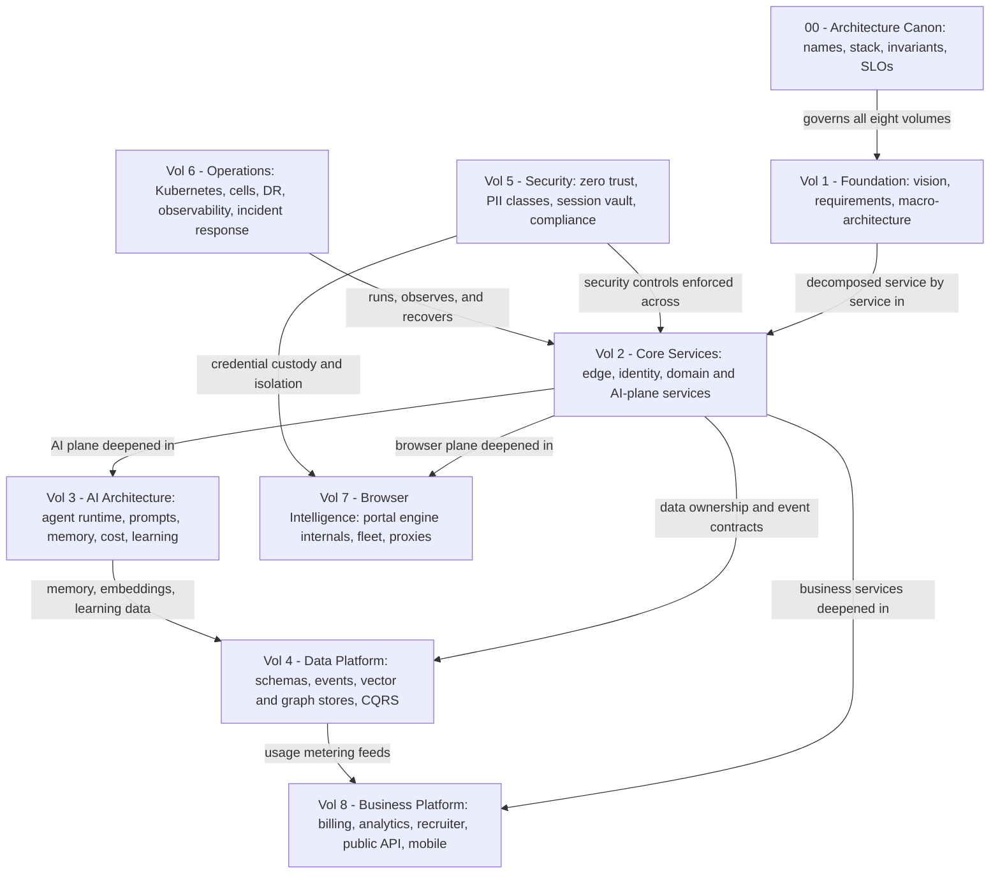

# AI Career Agent — Software Architecture Specification

| | |
|---|---|
| Product | AI Career Agent (ACA) |
| Mission | "Hire an AI that gets you a job." |
| Document set | ACA-SAS — eight volumes plus the Architecture Canon |
| Status | Volumes 1–2 drafted; Volume 3 in progress; Volumes 4–8 planned |

ACA is an autonomous, multi-tenant AI operating system that continuously discovers jobs across the internet, evaluates fit against a deeply understood user profile, generates tailored application materials, executes browser-based application workflows where supported and permitted, tracks outcomes, prepares users for interviews and negotiation, and learns from every signal. This specification is the complete architectural definition of that platform, written for the senior engineers who will build it.

## How to Read This Specification

**Read the [Architecture Canon](00-architecture-canon.md) first.** It is the single source of truth for every name, technology selection, convention, invariant, and SLO. Every chapter conforms to it; a chapter may extend the canon but never contradict it. Nothing in any chapter makes sense without the canon's service catalog (§4), agent catalog (§5), and invariants (§9–§16) in mind.

Chapter numbering is global across volumes (01–…); files live in per-volume directories. Every chapter follows the mandatory skeleton and rules in the [Writer Brief](WRITER-BRIEF.md) (authoring meta-documentation — read it if you are writing or reviewing chapters, not if you are only reading them).

### Suggested reading paths

| Role | Path | Rationale |
|---|---|---|
| New engineer | [Canon](00-architecture-canon.md) → [01](volume-1-foundation/01-executive-summary.md) → [05](volume-1-foundation/05-high-level-architecture.md) → [07](volume-1-foundation/07-system-context.md) → [09](volume-2-core-services/09-microservice-architecture.md) → your service's chapter | Hold the whole system in your head (01, 05, 07), learn how every service is built (09), then descend into your domain. [08](volume-1-foundation/08-user-journey.md) for product feel. |
| Security reviewer | [Canon §13](00-architecture-canon.md) → [07](volume-1-foundation/07-system-context.md) → [11](volume-2-core-services/11-identity-service.md) → [12 §8](volume-2-core-services/12-user-service.md) → [17](volume-2-core-services/17-browser-fleet.md) → [16](volume-2-core-services/16-universal-portal-engine.md) → [18](volume-2-core-services/18-ai-gateway.md) | Trust boundaries first (07), then the identity plane, RLS tenancy roots, browser isolation and credential custody, submission controls, and prompt-injection/safety filtering. Volume 5 will be normative when published. |
| SRE / platform | [Canon §14–§15](00-architecture-canon.md) → [04](volume-1-foundation/04-non-functional-requirements.md) → [05 §8](volume-1-foundation/05-high-level-architecture.md) → [09](volume-2-core-services/09-microservice-architecture.md) → [10](volume-2-core-services/10-api-gateway.md) → [20](volume-2-core-services/20-workflow-engine.md) | SLOs and DR targets, the load model all sizing derives from, cells, the service standard and production-readiness checklist, the Tier-0 edge, and the stateful Temporal backbone. Volume 6 will own runbooks. |
| AI engineer | [Canon §9–§10](00-architecture-canon.md) → [21](volume-3-ai-architecture/21-ai-architecture.md) → [18](volume-2-core-services/18-ai-gateway.md) → [19](volume-2-core-services/19-agent-orchestrator.md) → [16](volume-2-core-services/16-universal-portal-engine.md) | The AI invariants and escalation ladder, the AI plane end to end, the single model-call seam, the agent runtime, and the flagship agentic subsystem. Then [13](volume-2-core-services/13-profile-service.md)/[14](volume-2-core-services/14-resume-service.md) for applied AI features. |
| Product / business | [01](volume-1-foundation/01-executive-summary.md) → [02](volume-1-foundation/02-product-vision.md) → [03](volume-1-foundation/03-functional-requirements.md) → [08](volume-1-foundation/08-user-journey.md) | The executive synthesis, the product contract (personas, differentiators, non-goals), the FR catalog with phases and priorities, and the journeys that compose FRs into experience. |

## Volume Overview

The canon binds every volume; the arrows show the dominant depends-on/deepens relationships, not the only ones — chapters cross-reference freely with relative links.

## Volume 1 — Foundation

Mission, vision, principles, requirements, system context, and macro-architecture. Directory: [volume-1-foundation](volume-1-foundation/).

| Chapter | Title | Scope |
|---|---|---|
| 01 | [Executive Summary](volume-1-foundation/01-executive-summary.md) | Executive synthesis: what the system is, the fifteen shaping decisions, top risks, three-phase delivery plan, success metrics. |
| 02 | [Product Vision](volume-1-foundation/02-product-vision.md) | The product contract: personas, jobs-to-be-done, differentiators, trust principles, and binding non-goals the architecture must honor. |
| 03 | [Functional Requirements](volume-1-foundation/03-functional-requirements.md) | Authoritative FR catalog (`FR-NNN`) with MoSCoW priorities, delivery phases, owning services, and acceptance-criteria sketches. |
| 04 | [Non-Functional Requirements](volume-1-foundation/04-non-functional-requirements.md) | The load model all volumes size against, the testable NFR catalog, and the AI cost model that gates feature viability. |
| 05 | [High-Level Architecture](volume-1-foundation/05-high-level-architecture.md) | C4 Level 1–2: architecture style and forces, container decomposition of the 32 services, sync-vs-async rules, the canonical agent loop, cell-based multi-tenancy. |
| 06 | [Technology Stack](volume-1-foundation/06-technology-stack.md) | Why behind every canon §3 selection: rejected alternatives, revisit conditions, vendor-agnostic seams, build-vs-buy, licensing. |
| 07 | [System Context](volume-1-foundation/07-system-context.md) | C4 Level 1: external actors and systems, trust boundaries, consent bases, and the failure posture of every external dependency. |
| 08 | [User Journey](volume-1-foundation/08-user-journey.md) | Eight end-to-end journeys (J1–J8) mapped step-by-step to services, agents, events, and SLOs as executable contracts. |

## Volume 2 — Core Services

Service-by-service specifications for the edge, identity, profile/job domains, and the AI-plane infrastructure services. Directory: [volume-2-core-services](volume-2-core-services/).

| Chapter | Title | Scope |
|---|---|---|
| 09 | [Microservice Architecture](volume-2-core-services/09-microservice-architecture.md) | The service design standard: hexagonal template, shared chassis, communication matrix, service tiering, testing, production-readiness, team topology. |
| 10 | [API Gateway](volume-2-core-services/10-api-gateway.md) | The Tier-0 Envoy edge: routing, ext-authz, two-layer rate limiting, WAF, versioning, TLS/mTLS, multi-region failover. |
| 11 | [Identity Service](volume-2-core-services/11-identity-service.md) | Sole authentication authority: OAuth 2.1/OIDC on Ory, token and session design, passkeys + TOTP, enterprise SSO, delegated agent tokens. |
| 12 | [User Service](volume-2-core-services/12-user-service.md) | Accounts, tenants, memberships — the root of the RLS tenancy model; GDPR export/erasure sagas; account lifecycle events. |
| 13 | [Profile Service](volume-2-core-services/13-profile-service.md) | Career-profile ground truth vs. machine-generated ProfileInsight; LinkedIn/GitHub import pipelines; completeness scoring; embeddings. |
| 14 | [Resume Service](volume-2-core-services/14-resume-service.md) | ResumeModel parsing ladder, immutable version lineage from base resume to tailored variant, PDF render pipeline, ATS scoring. |
| 15 | [Job Intelligence Service](volume-2-core-services/15-job-intelligence-service.md) | Internet-wide discovery: source registry, tiered fetching, compliance gates, canonical Job schema, dedup, verified freshness, company enrichment. |
| 16 | [Universal Portal Engine](volume-2-core-services/16-universal-portal-engine.md) | The flagship differentiator: five-component plane, portal fingerprinting, template trust ladder, application-submission saga, template learning loop. |
| 17 | [Browser Fleet](volume-2-core-services/17-browser-fleet.md) | Ephemeral gVisor-sandboxed Playwright pods: pool and scheduler, session lifecycle, isolation and egress policy, autoscaling, cost model. |
| 18 | [AI Gateway](volume-2-core-services/18-ai-gateway.md) | The single model-call entry point: pipeline stages, provider adapters and failover, cache tiers, budget enforcement, token ledger, batch lane. |
| 19 | [Agent Orchestrator](volume-2-core-services/19-agent-orchestrator.md) | Runtime and control plane for the 23 canonical agents: registry, scheduling, durable agent loop, HITL checkpoints, supervision. |
| 20 | [Workflow Engine](volume-2-core-services/20-workflow-engine.md) | The self-hosted Temporal backbone: cluster topology, task queues, workflow catalog with the submission saga, versioning, multi-region DR. |

## Volume 3 — AI Architecture

Agent runtime depth, orchestration patterns, memory, prompts, routing, cost control, and the learning loop. Directory: [volume-3-ai-architecture](volume-3-ai-architecture/).

| Chapter | Title | Scope |
|---|---|---|
| 21 | [AI Architecture](volume-3-ai-architecture/21-ai-architecture.md) | The AI plane end to end: layered view, planner/reasoner, context builder, tool calling, autonomy and HITL machinery, evaluation-first governance. |
| 22 | Multi-Agent Framework *(in preparation)* | Agent abstraction, communication fabric, supervision, and the full agent catalog (referenced by Chapter 21). |

Further chapters of this volume (memory, prompts, routing/cost, learning loop) are in preparation.

## Volume 4 — Data Platform *(planned)*

Directory: `volume-4-data-platform/`. Chapters in preparation; global numbering continues.

| Chapter | Title | Scope |
|---|---|---|
| — | *In preparation* | Data ownership, per-service schemas, events/outbox and Kafka conventions, vector/graph/search stores, retention, CQRS read models, embedding versioning. |

## Volume 5 — Security *(planned)*

Directory: `volume-5-security/`. Chapters in preparation; this volume is normative for security policy.

| Chapter | Title | Scope |
|---|---|---|
| — | *In preparation* | Zero-trust architecture, identity deep-dive, PII classes P0–P3 handling, session vault cryptography, prompt-injection defense, consent registry, audit chain, compliance (SOC 2, GDPR/CCPA, ISO 27001). |

## Volume 6 — Operations *(planned)*

Directory: `volume-6-operations/`. Chapters in preparation.

| Chapter | Title | Scope |
|---|---|---|
| — | *In preparation* | Kubernetes and GitOps (Argo), Istio mesh, cell architecture, environments, DR and game-days, observability stack, error budgets, incident response. |

## Volume 7 — Browser Intelligence *(planned)*

Directory: `volume-7-browser-intelligence/`. Chapters in preparation; Chapters 16–17 are the architecture overviews this volume deepens.

| Chapter | Title | Scope |
|---|---|---|
| — | *In preparation* | Universal Portal Engine internals: perception pipeline, template representation and diffing, navigation-graph planning, portal memory, anti-bot posture, CAPTCHA policy, proxy management. |

## Volume 8 — Business Platform *(planned)*

Directory: `volume-8-business-platform/`. Chapters in preparation.

| Chapter | Title | Scope |
|---|---|---|
| — | *In preparation* | Billing and entitlements, usage metering, notifications, analytics, recruiter and university products, public API and webhooks, plugin framework, mobile. |

## Reference Documents

| Document | Role |
|---|---|
| [00 — Architecture Canon](00-architecture-canon.md) | **Authoritative.** Names, technology selections, conventions, invariants, SLOs. All chapters conform to it. |
| [WRITER-BRIEF](WRITER-BRIEF.md) | Authoring meta-documentation: chapter skeleton, depth targets, Mermaid safety rules, consistency requirements for chapter authors and reviewers. |
