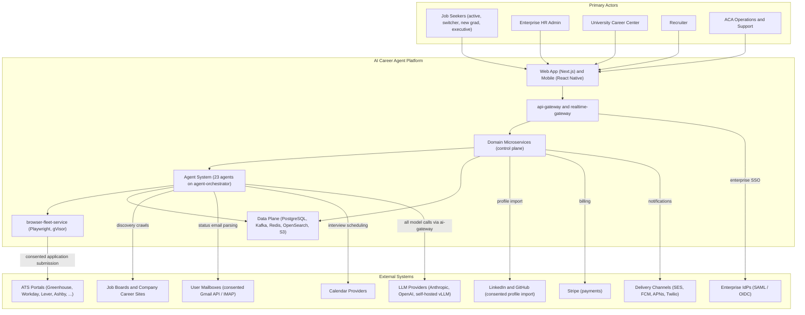
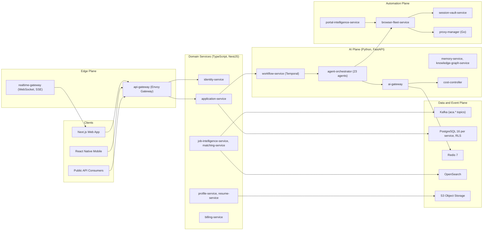
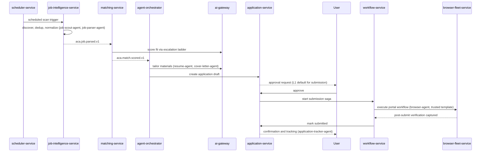

# 01 — Executive Summary

| | |
|---|---|
| Document ID | ACA-SAS-01 |
| Volume | 1 — Foundation |
| Status | Draft v1.0 |
| Depends on | [00 — Architecture Canon](../00-architecture-canon.md), [02 — Product Vision](02-product-vision.md) |

## 1. Overview

This chapter is the executive synthesis of the AI Career Agent (ACA) Software Architecture Specification. It states what the system is, the architectural style chosen to build it, the fifteen decisions that shape everything else, the ten risks most likely to kill the product or the platform, the three-phase delivery plan, and the metrics by which success is judged. Every claim here is elaborated in Volumes 1–8; nothing here contradicts the [Architecture Canon](../00-architecture-canon.md), which remains the single source of truth for names, technologies, and conventions.

ACA's mission is "Hire an AI that gets you a job." The product is an autonomous, multi-tenant AI operating system that continuously discovers jobs across the internet, evaluates fit against a deeply understood user profile, generates tailored application materials, executes browser-based application workflows where supported and permitted, tracks outcomes, prepares users for interviews and negotiation, and learns from every signal. The web application is only the control plane; the product is the distributed agent system behind it.

Two properties dominate the architecture. First, the system performs **consequential actions on a user's behalf with the user's own identity and credentials** — this forces consent, policy enforcement, human-in-the-loop (HITL) checkpoints, auditability, and credential isolation into the foundation rather than the periphery. Second, the system's core work is **long-running, failure-prone, and cost-variable** (crawling, LLM inference, browser automation against hostile third-party portals) — this forces durable execution, an event-driven backbone, aggressive cost control, and a learning loop into the foundation as well. Readers should evaluate every subsequent decision against these two properties.

The intended readers are senior engineers joining the build. This chapter should let a reader hold the whole system in their head before descending into service-level chapters.

## 2. Mission and Product Definition

- **Mission:** "Hire an AI that gets you a job."
- **Product:** an autonomous agent system with a web/mobile control plane, per the canon's product definition (§1 of the [canon](../00-architecture-canon.md)). Users configure goals, consent scopes, and autonomy levels; the platform's agents do the work; the user approves, observes, and overrides.
- **Tenant classes:** `individual`, `team`, `university`, `enterprise`, `recruiter`.
- **Plans (reference pricing):** Free ($0), Professional ($29), Premium ($79), Enterprise/University/Recruiter (custom) — entitlements per canon §12.
- **Non-negotiable guardrail:** ACA acts on behalf of a consenting user, with the user's own credentials and identity, under explicit user-approved policies, with platform-compliance enforcement and a kill switch at user, tenant, and platform scope.

What ACA is **not** (full non-goals in [02 — Product Vision](02-product-vision.md)): not a job board, not an employer-side ATS, not a staffing agency of record, not a tool for fabricating qualifications, and not an anti-bot evasion system.

## 3. System Context

The system-context view: five actor groups, one platform, nine classes of external systems. All external traffic enters through `api-gateway`; all automated outbound traffic to hiring portals flows through `browser-fleet-service` and `proxy-manager`; all model traffic flows through `ai-gateway`.

Context-level observations that drive the architecture:

| Observation | Architectural consequence |
|---|---|
| Third-party portals are adversarial and unversioned | Universal Portal Engine with learned templates, drift detection, and a trust ladder (canon §16) — never hardcoded per-site automation |
| User credentials touch external sites | `session-vault-service` (P0 data), gVisor-isolated browser pods, credentials injected at egress and never into agent context |
| All external content (job posts, DOM, email) is untrusted LLM input | Prompt-injection defense stack (canon §13): source tagging, instruction/data separation, `security-agent` screening |
| Model providers are a cost, quality, and availability dependency | Multi-provider `ai-gateway` with model classes, escalation ladder, and failover (canon §§9–10) |
| Actions are consequential and regulated | Autonomy levels L0–L3, `policy-agent` pre-action checks, hash-chained `audit-service`, GDPR/CCPA day 1 |

## 4. Architecture Style and Structural Summary

Per canon §2: cloud-native microservices on Kubernetes; event-driven backbone on Kafka (CloudEvents envelopes); AI-native control plane with a multi-agent system; multi-tenant with isolation at data, compute, and cost layers; zero-trust; observability-first; vendor-agnostic through named seams. Synchronous REST/gRPC at the edge and for control-plane reads/writes; asynchronous events for everything long-running; Temporal (via `workflow-service`) for durable execution and orchestrated sagas; outbox pattern (Debezium CDC) for atomic DB-write-plus-publish. No service touches another service's database.

The platform decomposes into five planes over a shared data/event plane. The canonical service catalog (canon §4 — "the 32 services") is authoritative; the diagram below shows representative services per plane, not the full catalog.

### 4.1 The golden path

The sequence below is the end-to-end value loop — the single flow every engineer must be able to reason about. It exercises discovery, matching, generation, HITL approval, durable submission via the browser fleet, and outcome tracking.

Latency budget across this path is governed by two canon SLOs: job discovered → scored p95 < 15 min, and application draft generation p95 < 60 s. Submission latency is dominated by user approval time at L1/L2 and by portal execution time at L3.

## 5. Key Architecture Decisions (Top 15)

Full treatment in the linked volumes; the canon (§§2–16) is normative for all of them.

| # | Decision | One-line rationale | Detailed in |
|---|---|---|---|
| D1 | Microservices on Kubernetes (canonical 30-service catalog) rather than a modular monolith | Heterogeneous runtimes (NestJS/FastAPI/Go), independent scaling of AI and browser workloads vs CRUD plane, and isolation blast-radius control outweigh operational overhead | [Volume 2](../volume-2-core-services/) |
| D2 | Event-driven backbone on Kafka with CloudEvents 1.0 envelopes and `aca.<domain>.<event>.v<major>` topics | Long-running autonomous work must be decoupled from the synchronous edge; versioned topics give schema evolution without breakage | [Volume 4](../volume-4-data-platform/) |
| D3 | Temporal (`workflow-service`) for durable execution; sagas orchestrated, never choreographed | Application submission is a multi-service, multi-minute, failure-prone transaction that must survive crashes and be observable as one unit | [Volume 2](../volume-2-core-services/) |
| D4 | Every model call goes through `ai-gateway`; no direct provider SDK use anywhere | Single choke point for routing, caching, safety filtering, token accounting, and provider failover — the vendor-agnostic seam | [18 — AI Gateway](../volume-2-core-services/18-ai-gateway.md) |
| D5 | Model-class escalation ladder (rules → caches → kNN → small → medium → large → frontier) | AI cost must scale sublinearly with usage; most tasks resolve below the large tier, and skipping tiers requires a logged policy | [Volume 3](../volume-3-ai-architecture/) |
| D6 | Universal Portal Engine: learned `PortalTemplate@version` with a trust ladder, never per-site adapters | The portal long tail is unbounded and unversioned; hardcoded adapters cannot keep pace, learned templates amortize | [Volume 7](../volume-7-browser-intelligence/) |
| D7 | Browser fleet as ephemeral Playwright pods under gVisor, one session per user task, no reuse | Credential and content isolation for the highest-risk workload; pod-per-session makes compromise containment trivial | [Volume 7](../volume-7-browser-intelligence/) |
| D8 | `session-vault-service` holds all P0 material; credentials injected at egress, never into agent context or prompts | LLM context is a data-exfiltration surface; envelope encryption with per-tenant KEKs bounds compromise | [Volume 5](../volume-5-security/) |
| D9 | PostgreSQL 16 per service with database-enforced RLS on `tenant_id`, plus service-layer guard | Tenant isolation enforced at the lowest layer that can enforce it; a service bug cannot cross tenants | [Volume 4](../volume-4-data-platform/) |
| D10 | Phase 1 data plane stays on Postgres extensions (pgvector, Apache AGE) behind `embedding-store` / `graph-store` interfaces | Minimize MVP operational surface; the interface seam preserves the Qdrant/Neo4j scale path without rewrites | [Volume 4](../volume-4-data-platform/) |
| D11 | Agents are logical workers on a shared runtime under `agent-orchestrator`, not microservices | 23 agents as services would multiply deploy/ops surface with no isolation benefit; supervision and HITL live in one place | [Volume 3](../volume-3-ai-architecture/) |
| D12 | User-configurable autonomy levels L0–L3, with application submission defaulting to L1 (approve-each) | Trust is earned incrementally; consequential actions get human checkpoints by default, autopilot is opt-in and policy-bounded | [Volume 3](../volume-3-ai-architecture/), [Volume 5](../volume-5-security/) |
| D13 | `cost-controller` budgets per tenant/user/agent/feature with soft (80%) degrade and hard (100%) deny thresholds enforced in `ai-gateway` | AI COGS is a first-class runtime signal, not a monthly finance surprise; degradation preserves the interactive experience | [Volume 3](../volume-3-ai-architecture/) |
| D14 | Cell-based architecture: pooled multi-tenant cells by default, dedicated cells for enterprise/university, EU cell for data residency | One architecture serves consumer scale and enterprise isolation/residency without a parallel single-tenant product | [Volume 6](../volume-6-operations/) |
| D15 | Zero-trust mesh: Istio mTLS, SPIFFE/SPIRE workload identity, OPA authorization at every hop, secrets only from Vault | Autonomous agents wielding user credentials demand least privilege everywhere; implicit network trust is untenable | [Volume 5](../volume-5-security/) |

Decisions the canon fixes that did not make the top 15 but are load-bearing: outbox pattern via Debezium for DB→Kafka atomicity; prompt versioning through `prompt-registry-service` with canary channels and eval-gated promotion; EdDSA JWTs with 15-minute access tokens; forward-only expand/migrate/contract migrations; event-sourcing restricted to the `application` timeline and the audit log.

## 6. Risk Register (Top 10)

Likelihood/impact on a H/M/L scale. Residual risk assumes mitigations are built as specified.

| ID | Risk | L | I | Primary mitigations (canonical mechanisms) | Residual |
|---|---|---|---|---|---|
| R1 | Portal terms-of-service and anti-automation escalation: portals block, throttle, or legally challenge automated submission | H | H | Guardrail principle (user identity + consent), `policy-agent` pre-action site-policy checks, per-site rate budgets in `proxy-manager`, disclosure where required, partnership/API track as strategic hedge | M |
| R2 | Portal drift degrades browser workflow success below the ≥ 92% SLO | H | H | Template trust ladder with drift detection, fingerprint diffs, failure-rate monitors, auto re-learning, `recovery-agent` diagnosis and retry | M |
| R3 | LLM cost blowout — per-user COGS exceeds plan revenue | M | H | Escalation ladder, exact + semantic caching, batch lane (≈50% cost), `cost-controller` hard budgets, plan-tier model-class gating | L |
| R4 | Prompt injection via job posts, portal DOM, or parsed email drives unauthorized agent actions | M | H | `untrusted_content` wrappers, instruction/data separation, per-agent tool allowlists, `security-agent` screening, output validators, no credentials in prompts | M |
| R5 | Compromise of stored portal credentials or session cookies (P0) | L | H | `session-vault-service` envelope encryption per user with per-tenant KEK, egress-only injection, gVisor + per-session network policy, Vault-managed keys | L |
| R6 | Generated application content is inaccurate or fabricated, harming users and reputation | M | H | L1 default HITL for submission, provenance-linked generation (evidence from profile), golden-set evals ≥ 95% pass, automatic prompt rollback on regression | M |
| R7 | LLM provider outage or model deprecation | M | M | Multi-provider `ai-gateway` failover, model classes not hardcoded vendors, self-hosted vLLM floor for `embed`/`small` | L |
| R8 | Employer-side backlash: ACA perceived as an application-spam cannon, poisoning portal relationships and user outcomes | M | H | Match-threshold gating before drafting, plan-level application caps, per-site rate budgets, quality-over-volume product principle (see [02](02-product-vision.md)) | M |
| R9 | Regulatory exposure: GDPR/CCPA, automated-decision provisions, emerging AI acts | M | H | Consent registry in `policy-service`, HITL checkpoints, hash-chained `audit-service` with 7-year WORM retention, 30-day hard delete, DPIA per feature | M |
| R10 | Operational complexity (Kafka, Temporal, Istio, browser fleet) outruns early team capacity | H | M | Phase 1 scope discipline (§7), managed/reference deployments, golden-path platform tooling, error-budget release gating | M |

R1 and R8 are product-existential and cannot be fully engineered away; they are managed jointly by architecture (rate budgets, policy checks) and product posture (consent, disclosure, quality gating). Volume 5 and Volume 7 own their detailed treatments.

## 7. Phased Delivery Plan

Phases are scoped by risk retirement, not by feature accumulation: Phase 1 proves the golden path is safe and reliable for individuals; Phase 2 proves unit economics and autonomy at scale; Phase 3 proves global and enterprise readiness. Quarters are relative to GA.

### 7.1 Phase 1 — MVP-grade production (GA-2 … GA)

| Dimension | Scope | Rationale |
|---|---|---|
| Tenants / plans | `individual` tenants; Free + Professional | Smallest surface that exercises billing, entitlements, and multi-tenancy for real |
| Autonomy | L0–L2; submission capped at L1 | Earn trust with approve-each before batch approval; no autopilot until success-rate data exists |
| Portal coverage | Universal Portal Engine live, seeded with mature templates for the known ATS families (Greenhouse, Lever, Ashby, Workday) | High-confidence fingerprint families cover the largest share of postings; engine generality is proven without hardcoding |
| AI plane | `ai-gateway` with two external providers + self-hosted embeddings; escalation ladder; exact + semantic cache; `cost-controller` budgets | Cost control must exist before scale, not after |
| Data plane | Postgres 16 + pgvector + Apache AGE, Redis, Kafka, OpenSearch, S3 | Single operational footprint per D10; every store has a named scale seam |
| Regions | Primary region active, warm standby (active-passive); EU data-resident tenants pinned to the EU cell (canon §15) | DR (RPO ≤ 5 min / RTO ≤ 30 min) without paying active-active complexity |
| Compliance | GDPR/CCPA day 1; SOC 2 Type II audit window opens | Canon §13 targets; enterprise sales blocked until SOC 2 lands |

**Phase 1 exit criteria** (all must hold for 4 consecutive weeks — long enough to exclude lucky weeks, short enough to keep pace):

| Gate | Target | Rationale |
|---|---|---|
| Browser workflow success (seeded families) | ≥ 92% weekly | Canon SLO applied to the constrained portal set first |
| Application draft generation p95 | < 60 s | Canon SLO; drafting is the most user-visible AI latency |
| AI eval pass rate on stable prompts | ≥ 95% | Canon SLO; quality gate before autonomy expands |
| Cost per submitted application (blended AI + browser) | ≤ $0.45 | Professional-plan unit economics: 100 applications/mo must fit $29 revenue with margin; number is a reference target owned by `cost-controller` reporting |
| Control-plane availability | 99.95% monthly | Canon SLO |
| Security | Zero P0 credential incidents; external pen test passed | Non-negotiable before scaling credential volume |

### 7.2 Phase 2 — Scale (GA … GA+3 quarters)

| Dimension | Scope | Rationale |
|---|---|---|
| Tenants / plans | Premium (L3 autopilot, frontier-class budgeted access); `team`, `recruiter`, `university` pilots | Autonomy and new tenant classes ride on Phase 1 trust data |
| Autonomy | L3 autopilot GA within policy budgets; consequential-action allowlist | Success-rate and override data from Phase 1 calibrate safe autopilot |
| Portal coverage | Template learning at scale for the long tail; template pack contribution via Adapter SDK (first-party) | The engine's economics come from the long tail, not the seeded families |
| AI plane | Batch lane for all non-interactive work; provider prompt caching exploited; frontier-class routing policies | ≈50% batch discount and cache hits are the biggest cost levers at volume |
| Data plane | Qdrant migration for hot embedding namespaces; ClickHouse for `analytics-service`; Kafka tiered storage tuning | Executed only where Phase 1 seams show measured pressure |
| Regions | Active-active stateless edge; first dedicated enterprise cells | Canon §15 phase 2 posture |
| Compliance | SOC 2 Type II report issued; WCAG 2.2 AA audit | Enterprise/university sales unblock |

**Phase 2 exit criteria:** browser success ≥ 92% weekly across all `trusted` templates (not just seeded families); L3 intervention rate (user overrides + `agent-supervisor` escalations) < 5% of autopilot submissions — above that, autopilot erodes trust faster than it adds value; cost per application ≤ $0.30 at 10× Phase 1 volume — batch + cache leverage must show up in unit economics; p95 job-discovered→scored < 15 min sustained at 10× ingest.

### 7.3 Phase 3 — Global (GA+3 … GA+6 quarters)

| Dimension | Scope | Rationale |
|---|---|---|
| Tenants | Enterprise GA with dedicated cells, SLAs, DPAs; university GA; public API + webhooks GA via `public-api-service` | Full canon tenant-class coverage |
| Geography | Multi-region data residency (additional residency cells beyond the EU cell as demanded); localization of matching and generation | Residency is a cell-placement problem, not a re-architecture, per D14 |
| Ecosystem | Third-party template packs via the plugin framework; mobile GA (React Native) | Externalize the long-tail portal problem; meet users where they are |
| Compliance | ISO 27001 (year 2 target); jurisdiction-specific automated-decision compliance reviews | Canon §13 |
| Learning loop | Global strategy mining by `learning-agent` across anonymized outcome corpus; per-market calibration | The durable moat: outcomes → better strategies → better outcomes |

**Phase 3 exit criteria:** two production cells in distinct jurisdictions passing quarterly DR game-days within RTO ≤ 30 min; ≥ 99.95% availability held during a full regional failover exercise; third-party template pack pipeline with policy review live.

## 8. Success Metrics

North-star metric: **qualified interviews per active user per month** — it captures discovery quality, generation quality, and submission reliability in one number, and cannot be gamed by raw application volume.

| Category | Metric | Target (reference) | Rationale |
|---|---|---|---|
| Product | Activation: profile complete + first approved application within 7 days | ≥ 40% of signups | Time-to-first-value predicts retention; 7 days matches the weekly job-search rhythm |
| Product | Qualified-interview rate per 100 submitted applications | ≥ 8, improving quarterly | Baseline manual benchmarks cluster near 2–5; the learning loop must beat manual, visibly |
| Product | L1 approval rate without edits | ≥ 70% | Measures draft quality; low values mean generation wastes user time |
| Trust | User-initiated kill-switch / autonomy downgrade rate | < 2% MAU monthly | Direct signal of trust failure; spikes gate autonomy rollouts |
| Technical | Golden SLOs (availability, latency, realtime, discovery→score, draft p95, browser success, eval pass, notification p95) | Per canon §14, verbatim | Canon-owned; error budgets gate releases |
| AI | Cost per submitted application | ≤ $0.45 Phase 1, ≤ $0.30 Phase 2 | Unit economics under plan pricing (see §7 gates) |
| AI | Eval pass rate on stable prompts | ≥ 95% | Canon SLO; regression auto-rollback threshold |
| Business | Free→Professional conversion | ≥ 6% at 90 days | Reference target consistent with the 10-application free cap creating a real upgrade moment |
| Business | Gross margin per Professional seat | ≥ 70% | SaaS-viable margin with AI + browser COGS included; enforced by D13 budgets |

Measurement ownership: `analytics-service` (funnels, rates), `cost-controller` (spend attribution), `learning-pipeline` (quality/eval trends), all fed by the canonical event topics (`aca.ai.request.completed.v1`, `aca.application.*`, `aca.agent.run.*`).

## 9. Volume Map

The SAS comprises eight volumes. Chapter numbering is global across volumes; files are numbered kebab-case within volume directories.

| Volume | Directory | Scope | Representative content |
|---|---|---|---|
| 1 — Foundation | [volume-1-foundation](./) | Mission, vision, principles, system context, macro-architecture | This chapter; [02 — Product Vision](02-product-vision.md) |
| 2 — Core Services | [volume-2-core-services](../volume-2-core-services/) | Edge, identity, profile/job/application domains, service-by-service specs | e.g. [18 — AI Gateway](../volume-2-core-services/18-ai-gateway.md) |
| 3 — AI Architecture | [volume-3-ai-architecture](../volume-3-ai-architecture/) | Agent runtime, orchestration, memory, prompts, routing, cost control, learning loop | `agent-orchestrator`, escalation ladder, autonomy levels |
| 4 — Data Platform | [volume-4-data-platform](../volume-4-data-platform/) | Ownership, schemas, events/outbox, vector/graph/search stores, retention, CQRS | Kafka conventions, RLS tenancy, embedding versioning |
| 5 — Security | [volume-5-security](../volume-5-security/) | Zero trust, identity, PII classes, session vault, prompt-injection defense, compliance | P0–P3 handling, consent registry, audit chain |
| 6 — Operations | [volume-6-operations](../volume-6-operations/) | Kubernetes, GitOps, cells, environments, DR, observability, incident response | Argo, Istio, error budgets, game-days |
| 7 — Browser Intelligence | [volume-7-browser-intelligence](../volume-7-browser-intelligence/) | Universal Portal Engine, browser fleet, portal intelligence, proxy management | Template trust ladder, perception stack, verification |
| 8 — Business Platform | [volume-8-business-platform](../volume-8-business-platform/) | Billing, entitlements, notifications, analytics, recruiter/university products, public API, mobile | Plans, metering, webhooks |

## 10. Failure Scenarios

Platform-level failure modes and their designed responses; service-level failure analysis lives in each service chapter.

| Scenario | Blast radius | Detection | Designed response |
|---|---|---|---|
| Correlated LLM provider outage (primary provider down) | Draft generation, matching explanations, agent planning degrade | `ai-gateway` provider health probes; error-rate SLO burn | Automatic failover to secondary provider per model class; degrade class one tier where quality policy allows; queue batch lane; user-interactive requests prioritized |
| Kafka backbone degradation | All async flows stall (discovery, scoring, tracking); control plane stays up | Consumer lag alerts, end-to-end freshness SLIs | Producers buffer via outbox (DB-backed, replayable); consumers resume from offsets; no data loss by design; realtime feed degrades to polling |
| Browser fleet ban wave (IP reputation collapse on a major portal family) | Submissions to affected family fail or pause | `browser-fleet-service` failure-rate monitors per fingerprint family; `proxy-manager` reputation health | Circuit-break the family; `policy-agent` pauses submissions; `recovery-agent` + `portal-intel-agent` re-learn; users notified with manual-apply fallback packets |
| Postgres primary failure in a cell | Single cell's tenants lose writes until failover | Health checks, replication lag alerts | Managed failover within RPO ≤ 5 min / RTO ≤ 30 min; other cells unaffected (D14 cell isolation) |
| Cost runaway (routing bug or abuse sends traffic to frontier class) | Margin destruction within hours | `cost-controller` budget burn alerts at 80%/100%; anomaly detection on spend per feature | Hard budget denial at 100%, automatic class downgrade, `cost-optimization-agent` flags routing anomaly, kill switch per feature |
| Poisoned or drifted portal template auto-submits bad applications | User harm on affected portal | Post-submit verification failures; `application-tracker-agent` confirmation mismatches | Template demoted to `stale` immediately; affected submissions flagged to users; trust-ladder promotion requires shadow verification precisely to bound this |
| Prompt-injection attempt in crawled content reaches an agent | Single agent run; tool allowlist bounds actions | `security-agent` screening, output validators, anomalous tool-call patterns | Run quarantined, content source flagged and down-ranked, incident replay via audit log |

## 11. Scaling Strategy

Scaling dimensions and their levers. Numbers are reference capacity targets for planning, not commitments; each has a stated basis.

| Dimension | Phase 1 (GA) | Target scale (design envelope) | Primary lever |
|---|---|---|---|
| Registered users | 500k | 5M | Stateless services HPA; Postgres read replicas; cells |
| Jobs ingested/day | 300k | 2M | Partitioned `job` tables (time-based); Kafka partition scale-out; batch-lane parsing |
| Applications submitted/day | 10k | 150k | Temporal worker fleets; browser fleet pool scale-out |
| Browser sessions/day | 8k | 100k (peak ~1,250 concurrent; 2,000-pod design) | Ephemeral pod pool with cluster autoscaler; per-site rate budgets cap useful concurrency |
| AI calls/day at `ai-gateway` | 2.5M | 21M average (50M design peak) | Escalation ladder, caches, batch lane, self-hosted small/embed classes |
| Peak concurrent realtime clients | 6k | 45k (100k design) | `realtime-gateway` horizontal scale on Redis pub/sub |

Basis: the authoritative load model and its capacity math are owned by [04 — Non-Functional Requirements §2](04-non-functional-requirements.md) (150k MAU / 40k DAU at GA; 1.2M MAU / 300k DAU at target scale); this table summarizes that model. The binding constraints are, in order: per-site rate budgets (external courtesy limit, not internal capacity), browser fleet cost, LLM cost. Compute scales horizontally everywhere by design; the stores with vertical pressure (pgvector, AGE) have named Phase 2 seams (D10).

## 12. Security Considerations

Volume 5 is normative; the executive posture:

- **Zero trust end to end** (D15): SPIFFE workload identity, Istio mTLS, OPA at every hop, Vault-only secrets.
- **The credential boundary is absolute:** P0 material exists only inside `session-vault-service`; it is injected into browser sessions at egress and never enters agent context, prompts, logs, or events.
- **Untrusted content discipline:** every byte from job boards, portals, and email is tagged `untrusted_content` before any LLM sees it; agents operate under per-agent tool allowlists; `policy-agent` gates consequential actions; `security-agent` screens for injection and behavioral anomalies.
- **Human authority is preserved:** autonomy levels L0–L3 with L1 default for submission; kill switch at user, tenant, and platform scope; approvals and overrides are hash-chained in `audit-service` (7-year WORM retention).
- **Compliance:** GDPR/CCPA from day 1 (consent registry, 30-day hard delete + tombstones), SOC 2 Type II in year 1, ISO 27001 year 2, WCAG 2.2 AA.

## 13. Observability

Canon §14 is normative. Executive posture: OpenTelemetry everywhere with `trace_id` propagated through Kafka (`traceparent` extension) and Temporal workflows, so a single trace spans REST call → event → workflow → agent run → browser session. The golden SLOs (canon table) are error-budget-managed with burn-rate alerts (2%/1h, 5%/6h) gating releases via Argo Rollouts analysis. Four first-class dashboard families: platform (RED/USE per service), AI (token spend, cache hit rates, eval pass, routing distribution), browser (success rate per fingerprint family, drift signals), business (funnel, north-star, unit economics). Every agent run is replayable from `aca.agent.run.*` events plus audit records — observability doubles as the compliance and debugging substrate.

## 14. Future Improvements

- **Portal partnership lane:** direct ATS API integrations where partnerships emerge, expressed as high-trust "API templates" inside the Universal Portal Engine rather than a parallel code path.
- **On-device/user-consented mailbox models:** move email parsing toward smaller, cheaper, privacy-tighter models as self-hosted quality improves.
- **Marketplace maturation:** third-party template packs and agent extensions via the plugin framework, with policy review and revenue share (Volume 8).
- **Active-active data plane:** beyond the Phase 2 stateless edge, evaluate per-cell active-active for write paths if enterprise SLAs demand it.
- **Learned routing:** replace heuristic complexity scoring in the escalation ladder with a trained router once `learning-pipeline` accumulates enough labeled routing outcomes.

## 15. Alternatives Considered & Tradeoffs

| Alternative | Verdict | Tradeoff accepted |
|---|---|---|
| Modular monolith first, decompose later | Rejected | The AI plane (Python), domain plane (TypeScript), and infra plane (Go) diverge in runtime and scaling from day 1; a monolith would force one runtime and entangle the browser fleet's isolation model. Cost: platform engineering investment earlier (mitigated by Phase 1 scope discipline, R10) |
| Serverless (FaaS + managed workflow) instead of Kubernetes | Rejected | Long-lived browser sessions, gVisor isolation, self-hosted models, and Temporal workers fit poorly in FaaS limits; Kubernetes gives one operational model for all planes. Cost: cluster operations burden |
| Event choreography instead of Temporal orchestration | Rejected | Submission sagas need central visibility, compensation, and human-approval waits measured in hours; choreographed compensation across 6+ services is unauditable. Cost: Temporal as critical infrastructure to operate |
| Per-site portal adapters (engineering-maintained) | Rejected | Linear maintenance cost against an unbounded, adversarially-changing portal population; the Universal Portal Engine amortizes learning. Cost: higher upfront ML/perception investment, probabilistic (not guaranteed) coverage — bounded by the trust ladder and ≥ 92% SLO |
| Single LLM provider, deep integration | Rejected | Provider outage/deprecation/pricing risk concentrates on the COGS-dominant dependency; multi-provider via `ai-gateway` model classes. Cost: lowest-common-denominator pressure on provider-specific features, managed by class-level capability flags |
| Buy browser automation (RPA vendor / hosted browser API) | Partially rejected | Hosted browsers cannot meet the credential-isolation and per-session network-policy requirements (D7, D8); commodity components (Playwright) are used, orchestration and isolation are owned. Cost: fleet engineering burden |
| Silo (per-tenant) deployment for all tenants | Rejected | Consumer economics require pooling; enterprise isolation is served by dedicated cells (D14). Cost: cell tooling complexity and RLS discipline in the pooled tier |
| Vector/graph specialty stores (Qdrant/Neo4j) from day 1 | Deferred | Two more distributed systems to run before product-market fit; Postgres extensions behind interfaces carry Phase 1 scale (D10). Cost: known migration later, priced in via dual-read re-embedding plan |

---

*Next: [02 — Product Vision](02-product-vision.md) grounds these decisions in personas, jobs-to-be-done, differentiators, and product principles.*
