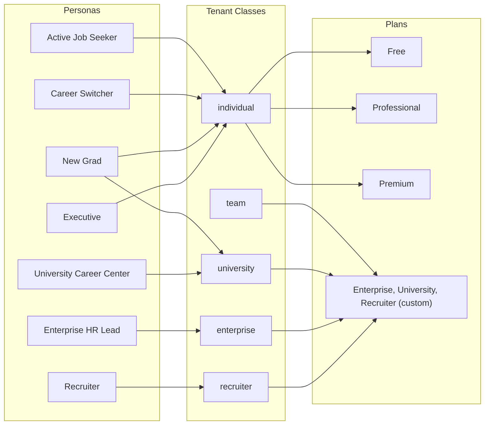
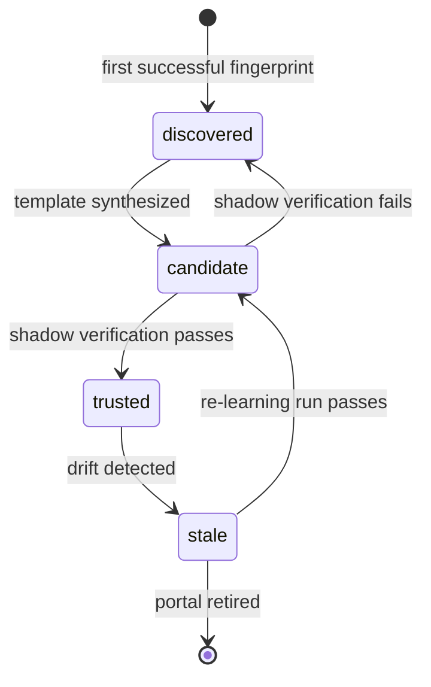
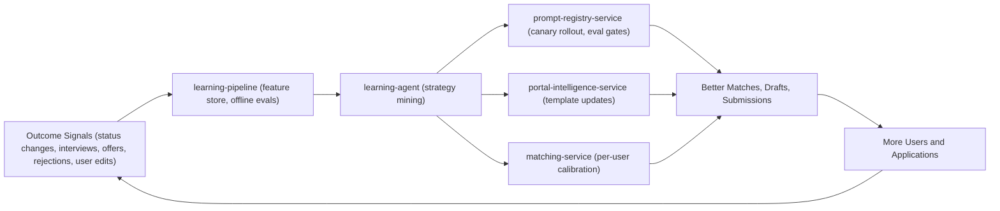
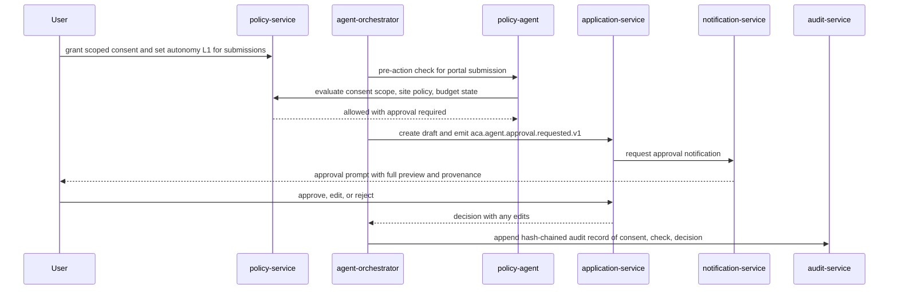

# 02 — Product Vision

| | |
|---|---|
| Document ID | ACA-SAS-02 |
| Volume | 1 — Foundation |
| Status | Draft v1.0 |
| Depends on | [00 — Architecture Canon](../00-architecture-canon.md), [01 — Executive Summary](01-executive-summary.md) |

## 1. Overview

This chapter defines what AI Career Agent (ACA) is for, who it serves, why it wins, and what it refuses to do. It is the product contract the architecture must honor: every persona, job-to-be-done, differentiator, and principle here maps to canonical services, agents, and mechanisms defined in the [Architecture Canon](../00-architecture-canon.md). Where the vision imposes a constraint (for example, consent-before-capability), this chapter names the architectural component that enforces it, so engineers can trace product intent to system design without interpretation.

The core thesis: job searching is a full-time job performed by people who already have one, or urgently need one. The market's existing tools optimize fragments — listing discovery, resume formatting, interview prep — and leave the user as the integration layer and the workhorse. ACA inverts this. The user states goals, grants scoped consent, and sets an autonomy level; a distributed agent system performs the search continuously, and the user's role shifts from operator to approver. "Hire an AI that gets you a job" is the mission precisely because the unit of value is an **outcome** (interviews, offers), not a tool session.

This inversion is only viable if trust is engineered, not asserted. An agent that applies to jobs under a user's identity can damage that user's reputation and legal standing in ways a resume builder never could. The product therefore treats consent, human control, truthfulness, and compliance as load-bearing features — the subject of §6 — and treats their enforcement mechanisms (autonomy levels L0–L3, `policy-agent`, `policy-service` consent registry, `audit-service`) as part of the product, not overhead.

Non-goals (§8) are as binding as goals. They exist to keep the platform on the defensible side of portal relationships, regulation, and user trust.

## 2. Vision and North Star

**Vision statement:** every job seeker has a tireless, expert, trustworthy agent working on their career around the clock — one that knows the whole market, represents them truthfully, acts only with their consent, and gets measurably better with every outcome.

**North-star metric:** qualified interviews per active user per month (defined in [01 — Executive Summary §8](01-executive-summary.md)). Volume metrics (applications sent) are explicitly rejected as north stars because they are trivially gameable by spam and adversarial to portal relationships (risk R8).

The five-year product arc follows the delivery phases in [01 §7](01-executive-summary.md): prove the trusted golden path for individuals (Phase 1), earn autonomy and scale unit economics (Phase 2), serve institutions and go global (Phase 3).

## 3. Personas

Seven personas span the five canonical tenant classes (`individual`, `team`, `university`, `enterprise`, `recruiter`). Persona-specific behavior is configuration — autonomy defaults, matching calibration, plan entitlements — never persona-specific code paths.

### 3.1 Active Job Seeker ("Maya", mid-career IC)

| Aspect | Detail |
|---|---|
| Context | Employed, searching discreetly, 3–6 hours/week available; applies to 5–15 roles/month manually today |
| Goals | Better role/comp without the search consuming her life or alerting her employer |
| Pains | Discovery is repetitive; tailoring per application takes 45+ minutes; status tracking decays into a spreadsheet; ghosting destroys morale |
| ACA behavior | Continuous discovery (`job-scout-agent`) against saved search intents; tailored drafts (`resume-agent`, `cover-letter-agent`); L1 approve-each by default, graduating to L2 batch approval; `application-tracker-agent` maintains the pipeline automatically |
| Plan fit | Professional → Premium |
| Success measure | Interviews per month vs her manual baseline; hours/week reduced below 1 |

Discretion is an architectural requirement for this persona: no public activity signals, notification digests she controls (`notification-service` preference enforcement), and no data sharing beyond consent scopes.

### 3.2 Career Switcher ("Deshawn", ops → data analytics)

| Aspect | Detail |
|---|---|
| Context | Transferable skills that keyword-matching ATSs cannot see; gets auto-rejected on title mismatch |
| Goals | Get evaluated on capability, not last job title |
| Pains | Doesn't know which adjacent roles fit; can't articulate skill transfer convincingly; every rejection is uninformative |
| ACA behavior | Skill-graph reasoning via `knowledge-graph-service` surfaces adjacent-role paths; `matching-agent` produces transfer-evidence explanations; generation grounds every claim in profile evidence (§6 P4); `learning-agent` feeds back which framings convert for switchers as a cohort |
| Plan fit | Professional |
| Success measure | Interview rate in the target field, not the origin field |

This persona stresses the matching architecture hardest: naive embedding similarity reproduces the keyword trap. The match-explanation requirement (canon: `matching-service` owns match explanations) exists substantially for this persona.

### 3.3 New Grad ("Priya", final-year CS student)

| Aspect | Detail |
|---|---|
| Context | First professional search; high volume tolerance, low market knowledge; thin resume; often reached via her university |
| Goals | Land a first role; learn what the market wants from her profile |
| Pains | 200-applicant postings within hours; no interview experience; cannot tell realistic from aspirational postings |
| ACA behavior | Speed matters: discovery→scored p95 < 15 min (canon SLO) makes her early in applicant queues; `portfolio-agent` extracts evidence from coursework and GitHub; `interview-coach-agent` provides first-interview preparation; calibration guards against spraying (quality gate, §6 P6) |
| Plan fit | Free → Professional; often under a `university` tenant |
| Success measure | Time to first offer; interview conversion improving as coaching iterates |

### 3.4 Executive ("Elena", VP-level)

| Aspect | Detail |
|---|---|
| Context | Sparse public postings; network- and recruiter-driven market; extreme discretion needs; low volume, very high stakes per application |
| Goals | Comprehensive view of a mostly-hidden market; flawless positioning; strong negotiation |
| Pains | Cannot be seen searching; generic materials are disqualifying at her level; comp packages are complex |
| ACA behavior | L0/L1 only — ACA drafts, Elena sends; `company-intel-agent` deep-dives targets; `negotiation-agent` models equity/bonus structures against benchmarks; zero automated submission unless explicitly enabled per application |
| Plan fit | Premium |
| Success measure | Quality of intelligence and negotiation outcome delta; volume is irrelevant |

Elena proves the autonomy ladder is a product feature, not a limitation: the same platform serves full autopilot and drafts-only postures through configuration (`policy-service` autonomy settings), with no separate product.

### 3.5 Enterprise HR Lead ("Marcus", outplacement / internal mobility)

| Aspect | Detail |
|---|---|
| Context | Buys ACA seats for departing employees (outplacement) or internal mobility programs; answers to procurement, legal, and the CHRO |
| Goals | Demonstrable placement outcomes for a cohort; compliance and reporting; predictable cost |
| Pains | Outplacement vendors are opaque and expensive; no per-cohort analytics; data-processing agreements are mandatory |
| ACA behavior | `enterprise` tenant with SSO/SAML federation (`identity-service`), seat management, cohort analytics via `analytics-service`, optional dedicated cell for data isolation and residency, DPA and SOC 2 artifacts; admin visibility is aggregate-only — individual users' search details remain private to them (consent boundary enforced by `policy-service`) |
| Plan fit | Enterprise (custom) |
| Success measure | Cohort placement rate and time-to-placement vs incumbent outplacement benchmarks |

The aggregate-only visibility rule is a deliberate product decision: the person being placed is the consenting principal, not the paying tenant. Architecture enforces it, not policy documents alone.

### 3.6 University Career Center ("Dr. Okafor", career services director)

| Aspect | Detail |
|---|---|
| Context | Serves thousands of students with a staff of ten; measured on placement statistics reported to rankings bodies |
| Goals | Scale personalized career support; visibility into cohort outcomes; equity of access across the student body |
| Pains | Advising does not scale; students who need help most engage least; outcome data collection is manual and late |
| ACA behavior | `university` tenant with bulk seat provisioning, cohort dashboards (majors, graduation years), curriculum-aligned readiness signals from `interview-coach-agent` usage, aggregate outcome reporting; same individual-privacy boundary as enterprise tenants |
| Plan fit | University (custom) |
| Success measure | Placement rate and engagement breadth (share of students actively served, not just the already-proactive) |

### 3.7 Recruiter ("Sam", agency recruiter)

| Aspect | Detail |
|---|---|
| Context | Fills roles against deadlines; drowns in unqualified inbound; pays for sourcing tools with stale data |
| Goals | Qualified, actually-interested candidates; efficient pipeline management |
| Pains | Sourcing databases decay; candidate intent is unknowable; outreach response rates are collapsing |
| ACA behavior | `recruiter-service` portal on the `recruiter` tenant class: posting intake feeds `job-intelligence-service` as a first-party source; **consented** candidate sourcing only — job seekers explicitly opt into recruiter visibility with scope controls; matching runs the same `matching-service` in reverse (role→candidates) |
| Plan fit | Recruiter (custom) |
| Success measure | Time-to-qualified-slate; response rate from surfaced candidates |

The recruiter persona creates the platform's two-sided potential but is deliberately sequenced after the seeker side reaches scale (Phase 2 pilot per [01 §7](01-executive-summary.md)): candidate consent inventory is the prerequisite asset, and seeker trust is never traded for recruiter revenue (§8, non-goal N6).

## 4. Jobs To Be Done

| # | Job to be done (user language) | Today's alternative | ACA capability (canonical owners) |
|---|---|---|---|
| J1 | "Watch the whole market for me so I never miss a role I'd want" | Saved searches on 3–5 boards, checked manually | `job-intelligence-service` + `job-scout-agent` continuous discovery; dedup and normalization (`job-parser-agent`) |
| J2 | "Tell me honestly whether a role is worth my time" | Gut feel; reading 40 postings to apply to 5 | `matching-service` + `matching-agent` scored fit with evidence-based explanations |
| J3 | "Make my application the best version of the truth for this specific role" | 45+ minutes of manual tailoring, or a generic resume | `resume-agent`, `cover-letter-agent`, `portfolio-agent` grounded in profile evidence; ATS-optimization scoring (`resume-service`) |
| J4 | "Do the soul-crushing form-filling for me" | Re-typing the same data into every ATS | Universal Portal Engine + `browser-agent` + `browser-fleet-service`, under autonomy level and policy checks |
| J5 | "Keep my pipeline organized without me maintaining a spreadsheet" | Spreadsheets, memory, inbox archaeology | `application-service` lifecycle + `application-tracker-agent` (email parsing, portal checks) |
| J6 | "Get me ready for this specific interview" | Generic question lists, expensive coaches | `interview-coach-agent` + `company-intel-agent` role- and company-specific preparation |
| J7 | "Help me not leave money on the table" | Asking friends; accepting first offers | `negotiation-agent` offer analysis and comp benchmarks |
| J8 | "Learn from what happens and get better on my behalf" | Nothing — every seeker restarts from zero | `learning-pipeline` + `learning-agent`: per-user calibration and global strategy mining |
| J9 | "Prove to me it's doing the right thing" | N/A — no tool offers this | Activity feed (`realtime-gateway`), approval previews, audit trail, kill switch |

J9 is unusual: it is a job-to-be-done created by the product category itself. Any autonomous agent product that cannot satisfy J9 loses the right to perform J4. This ordering — transparency before automation — is product principle P3.

## 5. Differentiators

Three differentiators compound: the Universal Portal Engine makes action possible, the autonomous agent system makes it continuous, and the learning loop makes both improve with scale. Each is examined as a component of the vision: purpose, why it is defensible, interactions, failure modes, and honest tradeoffs.

### 5.1 Universal Portal Engine

**Purpose.** Execute application workflows on effectively any hiring portal without per-site engineering, via learned, versioned, trust-laddered templates (canon §16).

**Why defensible.** Competitors hardcode adapters for the top ATS families and break on the long tail. The engine's corpus of `PortalTemplate@version` records, navigation graphs, and semantic form models — owned by `portal-intelligence-service` — grows with every user interaction and re-learning cycle. A competitor must reproduce not the code but the accumulated portal memory, which is a function of production traffic. Known ATS families (Greenhouse, Lever, Ashby, Workday, Taleo, iCIMS, SuccessFactors) are simply high-confidence fingerprint families with mature templates, not special cases.

**Interactions.** `portal-intel-agent` fingerprints and learns; `browser-agent` executes perceive→plan→act→verify steps on `browser-fleet-service` sessions; `policy-agent` clears every consequential submission; `session-vault-service` supplies credentials at egress only; verification signals feed `application-service` and the learning loop.

**Template lifecycle** (canonical trust ladder, verbatim states):

**Failure modes.** Drift (portal redesign) demotes `trusted` → `stale` via fingerprint diffs and failure-rate monitors; novel portals fall back to frontier-class reasoning (expensive, slow, gated by routing policy) or to a manual-apply assist packet for the user. The ≥ 92% weekly success SLO applies to known portals; the product must degrade to "prepared for you" rather than fail silently.

**Tradeoffs.** Probabilistic coverage instead of guaranteed adapters; higher upfront perception/ML investment; success-rate management becomes a permanent operational discipline. Accepted because the alternative — adapter maintenance against an unbounded, adversarially-changing portal population — has unbounded marginal cost (see [01 §15](01-executive-summary.md)).

### 5.2 Autonomous Agent System

**Purpose.** Convert the job search from user-operated sessions into a continuous background process: 23 canonical agents (canon §5) executing the Perceive → Retrieve → Plan → Act → Verify → Reflect/Learn loop under `agent-orchestrator` supervision, with `workflow-service` (Temporal) providing durability across hours-to-days timelines.

**Why defensible.** Continuity is the moat's mechanism, not its substance: because agents run around the clock within budgets (`scheduler-agent`, `cost-controller`), ACA is structurally first-in-queue on new postings (J1, Priya's speed advantage) and never drops pipeline state (J5). Competing session-based tools cannot match this without rebuilding into an agent architecture — a rebuild, not a feature.

**Trust integration.** Autonomy is graduated per action class — `L0 suggest`, `L1 approve-each`, `L2 approve-batch`, `L3 autopilot` — with submission defaulting to L1 and `agent-supervisor` plus `recovery-agent` handling loops, stalls, and failures. The kill switch operates at user, tenant, and platform scope. These are product surface, not internals: the activity feed and approval UX are how users experience the agent system.

**Failure modes.** Runaway loops (bounded by `agent-supervisor` and budget enforcement); stale context producing wrong actions (bounded by `memory-service` consolidation and context-builder freshness rules); user distrust from opaque behavior (bounded by J9 transparency surface). The systemic failure mode — competent-looking wrong action — is why HITL defaults are conservative and autonomy is earned per user (§6 P3).

**Tradeoffs.** An always-on agent fleet has an always-on cost floor per active user; the escalation ladder and per-user cadence planning (`scheduler-agent`) exist to keep that floor compatible with plan pricing. Accepted because continuity is the product.

### 5.3 Learning Loop

**Purpose.** Make every outcome — response, rejection, interview, offer, portal failure, user edit — improve the system, per-user and globally.

**Why defensible.** Outcome data — which applications, framed how, submitted where, led to interviews — does not exist in any public corpus and cannot be scraped. It accrues only to a platform that closes the loop from submission to outcome (`application-tracker-agent` closing the tracking gap is what makes the loop possible). Per-user calibration compounds individually; global strategy mining compounds across the user base; the flywheel in the diagram is the business case for the architecture's event discipline.

**Quality governance.** Prompt and routing changes ship through `prompt-registry-service` channels (dev/canary/stable) gated by golden-set evals; online sampling with small-model judges; automatic rollback on regression (canon §10.4). The learning loop is therefore safe-by-construction: it cannot silently degrade quality below the ≥ 95% eval SLO.

**Failure modes.** Feedback sparsity (most applications get no explicit outcome — mitigated by tracker signals and proxy labels); bias amplification (cohort-level fairness monitoring in `learning-pipeline` before strategy promotion); overfitting to portal quirks rather than application quality (guarded by holdout evaluation).

**Tradeoffs.** Learning from user data demands rigorous consent scoping and anonymization for global aggregation (§6 P1, P5); some potential signal is deliberately left unused where consent or fairness is unclear. Accepted: the moat is worthless if it costs user trust.

## 6. Product Principles

Principles are binding on design reviews: a feature that violates one needs an explicit, recorded exception. Each principle names its enforcement mechanism — a principle without an enforcing component is a slogan.

| # | Principle | Meaning | Enforced by |
|---|---|---|---|
| P1 | Consent before capability | No agent capability activates without explicit, scoped, revocable consent; consent is granular (per integration, per action class), never bundled | `policy-service` consent registry; `policy-agent` pre-action checks; consent state in every approval flow |
| P2 | The user is the applicant | ACA acts with the user's identity and credentials, discloses automation where required, and never misrepresents who is applying | Guardrail principle (canon §1); `session-vault-service` (user's own credentials); `audit-service` attribution |
| P3 | Human control is a feature | Autonomy is graduated (L0–L3), earned, per-action-class, and always reversible; the kill switch is one click at user scope | Autonomy settings in `policy-service`; HITL checkpoints in `agent-orchestrator`; kill switch at user/tenant/platform scope |
| P4 | Truthful representation | Every generated claim traces to profile evidence; the system persuades by framing truth, never by inventing it | Evidence-grounded generation contracts (Volume 3); output validators; L1 preview surfaces provenance |
| P5 | Compliance by design | GDPR/CCPA from day 1; site policy awareness before action; automated-decision provisions respected via HITL; audit trail is immutable | `policy-agent` site-policy checks; 30-day hard delete; hash-chained `audit-service` (7-year WORM); DPIA per feature |
| P6 | Quality over volume | ACA optimizes interviews per application, not applications sent; match thresholds gate drafting; plan caps and per-site rate budgets bound volume | `matching-service` thresholds; billing entitlements (canon §12); `proxy-manager` per-site rate budgets |
| P7 | Transparency of action | Users can always see what agents did, are doing, and will do next, with reasons | Activity feed via `realtime-gateway`; `aca.agent.run.*` events; approval previews |
| P8 | Cost-aware intelligence | Model capability is spent where it changes outcomes; the escalation ladder is a product stance (predictable pricing), not just a cost control | `ai-gateway` routing + `cost-controller` budgets |
| P9 | No silent lock-in | User data is exportable; vendor seams (LLM, cloud, payment, vector, graph) are named and maintained | GDPR export in `user-service`; canon §3 seams |

The consent-and-approval flow below is the architectural expression of P1–P3 and P7 for the highest-stakes action class (submission):

User edits captured in this flow are first-class learning signals (edit distance on approvals is a Volume 3 quality metric): the approval UX simultaneously enforces P3 and feeds §5.3.

## 7. Competitive Landscape Framing

Framing, not a market study: what each category does well, why it does not converge on ACA's position, and the honest threats.

| Category (exemplar class) | What it does well | Why it is not ACA |
|---|---|---|
| Job boards / aggregators (LinkedIn, Indeed class) | Liquidity, employer relationships, discovery scale | Business model is employer-paid attention: they monetize the search continuing, not concluding; acting on the seeker's behalf across *other* sites conflicts with their walled-garden economics |
| Auto-apply tools (browser-extension class) | Proved demand for J4 | Volume-first spray tools without matching rigor, consent architecture, or outcome tracking; they burn portal relationships (R8) and user reputations — ACA's P6 is the direct antithesis |
| Resume builders / optimizers (Teal-class) | Strong single-document UX, ATS keyword awareness | Session tools ending at the document; no discovery, no execution, no pipeline, no learning loop |
| AI career coaches (chat-based) | Cheap advice, always available | Advice without action; no portal execution, no persistent agent state, no outcome accountability |
| Staffing agencies / headhunters | High-touch quality, employer trust, negotiation skill | Economics serve the employer (fee payer) and only high-value placements; ACA is seeker-paid and scales to every seeker — `recruiter-service` cooperates with this category rather than replacing it |
| ATS vendors (Greenhouse/Workday class) | Own the employer-side workflow and the forms | Serve employers; structurally positioned to resist automation (threat T2) rather than build seeker agents |

**Honest threats.**

- **T1 — Platform incumbency:** LinkedIn-class players could build an agent over their own inventory. Response: ACA's value is cross-market breadth (J1) — an incumbent agent confined to its own walled garden serves the incumbent, and outcome-loop depth (§5.3) is not in their data either.
- **T2 — Anti-automation hardening:** ATS vendors escalate bot defenses. Response: the guardrail principle (consented user identity, disclosure, rate courtesy) keeps ACA distinguishable from abuse traffic; the partnership/API lane ([01 §14](01-executive-summary.md)) converts adversaries into channels; residual risk stays on the register (R1) rather than being assumed away.
- **T3 — Frontier-model commoditization:** raw generation quality stops differentiating. Response: expected and priced in — the moats are the portal template corpus, the outcome dataset, and the trust/consent infrastructure, none of which ship inside a model.

## 8. Non-Goals

Binding exclusions with rationale. Changing any of these requires canon-level review, not a product decision in isolation.

| # | Non-goal | Rationale |
|---|---|---|
| N1 | Not a job board or listing destination | ACA consumes the market, it does not host it; hosting creates employer-side conflicts of interest with P6 |
| N2 | Not an employer-side ATS | Serving both sides of the same transaction compromises the seeker-agent fiduciary posture |
| N3 | No fabrication of qualifications, experience, or identity — ever, at any autonomy level | P4; a single fabrication scandal ends the product; output validators and evidence grounding enforce |
| N4 | No anti-bot evasion: no CAPTCHA-farm circumvention, no fingerprint spoofing to defeat exclusion, no automation against portals that clearly prohibit it after policy evaluation | Guardrail principle; `policy-agent` blocks; the sustainable position is consented, disclosed, rate-respectful automation (R1) |
| N5 | Not a staffing agency of record; ACA never becomes the legal employer or placement fee party | Keeps incentives aligned with the seeker; avoids employment-law surface |
| N6 | No sale of candidate data; recruiter visibility is opt-in, scoped, and revocable | P1; the recruiter product is built on consent inventory, not surveillance |
| N7 | No autonomous acceptance of offers, signing of contracts, or salary-commitment communication | Consequential-action allowlist excludes these permanently; `negotiation-agent` drafts, humans commit |
| N8 | No unconsented mailbox, calendar, or account access; integrations are per-scope opt-in | P1; `email-agent` and `calendar-agent` operate only within granted scopes |
| N9 | No training of foundation models on identifiable user data; global learning uses anonymized, consented aggregates | P5; learning-loop governance (§5.3) |
| N10 | Not building proprietary foundation models (Phases 1–3) | Capital better spent on the actual moats (templates, outcomes, trust); `ai-gateway` seam keeps the option open |

## 9. Failure Scenarios

Product-level failure modes — ways the vision fails even if every service meets its SLOs. Technical failure analysis lives in [01 §10](01-executive-summary.md) and per-service chapters.

| Scenario | Signal | Designed response |
|---|---|---|
| Trust collapse: users stop granting autonomy after a bad automated action | Kill-switch activations, autonomy downgrades > 2% MAU monthly ([01 §8](01-executive-summary.md)) | Autonomy rollout freezes automatically; incident review with audit replay; affected-user remediation; re-earn via L1 quality before re-offering L2/L3 |
| Spam equilibrium: ACA-quality tools flood portals, employers discount all applications | Falling response rates platform-wide in `analytics-service` benchmarks | Double down on P6 (raise match thresholds), differentiate via verified-consent disclosure, accelerate partnership lane where portals reward quality channels |
| Quality plateau: learning loop stops improving north-star metric | Flat interviews-per-application trend across cohorts | Escalate from prompt/routing optimization to strategy-level experiments (`learning-agent`); reassess matching feature space; treat as existential, not incremental |
| Persona capture: product drifts toward high-volume personas, degrading executive/switcher experience | Persona-segmented NPS and outcome divergence | Persona-segmented success metrics are first-class in `analytics-service` dashboards; roadmap review gate |
| Institutional misuse: enterprise/university tenants pressure for individual-level surveillance | Feature requests violating the aggregate-only boundary (§3.5) | Boundary is architecturally enforced and contractually stated; refusal is pre-committed here to make sales-time erosion harder |
| Regulatory shift: automated-decision rules tighten in a key market | Legal/regulatory watch (compliance function) | HITL checkpoints and audit trail are already in place; per-market autonomy caps configurable in `policy-service` without re-architecture |

## 10. Scaling Strategy

Product-dimension scaling (system capacity scaling is [01 §11](01-executive-summary.md)):

- **Persona depth before persona breadth.** Phase 1 serves individual seekers (Maya, Deshawn, Priya) end to end; Elena's draft-only mode falls out of the autonomy ladder for free. Institutional personas (Marcus, Dr. Okafor, Sam) activate in Phase 2 on top of proven individual outcomes — institutions buy evidence, and the evidence is Phase 1's metrics.
- **Geography as configuration.** New markets require: source coverage in `job-intelligence-service`, per-market matching calibration, localization of generation prompts (`prompt-registry-service` variants), and residency cell placement — no new services. Market launch is a checklist, not a project.
- **Two-sided liquidity, carefully.** The recruiter side scales only as fast as candidate consent inventory grows (N6); sequencing recruiter GA behind seeker scale is deliberate anti-chicken-and-egg: seekers get full value with zero recruiters, so the seeker side bootstraps alone.
- **Entitlement-shaped growth.** Plan caps (10/100/400 applications per month) shape load growth predictably and keep the P6 quality posture priced in; entitlement changes are `billing-service` configuration, giving product levers without deploys.

## 11. Security Considerations

The vision's security posture, beyond Volume 5's technical treatment: the product handles a uniquely sensitive combination — career intentions (often secret from current employers), P0 portal credentials, and consequential outbound actions under user identity. Three vision-level commitments follow. First, **discretion is a feature**: search activity is never visible to anyone but the user and their explicitly consented parties; enterprise and university admins see aggregates only (§3.5, §3.6). Second, **the consent registry is the product's spine**: every capability checks `policy-service` before acting, and consent revocation takes effect on the next action, not the next release. Third, **auditability is user-facing**: the same hash-chained `audit-service` records that satisfy compliance power the user-visible activity history (P7) — one substrate, two audiences. PII classes P0–P3 and their handling rules are canonical (canon §11) and are treated in this chapter's scope as product commitments, not merely controls.

## 12. Observability

Product-vision observability is the measurement system for §§2–10: the north-star metric (qualified interviews per active user per month) with persona-segmented breakdowns; guardrail metrics that gate autonomy and growth decisions — L1 approval-without-edit rate (≥ 70% target), kill-switch/downgrade rate (< 2% MAU), per-portal complaint and block signals, response-rate benchmarks for the spam-equilibrium scenario (§9). `analytics-service` owns the read models, fed by canonical events (`aca.application.*`, `aca.agent.run.*`, `aca.match.scored.v1`); `analytics-agent` narrates cohort-level insight back to users and, in aggregate form, to institutional tenants. Every principle in §6 has at least one measured signal; a principle that cannot be measured cannot be enforced in review.

## 13. Future Improvements

- **Career-long relationship:** extend from job search episodes to continuous career management — skill-gap tracking against market drift, proactive "you are now competitive for X" signals from `knowledge-graph-service`; turns episodic revenue into continuous retention.
- **Verified-outcome credentials:** consented, portable proof of interview/offer history to counter application-inflation dynamics (§9 spam equilibrium) — a trust asset only an outcome-tracking platform can issue.
- **Coaching marketplace:** human coaches operating through the platform with user consent, augmenting `interview-coach-agent` and `negotiation-agent` for high-stakes moments (Elena) — plugin-framework candidate, Volume 8.
- **Employer quality channel:** where portals or employers offer verified/API intake for high-quality consented applications, plug it in as the partnership lane matures ([01 §14](01-executive-summary.md)).
- **Accessibility as differentiator:** beyond WCAG 2.2 AA compliance, agent-mediated job searching is a step-change for users for whom portal form-filling is a barrier; invest deliberately.

## 14. Alternatives Considered & Tradeoffs

| Alternative vision | Verdict | Reasoning and tradeoff |
|---|---|---|
| Volume-first auto-apply ("apply to 1000 jobs while you sleep") | Rejected | Fastest possible growth and the fastest possible death: burns portal relationships (R1/R8), user reputations, and regulatory goodwill; P6 chosen knowing it slows headline growth |
| Copilot-only (drafts and advice, no execution) | Rejected as end-state, embraced as L0/L1 | Execution (J4) is where incumbent tools stop and where the durable moats (templates, outcomes) form; a copilot has no defensible data asset. The copilot posture survives as the L0/L1 rungs of the ladder |
| Recruiter-funded model (free for seekers, recruiters pay for access) | Rejected | Recreates the incumbent conflict of interest: the paying customer becomes the recruiter, and seeker consent erodes under revenue pressure (N6); seeker-paid plans keep the fiduciary posture honest |
| Enterprise-first go-to-market | Rejected | Institutions buy proven outcomes; without Phase 1 consumer evidence there is nothing to sell, and enterprise feature demands would distort the core product before it exists |
| API-partnership-first execution (skip browser automation, integrate ATS APIs) | Rejected as primary path | Coverage would be hostage to the slowest partner; the long tail has no APIs. Browser-first with a partnership lane inverts the dependency: partnerships accelerate ACA rather than gate it |
| Human-in-the-loop as a temporary crutch to remove later | Rejected framing | HITL is permanent product surface (P3, J9): approval interactions generate the trust that sells autonomy and the edit signals that feed learning; "remove the human" is the wrong target — "earn larger scopes of delegated trust" is the target |

---

*Previous: [01 — Executive Summary](01-executive-summary.md). The architecture principles and system context chapters of Volume 1 elaborate how this vision constrains technical design; service-level contracts begin in [Volume 2](../volume-2-core-services/), e.g. [18 — AI Gateway](../volume-2-core-services/18-ai-gateway.md).*
