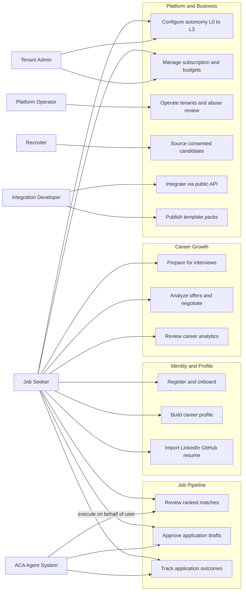
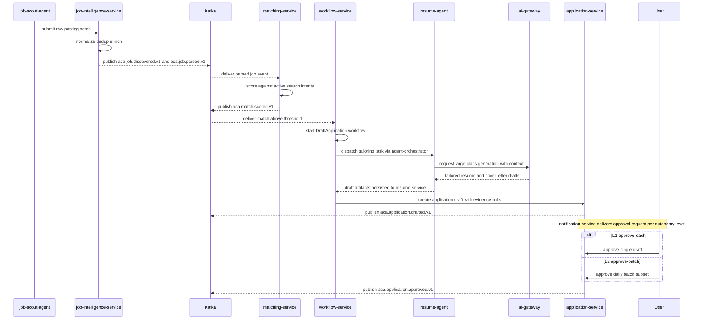
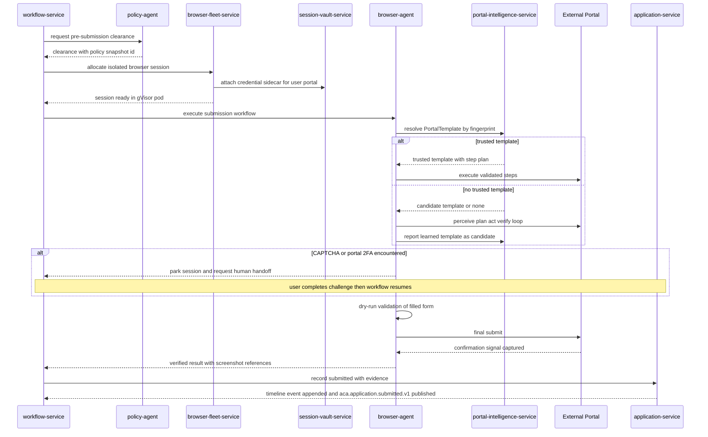
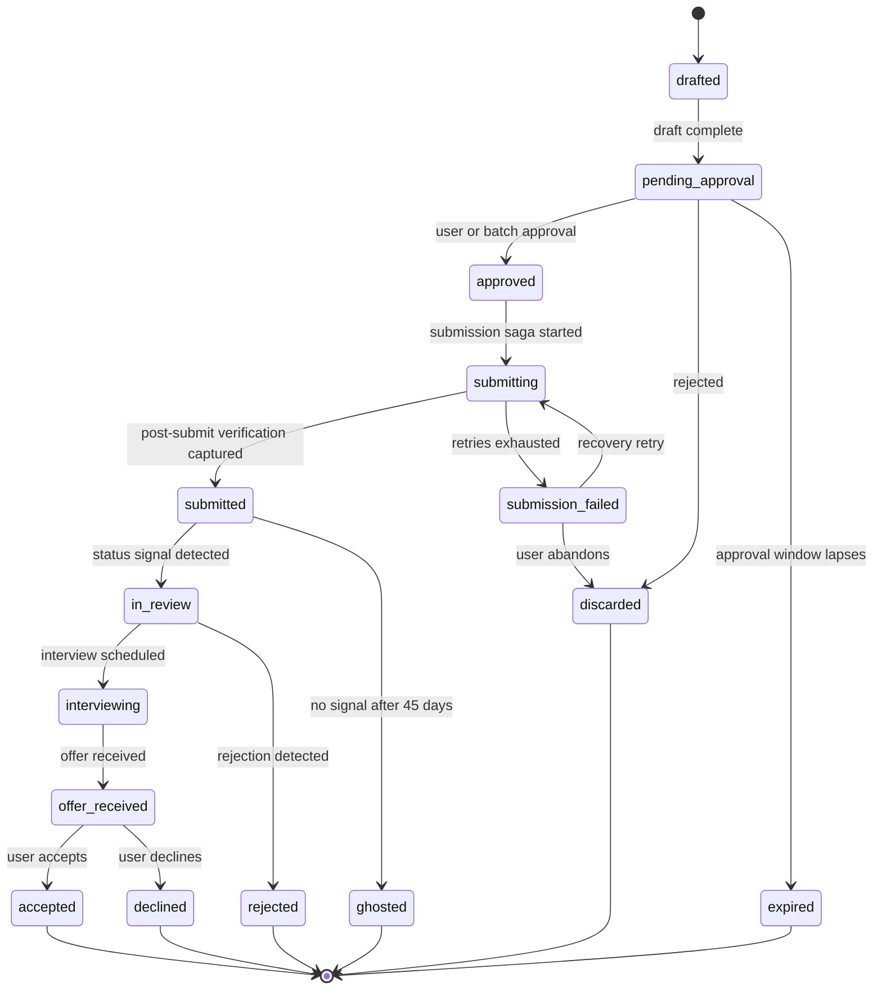

# 03 — Functional Requirements

| | |
|---|---|
| Document ID | ACA-SAS-03 |
| Volume | 1 — Foundation |
| Status | Draft v1.0 |
| Depends on | [00 — Architecture Canon](../00-architecture-canon.md), [04 — Non-Functional Requirements](04-non-functional-requirements.md) |

## 1. Overview

This chapter is the authoritative functional requirements (FR) catalog for the AI Career Agent (ACA) platform. It enumerates what the system must do, per capability area, mapped one-to-one onto the canonical service catalog ([Canon §4](../00-architecture-canon.md)) and agent catalog ([Canon §5](../00-architecture-canon.md)). Every FR carries a stable identifier, a MoSCoW priority relative to GA (end of Phase 1), a delivery phase, owning service(s), and an acceptance-criteria sketch that a QA engineer can expand into executable tests. Downstream chapters (Volumes 2–8) reference FR IDs when justifying service-level design decisions; the learning-pipeline and analytics-service trace product metrics back to these IDs.

The catalog deliberately reflects the canon's guardrail principle: ACA acts on behalf of a consenting user, with the user's own credentials, under explicit user-approved policies. Requirements that automate consequential actions (submission, outreach, negotiation) are therefore always expressed together with their control surface — autonomy levels `L0`–`L3`, approval workflows, `policy-agent` clearance, and the kill switch. A requirement without its control surface is treated as incomplete and must not be implemented.

Phases: **P1** = GA foundation (core loop end-to-end: discover → match → draft → approve → submit → track). **P2** = scale and intelligence (autopilot at volume, learning loops, enterprise, recruiter). **P3** = ecosystem (public SDK maturity, plugin marketplace, mobile parity). MoSCoW priority is scoped to GA: a `Could` FR may still be `P2`-planned; a `Won't` records an explicit GA exclusion to prevent scope creep.

ID scheme: `FR-NNN`, allocated in blocks of ten per capability area; gaps within a block are reserved for that area. IDs are never reused or renumbered after review sign-off.

## 2. Actors and Use-Case Overview

| Actor | Description | Tenant class (Canon §1) |
|---|---|---|
| Job Seeker | End user delegating job search to the agent system | `individual`, seat in `team`/`university`/`enterprise` |
| Tenant Admin | Manages seats, policies, SSO, billing for an org tenant | `team`, `university`, `enterprise` |
| Recruiter | Sources consented candidates, posts jobs | `recruiter` |
| Platform Operator | Internal ops, support, abuse review, fleet ops | — (internal) |
| Integration Developer | Consumes public API/SDK, webhooks, contributes plugins | any |
| ACA Agent System | The 23 canonical agents acting on behalf of users | — (internal) |

## 3. FR Catalog

Column conventions: **Priority** = MoSCoW for GA; **Phase** = delivery phase; **Owner** = canonical service identifiers (agents noted where they carry the logic); **Acceptance sketch** = minimal observable behavior to accept the FR.

### 3.1 Onboarding & Identity (FR-001–FR-009)

| ID | Requirement | Priority | Phase | Owner | Acceptance sketch |
|---|---|---|---|---|---|
| FR-001 | Account registration via email+password and OAuth (Google, LinkedIn, GitHub), issuing JWT per Canon §7 | Must | P1 | `identity-service`, `user-service` | New account → `aca.user.registered.v1` emitted; access token 15-min EdDSA; refresh rotation verified |
| FR-002 | 2FA enrollment: WebAuthn/passkeys primary, TOTP fallback; recovery codes | Must | P1 | `identity-service` | Passkey ceremony completes on 2 major browsers; TOTP drift window ±1 step; recovery code single-use |
| FR-003 | Enterprise SSO federation (SAML 2.0 + OIDC) with JIT provisioning into tenant seats | Should | P2 | `identity-service`, `user-service` | IdP-initiated and SP-initiated login; seat auto-provisioned respecting entitlement caps |
| FR-004 | Guided onboarding wizard capturing goals, target roles, locations, salary expectations, work-authorization constraints | Must | P1 | `profile-service`, `user-service` | Completion < 10 min median; every captured field visible in profile API; abandonment resumable |
| FR-005 | Autonomy configuration during onboarding per action class; application submission defaults to `L1 approve-each` | Must | P1 | `policy-service` | Default L1 verified for new users; change audit-logged via `aca.audit.event.v1` |
| FR-006 | Versioned consent capture: automation consent, ToS-awareness disclosure, data-processing consent; re-consent on version bump | Must | P1 | `policy-service` | Consent record immutable, versioned; agent actions blocked when consent version stale |
| FR-007 | Tenant creation and membership: invites, roles (owner/admin/member), single-member tenant auto-created for individuals | Must | P1 | `user-service` | Invite flow with expiring token; RLS verified — cross-tenant read returns zero rows |
| FR-008 | Account deletion (GDPR): hard delete + tombstone events within 30 days; export-before-delete offered | Must | P1 | `user-service`, all data owners | `aca.user.deleted.v1` fan-out; verification job confirms erasure across all service stores in ≤ 30 d |
| FR-009 | Kill switch at user scope: single control halting all agent activity for the account immediately | Must | P1 | `policy-service`, `agent-orchestrator` | Activation → zero new agent runs within 5 s; in-flight browser sessions aborted; state = suspended |

### 3.2 Profile, Resume & Portfolio (FR-010–FR-019)

| ID | Requirement | Priority | Phase | Owner | Acceptance sketch |
|---|---|---|---|---|---|
| FR-010 | Structured career profile CRUD: experience, education, skills (taxonomy-linked), certifications, preferences | Must | P1 | `profile-service` | Round-trip fidelity; `aca.profile.updated.v1` on mutation; skill entries linked to canonical taxonomy IDs |
| FR-011 | AI profile understanding snapshot: periodically regenerated narrative + embeddings capturing strengths, trajectory, gaps | Must | P1 | `profile-service`, `ai-gateway` | Snapshot regenerated ≤ 24 h after material profile change; versioned; visible to user with edit veto |
| FR-012 | Resume upload (PDF/DOCX ≤ 10 MB) and parsing into structured schema with confidence scores | Must | P1 | `resume-service` | ≥ 95% field-level parse accuracy on golden set; `aca.resume.parsed.v1`; low-confidence fields flagged for review |
| FR-013 | Resume versioning: immutable base versions plus per-application tailored versions with diff view | Must | P1 | `resume-service` | `aca.resume.version.created.v1`; diff renders added/removed bullets; tailored version links parent + application |
| FR-014 | ATS-optimization scoring: keyword coverage, format lint, section completeness against target job | Should | P1 | `resume-service` | Score 0–100 with itemized findings; re-score after edit < 5 s |
| FR-015 | Portfolio management: projects, GitHub repo analysis (languages, stars, activity), curated highlights per target role | Should | P2 | `portfolio-service`, `portfolio-agent` | Repo analysis refresh ≤ 7 d; per-role highlight set generated and user-editable |
| FR-016 | Profile completeness score with prioritized gap prompts driving onboarding funnel | Should | P1 | `profile-service` | Score deterministic given profile state; top-3 gap prompts actionable; measured lift tracked by `analytics-service` |

### 3.3 Imports (FR-020–FR-029)

| ID | Requirement | Priority | Phase | Owner | Acceptance sketch |
|---|---|---|---|---|---|
| FR-020 | LinkedIn profile import (user-consented, user-provided export file or consented fetch) mapped to profile schema | Must | P1 | `profile-service` | Import job async; `aca.profile.import.completed.v1`; field-mapping report shown; no credential storage outside `session-vault-service` |
| FR-021 | GitHub import: repos, contributions, languages via OAuth token | Should | P1 | `profile-service`, `portfolio-service` | OAuth scopes minimal (read-only); revocation honored ≤ 24 h; rate-limit-aware sync |
| FR-022 | Resume-as-bootstrap: uploaded resume seeds initial profile when no other source exists | Must | P1 | `resume-service`, `profile-service` | Empty profile + resume upload → ≥ 80% profile fields populated pending user confirmation |
| FR-023 | Mailbox connect (Gmail/IMAP, consented) enabling `email-agent` parsing of application-related email | Should | P2 | `email-agent`, `application-service` | OAuth consent screen scoped read-only; classification precision ≥ 97% before status mutation allowed; disconnect purges tokens |
| FR-024 | Import status tracking: progress, partial-failure report, retry of failed segments | Must | P1 | `profile-service` | Status endpoint reflects queued/running/partial/complete; failed segments retryable idempotently (`Idempotency-Key`) |

### 3.4 Job Discovery (FR-030–FR-039)

| ID | Requirement | Priority | Phase | Owner | Acceptance sketch |
|---|---|---|---|---|---|
| FR-030 | Continuous multi-source job discovery (boards, ATS career pages, aggregator feeds, recruiter postings) driven by user search intents | Must | P1 | `job-intelligence-service`, `job-scout-agent`, `scheduler-service` | 2M jobs/day sustained at target scale (see [Ch. 04](04-non-functional-requirements.md)); per-source crawl state resumable; `aca.job.discovered.v1` |
| FR-031 | Normalization to canonical Job schema — rules-first, LLM (`small` class) fallback for unstructured postings | Must | P1 | `job-intelligence-service`, `job-parser-agent` | ≥ 98% schema-valid output; LLM fallback rate ≤ 35% and monitored; `aca.job.parsed.v1` |
| FR-032 | Cross-source deduplication (URL canonicalization + content fingerprint + embedding similarity) | Must | P1 | `job-intelligence-service` | Duplicate rate in user feed ≤ 2%; merged record keeps source provenance list |
| FR-033 | Enrichment: salary inference, remote classification, seniority, tech-stack extraction | Should | P1 | `job-intelligence-service` | Enriched fields carry confidence; salary inference within ±15% of disclosed salary on holdout set |
| FR-034 | Job expiry and repost detection; expired jobs excluded from matching within 24 h | Must | P1 | `job-intelligence-service` | `aca.job.expired.v1`; stale-application prevention verified — no draft generated against expired job |
| FR-035 | User-defined search intents: role, geo, remote, salary floor, exclusion lists (companies, keywords) | Must | P1 | `profile-service`, `matching-service` | Exclusions honored with zero leakage in feed; intent edits re-scored within 15 min (autopilot SLO) |
| FR-036 | Job search & browse API/UI over OpenSearch index with tenant-scoped filters and saved searches | Must | P1 | `search-service` | p99 query < 300 ms; facets: location, remote, seniority, source, posted-age |

### 3.5 Company Intelligence (FR-040–FR-049)

| ID | Requirement | Priority | Phase | Owner | Acceptance sketch |
|---|---|---|---|---|---|
| FR-040 | Company profile build/refresh: overview, size, funding, culture signals, tech stack, hiring velocity | Must | P1 | `job-intelligence-service`, `company-intel-agent` | `aca.company.enriched.v1`; refresh ≤ 30 d or on-demand before draft generation |
| FR-041 | Hiring-signal detection: layoffs, funding rounds, growth signals feeding match ranking and draft evidence | Should | P2 | `company-intel-agent`, `learning-pipeline` | Signals timestamped with source citation; ranking feature importance tracked offline |
| FR-042 | Company page in product: intel summary, open roles, user's application history with that company | Should | P1 | `job-intelligence-service`, `application-service` | Page aggregates from owning services via API composition — no cross-DB reads |
| FR-043 | Entity/relationship persistence in knowledge graph (companies↔skills↔users↔outcomes) for reasoning and analytics | Should | P2 | `knowledge-graph-service` | Graph query answers "users like me who got offers here" within 500 ms p95 |

### 3.6 Matching (FR-050–FR-059)

| ID | Requirement | Priority | Phase | Owner | Acceptance sketch |
|---|---|---|---|---|---|
| FR-050 | Job↔profile scoring on the escalation ladder: deterministic features → embeddings + kNN → `small`-model rationale, per Canon §9/§10 | Must | P1 | `matching-service`, `matching-agent` | Score 0–100 reproducible for fixed inputs; `aca.match.scored.v1`; discovered→scored p95 < 15 min for autopilot users |
| FR-051 | Match explanation: top contributing factors, gaps, and evidence in user-readable form | Must | P1 | `matching-service` | Every surfaced match ≥ threshold carries explanation; no hallucinated requirements (validated against posting text) |
| FR-052 | User feedback calibration: per-user threshold adjustment from explicit feedback (save/dismiss/apply) and outcomes | Should | P2 | `matching-agent`, `learning-pipeline` | Dismiss-with-reason lowers similar-job scores within 24 h; calibration reversible |
| FR-053 | Ranked match feed with pagination, dedup against already-applied jobs, and daily digest cut | Must | P1 | `matching-service`, `search-service` | Feed excludes applied/dismissed/expired; cursor pagination per Canon §7 |
| FR-054 | Minimum-score gate for autopilot: only matches ≥ user-configurable threshold enter draft generation | Must | P1 | `matching-service`, `policy-service` | Threshold change takes effect next scoring cycle; gate evaluated before any AI spend on drafting |

### 3.7 Application Generation (FR-060–FR-069)

| ID | Requirement | Priority | Phase | Owner | Acceptance sketch |
|---|---|---|---|---|---|
| FR-060 | Tailored resume version per application with evidence-grounded edits (`large` class per Canon §10) | Must | P1 | `resume-agent`, `resume-service` | Draft p95 < 60 s; every added claim traceable to profile facts; ATS score ≥ base version |
| FR-061 | Tailored cover letter citing company intel and profile evidence; tone/user-voice configurable | Must | P1 | `cover-letter-agent` | No fabricated experience (validator gate); user style profile applied; regeneration with feedback supported |
| FR-062 | Screening-question answer drafting from profile facts; unanswerable questions escalated to user | Must | P1 | `browser-agent`, `application-service` | Questions without grounded answers never auto-filled; escalation notification within 60 s |
| FR-063 | Draft review/edit UX: inline edit, regenerate-with-instruction, side-by-side against posting | Must | P1 | `application-service` (API), frontend | Edits persist to tailored version; `aca.application.drafted.v1` on completion |
| FR-064 | Plan-gated model classes: Free = `small`/`medium` only; `large` tailoring from Professional; `frontier` budgeted from Premium (Canon §12) | Must | P1 | `ai-gateway`, `billing-service`, `cost-controller` | Entitlement snapshot enforced at `ai-gateway`; downgrade degrades gracefully, never errors |
| FR-065 | Bulk draft generation for `L2 approve-batch` users: nightly batch producing approval queue | Should | P2 | `workflow-service`, `scheduler-agent` | Batch uses provider batch lane (≈ 50% cost); queue ready before user's configured review hour |

### 3.8 Portal Automation (FR-070–FR-079)

| ID | Requirement | Priority | Phase | Owner | Acceptance sketch |
|---|---|---|---|---|---|
| FR-070 | Automated application submission on supported portals via Universal Portal Engine (Canon §16) — never hardcoded per site | Must | P1 | `browser-agent`, `browser-fleet-service`, `portal-intelligence-service` | Known-portal workflow success ≥ 92% weekly; `aca.application.submitted.v1` only after post-submit verification |
| FR-071 | Portal fingerprinting and template learning through the trust ladder `discovered` → `candidate` → `trusted` → `stale` | Must | P1 | `portal-intel-agent`, `portal-intelligence-service` | Candidate templates shadow-verified before trust; drift auto-detected via fingerprint diff + failure-rate monitor |
| FR-072 | Consented credential/session vault: portal logins, cookies, session artifacts encrypted per user (P0 class, Canon §11) | Must | P1 | `session-vault-service` | Credentials injected only via egress sidecar, never into agent context; per-tenant KEK; user revocation purges ≤ 1 h |
| FR-073 | Pre-submission gate: `policy-agent` clearance + autonomy-level check + dry-run validation + post-submit confirmation capture | Must | P1 | `policy-agent`, `workflow-service` | All four gates logged per submission; missing gate = hard failure, no submit |
| FR-074 | Evidence trail: screenshots + DOM snapshots at each consequential step, retained 90 d (Canon §11) | Must | P1 | `browser-fleet-service` | Every submitted application links ≥ 3 evidence artifacts; user-visible submission receipt |
| FR-075 | Human handoff on CAPTCHA, portal 2FA, or unresolvable ambiguity; session parked and resumable ≤ 24 h | Must | P1 | `browser-agent`, `notification-service` | Handoff notification < 60 s; resumed session completes without restarting workflow |
| FR-076 | Per-site rate budgets and egress policy: respectful pacing, geo routing, IP reputation health | Must | P1 | `proxy-manager`, `policy-agent` | Site budget breach blocks new sessions to that site; budgets configurable per portal family |
| FR-077 | Failed-workflow diagnosis and repair: automatic retry with adjusted plan, escalation after 3 attempts | Must | P1 | `recovery-agent`, `workflow-service` | `aca.browser.action.failed.v1` triggers diagnosis; ≤ 3 retries then user notification with reason |

### 3.9 Application Tracking (FR-080–FR-089)

| ID | Requirement | Priority | Phase | Owner | Acceptance sketch |
|---|---|---|---|---|---|
| FR-080 | Event-sourced application lifecycle (draft → submitted → in-review → interview → offer → closed) with full timeline | Must | P1 | `application-service` | Timeline reconstructable from events alone; `aca.application.status.changed.v1` on every transition |
| FR-081 | Automated status detection: email parsing (consented), portal status checks, calendar signals | Should | P2 | `application-tracker-agent`, `email-agent` | Detected transition precision ≥ 97%; ambiguous signals queued for user confirmation, never auto-applied |
| FR-082 | Manual status edit and note-taking; manual edits win over automated detection | Must | P1 | `application-service` | Manual edit sets `source=user` flag; automation never overwrites user-set status |
| FR-083 | Interview and offer records: rounds, participants, prep links, offer terms (comp structure) | Must | P1 | `application-service` | `aca.interview.scheduled.v1` / `aca.offer.received.v1`; offer terms encrypted at P1 field level |
| FR-084 | Pipeline views: kanban by stage, list with filters, per-tenant aggregate view for org admins | Must | P1 | `application-service`, `search-service` | Kanban drag = status change API; admin view respects seat-level privacy settings |

### 3.10 Interview Preparation (FR-090–FR-099)

| ID | Requirement | Priority | Phase | Owner | Acceptance sketch |
|---|---|---|---|---|---|
| FR-090 | Role- and company-specific question banks generated from job posting + company intel | Must | P1 | `interview-coach-agent` | Bank ≥ 20 questions across behavioral/technical/company axes; citations to posting/intel |
| FR-091 | Mock interview sessions (chat P1, voice P3) with structured feedback and scoring rubric | Should | P1 | `interview-coach-agent`, `memory-service` | Session transcript stored to memory tiers; rubric consistent across sessions for progress tracking |
| FR-092 | Prep plan per scheduled interview: timeline, materials, weak-area drills from mock results | Should | P2 | `interview-coach-agent` | Plan generated ≤ 1 h after `aca.interview.scheduled.v1`; adapts to days-until-interview |
| FR-093 | Interview scheduling assistance: calendar integration, availability proposals, reminders | Should | P2 | `calendar-agent`, `notification-service` | Proposed slots respect user calendar (consented); reminders at T-24h and T-1h |

### 3.11 Negotiation (FR-100–FR-109)

| ID | Requirement | Priority | Phase | Owner | Acceptance sketch |
|---|---|---|---|---|---|
| FR-100 | Offer analysis: total-comp breakdown, benchmark percentile vs. market data, decision factors | Must | P2 | `negotiation-agent`, `analytics-service` | Benchmark cites data source + cohort; analysis ≤ 5 min after offer entry; Premium entitlement (Canon §12) |
| FR-101 | Negotiation strategy and scripting: counter ranges, talking points, risk framing | Should | P2 | `negotiation-agent` | Strategy uses `frontier` class only within budget flag; every recommendation carries rationale |
| FR-102 | Counter-offer drafting is `L0/L1` only — never auto-sent regardless of autopilot level | Must | P2 | `negotiation-agent`, `policy-service` | Hard policy rule: outbound negotiation always requires explicit user send; verified in policy tests |
| FR-103 | Competing-offer comparison matrix across active offers | Could | P2 | `negotiation-agent` | Matrix normalizes equity/bonus/COL; export to PDF |

### 3.12 Notifications (FR-110–FR-119)

| ID | Requirement | Priority | Phase | Owner | Acceptance sketch |
|---|---|---|---|---|---|
| FR-110 | Multi-channel delivery: email, push (FCM/APNs), SMS, in-app — behind `notification-service` adapters (Canon §3) | Must | P1 | `notification-service` | Delivery p95 < 60 s (Canon §14); `aca.notification.delivered.v1` receipts; channel fallback order configurable |
| FR-111 | Intelligent notification decisions: what/when/how per user, digest composition, fatigue suppression | Should | P2 | `notification-agent` | Duplicate-suppression window; digest batches low-urgency items; urgency taxonomy documented |
| FR-112 | Preference center: per-category channel opt-in/out, quiet hours, frequency caps; legal notices exempt | Must | P1 | `notification-service`, `user-service` | Opt-out honored ≤ 5 min; quiet hours timezone-aware; audit trail of preference changes |
| FR-113 | Realtime activity feed: live agent activity, approvals, status changes over WebSocket/SSE | Must | P1 | `realtime-gateway` | Event delivery p95 < 2 s (Canon §14); reconnect with resume cursor; per-tenant fan-out isolation |

### 3.13 Analytics & Insights (FR-120–FR-129)

| ID | Requirement | Priority | Phase | Owner | Acceptance sketch |
|---|---|---|---|---|---|
| FR-120 | Career funnel analytics: application → response → interview → offer rates over time, per segment | Must | P1 | `analytics-service` | CQRS read models updated ≤ 15 min from source events; numbers reconcile with `application-service` counts |
| FR-121 | Benchmarks: user's rates vs. anonymized cohort (role/seniority/geo), k-anonymity ≥ 20 | Should | P2 | `analytics-service` | No cohort under 20 members surfaced; benchmark methodology page published |
| FR-122 | Insight narratives: AI-generated "what's working, what to change" summaries | Should | P2 | `analytics-agent` | Narrative cites underlying metrics; refresh weekly; wrong-claim rate < 2% on eval set |
| FR-123 | Outcome ingestion into learning loop: per-user and global strategy improvement (prompt/routing experiments) | Should | P2 | `learning-pipeline`, `learning-agent` | Outcome events land in feature store ≤ 1 h; experiment assignments logged; rollback on quality regression (Canon §10.4) |
| FR-124 | Exportable reports (CSV/PDF) for users and tenant admins | Could | P2 | `analytics-service` | Export async with notification; tenant export respects seat privacy |

### 3.14 Autopilot & Approval Workflows (FR-130–FR-139)

| ID | Requirement | Priority | Phase | Owner | Acceptance sketch |
|---|---|---|---|---|---|
| FR-130 | Autonomy levels per action class exactly per Canon §9: `L0 suggest`, `L1 approve-each`, `L2 approve-batch`, `L3 autopilot`; submission defaults L1 | Must | P1 | `policy-service`, `agent-orchestrator` | Level change effective ≤ 60 s; every consequential action logs the level it executed under |
| FR-131 | Approval inbox: single-item and batch approval with per-item diff, partial batch approval, expiry policy | Must | P1 | `application-service`, `notification-service` | `aca.agent.approval.requested.v1`; unapproved drafts expire per user setting (default 7 d) without submission |
| FR-132 | Autopilot cadence planning within plan + budget limits: daily quotas, pacing, priority ordering | Must | P2 | `scheduler-agent`, `cost-controller`, `workflow-service` | Daily submission count never exceeds plan cap; budget exhaustion pauses pipeline with user notice |
| FR-133 | Kill switch at tenant and platform scope (user scope in FR-009); platform scope operator-controlled with 2-person rule | Must | P1 | `policy-service`, `admin-service` | Tenant kill ≤ 5 s to quiesce; platform kill drill quarterly; re-enable audit-logged |
| FR-134 | HITL checkpoint mechanics: durable Temporal waits, timeout behavior (remind → expire), no silent auto-approve | Must | P1 | `workflow-service`, `agent-orchestrator` | Checkpoint survives worker restart; timeout never converts to approval; reminder cadence configurable |
| FR-135 | Complete agent action audit: every run, tool call, and consequential action in hash-chained audit log | Must | P1 | `audit-service`, `agent-orchestrator` | `aca.agent.run.started/completed/failed.v1` mirrored to `aca.audit.event.v1`; chain verification job green |
| FR-136 | Agent memory personalization: session/short/long-term tiers inform drafting and matching; user can view and delete memories | Should | P2 | `memory-service` | Memory view UI lists entries with provenance; delete propagates to indices ≤ 24 h |

### 3.15 Billing & Entitlements (FR-140–FR-149)

| ID | Requirement | Priority | Phase | Owner | Acceptance sketch |
|---|---|---|---|---|---|
| FR-140 | Plan lifecycle on Canon §12 plans (`free`, `professional`, `premium`, `enterprise`): subscribe, upgrade, downgrade, cancel via Stripe adapter | Must | P1 | `billing-service` | Proration correct on mid-cycle change; `aca.billing.subscription.changed.v1`; provider adapter seam tested with mock provider |
| FR-141 | Entitlement enforcement: signed snapshots at `api-gateway` (coarse) + services (fine) + `cost-controller` (AI budgets) | Must | P1 | `billing-service`, `api-gateway`, `cost-controller` | Expired snapshot fails closed to plan floor; tamper detection via signature check |
| FR-142 | Usage metering: applications, AI spend attribution, browser sessions via `aca.billing.usage.recorded.v1` | Must | P1 | `billing-service`, `cost-controller`, `application-service` | Metering reconciles with `ai-gateway` token ledger within 1%; monthly caps enforced (10/100/400 apps per Canon §12) |
| FR-143 | Invoicing, payment retry, and dunning with grace period before feature reduction | Must | P1 | `billing-service`, `notification-service` | Dunning schedule configurable; grace-period expiry degrades to `free` entitlements, never deletes data |
| FR-144 | User-visible AI budget: current-period spend, remaining budget, degrade notices at 80% (Canon §10.2) | Should | P1 | `cost-controller` | `aca.cost.budget.threshold.v1` at 80%/100%; UI matches ledger within 5 min |
| FR-145 | Enterprise contracts: seat management, custom caps, invoiced billing, DPA flags | Should | P2 | `billing-service`, `admin-service` | Seat over-allocation blocked; contract terms drive entitlement snapshot fields |

### 3.16 Admin & Operations (FR-150–FR-159)

| ID | Requirement | Priority | Phase | Owner | Acceptance sketch |
|---|---|---|---|---|---|
| FR-150 | Tenant management: search, inspect, suspend, quota adjustment, cell assignment | Must | P1 | `admin-service` | All mutations JIT-elevated + audit-logged (Canon §13); suspension quiesces agents like tenant kill switch |
| FR-151 | Support tooling: read-only "view-as" with user notification trail; no silent impersonation | Must | P1 | `admin-service` | View-as sessions time-boxed (≤ 1 h), logged, listed in user's security page |
| FR-152 | Abuse review: anomaly queues from `security-agent`, account action workflow (warn/limit/suspend) | Must | P1 | `admin-service`, `security-agent` | Queue SLA dashboards; every action reversible with reason codes |
| FR-153 | DLQ triage and event replay tooling per Canon §8 retry/DLQ convention | Must | P1 | `admin-service` | Replay idempotent (consumer dedup verified); DLQ age alerting at 1 h |
| FR-154 | Agent fleet operations: run inspection, stuck-run detection (`agent-supervisor` escalations), bulk pause per agent type | Must | P1 | `admin-service`, `agent-orchestrator` | Operator can pause one agent type platform-wide ≤ 60 s; run traces linked to Tempo |
| FR-155 | Prompt operations console: prompt version rollout state (dev/canary/stable), eval results, emergency rollback | Should | P1 | `admin-service`, `prompt-registry-service` | Rollback to prior stable ≤ 5 min; canary metrics visible before promotion |

### 3.17 Recruiter Portal (FR-160–FR-169)

| ID | Requirement | Priority | Phase | Owner | Acceptance sketch |
|---|---|---|---|---|---|
| FR-160 | Recruiter org onboarding with verification (domain + business checks) before candidate visibility | Must | P2 | `recruiter-service`, `identity-service` | Unverified orgs cannot search candidates; verification status audit-logged |
| FR-161 | Consented candidate sourcing: only profiles with explicit recruiter-visibility consent; anonymized until mutual interest | Must | P2 | `recruiter-service`, `policy-service` | Consent flag checked at query time; contact details released only on candidate accept |
| FR-162 | Job posting intake: recruiter postings enter `job-intelligence-service` as first-party source with priority freshness | Must | P2 | `recruiter-service`, `job-intelligence-service` | Posting live in matching ≤ 5 min; marked `source=recruiter` with verified-org badge |
| FR-163 | Pipeline views for recruiter postings: applicant flow, stage management, structured feedback to candidates | Should | P2 | `recruiter-service` | Stage changes emit events consumed by candidate's `application-service` timeline |

### 3.18 Public API & SDK (FR-170–FR-179)

| ID | Requirement | Priority | Phase | Owner | Acceptance sketch |
|---|---|---|---|---|---|
| FR-170 | Public REST API under `https://api.aca.dev/v1` per Canon §7: API-key auth, RFC 9457 errors, cursor pagination, idempotency | Must | P2 | `public-api-service`, `api-gateway` | Contract tests against OpenAPI spec; `X-API-Key` scoping; breaking-change policy documented |
| FR-171 | Webhooks: subscription management, HMAC-signed deliveries, retries with backoff, dead-letter visibility | Must | P2 | `public-api-service` | Signature verification sample code; ≥ 3 retry attempts; endpoint failure auto-disable with notice |
| FR-172 | Official SDKs (TypeScript, Python) generated from the OpenAPI spec, versioned with the API | Should | P3 | `public-api-service` | SDK CI runs contract tests; semver aligned to API version |
| FR-173 | API key management: create/rotate/revoke, per-key scopes and rate limits, usage dashboards | Must | P2 | `public-api-service` | Revocation effective ≤ 60 s; rate-limit headers per Canon §7 |
| FR-174 | Scoped OAuth for third-party apps acting for users (read-profile, read-applications; never submit) | Could | P3 | `identity-service`, `public-api-service` | Consent screen lists scopes; submission scope not grantable to third parties |

### 3.19 Plugin Marketplace (FR-180–FR-189)

| ID | Requirement | Priority | Phase | Owner | Acceptance sketch |
|---|---|---|---|---|---|
| FR-180 | Adapter SDK for portal template packs per Canon §16: first/third parties contribute `PortalTemplate@version` packs | Should | P3 | `portal-intelligence-service` | Pack schema validated on upload; packs enter trust ladder at `discovered`, never straight to `trusted` |
| FR-181 | Marketplace listing pipeline: submission, automated security scan, human review, signing, publication | Should | P3 | `public-api-service`, `admin-service` | Unsigned packs unloadable; review SLA published; takedown path ≤ 24 h |
| FR-182 | Tenant-scoped installation with sandboxed execution: packs run as data (templates), never as arbitrary code in the trust boundary | Must | P3 | `portal-intelligence-service`, `policy-service` | Pack cannot exceed declared portal scope; install/uninstall audit-logged per tenant |
| FR-183 | Contributor analytics and optional revenue share for third-party pack authors | Won't (GA) | P3 | `billing-service`, `public-api-service` | Explicitly out of GA scope; revisit after marketplace volume data |

## 4. Core Loop Sequences

### 4.1 Discovery → Match → Draft → Approval

### 4.2 Approved → Portal Submission (Universal Portal Engine)

### 4.3 Application Lifecycle States (FR-080)

The 45-day ghosted timeout reflects observed median employer response windows; it is a configurable constant owned by `application-service`, and `ghosted` applications remain reopenable on late signals. The full user-facing status vocabulary — adding `needs_user`, `negotiating`, and `withdrawn` — is fixed in [08 — User Journey](08-user-journey.md) §7.1.

## 5. Traceability Summary

| Capability area | FR range | Primary services | Canon anchor |
|---|---|---|---|
| Onboarding & identity | FR-001–009 | `identity-service`, `user-service`, `policy-service` | §3, §6, §7 |
| Profile/resume/portfolio | FR-010–016 | `profile-service`, `resume-service`, `portfolio-service` | §4.2 |
| Imports | FR-020–024 | `profile-service`, `email-agent` | §4.2, §5 |
| Job discovery | FR-030–036 | `job-intelligence-service`, `search-service` | §4.3 |
| Company intel | FR-040–043 | `job-intelligence-service`, `knowledge-graph-service` | §4.3, §4.4 |
| Matching | FR-050–054 | `matching-service` | §4.3, §9, §10 |
| Application generation | FR-060–065 | `resume-agent`, `cover-letter-agent`, `ai-gateway` | §5, §9, §10 |
| Portal automation | FR-070–077 | `browser-fleet-service`, `portal-intelligence-service`, `session-vault-service`, `proxy-manager` | §4.4, §16 |
| Tracking | FR-080–084 | `application-service` | §4.3, §8 |
| Interview prep | FR-090–093 | `interview-coach-agent`, `calendar-agent` | §5 |
| Negotiation | FR-100–103 | `negotiation-agent` | §5, §12 |
| Notifications | FR-110–113 | `notification-service`, `realtime-gateway` | §4.1, §4.5 |
| Analytics | FR-120–124 | `analytics-service`, `learning-pipeline` | §4.5 |
| Autopilot & approvals | FR-130–136 | `policy-service`, `workflow-service`, `agent-orchestrator` | §9 |
| Billing | FR-140–145 | `billing-service`, `cost-controller` | §12 |
| Admin | FR-150–155 | `admin-service` | §4.5, §13 |
| Recruiter | FR-160–163 | `recruiter-service` | §4.5 |
| Public API/SDK | FR-170–174 | `public-api-service` | §7 |
| Plugin marketplace | FR-180–183 | `portal-intelligence-service`, `public-api-service` | §16 |

Coverage check: all 32 canonical services own at least one FR except pure infrastructure (`api-gateway`, `realtime-gateway` appear as enforcement/delivery owners in FR-141, FR-113); `prompt-registry-service` and `memory-service` are covered via FR-155 and FR-136. Per-component depth (sequences, failure modes, scaling, security) for each owning service is specified in its Volume 2–8 chapter; this chapter consolidates the cross-cutting views below to avoid restating per-service material nineteen times.

## 6. Failure Scenarios

| Scenario | FRs affected | Required behavior |
|---|---|---|
| `ai-gateway` provider outage | FR-060–062, FR-090, FR-100 | Provider failover per Canon §3; drafting queues rather than fails; user-facing status honest ("drafting delayed") |
| Portal template drift mid-submission | FR-070, FR-071 | Verification step fails closed; no submit without confirmation capture; template demoted to `stale`; `recovery-agent` retry with re-fingerprint |
| Approval expiry vs. job expiry race | FR-131, FR-034 | Job expiry check re-run at submission time (FR-034 acceptance); expired job cancels workflow with user notice, never submits |
| Kafka consumer lag on `aca.match.scored.v1` | FR-050, FR-053 | Discovered→scored SLO breach alerts; autopilot pacing (FR-132) backs off before drafting stale matches |
| `session-vault-service` unavailable | FR-070, FR-072 | Submissions requiring credentials pause (park state); no fallback to plaintext or cached credentials anywhere |
| User revokes consent mid-run | FR-006, FR-009 | Consent check at each policy gate (FR-073); in-flight consequential actions abort before submit |
| Duplicate submission attempt (retry after unacked submit) | FR-070, FR-077 | Post-submit verification searches for existing confirmation before retry; portal-side dedup evidence stored |
| Batch approval partially fails downstream | FR-131, FR-065 | Per-item saga isolation: one failed submission never rolls back sibling approvals; per-item status visible |

## 7. Scaling Strategy

Functional scale targets and full capacity math live in [04 — Non-Functional Requirements](04-non-functional-requirements.md). Requirements here constrain *how* features scale: discovery and matching are horizontally partitioned by source and by `tenant_id`/entity key (Canon §8 ordering); draft generation for `L2`/`L3` users must use the batch lane (FR-065) so interactive traffic retains priority; portal automation scales by browser pod fleet with per-site budgets (FR-076) acting as a global concurrency brake per portal; approval inboxes and feeds are CQRS read models so user-facing reads never contend with agent write throughput. Any FR whose load grows super-linearly with users × jobs (matching, FR-050) must specify a pre-filter stage (deterministic + kNN) before model-class spend — this is a functional requirement, not an optimization.

## 8. Security Considerations

Security requirements are functionally embedded rather than appended: consent versioning (FR-006), P0 credential isolation (FR-072), policy gates before consequential actions (FR-073), no third-party submission scope (FR-174), and marketplace packs as data-not-code (FR-182). Cross-cutting mandates from Canon §13 apply to every FR: prompt-injection defenses on all external content entering LLM context (job postings FR-031, portal DOM FR-070, email FR-023), tool allowlists per agent, and `security-agent` screening. Acceptance testing for any FR touching external content must include adversarial fixtures (hostile posting text, malicious DOM) demonstrating that injected instructions do not alter agent behavior. Volume 5 chapters own the detailed threat models.

## 9. Observability

Every FR's acceptance sketch that cites an event topic doubles as an observability contract: the event is the measurement point. Chapter-level requirements: (a) each capability area exposes a funnel dashboard keyed by its FR events (e.g., discovery→scored→drafted→approved→submitted conversion); (b) SLO-bearing FRs (FR-030, FR-050, FR-060, FR-070, FR-110, FR-113) emit histograms whose p95 alarms map to the error-budget policy in Canon §14; (c) agent-executed FRs correlate `run_` IDs with `trace_id` end-to-end so a user-visible outcome can be traced through workflow, agent, `ai-gateway`, and browser session. Missing telemetry is a release blocker for `Must` FRs.

## 10. Future Improvements

- **Voice-based mock interviews** (extends FR-091) once realtime speech models pass quality evals — Phase 3.
- **Proactive career-move suggestions** (new area: unsolicited role recommendations from `learning-agent` trend analysis) — requires its own consent class; deferred until the notification-fatigue model (FR-111) is proven.
- **Recruiter-side automation agents** (auto-screening with candidate consent) — deliberately excluded until candidate-side fairness review completes.
- **Marketplace beyond template packs** (prompt packs, scoring plugins) — blocked on plugin sandbox maturity from FR-182.
- **Cross-tenant talent pools for universities** — awaiting FERPA analysis; candidate for Canon amendment.

## 11. Alternatives Considered & Tradeoffs

| Decision | Alternative rejected | Tradeoff accepted |
|---|---|---|
| Numbered flat FR catalog with area blocks | User-story map (epics/stories) as the spec of record | Stories drift with backlog tooling; flat IDs give stable cross-volume traceability at the cost of narrative flow |
| Submission defaults to `L1 approve-each` (FR-130) | Default `L3` for Premium to showcase autopilot | Trust and compliance outweigh activation metrics; L3 is opt-in after first approved submissions |
| Automated status detection gated at ≥ 97% precision (FR-081) | Best-effort auto-update with user correction | Wrong status updates destroy trust in the tracker; precision gate delays P2 feature but protects the core loop |
| Recruiter portal in P2, not GA | Two-sided launch at GA | Marketplace liquidity risk is real, but a weak candidate-side product would poison recruiter supply; sequencing chosen deliberately |
| Plugin packs restricted to declarative templates (FR-182) | Executable plugin code (WASM sandbox) for richer adapters | Loses expressiveness for exotic portals; dramatically shrinks marketplace attack surface and review cost. WASM revisit is a Canon-amendment decision |
| Ghosted state after 45 days | Indefinite `in_review` | Honest funnel metrics and user closure beat optimistic dashboards; late responses reopen the record |
| Mailbox integration read-only with classification gate (FR-023) | Full send-capable email agent at P2 | Outbound email as agent action is high-risk (identity, tone, legal); deferred behind negotiation-style explicit-send controls |
