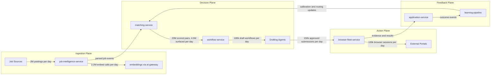
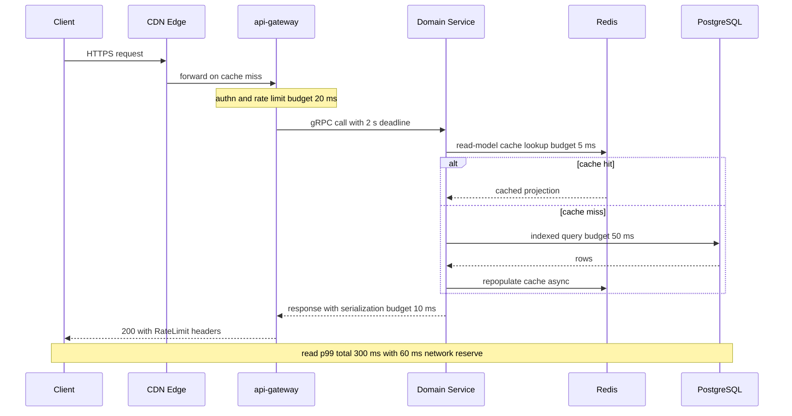
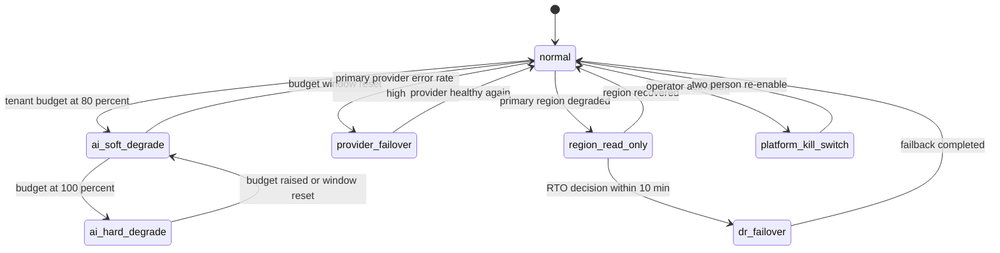

# 04 — Non-Functional Requirements

| | |
|---|---|
| Document ID | ACA-SAS-04 |
| Volume | 1 — Foundation |
| Status | Draft v1.0 |
| Depends on | [00 — Architecture Canon](../00-architecture-canon.md), [03 — Functional Requirements](03-functional-requirements.md) |

## 1. Overview

This chapter quantifies how well the ACA platform must perform the functions defined in [Chapter 03](03-functional-requirements.md). It is the contract that capacity planning, SLO monitoring, security engineering, and the FinOps program are built against. Every number is either inherited verbatim from the [Architecture Canon](../00-architecture-canon.md) (SLOs §14, retention §11, DR §15, plans §12) or derived here with its math shown. Where this chapter derives a number the canon does not state, the derivation is the authority and the number is a candidate for canon promotion.

The chapter has three load-bearing artifacts: the **load model** (§2) — the single set of traffic assumptions all volumes size against; the **NFR catalog** (§3–§10) — numbered, testable requirements with verification methods; and the **cost model** (§8) — AI unit economics per plan, because for an AI-native product cost is a first-class NFR that gates feature viability, not a finance afterthought.

Scale targets are given for two horizons: **Phase 1 (GA)** and **Target scale** (the design envelope, roughly GA + 18–24 months). Services must *run* at GA scale and *not require re-architecture* before target scale; the documented scale-path seams (pgvector→Qdrant, AGE→Neo4j, Postgres-OLAP→ClickHouse, cells) are the planned interventions between the two horizons.

NFR ID scheme mirrors Chapter 03: `NFR-NNN` in blocks per category; IDs are stable after review sign-off. Priorities are MoSCoW relative to GA.

## 2. Load Model & Capacity Math

### 2.1 Canonical load model

All chapters size against this table. Changing a row requires updating this chapter first, then dependent chapters.

| # | Metric | Phase 1 (GA) | Target scale | Peak factor | Basis / rationale |
|---|---|---|---|---|---|
| L1 | Registered users | 500 k | 5 M | — | Business plan envelope; drives identity, storage, GDPR tooling |
| L2 | MAU, all plans | 150 k | 1.2 M | — | 24% of registered; industry-typical for freemium career tools |
| L3 | MAU with active autopilot (L2/L3) | 40 k | 500 k | — | Assignment target; paying-plan feature, drives agent load |
| L4 | DAU | 40 k | 300 k | — | 25% of MAU; job search is a near-daily activity while active |
| L5 | Peak concurrent clients (web+mobile) | 6 k | 45 k | ×1.5 design → 100 k conns | 15% of DAU online in peak hour; WS+SSE on `realtime-gateway` |
| L6 | Jobs discovered/day | 300 k | 2 M | ×1.5 (Mon/Tue surge) | Assignment target; source-count × per-source yield |
| L7 | Active job corpus (searchable) | 12 M | 75 M docs | — | ~45-day live window + repost history at L6 rates |
| L8 | Match scores computed/day | 3 M | 20 M pairs | ×1.5 | 500 k autopilot × ~40 candidate jobs/day pre-filtered per user |
| L9 | Surfaced matches (events)/day | 0.8 M | 4.5 M | ×1.5 | ~22% of scored pairs clear user thresholds |
| L10 | Application drafts/day | 15 k | 180 k | ×1.5 | Plan caps (Canon §12) × observed utilization ~45% |
| L11 | Applications submitted/day | 10 k | 150 k | ×1.5 | Drafts × approval rate ~83%; includes manual-assist submissions |
| L12 | Browser sessions/day | 8 k | 100 k | ×3 (business-hours windows) | Assignment target; ~70% submission flows, 30% status checks/re-auth |
| L13 | AI calls/day at `ai-gateway` | 2.5 M | 21 M avg / **50 M design peak** | see §2.3 | Derived in §2.3; assignment peak target justified there |
| L14 | Kafka events/day | 6 M | 50 M | ×10 burst design | Sum of topic families incl. `aca.ai.request.completed.v1` at L13 volume |
| L15 | Search queries/day | 0.4 M | 3 M | ×4 peak hour | DAU × ~10 queries incl. feed refreshes |
| L16 | Control-plane API requests/day | 5 M | 36 M | ×4 peak hour | DAU × ~120 requests/day (SPA + mobile) |

### 2.2 Control-plane and event-backbone math

- **API gateway RPS:** 36 M/day ÷ 86,400 s ≈ **417 RPS** average; peak-hour concentration ×4 ≈ **1,670 RPS**; design with ×2 headroom → **3,300 RPS** at `api-gateway`. At ~2 KB mean response this is ~53 Mbit/s egress — trivially CDN-fronted; the binding constraint is downstream Postgres read models, hence the CQRS mandate (NFR-023).
- **Realtime connections:** 45 k peak concurrent × 1.5 design margin ≈ **100 k concurrent WS/SSE**. At ~64 KB per connection state, ~6.4 GB across the `realtime-gateway` fleet — fits 6–8 pods with Redis pub/sub fan-out; per-pod connection cap 20 k (file-descriptor and GC headroom).
- **Kafka throughput:** 50 M events/day ≈ **580 msg/s** average; burst design ×10 → **6 k msg/s** sustained cluster capability, with `aca.match.scored.v1` and `aca.ai.request.completed.v1` the dominant topics. At 1.5 KB mean payload and replication factor 3: ~27 MB/s peak write — comfortably a 6-broker KRaft cluster; partition counts sized per topic in Volume 4.
- **Browser fleet:** 100 k sessions/day × 6 min mean = 600 k pod-minutes/day → **417 concurrent pods average**; business-hours concentration ×3 → **1,250 concurrent**; design **2,000 pods** (1 vCPU / 2 GiB gVisor pods → ~2,000 vCPU burst on spot-heavy node groups). Mean session length is the sizing lever — a 1-minute regression in mean adds ~200 concurrent pods.

### 2.3 AI call volume derivation (justifies the 50 M/day peak envelope)

Average day at target scale, by workload (classes per Canon §10.1):

| Workload | Class | Calls/day | Basis |
|---|---|---|---|
| Job embeddings (new + re-embeds) | `embed` | 2.2 M | L6 + 10% re-embedding churn |
| Query/profile/memory embeddings | `embed` | 3.0 M | Retrieval for matching, context builder, memory indices |
| Job parse LLM fallback | `small` | 0.6 M | 30% of L6 fail rules-first parsing (FR-031 cap 35%) |
| Job enrichment | `small` | 1.0 M | ~50% of jobs need one inference-backed enrichment |
| Match rationale scoring | `small` | 2.0 M | ~4 borderline pairs/user/day escalate past kNN |
| Match explanations | `medium` | 2.5 M | Top-5 surfaced matches/user/day (L3 users) |
| Resume tailoring | `large` | 0.15 M | 1 per draft (L10) |
| Cover letters | `large` | 0.15 M | 1 per draft |
| Screening-question answers | `medium` | 0.45 M | ~3 per draft |
| Draft validation/guardrails | `small` | 0.6 M | ~4 validator passes per draft |
| Browser perception/verification | `vision` | 0.5 M | ~5/session; trusted templates keep this low |
| Browser step planning | `small` | 0.4 M | ~4/session |
| Novel-portal reasoning | `frontier` | 0.02 M | ~2% of sessions × ~10 calls (routing-policy gated) |
| Company intel refresh | `medium` | 0.15 M | 150 k company refreshes/day |
| Tracking: email/status parsing | `small` | 1.5 M | ~3 signals/autopilot user/day |
| Interview prep + negotiation (interactive) | `medium` | 0.8 M | Session-based, Professional+ |
| Interview/negotiation deep reasoning | `large` | 0.10 M | Subset of above |
| Notification decisions + digests | `small`/`medium` | 0.5 M / 0.2 M | `notification-agent` |
| Analytics narratives | `medium` | 0.1 M | Weekly per user ÷ 7 |
| Learning-pipeline evals (batch lane) | `small`/`medium` | 1.0 M / 0.3 M | Golden sets, online judges (Canon §10.4) |
| Memory consolidation | `small`/`medium` | 0.5 M / 0.1 M | Nightly jobs |
| Prompt-injection screening | `small` | 1.5 M | All external content entering context (Canon §13) |
| Supervision/misc (`agent-supervisor` etc.) | `small` | 0.5 M | Loop/stall detection samples |

**Totals:** `embed` 5.2 M · `small` 10.1 M · `medium` 4.6 M · `large` 0.4 M · `frontier` 0.02 M · `vision` 0.5 M ⇒ **≈ 21 M calls/day average**.

Peak envelope: weekly posting surge ×1.5 (≈ 31 M) + re-embedding/backfill campaigns (up to 8 M/day during `embed_v(n+1)` migrations, Canon §10.5) + 12-month growth margin ⇒ **50 M calls/day design peak** — the assignment target is thus an envelope, not an average. Rate shape: 50 M/86,400 ≈ 580 RPS sustained; intra-day ×2.5 concentration ⇒ **~1,450 RPS design at `ai-gateway`**, of which ~40% is absorbed by exact/semantic cache (NFR-062), leaving ~870 RPS to providers/self-hosted inference. Note `small`-class dominance (48%) is deliberate — the escalation ladder (Canon §9) is what keeps §8's cost model viable.

### 2.4 Storage math

| Store | Daily inflow | Retention (Canon §11) | Steady state | Note |
|---|---|---|---|---|
| Raw crawl artifacts (S3) | 20 GB (2 M × ~10 KB) | 30 d | 0.6 TB | Reparse buffer |
| Screenshots (S3) | 96 GB (100 k × 8 × 120 KB) | 90 d | ~9 TB | Evidence trail (FR-074) |
| DOM snapshots (S3) | 30 GB (100 k × 300 KB) | 90 d | 2.7 TB | Portal learning + audit |
| AI request logs | 42 GB (21 M × ~2 KB) | 90 d hot → 13 mo archive | 3.8 TB hot / 17 TB archive | Token ledger + replay |
| Jobs (Postgres, partitioned) | 4 GB normalized | 18 mo then compact | ~2 TB | Time partitions per Canon §11 |
| `application_event` (event-sourced) | 1.5 GB | Life of account | ~1 TB @ target | Hash-linked timeline |
| Vectors (`embedding-store`) | 8 GB (2.2 M × 1024-dim fp16 ≈ 2 KB + index) | Active corpus | 150 GB raw / ~400 GB with index | **Qdrant trigger:** > 25 M active vectors or kNN p95 > 200 ms (see NFR-027) |
| Audit events (WORM S3) | 10 GB (5 M × 2 KB) | 7 y | ~26 TB by year 7 | Compliance |

## 3. Availability & Reliability (NFR-001–NFR-009)

| ID | Requirement | Target | Verification | Priority | Phase |
|---|---|---|---|---|---|
| NFR-001 | Control-plane API availability (Canon §14) | **99.95% monthly** (≤ 21.9 min error budget) | Synthetic probes ×3 regions, 30 s interval; SLO burn-rate alerts 2%/1h, 5%/6h | Must | P1 |
| NFR-002 | Async/agent plane availability (Kafka, workflow, agents): degraded ≠ down — work queues and drains | 99.9% monthly for accept-and-durably-queue | Chaos drills: broker loss, worker eviction; queued work loss = SLO violation | Must | P1 |
| NFR-003 | `realtime-gateway` delivery | p95 < 2 s (Canon §14); reconnect storm of 100 k conns absorbed ≤ 60 s | Load test: mass-disconnect replay | Must | P1 |
| NFR-004 | No single point of failure in any request path; every service ≥ 2 replicas across ≥ 2 AZs | Zero SPOF findings | Quarterly architecture SPOF review + AZ-evacuation game day | Must | P1 |
| NFR-005 | Graceful degradation ladder (see §11 diagram): AI budget soft/hard degrade, provider failover, region read-only, kill switch — each state reachable and reversible without deploy | State transitions ≤ 60 s | Monthly degradation drill in staging, quarterly in prod | Must | P1 |
| NFR-006 | Browser workflow success on known portals (Canon §14) | ≥ 92% weekly | `aca.browser.session.completed.v1` vs `failed` ratio, per portal family dashboard | Must | P1 |
| NFR-007 | DR: RPO ≤ 5 min, RTO ≤ 30 min, active-passive per Canon §15 | Measured in quarterly game day | Runbooked failover; game-day report to canon owners | Must | P1 |
| NFR-008 | Consumer idempotency everywhere: duplicate event delivery causes zero duplicate side effects | 0 duplicate submissions/notifications in dedup tests | Chaos test: forced redelivery of 10 k events per topic | Must | P1 |
| NFR-009 | Temporal workflow durability: HITL checkpoints and sagas survive worker/cluster restart | 0 lost checkpoints | Kill-worker test during pending approval (FR-134) | Must | P1 |

## 4. Latency SLOs (NFR-010–NFR-019)

Golden SLOs mirror Canon §14 **exactly**; this chapter adds decomposition budgets.

| SLI (Canon §14) | SLO |
|---|---|
| Control-plane API availability | 99.95% monthly |
| API latency (read p99 / write p99) | < 300 ms / < 800 ms |
| Realtime event delivery p95 | < 2 s |
| Job discovered → scored (autopilot) p95 | < 15 min |
| Application draft generation p95 | < 60 s |
| Browser workflow success rate (known portals) | ≥ 92% weekly |
| AI answer quality (eval pass rate on stable prompts) | ≥ 95% |
| Notification delivery p95 | < 60 s |

| ID | Requirement | Target | Rationale | Priority | Phase |
|---|---|---|---|---|---|
| NFR-010 | Read-path p99 budget decomposition (below) | gateway 20 ms + service 200 ms + serialization 10 ms + network 60 ms ≤ 300 ms | Budgets make the SLO enforceable per hop; deadlines per Canon §7 (2 s sync read is the hard gRPC deadline, 300 ms the p99 goal) | Must | P1 |
| NFR-011 | Write-path p99 | < 800 ms incl. outbox write; event *publish* is async and excluded | Outbox decouples user latency from Kafka | Must | P1 |
| NFR-012 | Discovered→scored pipeline p95 < 15 min | Stage budgets: crawl-to-parsed 8 min, parse-to-embedded 3 min, embed-to-scored 4 min | Stage budgets localize regressions | Must | P1 |
| NFR-013 | Draft generation p95 < 60 s | Context build ≤ 5 s, `large` generation ≤ 40 s, validators ≤ 10 s, persistence ≤ 5 s | User-visible agent moment; interactive lane priority | Must | P1 |
| NFR-014 | Search (`search-service`) p99 | < 300 ms at L15 peak | Inside global read SLO with OpenSearch headroom | Must | P1 |
| NFR-015 | kNN retrieval (`embedding-store`) p95 | < 200 ms at L7 corpus | Matching pre-filter stage budget; Qdrant trigger metric | Must | P1 |
| NFR-016 | `ai-gateway` overhead (routing, cache, safety filters), excl. provider time | p99 < 150 ms | Gateway must be invisible next to model latency | Must | P1 |
| NFR-017 | Interactive AI floor: user-interactive requests within plan floor served even at hard budget cap (Canon §10.2) | 100% of floor traffic admitted | Cost control must not read as outage | Must | P1 |
| NFR-018 | Approval-to-submission-start (L1 flow) p95 | < 5 min while fleet capacity available | User intent should act while attention is present | Should | P1 |
| NFR-019 | Mobile/API cold TTFB p75 | < 1.5 s globally | CDN + edge caching of static/config | Should | P2 |

## 5. Scalability (NFR-020–NFR-029)

| ID | Requirement | Target | Verification | Priority | Phase |
|---|---|---|---|---|---|
| NFR-020 | Sustain the target-scale load model (§2.1) without re-architecture | All L1–L16 targets | Annual full-scale load test against staging cell | Must | P2 |
| NFR-021 | Horizontal scale-out only for stateless services; scale event ≤ 2× capacity in ≤ 5 min (HPA) | No vertical-only service | Load-ramp test per service | Must | P1 |
| NFR-022 | Ingestion (L6) scales by source-partition parallelism; adding a source class needs config, not code deploy | 2 M jobs/day, ×1.5 surge | Surge replay of recorded Monday peak | Must | P2 |
| NFR-023 | User-facing reads served from CQRS read models/caches; no user query fans out to > 1 OLTP primary | 0 cross-primary fan-out reads | Architecture test in CI (dependency lint) + query audit | Must | P1 |
| NFR-024 | Matching pre-filter reduction: deterministic + kNN filters cut candidate pairs before model spend | ≥ 95% reduction (L8: 20 M scored from ~400 M raw pairs) | Pipeline telemetry ratio | Must | P1 |
| NFR-025 | Browser fleet elasticity: 0→1,250 concurrent pods in ≤ 10 min; scale-to-near-zero off-peak | Pod cold start ≤ 30 s incl. gVisor | Fleet ramp drill; cost telemetry off-peak | Must | P2 |
| NFR-026 | Kafka: burst absorption ×10 average (6 k msg/s) with consumer lag recovery < 30 min after burst | Lag SLO per topic family | Burst injection test | Must | P1 |
| NFR-027 | `embedding-store` scale path executes at trigger: > 25 M active vectors **or** kNN p95 > 200 ms sustained 7 d → Qdrant migration (Canon §3 seam) with dual-read | Zero-downtime migration | Rehearsed in staging before trigger | Must | P2 |
| NFR-028 | Cell-based growth (Canon §15): a new cell reaches production readiness ≤ 2 weeks; enterprise tenants pinnable | Cell bring-up runbook timed | First dedicated-cell onboarding | Should | P2 |
| NFR-029 | Per-tenant fairness: no tenant consumes > 5% of shared-cell agent throughput (enterprise cells exempt) | Throttle telemetry | Noisy-neighbor injection test | Must | P1 |

## 6. Durability & Data Protection (NFR-030–NFR-036)

| ID | Requirement | Target | Verification | Priority | Phase |
|---|---|---|---|---|---|
| NFR-030 | Postgres PITR: RPO ≤ 5 min; snapshots daily, 35-day retention (Canon §11) | Restore drill quarterly, timed | Drill report; restore ≤ RTO | Must | P1 |
| NFR-031 | Object storage: versioning + cross-region replication; 11-nines durability class for evidence/audit buckets | Replication lag < 15 min | Replication metrics + sampled integrity checks | Must | P1 |
| NFR-032 | Kafka tiered storage ≥ 7-day hot retention (audit topics longer); replay of any topic window ≤ 7 d old | Replay drill monthly | DLQ/replay tooling (FR-153) | Must | P1 |
| NFR-033 | Audit log immutability: hash-chained, WORM storage, 7-year retention (Canon §11) | Chain verification job daily, zero breaks | Independent verifier in `audit-service` | Must | P1 |
| NFR-034 | Retention enforcement automated for every class in Canon §11 (crawl 30 d, evidence 90 d, AI logs 90 d/13 mo, deletion ≤ 30 d) | 0 over-retention findings | Quarterly retention audit query pack | Must | P1 |
| NFR-035 | Backup restore correctness: restored service passes its contract tests, not just "data present" | Green contract suite on restore | Part of quarterly drill | Must | P1 |
| NFR-036 | Event-sourced stores (`application` timeline, audit) reconstruct state byte-identical from events | Replay hash equality | Nightly shadow-replay of sample aggregates | Should | P2 |

## 7. Security, Privacy & Compliance (NFR-040–NFR-057)

Security architecture detail lives in Volume 5; these are the measurable platform requirements.

| ID | Requirement | Target | Verification | Priority | Phase |
|---|---|---|---|---|---|
| NFR-040 | Zero-trust transport: 100% inter-service traffic mTLS via mesh with SPIFFE identity (Canon §13) | 0 plaintext internal flows | Mesh policy audit + packet sampling | Must | P1 |
| NFR-041 | AuthZ at every hop: OPA decision on all gRPC methods and REST routes; default deny | 100% coverage | Policy coverage report in CI | Must | P1 |
| NFR-042 | Token hygiene per Canon §7: 15-min access tokens, rotating 30-day refresh, `kid` rotation ≤ 90 d | Rotation telemetry | Key-age alert; revocation test | Must | P1 |
| NFR-043 | PII handling per class (Canon §11): P0 in `session-vault-service` only (envelope, per-tenant KEK); P1 field-level AES-256-GCM; P2 at-rest encryption | 0 misclassified fields | Data-classification lint on schemas + annual review | Must | P1 |
| NFR-044 | Prompt-injection defense on 100% of external content entering LLM context: sanitization, `untrusted_content` tagging, output validation, tool allowlists (Canon §13) | Red-team suite pass ≥ 99% block rate | Adversarial fixture suite in CI + quarterly red team | Must | P1 |
| NFR-045 | Browser isolation: gVisor per session, per-session egress allowlist, no cross-user reuse, credentials via sidecar only | 0 isolation violations | Pen test + eBPF egress monitoring | Must | P1 |
| NFR-046 | Vulnerability SLAs: critical (internet-facing) ≤ 48 h, high ≤ 7 d, medium ≤ 30 d; base images rebuilt weekly | SLA adherence ≥ 95% | Vuln-management dashboard | Must | P1 |
| NFR-047 | Secrets exclusively from Vault; no secret in env-committed files, images, or logs | 0 findings | Secret scanning in CI + log scrubber tests | Must | P1 |
| NFR-048 | Admin access JIT-elevated, time-boxed, fully audited (Canon §13); no standing prod admin | 100% elevated sessions logged | Access review monthly | Must | P1 |
| NFR-049 | Anomaly detection on agent behavior (`security-agent`): flag-to-triage ≤ 15 min for high-severity | Queue SLA | Synthetic anomaly injection | Should | P2 |
| NFR-050 | GDPR/CCPA from day 1: erasure ≤ 30 d (hard delete + tombstones), DSAR export ≤ 30 d statutory with 72 h automated target | Verified erasure job (FR-008) | Erasure verification report per request | Must | P1 |
| NFR-051 | Consent precedes processing: no agent action on a data category without a live consent record (FR-006) | 0 consentless actions | Policy-gate audit sampling | Must | P1 |
| NFR-052 | EU data residency: EU-resident tenants pinned to EU cell; personal data does not leave region (Canon §15) | Residency assertions in data plane | Data-flow audit + egress policy tests | Must | P2 |
| NFR-053 | SOC 2 Type II in year 1; ISO 27001 year 2 (Canon §13) | Audit milestones met | External audit | Must | P1/P2 |
| NFR-054 | AI transparency: every AI-generated artifact labeled; users can view evidence/inputs behind drafts | 100% artifacts attributed | UI + API contract tests | Must | P1 |
| NFR-055 | Anonymized analytics cohorts k ≥ 20 (FR-121); no re-identification via benchmark queries | k-anonymity enforced at query layer | Privacy test suite | Must | P2 |
| NFR-056 | Sub-processor governance: LLM providers under DPA; zero training on customer data without explicit opt-in | Contract + config audit | Annual vendor review | Must | P1 |
| NFR-057 | Kill-switch drills at all three scopes (user/tenant/platform) | Quarterly, ≤ 5 s quiesce | Drill reports (FR-009, FR-133) | Must | P1 |

## 8. Cost Ceilings & AI Unit Economics (NFR-060–NFR-066)

### 8.1 Reference unit costs

Blended per-call costs derived from provider list prices at design time (reference: `small` ≈ $1/$5, `medium` ≈ $3/$15, `large` ≈ $5/$25, `frontier` ≈ $10/$50 per M input/output tokens — vendor-agnostic seam per Canon §3; `cost-controller` tracks live prices). Typical token profiles per class:

| Class | Typical in/out tokens | Blended cost/call (reference) | Rationale |
|---|---|---|---|
| `embed` | 500 in | $0.00002 | Self-hosted bge-class on amortized GPU (Canon §3) |
| `small` | 2 k / 300 | $0.004 | Classification/extraction with compact prompts |
| `medium` | 4 k / 800 | $0.025 | Drafting/summarization with context |
| `large` | 6 k / 1.5 k | $0.07 | Tailored generation with full evidence context |
| `frontier` | 8 k / 2 k | $0.18 | Novel portal/negotiation reasoning; routing-flag gated |
| `vision` | 6 k (incl. image) / 500 | $0.03 | Screenshot understanding, medium-class vision |

### 8.2 Naive vs. engineered daily cost (target scale, §2.3 volumes)

| Class | Calls/day | Naive $/day |
|---|---|---|
| `embed` | 5.2 M | $104 |
| `small` | 10.1 M | $40.4 k |
| `medium` | 4.6 M | $115 k |
| `large` | 0.4 M | $28 k |
| `frontier` | 0.02 M | $3.6 k |
| `vision` | 0.5 M | $15 k |
| **Total naive** | 20.8 M | **≈ $202 k/day ≈ $6.1 M/mo** |

Mandatory cost levers (each is an architectural requirement, not an aspiration):

| Lever | Mechanism (Canon §10.2) | Modeled effect |
|---|---|---|
| Exact + semantic cache | Redis request-hash; pgvector cosine ≥ 0.97 task-scoped | −30% of `small`/`medium` calls |
| Provider prompt caching | Stable-prefix context builder; cached input ≈ 0.1× price | −~25% on remaining input-token spend |
| Batch lane | Non-interactive work on provider batch APIs | −50% on ~40% of calls (parsing, enrichment, evals, L2 drafting) |
| Escalation-ladder routing | Rules → cache → kNN → `small` → up | Keeps `small` share ≥ 45%; skip-tier logged |

Compound target: effective spend ≤ **0.40 × naive** ⇒ **≤ $2.4 M/mo** at target scale ⇒ **≈ $4.85 per autopilot MAU per month** forecast.

### 8.3 Ceilings (NFR catalog)

| ID | Requirement | Target | Verification | Priority | Phase |
|---|---|---|---|---|---|
| NFR-060 | AI COGS ceiling per plan, per active user per month (reference prices, Canon §12): **Free ≤ $0.30**, **Professional ≤ $4.50**, **Premium ≤ $12.00**, **Enterprise ≤ $8.00 blended default** (contract-specific) | ≈ ≤ 16% of plan ARPU; Free ceiling treated as CAC | `cost-controller` per-plan ledger, monthly close | Must | P1 |
| NFR-061 | Aggregate AI spend ≤ weighted ceiling: at 55/30/15 Professional/Premium/Enterprise autopilot mix ⇒ ≤ $7.28/autopilot MAU; forecast ($4.85) must stay ≤ 80% of ceiling, alert above | FinOps alert at 80% | Monthly variance report | Must | P1 |
| NFR-062 | Cache effectiveness: ≥ 35% of `small`+`medium` gateway calls served without provider spend; prompt-cache read share ≥ 40% of input tokens | Gateway cache metrics | Continuous; regression alert −5 pts | Must | P1 |
| NFR-063 | Budget enforcement latency: soft (80%) degrade and hard (100%) queue/deny decisions applied ≤ 60 s from threshold cross (Canon §10.2); interactive floor preserved (NFR-017) | `aca.cost.budget.threshold.v1` to enforcement lag | Budget-breach injection test | Must | P1 |
| NFR-064 | Attribution completeness: 100% of `ai-gateway` calls carry tenant/user/agent/feature attribution in `aca.ai.request.completed.v1`; ledger reconciles with billing within 1% | Reconciliation job | Monthly close | Must | P1 |
| NFR-065 | Non-AI infra ceilings: browser session fully-loaded compute ≤ $0.015/session (6 pod-min on spot-heavy pools); total infra COGS ≤ 15% of revenue at target scale | FinOps dashboards | Quarterly review | Should | P2 |
| NFR-066 | Frontier-class spend ≤ 5% of total AI spend without explicit routing-policy expansion (Canon §10.1 flag) | Class-share telemetry | Alert on breach | Must | P1 |

## 9. Accessibility & Internationalization (NFR-070–NFR-078)

| ID | Requirement | Target | Verification | Priority | Phase |
|---|---|---|---|---|---|
| NFR-070 | WCAG 2.2 AA across web app (Canon §13), incl. approval inbox and agent activity feed | 0 serious/critical axe violations | Automated axe in CI + quarterly manual audit incl. screen readers | Must | P1 |
| NFR-071 | Full keyboard operability and visible focus for all core-loop flows (review, approve, edit drafts) | 100% task completion keyboard-only | Manual audit scripts | Must | P1 |
| NFR-072 | Motion/notification accessibility: reduced-motion honored; realtime feed usable with assistive tech (ARIA live regions, rate-limited announcements) | Audit pass | Assistive-tech test matrix | Should | P1 |
| NFR-075 | UI i18n: Phase 1 `en-US` only but fully externalized strings (ICU MessageFormat), locale-aware dates/numbers/currency from day 1 | 0 hardcoded strings (lint) | i18n lint in CI | Must | P1 |
| NFR-076 | Phase 2 UI locales: `es`, `de`, `fr`, `pt-BR`; translation turnaround ≤ 1 sprint behind feature strings | Locale coverage ≥ 99% keys | Pseudo-locale CI build | Should | P2 |
| NFR-077 | Multilingual job corpus from day 1: ingestion detects and tags language; matching never silently drops non-English postings for users with matching language skills | Language tag accuracy ≥ 98% | Corpus sampling | Must | P1 |
| NFR-078 | Generated application materials in the posting's language when user opts in; quality gate per language before enablement (Canon §10.4 evals per locale) | Eval pass ≥ 95% per enabled language | `prompt-registry-service` eval sets | Should | P2 |

## 10. Maintainability & Developer Experience (NFR-080–NFR-088)

| ID | Requirement | Target | Verification | Priority | Phase |
|---|---|---|---|---|---|
| NFR-080 | CI wall time p95 ≤ 15 min per service (build + tests + scans) | 15 min | CI telemetry; regressions block merge of the regressing change | Must | P1 |
| NFR-081 | Deploy frequency ≥ daily per active service; lead time commit→prod < 1 day; canary per Canon §15 | DORA metrics | Delivery dashboard | Must | P1 |
| NFR-082 | MTTR < 30 min for SEV-2+; every SEV gets a blameless postmortem ≤ 5 business days | DORA + postmortem SLA | Incident tooling | Must | P1 |
| NFR-083 | New-service scaffold (repo, chart, pipeline, dashboards, OTel, RLS template) ≤ 1 day via golden-path template | Timed scaffold exercise | Platform team KPI | Must | P1 |
| NFR-084 | Local development: kind/Tilt environment for any 3-service slice boots ≤ 20 min on a standard laptop; recorded contract stubs for the rest | Timed onboarding exercise | New-hire onboarding survey | Should | P1 |
| NFR-085 | Contract discipline: OpenAPI/Buf schemas are source-of-truth; breaking-change detection in CI (Buf breaking, schema-registry compat per Canon §8) | 0 undetected breaking changes | CI gates | Must | P1 |
| NFR-086 | Test coverage: ≥ 80% line on domain logic, plus per-service contract tests and per-flow E2E on the core loop | Coverage + suite health | CI gates; flake rate < 1% | Must | P1 |
| NFR-087 | Runbooks + dashboards required for every service before prod (enforced by readiness checklist); alert→runbook link coverage 100% | Readiness review | Production-readiness gate | Must | P1 |
| NFR-088 | Prompt/agent DX: prompt change → canary eval result feedback ≤ 30 min (`prompt-registry-service` + `learning-pipeline`) | Eval-loop latency | Prompt-ops telemetry | Should | P2 |

## 11. Failure Scenarios (NFR-level)

Degradation is a designed state machine, not an emergent behavior:

| Scenario | NFRs exercised | Expected behavior |
|---|---|---|
| Sustained 3× AI traffic spike (viral moment) | NFR-016, NFR-062, NFR-063 | Cache absorbs first; batch lane defers non-interactive; interactive floor holds; no cascading provider 429 amplification (jittered backoff at gateway) |
| Primary LLM provider brownout | NFR-005, NFR-013 | Failover to secondary/self-hosted per class; draft p95 may breach with honest status; quality evals gate degraded-class substitutions |
| Region failure | NFR-007, NFR-030 | Read-only ≤ 10 min decision window → DR failover ≤ 30 min RTO; ≤ 5 min RPO verified against outbox/Kafka replication |
| Cost-ledger pipeline lag | NFR-063, NFR-064 | Enforcement uses hot Redis aggregates (not the warm ledger); stale-ledger alarm; fail-closed to conservative budgets after 15 min staleness |
| Browser fleet exhaustion (portal surge) | NFR-025, NFR-029 | Per-site budgets brake first, then per-tenant fairness; queue depth visible to users as ETA, not silent delay |
| Erasure job backlog | NFR-050 | 30-day compliance clock monitored per request; backlog > 7 d pages privacy on-call |

## 12. Scaling Strategy

The scaling posture is: **partition by tenant, pipeline by stage, cache in front of everything user-facing.** Stateless tiers scale on HPA (NFR-021); the three stateful pressure points have named seams — `embedding-store` → Qdrant at the NFR-027 trigger, analytics OLAP → ClickHouse when Postgres read models exceed ~2 TB or 15-min freshness slips, graph → Neo4j when AGE traversals exceed 500 ms p95 (FR-043). Cell-based growth (NFR-028) is the macro lever: when a shared cell approaches 60% of its validated load-model share, a new cell is provisioned rather than scaling the old one past tested limits. Every capacity number in §2 carries a ×1.5–×2 design margin; exceeding a margin triggers a load-model revision in this chapter before any service-level heroics.

## 13. Security Considerations

Chapter-level security NFRs (§7) bind all volumes; three deserve emphasis as *architectural* constraints. First, the P0 boundary: portal credentials and session cookies exist only inside `session-vault-service` and its egress sidecars — any design that would move P0 material into agent context, logs, or prompts is rejected at review regardless of mitigation claims (NFR-043, NFR-045). Second, the untrusted-content boundary: job postings, portal DOM, and email are adversarial inputs by default; NFR-044's red-team suite is a merge gate for any change touching context assembly. Third, cost-abuse is a security surface: budget enforcement (NFR-063) doubles as the DoS/abuse brake for stolen keys and runaway agents, which is why enforcement reads the hot path and fails conservative.

## 14. Observability

Every NFR names its measurement; the platform-level requirements are: (a) OTel traces span the full loop — `trace_id` from user click through workflow, agent run, `ai-gateway` call, browser session, and back through events (`traceparent` extension per Canon §14); (b) the four golden dashboards (API SLOs, pipeline SLOs, AI cost/quality, browser fleet) are versioned artifacts reviewed with the same rigor as code; (c) SLO burn-rate alerts (2%/1 h, 5%/6 h) gate releases via the error-budget policy — a service out of budget ships only reliability fixes; (d) business + AI + browser + cost metrics are first-class (Canon §14): the cost-per-user forecast in §8 is a live metric with an alert, not a spreadsheet.

## 15. Future Improvements

- **Active-active edge (Phase 2, Canon §15):** promote stateless edge to active-active; revisit NFR-001 toward 99.99% for reads.
- **Per-tenant SLO tiers:** enterprise contracts with tighter SLOs served from dedicated cells; requires per-cell error budgets.
- **Predictive autoscaling** for browser fleet and batch lanes from `scheduler-agent` demand forecasts, replacing reactive HPA for the ×3 business-hours swing.
- **Carbon/efficiency NFRs:** tokens-per-outcome and CO₂e-per-application reporting once the learning-pipeline can attribute outcome quality to spend.
- **Formal capacity model automation:** replace §2 spreadsheet math with a continuously validated capacity model fed by production telemetry, alerting when reality diverges > 20% from model.

## 16. Alternatives Considered & Tradeoffs

| Decision | Alternative rejected | Tradeoff accepted |
|---|---|---|
| 99.95% control-plane SLO (not 99.99%) | 99.99% from day 1 | 99.99% forces active-active data plane immediately (~2× infra + complexity); consumer job-search tolerance and the async agent plane make 99.95% + honest degradation the better spend. Revisit with active-active phase 2 |
| Cost ceilings as ~16% of ARPU | Cost-plus pricing (pass AI spend to users) | Metered pricing is honest but hostile UX for consumers; fixed plans with enforced ceilings put efficiency risk on engineering, where the levers are |
| 50 M calls/day as design envelope over 21 M average | Sizing to average with reactive scale-up | Provider rate limits and GPU procurement have days-to-weeks lead times; envelope sizing costs reserved-capacity margin but removes the worst failure mode (throttled core loop during a growth spike) |
| pgvector first, Qdrant at named trigger (NFR-027) | Qdrant from day 1 | Day-1 Qdrant adds an operational system before scale demands it; the trigger + rehearsed dual-read migration caps the risk of the cheaper start |
| Stage-budgeted latency SLOs | Single end-to-end SLO only | Stage budgets cost maintenance as the pipeline evolves, but turn every SLO breach into a localized owner instead of a cross-team hunt |
| Blended per-call cost model (reference prices) | Pure token-level modeling per provider | Token-exact models rot with every price change; blended per-call classes are stable enough for ceilings while `cost-controller` owns exact live accounting |
| Erasure ≤ 30 d with automated verification | Soft-delete with 90-day purge | Soft-delete simplifies references but fails the canon's hard-delete stance and inflates breach blast radius; tombstone events absorb the referential-integrity cost |
| WCAG 2.2 AA as merge-gated CI check | Periodic audit only | CI gating slows some frontend merges; retrofit accessibility is strictly more expensive, and the approval inbox is the product's trust surface for all users |
