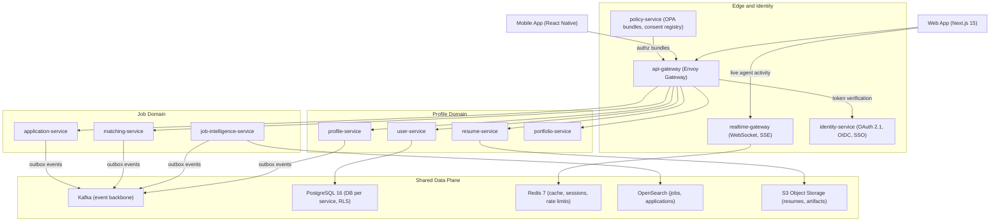
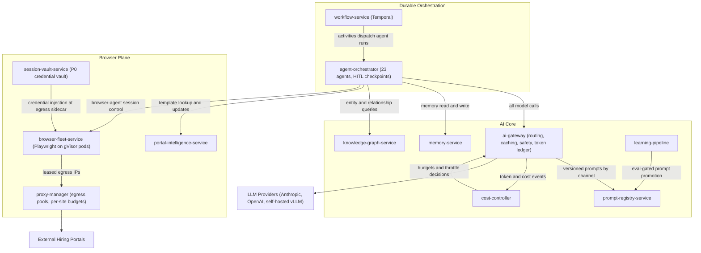
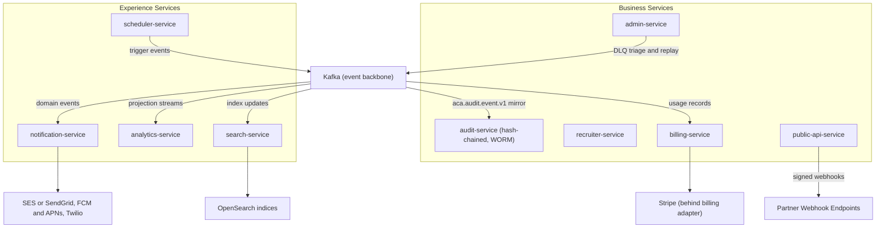
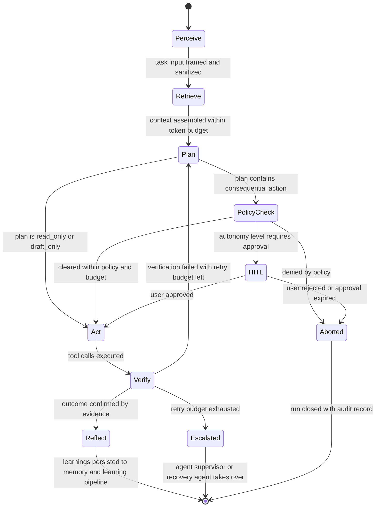
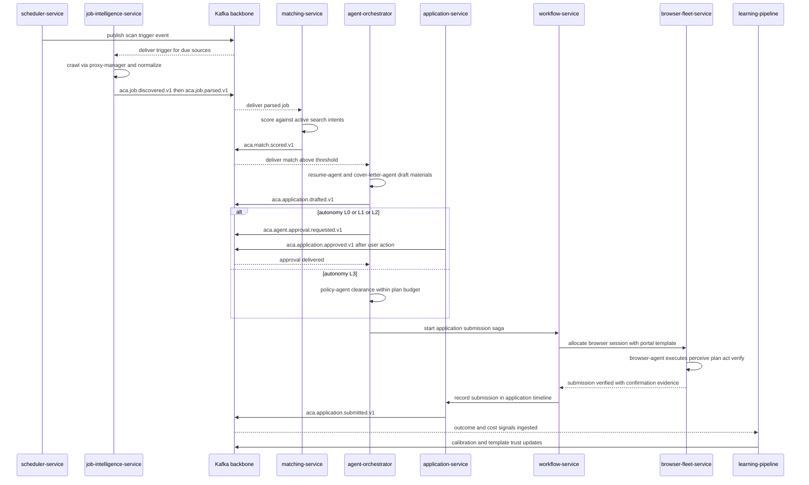

# 05 — High-Level Architecture

| | |
|---|---|
| Document ID | ACA-SAS-05 |
| Volume | 1 — Foundation |
| Status | Draft v1.0 |
| Depends on | [00 — Architecture Canon](../00-architecture-canon.md), [01 — Executive Summary](01-executive-summary.md), [03 — Functional Requirements](03-functional-requirements.md), [07 — System Context](07-system-context.md) |

## 1. Overview

This chapter is the C4 Level 1–2 view of the AI Career Agent platform: the architecture style and the forces that justify it, the container decomposition of the canonical service catalog (canon §4 — "the 30 services") grouped by domain, the rules that decide when two containers interact synchronously versus asynchronously, the canonical agent loop that every one of the 23 agents executes, the end-to-end data flow from job discovery to learning, and the cell-based multi-tenancy model that bounds blast radius and enables data residency. It closes with the three macro-decisions that most shaped this architecture — decomposition granularity, coordination style, and LLM provider strategy — with the alternatives that were seriously considered and rejected.

The chapter deliberately stays at Level 2. Per-service internals (C4 Level 3) live in the service chapters of [Volume 2](../volume-2-core-services/), [Volume 3](../volume-3-ai-architecture/), [Volume 7](../volume-7-browser-intelligence/), and [Volume 8](../volume-8-business-platform/). The system-context view (C4 Level 1, actors and external systems) is owned by [07 — System Context](07-system-context.md); it is summarized here only where needed to motivate container boundaries.

Two properties of the product dominate every structural choice, as established in [01 — Executive Summary](01-executive-summary.md): the system performs consequential actions with the user's own identity and credentials, and its core work is long-running, failure-prone, and cost-variable. The first property forces `policy-service`, `session-vault-service`, `audit-service`, and HITL checkpoints into the foundation. The second forces Kafka, Temporal, `cost-controller`, and `learning-pipeline` into the foundation. Readers should test each boundary drawn below against those two forces.

## 2. Architecture Style and Rationale

The canon (§2) fixes the style: cloud-native microservices on Kubernetes, an event-driven backbone on Kafka, an AI-native control plane with a multi-agent system, multi-tenant with isolation at data/compute/cost layers, zero-trust posture, observability-first, vendor-agnostic through named seams. This section records *why* — each style element is a response to a concrete force, not a default.

| Style element | Driving force | Consequence accepted |
|---|---|---|
| Microservices (canonical 30-service catalog per canon §4) | Three heterogeneous runtimes (NestJS/TypeScript control plane, Python AI plane, Go infrastructure); wildly divergent scaling profiles (CRUD APIs vs. browser pods vs. crawl fleets); fault isolation between hostile-web workloads and the user-facing control plane | Distributed-systems tax: tracing, contract management, deployment orchestration — mitigated by paved-road service chassis and mesh (see §15.1) |
| Event-driven backbone (Kafka) | Core value chain (discover → parse → match → draft → apply → learn) is a pipeline of independent, retryable stages with fan-out consumers; producers must not know consumers | Eventual consistency in read paths; consumer idempotency is mandatory everywhere (canon §8) |
| Durable execution (Temporal via `workflow-service`) | Application submission spans minutes-to-days (HITL approvals, portal retries); crash-safe progress and compensation cannot be hand-rolled per service | Temporal operational footprint + workflow versioning discipline (see §15.2) |
| AI-native control plane | LLM calls are the product's marginal cost and quality driver; they must be routed, cached, budgeted, evaluated, and audited centrally | Every model call pays one extra hop through `ai-gateway`; accepted for governability (canon §9) |
| Multi-tenancy with cells | Tenant classes from `individual` to `enterprise` with data-residency and blast-radius requirements | Cell routing layer and per-cell capacity management (see §8) |
| Zero trust + policy externalization (OPA via `policy-service`) | Agents act with user credentials against third-party sites; authorization must be provable, auditable, and revocable at user/tenant/platform scope | Policy evaluation on every consequential hop; latency budgeted at p99 ≤ 5 ms per check (sidecar, local bundle) |
| Vendor-agnostic seams | LLM pricing/capability churn; enterprise on-prem storage demands; payment-provider regionality | Interface indirection (`ai-gateway` model classes, `embedding-store`, `graph-store`, billing adapter) instead of direct SDK usage |

What the style is **not**: it is not "microservices because they are fashionable." The decomposition follows data ownership (canon §11 — one logical database per service, no cross-service DB access) and team topology; §15.1 documents why a modular monolith was rejected despite its genuinely lower operating cost.

## 3. Container View — the Service Catalog by Domain

The full catalog renders as three diagrams to stay readable: (1) edge, identity, profile, and job domains — the request-driven control plane; (2) the automation and AI plane — where the product actually works; (3) experience and business services. Shared data-plane infrastructure (PostgreSQL 16 with RLS, Kafka, Redis 7, OpenSearch 2.x, S3 object storage) appears once per diagram where load-bearing; every service owns its own logical database per canon §11 even where the diagram shows a single PostgreSQL node.

### 3.1 Edge, Identity, Profile, and Job Domains

**Purpose and responsibilities (delta over canon §4.1–4.3).** `api-gateway` is the single external entry: JWT verification (EdDSA, JWKS), coarse entitlement enforcement from `billing-service` snapshots, token-bucket rate limiting per API key and tenant, and cell routing (§8). `realtime-gateway` fans out agent activity and application timeline events to connected clients from Redis pub/sub, fed by Kafka consumers; delivery SLO p95 < 2 s (canon §14). `identity-service` and `policy-service` are control-plane-shared (not cell-local) because identity and consent must be globally consistent. The profile domain owns everything the agents know about the user; the job domain owns everything they know about the market. `job-intelligence-service` is deliberately platform-scoped (jobs and companies are global entities, not tenant rows) while `matching-service` and `application-service` are tenant-scoped — this split keeps the expensive crawl/enrich work amortized across all tenants.

**Representative edge routing contract** (full API catalog in Volume 2):

| Route prefix | Backend | Auth | Notes |
|---|---|---|---|
| `/v1/auth/*` | `identity-service` | public + session | OIDC/SAML flows, token refresh, passkeys |
| `/v1/users/*`, `/v1/tenants/*` | `user-service` | JWT | account, membership, GDPR requests |
| `/v1/profile/*`, `/v1/imports/*` | `profile-service` | JWT | LinkedIn/GitHub import orchestration |
| `/v1/resumes/*` | `resume-service` | JWT | upload via pre-signed S3 URLs |
| `/v1/jobs/*`, `/v1/companies/*` | `search-service` (reads), `job-intelligence-service` (detail) | JWT | reads go to projections, never crawl stores |
| `/v1/matches/*` | `matching-service` | JWT | scores, explanations, calibration feedback |
| `/v1/applications/*` | `application-service` | JWT | lifecycle, approvals, timeline |
| `/v1/agents/*`, `/v1/runs/*` | `agent-orchestrator` | JWT | autonomy settings, run inspection, kill switch |
| `/v1/billing/*` | `billing-service` | JWT | plans, invoices, entitlements |
| `/public/v1/*` | `public-api-service` | `X-API-Key` | partner surface, separate rate-limit class |

### 3.2 Automation and AI Plane

This is the product's engine room: durable orchestration, the agent runtime, model access, and the browser plane that touches the hostile web.

**Purpose and responsibilities (delta over canon §4.4).** `workflow-service` wraps Temporal and its worker fleets; every multi-service or long-running flow (autopilot cadence, application submission saga, import pipelines, re-crawls) is a workflow, never an ad-hoc chain of events (§15.2). `agent-orchestrator` executes the agent loop (§6) for all 23 agents on a shared Python runtime; agents are logical workers, not microservices — a deliberate decision to avoid 23 more deployables (canon §5). `ai-gateway` is the sole path to any model (canon §9 invariant); it assembles context deterministically for cache-friendliness, enforces the escalation ladder, and emits `aca.ai.request.completed.v1` for every call. The browser plane isolates all contact with the hostile web: `browser-fleet-service` schedules ephemeral gVisor-sandboxed pods, `session-vault-service` injects credentials only at the egress sidecar (never into agent context), `proxy-manager` owns per-site rate budgets and IP reputation, and `portal-intelligence-service` holds the Universal Portal Engine's learned templates (canon §16, detail in [Volume 7](../volume-7-browser-intelligence/)).

**Interactions worth pinning at Level 2:** `agent-orchestrator` → `ai-gateway` is gRPC with a streaming response path (agent planning is latency-sensitive); `cost-controller` → `ai-gateway` budget distribution is push-based (Redis-backed snapshots refreshed ≤ 5 s, so budget enforcement never adds a synchronous hop to a model call); `browser-fleet-service` sessions are Temporal activities with heartbeats, so a crashed browser pod is retried by the saga, not lost.

### 3.3 Experience and Business Services

**Purpose and responsibilities (delta over canon §4.5).** These services are overwhelmingly *consumers*: they project the event stream into user-facing value (notifications, search, analytics), money (billing metering from `aca.billing.usage.recorded.v1`), and accountability (`audit-service` consumes the mirrored audit stream into hash-chained WORM storage). `scheduler-service` is the platform's only time-based producer — everything periodic (scans, digests, re-crawls, memory consolidation) starts as a schedule trigger event, which keeps "why did this run?" answerable from one place. `admin-service` owns DLQ triage and replay tooling (canon §8), which makes it operationally load-bearing despite being an internal portal. `public-api-service` is the only container that exposes platform events outward (signed webhooks) and is rate-limited and entitlement-gated independently of the first-party edge.

## 4. Interaction Rules — Synchronous vs. Asynchronous

The single most common architecture review question is "should this be a call or an event?" The platform answers it with rules, not case-by-case taste. These rules are normative for all chapters.

| # | Rule | Rationale |
|---|---|---|
| R1 | Synchronous (gRPC internal, REST external) **only** for user-interactive request/response where the caller needs the answer to render or proceed, within the API latency SLO (read p99 < 300 ms, write p99 < 800 ms) | Sync couples availability; it must buy immediate user value |
| R2 | Anything that can exceed 2 s, spans services transactionally, or must survive a crash goes to Temporal (`workflow-service`) — never chained events pretending to be a transaction | Durable execution is the only crash-safe coordination primitive (canon §8 sagas) |
| R3 | Unidirectional fan-out reactions (notify, index, project, audit, meter) are Kafka events; producers never know consumers | Adding a consumer must be a zero-touch change for the producer |
| R4 | Maximum synchronous call depth is 2 (`api-gateway` → service → one owned dependency). Deeper composition uses CQRS read models built from events | Depth-3 chains multiply p99s and couple three availability domains; 99.95% edge SLO cannot survive them |
| R5 | No service reads another service's database, ever (canon §2). Cross-domain reads = the owner's API (sync, R1-bounded) or a local projection (async) | Data ownership is the decomposition; violating it silently re-creates the monolith |
| R6 | All sync calls carry deadlines (default 2 s read, 5 s write per canon §7); one retry, idempotent reads only, retry budget ≤ 10% of call volume | Unbudgeted retries turn brownouts into outages |
| R7 | Events are at-least-once; every consumer dedups on event `id` (Redis 24 h window or DB unique constraint). Ordering guaranteed only per partition key | At-least-once is the only honest guarantee; idempotency is cheaper than exactly-once theater |
| R8 | DB write + event publish is always the outbox pattern (Debezium CDC); no dual-write | A dropped event after a committed write is an unfindable bug class |
| R9 | Event payloads ≤ 256 KB; larger artifacts go to S3 with a reference in the event (claim check) | Kafka broker health and consumer memory; resumes/screenshots do not belong on the bus |
| R10 | HITL waits, timers, and human timeouts are Temporal constructs, not delayed messages | Approval windows are stateful and cancellable; delay-queue hacks are neither |

**Decision matrix** (apply top-down, first match wins):

| Interaction shape | Mechanism |
|---|---|
| User is waiting for the response | Sync API (R1) |
| Multi-service state change with compensation semantics | Temporal saga (R2) |
| Long-running single-service job (crawl batch, re-embedding) | Temporal workflow or worker + progress events |
| "Others might care that X happened" | Kafka event (R3) |
| Cross-domain read on a hot path | Local projection from events (R4) |
| Cross-domain read, cold path, freshness-critical | Owner's sync API with deadline (R5, R6) |

**Configured limits** (defaults; per-service overrides documented in service chapters with rationale):

| Limit | Value | Rationale |
|---|---|---|
| gRPC deadline read / write | 2 s / 5 s | Canon §7; bounds worst-case edge latency under R4 depth limit |
| Circuit breaker | open at ≥ 50% failures over a 20-request window; half-open probe every 30 s | Trips fast enough to protect p99 without flapping on single errors |
| Consumer retry ladder | 3 in-process tries (exponential, jittered) → `retry.1m` → `retry.10m` → DLQ | Canon §8; separates transient (seconds) from dependency-outage (minutes) from poison (human triage) |
| Outbox CDC end-to-end lag | p99 ≤ 1 s | Feeds the realtime delivery SLO (p95 < 2 s) with headroom for fan-out |
| Reactive-topic consumer lag | p95 < 30 s | Keeps the 15-min discovered→scored SLO safe even with two pipeline stages degraded |
| Event payload cap | 256 KB | R9 claim-check threshold; matches Kafka default message-size comfort zone |
| Idempotency dedup window | 24 h | Canon §7; covers the longest retry ladder plus DLQ replay same-day |

## 5. C4 Level 1 Summary

The Level 1 context is specified in [07 — System Context](07-system-context.md). For Level 2 purposes, four boundary facts shape the containers: (1) all inbound traffic — first-party clients, partner API calls, provider webhooks — enters via `api-gateway` (with `realtime-gateway` for server-push only); (2) all outbound traffic to the hostile web (job boards, portals) leaves via `proxy-manager`-managed egress from either the crawl fleet or `browser-fleet-service`; (3) all model traffic leaves via `ai-gateway`; (4) all money flows via `billing-service`'s provider adapter. There are exactly four external-traffic chokepoints — one ingress, three egress — and each is a policy- and observability-enforcement point. Any design that adds a fifth external touchpoint requires canon amendment.

## 6. The Canonical Agent Loop

Every agent run — from a `job-parser-agent` micro-task to a `browser-agent` portal workflow — executes the same loop (canon §9): Perceive → Retrieve → Plan → Act → Verify → Reflect/Learn, with `policy-agent` checks before consequential actions and HITL checkpoints per the user's autonomy level (`L0 suggest`, `L1 approve-each`, `L2 approve-batch`, `L3 autopilot`). Uniformity is the point: supervision (`agent-supervisor`), recovery (`recovery-agent`), cost attribution, and audit all key off loop stages, so no agent may implement a private control flow.

| Stage | What happens | Services involved | Failure handling |
|---|---|---|---|
| Perceive | Task framing; all external content wrapped as `untrusted_content`; `security-agent` injection screen on external inputs | `agent-orchestrator`, `security-agent` | Screening failure → run refused, audit event |
| Retrieve | Context builder assembles prompt: versioned system prompt (`prompt-registry-service`, by channel) + memory (`memory-service`) + task retrieval + tool schemas; stable prefix first for provider prompt caching | `ai-gateway`, `prompt-registry-service`, `memory-service`, `knowledge-graph-service` | Memory miss degrades gracefully (task context only); hard token budgets truncate volatile tail, never the system prefix |
| Plan | Model proposes step(s) via escalation ladder (rules → caches → kNN → small → … → frontier); complexity estimator picks entry tier | `ai-gateway`, `cost-controller` | Budget soft threshold degrades model class one tier; hard threshold queues non-critical runs |
| Policy check | `policy-agent` validates against site policy, consent registry, approval rules; autonomy level decides HITL | `policy-agent`, `policy-service` | Deny → abort with reason surfaced to user; policy evaluation is fail-closed |
| Act | Tool calls from the agent's JSON-Schema registry; consequential actions emit `aca.agent.approval.requested.v1` when HITL applies; browser actions go through `browser-fleet-service` | `agent-orchestrator`, tool-owning services | Tool errors retried per tool policy; results size-capped with S3 overflow |
| Verify | Evidence-based confirmation (e.g., portal confirmation signal, schema-validated output); no self-declared success for consequential actions | executing agent + `browser-fleet-service` verification | Failed verify → re-plan (bounded retries, default 2) → `recovery-agent` |
| Reflect/Learn | Outcome, cost, and quality signals persisted; memory consolidation queued; run events emitted (`aca.agent.run.completed.v1` / `.failed.v1`) | `memory-service`, `learning-pipeline`, `cost-controller` | Reflection is best-effort; its failure never fails the run |

Two invariants deserve emphasis. First, **verification is evidence-based**: an agent may not mark a consequential action successful without an external signal (a confirmation page capture, a parsed confirmation email, a validated API response). Second, **the loop is interruptible at every stage** by the kill switch (user, tenant, or platform scope): `agent-orchestrator` checks a Redis-backed kill flag between stages, and Temporal cancellation propagates into in-flight browser sessions.

## 7. Data Flow Overview — Discover → Match → Apply → Learn

The platform's value chain is one pipeline. The sequence below shows the L3-autopilot happy path plus the L0/L1 approval branch; every arrow labeled with a topic is at-least-once, keyed, and idempotent per §4.

**Event contract table for the value chain** (payload sketches; authoritative schemas in Schema Registry, detail in [Volume 4](../volume-4-data-platform/)):

| Stage | Topic | Partition key | Producer | Primary consumers | Payload sketch |
|---|---|---|---|---|---|
| Trigger | `aca.schedule.triggered.v1` | `schedule_id` | `scheduler-service` | `job-intelligence-service`, `workflow-service` | schedule_id, kind, scope, due window |
| Discovery | `aca.job.discovered.v1` | `job_id` | `job-intelligence-service` | parse pipeline, `audit-service` | job_id, source, canonical_url, raw_ref (S3), content fingerprint |
| Normalization | `aca.job.parsed.v1` | `job_id` | `job-intelligence-service` | `matching-service`, `search-service`, `knowledge-graph-service` | canonical Job fields, company_id, embedding_ref, provenance list |
| Enrichment | `aca.company.enriched.v1` | `company_id` | `job-intelligence-service` | `matching-service`, `knowledge-graph-service` | company profile deltas, hiring signals |
| Match | `aca.match.scored.v1` | `tenant_id` | `matching-service` | `agent-orchestrator`, `notification-service`, `analytics-service` | tenant_id, user_id, job_id, score, explanation_ref |
| Draft | `aca.application.drafted.v1` | `tenant_id` | `agent-orchestrator` | `application-service`, `notification-service` | app_id, artifact refs (resume version, letter), autonomy_level |
| Approval | `aca.agent.approval.requested.v1` | `tenant_id` | `agent-orchestrator` | `notification-service`, `realtime-gateway` | run_id, action_class, expiry, evidence refs |
| Approved | `aca.application.approved.v1` | `tenant_id` | `application-service` | `agent-orchestrator`, `audit-service` | app_id, approver, approval mode |
| Submission | `aca.application.submitted.v1` | `tenant_id` | `application-service` | `analytics-service`, `notification-service`, `learning-pipeline`, `billing-service` | app_id, portal family, verification evidence ref |
| Status | `aca.application.status.changed.v1` | `tenant_id` | `application-service` | `notification-service`, `analytics-service`, `learning-pipeline` | app_id, from_status, to_status, evidence ref |
| Cost | `aca.ai.request.completed.v1` | `tenant_id` | `ai-gateway` | `cost-controller`, `analytics-service`, `learning-pipeline` | tokens in/out, cache flags, model class, provider, cost, attribution |

**Latency budget across the chain** (allocations sum under the canonical SLOs; the pipeline is monitored per stage):

| Segment | Budget | Governing SLO |
|---|---|---|
| Source due → job parsed | ≤ 10 min p95 | discovered→scored < 15 min p95 leaves 5 min for scoring under lag |
| Parsed → match scored | ≤ 5 min p95 | includes embedding + ranking + calibration |
| Match → draft complete | ≤ 60 s p95 | canonical draft-generation SLO |
| Approved → submitted (known portal) | ≤ 10 min p95 | browser session allocation + workflow execution + verification |
| Submission → user notified | ≤ 60 s p95 | canonical notification SLO |

The **learning edge** closes the loop: `learning-pipeline` consumes outcomes (`submitted`, `status.changed`, interview/offer events), AI cost/quality signals, and browser workflow results; it feeds match calibration back to `matching-service`, template trust transitions (`discovered` → `candidate` → `trusted` → `stale`) to `portal-intelligence-service`, and eval-gated prompt promotions to `prompt-registry-service`. Nothing updates a production prompt, routing policy, or template trust level without passing the golden-set eval gate (canon §10.4).

## 8. Cell-Based Multi-Tenancy Overview

The tenancy model (canon §6, §15) separates a **shared control plane** from **cells**. A cell is a complete data-plane stack — the domain and AI-plane services plus their PostgreSQL databases, Redis, and Kafka consumer groups — serving a shard of tenants. The control plane (`identity-service`, `billing-service`, `admin-service`, plus `policy-service` distribution and the tenant registry in `user-service`) is deployed once per region and spans cells.

| Aspect | Decision | Rationale |
|---|---|---|
| Cell contents | All Volume 2/3/7 data-plane services + per-service Postgres + Redis + dedicated Kafka consumer groups; browser pods scheduled within the cell's node pools | Blast radius: a poisoned deployment or data incident is contained to one cell |
| Shared across cells | `identity-service`, `billing-service`, `admin-service`, `audit-service` (WORM), global `job-intelligence-service` corpus | Identity/billing need global consistency; the job corpus is platform-scoped and read by all cells (via events/search projections, not shared DB) |
| Cell routing | `api-gateway` resolves `tenant_id → cell` from a signed routing table distributed by the tenant registry; JWT carries `tenant_id`; requests are routed before any service hop | One lookup at the edge; no service ever guesses its cell |
| Within-cell isolation | PostgreSQL RLS on `tenant_id` (`SET app.tenant_id`) + service-layer guard | Two independent enforcement layers per canon §6 |
| Reference cell capacity | 50,000 active tenants per shared cell | Keeps any single cell ≤ ~5% of the projected phase-2 user base and Postgres working sets within a single writer's comfort zone; revisit with load data |
| Phase 1 topology | 3 cells: US shared, EU shared (data-resident), first dedicated enterprise cell as sold | Matches active-passive regional posture (canon §15) with EU residency day 1 |
| Tenant placement | `individual`/`team` → shared cell in home region; `enterprise`/`university` optionally dedicated; migration via dual-write cutover runbook | Dedicated cells are a sellable isolation tier (Enterprise plan) |
| Cross-cell operations | Forbidden in the request path; admin/analytics aggregate via events into control-plane read models | Prevents cells from becoming a hidden distributed transaction domain |

Global-versus-cell tension is real for the job corpus: jobs are global, matches are tenant-local. The resolution: `job-intelligence-service` runs in the control plane's data plane (platform-scoped), publishing `aca.job.parsed.v1` platform-wide; each cell's `matching-service` consumes the stream and materializes only what its tenants' search intents require. This keeps crawl cost amortized while match data stays cell-contained. Full cell lifecycle (provisioning, draining, migration, failover) is specified in [Volume 6](../volume-6-operations/).

## 9. Top Architectural Decisions

The fifteen-decision list (D1–D15) lives in [01 — Executive Summary](01-executive-summary.md). This chapter owns the three that define the macro-architecture; each is argued in §15 with alternatives and honest tradeoffs. Decision identifiers below are chapter-local (`HLA-D*`) to avoid collision with the executive summary's D1–D15 numbering. Summary:

| # | Decision | Chosen | Rejected alternatives | Argued in |
|---|---|---|---|---|
| HLA-D1 | Decomposition granularity | Microservices per canon catalog, three language stacks, paved-road chassis | Modular monolith; "macroservices" (5–6 coarse services) | §15.1 |
| HLA-D2 | Cross-service coordination | Orchestration: Temporal sagas for all multi-service transactions; choreography only for unidirectional fan-out | Pure choreography; hand-rolled saga state machines in each service | §15.2 |
| HLA-D3 | LLM provider strategy | Multi-provider behind `ai-gateway` model classes; Anthropic Claude family primary; self-hosted vLLM floor | Single provider; per-team provider freedom | §15.3 |
| HLA-D4 | Tenancy isolation | Shared-schema RLS + cells (not schema-per-tenant) | Schema-per-tenant; DB-per-tenant | [Volume 4](../volume-4-data-platform/) |
| HLA-D5 | Vector/graph stores | pgvector + Apache AGE phase 1 behind interfaces | Dedicated Qdrant/Neo4j day 1 | [Volume 4](../volume-4-data-platform/) |
| HLA-D6 | Portal automation | Universal Portal Engine (learned templates) | Hardcoded per-ATS adapters | [Volume 7](../volume-7-browser-intelligence/) |

## 10. Failure Scenarios

Chapter-level (macro) failure modes; per-service scenarios live in service chapters.

| Scenario | Effect | Containment and recovery |
|---|---|---|
| Kafka cluster degraded/unavailable | Value-chain pipeline stalls; sync control plane keeps serving (reads, profile edits, manual applies) | Outbox tables buffer producer writes (bounded by disk, alert at 15 min of backlog); consumers resume from committed offsets; no data loss by design (R8) |
| Temporal (workflow-service) outage | No new sagas start; in-flight workflows freeze safely (state persisted) | `agent-orchestrator` queues run requests (Redis, TTL-bounded); on recovery, workers replay from history; RTO target 30 min per canon DR |
| Primary LLM provider outage | Model calls fail at provider | `ai-gateway` failover ladder: secondary provider (same class) → self-hosted vLLM floor → queue non-interactive work; user-interactive requests keep a degraded-class floor per canon §10.2 |
| One cell down | ≤ 1 cell's tenants lose data-plane service; control plane and other cells unaffected | Cell-scoped incident; regional failover per DR runbook (RPO ≤ 5 min, RTO ≤ 30 min); status page scoped to cell |
| `policy-service` bundle distribution failure | Services keep last-known-good OPA bundles | Fail-static for existing bundles, fail-closed for consequential actions if bundle age > 1 h (staleness bound prevents indefinite drift) |
| Browser fleet mass failure (portal-side bot walls, pod evictions) | Submission success rate drops below 92% weekly SLO | Saga retries with backoff; `recovery-agent` diagnosis; `portal-intelligence-service` marks templates `stale`; affected submissions fall back to L1 assist (user-in-the-loop) rather than silent failure |
| Cost runaway (routing bug, prompt regression) | Spend spike | `cost-controller` hard thresholds deny/degrade within one budget refresh (≤ 5 s); platform-scope kill switch stops all autonomous runs; token ledger enables per-feature forensics |
| Outbox/CDC (Debezium) lag or stall | Events delayed platform-wide; realtime SLO breach | Lag alert at p99 > 1 s sustained 5 min; connector restart runbook; consumers are idempotent so replay is safe |

## 11. Scaling Strategy

- **Independent axes.** The catalog's grouping is also its scaling map: edge and control-plane services scale on HTTP RPS (HPA on CPU + latency); `job-intelligence-service` scales on source count and crawl schedules (worker pools); `matching-service` on `aca.job.parsed.v1` consumer lag; `agent-orchestrator` on queued run depth; `browser-fleet-service` on session demand (pod pool with pre-warm buffer, detail in Volume 7); `ai-gateway` on request concurrency with per-provider connection pools.
- **The bottleneck order is known.** Modeling says the first three scale walls are: (1) browser session throughput (pods are heavy — one session per pod by isolation policy), (2) LLM provider rate limits (mitigated by batch lane, caching, and multi-provider spread), (3) Postgres write volume on `application_event` and `ai_request_log` (mitigated by time partitioning per canon §11 and, phase 2, ClickHouse offload for analytics).
- **Cells scale horizontally.** When a shared cell approaches its 50k-tenant reference capacity or its Postgres p99 degrades, a new cell is provisioned and new tenants land there; rebalancing existing tenants is a runbooked migration, not an automatic process (phase 1).
- **Kafka partitioning.** Tenant-keyed topics start at 32 partitions (headroom for consumer parallelism without rebalance churn); entity-keyed discovery topics at 64 (crawl bursts). Partition counts are per-topic-documented in Volume 4.

## 12. Security Considerations

Level-2 security posture (full treatment in [Volume 5](../volume-5-security/)): zero-trust mesh (Istio mTLS + SPIFFE identities) with OPA authorization on every internal hop; the four external-traffic chokepoints of §5 double as policy-enforcement points; P0 credentials exist only inside `session-vault-service` and its egress-injection sidecar path — no P0 material in Kafka, logs, prompts, or agent context, ever; all external content entering prompts is wrapped `untrusted_content` and screened (`security-agent`); every consequential action carries a policy decision record into `audit-service`'s hash chain. The container decomposition itself is a security control: the browser plane's blast radius (compromised page, malicious DOM) is bounded by gVisor sandboxing, per-session network policy, and the absence of any credential or token in the browser pod beyond the injected session.

## 13. Observability

The pipeline of §7 is instrumented as a first-class trace: `trace_id` propagates from the schedule trigger through every topic (`traceparent` extension) and Temporal workflow, so one trace shows discover→submit end-to-end. Golden dashboards at this level: (1) value-chain stage latency vs. the §7 budget table, (2) consumer lag by topic vs. the 30 s p95 bound, (3) autonomy funnel (drafted → approved → submitted) by tenant plan, (4) budget burn by scope (`cost-controller` aggregates), (5) cell health scorecards. Alerting follows canonical burn-rate policy (2%/1h, 5%/6h) on the golden SLOs (canon §14).

## 14. Future Improvements

1. **Post-GA consolidation review** of the profile domain (`portfolio-service` → `profile-service` merge candidate) with production traffic data — the catalog should shrink if reality permits (§15.1).
2. **Cell auto-placement and live rebalancing** — phase 1 places new tenants only; phase 2 adds runbook-automated tenant migration and cell auto-provisioning on capacity signals.
3. **Active-active edge** (canon §15 phase 2): stateless edge and read paths served from both regions; requires cell-aware global routing at DNS/gateway level.
4. **ClickHouse analytics offload** (canon-flagged phase 2 option) once Postgres OLAP projections in `analytics-service` show contention.
5. **Choreography-vs-orchestration audit** twice yearly: reclassify flows that drifted into the wrong mechanism (R2/R3 boundary), with workflow-count and event-consumer-count as drift indicators.
6. **Formalized latency-budget contracts** per pipeline stage (§7 table) promoted into SLO tooling with per-stage error budgets rather than end-to-end only.

## 15. Alternatives Considered & Tradeoffs

### 15.1 HLA-D1 — Modular Monolith vs. Microservices

**Chosen:** microservices per the canon catalog. **Considered seriously:** (a) a modular monolith (single deployable, enforced module boundaries, one Postgres with schemas per module) with the browser fleet as the only satellite; (b) "macroservices" — 5–6 coarse services along the five domain groups.

The modular monolith is the right default for most SaaS at this stage, and the case for it was strong: one deployment pipeline, in-process calls instead of a mesh, trivially consistent transactions, a fraction of the observability surface. It was rejected on four grounds specific to this product. First, **polyglot is intrinsic, not incidental**: the AI plane is Python (agent runtime, ML tooling), the control plane is TypeScript/NestJS, and `proxy-manager`/`scheduler-service` justify Go; a monolith forces one runtime or becomes a distributed system anyway. Second, **failure isolation is a product requirement**: crawl and browser workloads interact with hostile external systems and *will* misbehave (memory spikes, hangs, poisoned content); they cannot share a failure domain with the 99.95% control plane. Third, **scaling profiles diverge by orders of magnitude**: browser pods and crawl workers scale on entirely different signals and cost curves than CRUD APIs; independent right-sizing is where the infrastructure budget is won. Fourth, **cost attribution and the kill switch** demand hard boundaries: per-agent/per-feature budget enforcement and scoped termination are far more reliable at process/service granularity.

The macroservice option (one service per domain group) was closer. It was rejected because the groups internally contain both platform-scoped and tenant-scoped data (e.g., `job-intelligence-service` vs. `matching-service`), both stateless and stateful members, and both latency-critical and batch members — the coarse boundary would be re-partitioned within a year. **Tradeoff accepted:** a 30-service catalog is a real operating burden for a small team. Mitigations: a mandatory service chassis per language (observability, health, config, outbox, idempotency middleware baked in), one umbrella Helm chart, Argo CD app-of-apps, and a rule that new services require canon amendment — the catalog is a ceiling, not a floor. **Honest residual risk:** several profile-domain services (`portfolio-service`, arguably `resume-service`) could have merged with `profile-service`; they are kept separate for artifact-lifecycle and scaling reasons but a consolidation review is scheduled post-GA (§14).

### 15.2 HLA-D2 — Choreography vs. Orchestration for Multi-Service Flows

**Chosen:** orchestration via Temporal (`workflow-service`) for every multi-service transaction (application submission saga, autopilot cadence, imports, deletion pipelines); choreography (plain Kafka events) only for unidirectional fan-out (R3). **Considered:** pure choreography (each service reacts to events, compensations as compensating events); hand-rolled saga orchestrators inside owning services (state machine tables + timeouts).

Pure choreography scored well on decoupling and had the appeal of "the backbone is already there." It fails this product on three counts. **Visibility:** the flagship flow (submission) spans up to seven services, HITL waits of hours-to-days, and browser retries; with choreography, the flow's state exists only as a correlation of events, and answering "where is application X stuck?" becomes an investigation. Temporal makes the flow a first-class, queryable, cancellable object — which the kill switch and support tooling require. **Compensation correctness:** submission failure semantics are subtle (a portal may have accepted the form despite a timeout — verification evidence decides), and compensations must run in defined order with their own retries; encoding that in scattered consumers is where choreographed sagas rot. **Time:** approval expiries, pacing delays, and portal retry backoffs are durable timers — a native Temporal primitive versus delay-queue hacks (R10). Hand-rolled orchestrators were rejected as Temporal-without-the-benefits: every service would re-implement history, timers, and recovery, badly.

**Tradeoffs accepted:** Temporal is a serious operational dependency (self-hosted cluster, worker versioning discipline, workflow-code determinism constraints), and centralized orchestration concentrates coupling in workflow definitions. Mitigations: `workflow-service` owns the Temporal platform with a paved-road workflow SDK; workflow definitions live with the owning domain team; determinism is CI-linted; and the choreography escape hatch (R3) keeps the bus doing what it is good at. The failure mode to guard against — documented as an explicit review trigger — is orchestration creep: sync-style micro-workflows for things a single service should own.

### 15.3 HLA-D3 — Single vs. Multi LLM Provider

**Chosen:** multi-provider behind `ai-gateway` with model classes (`embed`/`small`/`medium`/`large`/`frontier`/`vision`); Anthropic Claude family as reference/primary; OpenAI as secondary; self-hosted open-weight models on vLLM as the floor and the data-residency option. **Considered:** (a) single provider (deep integration, one SDK, provider-native caching/batching everywhere); (b) uncontrolled multi-provider (teams pick per use case).

Single-provider was tempting: prompt engineering is provider-flavored in practice, evals are expensive to duplicate, and provider-native prompt caching and batch APIs reward concentration. Rejected because the product's unit economics and availability both hang on inference: (1) **availability** — provider incidents and rate-limit exhaustion are common enough that the browser-workflow and draft-generation SLOs cannot depend on one vendor; (2) **cost arbitrage** — class-based routing lets the escalation ladder buy each task at the cheapest adequate tier, and cross-provider price competition is worth real margin at scale; (3) **capability coverage** — vision-heavy portal perception, long-context planning, and cheap classification are won by different models in different quarters; (4) **enterprise constraints** — data-residency and no-external-inference demands from `enterprise`/`university` tenants require the self-hosted vLLM path regardless, so the abstraction must exist anyway; (5) **negotiating position** — credible portability is leverage on committed-use pricing. Uncontrolled multi-provider was rejected immediately: it forfeits central budget enforcement, safety filtering, caching, and auditability — all canon §9 invariants.

**Tradeoffs accepted:** the portability tax is real — prompts are maintained per model class with provider-specific variants where measurably better, doubling parts of the eval matrix (golden sets run per provider-class pair on the stable channel); `ai-gateway` must normalize tool-calling and streaming semantics across providers, an ongoing engineering cost; and "lowest-common-denominator" pressure can leave provider-specific capabilities unused — countered by allowing provider-specific prompt variants behind the class abstraction, gated by evals. The routing policy, not the application code, is where provider preference lives; that keeps the seam honest.

Cross-references: system context in [07 — System Context](07-system-context.md); AI-plane depth in [Volume 3](../volume-3-ai-architecture/) including [18 — AI Gateway](../volume-2-core-services/18-ai-gateway.md); data conventions in [Volume 4](../volume-4-data-platform/); cells and operations in [Volume 6](../volume-6-operations/); the Universal Portal Engine in [Volume 7](../volume-7-browser-intelligence/).
