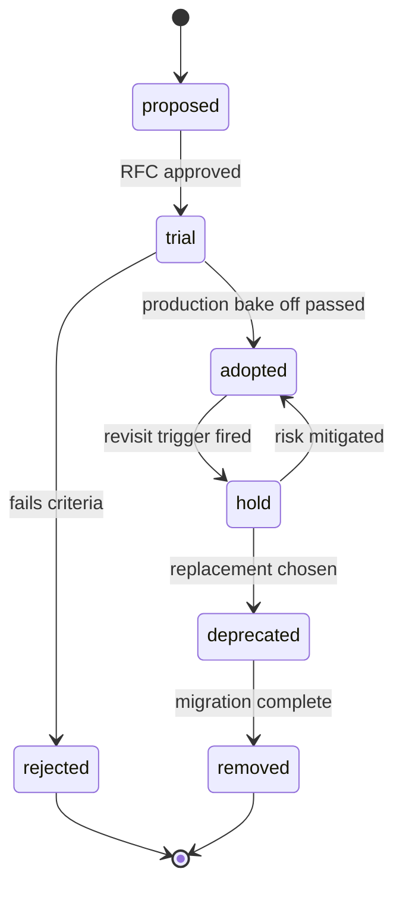
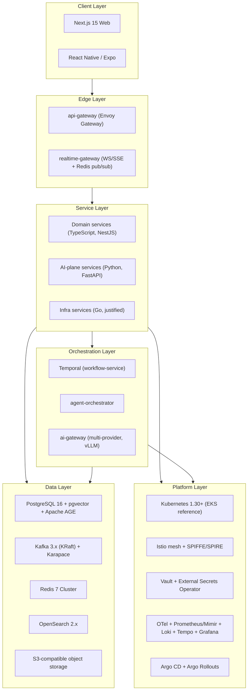
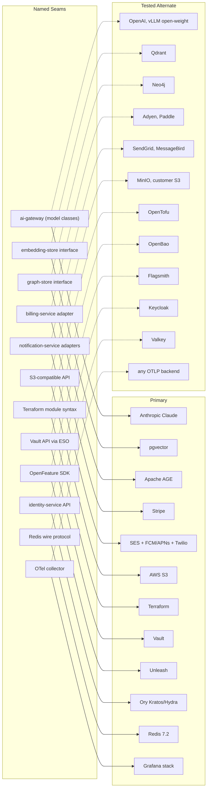

# 06 — Technology Stack

| | |
|---|---|
| Document ID | ACA-SAS-06 |
| Volume | 1 — Foundation |
| Status | Draft v1.0 |
| Depends on | [00 — Architecture Canon](../00-architecture-canon.md), [01 — Executive Summary](01-executive-summary.md), [04 — Non-Functional Requirements](04-non-functional-requirements.md) |

## 1. Overview

This chapter justifies every selection in canon §3. The canon states *what* we chose; this chapter records *why*, what we rejected, and under which conditions each decision should be revisited. It also defines the policies that keep the stack healthy over time: version and upgrade policy, the vendor-agnostic seams inventory, build-vs-buy principles, and a licensing review.

Two product properties from [01 — Executive Summary](01-executive-summary.md) dominate stack selection. First, ACA performs **consequential actions with user credentials**, which forces self-hostability (enterprise cells, EU data residency), auditable infrastructure, and P0/P1 data never leaving our trust boundary — this alone eliminates several SaaS-only options (Pinecone, Auth0, managed-only observability). Second, the core workload is **long-running, failure-prone, and cost-variable** (crawling, LLM inference, hostile browser automation), which forces durable execution, replayable event streams, and fine-grained cost attribution into the infrastructure layer rather than the application layer.

Every selection is scored against the decision drivers in §2. Where the market is volatile (LLM providers, vector stores, payments) we buy through a named seam; where the technology is a commodity (Postgres, Kafka, Kubernetes) we adopt the ecosystem default and invest in operations; where the capability is our moat (Universal Portal Engine, agent runtime, matching) we build. Nothing in this chapter contradicts the canon; decisions the canon does not cover are listed in §22 for promotion.

## 2. Decision Framework and Build-vs-Buy Principles

### 2.1 Decision drivers

| # | Driver | Weight | Rationale |
|---|---|---|---|
| D1 | Self-hostable / data-residency capable | High | Enterprise cells, EU pinning, P0/P1 data must stay in our VPC (canon §11, §15) |
| D2 | License safety for a commercial SaaS | High | No copyleft obligations on distributed components; no rug-pull exposure without a fork path |
| D3 | Operational maturity at 30-service scale | High | One platform team cannot babysit exotic infrastructure; prefer boring, widely-run systems |
| D4 | Ecosystem leverage | Medium | CDC, connectors, SDKs in TypeScript + Python + Go (canon §3 languages) |
| D5 | Cloud-agnosticism | Medium | AWS reference, GKE/AKS supported (canon §3); no service hard-wired to one cloud API |
| D6 | Cost shape at 10x scale | Medium | Per-request pricing models are hostile to agentic workloads with high event volume |
| D7 | Hiring pool | Low-Medium | Mainstream stacks reduce onboarding time for senior engineers |

### 2.2 Build-vs-buy principles

| # | Principle | Consequence |
|---|---|---|
| P1 | Never build commodity infrastructure | Databases, brokers, meshes, schedulers are adopted, not written |
| P2 | Build the moat | Universal Portal Engine, agent runtime, matching, portal memory are in-house — no vendor sells them |
| P3 | Buy through a seam when the market is volatile | LLM providers, vector store, payments, email — adapter interfaces, contract-tested (§15) |
| P4 | Wrap, don't fork | `workflow-service` wraps Temporal; `ai-gateway` wraps providers; forks only as licensing escape hatches |
| P5 | Self-host by default, managed where undifferentiated | Kafka, Temporal, Vault self-hosted; object storage and CDN managed |
| P6 | Two application languages, one infra language | TypeScript (NestJS) and Python (FastAPI); Go only with per-service justification (canon §3) |
| P7 | Every adopted technology enters a lifecycle | See §2.3; nothing is "permanent", everything has a revisit trigger |

### 2.3 Technology lifecycle

Every stack element is tracked on an internal radar with an owner and a revisit trigger (license change, maintainer risk, scale ceiling, better alternative reaching maturity).

## 3. Stack at a Glance

Sections 4–13 justify each layer. Each flagship decision gets a tradeoff table; remaining canon §3 rows are covered in the consolidated table in §13.4.

## 4. Runtime Platform and Delivery

### 4.1 Kubernetes 1.30+ (EKS reference)

**Purpose.** Single substrate for 30 services, worker fleets, browser pods, and self-hosted model serving. **Responsibilities:** scheduling, autoscaling, network policy, workload identity attachment points. **Interactions:** everything; notably `browser-fleet-service` requires RuntimeClass support for gVisor and fast pod churn (thousands of ephemeral pods/day).

| Option | Pros | Cons | Verdict |
|---|---|---|---|
| Kubernetes (EKS reference) | gVisor RuntimeClass, GPU node pools for vLLM, mesh + SPIFFE ecosystem, cloud-agnostic manifests | Operational depth required; upgrade treadmill | **Selected** |
| ECS / Fargate | Less ops | No gVisor control, weak mesh story, AWS-only — violates D5 | Rejected |
| Nomad | Simple, good batch | Ecosystem gap (mesh, operators, ESO), HashiCorp BUSL trajectory | Rejected |
| PaaS (Fly/Render/Heroku-class) | Fastest start | No isolation guarantees for browser fleet, no cells, cost shape at scale | Rejected |

Failure/scaling/security/monitoring for the cluster layer are owned by Volume 6; this chapter fixes only the selection and the constraint that **manifests remain cloud-agnostic** (kustomize/Helm values per cloud, no cloud-specific CRDs in service charts; cloud-specific wiring lives in Terraform).

### 4.2 IaC — Terraform + Terragrunt

Terraform for provider breadth and team familiarity; Terragrunt for DRY per-environment/per-cell composition (cells multiply environments — canon §15 — and naive Terraform workspaces do not scale to N cells × 3 environments). State in object storage with locking.

**Licensing caution:** Terraform moved to BUSL 1.1. BUSL restricts *competing* products, which ACA is not, so use is safe today — but the seam is named: **OpenTofu (MPL-2.0)** is a drop-in replacement while we remain on ≤1.5-compatible module syntax; module CI runs a weekly OpenTofu plan-parity check so the escape hatch stays real (§15). Pulumi was rejected: general-purpose-language IaC invites application logic in infrastructure code, and its state service defaults to SaaS.

### 4.3 Packaging — Docker (distroless/Chainguard), Helm

Distroless/Chainguard bases minimize CVE surface for the 30 services (drivers D2, security canon). **Note:** Chainguard's free tier tracks `latest` only; version-pinned images require a subscription. Decision: mirror all base images into our registry, prefer Google distroless (Apache-2.0) where a Chainguard subscription is not justified, and rebuild weekly. One umbrella Helm chart plus per-service charts (canon §3): the umbrella pins the tested combination per release train; per-service charts allow independent canary.

### 4.4 GitOps — Argo CD + Argo Rollouts; GitHub Actions CI

| Option | Pros | Cons | Verdict |
|---|---|---|---|
| Argo CD + Rollouts | UI for 30-service fleet, ApplicationSets per cell, Rollouts = canary/blue-green with metric analysis (canon §15) | Heavier than Flux | **Selected** |
| Flux + Flagger | Lightweight, GitOps-pure | Weaker multi-tenant UI for ops/support; Flagger analysis less flexible than Rollouts + Prometheus queries | Rejected |
| Spinnaker | Battle-tested pipelines | Operational weight, declining community energy | Rejected |

CI on GitHub Actions because the repos live on GitHub (D4); self-hosted runners for jobs needing VPC access (integration tests against ephemeral Kafka/Postgres). CI produces signed images + SBOMs (§19); CD is pull-based via Argo — CI never holds cluster credentials.

## 5. Edge and Mesh

### 5.1 Service mesh — Istio vs Linkerd vs none

**Purpose.** mTLS everywhere, SPIFFE workload identity, L7 authorization, traffic policy, and controlled egress — the zero-trust substrate (canon §13). The browser fleet's per-session egress allowlists and the mesh-level deny-by-default posture are hard requirements, not conveniences.

| Criterion | Istio | Linkerd | None (NetworkPolicy + app mTLS) |
|---|---|---|---|
| mTLS + SPIFFE/SPIRE integration | Native, mature | mTLS yes; SPIRE integration weaker | Hand-rolled in 30 services — rejected outright |
| L7 authz (per-method, ext-authz) | Rich (AuthorizationPolicy + ext-authz to OPA) | Basic policy; no ext-authz equivalent | N/A |
| Egress control (egress gateway, per-workload allowlists) | First-class | Limited | L3/L4 only |
| Operational cost | High (mitigated by ambient mode, phase 2 evaluation) | Low | Hidden but higher (cert rotation ×30 services) |
| Licensing / stewardship | Apache-2.0, CNCF graduated | Apache-2.0, but stable binary distributions gated behind Buoyant Enterprise since 2024 — supply risk | — |
| Verdict | **Selected** | Rejected | Rejected |

The honest tradeoff: Istio is the most complex component in the platform layer, and most incidents in mesh-adopting organizations trace to it. We accept this because the alternative is implementing L7 authz, egress control, and identity in every service — strictly worse. Mitigations: sidecar-injection scoped per-namespace, ambient-mode evaluation in Phase 2 to remove the sidecar tax, and a mesh-bypass break-glass runbook (Volume 6).

### 5.2 Edge — Envoy Gateway + ext-authz (`api-gateway`)

Gateway API standard keeps routing config portable (D5); the custom ext-authz filter centralizes JWT validation, coarse entitlement checks (canon §12), and rate limiting at one hop. Alternatives: Kong (OSS/enterprise feature split moves the roadmap out of our control), AWS API Gateway (per-request pricing hostile to D6, AWS-only), NGINX Ingress (no Gateway API-native policy attachment, weaker ext-authz story). Envoy alignment also means one L7 dataplane technology across mesh and edge — one skill set, one CVE stream.

`realtime-gateway` is a custom NestJS service (WebSocket + SSE over Redis pub/sub) rather than a managed push product (Pusher/Ably): fan-out is trivially self-hostable, P1 data stays inside the VPC, and the realtime delivery SLO (p95 < 2 s, canon §14) is achievable without a third party in the hot path.

## 6. Languages and Frameworks

### 6.1 NestJS vs Express vs Fastify (TypeScript domain services)

| Criterion | NestJS | Express | Fastify (raw) |
|---|---|---|---|
| Structure across ~20 services | Enforced modules/DI/testing idioms — critical at fleet scale | None; 20 bespoke architectures | Plugin idioms, still per-team |
| gRPC + Kafka transports | First-class microservice transports | DIY | DIY |
| OpenAPI generation | Decorator-driven, canonical | Manual | Schema-driven, good |
| Performance | Runs on Fastify adapter — near-Fastify throughput | Slowest; legacy middleware model | Fastest |
| Hiring/onboarding | Large pool, opinionated docs | Universal but low-signal | Moderate |
| Verdict | **Selected (with Fastify adapter)** | Rejected | Rejected as fleet standard |

The real risk with NestJS is framework magic (DI container, decorators) obscuring control flow. Accepted because the alternative — 20 hand-structured services — historically decays worse. Decision recorded: **NestJS runs on the Fastify HTTP adapter platform-wide** (perf without giving up structure).

### 6.2 Python (FastAPI) for the AI plane; Go by exception

FastAPI for `ai-gateway` internals, agent runtime, `learning-pipeline`, `portal-intelligence-service` ML: the ML ecosystem is Python (vLLM, torch, evals), async-first FastAPI handles high-concurrency LLM fan-out, and Pydantic models double as tool-schema validators (canon §9 tool calling). Go is permitted only where a service is CPU/network-bound with tiny domain logic — `proxy-manager` and `scheduler-service` qualify (canon §3); each Go adoption requires an RFC proving TypeScript/Python cannot meet the perf envelope.

### 6.3 Frontend — Next.js 15; Mobile — React Native (Expo)

Next.js 15 (App Router, RSC) self-hosted on Kubernetes behind a CDN — not on Vercel, to keep D1/D5 and avoid per-invocation pricing (D6). RSC reduces client bundle for dashboard-heavy views; TanStack Query + Zustand split server-state from UI-state cleanly; shadcn/ui gives owned-source components (no component-library lock-in — code lives in our repo). Alternatives: Remix/SvelteKit (smaller ecosystems, no RSC-equivalent maturity), plain SPA (SEO + TTI penalties on marketing/onboarding surfaces). Expo over Flutter: shares the TypeScript skill pool and the public API client; Flutter would fork the frontend guild into Dart.

## 7. Async Backbone — Kafka vs Pulsar vs SQS/SNS

**Purpose.** The event backbone carries every domain fact (canon §8) and feeds `learning-pipeline` — which means **replayable, ordered, long-retention** streams are a functional requirement, not an optimization.

| Criterion | Kafka 3.x (KRaft) | Pulsar | SQS/SNS | NATS JetStream |
|---|---|---|---|---|
| Replay + retention (learning loop, projections rebuild) | Native; tiered storage | Native; tiered storage | None (14-day queues, no replay) | Limited |
| Per-key ordering at scale | Partitions by `tenant_id`/entity | Yes (Key_Shared caveats) | FIFO caps ~3k msg/s/group | Limited |
| CDC / outbox ecosystem | **Debezium — canonical outbox (canon §8) requires it** | Weak Debezium support | None | None |
| Schema governance | Registry ecosystem (Karapace) | Built-in, less tooling | None | None |
| Ops burden | Moderate (KRaft removed ZooKeeper) | High (brokers + BookKeeper) | None | Low |
| Cloud-agnostic (D5) | Yes | Yes | AWS-only | Yes |
| Verdict | **Selected** | Rejected | Rejected | Rejected |

Pulsar's native multi-tenancy was seriously considered for the cell model; rejected because the Debezium/Connect ecosystem gap breaks the outbox pattern the canon mandates, and two-tier storage (brokers + BookKeeper) roughly doubles the moving parts. SQS/SNS fails four criteria at once. **Schema Registry: Karapace** (Apache-2.0, Confluent-API-compatible) — Confluent's own registry is under the Confluent Community License, which prohibits offering it as part of a competing service and complicates enterprise on-prem cells; API compatibility keeps client tooling standard (decision recorded, §22).

Baseline configuration (defaults, tuned per topic in Volume 4): 12 partitions per core topic (headroom for consumer parallelism at 10x without repartition churn), RF=3 min.insync.replicas=2 (survive one broker loss without accepting silent underreplication), 7-day hot retention with tiered storage beyond (canon §11).

## 8. Durable Execution — Temporal vs Camunda vs Step Functions

**Purpose.** Application-submission sagas, autopilot runs, import pipelines, re-crawl campaigns: multi-step, hours-to-days-long, must survive worker/pod/region failure with exactly-once *effect* semantics (canon §2, §8). `workflow-service` wraps the Temporal cluster and owns worker fleets; no other service talks to Temporal directly (P4).

| Criterion | Temporal (self-hosted) | Camunda 8 / Zeebe | AWS Step Functions | Airflow / custom sagas |
|---|---|---|---|---|
| Programming model | Code-first, deterministic replay — fits agent loops with dynamic branching | BPMN-first; dynamic agent plans fight the modeler | ASL JSON state machines; poor fit for dynamic plans | DAGs are batch-shaped; custom = building Temporal badly |
| Language SDKs | TS + Python + Go — matches canon languages exactly | Java-centric; other SDKs thinner | SDK-less (JSON) | Python only |
| Long-running + HITL (approval checkpoints, L1/L2) | Signals/updates + timers, days-long workflows natural | Human-task support exists, code-level HITL clumsy | 1-year cap, 25k event history limit bites long autopilot runs | Poor |
| Self-host / cells / EU residency (D1) | Yes; persistence on Postgres, visibility on OpenSearch — reuses our stack | Self-managed Zeebe under source-available license | Managed-only, AWS-only — violates D1/D5 | Yes |
| License | MIT | Camunda License (source-available) — D2 fail for on-prem cells | Proprietary | Apache-2.0 |
| Cost shape (D6) | Infra + ops only | Seat/volume licensing | Per-state-transition pricing explodes at agent-step volume | Infra |
| Verdict | **Selected** | Rejected | Rejected | Rejected |

The honest cost: Temporal's determinism constraints (no direct I/O in workflow code, versioned patching of in-flight workflows) demand developer discipline, and the cluster is another stateful system to run. Both are mitigated: `workflow-service` publishes lint rules + templates for workflow code, and the cluster persists to the same Postgres tooling we already operate. **Cluster decision recorded:** history shard count fixed at **4096** at cluster creation (immutable thereafter; sized for ~10x projected concurrent workflow load — resharding requires a cluster rebuild, so we over-provision deliberately). Visibility store on OpenSearch 2.x (supported by Temporal; avoids introducing Elasticsearch — §9.5, §16).

## 9. Data Layer

### 9.1 PostgreSQL 16 — the default database

One logical DB per service (canon §11). Deciding factor over MySQL/CockroachDB/DynamoDB: **Row-Level Security is the tenant-isolation enforcement point** (canon §6) — RLS with `SET app.tenant_id` gives database-enforced tenancy that MySQL lacks natively and DynamoDB can only approximate in the application layer. Postgres additionally hosts pgvector and Apache AGE (below), collapsing three infrastructure classes into one operational skill in Phase 1. CockroachDB was rejected for Phase 1: serializable-by-default performance cost, licensing (BUSL), and our multi-region posture is active-passive (canon §15) — we do not need global consistency yet; revisit trigger: active-active OLTP requirement. Reference operators: Aurora (managed) or CloudNativePG (cells/on-prem) — both behind standard Postgres wire protocol, so the choice stays per-deployment.

### 9.2 Vector store — pgvector vs Qdrant vs Pinecone

| Criterion | pgvector (phase 1) | Qdrant (phase 2 path) | Pinecone |
|---|---|---|---|
| Tenant isolation | **Inherits Postgres RLS — vectors are rows** | App-layer filters; per-collection isolation | App-layer namespace filters |
| Data residency / cells (D1) | Trivially — same DB | Self-hostable, Apache-2.0 | SaaS-only — P1/P2 embeddings leave VPC — **disqualifying** |
| Transactional consistency with source rows | Same-transaction insert of row + embedding | Dual-write problem | Dual-write problem |
| ANN scale ceiling | HNSW comfortable to ~10M vectors/namespace; filtered search degrades earlier | Purpose-built: quantization, payload-indexed filtering, horizontal shards | High, at per-vector cost |
| Ops | Zero new systems | One new system | None (but D1 fail) |
| Verdict | **Selected phase 1** | **Named scale path** | Rejected |

The `embedding-store` interface (canon §3) is the seam: namespace-scoped upsert/query/delete with dimension-versioned indices (canon §10.5). Migration trigger to Qdrant: any namespace exceeding ~10M vectors, p95 filtered-kNN > 100 ms sustained, or index-build memory pressure on the owning service's DB. Dual-read during migration per canon §10.5. Weaviate (BSD-3) and Milvus (Apache-2.0) remain acceptable substitutes behind the same interface if Qdrant's trajectory changes; OpenSearch k-NN was rejected as primary (index refresh semantics and recall/latency tuning inferior for high-churn per-user namespaces).

### 9.3 Graph store — Apache AGE (phase 1) → Neo4j (phase 2)

`knowledge-graph-service` needs entity/relationship queries (user↔company↔skill↔outcome). AGE gives openCypher on Postgres — again zero new infrastructure and RLS-adjacent tenancy. Ceiling: multi-hop traversals over >100M edges. Neo4j is the named phase-2 path behind the `graph-store` interface; note Neo4j Community is GPLv3 and clustering is Enterprise-commercial — the phase-2 decision therefore carries a real licensing cost line, which is exactly why it is deferred until graph query volume proves it (§16). Neptune rejected (AWS-only, violates D5).

### 9.4 Redis 7 (Cluster mode) — with a licensing seam

Exact cache, session state, rate-limit counters, idempotency dedup, semantic-cache metadata, realtime pub/sub (canon §3). **Licensing:** Redis changed licenses after 7.2 (RSALv2/SSPL dual; AGPL added later in v8). Decision recorded: **pin the 7.2.x line (BSD-3)** for as long as security backports allow, and name **Valkey** (BSD-3, Linux Foundation fork, protocol-compatible) as the successor — all access goes through standard clients, so the seam is the wire protocol itself. Dragonfly was rejected (BSL license, smaller operational track record). Revisit trigger: first 7.2 CVE without a backport.

### 9.5 Search — OpenSearch vs Elasticsearch vs Typesense

| Criterion | OpenSearch 2.x | Elasticsearch 8.x | Typesense | Meilisearch |
|---|---|---|---|---|
| License (D2) | Apache-2.0 (Linux Foundation) | ELv2/SSPL (+AGPLv3 option since 2024) — legal review burden per deployment, on-prem cells awkward | GPL-3.0 server | MIT |
| Jobs index scale (100M+ docs, heavy aggregations) | Yes — shards, ILM, aggregations | Yes (best-in-class) | Memory-resident model; aggregations weak — fails at target scale | Similar ceiling |
| Security / multi-tenant filtering | Security plugin (per-index/DLS) | Strong (paid tiers) | Basic API keys | Basic |
| k-NN adjacency (hybrid search, phase 2) | k-NN plugin | Yes | Yes | Yes |
| Managed option on reference cloud | AWS OpenSearch Service | Elastic Cloud only | None serious | None serious |
| Verdict | **Selected** | Rejected | Rejected | Rejected |

Elasticsearch is technically ahead in places (ES|QL, vector maturity), and the 2024 AGPLv3 option softens the licensing story — but AGPL on a search server we ship inside on-prem enterprise cells is precisely the obligation we refuse (D2), and running two search products (ES for SaaS, something else for cells) is worse than OpenSearch everywhere. Typesense/Meilisearch are excellent for storefront-style instant search but are not aggregation engines; the jobs index is analytics-shaped (facets, salary histograms, dedup heuristics). OpenSearch also serves as the Temporal visibility store (§8), amortizing its ops cost.

### 9.6 Object storage and analytics path

S3-compatible API is the portability contract (canon §3): AWS S3 in SaaS, **MinIO for on-prem cells with an explicit AGPLv3 review** — because in on-prem cells we *distribute* the stack, AGPL obligations activate; the fallback is customer-provided S3-compatible storage (most enterprises have one) — see §16. Analytics: OLAP schema in Postgres phase 1, **ClickHouse (Apache-2.0) phase 2** when `analytics-service` projections exceed Postgres aggregation comfort (canon §4.5 already anticipates this); Druid/Pinot rejected (ops weight vs. our query shapes), warehouse SaaS (BigQuery/Snowflake) rejected for the product path by D1/D5 — acceptable later for internal BI only.

## 10. AI Serving Stack

All model access flows through `ai-gateway` (canon §9 — invariant). Stack choices behind it:

- **Multi-provider LLMs** — Anthropic Claude family primary, OpenAI secondary, self-hosted open-weight via **vLLM** (Apache-2.0) for the `small`/`embed` classes and burst-insensitive batch lanes. Rationale: provider concentration is a business risk (quality regressions, price moves, availability); the model-class abstraction (canon §10.1) makes providers substitutable per class. vLLM over TGI/Ollama-class servers: continuous batching + PagedAttention throughput, first-class OpenAI-compatible serving API, healthy multi-org governance.
- **Embeddings** — bge-class open-weight (MIT) served via vLLM/TEI; provider embeddings as fallback only (canon §3). Owning the embedding model removes a per-token cost from the highest-volume call class and keeps P2 career text in-VPC; dimension-versioned per canon §10.5.
- **No LangChain-class framework dependency in the runtime.** The agent loop, context builder, and tool registry are in-house (canon §9 defines them precisely); orchestration frameworks churn fast, blur prompt provenance (breaks `prompt_id@semver` discipline), and add abstraction layers exactly where we need deterministic control for caching (stable-prefix design, canon §10.2). Libraries may be used in offline research, never in the serving path. This is a build-the-moat call (P2).
- **GPU capacity** — dedicated node pools (reference: L4/A10-class for embeddings + small models); frontier/large classes stay provider-hosted in Phase 1 — self-hosting them fails D6 at our utilization. Revisit trigger: sustained provider spend > 3x equivalent reserved-GPU cost for a class.

## 11. Security and Identity Stack

### 11.1 Identity — Ory (Kratos/Hydra) reference vs Keycloak vs Auth0/Cognito

| Criterion | Ory Kratos/Hydra | Keycloak | Auth0 / Cognito |
|---|---|---|---|
| Deployment model | API-first libraries/services — composable into `identity-service`, headless UX | Monolithic server + themes; UX customization fights the product | SaaS — P1 identity data + session control outside VPC (D1 fail for enterprise cells) |
| Protocol coverage | OAuth2.1/OIDC, WebAuthn/passkeys, TOTP — matches canon §3 list | Complete, mature SAML | Complete |
| Multi-tenant fit | Schema-per-tenant patterns workable; we own the data model | Realms model is heavyweight at individual-tenant volume (millions of single-member tenants) | Per-MAU pricing hostile at free-tier scale (D6) |
| License | Apache-2.0 | Apache-2.0 (CNCF) | Proprietary |
| Verdict | **Selected as reference implementation inside `identity-service`** | Rejected (kept as acceptable substitute for enterprise-cell SAML if Ory SAML federation proves thin) | Rejected |

The canon phrases this correctly: `identity-service` is ours; Ory is the *reference implementation inside it* — the seam is our own service API, so replacing Ory never touches other services.

### 11.2 Authorization — OPA (Rego)

RBAC + ABAC via OPA sidecar/library with `policy-service` distributing bundles (canon §3). OPA over alternatives: Cedar (strong formal model but young ecosystem, AWS-gravity), Casbin (model too thin for consent/automation policies), SpiceDB/Zanzibar-class (relationship authz is overkill — our authz is attribute-heavy, relationship-light; revisit if sharing/collaboration features grow). Decisive: the same engine evaluates API authz, agent tool-call policy checks (canon §9), and Kubernetes admission — one policy language across product and platform.

### 11.3 Secrets — Vault + External Secrets Operator; KMS envelope encryption

Vault for dynamic DB credentials, PKI, and the transit engine backing `session-vault-service` envelope encryption (per-tenant KEKs, canon §11 P0). **Licensing:** Vault is BUSL 1.1 — same posture as Terraform: safe for our use, seam named (**OpenBao**, MPL-2.0 fork, API-compatible) and exercised by running the ESO integration tests against OpenBao quarterly. Cloud KMS (AWS KMS reference) remains the root of envelope encryption per canon; SPIFFE/SPIRE issues workload identity so secrets access is workload-bound, not token-bound.

## 12. Observability Stack

OTel-native everything (canon §14): instrumentation is vendor-neutral by construction — the collector is the seam, backends are swappable.

| Criterion | Grafana stack (Prometheus/Mimir, Loki, Tempo) | Datadog | New Relic / Honeycomb |
|---|---|---|---|
| Cost shape at agent-scale telemetry (D6) | Infra-bound; high-cardinality cost controlled by us | Per-host + per-GB + per-span — agentic workloads generate telemetry disproportionate to revenue | Similar SaaS pricing exposure |
| Data residency (D1) | Self-hosted, per-cell possible | SaaS | SaaS |
| Correlation (traces↔logs↔metrics + `traceparent` through Kafka/Temporal) | Native via Grafana + OTel | Excellent | Excellent (Honeycomb tracing best-in-class) |
| License | AGPLv3 (Grafana/Loki/Tempo/Mimir) — fine for internal use, **not shipped inside customer cells**; cells export OTLP to our central plane or customer's own backend | Proprietary | Proprietary |
| Verdict | **Selected** | Rejected (approved as optional overlay for business dashboards if ever needed) | Rejected |

Alertmanager → PagerDuty for paging (canon §14); PagerDuty is a leaf dependency (alert delivery only), acceptable SaaS.

## 13. Business and Product Tooling

### 13.1 Billing — Stripe behind `billing-service`

Stripe: best-in-class API, Billing (subscriptions, proration, dunning), Tax, and revenue-share economics understood. Lock-in is real (subscription state lives in Stripe), so the canon-mandated adapter in `billing-service` isolates: provider-neutral domain model (plans/subscriptions/entitlements owned by us in Postgres — Stripe is the charging engine, not the source of truth for entitlements), webhook normalization, and Adyen/Paddle adapters as compile-time proofs the interface holds. Paddle specifically covers the merchant-of-record path for tax-heavy international expansion.

### 13.2 Notifications — SES/SendGrid, FCM/APNs, Twilio behind `notification-service`

Deliverability risk is vendor-diversified by design: email adapter supports SES (cost) and SendGrid (deliverability tooling) with per-tenant routing; push is FCM/APNs (no alternative exists); SMS via Twilio adapter (MessageBird/SNS substitutable). All channel choices sit behind `notification-service` so no product service knows a channel vendor exists.

### 13.3 Feature flags — OpenFeature + Unleash; Browser automation — Playwright

**Flags:** OpenFeature SDK is the seam (CNCF standard API); Unleash (Apache-2.0 OSS server) self-hosted behind it as `feature-flag-service`. LaunchDarkly rejected (SaaS in the request path + per-seat/MAU pricing); Flagsmith acceptable substitute. Flags gate progressive delivery (with Argo Rollouts) and per-tenant capability rollout — flag evaluation must work inside cells, hence self-hosted.

**Browser automation:** Playwright (Apache-2.0) — auto-waiting model, first-class Chromium DevTools control, network interception, trace artifacts (feeding `portal-intelligence-service` learning), and TS + Python clients matching our languages. Selenium rejected (WebDriver indirection too lossy for perceive→plan→act→verify loops); Puppeteer rejected (Chrome-team governance narrower, no cross-language parity). Chromium primary; Firefox/WebKit available for fingerprint diversity where policy permits (Volume 7 owns that discussion).

### 13.4 Remaining canon §3 rows — consolidated justification

| Concern | Choice | Strongest alternative | Deciding factor |
|---|---|---|---|
| Protobuf governance | Buf | protoc + scripts | Breaking-change CI checks, schema registry (BSR optional) |
| CDC | Debezium | polling outbox relays | Log-based capture, exactly the outbox tooling Kafka ecosystem assumes |
| Mobile | React Native (Expo) | Flutter | TS skill pool + shared API client (§6.3) |
| Browser isolation | gVisor | Kata Containers / Firecracker | Syscall-filter model fits per-pod browser sandboxing; no nested-virt requirement on nodes |
| Workload identity | SPIFFE/SPIRE | cloud IAM only | Cloud-agnostic identity (D5), mesh integration |
| DB migrations | Flyway/Atlas | Liquibase | Forward-only SQL-first discipline (canon §11) |
| Scheduling | `scheduler-service` (Go) + cron/RRULE | K8s CronJobs only | Tenant-aware fan-out, RRULE semantics, publish-to-Kafka trigger model |
| CDN | Cloud CDN in front of Next.js | Vercel edge | D1/D5/D6 (§6.3) |

## 14. Version and Upgrade Policy

Principles: pin everything, upgrade on a rhythm not on a fire, rehearse in staging with production-shaped load, never couple a platform upgrade with a product release.

| Component class | Pinning | Cadence | Method |
|---|---|---|---|
| Kubernetes | Exact minor, fleet-wide | N-1 vs newest EKS minor; upgrade within 90 days of provider GA | Surge node pools, PDB-respecting drains; per-cell rings (dev → staging → prod cells) |
| Postgres | Major pinned/yr; minor monthly | Major annually | Logical-replication blue-green cutover; expand→migrate→contract for app schemas (canon §11) |
| Kafka | Exact broker version | Minor ≈ quarterly | Rolling broker restart, canary consumer lag watch |
| Temporal | Server + SDK matrix pinned together | Server ≈ quarterly | Rolling upgrade (supports it); workflow code via versioned patching |
| Istio / Envoy Gateway | Exact | Track n-1 minor; CVE-driven patch | Revisioned canary control plane, namespace-by-namespace dataplane migration |
| Node.js / Python runtimes | Active LTS only | LTS migration within 6 months of new LTS | Renovate PRs per service; umbrella chart gates the train |
| Direct libraries | Lockfiles everywhere | Renovate: patch auto-merge on green CI; minor weekly batch; major per-RFC | Contract tests must pass; SBOM diff reviewed |
| Base images | Digest-pinned | Weekly rebuild | Registry mirror; trivy gate |
| LLM provider models | Model IDs pinned per model class in `ai-gateway` config | Provider-driven; new model = eval-gated promotion | Golden-set evals (canon §10.4), canary routing channel, auto-rollback |

CVE SLA: critical 48 h, high 7 d, medium 30 d (aligned with SOC 2 commitments, Volume 5). Every third-party *service* dependency (Stripe, PagerDuty, providers) carries an owner, a quarterly API-deprecation review, and a documented degradation mode (§17).

## 15. Vendor-Agnostic Seams Inventory

The canon names the seams; this is the authoritative inventory with switching mechanics. A seam is only real if it is **tested** — each row lists its verification.

| Seam | Switching cost (est.) | Verification that the seam is real |
|---|---|---|
| LLM providers via `ai-gateway` | Days per model class | Continuous: multi-provider failover exercised in production routing; eval parity per class |
| `embedding-store` | Weeks (re-embed + dual-read) | Qdrant adapter kept green in CI against interface contract tests |
| `graph-store` | Weeks | Contract tests on openCypher subset both engines support |
| Payments adapter | Weeks–months (data migration) | Adyen adapter passes billing contract suite quarterly |
| Notification channel adapters | Days | Secondary email provider live for a tenant slice at all times |
| Object storage | Days | MinIO used in dev/CI daily — de facto continuous verification |
| IaC (OpenTofu) | Days | Weekly `tofu plan` parity job on module repo |
| Secrets (OpenBao) | Days–weeks | Quarterly ESO integration suite against OpenBao |
| Feature flags (OpenFeature) | Days | SDK-level seam; Flagsmith smoke test semiannually |
| Identity implementation | Months | Seam = our own `identity-service` API; other services never see Ory types (CI lint rule) |
| Redis → Valkey | Days | Protocol-level; Valkey job in CI cache tests |
| Observability backend | Weeks | OTLP export config only; no vendor SDKs in services (CI lint rule) |
| **Non-seams (accepted lock-in)** | — | Kafka (ecosystem-coupled via Debezium/Karapace), Temporal (workflow code model), Kubernetes, Postgres — documented as committed foundations; exit = migration project, mitigated by their licenses and ubiquity |

Honesty matters here: Temporal and Kafka are **not** behind seams — pretending otherwise would be architecture theater. They are chosen precisely because their licenses (MIT, Apache-2.0) and community breadth make forced exit unlikely.

## 16. Licensing Review

| Component | License | Risk assessment |
|---|---|---|
| Kubernetes, Kafka, OpenSearch, Istio, Envoy, Argo, Helm, OPA, SPIFFE/SPIRE, Debezium, Karapace, vLLM, Playwright, gVisor, Qdrant, ClickHouse, Ory, Keycloak, Prometheus, OTel, CloudNativePG | Apache-2.0 | Green — no obligations of concern |
| Temporal, NestJS, Next.js, Expo, Tailwind, shadcn/ui, TanStack, Zustand, Meilisearch (unused), bge models | MIT | Green |
| PostgreSQL, pgvector | PostgreSQL License | Green |
| Redis 7.2 | BSD-3 (last BSD line) | Amber — successor versions RSALv2/SSPL/AGPL; pinned line + Valkey seam (§9.4) |
| Terraform, Vault | BUSL 1.1 | Amber — safe for our (non-competing) use; OpenTofu/OpenBao seams kept green (§4.2, §11.3) |
| Grafana, Loki, Tempo, Mimir | AGPLv3 | Amber — internal SaaS use only; **never shipped inside customer-operated cells**; cells export OTLP outward (§12) |
| MinIO | AGPLv3 | Amber — used in dev/CI freely; for distributed on-prem cells, legal review or customer-provided S3 (§9.6) |
| Elasticsearch | ELv2/SSPL/AGPLv3 | Avoided — OpenSearch selected (§9.5) |
| Confluent Schema Registry | Confluent Community License | Avoided — Karapace selected (§7) |
| Neo4j (phase 2) | GPLv3 community / commercial enterprise | Amber — phase-2 decision must budget commercial licensing for clustering; deferred deliberately (§9.3) |
| Typesense | GPL-3.0 | Avoided |
| Linkerd stable distributions | Apache-2.0 + Buoyant distribution gating | Avoided (§5.1) |
| Camunda 8 / Zeebe | Camunda License (source-available) | Avoided (§8) |
| Stripe, PagerDuty, Twilio, SendGrid, provider LLM APIs | Proprietary SaaS | Green as leaf/seamed dependencies; contract + DPA review per Volume 5 |

Automation: license scanning (SPDX via SBOM) in CI blocks introduction of copyleft licenses into distributed artifacts; the allowlist is this table. Any new license class requires legal review before merge.

## 17. Failure Scenarios

Stack-level dependency failures and their designed degradation modes (service-level detail in the owning chapters):

| Dependency down | Blast radius | Designed behavior |
|---|---|---|
| Kafka | All async flows | Producers buffer via outbox tables (Debezium resumes from WAL — no event loss); control-plane reads/writes continue; agents pause at next event boundary; SLO "job discovered → scored" degrades first |
| Temporal | Autopilot, submission sagas | Workers idle; in-flight workflows resume from history on recovery — no manual reconciliation; new consequential actions queue |
| Redis | Cache, rate limits, idempotency, realtime | Caches fall through to origin (latency rises); rate limiting fails to conservative static limits (fail-closed for unauthenticated, fail-open within plan floor for authenticated — protects availability SLO without opening abuse); realtime falls back to client polling |
| Postgres (one service's DB) | That service only | Bulkheaded by design (DB-per-service); PITR ≤ 5-min RPO (canon §11); dependent services degrade via stale read models |
| OpenSearch | Search, Temporal visibility | Jobs/app search degraded; index rebuild by Kafka replay (projections are disposable); Temporal core unaffected (visibility only) |
| Vault | Secret issuance | ESO-cached secrets + extended lease TTLs ride out short outages; new pod scheduling of secret-dependent services throttled |
| Primary LLM provider | AI plane | `ai-gateway` failover ladder per model class → secondary provider → vLLM small-class → queue non-interactive (canon §10.2); user-interactive floor protected |
| Stripe | Billing writes | Entitlement snapshots are signed + cached — product access unaffected; metering events buffer in Kafka; invoice operations queue |
| CDN / edge cloud AZ | Client access | Multi-AZ edge; active-passive region failover per canon §15 (RTO ≤ 30 min) |

The recurring pattern — buffer at the boundary, degrade by tier, protect user-interactive floors — is a direct consequence of choosing replayable (Kafka), durable (Temporal), and cache-fronted (Redis) infrastructure. This pattern is a stack property, not per-service heroics.

## 18. Scaling Strategy

- **Kubernetes:** cluster-per-cell (canon §15); HPA on RPS/lag/queue-depth per service class; Karpenter-style node autoscaling with dedicated pools (general / browser-gVisor / GPU). Browser fleet is the spikiest consumer — isolated node pool prevents it starving the control plane.
- **Kafka:** partitions sized for 10x (12/topic baseline, §7); scaling = broker adds + partition reassignment (rehearsed); per-tenant ordering preserved by key discipline, so partition count changes are the only re-keying hazard — done only at major topic versions.
- **Temporal:** 4096 history shards (§8) sized so worker fleets, not the cluster, are the scaling knob; per-domain task queues (autopilot, submission, import) scale worker deployments independently.
- **Postgres:** vertical first (boring and effective), read replicas for read-model-heavy services, time-based partitioning for high-volume tables and hash-by-`tenant_id` for cells (canon §11); services that outgrow single-writer Postgres are candidates for cell splitting before database exotics.
- **pgvector → Qdrant:** trigger-based migration path (§9.2) — the scaling strategy *is* the seam.
- **OpenSearch:** index-per-domain with ILM rollover; shard target ~30 GB (aggregation-friendly, recovery-friendly); jobs index is the first to shard by region/recency.
- **vLLM:** horizontal replicas per model; batch lane absorbs burst (canon §10.2) so interactive GPU capacity is sized for p95, not peak.

## 19. Security Considerations

Stack-level security posture (full treatment in Volume 5):

- **Supply chain:** digest-pinned distroless/Chainguard bases (§4.3); SBOM (syft) per image; cosign-signed images verified by admission policy; SLSA-leveling of build provenance on the CI runners; Renovate + trivy keep the patch train honest (§14).
- **License compliance as security:** the §16 allowlist is enforced in CI — an unnoticed AGPL dependency in a shipped cell is a legal incident, treated with incident-response severity.
- **Blast-radius by construction:** DB-per-service, mesh deny-by-default, per-session browser network policy, SPIFFE identity — the stack choices in §5, §9, §11 exist to make lateral movement structurally hard, not policy-hard.
- **Secrets:** no secrets in env-committed files (canon §13); Vault dynamic credentials mean most DB passwords do not exist at rest; P0 session material only ever in `session-vault-service` under per-tenant KEKs.
- **SaaS leaf dependencies** (Stripe, PagerDuty, providers): scoped credentials, egress-allowlisted from named services only, DPAs tracked in the Volume 5 vendor register.

## 20. Observability

Per canon §14, plus stack-specific requirements this chapter imposes:

- Every infrastructure component in §3 exposes Prometheus metrics and ships a curated Grafana dashboard + alert pack as part of its Helm chart — adopting a technology includes adopting its observability pack (definition of done for §2.3 `adopted`).
- **Upgrade observability:** every §14 upgrade runs behind Argo Rollouts metric analysis where applicable; platform upgrades emit annotated Grafana events so regressions correlate to platform, not product, changes.
- **Seam observability:** provider failover events, cache-tier hit rates, and adapter selection are first-class metrics — a silent failover that degrades quality is an incident (`ai-gateway` eval sampling per canon §10.4 catches it).
- Cost telemetry is part of the stack contract: `aca.ai.request.completed.v1` and `aca.billing.usage.recorded.v1` feed `cost-controller`; infra cost allocation via per-namespace/per-cell labels closes the loop between stack choices and D6.

## 21. Future Improvements

| Horizon | Item | Trigger |
|---|---|---|
| Phase 2 | Istio ambient mode (remove sidecar tax) | Ambient maturity on our K8s minor + mesh CPU >5% of fleet |
| Phase 2 | Qdrant cluster behind `embedding-store` | §9.2 triggers |
| Phase 2 | Neo4j behind `graph-store` (with commercial licensing decision) | Multi-hop query volume / AGE latency ceiling |
| Phase 2 | ClickHouse for `analytics-service` | Postgres OLAP aggregation p95 misses dashboards SLO |
| Phase 2 | Active-active stateless edge (canon §15) | EU tenant volume |
| Watch | Valkey migration | First unpatched Redis 7.2 CVE (§9.4) |
| Watch | OpenTofu switch | Terraform module ecosystem divergence or BUSL interpretation change |
| Watch | Self-hosting medium-class models | Provider spend > 3x reserved-GPU equivalent (§10) |
| Watch | Cilium/eBPF dataplane consolidation | Ambient-mode evaluation outcome |

## 22. Alternatives Considered & Tradeoffs

Every §4–§13 section carries its own tradeoff table; this section records the cross-cutting tradeoffs and the decisions this chapter adds beyond the canon (candidates for canon promotion):

**Cross-cutting tradeoffs accepted:**

1. **Operational depth over managed convenience.** Self-hosting Kafka, Temporal, Vault, OpenSearch, and the Grafana stack trades platform-team headcount for data residency, cost shape, and cell deployability. This is the single biggest bet in the chapter; it fails if the platform team is understaffed — flagged as a resourcing precondition, not an architecture nicety.
2. **Postgres-maximalism in Phase 1** (pgvector, AGE, OLAP schemas in Postgres) trades early scale ceilings for a radically simpler Phase-1 operational surface, with named, trigger-based exits per store. The risk is *unnoticed* ceiling approach — mitigated by the §9 triggers being alerting rules, not prose.
3. **Istio's complexity** accepted to make zero-trust structural (§5.1).
4. **Two source-available dependencies (Terraform, Vault)** accepted with continuously verified forks as exits, rather than adopting the forks now (forks are younger; we take the mature tool plus a tested escape).
5. **No orchestration-framework dependency in the AI runtime** — more in-house code, full control of caching/provenance/policy (§10).

**Decisions recorded here that the canon does not explicitly cover** (for promotion on review):

| # | Decision |
|---|---|
| N1 | NestJS runs on the Fastify HTTP adapter fleet-wide (§6.1) |
| N2 | Karapace as the Confluent-compatible Schema Registry implementation (§7) — canon names it as reference; this chapter fixes it as the selection |
| N3 | Temporal: 4096 history shards at cluster creation; visibility store on OpenSearch (§8) |
| N4 | Redis pinned to the 7.2.x BSD line; Valkey named successor (§9.4) |
| N5 | OpenTofu weekly plan-parity job; OpenBao quarterly integration suite (§15) |
| N6 | Kafka baseline: 12 partitions/core topic, RF=3, min.insync.replicas=2 (§7) |
| N7 | CVE SLA: critical 48 h / high 7 d / medium 30 d (§14) |
| N8 | Grafana-stack AGPL components never shipped inside customer-operated cells; cells export OTLP (§12, §16) |
| N9 | License allowlist enforced in CI as a merge gate (§16, §19) |
| N10 | Go adoption requires per-service RFC demonstrating TS/Python cannot meet the performance envelope (§6.2) |
| N11 | Frontier/large model classes remain provider-hosted in Phase 1; self-hosting trigger at 3x reserved-GPU parity (§10) |

Related chapters: [04 — Non-Functional Requirements](04-non-functional-requirements.md) motivates the SLO-driven criteria; [18 — AI Gateway](../volume-2-core-services/18-ai-gateway.md) elaborates the model-provider seam; Volume 4 owns data-platform deep dives; Volume 6 owns the operational runbooks these selections imply.
