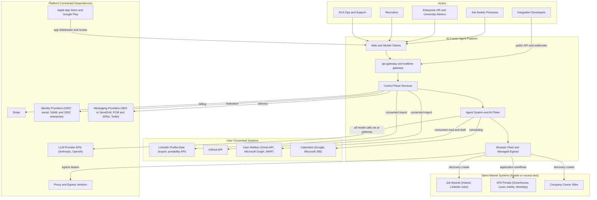
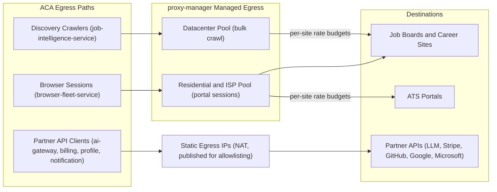
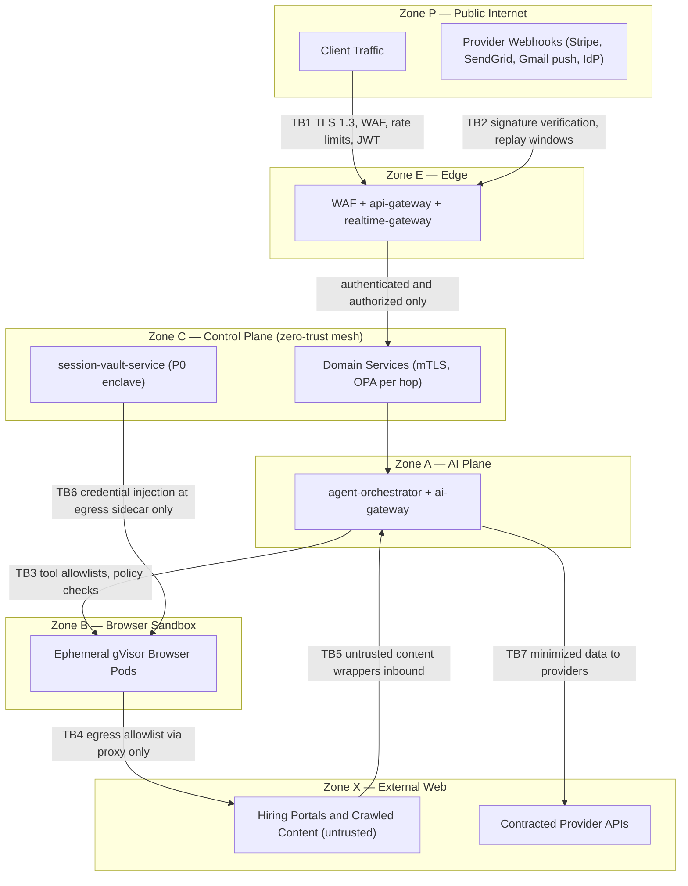
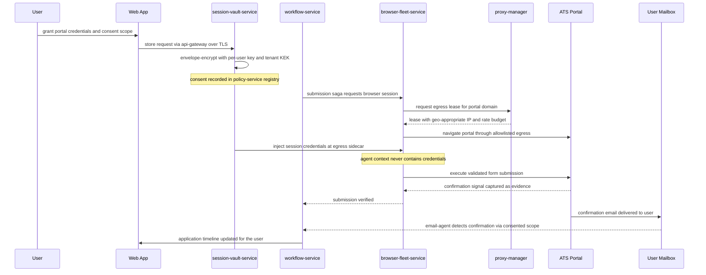

# 07 — System Context

| | |
|---|---|
| Document ID | ACA-SAS-07 |
| Volume | 1 — Foundation |
| Status | Draft v1.0 |
| Depends on | [00 — Architecture Canon](../00-architecture-canon.md), [02 — Product Vision](02-product-vision.md), [03 — Functional Requirements](03-functional-requirements.md), [05 — High-Level Architecture](05-high-level-architecture.md) |

## 1. Overview

This chapter is the C4 Level 1 view: who and what exists outside the AI Career Agent platform, how each external party interacts with it, where the trust boundaries lie, and what each external dependency can do to us. ACA is unusually exposed for a SaaS product: it does not merely *integrate* with external systems, it *acts inside them* — filling forms on hiring portals with user credentials, reading consented mailboxes, writing to calendars, spending money on LLM inference per user action. Consequently the context boundary is where most of the platform's risk lives, and this chapter treats every external relationship as a managed dependency with a stated rate-limit reality, terms-of-service posture, failure mode, and mitigation.

Three structural facts from [05 — High-Level Architecture](05-high-level-architecture.md) §5 govern everything here: all inbound traffic enters via `api-gateway` (server-push via `realtime-gateway`); all outbound traffic to the hostile web leaves via `proxy-manager`-managed egress; all model traffic leaves via `ai-gateway`; all money flows via `billing-service`. Each chokepoint is a policy- and observability-enforcement point at the context boundary.

The canon's guardrail principle (§1) is restated because it is the context model's axiom: ACA acts on behalf of a consenting user, with the user's own credentials and identity, under explicit user-approved policies, with ToS-awareness, rate limiting, disclosure where required, and a kill switch at user, tenant, and platform scope. External systems are therefore partitioned not just by protocol but by *consent basis*: platform-contracted dependencies (LLM providers, Stripe, proxy vendors), user-consented systems (mailbox, calendar, LinkedIn/GitHub data), and third-party systems we touch on the user's instruction (job boards, ATS portals).

## 2. Actors by Persona

| Persona | Tenant class / plan mapping | Goals | Primary interface | Default autonomy posture |
|---|---|---|---|---|
| Active job seeker | `individual`; Free → Professional | Maximize quality applications per week; track everything | Web app, mobile | `L1 approve-each` submissions; `L2` after trust established |
| Passive career switcher | `individual`; Professional → Premium | High-selectivity monitoring; act only on exceptional matches | Mobile notifications, weekly digest | `L0 suggest` / `L1`; low cadence |
| New graduate | `individual` or `university`; Free / university seat | Volume applications, first-job guidance, interview prep | Web app; university portal cohort views | `L2 approve-batch` (daily batch) |
| Executive / senior candidate | `individual`; Premium | Discretion, negotiation support, few high-stakes applications | Web app | `L0`/`L1` only; `negotiation-agent` active |
| Enterprise HR admin (outplacement) | `enterprise` | Manage seats, cohort outcomes, compliance reporting | Admin views via web app; SSO | Configures tenant-wide autonomy ceilings |
| University career center staff | `university` | Cohort onboarding, aggregate outcomes, program reporting | Web app cohort dashboards; SSO | Configures cohort defaults; no access to member credentials |
| Recruiter | `recruiter` | Source consented candidates, post roles, manage pipelines | Recruiter portal (`recruiter-service`) | N/A — no automation on candidate's behalf |
| Integration developer | any; API access per plan | Build on public API and webhooks | `public-api-service` (`X-API-Key`) | N/A |
| ACA operations & support | internal | Tenant support, abuse review, DLQ triage, fleet ops | `admin-service` internal portal; JIT-elevated access | N/A |

Persona-to-requirement traceability is maintained in [03 — Functional Requirements](03-functional-requirements.md). The recruiter persona is deliberately firewalled: `recruiter-service` exposes only candidates who granted sourcing consent (`policy-service` consent registry), and no recruiter-facing surface can observe a candidate's agent activity.

## 3. Context Diagram

Self-hosted vLLM model serving is *inside* the platform boundary (it is infrastructure, not an external dependency) but is listed alongside LLM providers throughout this chapter because it participates in the same failover ladder at `ai-gateway`.

## 4. External Systems by Category

Each category is treated as a component of the context: purpose, integration mode, owning service, and the interaction contract. Risk quantification is consolidated in §9.

### 4.1 Job Boards and ATS Portals

**Purpose.** The supply side of the product: sources of job postings (discovery) and the systems into which applications are submitted (execution). **Owners:** `job-intelligence-service` (discovery), `browser-fleet-service` + `portal-intelligence-service` (execution), `proxy-manager` (egress), `policy-agent` (per-site compliance posture).

**Integration modes.** Per canon §16, known ATS families (Greenhouse, Lever, Ashby, Workday, Taleo, iCIMS, SuccessFactors) are high-confidence fingerprint families with mature templates in the Universal Portal Engine — never hardcoded adapters. Where a site offers a compliant read API (Greenhouse Job Board API, Lever Postings API, Ashby postings endpoints), discovery prefers the API over crawling: cheaper, stable, and unambiguous ToS posture. Submission is browser-based via learned `PortalTemplate@version` artifacts, with the template trust ladder (`discovered` → `candidate` → `trusted` → `stale`) gating autonomous use.

**Per-site automation posture.** `policy-service` maintains a posture registry consulted by `policy-agent` before any action; the platform is ToS-aware by construction, and ACA is explicitly not an anti-bot evasion system ([02 — Product Vision](02-product-vision.md)):

| Site family | Discovery posture | Application posture | Rationale |
|---|---|---|---|
| Greenhouse | Public postings API (`automated`) | `automated` — hosted forms, stable structure, mature templates | Public API for reads; form automation on user's behalf with disclosure policy |
| Lever | Public postings API (`automated`) | `automated` | Same as Greenhouse; low-friction forms |
| Ashby | Public postings API (`automated`) | `automated` | API-first vendor; clean hosted flows |
| Workday | Crawl of tenant career sites (`automated`, conservative budgets) | `automated` with `L1` recommended — per-employer account creation, multi-step wizards | No public postings API; heaviest workflow family; account creation is a consequential action requiring approval |
| Taleo / iCIMS / SuccessFactors | Crawl (`automated`, conservative) | `automated` where template trust ≥ `trusted`, else `assist-only` | Legacy DOM volatility; templates mature per employer tenant |
| LinkedIn | Job postings via compliant/licensed feeds only; no logged-in scraping | `assist-only` — draft materials, deep-link the user to apply | User Agreement prohibits unauthorized automated access; posture revisited only via official partnership |
| Indeed | Licensed/partner feeds where available; conservative public crawl of postings; prefer redirect to origin ATS | `assist-only` — redirect to the employer's ATS and automate there when permitted | Publisher/partner APIs are employer-side; aggressive anti-bot posture; the origin ATS is usually reachable directly |
| Company career sites (long tail) | `automated` crawl within robots and rate budgets | `automated` when a learned template reaches `trusted`; `assist-only` otherwise | The Universal Portal Engine's generalization target |

`assist-only` means the platform prepares everything (tailored resume, letter, answers) and the user performs the final submission — the product remains valuable even where automation is not permitted. Posture is per-site configuration, not code; changes are policy deployments audited via `audit-service`.

### 4.2 LinkedIn and GitHub Import (User-Consented Profile Data)

**Purpose.** Bootstrap and enrich the career profile. **Owner:** `profile-service` (import orchestration, per canon §4.2), `portfolio-service` (GitHub repository analysis).

| Source | Mechanism | Contract notes |
|---|---|---|
| GitHub | OAuth App, REST/GraphQL API | 5,000 requests/hour/token — ample for import; repo analysis batched and cached; scopes limited to public repos plus opt-in private read |
| LinkedIn | (a) User-uploaded data export ZIP; (b) Member Data Portability API (DMA-scope, where available); (c) limited OIDC sign-in profile claims | No general-purpose profile read API exists for non-partners; the export path is universally available and fully user-mediated; parsing owned by `profile-service` with `resume-agent`-class extraction |

Import is a Temporal workflow (`workflow-service`): fetch/upload → parse → normalize → user review → merge, emitting `aca.profile.import.completed.v1`. Failures park in a review state rather than corrupting the profile.

### 4.3 Email Providers (Two Distinct Relationships)

Email appears twice in the context with different trust characteristics, and conflating them is a design error this chapter explicitly forbids.

**Outbound transactional email** — platform-contracted. `notification-service` sends via the SES/SendGrid adapter. Concerns: sender reputation (dedicated IPs, DKIM/SPF/DMARC), provider sending quotas ramping with volume, and delivery-event webhooks (§6).

**Consented mailbox integration** — user-granted, read/draft scope. `email-agent` and `application-tracker-agent` parse application-related mail (confirmations, interview invitations, rejections) and draft replies. Mechanisms: Gmail API (OAuth, restricted scopes — subject to Google's annual CASA security assessment for restricted-scope apps), Microsoft Graph (mail.read/mail.draft equivalents), IMAP fallback for other providers. Mailbox content is `untrusted_content` (canon §13): it is prompt-injection surface and is sanitized, source-tagged, and screened by `security-agent` before any model call. Mailbox tokens are P0-adjacent and live in `session-vault-service`; scope requests are minimal (read + draft, never send-without-approval below `L3`).

### 4.4 Calendar Providers

**Owner:** `calendar-agent` via `application-service` integration endpoints. Google Calendar API and Microsoft Graph calendars: availability reads, interview event creation, reminders. Watch channels / change notifications expire (Google channels ≤ ~7 days) and must be renewed by a `scheduler-service`-triggered job; renewal failure degrades to polling. Calendar write is a consequential action class: event creation at `L2+`, invitation replies at `L1` by default.

### 4.5 LLM Providers

**Owner:** `ai-gateway` exclusively (canon §9 invariant). Anthropic Claude family primary, OpenAI secondary, self-hosted vLLM floor — model classes per canon §10.1, failover per [05 §14.3](05-high-level-architecture.md). Contract realities that shape the architecture: tiered rate limits (requests/min and tokens/min) that must be pooled and prioritized across all tenants; batch APIs (≈50% cost, ≤24 h SLA) for the non-interactive lane; provider-side prompt caching exploited via deterministic stable-prefix assembly; model deprecation cycles (months, not years) requiring the eval matrix to keep candidate successors continuously scored; data-processing terms (no training on API data per current provider terms; DPAs in place) verified per provider and surfaced to enterprise tenants.

### 4.6 Payment Provider

**Owner:** `billing-service` behind the provider adapter (Adyen/Paddle pluggable). Stripe holds all card data — ACA is SAQ-A scope, tokenized checkout only, no PAN ever touches the platform. Webhooks drive subscription lifecycle (§6); reconciliation jobs (daily) detect webhook gaps. Plans and entitlements per canon §12; entitlement snapshots signed by `billing-service` and enforced at `api-gateway`, services, and `cost-controller`.

### 4.7 Identity Providers

**Owner:** `identity-service`. Three federation classes: OIDC social login (Google, Microsoft; LinkedIn OIDC for sign-in claims only), enterprise SSO (SAML 2.0 + OIDC federation — Okta, Entra ID, Google Workspace — per-tenant configuration), and native accounts (passkeys/WebAuthn + TOTP 2FA). IdP outage is a tenant-wide lockout risk for SSO-only enterprise tenants; mitigations: cached JWKS/metadata with staleness bounds, 15-minute access tokens that keep working sessions alive through short IdP blips, and break-glass admin access via `admin-service` JIT elevation.

### 4.8 Proxy and Egress Infrastructure

**Owner:** `proxy-manager`. Commercial proxy pools (datacenter class for bulk discovery crawl; residential/ISP class where target sites geo-differentiate or where user-locality matters for application flows), multi-vendor to avoid single-pool reputation collapse. Vendor selection criteria include ethically sourced residential supply (documented consent chain) — a compliance requirement, not a preference. Per-site rate budgets are enforced here regardless of which internal service originates traffic; `proxy-manager` is the single place where "how hard are we hitting site X" is answerable. Partner-API traffic (GitHub, Stripe, LLM, Google, Microsoft) does *not* use proxy pools — it egresses via published static IPs (NAT gateway) for allowlisting and audit cleanliness.

### 4.9 App Stores

**Owner:** mobile distribution (Volume 8). Apple App Store and Google Play distribute the React Native client. Constraints with architectural consequences: review cycles (typically 1–3 days, occasionally weeks) mean the mobile client must tolerate a trailing API version — the additive-only `/v1` policy (canon §7) exists partly for this; Apple's in-app purchase rules apply to digital subscriptions sold in-app — phase 1 keeps purchase and plan management on the web (compliant "account created elsewhere" pattern), with StoreKit IAP as a Volume 8 decision if in-app purchase is later required; store policy changes (SDK deadlines, privacy manifests) arrive on the stores' schedule, not ours, and are tracked as a standing operational calendar item.

## 5. Trust Boundaries

| Boundary | Between | Controls | Failure posture |
|---|---|---|---|
| TB1 — Public edge | Internet ↔ Zone E | TLS 1.3, WAF, token-bucket rate limits, JWT (EdDSA, 15-min), bot filtering | Fail-closed |
| TB2 — Webhook ingress | Provider callbacks ↔ Zone E | Per-provider signature verification (§6), replay windows, idempotent handlers, dedicated rate class | Fail-closed; missed webhooks recovered by reconciliation |
| TB3 — Agent → browser | Zone A ↔ Zone B | Per-agent tool allowlists, `policy-agent` clearance, autonomy-level checks, session-scoped instructions only | Fail-closed |
| TB4 — Browser → web | Zone B ↔ Zone X | Per-session network policy (egress allowlist = target portal + proxy), gVisor isolation, no cross-user pod reuse | Fail-closed (unlisted egress dropped) |
| TB5 — External content inbound | Zone X ↔ Zone A | `untrusted_content` wrapping, sanitization, instruction/data separation, `security-agent` screening, output validators | Fail-closed on screening errors |
| TB6 — Credential boundary | Vault enclave ↔ Zone B | P0 envelope encryption (per-user key, per-tenant KEK), injection at egress sidecar only, never in prompts/logs/events | Fail-closed; injection failure aborts the session |
| TB7 — Provider egress | Zone A/C ↔ contracted APIs | Static egress IPs, mTLS/API auth, PII minimization policy per provider, DPAs | Fail-open to failover provider per `ai-gateway` ladder |
| TB8 — Tenant boundary | Tenant ↔ tenant (internal) | Postgres RLS + service guard; cells for `enterprise`/`university`; recruiter consent firewall | Fail-closed |

**PII egress matrix** (classes per canon §11; the matrix is enforced by `policy-agent` + `ai-gateway` filters and audited):

| Destination | P0 (credentials, cookies) | P1 (identity PII) | P2 (career data) | P3 (public/derived) |
|---|---|---|---|---|
| Hiring portals (TB4) | Injected at egress only, never readable by agents | Yes — application content, user-consented | Yes | Yes |
| LLM providers (TB7) | Never | Minimized; masked where task permits; enterprise tenants may mandate self-hosted class only | Yes | Yes |
| Stripe | Never | Billing identity only | Never | N/A |
| Messaging providers | Never | Delivery address only | Digest content per user settings | Yes |
| Proxy vendors | Never (TLS pass-through; vendor sees SNI/traffic metadata only) | No payload visibility | No payload visibility | N/A |
| Public API consumers | Never | Only fields the tenant's API scope grants | Scoped | Yes |

## 6. Inbound Integration Surface

External systems that call *us*. All webhook ingress terminates at `api-gateway` on a dedicated rate class, then routes to the owning service; every handler is idempotent (event-id dedup) because every provider redelivers.

| Surface | Caller | Owner | Verification | Notes |
|---|---|---|---|---|
| `POST /v1/webhooks/stripe` | Stripe | `billing-service` | `Stripe-Signature` HMAC, 5-min replay tolerance | Drives subscription lifecycle; daily reconciliation covers gaps |
| `POST /v1/webhooks/sendgrid` (or SES SNS) | Email provider | `notification-service` | Signed event webhook / SNS signature | Bounce and complaint handling feeds suppression lists |
| `POST /v1/webhooks/mailbox/google` | Gmail watch push (Pub/Sub) | `application-service` (feeds `email-agent` pipeline) | OIDC token on push subscription | Triggers incremental mailbox sync, not payload delivery |
| `POST /v1/webhooks/mailbox/microsoft` | Microsoft Graph change notifications | `application-service` | `clientState` secret + validation handshake | Subscription renewal via `scheduler-service` |
| `POST /v1/webhooks/calendar/{provider}` | Calendar change notifications | `application-service` (feeds `calendar-agent`) | Channel token / `clientState` | Expiring channels renewed proactively |
| `POST /v1/auth/saml/acs`, `/v1/auth/oidc/callback` | Enterprise IdPs, social IdPs | `identity-service` | Signed assertions, audience + nonce validation | Per-tenant IdP configuration |
| App store server notifications | Apple (JWS), Google (RTDN via Pub/Sub) | `billing-service` | JWS signature / Pub/Sub OIDC | Phase 1: informational; load-bearing only if IAP ships |
| Partner webhooks (outbound from ACA) | — | `public-api-service` | HMAC-signed deliveries, per-endpoint secrets, retries with backoff | Listed for completeness; direction is outbound |

## 7. Representative Cross-Boundary Sequence — Consented Credential Use and Application Confirmation

The flow below crosses TB1, TB6, TB4, and TB5 in one journey and is the reference for how consent, credential isolation, managed egress, and evidence-based verification compose. (Saga detail in [05 §7](05-high-level-architecture.md); browser internals in [Volume 7](../volume-7-browser-intelligence/).)

## 8. External Dependency Risk Table

The consolidated risk register for every external dependency class. "Blast radius" states what degrades when the dependency fails; mitigations are implemented, not aspirational, unless marked "phase 2."

| Dependency | Rate-limit reality | ToS / policy constraints | Dominant failure modes | Blast radius | Mitigations |
|---|---|---|---|---|---|
| Greenhouse | Postings API generous; per-IP throttling on hosted forms | Public postings API sanctioned; submission automation on user's behalf governed by our disclosure policy | Form/DOM revisions; per-company config variance | Discovery + submission for Greenhouse-hosted roles | API-first discovery; template trust ladder + drift detection; `assist-only` fallback |
| Lever | Postings API generous | As Greenhouse | Form revisions; captcha on some tenants | Lever-hosted roles | Same as Greenhouse; captcha → `L1` human step, never bypass |
| Ashby | Postings API generous | As Greenhouse | Rapid product iteration changes DOM | Ashby-hosted roles | High re-learn cadence for fingerprint family |
| Workday | No public postings API; strict per-tenant throttling; bot detection | Automation posture conservative; per-employer accounts are user-owned | Multi-step wizard changes; MFA challenges; session expiry mid-flow | Largest enterprise-role coverage segment | Per-employer-tenant templates; `L1` default; `recovery-agent` mid-flow resume; session vault cookie reuse |
| LinkedIn | N/A for automation (posture `assist-only`); portability API quotas where available | User Agreement prohibits unauthorized automated access/scraping | Export format changes; portability API regional availability | Profile import richness; LinkedIn-exclusive postings visibility | Export-ZIP import path (universal); licensed feed partners for postings; official partnership pursuit (phase 2) |
| Indeed | Partner feeds contractual; public pages behind aggressive anti-bot | Publisher/partner terms are employer-side; scraping disfavored | Feed contract changes; anti-bot escalation | Aggregated-posting discovery volume | Prefer origin-ATS discovery (dedup canonicalizes to origin); licensed feeds; posture `assist-only` for apply |
| Company career sites (long tail) | Highly variable; robots.txt respected | Robots + site terms; rate budgets per site | Site redesigns; anti-bot walls; broken postings | Single-site discovery/apply gaps | Universal Portal Engine re-learning; per-site budgets in `proxy-manager`; failure-rate monitors demote templates to `stale` |
| GitHub API | 5,000 req/hr/token; secondary rate limits | Standard API terms; OAuth scopes minimal | Token revocation; abuse-detection trips on bursts | Portfolio import/analysis | Batched, cached, off-peak analysis; conditional requests (ETags) |
| Gmail API | Per-user and per-project quota units; restricted-scope program | Restricted scopes require annual CASA assessment; user data policy (limited use) | OAuth token revocation waves; verification lapse suspends the OAuth app | Mailbox tracking for Gmail users (largest cohort) | Scope minimalism; incremental sync (historyId); IMAP fallback; compliance calendar for CASA renewal |
| Microsoft Graph (mail/calendar) | Per-app per-mailbox throttling | Standard API terms | Subscription expiry; conditional-access policy blocks in enterprise tenants | Mailbox/calendar tracking for M365 users | Proactive subscription renewal; delta queries; per-tenant admin-consent flow for enterprise |
| Google/Microsoft Calendar | Moderate quotas | Standard | Watch channel expiry; quota exhaustion on bulk ops | Interview scheduling automation | Renewal jobs; polling fallback; batch reads |
| Anthropic (primary LLM) | Tiered RPM/TPM per model; batch lane separate | API data not used for training per current terms; DPA | Provider incident; rate-limit exhaustion under burst; model deprecation | Draft generation, agent planning quality | Multi-provider failover; committed-throughput contract (phase 2); semantic + exact caching; batch lane; queueing with plan-floor guarantees |
| OpenAI (secondary LLM) | Tiered RPM/TPM | DPA; same posture | Same as primary | Failover capacity, specific model classes | Same ladder; continuous cross-provider evals keep prompts warm |
| Self-hosted vLLM | Own capacity; GPU supply constraints | N/A (internal) | GPU node failures; capacity ceiling under failover surge | Floor capacity; enterprise no-external-inference tenants | Autoscaled GPU pools with headroom target 30%; degrade-to-queue policy |
| Stripe | 100 read + 100 write req/s (live) default; webhook bursts | PCI handled by provider (SAQ-A for ACA) | Webhook delay/duplication; API brownouts; account risk reviews | New subscriptions, plan changes; entitlements unaffected (cached snapshots) | Idempotent handlers; daily reconciliation; signed entitlement snapshots keep enforcing during outage; adapter seam to Adyen/Paddle |
| Social OIDC IdPs | Generous | Standard OAuth terms | IdP outage; consent-screen policy changes | Login for social-auth users | Multiple IdP options + native passkeys; session continuity via refresh tokens |
| Enterprise IdPs (Okta, Entra) | Per-tenant | Tenant-controlled policies | Tenant misconfiguration; IdP outage locks the tenant | Whole enterprise tenant's access | Cached metadata; break-glass JIT admin path; config validation on setup |
| Proxy vendors | Contracted bandwidth/session caps | Ethical-sourcing requirement; vendor AUPs | Pool reputation decay; vendor outage; geo-coverage gaps | Discovery volume; portal session success rates | Multi-vendor pools; health scoring + automatic rotation in `proxy-manager`; per-site budget isolation |
| SES/SendGrid | Sending quotas ramp with reputation | Anti-spam law compliance (CAN-SPAM, ePrivacy) | Reputation damage → throttling; provider outage | Transactional email delivery SLO | Dual-provider adapter; suppression list hygiene; dedicated IP warm-up |
| FCM/APNs | High quotas | Store push policies | Certificate/key rotation misses; token churn | Mobile push delivery | Rotation runbooks + expiry gauges; in-app inbox as fallback channel |
| Twilio SMS | A2P 10DLC registration + per-number throughput | Carrier filtering rules | Campaign re-registration; carrier filtering | SMS notifications (lowest-volume channel) | SMS reserved for high-value alerts; email/push fallback |
| Apple App Store / Google Play | N/A | Review guidelines; IAP rules for digital goods; SDK/privacy deadlines | Rejection blocks release; forced policy migrations | Mobile release cadence only (web unaffected) | Web-first purchase flow; additive `/v1` API tolerance for trailing clients; store-policy calendar |

## 9. Failure Scenarios

Context-level scenarios (platform-internal failures in [05 §10](05-high-level-architecture.md)):

| Scenario | Detection | Response |
|---|---|---|
| ATS family DOM overhaul (e.g., Workday release wave) | Template failure-rate monitors; fingerprint drift diffs | Templates demoted to `stale`; affected submissions downgrade to `assist-only`; `portal-intel-agent` re-learns; users notified with honest status |
| LLM provider regional incident | `ai-gateway` error/latency SLIs per provider | Failover ladder engages within one routing refresh; non-interactive lanes queue; incident annotation on quality dashboards |
| Mass OAuth revocation (provider security event) | Token-failure spike gauges per provider | Re-consent campaign via `notification-service`; affected automations pause gracefully with user-visible state, no silent failure |
| Stripe webhook storm/dupes after provider recovery | Webhook lag + dedup-hit metrics | Idempotent handlers absorb; reconciliation validates final state; entitlement snapshots prevented any enforcement gap |
| Enterprise IdP outage | SSO failure rate per tenant | Existing sessions ride on refresh tokens; break-glass admin path; tenant status page entry |
| Proxy vendor ban wave on a pool | Per-pool success-rate and reputation scores in `proxy-manager` | Automatic pool rotation; crawl cadence reduced for affected sites; vendor escalation |
| App store rejection of a release | Release pipeline gate | Web-first functionality unaffected; expedited-review path; feature-flagged mobile degradation |
| Gmail restricted-scope verification lapse | Compliance calendar + token failure alerts | Treated as Sev-2: mailbox features degrade to IMAP/manual forwarding; CASA remediation sprint |

## 10. Scaling Strategy

External dependencies scale differently from internal services: most cannot be scaled, only *budgeted*. The architecture therefore concentrates scarce-resource arbitration in three places: `proxy-manager` (per-site request budgets across all tenants — adding tenants must never linearly increase pressure on any single external site; crawl schedules amortize), `ai-gateway` (provider rate-limit pools with priority classes — user-interactive > autopilot > batch — so provider ceilings degrade batch first), and `notification-service` (provider sending-rate shaping). Partner API quotas that are per-user (Gmail, Graph) scale naturally with the user base; per-app quotas (LLM tiers, Stripe) are contract-managed with headroom targets of 2× observed peak, reviewed monthly. Discovery scale is decoupled from tenant scale by design: jobs are crawled once for all tenants ([05 §8](05-high-level-architecture.md)).

## 11. Security Considerations

The context boundary's security posture is the sum of §5's controls; three points warrant emphasis. First, **the platform's most dangerous input is content it asked for**: job postings, portal DOM, and mailbox content are attacker-controllable and flow toward LLMs — every such path crosses TB5's sanitization and `security-agent` screening, with tool allowlists bounding what a poisoned context could do. Second, **the platform's most dangerous output is a credentialed action**: TB6 ensures agents can *cause* authentication without ever *holding* credentials, and every consequential action carries policy-decision provenance into the `audit-service` hash chain. Third, **disclosure and honesty are security controls**: per-site automation posture, submission disclosure policies, and user-visible agent activity feeds keep the platform's behavior legible to users, sites, and auditors — the alternative (covert automation) is both a ToS and a trust catastrophe. Full threat model in [Volume 5](../volume-5-security/).

## 12. Observability

Every external dependency gets: a synthetic canary (black-box probe at its integration point — postings API fetch, sandbox portal login on a test account, provider health endpoint, webhook loopback), per-dependency SLIs (availability, latency, error taxonomy, quota consumption vs. ceiling), and a dependency scorecard dashboard aggregating them. Quota gauges alert at 70% of any ceiling (headroom to react within a business day) and 90% (page). Webhook pipelines expose end-to-end lag (provider event time → handler commit) with a 60 s p95 target aligned to the notification SLO. Token/subscription expiry (OAuth grants, Graph subscriptions, APNs keys, calendar channels) are exported as time-to-expiry gauges — expiry-driven outages are the most preventable class in this chapter and are treated as zero-tolerance.

## 13. Future Improvements

1. **Official partnership tracks** (LinkedIn, Indeed, major ATS vendors) to convert `assist-only` postures into sanctioned integrations — the single highest-leverage de-risking available (phase 2).
2. **Licensed job-feed contracts** to reduce crawl dependence for aggregate sources; evaluated on cost per usable posting vs. crawl cost.
3. **Committed-throughput LLM contracts** once volume forecasting stabilizes (phase 2), shifting rate-limit risk to contractual capacity.
4. **Webhook-relay hardening**: dedicated ingress cells for webhook classes so a provider replay storm cannot pressure the interactive edge.
5. **Dependency chaos drills**: quarterly game-days that simulate top risk-table rows (provider outage, revocation wave, template drift wave) against staging.
6. **In-app purchase decision** for mobile (Volume 8) once web-first conversion data exists.

## 14. Alternatives Considered & Tradeoffs

**Official APIs only (no browser automation).** Rejected as a product-defining constraint: only a minority of application flows are reachable via sanctioned APIs; the product's coverage promise dies. The chosen posture — API where offered, learned browser templates where permitted, `assist-only` where not — trades engineering complexity (Universal Portal Engine, Volume 7) for coverage with a defensible compliance stance. The `assist-only` tier is the honest release valve: coverage without ToS violation.

**Scraping-maximalist discovery (ignore ToS gray zones).** Rejected outright despite competitors doing it: it poisons enterprise sales, invites litigation and IP-reputation collapse, and contradicts the canon guardrail. Cost: smaller discoverable corpus in the short term; mitigation is feed licensing and origin-ATS canonicalization (most aggregator postings resolve to a directly-reachable ATS).

**Per-tenant provider credentials (each tenant brings its own LLM/email keys).** Considered for enterprise; deferred. It complicates budget arbitration, quality evals, and support, and most enterprise requirements are met by the self-hosted vLLM class and EU cell residency. Revisit if procurement demands it; the `ai-gateway` seam makes it additive.

**Webhook-less polling for all providers.** Simpler trust surface (no TB2), rejected for latency and quota cost: Stripe/mailbox/calendar polling at the required freshness would burn quotas and still miss the notification SLO. Webhooks with signature verification + reconciliation gives freshness with a safety net; the tradeoff is the §6 verification surface, which is bounded and testable.

**Single proxy vendor.** Operationally simpler, rejected because pool reputation is a correlated-failure domain: one vendor's ban wave would take discovery and submission down together. Multi-vendor via `proxy-manager` costs integration and spend fragmentation but converts a platform outage into a capacity dip.
