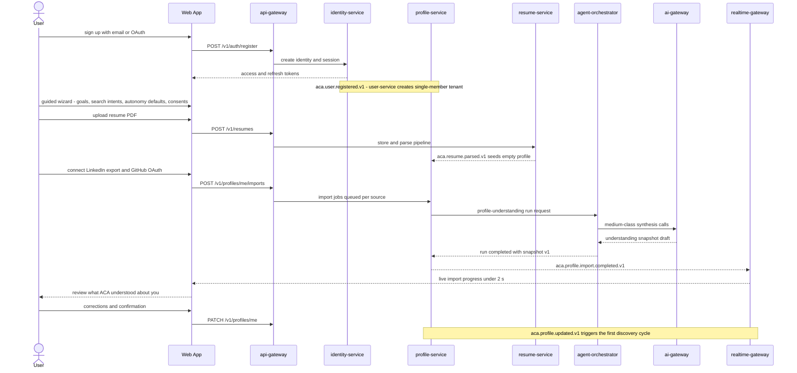
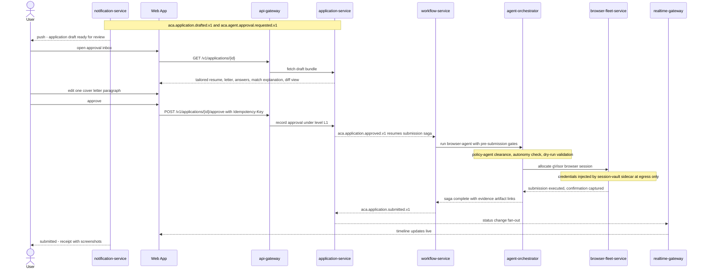
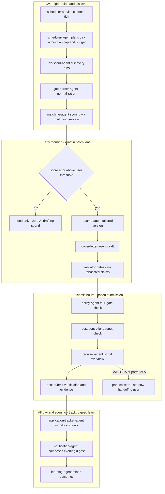
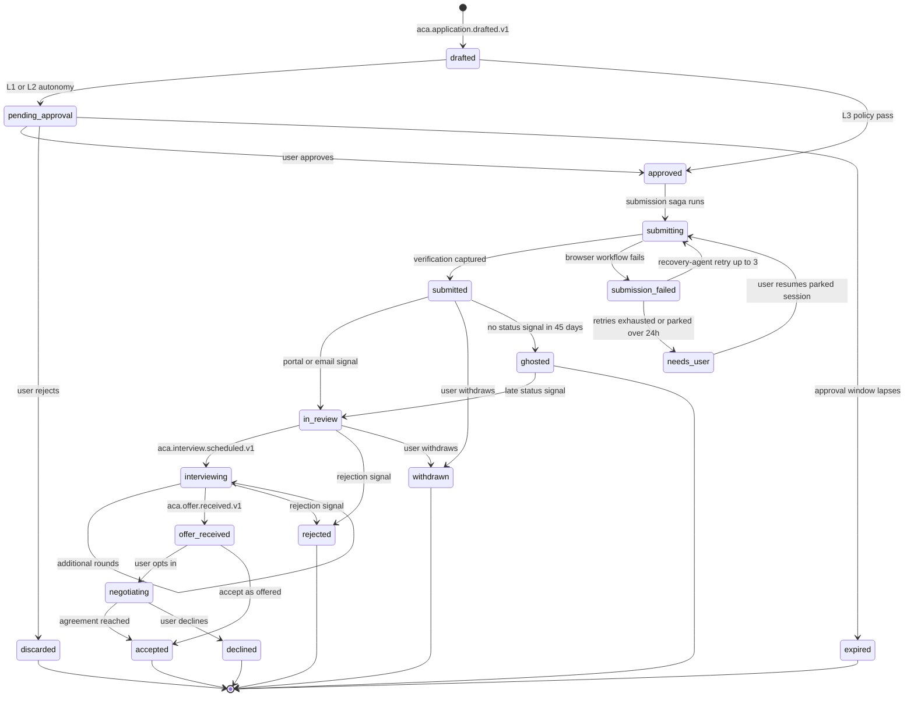
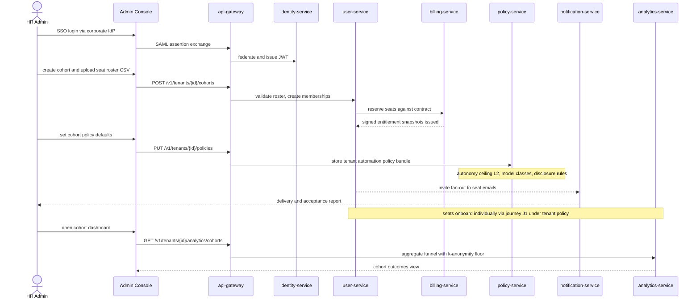

# 08 — User Journey

| | |
|---|---|
| Document ID | ACA-SAS-08 |
| Volume | 1 — Foundation |
| Status | Draft v1.0 |
| Depends on | [00 — Architecture Canon](../00-architecture-canon.md), [02 — Product Vision](02-product-vision.md), [03 — Functional Requirements](03-functional-requirements.md), [05 — High-Level Architecture](05-high-level-architecture.md), [07 — System Context](07-system-context.md) |

## 1. Overview

This chapter specifies the end-to-end user journeys of ACA as an executable contract: every journey step is mapped to the canonical services, agents, and events that implement it, so a senior engineer can trace a user-visible moment to the exact component, API call, and Kafka topic that produces it. Journeys are the acceptance layer above the functional requirements in [03](03-functional-requirements.md) — an FR passes in isolation; a journey passes only when the chain of FRs composes into a coherent experience within the SLOs of canon §14.

Eight journeys cover the platform's lifecycle: J1 onboarding + import + AI profile understanding, J2 first match review, J3 approving an application at `L1 approve-each`, J4 a full autopilot day at `L3 autopilot`, J5 the interview loop, J6 offer and negotiation, J7 enterprise admin onboarding a cohort, and J8 the recruiter journey. J1–J6 serve the individual personas (Maya, Deshawn, Priya, Elena — [02 §3](02-product-vision.md)); J7 serves Marcus and Dr. Okafor; J8 serves Sam. J1–J3 and J5 are Phase 1 critical path; J4 activates with Professional/Premium plans; J7–J8 are Phase 2 per the sequencing rationale in [02 §11](02-product-vision.md).

Two design stances govern every journey. First, **trust is earned in ratchets**: the journeys are deliberately ordered so each grants the platform slightly more delegated authority only after the previous step produced verifiable evidence (diff views, submission receipts, evidence artifacts). The autonomy ladder L0→L3 (canon §9) is the mechanism; the journeys are the curriculum. Second, **emotion is an engineering input**: job seeking is high-stakes and morale-fragile, so §11 maps each journey stage to the emotional state it must handle and the instrumented signal that verifies we handled it — these are guardrail metrics in `analytics-service`, not copywriting guidance.

## 2. Journey Model & Conventions

### 2.1 Journey catalog

| ID | Journey | Primary persona | Plan floor | Autonomy involved | Phase |
|---|---|---|---|---|---|
| J1 | Onboarding, import, AI profile understanding | All individual | Free | — | 1 |
| J2 | First match review | Maya, Deshawn, Priya | Free | L0 | 1 |
| J3 | Approving an application | Maya (default posture) | Free (assist-only submission); automated submission from Professional (Canon §12) | L1 | 1 |
| J4 | Full autopilot day | Maya (matured), Priya | Premium (L3), Professional (L2 variant) | L2/L3 | 1–2 |
| J5 | Interview loop | All individual | Free (prep from Professional) | L0/L1 | 1 |
| J6 | Offer + negotiation | Elena, Maya | Premium (negotiation agent) | L0/L1 hard cap | 2 |
| J7 | Enterprise admin cohort onboarding | Marcus, Dr. Okafor | Enterprise / University | tenant policy ceiling | 2 |
| J8 | Recruiter journey | Sam | Recruiter | consent-scoped | 2 |

### 2.2 Step-map notation

Each journey carries a step map with columns: **Step** (user- or system-initiated), **Surface** (web, mobile, notification, none), **Services** (canonical identifiers), **Agents** (canonical identifiers, if any), **Events** (topics emitted, canon §8). A step with no agent is a pure control-plane interaction; a step with no surface is autonomous background work whose existence the user later sees as evidence, feed items, or notifications.

### 2.3 Notification urgency taxonomy

This chapter fixes the urgency taxonomy that FR-111 requires documented (decision recorded in §18 for canon promotion). `notification-agent` classifies every candidate notification into exactly one class; `notification-service` enforces channel and timing rules per class.

| Class | Meaning | Default channels | Quiet hours (default 21:00–08:00 local) | Rationale |
|---|---|---|---|---|
| `act-now` | User action blocks or time-critical event | push + in-app; SMS if opted in | Exempt **only** for interview T-1h reminder and parked-session expiry warning | These two are the only cases where waking the user beats losing the opportunity |
| `today` | Should be seen this waking day | push + in-app | Held until quiet hours end | Same-day relevance without alarm semantics |
| `digest` | Batched into the daily digest | email + in-app | Delivered at user's digest hour (default 18:00 local) | Protects the fatigue-suppression guardrail (FR-111) |
| `record-only` | Timeline material, no push value | in-app feed only | n/a | Completeness without interruption |

Welcome/verification and tenant-invitation messages are transactional account notices outside this taxonomy (labeled `transactional` in §12): delivered immediately on their trigger event and, like legal notices, exempt from opt-out (FR-112).

### 2.4 Journey SLO ledger

Canon §14 SLOs land on specific journey moments; the journey is the reason the SLO exists.

| Canon SLO | Journey moment it protects |
|---|---|
| Job discovered → scored p95 < 15 min | J2/J4 — intent edits and new postings reach the feed while the user's attention is live |
| Application draft generation p95 < 60 s | J3 — "generate draft" is an in-session wait; J4 batch lane is exempt (≤ 24 h SLA, canon §10.2) |
| Realtime event delivery p95 < 2 s | J1 import progress, J3/J4 live timeline, agent activity feed (FR-113) |
| Notification delivery p95 < 60 s | J4 human handoff (FR-075), J5 interview reminders, J6 offer alert |
| Browser workflow success ≥ 92% weekly (known portals) | J3/J4 — submission receipts stay routine, `needs_user` stays exceptional |
| Control-plane API availability 99.95% | Every surface interaction in J1–J8 |

## 3. J1 — Onboarding, Import & AI Profile Understanding

**Purpose.** Take a skeptical new user from signup to a confirmed, AI-understood career profile in one session, ending with the platform demonstrably "getting" them — the precondition for every later act of delegation. Wizard completion target: < 10 min median (FR-004).

**Responsibilities.** `identity-service` (registration, JWT issuance, 2FA enrollment), `user-service` (single-member tenant creation, FR-007), `profile-service` (wizard capture, import orchestration, understanding snapshot, FR-010/011/020–024), `resume-service` (upload + parse, FR-012, resume-as-bootstrap FR-022), `policy-service` (autonomy defaults — submission = L1 per FR-005/canon §9 — and versioned consent capture FR-006), `agent-orchestrator` + `ai-gateway` (profile-understanding run, `medium` class), `realtime-gateway` (live progress), `notification-service` (welcome, completion).

### 3.1 Sequence

### 3.2 Step map

| Step | Surface | Services | Agents | Events |
|---|---|---|---|---|
| Register (email/OAuth), optional passkey enrollment | web | `api-gateway`, `identity-service`, `user-service` | — | `aca.user.registered.v1` |
| Guided wizard: goals, target roles, locations, salary, exclusions, work authorization | web | `profile-service`, `user-service` | — | `aca.profile.updated.v1` |
| Autonomy + consent capture (submission defaults L1; versioned consents) | web | `policy-service` | — | `aca.audit.event.v1` |
| Resume upload + parse; low-confidence fields flagged | web | `resume-service` | — | `aca.resume.parsed.v1` |
| LinkedIn/GitHub import (consented; async with progress) | web + realtime | `profile-service`, `portfolio-service`, `session-vault-service` (if credentials consented) | — | `aca.profile.import.completed.v1` |
| AI profile understanding synthesis | none → web review | `profile-service`, `agent-orchestrator`, `ai-gateway`, `memory-service` | profile synthesis run (orchestrated) | `aca.agent.run.started.v1`, `aca.agent.run.completed.v1`, `aca.ai.request.completed.v1` |
| User reviews, corrects, confirms understanding (edit veto, FR-011) | web | `profile-service` | — | `aca.profile.updated.v1` |
| First discovery cycle scheduled | none | `scheduler-service`, `job-intelligence-service` | `job-scout-agent` | `aca.job.discovered.v1` |

### 3.3 Contracts

| Method | Path | Service | Purpose | Notes |
|---|---|---|---|---|
| POST | `/v1/auth/register` | `identity-service` | Create identity + session | Idempotency-Key; RFC 9457 errors |
| POST | `/v1/resumes` | `resume-service` | Upload (PDF/DOCX ≤ 10 MB) | Async parse; 202 + status URL |
| POST | `/v1/profiles/me/imports` | `profile-service` | Start LinkedIn/GitHub import | One import job per source; retry per FR-024 |
| GET | `/v1/profiles/me/imports/{id}` | `profile-service` | Import status (queued/running/partial/complete) | Poll fallback when WS unavailable |
| GET | `/v1/profiles/me/understanding` | `profile-service` | Latest understanding snapshot + version | Regenerated ≤ 24 h after material change (FR-011) |
| PATCH | `/v1/profiles/me` | `profile-service` | Corrections + confirmation | Emits `aca.profile.updated.v1` |
| PUT | `/v1/users/me/autonomy` | `policy-service` | Per-action-class autonomy settings | Effective ≤ 60 s (FR-130); audit-logged |

**Limits (with rationale):**

| Limit | Value | Rationale |
|---|---|---|
| Wizard median completion | < 10 min | FR-004 acceptance; abandonment rises steeply beyond it |
| Import end-to-end p95 (resume path) | < 5 min | User stays in-session for the understanding reveal; longer = abandonment before the aha moment |
| Understanding snapshot in-session p95 | < 60 s after parse completes | Same in-session budget class as draft generation (canon §14) |
| Profile fields populated from resume alone | ≥ 80% | FR-022 acceptance — bootstrap must feel complete, not skeletal |

**Failure modes (journey-local).** Parse failure or low-confidence fields → partial-failure report + inline manual entry (FR-024, FR-012); import source outage → other sources proceed, failed segment retryable idempotently; `ai-gateway` degraded → understanding deferred with honest ETA, wizard completes without it (the journey never blocks on the AI plane); user abandons mid-wizard → resumable (FR-004), day-2 `today` nudge.

## 4. J2 — First Match Review

**Purpose.** Deliver the aha moment: a ranked, explained, deduplicated match feed that visibly reflects the confirmed profile — within 15 minutes of profile confirmation (canon SLO: discovered → scored p95 < 15 min; the corpus is pre-crawled, so the wait is scoring, not discovery).

**Responsibilities.** `job-intelligence-service` (corpus, dedup FR-032, expiry FR-034), `matching-service` + `matching-agent` (scoring on the escalation ladder FR-050, explanations FR-051, feed FR-053), `search-service` (browse + saved searches FR-036), `learning-pipeline` (feedback capture for calibration FR-052), `realtime-gateway` (feed refresh push).

### 4.1 Step map

| Step | Surface | Services | Agents | Events |
|---|---|---|---|---|
| Scoring cycle over confirmed intents | none | `matching-service` | `matching-agent` | `aca.match.scored.v1` |
| "First matches ready" notification (`today`) | push/in-app | `notification-service` | `notification-agent` | `aca.notification.requested.v1`, `aca.notification.delivered.v1` |
| User reviews ranked feed with explanations | web/mobile | `matching-service`, `search-service` | — | — |
| Save / dismiss-with-reason / "apply" intent per match | web/mobile | `matching-service`, `learning-pipeline` | `matching-agent` (calibration) | feedback events into `learning-pipeline` feature store |
| Threshold + exclusion tuning | web | `matching-service`, `profile-service` | — | re-score ≤ 15 min (FR-035) |
| "Apply" on a match → draft generation begins | web | `application-service`, `workflow-service` | `resume-agent`, `cover-letter-agent` | `aca.application.drafted.v1` (J3 entry) |

### 4.2 Contracts and rules

| Method | Path | Service | Purpose | Notes |
|---|---|---|---|---|
| GET | `/v1/matches?cursor=&limit=` | `matching-service` | Ranked feed; excludes applied/dismissed/expired | Cursor pagination per canon §7 |
| GET | `/v1/matches/{id}` | `matching-service` | Match detail + explanation + evidence | Explanation validated against posting text (FR-051) |
| POST | `/v1/matches/{id}/feedback` | `matching-service` | save / dismiss / dismiss-with-reason | Dismiss-with-reason affects similar scores ≤ 24 h (FR-052) |
| POST | `/v1/matches/{id}/apply` | `application-service` | Create application in `drafted` pipeline | Idempotency-Key; starts draft workflow |

Design rules this journey fixes: the feed **never** shows an unexplained score (FR-051 — the Career Switcher persona depends on it, [02 §3.2](02-product-vision.md)); the minimum-score gate (FR-054) is evaluated **before** any drafting spend, making J2 the cost firewall between discovery and the AI plane; expired jobs are excluded within 24 h so the first session never ends in a dead link (FR-034).

## 5. J3 — Approving an Application (L1)

**Purpose.** The trust-critical journey: the user reviews a fully tailored application (resume version, cover letter, screening answers), edits if desired, approves, and watches the platform submit it as them — with policy gates and evidence at every consequential step. Submission defaults to L1 for every new user (canon §9, FR-005).

**Responsibilities.** `application-service` (draft bundle, approval inbox FR-131, event-sourced timeline FR-080), `resume-service` + `resume-agent` (tailored version, ATS score ≥ base, FR-060/013), `cover-letter-agent` (FR-061), `workflow-service` (submission saga with durable HITL checkpoint, FR-134), `policy-agent` (four-gate pre-submission check, FR-073), `browser-agent` + `browser-fleet-service` + `session-vault-service` + `proxy-manager` (execution, FR-070/072/074/076), `recovery-agent` (FR-077), `audit-service` (FR-135).

### 5.1 Sequence

### 5.2 Step map

| Step | Surface | Services | Agents | Events |
|---|---|---|---|---|
| Draft generation (in-session p95 < 60 s) | web progress | `application-service`, `resume-service`, `ai-gateway` | `resume-agent`, `cover-letter-agent` | `aca.resume.version.created.v1`, `aca.application.drafted.v1` |
| Approval request + HITL checkpoint parked in Temporal | notification (`today`) | `workflow-service`, `notification-service` | `notification-agent` | `aca.agent.approval.requested.v1` |
| Review with per-item diff, regenerate-with-instruction (FR-063) | web/mobile | `application-service`, `resume-service` | `resume-agent` (regenerate path) | `aca.resume.version.created.v1` (on edit) |
| Approve (or reject → `discarded`) | web/mobile | `application-service` | — | `aca.application.approved.v1`, `aca.audit.event.v1` |
| Pre-submission gates: policy clearance, autonomy check, dry-run, site budget | none | `policy-service`, `proxy-manager` | `policy-agent` | gate results audit-logged (FR-073) |
| Browser execution with evidence capture | realtime feed | `browser-fleet-service`, `session-vault-service` | `browser-agent` | `aca.browser.session.started.v1`, `aca.browser.session.completed.v1` |
| Post-submit verification → status `submitted` | notification + timeline | `application-service` | `application-tracker-agent` (takes over) | `aca.application.submitted.v1`, `aca.application.status.changed.v1` |
| Failure path: diagnose, retry ≤ 3, then escalate | notification (`act-now` if parked) | `workflow-service` | `recovery-agent` | `aca.browser.action.failed.v1`, `aca.agent.run.failed.v1` |

### 5.3 Approval mechanics (contracts + limits)

| Method | Path | Service | Purpose | Notes |
|---|---|---|---|---|
| GET | `/v1/approvals?cursor=` | `application-service` | Approval inbox (single + batch items) | Ordered by expiry proximity |
| POST | `/v1/applications/{id}/approve` | `application-service` | Approve one draft | Idempotency-Key mandatory; 24 h dedup (canon §7) |
| POST | `/v1/applications/{id}/reject` | `application-service` | Reject with optional reason | Reason feeds `learning-pipeline` |
| POST | `/v1/approvals/batch` | `application-service` | Partial batch approval (L2) | Item-level results; never all-or-nothing |
| GET | `/v1/applications/{id}/timeline` | `application-service` | Event-sourced timeline incl. evidence links | Reconstructable from events alone (FR-080) |

| Limit | Value | Rationale |
|---|---|---|
| Approval expiry | default 7 d, user-configurable 1–30 d | FR-131; postings go stale — an approved-late application harms the user |
| Approval reminder cadence | nudge at T+72 h (`today`), expiry warning at T-24 h (`act-now` outside quiet hours) | Two touches max — protects fatigue guardrail while preventing silent expiry |
| Timeout behavior | remind → expire; **never** auto-approve | FR-134; silent auto-approval would destroy the trust ratchet |
| Retry budget on submission failure | ≤ 3 attempts with adjusted plan | FR-077; beyond 3, failure cause is systematic — escalate with reason, don't burn site budget |
| Evidence artifacts per submission | ≥ 3 (pre-submit, confirmation, receipt) | FR-074; the receipt is the trust artifact that makes L2/L3 graduation possible |

The guardrail metric for this journey is **approval-without-edit rate ≥ 70%** ([02 §12](02-product-vision.md)): below it, drafts are not trustworthy enough to justify offering L2/L3 graduation prompts.

## 6. J4 — Full Autopilot Day (L3)

**Purpose.** A Premium user at `L3 autopilot` delegates the daily loop: overnight planning and discovery, morning drafting, paced business-hours submission within policy and budget, continuous tracking, and an evening digest that keeps the user genuinely informed with near-zero interaction cost. The Professional-plan variant is `L2 approve-batch`: identical pipeline, but the submission stage parks at a batch HITL checkpoint before the user's configured review hour (FR-065, FR-131).

### 6.1 Day flow

### 6.2 Timeline map

| Local time | Activity | Services | Agents | Events |
|---|---|---|---|---|
| 02:00 | Cadence plan for the day: quota, pacing, priority order within remaining plan/budget (FR-132) | `scheduler-service`, `cost-controller`, `workflow-service` | `scheduler-agent` | schedule trigger events |
| 02:15–05:00 | Discovery + parse + score for the user's intents | `job-intelligence-service`, `matching-service` | `job-scout-agent`, `job-parser-agent`, `matching-agent` | `aca.job.discovered.v1`, `aca.job.parsed.v1`, `aca.match.scored.v1` |
| 05:00–07:00 | Draft generation via provider batch lane (≈ 50% cost, canon §10.2) | `application-service`, `resume-service`, `ai-gateway` | `resume-agent`, `cover-letter-agent` | `aca.application.drafted.v1` |
| 09:00–17:00 | Paced submissions; per-site rate budgets respected (FR-076) | `workflow-service`, `browser-fleet-service`, `session-vault-service`, `proxy-manager` | `policy-agent`, `browser-agent`, `recovery-agent` | `aca.application.approved.v1` (auto under L3 policy), `aca.application.submitted.v1`, `aca.browser.session.*.v1` |
| continuous | Status detection: email parsing, portal checks (FR-081) | `application-service` | `application-tracker-agent`, `email-agent` | `aca.application.status.changed.v1` |
| continuous | Supervision: loop/stall detection, spend anomaly | `agent-orchestrator`, `cost-controller` | `agent-supervisor`, `cost-optimization-agent`, `security-agent` | `aca.agent.run.*.v1`, `aca.cost.budget.threshold.v1` |
| 18:00 | Evening digest: submitted, responses, tomorrow's plan, anything parked | `notification-service` | `notification-agent`, `analytics-agent` | `aca.notification.requested.v1` |
| 23:00 | Outcome mining into the learning loop (FR-123) | `learning-pipeline` | `learning-agent` | feature-store ingestion |

### 6.3 Autopilot limits

| Limit | Value | Rationale |
|---|---|---|
| L3 daily submission cap | min(plan pacing, 20/day) | Premium = 400/mo ≈ 13/day average; hard cap 20 absorbs good days without spray-and-pray quality collapse or portal-reputation damage |
| L2 batch review size cap | 25 items/batch | A batch must be reviewable in one sitting (~12–15 min at 30 s/item); larger batches produce rubber-stamping, which invalidates the HITL control |
| Budget thresholds | soft 80% → degrade one model tier + notify (`today`); hard 100% → pause pipeline + notify (`act-now` during waking hours) | Canon §10.2; the user must never discover a silent pause the next day |
| Human handoff notification | < 60 s; parked session resumable ≤ 24 h | FR-075; a parked CAPTCHA is the one moment autopilot needs the human *now* |
| Consequential-action allowlist | submissions only; interview confirmations, offer responses, negotiation always escalate | Canon §9 L3 definition — autopilot never accepts an offer |

**L3 failure honesty.** A bad autopilot day (portal drift, budget exhaustion, provider outage) must degrade to *visible inactivity with reasons*, never to silent failure: `agent-supervisor` escalates stalls, the digest reports zero-submission days explicitly with cause, and the kill switch (FR-009) is one tap from every digest — quiesce ≤ 5 s.

## 7. J5 — Interview Loop

**Purpose.** Convert a scheduled interview into a prepared candidate: detection, scheduling assistance, a prep plan within an hour, mock sessions with consistent rubrics, and reminders that respect the stakes (T-24h, T-1h).

**Responsibilities.** `application-service` (interview records FR-083), `application-tracker-agent` + `email-agent` (detection FR-081 — ≥ 97% precision before auto-transition; ambiguity queues for user confirmation), `calendar-agent` (scheduling assistance FR-093), `interview-coach-agent` + `memory-service` (question banks FR-090, mock sessions FR-091, prep plan FR-092), `notification-service` (reminders), `learning-pipeline` (outcome capture).

### 7.1 Application lifecycle state model

The interview loop lives inside the event-sourced application lifecycle (FR-080). This state model is the shared vocabulary for J3–J6; `aca.application.status.changed.v1` fires on every transition.

Manual edits always win over automated detection (FR-082): a user-set status carries `source=user` and automation never overwrites it.

### 7.2 Step map

| Step | Surface | Services | Agents | Events |
|---|---|---|---|---|
| Interview signal detected (email/portal) or user-entered | notification (`act-now`) | `application-service` | `application-tracker-agent`, `email-agent` | `aca.interview.scheduled.v1`, `aca.application.status.changed.v1` |
| Scheduling assistance: slot proposals against consented calendar | web + email draft | — | `calendar-agent`, `email-agent` | calendar hold events |
| Prep plan generated ≤ 1 h after scheduling (FR-092) | notification (`today`) + web | `application-service` (links), `ai-gateway` | `interview-coach-agent` | `aca.agent.run.completed.v1` |
| Question bank: ≥ 20 questions with citations (FR-090) | web | `ai-gateway`, `job-intelligence-service` (company intel) | `interview-coach-agent`, `company-intel-agent` | — |
| Mock sessions with rubric-consistent scoring (FR-091) | web (chat P1, voice P3) | `memory-service`, `ai-gateway` | `interview-coach-agent` | transcripts to memory tiers |
| Reminders T-24h (`today`) and T-1h (`act-now`, quiet-hours exempt) | push/SMS | `notification-service` | `notification-agent` | `aca.notification.delivered.v1` |
| Post-interview debrief capture → next-round or outcome | web | `application-service`, `learning-pipeline` | `interview-coach-agent`, `learning-agent` | `aca.application.status.changed.v1` |

The loop iterates per round (`interviewing --> interviewing`); prep plans adapt to days-until-interview and mock-score weak areas. Debrief capture is deliberately lightweight (three prompts, < 2 min) — post-interview energy is the scarcest resource in the journey.

## 8. J6 — Offer & Negotiation

**Purpose.** Turn an offer — the highest-stakes, highest-anxiety moment — into an analyzed, benchmarked decision with negotiation support, under a **hard autonomy cap**: counter-offers and any outbound negotiation communication are `L0/L1` only, never auto-sent, regardless of the user's autopilot level (FR-102; policy-tested).

### 8.1 Step map

| Step | Surface | Services | Agents | Events |
|---|---|---|---|---|
| Offer detected or entered; terms stored P1-encrypted (FR-083) | notification (`act-now`) | `application-service` | `application-tracker-agent`, `email-agent` | `aca.offer.received.v1` |
| Offer analysis ≤ 5 min: total-comp breakdown, benchmark percentile with cited cohort (FR-100) | web | `analytics-service`, `ai-gateway` | `negotiation-agent` | `aca.agent.run.completed.v1` |
| Strategy + scripting: counter ranges, talking points, risk framing (FR-101; `frontier` class within Premium budget flag) | web | `ai-gateway`, `cost-controller` | `negotiation-agent` | `aca.ai.request.completed.v1` |
| Counter-offer draft — user sends it themselves (or one-click send after explicit per-message approval) | web/email | `notification-service` (send rail if used) | `negotiation-agent`, `email-agent` | `aca.audit.event.v1` |
| Competing-offer comparison matrix (FR-103) | web | `application-service` | `negotiation-agent` | — |
| Accept/decline recorded; outcome into learning loop | web | `application-service`, `learning-pipeline`, `knowledge-graph-service` | `learning-agent` | `aca.application.status.changed.v1` |

### 8.2 Contracts

| Method | Path | Service | Purpose | Notes |
|---|---|---|---|---|
| POST | `/v1/applications/{id}/offers` | `application-service` | Record offer terms | P1 field-level encryption (canon §11) |
| POST | `/v1/offers/{id}/analysis` | `application-service` (orchestrates) | Trigger analysis run | ≤ 5 min; Premium entitlement checked at `api-gateway` + `cost-controller` |
| POST | `/v1/offers/{id}/counter-drafts` | `application-service` | Generate counter draft | Draft only; send is a separate, per-message user action |
| GET | `/v1/offers/comparison` | `application-service` | Active-offer matrix | Normalizes equity/bonus/COL |

Elena's persona ([02 §3.4](02-product-vision.md)) is the design proof: the same journey serves a drafts-only executive and a Premium autopilot user because the L0/L1 cap on outbound negotiation is a **policy invariant**, not a plan feature.

## 9. J7 — Enterprise Admin Onboarding a Cohort

**Purpose.** Marcus (outplacement/HR) or Dr. Okafor (university career center) provisions a cohort: SSO, seat roster, tenant-level policy ceilings, invitations, and an outcomes dashboard — without ever gaining visibility into an individual seat's private search beyond consented, k-anonymized aggregates.

### 9.1 Sequence

### 9.2 Step map and rules

| Step | Surface | Services | Agents | Events |
|---|---|---|---|---|
| SSO federation (SAML/OIDC), JIT provisioning into seats (FR-003) | admin console | `identity-service`, `user-service` | — | `aca.user.registered.v1` per JIT seat |
| Cohort creation + roster upload (CSV ≤ 5,000 rows/upload) | admin console | `user-service`, `billing-service` | — | `aca.billing.subscription.changed.v1` (seat delta) |
| Tenant policy ceiling: max autonomy, allowed model classes, disclosure requirements | admin console | `policy-service` | — | `aca.audit.event.v1` |
| Invitations with expiring tokens (FR-007) | email | `notification-service` | — | `aca.notification.delivered.v1` |
| Seats run J1 individually; seat autonomy ≤ tenant ceiling | seat web | all J1 services | all J1 agents | J1 events per seat |
| Cohort dashboard: funnels, activation, outcomes; weekly digest to admin | admin console + email | `analytics-service`, `search-service` | `analytics-agent` | — |
| Tenant kill switch available to admin (FR-133) | admin console | `policy-service`, `admin-service` | — | `aca.audit.event.v1` |

| Rule / limit | Value | Rationale |
|---|---|---|
| Roster upload batch | ≤ 5,000 rows; async validation report | Bounds membership-write burst; row-level errors must be reviewable, not all-or-nothing |
| Cohort aggregate k-anonymity | ≥ 20 seats per surfaced cohort cut | FR-121; smaller cuts deanonymize individual seats' searches |
| Seat privacy | admin sees aggregates + own-posting pipelines only; never a seat's feed, drafts, or employer targets | [02 §3.5](02-product-vision.md) discretion requirement generalized: the employer paying for outplacement must not see where the employee applies |
| Tenant policy propagation | effective ≤ 60 s on all seats | Same bound as FR-130; a policy ceiling that lags is not a ceiling |
| Dedicated cell option | enterprise tenants may pin to a cell (canon §15) | Data residency and blast-radius isolation; provisioning owned by Volume 6 |

## 10. J8 — Recruiter Journey

**Purpose.** Sam (agency recruiter) posts roles, sources **consented** candidates, and manages pipelines. Sequenced Phase 2 deliberately ([02 §11](02-product-vision.md)): the consent inventory built by Phase 1 seekers is the prerequisite asset, and no recruiter feature may erode seeker trust (seeker data is opt-in, scope-limited, revocable).

### 10.1 Step map

| Step | Surface | Services | Agents | Events |
|---|---|---|---|---|
| Recruiter org onboarding: org verification, seats, plan | recruiter portal | `recruiter-service`, `identity-service`, `billing-service` | — | `aca.user.registered.v1`, `aca.billing.subscription.changed.v1` |
| Job posting intake → enters canonical job corpus as high-trust source | recruiter portal | `recruiter-service`, `job-intelligence-service` | `job-parser-agent` | `aca.job.discovered.v1`, `aca.job.parsed.v1` |
| Posting reaches matched seekers organically via J2 feeds | seeker surfaces | `matching-service` | `matching-agent` | `aca.match.scored.v1` |
| Consented candidate sourcing: search over profiles whose owners opted into recruiter visibility, per-scope | recruiter portal | `recruiter-service`, `search-service`, `policy-service` | — | consent checks audit-logged |
| Outreach: delivered as in-product introduction the candidate accepts or ignores; no email address disclosure before acceptance | seeker notification (`digest` default) | `notification-service`, `recruiter-service` | `notification-agent` | `aca.notification.requested.v1` |
| Pipeline views over the recruiter's own postings' applicants | recruiter portal | `recruiter-service`, `application-service` (API composition) | — | `aca.application.status.changed.v1` (recruiter-visible subset) |
| Consent revocation by seeker → recruiter visibility removed | seeker settings | `policy-service`, `recruiter-service`, `search-service` | — | revocation effective ≤ 1 h, audit-logged |

**Contracts:** `POST /v1/recruiter/postings`, `GET /v1/recruiter/candidates?filters=` (consent-scoped, tenant-filtered at `search-service`), `POST /v1/recruiter/introductions`, `GET /v1/recruiter/pipelines/{postingId}` — all under `recruiter-service`.

Two invariants: recruiter search results contain **only** consent-opted profiles with the consented field scope (enforced in `policy-service` bundles evaluated at query time, not post-filtered in the client); and introductions are metered per plan to prevent spray outreach — the seeker-side experience of J8 must never feel like LinkedIn InMail spam, or the consent inventory collapses.

## 11. Journey-Stage × Emotion/Value Map

Emotional states are design inputs with instrumented verification. `analytics-service` owns the signals; the guardrails gate autonomy-graduation prompts and growth experiments ([02 §12](02-product-vision.md)).

| # | Stage (journey) | Dominant emotion entering | Design response | Value delivered | Instrumented signal |
|---|---|---|---|---|---|
| 1 | Signup (J1) | Skeptical curiosity — "another AI tool" | Time-to-value promise up front; no feature tour | Clear contract of what ACA will do | signup → import conversion |
| 2 | Import (J1) | Impatience; effort aversion | Live progress (< 2 s realtime), resume-as-bootstrap | Minutes, not an afternoon of form-filling | import completion rate; wizard median < 10 min |
| 3 | Understanding review (J1) | Vulnerability — "does it get me?" | Show the AI's understanding; user has edit veto (FR-011) | Feeling accurately understood, with agency | correction rate; confirmation rate |
| 4 | First matches (J2) | Hope shadowed by keyword-spam expectations | Explained scores, zero unexplained matches, exclusions honored | The aha moment — relevance with reasons | save/dismiss ratio; first-session dwell |
| 5 | First L1 approval (J3) | Control anxiety — "it applies **as me**" | Full diff, evidence-grounded claims, edit-in-place | Trust seed: nothing leaves without consent | approval-without-edit ≥ 70% guardrail |
| 6 | First submission receipt (J3) | Relief with residual doubt | Screenshot receipt + verified confirmation | Proof of faithful execution | receipt open rate |
| 7 | Trust ramp L1→L2→L3 (J4) | Cautious delegation | Spotless record surfaced; graduation offered, never auto-applied | Time reclaimed under user-set limits | L2/L3 adoption; kill-switch rate < 2% MAU |
| 8 | Silence and ghosting (J5 pre-stage) | Discouragement, self-doubt | Honest tracker, cohort benchmarks, "what to change" insights | Morale protection through context | digest engagement; churn in > 14 d no-response cohort |
| 9 | Interview scheduled (J5) | Excitement + performance anxiety | Prep plan ≤ 1 h; mocks with consistent rubric; T-24h/T-1h reminders | Readiness, measurably improving | prep completion; mock score trend |
| 10 | Offer (J6) | Elation + negotiation fear | Benchmarked analysis ≤ 5 min; scripts; hard no-auto-send rule | Confidence with absolute control | negotiation adoption; comp delta vs. benchmark |
| 11 | Outcome (all) | Gratitude or disappointment | Close the loop; show what the system learned either way | Compounding improvement across cycles | north star: qualified interviews per active user per month |

Stage 8 is the emotionally load-bearing stage the industry ignores: most of a job search is silence. The digest never fabricates progress, but it always pairs a zero-news day with either context (benchmark: median response latency for this role class) or an action (one high-fit new match) — measured by whether stage-8 cohorts retain.

## 12. Notification Touchpoints (Consolidated)

All notifications flow `notification-agent` (decision) → `notification-service` (delivery, preference enforcement, FR-110/112). Classes per §2.3. Preference changes honored ≤ 5 min; legal notices exempt from opt-out.

| Touchpoint | Trigger event | Class | Default channels | Timing rule |
|---|---|---|---|---|
| Welcome + verification | `aca.user.registered.v1` | transactional | email | immediate |
| Import complete / understanding ready | `aca.profile.import.completed.v1` | `today` | push, in-app | immediate in waking hours |
| First matches ready | first `aca.match.scored.v1` batch | `today` | push, in-app | immediate in waking hours |
| Draft awaiting approval (L1) | `aca.agent.approval.requested.v1` | `today` | push, in-app | immediate; nudge T+72 h; expiry warning T-24 h (`act-now`) |
| L2 batch queue ready | batch `aca.agent.approval.requested.v1` | `today` | push, in-app | before user's configured review hour (FR-065) |
| Human handoff (CAPTCHA / portal 2FA) | `aca.browser.action.failed.v1` (parked) | `act-now` | push, in-app; SMS opt-in | < 60 s (FR-075) |
| Submission confirmation | `aca.application.submitted.v1` | `today` first 5 per user, then `digest` | push → digest | fatigue suppression (FR-111) |
| Status change — positive (in-review, recruiter view) | `aca.application.status.changed.v1` | `digest` | digest, in-app | daily digest hour |
| Status change — rejection | `aca.application.status.changed.v1` | `digest`, never push by default | digest, in-app | rejections are batched with context, never pushed as alerts |
| Interview scheduled | `aca.interview.scheduled.v1` | `act-now` | push, email | immediate |
| Interview reminders | schedule from `calendar-agent` | T-24 h `today`; T-1 h `act-now` (quiet-hours exempt) | push; SMS opt-in | FR-093 |
| Offer received | `aca.offer.received.v1` | `act-now` | push, email | immediate |
| Budget soft threshold (80%) | `aca.cost.budget.threshold.v1` | `today` | in-app, push | with degradation explanation (canon §10.2) |
| Budget hard threshold / pipeline paused | `aca.cost.budget.threshold.v1` | `act-now` (waking hours) | push, email | pause is never silent |
| Evening digest | composed by `notification-agent` | `digest` | email, in-app | user digest hour, default 18:00 local |
| Kill switch engaged (any scope) | `aca.audit.event.v1` | `act-now` | push, email | confirmation + re-enable path |
| Enterprise: invites, weekly cohort report | membership + schedule events | transactional / `digest` | email | weekly, admin-configured |
| Recruiter introduction (seeker side) | introduction request | `digest` default | in-app, digest | seeker may upgrade to push; default protects trust |

Delivery SLO: p95 < 60 s from `aca.notification.requested.v1` to channel handoff (canon §14), with `aca.notification.delivered.v1` receipts closing the loop for audit and retry.

## 13. Failure Scenarios

Journey-level degradation contract: what the user experiences when the platform fails, and the invariant that must hold. Infrastructure-level behavior is specified in [06 §17](06-technology-stack.md); service-level detail in owning chapters.

| Failure | User-visible effect | Journey safeguard (invariant) |
|---|---|---|
| Resume parse failure / low confidence (J1) | Partial-import report with per-field manual entry | Wizard always completable without any AI or import success (FR-024) |
| `ai-gateway` degraded or provider outage (J1–J6) | Understanding/drafts show honest ETA; interactive floor preserved for chat/prep | Non-interactive work queues; **no journey blocks on the AI plane**; canon §10.2 failover ladder first |
| No matches above threshold (J2) | Explicit empty state with threshold/intent tuning suggestions | Never pad the feed with weak matches to fake liveliness — trust outlasts engagement |
| Browser workflow failure (J3/J4) | Timeline shows retry attempts; after 3, `needs_user` with plain-language reason + evidence | `recovery-agent` retries ≤ 3; site budget respected; never silent drop (FR-077) |
| CAPTCHA / portal 2FA (J3/J4) | `act-now` handoff < 60 s; session parked, resumable ≤ 24 h | Parked ≠ failed; resume completes without restarting the workflow (FR-075) |
| Approval expires during a platform outage (J3) | Draft expires per policy; user notified with regenerate option | Expiry **never** converts to auto-approval — fail-closed on consent (FR-134) |
| `realtime-gateway` down | Progress/timeline fall back to polling; banner notes delay | Read APIs are the source of truth; WS is an accelerator, not a dependency |
| `notification-service` outage | In-app feed remains complete; missed `act-now` items re-evaluated on recovery | Notifications are projections of events — replayable, deduplicated on event id |
| Status-detection ambiguity (J5) | "Did this happen?" confirmation prompt instead of a wrong transition | < 97% classifier confidence never mutates status (FR-081); manual edits always win (FR-082) |
| Budget exhausted mid-day (J4) | Pipeline pauses; `act-now` notice with resume/upgrade options; digest reports the pause | Paid-for interactive use continues within plan floor (canon §10.2) |
| Tenant kill switch (J7) | All seat agent activity quiesces ≤ 5 s; seats see honest "paused by your organization" state | FR-133; re-enable audit-logged; no lost drafts |
| Recruiter consent revoked mid-pipeline (J8) | Candidate disappears from recruiter search/pipelines ≤ 1 h | Consent is evaluated at query time — revocation needs no data migration to take effect |

## 14. Scaling Strategy

Journey load is strongly diurnal and cohort-correlated; the architecture exploits this rather than fighting it.

- **Overnight batch trough → provider batch lane.** J4 discovery/scoring/drafting concentrates in the user's local night on the batch lane (≈ 50% cost, ≤ 24 h SLA — canon §10.2). `scheduler-agent` spreads cadence ticks across the night window per timezone cohort so Kafka partitions (keyed `tenant_id`) and GPU/provider capacity see a plateau, not a spike.
- **Morning approval peak.** L2 review hours cluster 07:00–09:00 local; approval-inbox reads are cache-friendly (draft bundles are immutable once generated) and `application-service` read replicas absorb the peak. Batch-ready notifications are jittered ± 10 min to decorrelate.
- **Business-hours submission pacing.** `browser-fleet-service` demand is shaped by per-site rate budgets (FR-076) and the L3 daily cap (§6.3) — pacing is a scaling mechanism as much as a compliance one. Fleet node pool isolation per [06 §18](06-technology-stack.md).
- **Digest fan-out.** The 18:00-local digest spike is per-timezone sharded; digests are composed ahead (from 17:00 local) and only delivery lands in the SLO window, keeping notification p95 < 60 s at fan-out scale.
- **Realtime fan-out.** `realtime-gateway` per-tenant isolation (FR-113) bounds any tenant's connection storm; reconnect-with-resume-cursor makes deploys invisible to J1/J3 live progress.
- **Cohort onboarding bursts (J7).** A 5,000-seat roster activating in one week multiplies J1/J2 load; seat invitations are released in scheduler-controlled waves (default 500/day, admin-tunable) so first-discovery crawl and scoring stay inside the 15-min SLO for every wave.

## 15. Security Considerations

Journey-specific posture; platform-wide treatment in Volume 5.

- **Consent precedes capability at every step.** Versioned consents (FR-006) are checked by `policy-agent` before any consequential action; a stale consent version blocks agent action mid-journey rather than proceeding on the old grant.
- **Credentials are never in the journey surface.** Portal credentials and cookies (P0) exist only in `session-vault-service`, injected by the egress sidecar (canon §13); the approval UI, timelines, and evidence artifacts never contain them — screenshots are captured post-redaction of credential fields.
- **Step-up authentication for irreversible acts.** Enabling L3, disabling a kill switch, account deletion, and sending a negotiation counter through the platform rail require fresh passkey/TOTP verification (decision recorded, §18) — a stolen session must not be able to escalate autonomy or speak to an employer as the user.
- **Evidence integrity.** Submission receipts and gate results are mirrored to `audit-service` (hash-chained, FR-135); the user-facing receipt and the compliance record are the same events, so the trust artifact cannot diverge from the audit truth.
- **Tenant admin boundaries (J7).** Admin scope is structural: `analytics-service` aggregates enforce k ≥ 20 and RLS confines admin queries to tenant scope; seat-level career data is not reachable via any admin API, including support tooling (JIT-elevated access per canon §13 is audit-logged and excludes seat feed/draft content).
- **Recruiter boundary (J8).** Consent scopes are evaluated in `policy-service` bundles at query time inside `search-service` filters — not post-filtered — so a bug in the recruiter portal cannot over-return; introductions hide contact details until candidate acceptance.
- **Notification content minimization.** Push payloads carry titles and deep links, never offer amounts, employer names in ambient previews (configurable), or credential prompts — lock-screen exposure is part of the threat model for a discreet job search (Maya, Elena).

## 16. Observability

- **Named funnels as first-class dashboards** (`analytics-service`, fed by canonical events): *activation* (signup → import → understanding confirmed → first approval), *trust* (L1 → L2 → L3 adoption, approval-without-edit rate, kill-switch/downgrade rate), *outcome* (submitted → response → interview → offer, per segment). CQRS read models fresh ≤ 15 min (FR-120); funnel counts must reconcile with `application-service` (drift alerts).
- **Journey SLO burn tracking.** The §2.4 ledger maps each canon SLO to its journey moment; burn-rate alerts (canon §14) are annotated with the journey stage they degrade so on-call sees "J3 in-session draft wait degrading," not just a latency graph.
- **Trace continuity across the journey.** `trace_id` propagates from the UI action through `api-gateway`, Temporal workflows, agent runs, and Kafka (`traceparent` extension) — a single trace covers approve-click → policy gates → browser session → submitted event, which is the primary debugging artifact for J3/J4 incidents.
- **Emotion proxies as guardrail alerts.** Approval-without-edit < 70%, kill-switch rate ≥ 2% MAU, stage-8 cohort churn anomalies, and notification opt-out spikes page product-engineering rotation (not infra on-call) — they indicate the journey, not the platform, is failing.
- **Notification loop closure.** `aca.notification.requested.v1` vs `aca.notification.delivered.v1` per class and channel; `act-now` non-delivery within 60 s is an incident-grade alert because J4 handoffs and J5 T-1h reminders depend on it.

## 17. Future Improvements

| Horizon | Item | Trigger / rationale |
|---|---|---|
| Phase 2 | Approve-from-push (one-tap L1 approval in the notification) with embedded step-up auth | Mobile approval friction shows up in L1 approval latency metrics; blocked until step-up-in-notification design passes security review (§18) |
| Phase 2 | Conversational onboarding overlay (agent-interviewed profile capture) alongside the wizard | Wizard completion telemetry identifies segments (e.g., executives) with low form tolerance |
| Phase 2 | Proactive ghosting interventions: stage-8 detection triggers strategy suggestions from `learning-agent` | Stage-8 churn cohort data; requires FR-123 learning loop maturity |
| Phase 2 | University cohort playbooks: term-calendar-aware cadence templates for Dr. Okafor's tenants | University tenant feedback post-J7 pilot |
| Phase 3 | Voice mock interviews (FR-091 P3) integrated into J5 prep plans | Chat-mock adoption and rubric validity data first |
| Phase 3 | Two-sided introductions: matched seeker ↔ recruiter posting with mutual-interest gating | Requires consent inventory scale and J8 introduction-quality metrics |

## 18. Alternatives Considered & Tradeoffs

**Journey design alternatives:**

1. **Wizard + import vs. conversational onboarding (J1).** A chat-first onboarding demos better but measures worse: completion is bimodal, captured fields are non-deterministic, and abandonment recovery is hard. The wizard with resume-as-bootstrap gives deterministic field coverage and resumability; conversational capture is deferred to an overlay (§17). Tradeoff accepted: slightly more "form-like" first minutes.
2. **Email-reply approvals (J3) — rejected.** Approving by replying to an email is low-friction but unauthenticatable (spoofing), diff-less (the user approves blind), and breaks the Idempotency-Key contract. The approval inbox with full diff is the only approval surface; push deep-links reduce the friction gap.
3. **Auto-graduation of autonomy — rejected.** Automatically promoting L1→L2 after N clean approvals would boost delegation metrics but inverts the consent model: the platform must never expand its own authority. Instead, eligibility prompts surface the user's own clean record and offer the upgrade (one tap, step-up auth for L3).
4. **Realtime-first vs. digest-first notifications.** Realtime-everything maximizes perceived liveliness but burns the fatigue budget that `act-now` moments (handoffs, interviews, offers) depend on. Digest-default with a strict `act-now` allowlist (§2.3) trades ambient excitement for reliability of attention when it matters. The first-5-submissions push exception seeds trust before the digest takes over.
5. **Rejection notifications as push — rejected by default.** Emotionally, an alert-shaped rejection is a punch; batched with benchmarks and a next action, it is context. Users can opt rejections up to push; the default protects stage 8.
6. **Admin visibility into seat activity (J7) — scoped to aggregates.** Enterprise buyers ask for per-seat pipelines; granting it would poison seeker honesty (outplacement users hiding applications from the paying employer). k-anonymized aggregates plus seat-count activation metrics satisfy the buyer's accountability need without breaking the seeker covenant. Tradeoff: some enterprise deals will push back; this is a product-identity line, not a negotiation position.
7. **Recruiter direct-contact export (J8) — rejected.** Exporting candidate contact data would monetize fast and destroy the consent inventory. Introductions with acceptance gating are slower revenue and the only durable design.

**Decisions recorded here that the canon does not explicitly cover** (for promotion on review):

| # | Decision |
|---|---|
| N1 | Notification urgency taxonomy `act-now` / `today` / `digest` / `record-only` with channel + quiet-hours rules (§2.3); quiet hours default 21:00–08:00 local; `act-now` quiet-hours exemptions limited to interview T-1h and parked-session expiry |
| N2 | L2 batch review cap: 25 items per batch (§6.3) |
| N3 | L3 daily submission cap: min(plan pacing, 20/day) (§6.3) |
| N4 | Approval reminder cadence: nudge T+72 h, expiry warning T-24 h before the 7-day default expiry (§5.3) |
| N5 | Step-up authentication required for L3 enable, kill-switch disable, account deletion, and platform-rail negotiation send (§15) |
| N6 | Rejection status changes are never push notifications by default (§12, §18.5) |
| N7 | Submission confirmations: push for a user's first 5, digest thereafter (§12) |
| N8 | Application lifecycle state model of §7.1 as the canonical user-facing status vocabulary, including `needs_user`, `withdrawn`, `discarded`, `expired`, and `ghosted` (45-day no-signal timeout per [03 — Functional Requirements](03-functional-requirements.md) §4.3, reopenable on a late signal) |
| N9 | Cohort invitation waves default 500 seats/day to protect discovery/scoring SLOs during J7 bursts (§14) |
| N10 | Recruiter introductions hide candidate contact details until candidate acceptance; consent evaluated at query time in search filters (§10, §15) |
| N11 | In-session profile-understanding budget: import end-to-end p95 < 5 min, understanding synthesis p95 < 60 s post-parse (§3.3) |

Related chapters: [03 — Functional Requirements](03-functional-requirements.md) carries the FR-level acceptance criteria these journeys compose; [05 — High-Level Architecture](05-high-level-architecture.md) places the services these journeys traverse; [18 — AI Gateway](../volume-2-core-services/18-ai-gateway.md) details the model routing behind draft generation and understanding synthesis; Volume 3 owns agent-loop internals; Volume 7 owns the Universal Portal Engine mechanics behind J3/J4 submissions; Volume 8 owns billing, recruiter, and mobile surfaces.
