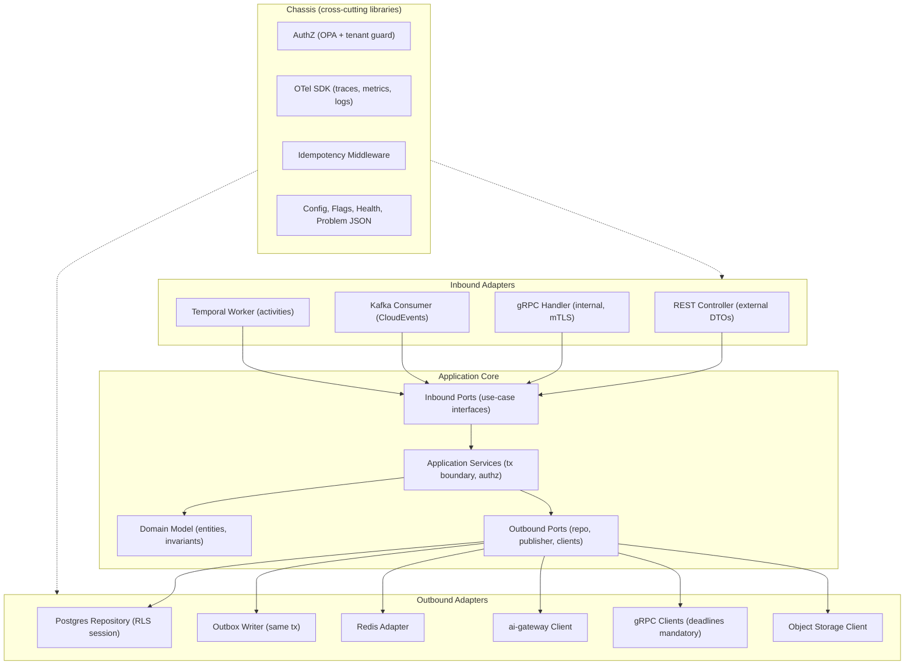
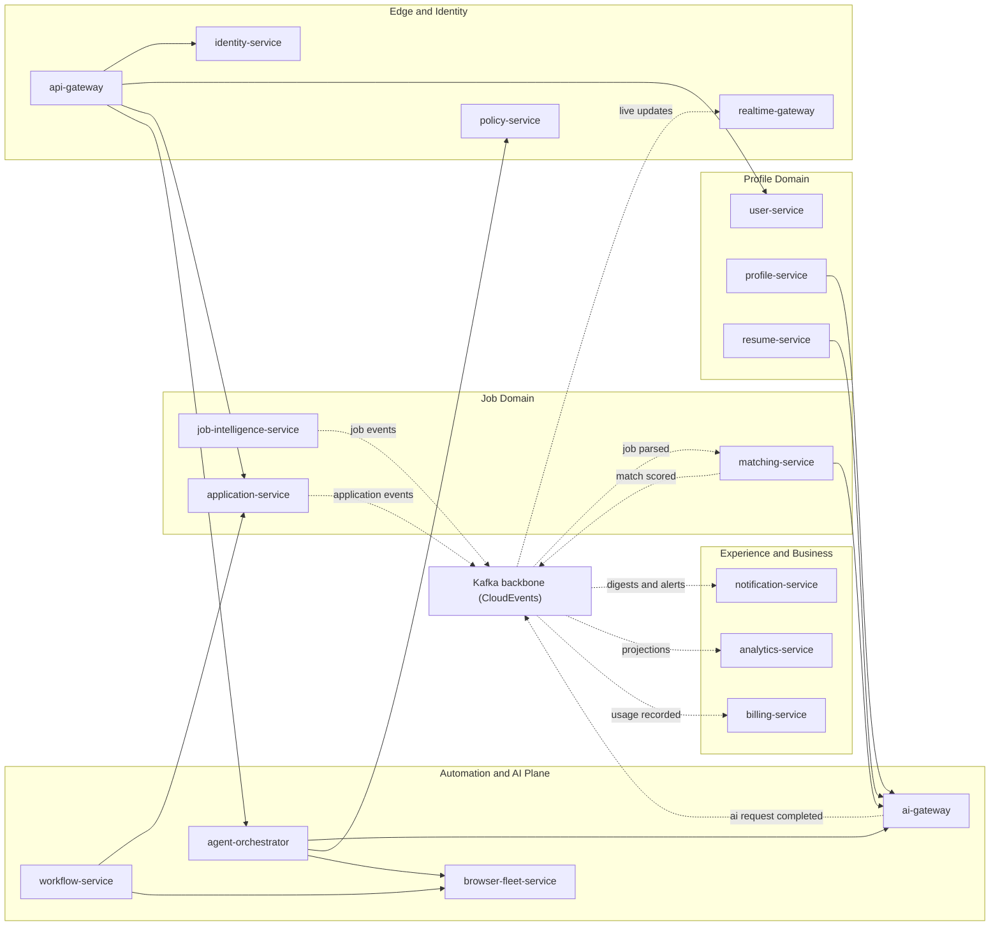
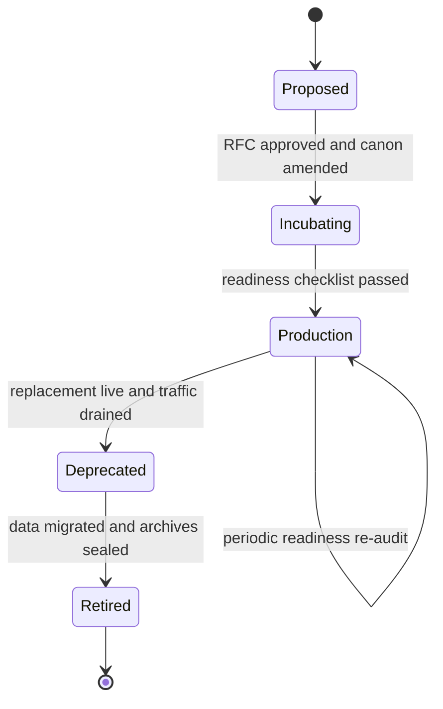
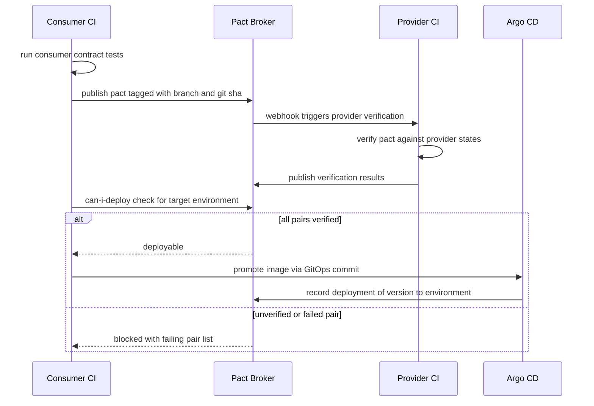

# 09 — Microservice Architecture

| | |
|---|---|
| Document ID | ACA-SAS-09 |
| Volume | 2 — Core Services |
| Status | Draft v1.0 |
| Depends on | [00 — Architecture Canon](../00-architecture-canon.md), [05 — High-Level Architecture](../volume-1-foundation/05-high-level-architecture.md), [06 — Technology Stack](../volume-1-foundation/06-technology-stack.md), [10 — API Gateway](10-api-gateway.md), [18 — AI Gateway](18-ai-gateway.md) |

## 1. Overview

This chapter defines the **service design standard** that every service in the canonical catalog ([canon §4](../00-architecture-canon.md)) must follow: the hexagonal (ports-and-adapters) template, the standard chassis libraries, the communication matrix, the data ownership map, the service tiering model, the testing strategy including consumer-driven contract testing, the production-readiness checklist, and the team topology that owns it all. Individual service chapters in Volumes 2, 3, 7, and 8 specify *what* each service does; this chapter specifies *how every service is built*, so that the per-service chapters never re-litigate structure.

The standard exists to make 30+ services operable by a small organization. Every deviation a service takes from this template is a tax paid by every engineer who touches that service later. Deviations are therefore allowed only through the exception register in §9 (production-readiness checklist item PR-24), with a named owner and an expiry date.

The canon's shorthand "the 32 services" refers to the authoritative catalog in [canon §4](../00-architecture-canon.md); the enumeration used throughout this chapter is exactly that catalog (32 canonical identifiers across five groups). Agents ([canon §5](../00-architecture-canon.md)) are logical workers inside `agent-orchestrator`'s runtime and are deliberately **not** services; nothing in this chapter applies to agents except through the services that host them.

Two constraints from the canon shape everything here: **no service calls another service's database** (integration is APIs and events only), and **all model calls go through `ai-gateway`**. The chassis (§7) makes the right way the easy way: the outbox writer, the idempotent consumer, the OPA guard, and the OTel wiring come from shared libraries, not from per-team reimplementation.

## 2. Service Design Standard — Hexagonal Template

### 2.1 Purpose

Every service — NestJS (TypeScript) for product/domain services, FastAPI (Python) for AI-plane services, Go where the canon permits (`proxy-manager`, `scheduler-service`) — implements the same hexagonal shape: a pure application core surrounded by inbound and outbound adapters, with all cross-cutting behavior supplied by the chassis. The shape is enforced by lint rules (import-boundary checks in CI), not by convention alone.

### 2.2 Responsibilities of each layer

| Layer | Contains | Must not contain |
|---|---|---|
| Inbound adapters | REST controllers (external DTOs), gRPC handlers (internal), Kafka consumers (CloudEvents unwrap), Temporal activity/workflow workers | Business rules, direct repository access |
| Inbound ports | Use-case interfaces (one per command/query), input validation schemas | Transport concerns (HTTP codes, protobuf types) |
| Application services | Use-case orchestration, transaction boundary, outbox emission, authorization decisions (via chassis OPA guard) | SQL, HTTP clients, provider SDKs |
| Domain model | Entities, value objects, invariants, domain events (in-process) | Framework imports of any kind |
| Outbound ports | Repository, event-publisher, cache, and client interfaces | Implementation detail |
| Outbound adapters | Postgres repositories (RLS session), outbox writer, Redis adapter, gRPC clients, `ai-gateway` client, object-storage client | Business rules |

Rules that follow from the layering:

- **One transaction, one aggregate, plus outbox.** An application service method opens one Postgres transaction; state change and `outbox_event` insert commit atomically. Cross-aggregate consistency is events or a Temporal saga — never a distributed transaction.
- **Tenant context is ambient and mandatory.** The chassis binds `tenant_id` from the authenticated principal into the request context and issues `SET app.tenant_id` on every pooled connection checkout; RLS enforces it at the database ([canon §6](../00-architecture-canon.md)). Application code cannot opt out.
- **External DTOs ≠ internal models.** REST DTOs, protobuf messages, and event payloads are mapped at the adapter boundary. Schema Registry owns event schemas; Buf owns protobuf; OpenAPI documents own REST.
- **No direct provider SDKs.** LLM calls go through the `ai-gateway` client port; payments through `billing-service`; email/push/SMS through `notification-service`. The lint boundary blocks `stripe`, `@anthropic-ai/*`, `openai`, `@sendgrid/*` imports outside the owning service.

### 2.3 Service anatomy



### 2.4 Repository and deployment shape

- **One repo per service** (`aca/<service-name>`), plus `aca/chassis-ts`, `aca/chassis-py`, `aca/proto` (Buf registry), `aca/gateway-config`, `aca/platform-infra`. Monorepo was rejected (§16) to keep CI blast radius and CODEOWNERS clean at this team size.
- **One Helm chart per service** derived from a shared library chart; one Deployment per process role (`api`, `worker`, `consumer`) so HPA scales roles independently.
- **One logical Postgres database per service** ([canon §3](../00-architecture-canon.md)); migrations forward-only, expand→migrate→contract, run as pre-sync Argo CD jobs decoupled from deploys.

## 3. Communication Matrix

The matrix below is the authoritative statement of who talks to whom. Solid dependencies are synchronous (gRPC internal, REST at the edge); event rows reference [canon §8](../00-architecture-canon.md) topics plus domain-scoped extensions following the same convention. A sync edge not listed here is a design violation flagged in review; adding one requires updating this table in the same PR.

Rules of the matrix:

1. **Sync calls only point "down" the value chain or to platform services** (`ai-gateway`, `policy-service`, `session-vault-service`, `workflow-service`). Cycles are forbidden; the CI dependency-graph check fails on cycle introduction.
2. **Anything that can be eventual is an event.** Sync is reserved for request-scoped reads and for commands where the caller needs the outcome to answer a user.
3. **`workflow-service` (Temporal) calls services as saga activities**; services never call Temporal internals directly — they start workflows via the workflow-service gRPC facade.

### 3.1 Synchronous call and event matrix

| Service | Sync calls (outbound) | Sync called by | Publishes (key topics) | Subscribes (key topics) |
|---|---|---|---|---|
| `api-gateway` | `identity-service` (JWKS/introspection), all routed services | external clients | — | — |
| `realtime-gateway` | `identity-service` (token validation) | `api-gateway` (WS/SSE upgrade) | — | `aca.agent.run.*`, `aca.application.status.changed.v1`, `aca.match.scored.v1`, `aca.notification.delivered.v1` (fan-out via Redis pub/sub) |
| `identity-service` | — | `api-gateway`, `realtime-gateway`, `public-api-service` | `aca.user.registered.v1` (identity created), session/audit events | `aca.user.deleted.v1` (credential purge) |
| `policy-service` | — | OPA sidecars (bundle pull), `agent-orchestrator` (consent/approval checks), `admin-service` | `aca.policy.updated.v1`, `aca.policy.killswitch.changed.v1` (domain extensions) | `aca.user.deleted.v1` (consent teardown) |
| `user-service` | `identity-service` (session revocation on delete/2FA reset) | `api-gateway`, `admin-service`, `billing-service` (seat checks) | `aca.user.registered.v1` (account+tenant provisioned), `aca.user.deleted.v1` | `aca.billing.subscription.changed.v1` (plan cache) |
| `profile-service` | `ai-gateway` (profile understanding), `resume-service` (import attach) | `api-gateway`, `matching-service` (profile read) | `aca.profile.updated.v1`, `aca.profile.import.completed.v1` | `aca.resume.parsed.v1`, `aca.user.registered.v1` (bootstrap) |
| `resume-service` | `ai-gateway` (parse fallback, tailoring), object storage | `api-gateway`, `profile-service`, `application-service`, workflow activities | `aca.resume.parsed.v1`, `aca.resume.version.created.v1` | `aca.user.deleted.v1` (purge) |
| `portfolio-service` | `ai-gateway` (project analysis), `proxy-manager` (GitHub egress lease) | `api-gateway`, `matching-service` | `aca.portfolio.updated.v1` (domain extension) | `aca.user.registered.v1` |
| `job-intelligence-service` | `ai-gateway` (parse fallback, enrichment), `proxy-manager` (crawl egress) | `api-gateway`, `recruiter-service` | `aca.job.discovered.v1`, `aca.job.parsed.v1`, `aca.job.updated.v1`, `aca.job.expired.v1`, `aca.company.enriched.v1` | `aca.scheduler.trigger.fired.v1` (re-crawl) |
| `matching-service` | `ai-gateway` (explanations), `knowledge-graph-service` (graph features), `profile-service` (profile read) | `api-gateway` | `aca.match.scored.v1` | `aca.job.parsed.v1`, `aca.profile.updated.v1` |
| `application-service` | `resume-service` (version attach), `workflow-service` (start submission saga) | `api-gateway`, workflow activities, `agent-orchestrator` | `aca.application.drafted.v1`, `.approved.v1`, `.submitted.v1`, `.status.changed.v1`, `aca.interview.scheduled.v1`, `aca.offer.received.v1` | `aca.browser.session.completed.v1`, `aca.agent.run.completed.v1`, `aca.match.scored.v1` (draft suggestions) |
| `workflow-service` | activities call: `application-service`, `browser-fleet-service`, `agent-orchestrator`, `resume-service`, `notification-service` | services starting workflows (gRPC facade) | workflow lifecycle events (domain extension) | — (Temporal signals, not Kafka) |
| `agent-orchestrator` | `ai-gateway`, `memory-service`, `policy-service` (pre-action checks), `browser-fleet-service`, `knowledge-graph-service`, `prompt-registry-service` (indirect via ai-gateway) | `api-gateway` (assistant/approvals), workflow activities | `aca.agent.run.started.v1`, `.completed.v1`, `.failed.v1`, `aca.agent.approval.requested.v1` | `aca.scheduler.trigger.fired.v1`, `aca.match.scored.v1` (autopilot triggers) |
| `ai-gateway` | LLM providers (external, sole egress point), `prompt-registry-service` (prompt pull), `cost-controller` (budget snapshot refresh) | every service needing models; `agent-orchestrator` | `aca.ai.request.completed.v1` | `aca.cost.budget.threshold.v1` (enforcement state) |
| `prompt-registry-service` | — | `ai-gateway`, `learning-pipeline`, `admin-service` | `aca.prompt.version.promoted.v1` (domain extension) | eval results from `learning-pipeline` (sync API instead) |
| `memory-service` | `ai-gateway` (embeddings for memory indexing) | `agent-orchestrator` (context builder) | — | `aca.agent.run.completed.v1` (consolidation), `aca.user.deleted.v1` (purge) |
| `knowledge-graph-service` | — | `matching-service`, `agent-orchestrator`, `analytics-service` | — | `aca.user.registered.v1`, `aca.company.enriched.v1`, `aca.application.status.changed.v1`, `aca.offer.received.v1`, `aca.match.scored.v1` |
| `cost-controller` | — | `ai-gateway` (budget snapshots), `admin-service` | `aca.cost.budget.threshold.v1`, `aca.billing.usage.recorded.v1` | `aca.ai.request.completed.v1` |
| `learning-pipeline` | `prompt-registry-service` (eval submission, rollback trigger), `ai-gateway` (judge models, batch lane) | `admin-service` | `aca.learning.rollback.requested.v1` (domain extension) | `aca.application.status.changed.v1`, `aca.agent.run.completed.v1`, `aca.ai.request.completed.v1`, `aca.match.scored.v1`, `aca.browser.session.completed.v1` |
| `portal-intelligence-service` | `ai-gateway` (template learning, vision) | `browser-fleet-service`, `agent-orchestrator` (browser-agent template fetch) | `aca.portal.template.promoted.v1` (domain extension) | `aca.browser.session.completed.v1`, `aca.browser.action.failed.v1` (drift detection) |
| `browser-fleet-service` | `session-vault-service` (credential sidecar), `proxy-manager` (egress lease), `portal-intelligence-service` (fingerprint/template) | `agent-orchestrator`, workflow activities | `aca.browser.session.started.v1`, `.completed.v1`, `aca.browser.action.failed.v1` | — |
| `session-vault-service` | — | `browser-fleet-service` (sidecar), `user-service` (consent-scoped writes), `admin-service` (audited break-glass) | vault access audit events → `aca.audit.event.v1` | `aca.user.deleted.v1` (hard purge) |
| `proxy-manager` | external proxy providers | `browser-fleet-service`, `job-intelligence-service`, `portfolio-service` | — | — |
| `notification-service` | SES/SendGrid, FCM/APNs, Twilio (behind adapters) | `api-gateway` (prefs), workflow activities | `aca.notification.delivered.v1` | `aca.notification.requested.v1`, digest-relevant domain events |
| `scheduler-service` | — | `admin-service` (schedule mgmt) | `aca.scheduler.trigger.fired.v1` (domain extension) | — |
| `search-service` | OpenSearch | `api-gateway`, `recruiter-service` | — | `aca.job.parsed.v1`, `.updated.v1`, `.expired.v1`, `aca.application.*` (index projections) |
| `analytics-service` | — | `api-gateway`, `admin-service` | benchmark/insight events (domain extension) | nearly all domain topics (CQRS projections) |
| `billing-service` | Stripe (adapter), `user-service` (seat validation) | `api-gateway` (entitlement snapshots), `user-service` | `aca.billing.subscription.changed.v1` | `aca.billing.usage.recorded.v1`, `aca.user.registered.v1`, `aca.user.deleted.v1` |
| `admin-service` | admin gRPC surfaces of most services (JIT-elevated) | internal ops portal only | `aca.audit.event.v1` contributions | `<topic>.dlq` set (triage), `aca.agent.run.failed.v1` |
| `recruiter-service` | `search-service`, `job-intelligence-service` (posting intake) | `api-gateway` | `aca.recruiter.posting.created.v1` (domain extension) | `aca.application.status.changed.v1` (consented pipelines) |
| `audit-service` | WORM object storage | `admin-service` (compliance export) | — | `aca.audit.event.v1` (sole consumer of record) |
| `public-api-service` | domain services (fan-in, same authz as first-party), `identity-service` (key→principal resolution) | external partners via `api-gateway` | webhook delivery receipts (domain extension) | domain events driving outbound webhooks |

### 3.2 Communication overview (representative flows)

The diagram shows the dominant paths only; the table above is exhaustive. Solid = sync gRPC/REST; dashed = Kafka events.



## 4. Data Ownership Map

Every data-owning service owns exactly one logical schema; ownership means sole write access, migration authority, and accountability for its PII classes and retention ([canon §11](../00-architecture-canon.md)). The two stateless edge services are listed for completeness — they own no durable schema, and that absence is itself an architectural invariant. Read models elsewhere are event-derived projections and may be stale; they never become a source of truth.

| Service | Primary store | Key entities | Max PII | Notes (partitioning / retention) |
|---|---|---|---|---|
| `api-gateway` | — (stateless) | — | — | config-as-code only; rate-limit buckets and snapshot caches live in gateway-scoped Redis and are reconstructible, not owned data |
| `realtime-gateway` | Redis (ephemeral) | connection registry | P2 | user↔connection mappings, TTL-expired seconds after disconnect; nothing durable |
| `identity-service` | Postgres | identities, credentials, sessions, refresh tokens | P1 | Argon2id password hashes; sessions also in Redis |
| `policy-service` | Postgres | policies, consents, approval rules | P2 | OPA bundles built from here; versioned, signed |
| `user-service` | Postgres | users, tenants, memberships | P1 | field-level AES-256-GCM on identity PII |
| `profile-service` | Postgres + pgvector | profiles, skills, imports, understanding snapshots | P2 | embedding namespaces dimension-versioned |
| `resume-service` | Postgres + S3 | resumes, versions, parse results | P1 | binaries in S3; parse results 13-month archive |
| `portfolio-service` | Postgres | portfolios, projects | P2 | public-source derived data marked P3 |
| `job-intelligence-service` | Postgres + S3 | jobs, companies, sources, crawl state | P3 | `job` time-partitioned; raw crawl artifacts 30d |
| `matching-service` | Postgres | match scores, match features | P2 | scores partitioned by month |
| `application-service` | Postgres (event-sourced timeline) | applications, application events, interviews, offers | P2 | `application_event` time-partitioned; event-sourced per canon |
| `workflow-service` | Temporal store (Postgres) | workflow histories | P2 | history retention 90d, then archival |
| `agent-orchestrator` | Postgres | agent definitions, runs, checkpoints | P2 | runs time-partitioned |
| `ai-gateway` | Postgres + Redis | request logs, token ledger (hot) | P2 | `ai_request_log` partitioned; 90d hot → 13-month archive |
| `prompt-registry-service` | Postgres | prompts, versions, eval results | P3 | immutable versions, semver |
| `memory-service` | Postgres + pgvector | memories, memory indices | P2 | per-user namespaces; purged on deletion |
| `knowledge-graph-service` | Apache AGE on Postgres | entity/relationship graph | P2 | behind `graph-store` interface (Neo4j phase 2) |
| `cost-controller` | Postgres + Redis | budgets, spend aggregates | P3 | hot aggregates in Redis, daily rollups in PG |
| `learning-pipeline` | Postgres + S3 | training sets, eval runs, feature store | P2 | training sets de-identified before storage |
| `portal-intelligence-service` | Postgres | portal fingerprints, templates, portal memory | P3 | `PortalTemplate@version` immutable |
| `browser-fleet-service` | Redis + Postgres | browser sessions (ephemeral), fleet state | P2 | screenshots/DOM in S3, 90d per canon |
| `session-vault-service` | Postgres (envelope-encrypted) | cookie/session vault | **P0** | per-user DEK, per-tenant KEK; sole P0 custodian |
| `proxy-manager` | Redis + Postgres | proxy pool state | P3 | reputation history 90d |
| `notification-service` | Postgres | notifications, delivery receipts | P1 | receipts 13-month archive |
| `scheduler-service` | Postgres | schedules | P3 | RRULE definitions |
| `search-service` | OpenSearch | search indices (projections) | P2 | rebuildable from events; not a source of truth |
| `analytics-service` | Postgres OLAP schema (ClickHouse phase 2) | analytics projections | P2 | aggregates only; user-level data pseudonymized |
| `billing-service` | Postgres | subscriptions, invoices, entitlements, usage records | P1 | Stripe is source of truth for payment instruments |
| `admin-service` | Postgres | admin audit shadow, support cases | P1 | JIT-elevation records mirrored to audit |
| `recruiter-service` | Postgres | recruiter orgs, postings, pipelines | P1 | candidate visibility strictly consent-gated |
| `audit-service` | Postgres + WORM S3 | audit events (append-only, hash-chained) | P1 | 7-year retention; no UPDATE/DELETE grants |
| `public-api-service` | Postgres | api keys, webhook endpoints | P1 | key hashes only; secrets shown once |

Cross-cutting rules:

- **`session-vault-service` is the only P0 custodian.** No other schema may contain credentials or session cookies; CI secret-scanning plus schema review enforce this.
- **Deletion fan-out:** `aca.user.deleted.v1` must be consumed by every service holding user-linked data; the GDPR erasure workflow (Temporal) verifies tombstone acknowledgments from each within 30 days ([canon §11](../00-architecture-canon.md)).
- **Projection rebuild:** any service holding projections (`search-service`, `analytics-service`, `knowledge-graph-service`) must support full rebuild from topic replay; rebuild time is a tested, published number (§9, PR-15).

## 5. Service Tiering

Tiering assigns operational rigor by blast radius, not by team preference. The tier determines on-call posture, review depth, deployment strategy, and capacity policy. Tier assignment is reviewed quarterly with the readiness re-audit (§9).

### 5.1 Tier definitions and assignments

| Tier | Definition | Services |
|---|---|---|
| **Tier-0** (critical path) | A failure immediately breaks the control-plane availability SLO (99.95%) or the security perimeter | `api-gateway`, `identity-service`, `policy-service`, `user-service`, `application-service`, `ai-gateway`, `session-vault-service` |
| **Tier-1** (core product) | A failure degrades the product within minutes-to-hours (autopilot stalls, notifications late, submissions blocked) but the control plane stays up | `realtime-gateway`, `profile-service`, `resume-service`, `job-intelligence-service`, `matching-service`, `workflow-service`, `agent-orchestrator`, `browser-fleet-service`, `portal-intelligence-service`, `proxy-manager`, `memory-service`, `cost-controller`, `notification-service`, `billing-service`, `search-service`, `audit-service`, `public-api-service`, `scheduler-service` |
| **Tier-2** (deferrable) | A failure is tolerable for a day; work is batch or internal | `portfolio-service`, `knowledge-graph-service`, `prompt-registry-service`, `learning-pipeline`, `analytics-service`, `admin-service`, `recruiter-service` |

Assignment rationale for the contested cases:

- `session-vault-service` is Tier-0 despite sitting on the async path: an outage halts every consequential submission, and its compromise class is P0 — it gets Tier-0 rigor for security even though its availability dependency is Tier-1-shaped.
- `policy-service` is Tier-0 because it distributes the **kill switch** and consent state; OPA bundle caching tolerates short outages, but staleness of kill-switch state is a safety issue, bounded by the 60 s bundle poll (§7.3).
- `billing-service` is Tier-1, not Tier-0: entitlement enforcement at the edge uses signed snapshots cached up to 24 h, so a billing outage degrades to "no plan changes," not "no service."
- `audit-service` is Tier-1 with a special rule: producers never block on audit ingestion (fire-and-forget via `aca.audit.event.v1` with Kafka durability as the guarantee), but sustained audit-consumer lag > 15 min pages, because compliance evidence is time-sensitive.
- `prompt-registry-service` is Tier-2 because `ai-gateway` caches resolved prompts by channel; registry downtime freezes prompt rollout, which is acceptable for a day.

### 5.2 Per-tier operational requirements

| Requirement | Tier-0 | Tier-1 | Tier-2 | Rationale |
|---|---|---|---|---|
| Min replicas / multi-AZ | 3 / required | 2 / required | 2 / required | quorum-safe rolling restarts on Tier-0 |
| PodDisruptionBudget | maxUnavailable 1 | maxUnavailable 1 | maxUnavailable 50% | Tier-0/1 must survive node drains |
| Deployment strategy | canary 5→25→100 with auto-analysis | canary | rolling | canon progressive delivery; Tier-2 gets speed |
| Load test before major release | required | required for hot paths | optional | protects SLOs where they matter |
| Capacity headroom | 100% (2× peak) | 50% | 25% | Tier-0 must absorb regional failover doubling |
| Paging | 24/7 page on SLO burn | 24/7 page, relaxed thresholds | business hours | error-budget burn-rate alerts per canon (2%/1h, 5%/6h) |
| Dependency review | any new sync edge needs architecture sign-off | team review | team review | Tier-0 sync fan-in is the availability product |
| Chaos participation | every quarterly game-day | rotating | annual | canon DR drill cadence |
| Readiness re-audit | quarterly | semi-annual | annual | drift catches |

### 5.3 Service maturity lifecycle



New services enter through an RFC that amends the canon catalog ([canon §4](../00-architecture-canon.md) requires it). `Incubating` services may take production traffic only behind a feature flag with a Tier-2 posture; promotion to `Production` requires the full checklist (§9).

## 6. Standard Chassis

### 6.1 Purpose and packaging

The chassis is the paved road: two first-party library suites — `@aca/chassis-*` (NestJS/TypeScript) and `aca_chassis` (FastAPI/Python) — plus a minimal Go module (`aca-go-chassis`) for the permitted Go services. Feature parity across the three is a hard requirement for the modules marked "core" below; the AI-plane extras exist only in Python.

Version policy: chassis releases are semver; **minor upgrades must be adopted within 30 days** (Renovate PRs, auto-merged when tests pass), majors within one quarter with a migration guide. The chassis team (§10) treats a breaking change without a codemod as a release blocker. Rationale: a security fix in the authz or Kafka module is worthless if half the fleet lags a year behind.

### 6.2 Chassis modules

| Module | Core | Behavior (normative) |
|---|---|---|
| `chassis-http` | yes | RFC 9457 problem+json errors with `trace_id`; cursor pagination helpers (default 25, max 100); request-size and content-type guards; keep-alive 65 s (above the 60 s LB idle timeout to avoid connection-reset races) |
| `chassis-authz` | yes | OPA policy evaluation (sidecar or embedded lib per service size); tenant guard binding `SET app.tenant_id` at connection checkout; principal propagation from gateway-injected headers; deny-by-default |
| `chassis-otel` | yes | OTel traces/metrics/logs; W3C tracecontext + `traceparent` CloudEvents extension propagation; parent-based head sampling 10% with tail sampling for errors and > p95 latency (keeps volume affordable while never losing bad requests); RED metrics auto-instrumented per endpoint/topic |
| `chassis-kafka` | yes | CloudEvents 1.0 envelope encode/decode; producer = outbox only (direct produce is lint-banned outside the CDC relay); consumer with per-key ordering, Redis dedup on event `id` (first line) + `consumed_event` table (crash-window closure); retry ladder 3 tries → `<topic>.retry.1m` → `.retry.10m` → `<topic>.dlq` per canon |
| `chassis-outbox` | yes | `outbox_event` table DDL + writer bound to the application transaction; Debezium captures WAL; rows pruned after 7 days (long enough to reprocess any CDC incident, short enough to keep the table small) |
| `chassis-idempotency` | yes | `Idempotency-Key` middleware on all POSTs; Redis 24 h window per canon; stores response snapshot (status + body hash + body ≤ 64 KiB, larger responses replay by re-execution guard) keyed by `tenant_id + endpoint + key` |
| `chassis-grpc` | yes | mTLS via mesh; mandatory deadlines (default 2 s sync read / 5 s sync write per canon); per-method OPA authz interceptor; typed client factories generated from the Buf registry |
| `chassis-config` | yes | 12-factor env + Vault (External Secrets); fail-fast on missing required config; no secrets in Helm values |
| `chassis-health` | yes | `livez` (process), `readyz` (deps: DB ping ≤ 500 ms, Kafka metadata, Redis ping), `startupz` with 60 s budget for migration-gated boots |
| `chassis-flags` | yes | OpenFeature SDK wired to Unleash (`feature-flag-service`); flag evaluation context = tenant, plan, cell |
| `chassis-ai` | py | `ai-gateway` client with model-class request builder, token budget hints, `untrusted_content` wrapper helpers for prompt-injection defense ([canon §13](../00-architecture-canon.md)) |
| `chassis-temporal` | ts+py | workflow/activity base classes with OTel interceptors, heartbeat conventions, saga compensation scaffolding |

### 6.3 Chassis-owned DDL

Every service schema includes these chassis tables verbatim (migration shipped with the chassis):

```sql
-- Outbox: written in the same transaction as the state change; Debezium relays to Kafka.
CREATE TABLE outbox_event (
  id             UUID PRIMARY KEY,                 -- UUIDv7; becomes CloudEvents id
  aggregate_type TEXT NOT NULL,
  aggregate_id   UUID NOT NULL,
  topic          TEXT NOT NULL,                    -- aca.<domain>.<event>.v<major>
  event_type     TEXT NOT NULL,
  partition_key  TEXT NOT NULL,                    -- tenant_id or entity id (canon ordering)
  payload        JSONB NOT NULL,                   -- CloudEvents envelope
  created_at     TIMESTAMPTZ NOT NULL DEFAULT now()
);
-- Pruned after 7 days by the chassis janitor job.

-- Consumer dedup: closes the crash window behind the Redis first-line dedup.
CREATE TABLE consumed_event (
  consumer_group TEXT NOT NULL,
  event_id       UUID NOT NULL,
  consumed_at    TIMESTAMPTZ NOT NULL DEFAULT now(),
  PRIMARY KEY (consumer_group, event_id)
);
-- Pruned after 7 days; Kafka hot retention is 7 days, so replay beyond that is a
-- deliberate operation with its own dedup plan.
```

### 6.4 Standard runtime limits

| Setting | Default | Rationale |
|---|---|---|
| Postgres pool per pod | 20 connections | 32 services × replicas must fit Aurora connection limits; RDS Proxy/pgbouncer absorbs bursts |
| HTTP server request timeout | 15 s | above the gateway's strictest upstream timeout so the gateway, not the service, owns the client-facing deadline |
| Kafka consumer `max.poll.interval` | 300 s | longest legal message-processing stall before rebalance; AI-plane consumers doing model calls need headroom |
| Consumer batch size | 100 records | balances throughput vs. per-key ordering latency |
| gRPC message max | 4 MiB | anything larger belongs in object storage with a reference (canon tool-result rule generalized) |
| Graceful shutdown drain | 30 s | matches Kubernetes `terminationGracePeriodSeconds`; consumers commit offsets before exit |
| CPU/memory requests | from load test, never defaults | prevents the "everything requests 100m" bin-packing lie |

## 7. Testing Strategy

### 7.1 Testing pyramid

| Level | Scope | Infrastructure | Budget / gate |
|---|---|---|---|
| Unit | domain model + application services with ports mocked | none | ≥ 70% of suite count; < 5 min in CI; PR gate |
| Component | one service in-process with real Postgres/Redis/Kafka via Testcontainers | Testcontainers | < 15 min; PR gate; covers RLS behavior, outbox emission, consumer idempotency |
| Contract | every sync consumer-provider pair (Pact) + every event schema (Registry compatibility) | Pact Broker, Schema Registry | PR gate on both sides; `can-i-deploy` gates promotion |
| End-to-end | ≤ 20 critical journeys (register→profile→match→draft→approve→submit; billing upgrade; GDPR erasure) | staging environment | nightly + smoke subset on every deploy; not a PR gate (flake quarantine policy) |
| Performance | k6 suites per Tier-0/1 hot path against staging | dedicated load cell | before major releases + quarterly |
| Chaos / DR | dependency-kill, AZ evacuation, region failover | game-days | quarterly per canon |

The deliberate imbalance: E2E tests are capped at 20 journeys because cross-service E2E is the most expensive test class to keep honest; contract tests carry the integration burden instead.

### 7.2 Contract testing (Pact)

Every synchronous edge in §3.1 has a consumer-driven contract. Providers verify pacts in CI against **provider states** (fixtures per scenario); consumers publish pacts per branch and version. Event contracts use two mechanisms: JSON Schema BACKWARD compatibility enforced by Schema Registry on producer CI, plus Pact message contracts for the consumer-side semantic expectations the Registry cannot express (field semantics, required extensions like `tenantid` and `traceparent`).



Operating rules:

- `can-i-deploy` runs against the **target environment's recorded versions** — a consumer cannot ship an expectation its production provider does not meet, and vice versa.
- Provider verification failure on `main` pages the provider team, not the consumer: the provider broke a published expectation.
- Pacts do not test business logic; a pact asserting response *values* beyond shape and semantics is rejected in review. Behavior belongs to the provider's component tests.
- The Pact Broker is deployed in the platform cluster; its outage blocks deploys (fail-closed) — accepted because deploy freeze is cheaper than unverified integration drift. Break-glass override requires VP-Eng-delegated approval and is audited.

## 8. Production Readiness Checklist

Promotion from `Incubating` to `Production` (§5.3) and quarterly Tier-0 re-audits use this checklist. "Evidence" means a link in the service's `READINESS.md` — a claim without a link fails the audit.

| # | Item | Evidence required |
|---|---|---|
| PR-01 | Hexagonal layout passes import-boundary lint | CI job |
| PR-02 | Chassis at current minor version | Renovate status |
| PR-03 | OpenAPI/Buf/event schemas published to registries | registry links |
| PR-04 | All POSTs idempotent via `Idempotency-Key` | component tests |
| PR-05 | All consumers idempotent (dedup verified under duplicate injection) | component tests |
| PR-06 | Outbox in place; zero direct Kafka produce | lint + Debezium config |
| PR-07 | RLS enabled on every table; cross-tenant probe test passes | component test |
| PR-08 | Pact contracts for every edge in §3.1 touching this service | Broker matrix |
| PR-09 | SLOs declared (latency, availability, freshness) with dashboards | Grafana links |
| PR-10 | Burn-rate alerts wired to PagerDuty per tier | Alertmanager config |
| PR-11 | Runbook: top 5 failure modes with commands | runbook link |
| PR-12 | Load test at 2× projected peak; limits set from results | k6 report |
| PR-13 | Canary analysis template configured (Tier-0/1) | Rollouts manifest |
| PR-14 | Backup/restore drill passed (owns data) | drill record |
| PR-15 | Projection rebuild time measured (owns projections) | drill record |
| PR-16 | `aca.user.deleted.v1` handling proven (holds user data) | E2E erasure test |
| PR-17 | PII classes declared per column; encryption verified for P0/P1 | schema annotations |
| PR-18 | Vault-only secrets; no secret in env/Helm | trufflehog CI |
| PR-19 | NetworkPolicy + mesh AuthorizationPolicy least-privilege | manifests |
| PR-20 | Resource requests/limits from measurement | k6 + VPA report |
| PR-21 | PDB + graceful drain verified under node kill | chaos test |
| PR-22 | DLQ triage path documented; replay tested | admin-service run |
| PR-23 | On-call rotation staffed; alert routing tested | PagerDuty |
| PR-24 | Deviations registered with owner + expiry | exception register |

## 9. Org and Team Topology

Team boundaries follow the domain boundaries (stream-aligned teams per Team Topologies), because the communication matrix in §3 is also the org's communication matrix — Conway's law is steered, not suffered. Target team size 4–7 engineers; a team owning more than ~5 services or any two Tier-0 services gets first claim on hiring or a split.

| Team | Type | Owns |
|---|---|---|
| Platform Engineering | platform | `api-gateway`, `realtime-gateway`, chassis suites, Kubernetes/Argo/Istio/observability stack, Pact Broker, Schema Registry |
| Identity & Trust | stream-aligned | `identity-service`, `policy-service`, `session-vault-service` |
| Profile & Documents | stream-aligned | `user-service`, `profile-service`, `resume-service`, `portfolio-service` |
| Jobs & Matching | stream-aligned | `job-intelligence-service`, `matching-service`, `search-service` |
| Applications & Orchestration | stream-aligned | `application-service`, `workflow-service`, `scheduler-service` |
| AI Platform | complicated-subsystem | `ai-gateway`, `agent-orchestrator`, `prompt-registry-service`, `memory-service`, `knowledge-graph-service`, `cost-controller`, `learning-pipeline` |
| Browser Intelligence | complicated-subsystem | `browser-fleet-service`, `portal-intelligence-service`, `proxy-manager` |
| Business Platform | stream-aligned | `billing-service`, `notification-service`, `analytics-service`, `admin-service`, `recruiter-service`, `audit-service`, `public-api-service` |
| Security Engineering | enabling | no services; embeds with teams for threat modeling, P0/P1 reviews, prompt-injection defense audits (Volume 5) |

Notes and known tensions:

- `session-vault-service` sits with Identity & Trust (credential-custody competency) although its primary consumer is Browser Intelligence; the seam is the vault's gRPC sidecar API, and the two teams co-own its contract tests.
- AI Platform at 7 services exceeds the ~5 guideline; the planned split is "AI Serving" (`ai-gateway`, `prompt-registry-service`, `cost-controller`) and "Agent Systems" (rest) once headcount allows — recorded here so it is a plan, not an accident.
- Business Platform similarly splits along `recruiter-service`/university product lines when Volume 8 revenue justifies it.
- Platform Engineering owns `api-gateway` because gateway config is a paved-road product consumed by every stream team via the config-as-code pipeline ([10 — API Gateway §12](10-api-gateway.md)).

## 10. Failure Scenarios

Chapter-level failure modes of the *architecture standard itself*; per-service failure modes live in the service chapters.

| Scenario | Effect | Mitigation / detection |
|---|---|---|
| Debezium/CDC relay down | outbox rows accumulate; events delayed, never lost | relay lag metric + alert at 60 s; outbox table sized for 24 h backlog; relay is HA-paired |
| Kafka unavailable | async plane stalls; sync control plane keeps serving | consumers/producers back off; outbox absorbs writes; Tier-0 paths have no sync Kafka dependency by design |
| Redis dedup loss (cluster failover) | duplicate deliveries reach consumers | `consumed_event` table closes the window; consumers are idempotent by contract (PR-05) |
| Schema Registry outage | producer CI blocks; runtime unaffected (schemas cached) | deploy freeze on producers only; registry is HA |
| Pact Broker outage | deploy freeze (fail-closed) | break-glass override, audited; broker restore < 30 min from backup |
| Chassis regression ships fleet-wide | correlated multi-service incident | staged chassis rollout: canary services (one per tier) soak 24 h before Renovate fans out |
| Sync-call cycle introduced | cascading failure amplification | CI dependency-graph check fails the PR; §3.1 is the reviewed source of truth |
| Cross-service DB access sneaks in | hidden coupling, broken ownership | per-service DB credentials scoped to own schema; network policy denies foreign DB endpoints; PR-19 |
| Temporal outage | sagas pause; no partial state (durable execution) | workflows resume on recovery; Tier-1 paging; interactive paths do not block on Temporal |
| Tenant-context bug bypasses RLS | none (defense in depth) | RLS denies at the database; cross-tenant probe tests (PR-07) verify continuously |

## 11. Scaling Strategy

- **Scale by role, not by service.** The `api`/`worker`/`consumer` Deployment split (§2.4) lets HPA scale the HTTP path on CPU+p95 latency while consumers scale on Kafka lag (KEDA) and workers on Temporal task-queue depth — three different signals, three different curves.
- **Partition-key discipline is the throughput ceiling.** Per-key ordering (canon: `tenant_id` or entity id) bounds consumer parallelism at partition count; high-volume topics (`aca.job.*`, `aca.ai.request.completed.v1`) start at 48 partitions (headroom for ~48 consumer instances; repartitioning is expensive, over-provision up front) while low-volume domain topics start at 12.
- **Read models absorb read scale.** Services never add sync fan-out to scale reads; they publish events and let `search-service`/`analytics-service`/local projections carry query load (CQRS per canon).
- **Cell scale-out** ([canon §15](../00-architecture-canon.md)): when a pooled cell approaches 70% of its measured capacity envelope (headroom for failover), a new cell is provisioned and new tenants land there; the standard makes this possible because every service is stateless above its own store and every store is per-cell.
- **Postgres growth path:** time-based partitioning first (canon §11), then per-tenant hash cells; cross-shard queries are forbidden — anything needing them is an analytics projection.

## 12. Security Considerations

- The chassis enforces the zero-trust baseline: mesh mTLS + SPIFFE identity, per-method OPA on gRPC, deny-by-default AuthorizationPolicies, Vault-only secrets ([canon §13](../00-architecture-canon.md)). A service cannot skip these without failing PR-19.
- **Tenant isolation is dual-layer** — chassis guard + database RLS — and tested adversarially (PR-07), because the canon treats "a service bug cannot cross tenants" as a database-level guarantee.
- **PII flows are schema-reviewed:** any migration adding a P0/P1 column requires Security Engineering sign-off; P0 outside `session-vault-service` is an automatic reject (§4).
- Event payloads are minimized: events carry IDs and deltas, not full PII snapshots, so Kafka's 7-day hot retention is not a shadow PII store; consumers needing detail call the owning service under their own authorization.
- Supply chain: distroless/Chainguard bases, SBOM per image, image signing (cosign) verified by admission policy; chassis pinned by checksum in lockfiles.

## 13. Observability

- **RED per endpoint and per topic** auto-instrumented by `chassis-otel`; USE metrics from the platform. Golden SLOs ([canon §14](../00-architecture-canon.md)) decompose into per-service SLOs declared in PR-09.
- **Trace continuity across the async plane** is the non-negotiable: `traceparent` rides the CloudEvents extension and Temporal headers, so "job discovered → scored" (15-min SLO) is one trace across `job-intelligence-service`, Kafka, `matching-service`, and `ai-gateway`.
- Standard dashboards are generated from service metadata (tier, endpoints, topics): every service gets latency/error/saturation, consumer lag, outbox lag, DLQ depth, and dependency-health panels without hand-building.
- Log schema is structured JSON with mandatory fields (`trace_id`, `tenant_id` hashed, `service`, `severity`); free-text logging of request bodies is lint-banned (PII risk).
- Per-tier alert policy: Tier-0 pages on burn rate; Tier-1 pages on sustained burn; Tier-2 tickets. Consumer lag alerts scale with the topic's freshness SLO (e.g., `matching-service` lag alert at 5 min because the discovery-to-scored SLO is 15 min end-to-end).

## 14. Future Improvements

- **Platform-as-product scorecards:** automate §8 as a continuously evaluated scorecard (Backstage-class portal) instead of quarterly manual audits.
- **Chassis for edge functions:** if Phase 2 adds CDN-edge compute for the frontend, extend the chassis conventions (problem+json, OTel) there.
- **Dependency budgets:** enforce a per-service maximum sync fan-in/fan-out budget in CI (today it is review-enforced via §3.1).
- **AI Platform team split** (§9) and the corresponding chapter-ownership split in Volume 3.
- **Automated pact generation** from OpenAPI + recorded traffic for low-risk internal read edges, to reduce hand-written contract maintenance.

## 15. Alternatives Considered & Tradeoffs

| Decision | Chosen | Alternative | Tradeoff accepted |
|---|---|---|---|
| Code organization | polyrepo per service + shared chassis repos | monorepo (Bazel/Nx) | lose atomic cross-service refactors; gain per-team autonomy, simple CODEOWNERS, small CI blast radius — right for < 100 engineers; revisit at scale |
| Service template | hexagonal ports-and-adapters | layered MVC, "just NestJS modules" | more upfront ceremony per service; buys testability (ports mocked), swappable adapters (canon's vendor seams), and lint-enforceable boundaries |
| Event production | outbox + Debezium CDC only | direct produce with retries; transactional dual-write | CDC adds a relay component and ~100 ms latency; eliminates the dual-write inconsistency class entirely — canon mandates it, this chapter operationalizes it |
| Consumer dedup | Redis + `consumed_event` table | Kafka EOS transactions end-to-end | EOS does not cover side effects outside Kafka (DB writes, HTTP calls); idempotency is required anyway, so EOS would add broker cost for partial coverage |
| Contract testing | Pact (CDC) + Schema Registry | provider-driven OpenAPI diffing only (Optic-class) | Pact costs consumer-side test maintenance; buys deployment gating on real consumer expectations, which schema diffing cannot see |
| Pact Broker outage posture | fail-closed (deploy freeze) | fail-open | availability of deploys traded for integration safety; break-glass covers true emergencies |
| Tiering | 3 tiers by blast radius | uniform "everything is critical" | uniform rigor overloads small teams and dilutes on-call attention; tiering concentrates rigor where the SLO math says it matters |
| Team topology | stream-aligned by domain + 2 complicated-subsystem teams | component teams (DB team, API team); one platform monolith team | stream alignment duplicates some skills across teams; buys end-to-end ownership matching the communication matrix, minimizing hand-offs on the critical path |
| Agents as services | rejected ([canon §5](../00-architecture-canon.md)) | one microservice per agent | kept: 23 agents as services would multiply deploy/ops surface with no isolation benefit; supervision centralizes in `agent-orchestrator` |

---

*Related: [10 — API Gateway](10-api-gateway.md) applies this standard to the edge; [18 — AI Gateway](18-ai-gateway.md) to the AI plane. Data conventions in [Volume 4](../volume-4-data-platform/); operations and cells in [Volume 6](../volume-6-operations/); security depth in [Volume 5](../volume-5-security/).*
