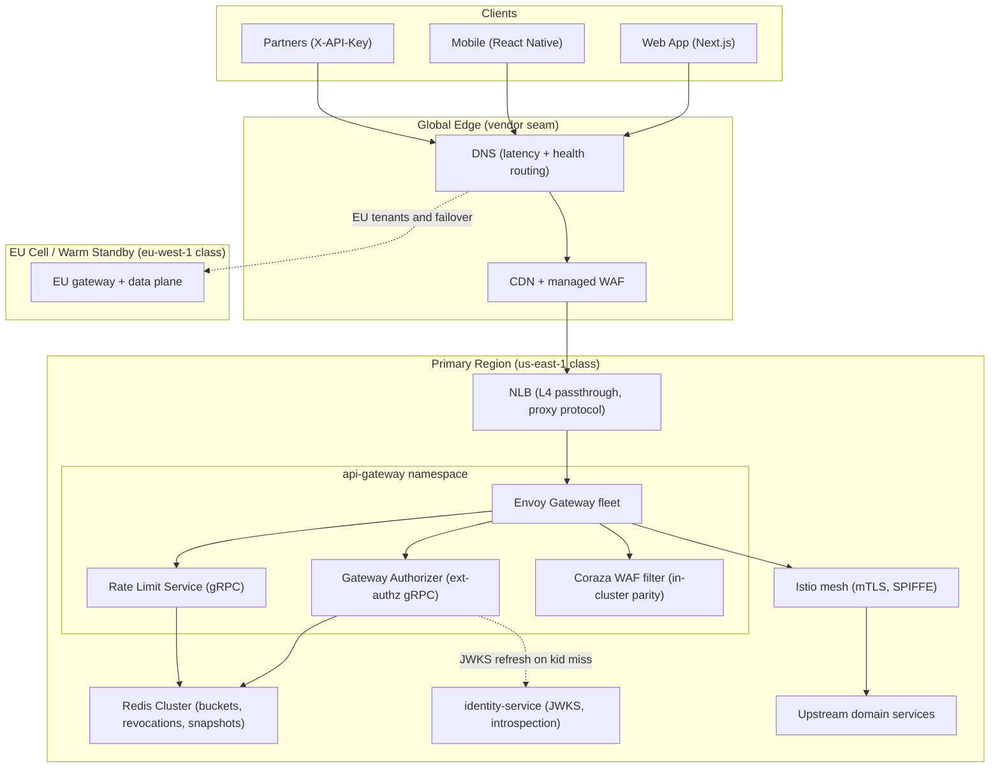
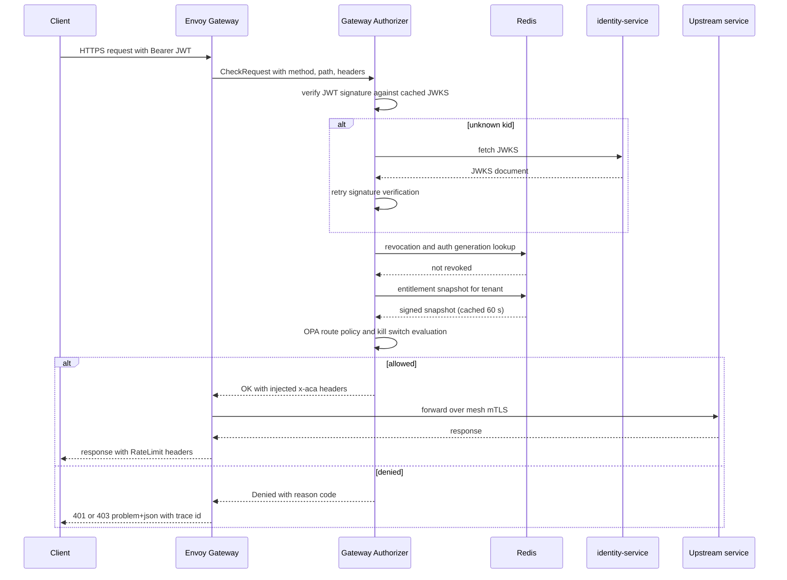
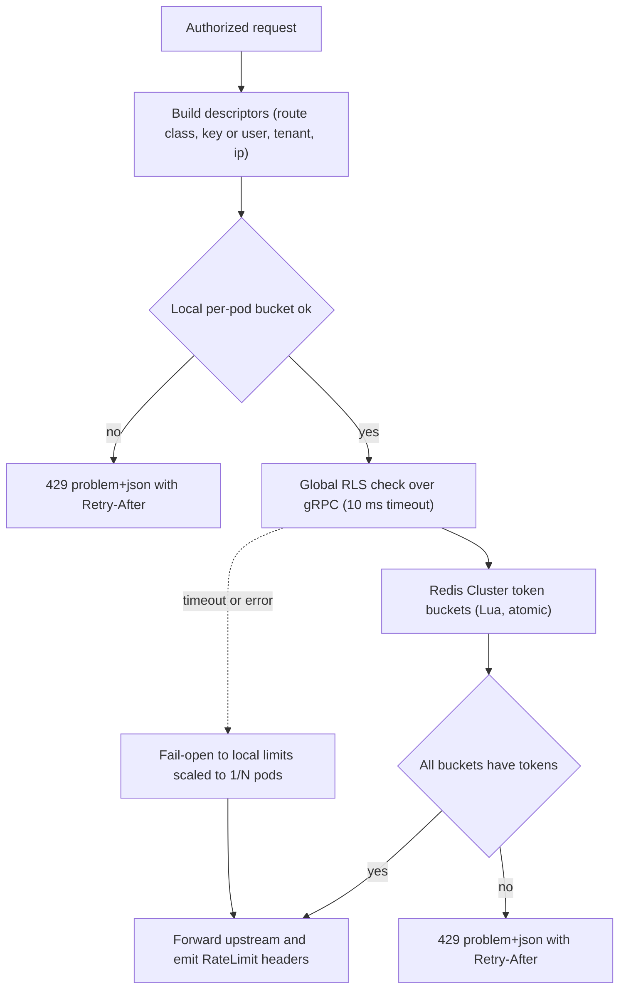
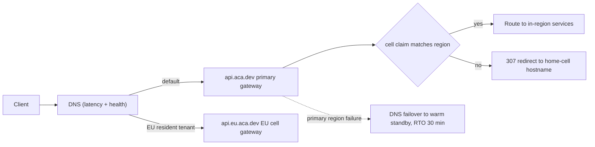
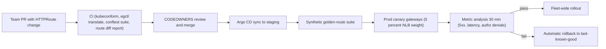

# 10 — API Gateway

| | |
|---|---|
| Document ID | ACA-SAS-10 |
| Volume | 2 — Core Services |
| Status | Draft v1.0 |
| Depends on | [00 — Architecture Canon](../00-architecture-canon.md), [07 — System Context](../volume-1-foundation/07-system-context.md), [09 — Microservice Architecture](09-microservice-architecture.md), [18 — AI Gateway](18-ai-gateway.md) |

## 1. Overview

`api-gateway` is the single external entry point to the platform: an Envoy Gateway (Kubernetes Gateway API) deployment with a custom ext-authz filter, per the canon's technology selection. It terminates TLS, authenticates every request, enforces coarse authorization and entitlements, applies rate limits, validates request shape, and routes to upstream services over the Istio mesh with mTLS. It is stateless ([canon §4.1](../00-architecture-canon.md)) — every piece of state it consults (JWKS, revocations, rate-limit buckets, entitlement snapshots) lives in `identity-service`, `billing-service`, or Redis.

The gateway is Tier-0 ([09 §5](09-microservice-architecture.md)): its availability *is* the control-plane availability SLO (99.95%), and its added latency is inside the read p99 < 300 ms budget. The component-level targets are therefore stricter than the product SLOs: 99.99% gateway availability, ≤ 10 ms p99 added latency for routing, ≤ 20 ms p99 for the full authz decision (cached path).

Scope boundaries: `realtime-gateway` (WebSocket/SSE) is a separate canonical service — `api-gateway` routes the upgrade/stream requests to it but does not hold long-lived client streams itself, keeping the gateway's restart cost near zero. `ai-gateway` ([18](18-ai-gateway.md)) is the *internal* model-traffic gateway; it is an upstream like any other from this chapter's perspective. Webhooks **out** to partners are `public-api-service`'s job; webhooks **in** (Stripe) enter through routes defined here.

This chapter specifies the routing conventions, the ext-authz flow with `identity-service`, the two-layer rate-limiting architecture, WAF/bot defense, request validation, versioning and deprecation mechanics, TLS/mTLS termination, resilience policy, multi-region routing, and the config-as-code pipeline, closing with the full failure-mode table.

## 2. Edge Topology

Component inventory (all deployed in the `api-gateway` namespace; the Authorizer and RLS are deployment components of the canonical `api-gateway` service, not new catalog services):

| Component | Purpose | Failure posture |
|---|---|---|
| Envoy Gateway fleet | L7 routing, TLS termination, filters | N+2 pods across 3 AZs |
| Gateway Authorizer | ext-authz gRPC: JWT validation, revocation, entitlements, coarse OPA policy, header injection | fail-closed for protected routes |
| Rate Limit Service (RLS) | global token buckets over Redis | fail-open to local limits |
| Coraza WAF filter | OWASP CRS in-cluster (parity with managed edge WAF) | fail-open above severity threshold, log-only mode switchable |
| Redis Cluster (gateway-scoped) | buckets, revocation set, entitlement snapshot cache | degraded modes per consumer |

## 3. Routing Table Conventions

### 3.1 Conventions

- **Gateway API resources:** one `Gateway` per listener class (`public`, `partner`, `admin`), one `HTTPRoute` file per upstream service, owned by the service's team via CODEOWNERS in the `aca/gateway-config` repo (§12). Platform Engineering owns the `Gateway`/`GatewayClass` and all policy attachments.
- **Path shape:** `https://api.aca.dev/v1/<plural-resource>`; resources, never service names, appear in paths ([canon §7](../00-architecture-canon.md)). A service rename must never be a client-visible event.
- **One route → one backend service.** No gateway-level aggregation or response stitching; composition belongs to a backend (BFF logic lives in the Next.js server components or `public-api-service`, not in Envoy).
- **Every route declares:** authn mode, rate-limit class, timeout class, body-size class, and validation schema reference. The conftest policy suite (§12) rejects routes with missing declarations — there is no "default open" route.
- **Header contract upstream:** the gateway strips all inbound `x-aca-*` headers (spoofing defense) and injects `x-aca-user-id`, `x-aca-tenant-id`, `x-aca-plan`, `x-aca-scopes`, `x-aca-cell`, `x-aca-auth-kind` (`user` | `api-key` | `service`), plus `traceparent`. Upstreams trust these headers only over mesh mTLS from the gateway's SPIFFE identity.

### 3.2 Routing table (authoritative excerpt)

| Route prefix | Backend | AuthN | RL class | Timeout | Body cap |
|---|---|---|---|---|---|
| `/v1/auth/*`, `/v1/sessions/*` | `identity-service` | anonymous (strict per-IP) | `auth` | 5 s | 64 KiB |
| `/v1/users/*`, `/v1/tenants/*` | `user-service` | JWT | `interactive` | 5 s | 256 KiB |
| `/v1/profiles/*`, `/v1/imports/*` | `profile-service` | JWT | `interactive` | 5 s | 1 MiB |
| `/v1/resumes/*` | `resume-service` | JWT | `interactive` | 5 s | 256 KiB (binaries via presigned S3, §7) |
| `/v1/portfolios/*` | `portfolio-service` | JWT | `interactive` | 5 s | 1 MiB |
| `/v1/jobs/*`, `/v1/companies/*` | `job-intelligence-service` | JWT | `read-heavy` | 3 s | 64 KiB |
| `/v1/matches/*` | `matching-service` | JWT | `read-heavy` | 3 s | 64 KiB |
| `/v1/applications/*`, `/v1/interviews/*`, `/v1/offers/*` | `application-service` | JWT | `interactive` | 5 s | 1 MiB |
| `/v1/assistant/*`, `/v1/agent-runs/*`, `/v1/approvals/*` | `agent-orchestrator` | JWT | `ai-heavy` | 30 s | 256 KiB |
| `/v1/search/*` | `search-service` | JWT | `read-heavy` | 3 s | 16 KiB |
| `/v1/analytics/*` | `analytics-service` | JWT | `read-heavy` | 5 s | 16 KiB |
| `/v1/notifications/*` | `notification-service` | JWT | `interactive` | 3 s | 64 KiB |
| `/v1/billing/*`, `/v1/plans/*` | `billing-service` | JWT | `interactive` | 5 s | 64 KiB |
| `/v1/webhooks/stripe` | `billing-service` | Stripe signature + source IP allowlist | `webhook` | 10 s | 1 MiB |
| `/v1/recruiter/*` | `recruiter-service` | JWT (recruiter tenant class) | `interactive` | 5 s | 1 MiB |
| `/v1/realtime`, `/v1/events` | `realtime-gateway` | JWT (at upgrade) | `interactive` | none (stream, 60 s idle) | 16 KiB |
| `partner.api.aca.dev/v1/*` | `public-api-service` | `X-API-Key` | `partner` | 10 s | 1 MiB |
| `admin.aca.dev/v1/*` | `admin-service` | JWT + ZTNA listener (mTLS, allowlisted network) | `admin` | 10 s | 1 MiB |

Timeout rationale: interactive 5 s = canon's 5 s sync-write internal deadline plus zero — the gateway deadline equals the deepest upstream deadline so the client sees one consistent budget; `ai-heavy` 30 s covers interactive drafting within the 60 s p95 draft SLO while forcing anything longer onto the async/agent-run path; `read-heavy` 3 s bounds fan-out reads at 1.5× the internal 2 s read deadline.

## 4. Authentication and Authorization (ext-authz)

### 4.1 Design

The Authorizer is a custom ext-authz gRPC server co-deployed with Envoy (the canon's "custom ext-authz filter"). The core decision: **no synchronous call to `identity-service` on the hot path.** JWTs are EdDSA (Ed25519) with 15-minute lifetimes ([canon §7](../00-architecture-canon.md)); the Authorizer validates signatures against a JWKS cache and checks a Redis revocation set, so token-theft exposure is bounded by min(15 min, revocation propagation ≈ 1 s) without per-request introspection latency.

Decision sequence per request:

1. **Route metadata lookup** — authn mode, required scopes, RL class (compiled into the Authorizer from gateway config at deploy).
2. **JWT verification** — signature via cached JWKS (refresh every 5 min and on unknown `kid`, serving stale up to 24 h if `identity-service` is down); `iss`/`aud`/`exp`/`nbf` checks.
3. **Revocation check** — Redis set of revoked session IDs (`sid`) and a per-user `auth_generation` counter (bumped on password reset/2FA change/compromise, invalidating all prior tokens). Populated by `identity-service` on logout/revocation events.
4. **Entitlement check (coarse)** — signed entitlement snapshot from `billing-service` ([canon §12](../00-architecture-canon.md)), cached in Redis 60 s, verified by signature; enforces plan-level route access (e.g., `/v1/recruiter/*` requires recruiter tenant class; frontier-class assistant features require Premium). Fine-grained enforcement stays in services.
5. **Coarse OPA policy** — embedded OPA (bundles from `policy-service`, polled every 60 s) evaluates route-level rules: scope→route mapping, tenant-state gates (suspended tenants get 403 with `type: tenant-suspended`), platform **kill switch** (blocks automation-triggering routes while leaving read/export routes up).
6. **Header injection** — the §3.1 header contract, plus `x-aca-cell` from the token's home-cell claim (§11).

API-key requests (`partner.api.aca.dev`) differ at step 2–3: the Authorizer verifies the key hash against a Redis-cached key record synced from `public-api-service` (60 s TTL, delete-on-revoke push), then proceeds identically with the key's principal.

### 4.2 Sequence

### 4.3 Failure posture

| Dependency down | Behavior | Rationale |
|---|---|---|
| `identity-service` (JWKS) | serve cached JWKS ≤ 24 h; alert at first stale serve | key rotation is scheduled; 24 h stale keys ≫ outage MTTR, and revocation still works via Redis |
| Redis (revocation) | **fail-closed for state-changing routes**, fail-open ≤ 60 s for reads with `x-aca-degraded: revocation` upstream hint | a revoked token performing reads for ≤ 60 s is accepted; writes and consequential actions are not |
| `billing-service` snapshots stale | honor last snapshot ≤ 24 h | entitlement drift for hours is a revenue nuance, not a security hole |
| `policy-service` bundles stale | honor last bundle ≤ 15 min, then fail-closed for automation routes | kill-switch staleness is safety-relevant; 15 min bounds it |
| Authorizer itself down | fail-closed (503) for all protected routes; `/healthz`, status page unaffected | authn cannot fail open, ever |

## 5. Rate Limiting Architecture

### 5.1 Two layers

**Layer 1 — local (per-Envoy-pod) token buckets:** blunt per-IP and per-connection caps evaluated in-process (no network hop). Purpose: survive floods even if the global RLS is degraded, and cheaply absorb the worst offenders before they cost a Redis round trip.

**Layer 2 — global RLS:** Envoy's rate-limit filter calls the RLS (gRPC, 10 ms timeout), which executes token-bucket Lua scripts in Redis Cluster keyed by descriptors. Descriptors are ordered most-specific-first; the first exhausted bucket denies.

Descriptor set per request: `(route_class, auth_kind, api_key | user_id, tenant_id, ip)`.

### 5.2 Limit table (reference defaults)

All buckets: burst = 2× sustained (UI interactions are bursty; 2× covers page-load fan-out without widening sustained abuse), refill continuous.

| Descriptor | Free | Professional | Premium | Enterprise | Rationale |
|---|---|---|---|---|---|
| per-user, `interactive` (req/min) | 120 | 300 | 600 | custom | 2 rps sustained exceeds any legitimate UI; plans scale with usage depth |
| per-user, `read-heavy` (req/min) | 240 | 600 | 1200 | custom | dashboards poll; reads are cheap but not free |
| per-user, `ai-heavy` (req/min) | 6 | 20 | 40 | custom | coarse cost guard; fine budgets are `cost-controller`'s job via [18 — AI Gateway](18-ai-gateway.md) |
| per-tenant aggregate (req/s) | 5 | 15 | 30 | seat-scaled | caps a single tenant's blast radius on shared cells |
| per-API-key, `partner` (req/s) | — | — | — | 10 default, contractual above | partner SLAs are sold, not assumed |
| per-IP anonymous (req/min) | 100 | 100 | 100 | 100 | scraping/enumeration defense pre-auth |
| `auth` login attempts per-IP (req/min) | 10 | 10 | 10 | 10 | credential stuffing; complements identity-service lockouts |
| `auth` signup per-IP (req/hour) | 5 | 5 | 5 | 5 | bot registration throttle |
| `webhook` (Stripe) (req/s) | 50 shared | — | — | — | above Stripe's realistic burst; protects `billing-service` |
| platform ceiling (req/s) | 50k shared | — | — | — | measured capacity envelope minus failover headroom; raised with load tests |

Headers `RateLimit-Limit`, `RateLimit-Remaining`, `RateLimit-Reset` are emitted on every limited route per canon; 429 bodies are problem+json with `type: rate-limited` and `Retry-After`.

### 5.3 Operational decisions

- **Fail-open with local fallback:** if RLS/Redis is unreachable, Envoy applies local limits scaled to `configured/N` (N = current pod count from endpoint discovery) so the aggregate stays near the intended global value. Availability beats exactness; the anomaly is logged and paged at 1 min sustained.
- **Redis budget:** single-digit-ms p99 required; buckets are cluster-sharded by descriptor hash. Hot-key mitigation: per-tenant descriptors above 1k req/s switch to a sliding-window approximation with per-pod token leases (trades ±5% accuracy for removing the hot key).
- **Limit changes are config-as-code** (§12) — no runtime knob twiddling; emergency overrides go through the break-glass path with audit.

## 6. WAF and Bot Defense

Two placements, one ruleset philosophy:

- **Managed edge WAF at the CDN** (AWS WAF reference; Cloudflare/Fastly pluggable — vendor seam is the CDN layer itself): OWASP Core Rule Set managed rules, IP reputation lists, geo policies, volumetric DDoS absorption (L3/4 at the CDN/provider edge).
- **In-cluster Coraza filter** (OWASP CRS v4, WASM filter in Envoy): parity enforcement for traffic paths that bypass the CDN (partner direct-connect, on-prem MinIO-class enterprise deployments) and a vendor-independent baseline so a CDN switch never changes the security floor.

Policy decisions:

| Concern | Decision | Rationale |
|---|---|---|
| CRS paranoia level | 1, with per-route exceptions | PL2+ false-positive rate is unacceptable for resume/free-text payloads; app-layer validation (§7) covers the gap |
| Mode rollout | log-only 2 weeks per new rule set → enforce | measured FP rate before user impact |
| Bot scoring | TLS fingerprint (JA4-class) + IP reputation + behavioral velocity, scored at the Authorizer | signup/login/scrape defense beyond static rules |
| Challenges | invisible challenge (Turnstile-class, vendor seam) on `auth` routes at elevated bot score | no CAPTCHA tax on legitimate users at normal score |
| Enumeration defense | uniform 404-shape and constant-time-ish auth error responses at gateway | ID/email oracle prevention |
| Admin listener | `admin.aca.dev` reachable only via ZTNA + client mTLS (§9) | WAF is not the control for admin — network identity is |

The platform's own crawlers (`job-intelligence-service` via `proxy-manager`) never traverse the public edge; egress policy is [Volume 7](../volume-7-browser-intelligence/) scope.

## 7. Request Validation

Validation at the gateway is **shape enforcement, not business validation** (that stays in services; the gateway must never need a service's domain knowledge):

- **Structural caps** (all routes): body cap per §3.2 class; header count ≤ 64, header size ≤ 16 KiB; JSON depth ≤ 32, array length ≤ 10k; UTF-8 enforced; content-type allowlist per route (`application/json` default; multipart only where declared).
- **OpenAPI-schema validation** (ext-proc filter) for `anonymous` and `partner` routes — the highest-abuse surfaces: requests failing the published OpenAPI 3.1 schema get 400 problem+json with `type: schema-violation` before touching upstreams. First-party JWT routes skip gateway schema validation (the chassis validates in-service; double validation buys little and slows the hot path) except for the `auth` class.
- **Uploads bypass the gateway body path:** resume/portfolio binaries go direct-to-S3 via presigned URLs issued by `resume-service`/`portfolio-service`; the gateway only ever sees the small JSON exchange. Keeps gateway memory flat and body caps tight (largest JSON route: 1 MiB).
- **Method and query discipline:** unknown query parameters are logged (not rejected — additive evolution per canon); unsupported methods get 405 with `Allow`.

## 8. API Versioning and Deprecation Mechanics

Canon rules ([§7](../00-architecture-canon.md)): path versioning `/v1`, additive-only within a version, breaking changes mint `/v2` with a 12-month deprecation window. The gateway operationalizes this:

- **Version is part of the route key:** `/v1/...` and `/v2/...` are distinct HTTPRoutes, possibly to different backend versions; the gateway never rewrites between versions (no silent translation — translation shims live in the owning service where they can be tested).
- **Deprecation metadata per route:** `deprecated: true`, `sunset: <RFC3339>`, `successor: /v2/...` in route annotations. The gateway injects `Deprecation`, `Sunset`, and `Link rel="successor-version"` headers on every response of a deprecated route.
- **Consumer accountability:** the gateway emits per-route, per-principal usage metrics; a weekly report of deprecated-route callers goes to API owners and, for `partner` keys, into partner-facing dashboards via `public-api-service`. Nobody gets to say they weren't told.
- **Sunset enforcement:** after sunset, routes return 410 problem+json with `type: version-retired` and the successor link for a 30-day grace (rationale: a hard 404 destroys diagnosability for stragglers), then the route is deleted.
- **Additive-change guard:** CI on `aca/gateway-config` cross-checks route OpenAPI references against the published registry; a non-additive diff within `/v1` fails the pipeline (§12).

## 9. TLS and mTLS Termination

| Hop | Policy |
|---|---|
| Client → CDN | TLS 1.3 (1.2 floor for enterprise legacy clients, revisited yearly); HSTS preload on `aca.dev`; OCSP stapling |
| CDN → NLB → Envoy | TLS 1.3 re-termination at Envoy (NLB is L4 passthrough with proxy protocol v2 for client IP preservation) |
| Partner mTLS (`partner.api.aca.dev`, optional per contract) | client-cert allowlist per API key; SPKI pinning recorded in `public-api-service` key metadata |
| Admin (`admin.aca.dev`) | mandatory client mTLS (ZTNA-issued certs) + network allowlist |
| Envoy → upstream | Istio mesh mTLS; gateway pods carry SPIFFE identity `spiffe://aca/ns/api-gateway/sa/envoy`; upstream AuthorizationPolicies accept `x-aca-*` headers only from this identity |

Certificate operations: cert-manager with ACME DNS-01 for public certs, renewal at 30 days remaining, page at 14 days unrenewed (two escalation windows before expiry); mesh certs are SPIRE-rotated hourly. Private keys never leave the cluster: public-facing keys live in Envoy SDS backed by Vault, not in Kubernetes Secrets committed anywhere.

## 10. Resilience Policy

Per-route-class Envoy policy, uniform across the fleet:

| Mechanism | Policy | Rationale |
|---|---|---|
| Retries | GET/HEAD only; max 2; `retry_on: 5xx, reset, connect-failure`; per-try timeout = route timeout / 3; retry budget 20% of active requests | non-idempotent retries at the edge would double-submit despite `Idempotency-Key` (the gateway cannot know a POST reached the service); budget caps retry storms |
| Hedging | Tier-0 `read-heavy` routes only: hedge after 300 ms (the read p99 SLO — a request already past p99 is worth a second attempt) with 1 hedge max | tames tail latency on the routes where p99 is the SLO; strictly idempotent routes only |
| Circuit breaking | per-upstream: max connections 1024, max pending 256, max requests 4096 per pod | bounds gateway memory under upstream stall; numbers from load tests at 2× peak |
| Outlier detection | eject on 5 consecutive 5xx; base ejection 30 s; max 50% of endpoints ejected | fast isolation of a bad canary pod without amputating a whole service |
| Timeouts | per §3.2; stream routes idle-timeout 60 s with keepalive pings | every request has a deadline; streams have liveness instead |
| Backpressure | 503 + `Retry-After: 2` when upstream circuit open; problem+json `type: upstream-unavailable` | clients (TanStack Query) implement jittered backoff against this contract |
| Load shedding | at 85% gateway CPU, shed `read-heavy` anonymous traffic first, then `partner` over-quota bursts; never shed `auth` or approval routes | preserve login and human-approval paths (safety-relevant) under duress |

## 11. Multi-Region Routing

Phase 1 is active-passive with an active EU cell for data-resident tenants ([canon §15](../00-architecture-canon.md)):

- **Hostname-per-cell:** `api.aca.dev` (primary region) and `api.eu.aca.dev` (EU cell). At login, `identity-service` returns the tenant's home-cell hostname; clients pin to it. The JWT carries a `cell` claim.
- **Mismatch handling:** a request landing on the wrong region's gateway (stale client, DNS anomaly) gets a 307 to the home-cell hostname from the Authorizer (`x-aca-cell` vs. local cell). Rationale: cross-region proxying from the gateway would add an 80–100 ms RTT tax and create a hidden inter-region dependency; an explicit redirect is visible, cacheable, and cheap. Exception: control-plane-shared routes (`/v1/auth/*`, `/v1/billing/*`) are served from the primary region for all tenants, consistent with the canon's shared control plane.
- **Failover:** DNS health-check failover (30 s interval, 3 failures → ~90 s detection) from primary to warm standby; standby promotion is the runbooked RTO ≤ 30 min path ([Volume 6](../volume-6-operations/)). Gateway config is continuously synced to the standby by Argo CD, so the edge in the standby region is always deploy-current — failover promotes data, not config.
- **Phase 2:** active-active stateless edge — both regions' gateways serve all tenants, with the Authorizer routing to the tenant's home cell over mesh east-west gateways. The §4 design anticipates this: nothing in the authz path is region-local except Redis, which becomes cell-scoped.

## 12. Config-as-Code Pipeline

All gateway behavior — routes, policies, limits, filters — lives in the `aca/gateway-config` repo as Gateway API CRDs plus policy attachments. There is no imperative configuration path.

Pipeline stages and gates:

1. **CI validation:** `kubeconform` (CRD schema), `egctl x translate` (the change must produce valid Envoy config — catches semantic errors schema checks miss), conftest/OPA policy suite, and a human-readable route-diff report posted to the PR.
2. **Conftest policy suite (excerpt):** every route declares authn mode, RL class, timeout class, body cap, and OpenAPI reference; no `anonymous` route outside the `auth` and status allowlist; no timeout above class ceilings; no route removal while traffic > 0 in the last 7 days (metric-sourced); deprecation metadata required before sunset dates.
3. **Staging soak:** synthetic suite exercises every route class (golden routes) plus authz-denial and rate-limit probes; a route that cannot be synthetically probed does not ship.
4. **Prod canary:** two canary gateway pods behind a 5% NLB target-group weight for 30 min with automated analysis (5xx delta, p99 delta, authz-denial-rate delta vs. fleet baseline). Gateway config is the one place where a bad push touches *everything*, so the fleet never receives an unsoaked change.
5. **Rollback:** Argo CD reverts to last-known-good on analysis failure; Envoy's last-known-good config also persists in-process (xDS rejection keeps serving prior config on invalid pushes — defense in depth against a validator gap).
6. **Break-glass:** direct `kubectl apply` is technically possible for SEV-1 mitigation, requires JIT elevation via `admin-service`, is audit-logged (`aca.audit.event.v1`), and must be reconciled into git within 24 h or Argo CD reverts it.

## 13. Failure Scenarios (full failure-mode table)

| # | Failure | Detection | Impact | Response |
|---|---|---|---|---|
| F1 | Authorizer deployment down | ext-authz error rate, synthetic authz probe | all protected routes 503 (fail-closed) | page; Envoy retries ext-authz across pods; N+2 sizing makes total loss a multi-fault event |
| F2 | JWKS refresh failing | stale-serve counter > 0 | none ≤ 24 h (cached keys); key rotation blocked | page identity on-call; freeze scheduled rotation |
| F3 | Redis (gateway) cluster down | RLS/Authorizer error metrics | rate limiting falls to local 1/N (§5.3); revocation degraded per §4.3; entitlements from last snapshot | page; reads fail-open ≤ 60 s, writes fail-closed on revocation checks |
| F4 | RLS latency > 10 ms budget | RLS timeout counter | intermittent fail-open to local limits | investigate Redis hot keys; §5.3 lease mode for offenders |
| F5 | Upstream service 5xx storm | outlier ejection events, upstream SLO burn | route degraded; others isolated by per-upstream circuits | 503 + Retry-After contract; upstream team paged via their SLO |
| F6 | Bad config passes validation | canary analysis delta | ≤ 5% of traffic for ≤ 30 min | auto-rollback (§12); post-incident: add conftest rule |
| F7 | Invalid xDS push (validator gap) | Envoy NACK metric | none (last-known-good keeps serving) | page platform; fix forward in git |
| F8 | Public cert expiry | cert-manager renewal alerts at 30/14 d | TLS failure (catastrophic, must never happen) | dual alerting paths; secondary cert pre-staged for one-command swap |
| F9 | NLB AZ loss | health-check + AZ imbalance metrics | capacity −33%; headroom absorbs (§14) | Kubernetes reschedules; no action if within envelope |
| F10 | Primary region loss | DNS health checks, platform-wide alerts | full outage until failover (~90 s detection + promotion) | runbooked failover, RTO ≤ 30 min; EU cell unaffected |
| F11 | CDN/WAF provider outage | edge synthetic probes | public edge down even though origin is healthy | DNS cutover to direct-NLB standby distribution (documented, drilled); Coraza keeps WAF floor (§6) |
| F12 | WAF false-positive wave | 403 rate delta per rule ID | legitimate requests blocked | per-rule kill via config pipeline; log-only fallback for the rule; SEV-2 |
| F13 | Credential-stuffing / bot wave | `auth` RL trips, bot-score distribution shift | login latency/noise | tighten per-IP tiers via config; enable challenges; feed IPs to edge WAF lists |
| F14 | L7 DDoS within rate limits (distributed, low-rate) | anomaly detection on per-route baselines | creeping saturation | platform ceiling backstop (§5.2); load shedding order (§10); CDN scrubbing escalation |
| F15 | Slowloris / slow-body attacks | connection-age and read-rate metrics | connection pool pressure | Envoy request/idle timeouts + header-read timeout 5 s; local per-IP connection caps |
| F16 | Entitlement snapshot signature invalid | verification failure counter | affected tenant treated as Free floor (never elevated) | page billing; snapshots are signed precisely so Redis tampering cannot elevate plans |
| F17 | Kill-switch bundle stale > 15 min | bundle-age gauge | automation routes fail-closed (§4.3) | page; this posture is deliberate — safety over availability for automation |
| F18 | `realtime-gateway` down | upgrade-route 5xx | live updates stop; REST unaffected | clients fall back to polling (frontend contract); Tier-1 page |

## 14. Scaling Strategy

- **Horizontal, stateless:** Envoy pods HPA on CPU (target 60%) and downstream connection count; Authorizer and RLS scale on gRPC p99 and QPS. No gateway component holds state that impedes scale-out; Redis Cluster shards by descriptor/key hash.
- **Capacity model:** Tier-0 headroom rule (2× peak, [09 §5.2](09-microservice-architecture.md)) plus the failover doubling case: the primary region's gateway fleet must absorb 100% of global traffic when the standby is promoted in reverse. Load tests validate the 50k req/s ceiling quarterly; the ceiling and HPA maxReplicas move together.
- **Connection reuse:** HTTP/2 upstream connection pooling to the mesh; client-side HTTP/2 + connection coalescing at the CDN keeps edge connection counts an order of magnitude below request counts.
- **Cell growth:** each new cell ships its own gateway namespace from the same config repo (per-cell overlay), so gateway scale-out is a byproduct of cell scale-out, not a separate program.

## 15. Security Considerations

- The gateway is the **authn perimeter but not the only authz layer**: services re-verify JWTs and evaluate fine-grained OPA policy (defense in depth per [canon §13](../00-architecture-canon.md)); the gateway's header injection is a performance optimization trusted only over mesh mTLS from the gateway identity, never a substitute for service-side checks on sensitive operations.
- **Header spoofing:** all inbound `x-aca-*` stripped at the edge (§3.1); AuthorizationPolicies bind header trust to the gateway SPIFFE ID, so an in-mesh compromised pod cannot mint identities toward other services via the gateway's header contract.
- **Token handling:** the gateway never logs tokens or `Authorization` headers; access logs record `sub`/`sid` hashes only. JWTs are P1-adjacent material; log scrubbing is tested in CI.
- **Kill switch:** platform-scope kill switch ([canon §1](../00-architecture-canon.md)) is enforced here for automation-triggering routes as the outermost of its three enforcement points (gateway, `agent-orchestrator`, `browser-fleet-service`).
- **Admin isolation:** `admin.aca.dev` is a separate `Gateway` with ZTNA mTLS; a public-listener vulnerability cannot reach admin routing.
- Gateway pods run the standard hardened posture: distroless images, read-only rootfs, no privilege, seccomp default; the WASM WAF filter is version-pinned and hash-verified.

## 16. Observability

- **Metrics:** RED per route class and per route; ext-authz decision latency histogram + decision-by-reason counters; RLS verdict counters per descriptor class; circuit/ejection events; TLS handshake errors; per-principal usage for deprecation reports (§8). Gateway SLO dashboards: availability 99.99%, added latency ≤ 10 ms p99, authz ≤ 20 ms p99.
- **Access logs:** structured JSON to Loki — route, status, duration, upstream duration, authz reason, RL verdict, `trace_id`, hashed principal; sampled at 100% for non-2xx and 10% for 2xx (2xx volume is the cost driver; failures are never sampled away).
- **Traces:** the gateway starts the trace (or continues the frontend's W3C context); `traceparent` flows through every upstream and into the event plane per canon, making the gateway span the root of nearly every product trace.
- **Synthetics:** golden-route probes per class + authz-denial and rate-limit probes, per region, every 30 s; these are the primary availability SLI source (client-side vantage beats self-reported health).
- **Alerting:** SLO burn-rate (2%/1h, 5%/6h per canon) on gateway availability and latency; dependency-specific alerts per §13's detection column; canary analysis alerts route to the merging team, not platform on-call (accountability follows the change).

## 17. Future Improvements

- **Phase 2 active-active edge** with cell-aware east-west routing at the Authorizer (§11), removing the 307 redirect hop.
- **Per-tenant adaptive rate limiting:** learned baselines per tenant with anomaly-based tightening, replacing parts of the static table in §5.2.
- **JWT-embedded entitlement claims** (short-lived, re-issued on refresh) to drop the Redis snapshot lookup from the hot path once claim-size and revocation semantics are validated.
- **gRPC-Web / Connect support** on the public listener if SDK demand materializes via `public-api-service`.
- **Request-priority classes** end-to-end (edge → mesh → service pools), extending §10's shedding order into upstream scheduling.

## 18. Alternatives Considered & Tradeoffs

| Decision | Chosen | Alternative | Tradeoff accepted |
|---|---|---|---|
| Gateway product | Envoy Gateway (Gateway API) + custom ext-authz | Kong, cloud-managed API gateways (canon-fixed) | operating Envoy ourselves vs. managed convenience; buys mesh-native consistency, xDS last-known-good semantics, and no per-request vendor pricing — and the canon mandates it |
| Hot-path authn | local JWT verification + Redis revocation | per-request introspection against `identity-service` | revocation propagation ≈ 1 s and 15-min token ceiling vs. an `identity-service` availability coupling on every request; introspection would put a Tier-0 sync dependency on every call for marginal freshness |
| AuthZ split | coarse at gateway, fine in services | full authz centralization at the edge | edge would need every domain's context (ownership, consent state) — an unbounded data dependency; coarse/fine split keeps the gateway's inputs small and cacheable |
| Rate-limit store | Redis Cluster token buckets (global) + local fallback | per-pod only; DynamoDB-class store | per-pod-only cannot enforce tenant aggregates; a cloud KV store adds vendor coupling and worse p99 than cluster-local Redis |
| RLS failure posture | fail-open with scaled local limits | fail-closed | closing on RLS failure converts a limiter outage into a platform outage; abuse risk during fail-open is bounded by local limits and short MTTR |
| Authorizer failure posture | fail-closed | fail-open with stale allow-cache | opposite call from RLS: authn correctness is a security invariant, rate limiting is a resource control |
| Cross-region mismatch | 307 redirect to home cell | transparent cross-region proxying | redirect exposes cell topology in hostnames and costs one round trip on mismatch; proxying hides topology but adds latency to every mismatched request and an inter-region failure coupling |
| Uploads | presigned S3, gateway sees JSON only | multipart proxying through gateway | presigned URLs complicate client code slightly; proxying binaries would dominate gateway memory/bandwidth sizing and force 15 MiB+ body caps on the edge |
| Schema validation scope | anonymous/partner/auth routes only | validate everything at the edge | full-edge validation doubles validation work on trusted paths and drags service contracts into gateway deploys; abuse surfaces get it, trusted paths rely on chassis validation |
| Gateway config rollout | canary gateways at 5% NLB weight | trust CRD validation + instant fleet apply | canary adds ≤ 40 min to every routing change; a bad fleet-wide route/authz change is the single largest self-inflicted outage class this platform can have |

---

*Related: [09 — Microservice Architecture](09-microservice-architecture.md) (service standard, tiering), [18 — AI Gateway](18-ai-gateway.md) (internal model gateway, budget enforcement), [Volume 5](../volume-5-security/) (identity, session vault, zero trust), [Volume 6](../volume-6-operations/) (cells, DR, failover runbooks).*
