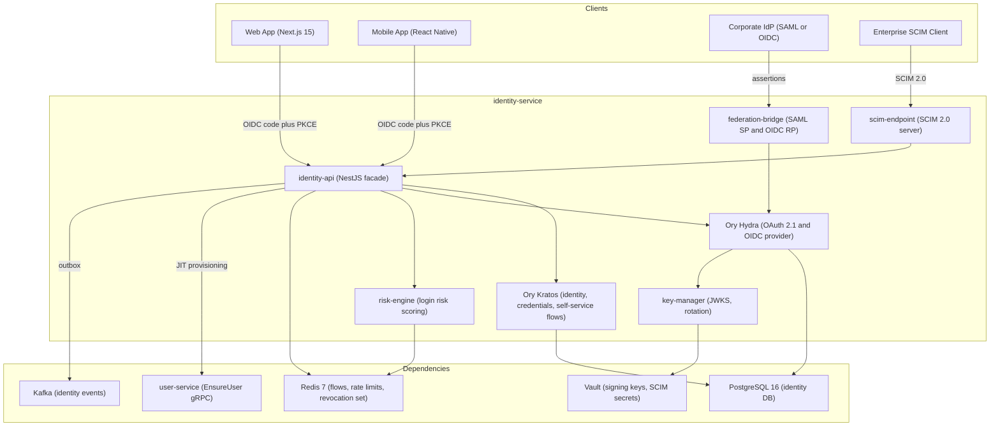
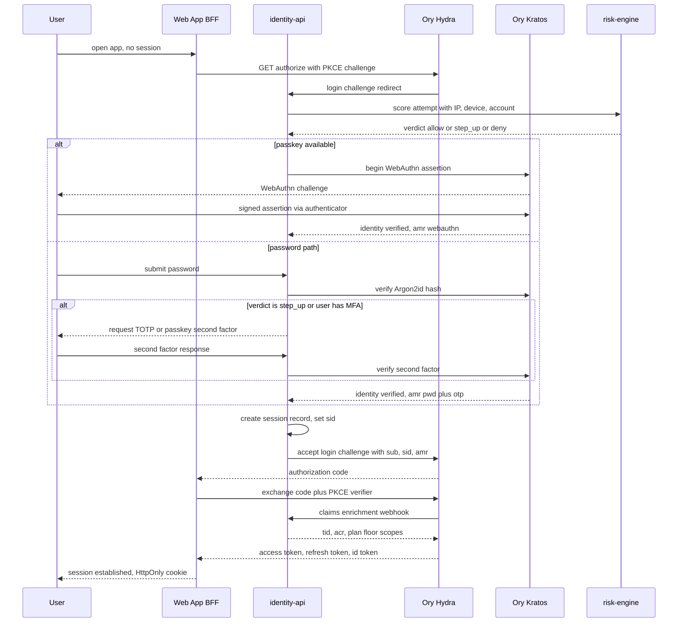
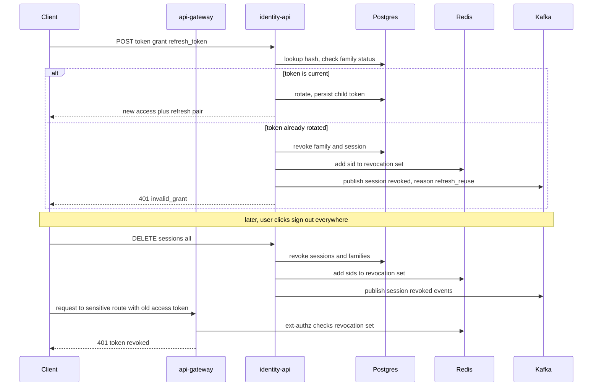
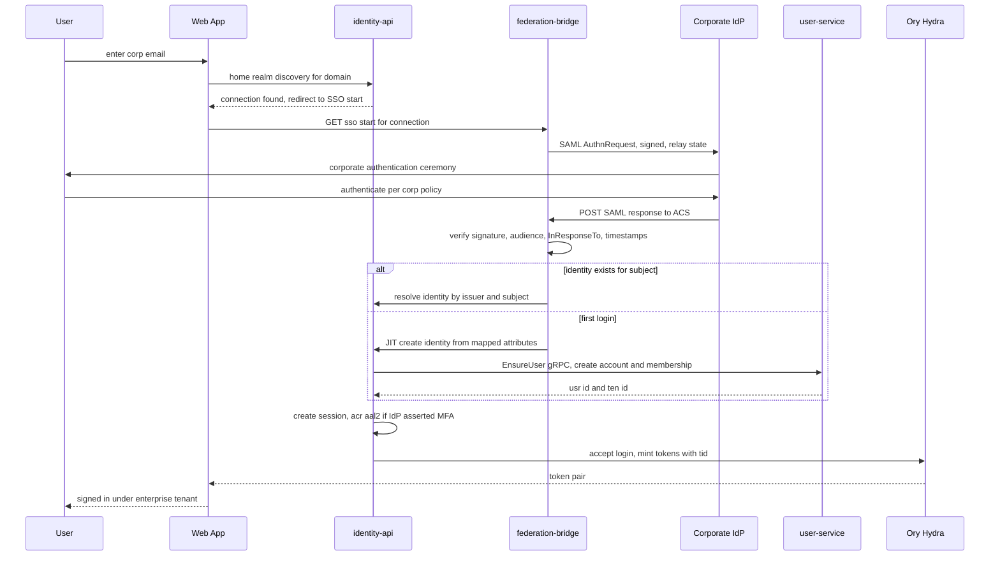
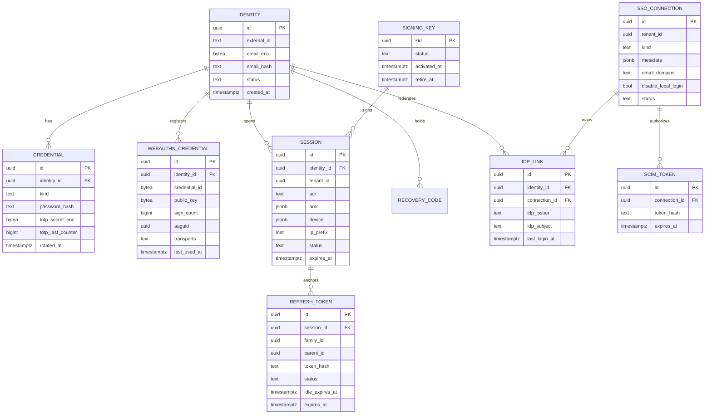

# 11 — Identity Service

| | |
|---|---|
| Document ID | ACA-SAS-11 |
| Volume | 2 — Core Services |
| Status | Draft v1.0 |
| Depends on | [00 — Architecture Canon](../00-architecture-canon.md), [05 — High-Level Architecture](../volume-1-foundation/05-high-level-architecture.md), [12 — User Service](12-user-service.md), [Volume 5 — Security](../volume-5-security/) |

## 1. Overview

`identity-service` is the platform's sole authentication authority: it proves who a principal is, issues the tokens every other component trusts, and manages the credential and session lifecycle for humans and machine clients. Per canon §4.1 it owns identities, credentials, sessions, and refresh tokens; per canon §3 it is built on OAuth 2.1 + OIDC with a reference implementation on Ory (Kratos for identity/credential flows, Hydra for the OAuth/OIDC provider), plus SAML and OIDC federation for enterprise SSO and WebAuthn/passkeys + TOTP for 2FA. Authorization is explicitly **not** this service's job — policy evaluation belongs to OPA and `policy-service`; `identity-service` supplies only the verified claims that policies consume.

Two placement decisions from [05 — High-Level Architecture](../volume-1-foundation/05-high-level-architecture.md) shape everything here. First, `identity-service` is **control-plane-shared, not cell-local**: a user's identity must resolve identically regardless of which cell serves their tenant, so the identity store is global (with EU-resident read replicas for EU tenants). Second, token verification is **local at the verifier**: `api-gateway` and services validate EdDSA signatures against a cached JWKS; `identity-service` is on the critical path only for login, refresh, and federation — never for steady-state request authentication. This bounds identity's availability blast radius to "no new sessions," not "platform down."

The service also carries an unusual burden for a SaaS identity plane: ACA's agents act with the user's delegated authority. Every agent-initiated action must be attributable to a specific user grant with a specific scope, which drives the token-exchange design in §4.4 — agents never hold a user's primary tokens, only narrow, short-lived delegated tokens with an `act` (actor) claim.

This chapter specifies the component architecture, the supported OAuth 2.1/OIDC flows, token and session design, MFA (passkeys + TOTP) enrollment and recovery, enterprise SSO federation with JIT provisioning and SCIM, account-security defenses, key management, the data model, and the threat model. Deep security policy (pen-test scope, compliance mapping) lives in [Volume 5 — Security](../volume-5-security/).

## 2. Service Architecture

### 2.1 Component View



### 2.2 Components

| Component | Purpose | Key responsibilities |
|---|---|---|
| `identity-api` | NestJS facade; the only surface other ACA components and clients touch | Flow orchestration over Kratos/Hydra, claims enrichment webhook, session APIs, admin APIs, outbox event publishing |
| Ory Kratos | Identity + credential system of record | Registration, password auth (Argon2id), WebAuthn, TOTP, recovery flows, identity schema management |
| Ory Hydra | Certified OAuth 2.1 / OIDC provider | `/authorize`, `/token`, `/revoke`, consent management, client registry, token issuance |
| `federation-bridge` | Terminates enterprise federation protocols | SAML 2.0 SP (SP-initiated + IdP-initiated with relay validation), external OIDC RP, home-realm discovery, assertion→identity mapping |
| `scim-endpoint` | SCIM 2.0 server per enterprise tenant | User/Group provisioning and deprovisioning from corporate directories, mapped onto identities + `user-service` memberships |
| `risk-engine` | Inline login risk scoring | Velocity checks, IP/ASN reputation, impossible travel, device-fingerprint continuity, breached-password verdicts; emits allow / step-up / deny |
| `key-manager` | Signing-key custody | Ed25519 key generation in Vault (Transit), `kid` lifecycle, JWKS publication, scheduled + emergency rotation |

**Interactions.** Downstream, every service trusts identity only through the JWKS endpoint and the claims contract (§4.1). Synchronous calls out of `identity-service` are limited to `user-service` (`EnsureUser` during JIT provisioning, §7.2) and Vault; everything else (audit trail, notification of new-device login, analytics) leaves via Kafka events (§10) so a downstream outage can never block a login.

**Why wrap Ory instead of using it bare.** Kratos and Hydra are deliberately generic; ACA needs tenant-aware claims (`tid`), agent delegation (token exchange), the risk engine inline in the login flow, SCIM, and SAML — none of which Ory provides out of the box in our self-hosted configuration. The facade keeps Ory upgradeable (we consume its stable APIs, never its DB) and keeps the vendor seam honest: replacing Ory means reimplementing the facade's ports, not re-integrating thirty services.

## 3. OAuth 2.1 / OIDC Flows

### 3.1 Grant Matrix

OAuth 2.1 baseline: no implicit grant, no resource-owner-password grant, PKCE mandatory for all authorization-code clients, exact-match redirect URIs.

| Grant | Client type | Token lifetime | Notes |
|---|---|---|---|
| Authorization code + PKCE (S256) | Web app (confidential, BFF), mobile (public) | 15-min access / 30-day rotating refresh | The only human login grant; consent screen skipped for first-party clients |
| Client credentials | First-party machine clients **outside** the mesh trust domain (CI jobs, admin tooling, cross-cell control-plane calls) | 15-min access, no refresh | Inside the mesh, SPIFFE mTLS + OPA replaces OAuth entirely (canon §13); client credentials exists for the gaps where SPIFFE identity is unavailable |
| Token exchange (RFC 8693) | `agent-orchestrator` only | ≤ 15-min delegated access, no refresh | Converts a user's standing automation grant into a narrow per-run token with `act` claim (§4.4) |
| Refresh token | Holders of a valid refresh token | Rotating, family-tracked | §4.3 |

Device-authorization grant is deliberately out of scope for Phase 1 (no TV/CLI login surface); see §17.

### 3.2 Interactive Login — Authorization Code + PKCE

The canonical login covers password and passkey paths plus risk-gated MFA step-up. The web client is a confidential BFF client (Next.js server holds the client secret); mobile is a public client relying on PKCE alone.



Decisions embedded in this flow:

- **Passkey-first UX.** If the identity has a registered WebAuthn credential, the passkey ceremony is offered before the password form (conditional UI / autofill). Passkeys with user verification satisfy AAL2 in one step — no separate MFA prompt — which is why `amr` and `acr` are computed per-ceremony, not per-account.
- **Risk verdict is inline, budgeted at p99 ≤ 30 ms.** All risk-engine features are Redis-resident (rationale: login p99 target is 500 ms and Argon2id already consumes ~200 ms of it; the risk check cannot add a database round trip).
- **Claims enrichment via Hydra webhook, not post-issuance mutation.** Tenant context (`tid`), `acr`, and plan-floor scopes are injected at token-mint time so every token is complete and self-contained; verifiers never call back.
- **Tenant selection.** A user with multiple memberships selects the active tenant at login (or the client passes `tenant_hint`); the token is bound to exactly one `tid`. Switching tenants mints a new token pair via a fresh (session-backed, non-interactive) authorize round trip. Rationale: single-`tid` tokens keep RLS and OPA inputs unambiguous and make cross-tenant confused-deputy bugs structurally impossible.

### 3.3 Client Credentials for Services

Machine clients are registered in Hydra with `client_id = svc_<name>`, per-client scopes, and secret custody in Vault (synced by External Secrets Operator). Issued tokens carry `sub = svc_<name>`, no `sid`, no refresh token (clients re-authenticate; 15-min lifetime bounds theft). Gateway rate limits machine clients on a separate, tighter bucket class than user traffic.

## 4. Token Architecture

### 4.1 Access Token — EdDSA JWT Claims

Canon §7 fixes the envelope: EdDSA (Ed25519), 15-minute lifetime, `kid`-based rotation via JWKS. Claims are deliberately minimal — entitlements live in `billing-service` snapshots, permissions in OPA; the JWT carries identity and context only.

| Claim | Example | Semantics / rationale |
|---|---|---|
| `iss` | `https://auth.aca.dev` | Single issuer for all environments of a deployment; env-distinct hosts prevent cross-env replay |
| `sub` | `usr_01J8...` | Prefixed opaque ID (canon §6); `svc_*` for machine clients |
| `aud` | `aca-api` | Single logical audience for the platform API; `public-api` for partner surface |
| `exp`, `iat`, `nbf` | — | `exp − iat` = 900 s; 15 min bounds revocation staleness (canon §7) |
| `jti` | UUIDv7 | Enables replay tracking in audit; not used for online revocation (see `sid`) |
| `sid` | `ses_01J8...` | Session ID; the revocation unit (§4.5) |
| `tid` | `ten_01J8...` | Active tenant; drives RLS `app.tenant_id` and OPA input; absent on `svc_*` tokens |
| `scope` | `profile.read applications.write` | Coarse scopes; fine-grained decisions remain in OPA |
| `amr` | `["webauthn"]` | Methods used this session; consumed by step-up logic |
| `acr` | `aal2` | Assurance level; sensitive routes require `aal2` (§5.3) |
| `azp` | `web-app` | Authorized client; distinguishes web/mobile/machine issuance |
| `act` | `{"sub":"agt_browser-agent"}` | Present **only** on exchanged delegation tokens (§4.4) |
| `ver` | `1` | Claims-contract version; verifiers reject unknown majors |

**No PII in tokens.** Email, name, and plan are absent by design (tokens traverse logs and browser storage; claims are P3 by construction). ID tokens (OIDC) may carry `email` for first-party display purposes only and are never accepted for API access.

### 4.2 Signature and Verification

Ed25519 signatures verify in ~50 µs without RSA's padding pitfalls; key material is 32 bytes, so JWKS documents stay small. Verifiers (api-gateway ext-authz, service chassis middleware) cache JWKS for 5 minutes with background refresh and accept any non-expired `kid` present in the document — this, combined with the rotation overlap in §8, makes rotation invisible to verifiers.

### 4.3 Refresh Tokens — Rotation with Family Reuse Detection

Refresh tokens are opaque 256-bit random values, stored hashed (SHA-256) — a DB leak yields nothing replayable.

- **Rotation:** every `/token` refresh call invalidates the presented token and issues a successor; parent–child links form a **family** rooted at login.
- **Reuse detection:** presentation of an already-rotated token revokes the entire family and the session, flags the session `compromised`, and emits `aca.identity.session.revoked.v1` with reason `refresh_reuse`. Rationale: reuse is the canonical signature of token theft; the legitimate holder re-authenticates, the thief is cut off, and both events are visible in audit.
- **Lifetimes:** 30-day absolute family lifetime (canon §7); 14-day idle timeout (a token unused for 14 days is dead — bounds the value of stale stolen tokens while keeping weekly-active users signed in).
- **Binding:** web refresh tokens are delivered only in an `HttpOnly; Secure; SameSite=Strict` cookie scoped to the auth domain (never readable by SPA JS); mobile tokens live in the OS keystore. Confidential clients must additionally present their client secret at refresh.

### 4.4 Delegated Agent Tokens (Token Exchange)

Agents must act with user authority but must never hold user login tokens. The standing consent ("automation grant," recorded in `policy-service`) authorizes `agent-orchestrator` to perform RFC 8693 token exchange:

1. `agent-orchestrator` (authenticated via mesh mTLS + its own `svc_` credentials) presents the grant reference and the requesting agent's identity.
2. `identity-service` verifies the grant is live (not revoked, within autonomy level) via `policy-service`.
3. It mints an access token with the user's `sub`/`tid`, scopes narrowed to the grant intersection (e.g. `applications.submit` only), `act.sub = agt_<agent>`, `acr = delegated`, lifetime ≤ 15 min, **no refresh token**.

Every agent action is thereby attributable (`sub` = user, `act` = agent) and instantly revocable — kill switch = revoke grant, and no new delegated tokens mint; in-flight tokens die within 15 minutes, or immediately for routes that check the revocation set. This is the identity half of the canon's guardrail principle (§1): the platform acts on behalf of a consenting user, provably.

### 4.5 Revocation Model

| Mechanism | Latency | Scope |
|---|---|---|
| Refresh-token revocation (RFC 7009, session delete, family reuse) | Immediate for new tokens | Session/family |
| Access-token natural expiry | ≤ 15 min | Token |
| **Revocation set** — Redis set of revoked `sid`s, TTL 15 min, checked by api-gateway ext-authz on *sensitive route classes only* (credential change, payment, session-vault access, automation-grant change, data export/deletion) | < 1 s on sensitive routes | Session |
| Signing-key emergency rotation (§8) | Minutes, platform-wide | All tokens |

Full online revocation checking on every request was rejected: it reintroduces a synchronous identity dependency into every API call, precisely what stateless JWTs avoid. The 15-minute staleness window on non-sensitive reads is an accepted, documented risk; the sensitive-route revocation set closes the window where it matters.

### 4.6 Refresh and Revocation Sequence



## 5. Session Management

### 5.1 Session Model

A **session** is created at login and is the unit of visibility and revocation. Sessions live in Postgres (system of record) with a Redis read-through cache (`ses:<sid>`, TTL = remaining lifetime) for the sensitive-route checks and the session-list API.

| Attribute | Value | Rationale |
|---|---|---|
| Absolute lifetime | 30 days (individual default); tenant-configurable 8 h – 30 d for enterprise | Matches refresh family; enterprises inherit their IdP posture |
| Idle timeout | 14 days | Mirrors refresh idle rule |
| Concurrent sessions per user | 10 | Covers realistic device counts; caps session-fixation fan-out and stuffing amplification |
| Device record | UA-derived label + platform + first/last seen + IP prefix | Powers "your devices" UX and risk continuity; raw fingerprints are not stored (P1 minimization) |

### 5.2 New-Device and Session Hygiene

First login from an unrecognized device emits `aca.identity.login.new_device.v1` → `notification-service` ("New sign-in on …") — cheap, high-value account-takeover tripwire. Session list/revoke APIs (§11) let users and tenant admins terminate sessions; admin revocation additionally requires JIT elevation per canon §13.

### 5.3 Step-Up Authentication

Routes tagged `aal2` in the gateway route table (payment methods, session-vault credential management, automation-grant changes, data deletion) require `acr = aal2` **and** an `amr` event fresher than 10 minutes. A token failing the check receives RFC 9457 `403` with `type = .../step-up-required`; the client runs a step-up ceremony (passkey or TOTP) that re-mints tokens with updated `acr`/`auth_time`. Ten minutes balances friction against the shoulder-surfing/stolen-laptop window.

## 6. MFA — Passkeys and TOTP

### 6.1 WebAuthn / Passkeys

- **Enrollment:** authenticated user (fresh `aal2` or recent login) requests registration options; server issues challenge with `rp.id = aca.dev`, `userVerification: required`, `residentKey: preferred`, attestation `none` (attestation metadata verification adds enterprise-grade assurance nobody consumes in Phase 1; revisit for enterprise device policies). Credential ID, COSE public key, sign counter, AAGUID, and transports are stored per §9.
- **Login:** conditional-UI assertion as primary factor (§3.2); passkey with UV ⇒ `acr = aal2` directly.
- **Sign-counter policy:** counter regression flags (not blocks) the credential — multi-device synced passkeys legitimately report zero counters; blocking would break the mainstream case. Flag feeds the risk engine.
- **Cross-device:** synced passkeys (platform vendors) accepted; hybrid (QR/CTAP) supported by the browser ceremony without server-side special-casing.

### 6.2 TOTP

RFC 6238, SHA-1/6-digit/30-s (maximal authenticator-app compatibility), secret generated server-side, shown once as QR + manual code, stored AES-256-GCM field-encrypted (P1). Verification accepts ±1 time step (clock skew) and **stores the last accepted counter to reject replay within the window**. Enrollment completes only after one valid code. Rate limit: 5 TOTP attempts / 5 min / account — brute-forcing 10^6 codes at this rate exceeds the code lifetime by orders of magnitude.

### 6.3 Recovery

Recovery is the classic MFA bypass; it is therefore deliberately slow and loud:

| Path | Mechanism | Guard |
|---|---|---|
| Recovery codes | 10 single-use codes issued at MFA enrollment, Argon2id-hashed | Code consumption emits notification + audit event; 3 failed codes / hour lock the path |
| Email recovery (no MFA enrolled) | Magic link, 15-min TTL, single-use | Risk engine must score `allow`; else manual review |
| MFA-loss recovery | Email link **plus** 24-h delay **plus** notification to all channels with cancel link | The delay converts account takeover from instant to detectable; user can cancel from any live session |
| Enterprise users | Redirect to IdP/helpdesk — ACA never overrides federated credentials | SSO tenants own their identity lifecycle (§7) |

All recovery events publish `aca.identity.credential.changed.v1` and revoke every existing session (post-recovery state must be attacker-free).

## 7. Enterprise SSO Federation

### 7.1 Connection Model

Enterprise/university/recruiter tenants register one or more **SSO connections** (SAML 2.0 or external OIDC) plus optional SCIM. Connections are tenant-scoped rows (§9) with verified email domains for home-realm discovery: a login attempt for `user@corp.example` with a matching verified domain is routed to the connection **before** any password prompt (prevents credential capture for federated users and satisfies "no local passwords" enterprise policies via the `disable_local_login` flag).

| Setting | Default | Rationale |
|---|---|---|
| Signed assertions/responses required | yes | Unsigned SAML is a forgery vector |
| Assertion encryption | optional | Transport is TLS; encryption is IdP-capability-dependent |
| Clock skew tolerance | 120 s | Covers real IdP drift without opening replay windows |
| `InResponseTo` validation | required, SP-initiated | Kills unsolicited-response injection |
| IdP-initiated SSO | off by default | No CSRF-safe binding of the response to a browser flow; enable per-tenant on request with relay-state allowlist |
| JIT provisioning | on | §7.2 |
| SCIM deprovisioning SLA | ≤ 5 min from SCIM call | Leaver access-revocation is the enterprise security requirement |

### 7.2 SP-Initiated SAML Login with JIT Provisioning



JIT decisions: identity linkage is keyed on `(idp_issuer, idp_subject)` — **never** on email, which IdPs recycle and users change. Attribute mapping (name, email, groups) is per-connection configuration; group claims map to `user-service` membership roles. The synchronous `EnsureUser` call is a deliberate exception to the events-only integration rule: the very next request needs `tid`, so eventual consistency is not an option — the call is idempotent and budgeted at 300 ms, and its failure fails the login cleanly (§13).

External-OIDC connections follow the same shape with `state`/`nonce`/PKCE in place of SAML message validation; ID-token `iss`/`sub` provide the linkage key.

### 7.3 SCIM 2.0

`scim-endpoint` exposes `/scim/v2/Users` and `/scim/v2/Groups` per connection, authenticated by per-connection bearer tokens (Vault-issued, 1-year, rotatable, revocable). Supported: create, patch (RFC 7644 subset: `replace`/`add` on mapped attributes), deactivate (`active=false` ⇒ suspend account + revoke sessions ≤ 5 min), group membership sync → role mapping. Deletes map to **suspension**, not GDPR erasure — erasure follows the [User Service](12-user-service.md) deletion saga with its legal-hold checks; a directory misconfiguration must not be able to trigger irreversible data destruction.

## 8. Key Management and JWKS

| Property | Value | Rationale |
|---|---|---|
| Algorithm | Ed25519 (EdDSA) | Canon §7; fast, small, misuse-resistant |
| Custody | Vault Transit — private keys never leave Vault; signing is a Vault API call | Key exfiltration requires Vault compromise, not service compromise |
| Rotation cadence | 30 days, automated | Bounds blast radius of undetected leak; frequent enough to keep the procedure exercised |
| Overlap window | 7 days (old key verifies, new key signs) | ≫ access-token life + JWKS cache TTL; rotation is invisible to verifiers |
| JWKS | `https://auth.aca.dev/.well-known/jwks.json`, ≤ 3 active keys, `Cache-Control: max-age=300` | Small doc, 5-min verifier staleness bound |
| `kid` | UUIDv7 | Sortable, unambiguous |
| Emergency rotation | Runbooked: new key signs immediately; compromised `kid` removed from JWKS at once; all sessions optionally mass-revoked | Removing a `kid` invalidates its tokens within one cache TTL (≤ 5 min) platform-wide |

Signing latency via Vault (~1–2 ms) is paid only at token mint (login/refresh/exchange), never at verification — an acceptable cost for never materializing private keys in service memory.

## 9. Data Model

Identity data is **not** tenant-RLS-scoped: identity precedes tenant membership and one identity may span tenants (canon §6 makes tenant context a token property, not an identity property). Access control is therefore service-layer (identity-id-scoped queries) plus the facade being the only DB client. SSO/SCIM tables carry `tenant_id` and do use RLS. All identity PII is P1 (field-level AES-256-GCM per canon §11); password/TOTP/recovery secrets are stored only as hashes or encrypted blobs.



DDL excerpt (authoritative fragments; full migrations in the service repo):

```sql
CREATE TABLE session (
    id            uuid PRIMARY KEY,            -- UUIDv7
    identity_id   uuid NOT NULL REFERENCES identity(id),
    tenant_id     uuid,                        -- active tenant context; NULL for svc_ sessions
    acr           text NOT NULL CHECK (acr IN ('aal1','aal2','delegated')),
    amr           jsonb NOT NULL DEFAULT '[]',
    device        jsonb NOT NULL DEFAULT '{}', -- label, platform, first/last seen
    ip_prefix     inet,
    status        text NOT NULL DEFAULT 'active'
                  CHECK (status IN ('active','revoked','compromised','expired')),
    created_at    timestamptz NOT NULL DEFAULT now(),
    expires_at    timestamptz NOT NULL
);
CREATE INDEX ON session (identity_id) WHERE status = 'active';

CREATE TABLE refresh_token (
    id              uuid PRIMARY KEY,
    session_id      uuid NOT NULL REFERENCES session(id),
    family_id       uuid NOT NULL,             -- root of rotation chain
    parent_id       uuid REFERENCES refresh_token(id),
    token_hash      text NOT NULL UNIQUE,      -- sha256(token); raw value never stored
    status          text NOT NULL DEFAULT 'current'
                    CHECK (status IN ('current','rotated','revoked')),
    idle_expires_at timestamptz NOT NULL,      -- now() + 14d, advanced on use
    expires_at      timestamptz NOT NULL,      -- family root + 30d
    created_at      timestamptz NOT NULL DEFAULT now()
);
CREATE INDEX ON refresh_token (family_id);

CREATE TABLE login_attempt (               -- risk-engine + lockout evidence, 90d retention
    id           uuid PRIMARY KEY,
    email_hash   text NOT NULL,            -- HMAC of normalized email; raw email absent
    ip           inet NOT NULL,
    outcome      text NOT NULL CHECK (outcome IN
                 ('success','bad_password','bad_mfa','locked','risk_denied')),
    risk_score   numeric,
    created_at   timestamptz NOT NULL DEFAULT now()
) PARTITION BY RANGE (created_at);
```

## 10. API and Event Contracts

### 10.1 REST Surface (via api-gateway, prefix `/v1/auth`)

| Method | Path | Auth | Purpose |
|---|---|---|---|
| GET | `/.well-known/openid-configuration` | public | OIDC discovery |
| GET | `/.well-known/jwks.json` | public | Verification keys |
| GET | `/v1/auth/authorize` | public | OAuth 2.1 authorize (PKCE required) |
| POST | `/v1/auth/token` | client auth | Code, refresh, client-credentials, token-exchange grants |
| POST | `/v1/auth/revoke` | client auth | RFC 7009 refresh revocation |
| POST | `/v1/auth/register` | public | Self-service registration (risk-gated) |
| POST | `/v1/auth/login` | public | Kratos login flow submit (password / passkey assertion) |
| POST | `/v1/auth/logout` | session | End current session |
| GET | `/v1/auth/discover` | public | Home-realm discovery by email domain |
| GET | `/v1/auth/sso/{connection_id}/start` | public | Begin SAML/OIDC federation |
| POST | `/v1/auth/sso/saml/acs` | public | SAML assertion consumer |
| GET | `/v1/auth/sso/oidc/callback` | public | External OIDC callback |
| POST | `/v1/auth/mfa/webauthn/register` | JWT, aal2 | Passkey registration (options + verify) |
| POST | `/v1/auth/mfa/totp/enroll` | JWT, aal2 | TOTP enrollment (QR + confirm) |
| POST | `/v1/auth/mfa/step-up` | JWT | Elevate `acr` to aal2 |
| POST | `/v1/auth/recovery` | public | Begin recovery (risk-gated, delayed paths per §6.3) |
| GET / DELETE | `/v1/auth/sessions`, `/v1/auth/sessions/{id}` | JWT | List / revoke sessions ("sign out everywhere") |
| CRUD | `/scim/v2/Users`, `/scim/v2/Groups` | SCIM bearer | Enterprise provisioning |

Errors follow RFC 9457; login failures return a deliberately uniform `invalid_credentials` problem type (no user-existence oracle).

### 10.2 Events

| Topic | Key | Payload sketch | Consumers |
|---|---|---|---|
| `aca.identity.login.succeeded.v1` | identity_id | sid, tid, amr, acr, device label, ip prefix, risk score | audit-service, analytics-service, risk feedback |
| `aca.identity.login.failed.v1` | email_hash | outcome, ip, risk score | audit-service, risk-engine training |
| `aca.identity.login.new_device.v1` | identity_id | device label, ip prefix | notification-service |
| `aca.identity.session.revoked.v1` | identity_id | sid, reason (`user`, `admin`, `refresh_reuse`, `scim`, `risk`) | audit-service, realtime-gateway |
| `aca.identity.mfa.enrolled.v1` | identity_id | method (`webauthn`,`totp`) | notification-service, audit-service |
| `aca.identity.credential.changed.v1` | identity_id | kind, initiator | notification-service, audit-service |
| `aca.identity.risk.flagged.v1` | identity_id | signal, score, action taken | audit-service, admin-service, user-service |
| `aca.identity.sso.provisioned.v1` | tenant_id | connection_id, usr id | audit-service, analytics-service |

Consumed: `aca.user.deleted.v1` (purge identity, credentials, sessions within the deletion saga's SLA — see [12 — User Service §7](12-user-service.md)); `aca.user.suspended.v1` (revoke all of the user's sessions and add their `sid`s to the revocation set — the identity half of the account-level kill switch); `aca.billing.subscription.changed.v1` (session-lifetime policy for enterprise tenants).

All publishes use the transactional outbox (Debezium CDC) per canon §8.

## 11. Account Security Defenses

| Threat | Defense | Parameters / rationale |
|---|---|---|
| Credential stuffing | Layered rate limits + IP/ASN reputation + device continuity | 10 failures / account / 15 min → escalating CAPTCHA then 15-min lock (temporary — permanent locks are a DoS gift); 100 login attempts / IP / hour; ASN-level shaping for hosting-provider ranges |
| Breached passwords | k-anonymity range check (HIBP-style, self-hosted corpus mirror) at registration, password change, **and** login | Login-time checks catch passwords breached after they were set; self-hosted mirror avoids leaking hash prefixes to third parties |
| Password cracking (offline) | Argon2id, 64 MiB / t=3 / p=4, per-credential salt + server-side pepper (Vault) | ~200 ms verify on reference nodes — the login-latency budget's chosen floor; pepper makes a DB-only leak uncrackable |
| Password spraying | Per-IP + per-ASN velocity independent of per-account counters | Spraying defeats per-account counters by design; IP dimension catches it |
| Session theft | HttpOnly/SameSite cookies, refresh rotation + family reuse detection, revocation set on sensitive routes | §4.3, §4.5 |
| Account takeover via recovery | Delayed, multi-channel-notified, cancellable recovery | §6.3 |
| Anomalous logins | risk-engine: impossible travel (> 900 km/h implied velocity), new ASN + new device, Tor/known-proxy lists, failure-burst context | Step-up rather than block on medium scores — false positives cost trust; hard deny only ≥ 0.9 score |
| Enumeration | Uniform error responses and timings on login, registration, recovery | Constant-time compare on hashes; registration returns "check your email" regardless |

The risk engine is deliberately rules-first in Phase 1 (auditable, tunable, no training-data cold start); its features and outcomes are logged to `learning-pipeline` so a learned scorer can shadow-evaluate before ever gating a login (§17).

## 12. Threat Model (STRIDE Summary)

| STRIDE | Representative threat | Primary mitigations |
|---|---|---|
| Spoofing | Stolen credentials; forged SAML assertions; phished OTPs | MFA with passkey-first (phishing-resistant), risk engine, signed-assertion enforcement + `InResponseTo`, home-realm lockout of local passwords |
| Tampering | JWT forgery/alg-confusion; authorization-code injection | EdDSA-only allowlist at verifiers (`alg` pinned), PKCE S256 mandatory, exact redirect URIs, state/nonce on federation |
| Repudiation | "That wasn't me" on agent actions or admin ops | `act` claim on delegated tokens, every auth event to `audit-service` (hash-chained), admin JIT elevation audited |
| Information disclosure | Token/PII leakage via logs or DB compromise | No PII claims, hashed refresh tokens, P1 field encryption, peppered Argon2id, secrets only in Vault |
| Denial of service | Login-endpoint floods; Argon2 CPU exhaustion; lockout-as-DoS | Gateway rate classes, CAPTCHA escalation before compute-heavy hashing, temporary (never permanent) locks, HPA on stateless pods |
| Elevation of privilege | Scope escalation via token exchange; SCIM abuse; confused deputy across tenants | Exchange scope = intersection with consent grant (policy-service verified), SCIM maps to suspend-only, single-`tid` tokens, OPA on every hop |

Cross-cutting: `identity-service` is the platform's highest-value target; it runs in a dedicated namespace with the mesh's strictest `AuthorizationPolicy` (only api-gateway, agent-orchestrator, user-service, admin-service may call it), and its DB credentials are unique and non-reusable per canon zero-trust rules.

## 13. Failure Scenarios

| Scenario | Impact | Mitigation / recovery |
|---|---|---|
| `identity-service` fully down | No logins, refreshes, or federation; **existing access tokens keep working ≤ 15 min**, steady-state traffic unaffected while JWKS caches hold | Multi-AZ ≥ 3 replicas; JWKS additionally served from CDN with 24-h stale-while-revalidate; refresh clients retry with jittered backoff |
| Postgres (identity DB) down | Logins/refresh fail; verification unaffected | PITR (5-min RPO, canon §11); promote replica ≤ 30 min RTO; no degraded "auth without DB" mode — correctness over availability for authentication |
| Redis down | Risk engine, revocation set, flow state degraded | Fail-policy split: risk check **fails open to step-up** (never silently allow), revocation-set check **fails closed** on sensitive routes; login flows fall back to DB-backed state at higher latency |
| Vault unreachable | Token minting fails (no signing) | 3-node Vault HA; last-resort break-glass: pre-provisioned standby key activated by runbook — never a static key on disk |
| Corporate IdP outage | That tenant's SSO logins fail | Surfaced distinctly ("your company's sign-on is unavailable"); no local-password fallback when `disable_local_login` — the enterprise chose that posture |
| `user-service` down during JIT | First-time SSO logins fail; existing users unaffected | `EnsureUser` is idempotent → safe client retry; monitored as its own SLI |
| Clock skew across verifiers | Spurious `exp`/`nbf` failures | NTP-disciplined nodes, 30-s validation leeway (industry floor) |
| Kafka down | Outbox buffers events; **no auth flow blocks** | Events-only-async rule (§2.2) exists precisely for this |

## 14. Scaling Strategy

- **Stateless facade + Hydra + Kratos pods** scale horizontally (HPA on CPU + p95 latency); all state in Postgres/Redis/Vault.
- Sizing anchor: 1 M MAU with ~2 logins/day and refresh every 15 min steady-state ⇒ token endpoint dominates at ~1.4 k rps peak; Ed25519 signing via Vault batches comfortably; Argon2id logins (~200 ms CPU) get a dedicated worker pool so hashing bursts cannot starve token refreshes.
- Postgres: identity DB is small (rows ∝ users + sessions); `login_attempt` is time-partitioned (90-d drop). Read replicas serve session-list and admin reads; EU replica serves EU-cell latency.
- Verification is fully offloaded (JWKS at verifiers + CDN) — identity's load is **independent of API traffic**, the property that makes control-plane-shared placement safe.
- Cell interaction: identity remains shared as cells scale; per-cell gateways only consume JWKS. If a jurisdiction ever demands resident *authentication* (not just data), the seam is a federated second issuer with its own JWKS listed in verifier trust — recorded as a Phase-3 option, not designed further here.

## 15. Security Considerations (Deployment Posture)

Beyond §11–§12: distroless images; no shell in prod pods; SPIFFE identities for every component; DB access via IAM-auth short-lived credentials; secrets exclusively via Vault + External Secrets Operator; `federation-bridge` XML parsing hardened (entity expansion disabled, schema-validated, signature-before-parse discipline) since SAML XML is the service's largest parser attack surface; SCIM endpoints are per-tenant-token scoped and rate-limited independently; all admin mutations require JIT elevation through `admin-service` and are dual-logged to `audit-service`.

## 16. Observability

| Signal | Detail | Alert |
|---|---|---|
| `login_success_rate` | By method (pwd, passkey, SSO) and tenant | < 95% over 15 min (excl. bad-password) → page |
| `token_endpoint_latency` | p50/p99 by grant | p99 > 150 ms (mint is Vault-bound; regression means Vault or DB trouble) |
| `login_latency` | p99 target 500 ms | Burn-rate per canon §14 |
| `refresh_reuse_detections` | Count + affected families | Any spike → security review (theft campaign indicator) |
| `risk_verdict_distribution` | allow/step-up/deny ratios | Deny > 2% sustained → tune or incident |
| `jwks_fetch_errors` (verifier-side) | Per verifier | Any sustained failure → page (platform-wide auth risk) |
| `sso_login_failures` | Per connection | Per-tenant alert + admin-service surfacing |
| `scim_deprovision_latency` | Call → sessions revoked | > 5 min violates §7.1 SLA |
| `signing_key_age` | Days since activation | > 35 d → rotation automation failed |

All flows are OTel-traced; `trace_id` joins gateway ext-authz decisions to identity spans. Audit-relevant events are mirrored to `aca.audit.event.v1` per canon §8.

## 17. Future Improvements

- **DPoP (RFC 9449)** sender-constrained access tokens for public clients — closes the residual stolen-access-token window; deferred for client-library maturity.
- **Learned risk scoring** shadow-mode via `learning-pipeline`, replacing rules only after ≥ 6 months of labeled outcomes.
- **Passkey-only accounts** (no password ever set) once support metrics show < 1% recovery-path usage regression.
- **Device-authorization grant** if a CLI/TV surface ships.
- **Verifiable credentials / OpenID4VCI** for portable proof-of-employment — speculative, tracked in Volume 8.
- **Continuous Access Evaluation (CAEP)** subscription push of revocations to services, replacing the Redis revocation set.

## 18. Alternatives Considered & Tradeoffs

| Decision | Alternatives | Why the canon/chapter choice won |
|---|---|---|
| Self-hosted Ory (Kratos + Hydra) behind a facade | Auth0/Okta/Cognito (SaaS); Keycloak; fully bespoke | SaaS IdPs: per-MAU pricing hostile at consumer scale, data-residency friction, P1 PII exits our trust boundary. Keycloak: monolithic, Java-heavy ops, harder to embed the risk engine inline. Bespoke: unacceptable crypto/protocol risk. Ory gives certified OIDC with full data custody; the facade owns everything Ory lacks. Tradeoff accepted: we operate three components instead of buying one. |
| EdDSA JWT access tokens | Opaque tokens + introspection; RS256 JWTs | Introspection puts identity on every request path (availability + latency), contradicting §14's independence property. RS256: larger keys/sigs, padding-config risk. Tradeoff accepted: ≤ 15-min revocation staleness on non-sensitive routes, mitigated by §4.5. |
| Rotating refresh + family reuse detection | Long-lived static refresh tokens; sliding sessions only | Static tokens are undetectable when stolen. Rotation's cost — occasional race on concurrent refresh (mitigated by 10-s grace reuse window for the immediate parent) — is worth the theft tripwire. |
| SAML terminated in-house (`federation-bridge`) | SaaS federation broker; Dex/Shibboleth sidecar | Broker reintroduces a third party into the most sensitive flow; Dex lacks the per-tenant SAML config surface enterprises demand. Cost accepted: we own XML-security hardening. |
| Synchronous `EnsureUser` JIT call | Event-driven eventual provisioning | First SSO login needs `tid` immediately; eventual consistency ⇒ broken first-run UX. Exception is documented, idempotent, and 300-ms-budgeted. |
| Token exchange for agent delegation | Agents reuse user refresh tokens; per-agent API keys | Reuse of user tokens destroys attribution and makes the kill switch leaky; static agent keys can't carry per-user scope. RFC 8693 gives standard, auditable, instantly revocable delegation. Tradeoff: one extra mint per agent run (~2 ms Vault signing, amortized by run duration). |
| Sensitive-route revocation set (partial online check) | Full online revocation on every request; pure stateless expiry | Full check = identity in every request path; pure expiry = 15-min ATO window on payment/credential routes. The hybrid pays one Redis lookup only where the window is unacceptable. |
