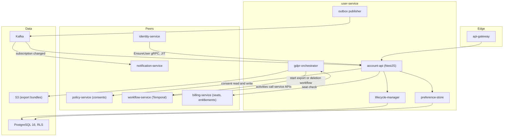
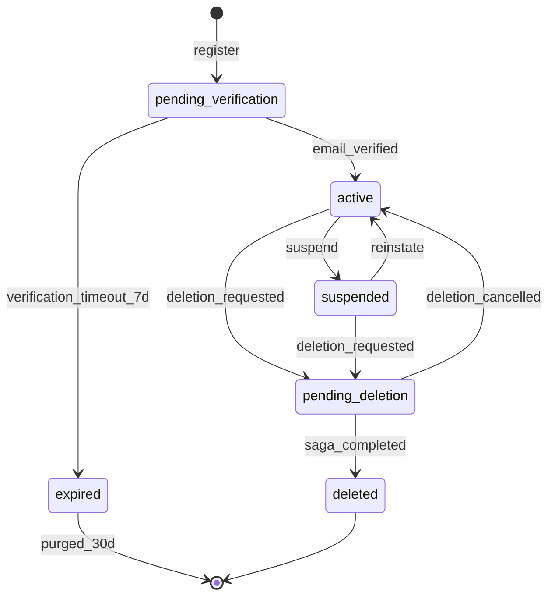
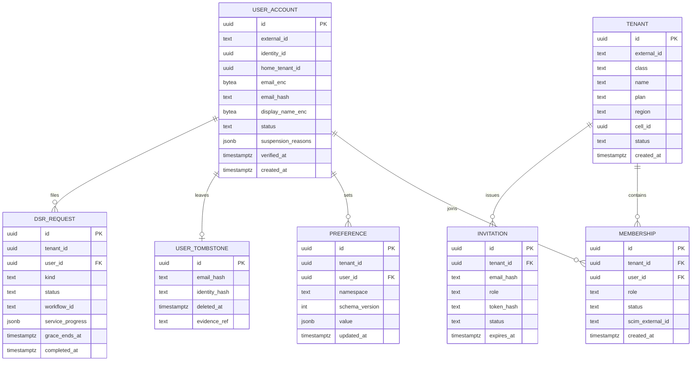
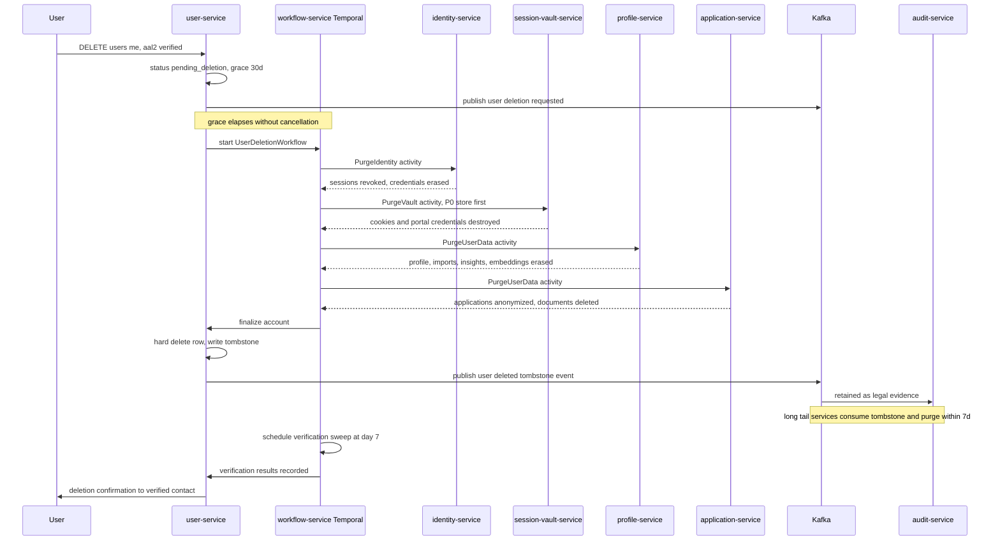

# 12 — User Service

| | |
|---|---|
| Document ID | ACA-SAS-12 |
| Volume | 2 — Core Services |
| Status | Draft v1.0 |
| Depends on | [00 — Architecture Canon](../00-architecture-canon.md), [05 — High-Level Architecture](../volume-1-foundation/05-high-level-architecture.md), [11 — Identity Service](11-identity-service.md), [13 — Profile Service](13-profile-service.md), [Volume 5 — Security](../volume-5-security/) |

## 1. Overview

`user-service` owns the **account** — the business-domain representation of a person and the tenants they belong to. Per canon §4.2 it owns users, tenants, and memberships, plus preferences, notification settings pointers, and GDPR request orchestration. It is deliberately distinct from [`identity-service`](11-identity-service.md): identity answers "who is authenticating and how," user answers "what account exists, in which tenants, with what standing." The split keeps credentials and sessions (P0/P1-heavy, security-critical, control-plane-shared) apart from the mutable business account model (cell-resident, product-velocity-heavy). The linkage is one field: `identity_id` on `user_account`, and the `sub`/`tid` claims minted by identity resolve against rows owned here.

Three responsibilities give this service outsized architectural weight. First, it is the **root of the tenancy model**: every RLS policy in the platform ultimately keys on tenants and memberships that this service creates, so its correctness is a precondition for isolation everywhere (§8). Second, it is the **entry point of the GDPR machinery**: data-subject export and erasure are cross-service sagas that this service initiates and tracks, with `workflow-service` (Temporal) executing them durably (§7). Third, it publishes the **account lifecycle events** (`aca.user.registered.v1`, `aca.user.deleted.v1`, suspensions) that gate nearly every autonomous behavior — no agent acts for a non-`active` account.

Consent is a shared concern with a sharp boundary: `policy-service` is the system of record for consents and automation policies (canon §4.1); `user-service` provides the user-facing consent UX surface and holds only non-authoritative pointers (§6). This chapter specifies the account lifecycle, the tenant/membership data model and DDL, preferences, consent integration, GDPR flows with the deletion saga, the REST and event contracts, and the RLS strategy that the rest of the platform copies.

## 2. Service Architecture

### 2.1 Context



### 2.2 Components

| Component | Purpose | Notes |
|---|---|---|
| `account-api` | REST/gRPC surface for accounts, tenants, memberships, invitations | The `EnsureUser` gRPC endpoint (idempotent) serves identity-service JIT provisioning — see [11 §7.2](11-identity-service.md) |
| `lifecycle-manager` | State machine for account status (§3); enforces legal transition set, emits lifecycle events | Single writer for `status`; all transitions audited |
| `gdpr-orchestrator` | Accepts data-subject requests, starts Temporal workflows, tracks per-service completion, assembles evidence | Owns `dsr_request` table; the Temporal workflow definitions live in `workflow-service` worker fleets but are versioned with this service |
| `preference-store` | Namespaced, schema-validated user preferences | §5 |
| Outbox publisher | Debezium CDC outbox per canon §8 | Guarantees DB-write + event atomicity for lifecycle events |

**Interactions.** Reads of user/tenant data by other services happen via this service's gRPC read API (2-s deadline per canon §7) or via event-built projections — never via its database. High-fan-out consumers (e.g., `matching-service` needing account status to gate scoring) maintain local status projections from lifecycle events; the gRPC path is reserved for low-volume authoritative reads (JIT, admin, billing seat checks). Rationale: account-status checks would otherwise become a platform-wide synchronous hot spot.

## 3. Account Lifecycle

### 3.1 State Machine



### 3.2 State Semantics

| State | Meaning | Platform behavior |
|---|---|---|
| `pending_verification` | Registered, email unproven | Login allowed; no agent runs, no imports, no outbound anything (anti-abuse: unverified accounts cannot consume paid-model budget or touch third-party sites); purged after 7 days unverified + 30-day tombstone-free hard delete |
| `active` | Normal standing | Full function per plan/autonomy settings |
| `suspended` | Standing revoked — abuse, payment failure (`billing-service` signal), security hold (`aca.identity.risk.flagged.v1`), admin action, or SCIM deactivation | All sessions revoked via identity-service; **all agent runs for the user halt** (agent-orchestrator consumes the suspension event); data retained; user sees suspension reason category |
| `pending_deletion` | Erasure requested; 30-day grace running | Same behavioral freeze as suspended; user may cancel; grace window exists because deletion is irreversible and account-takeover-initiated deletion is a real attack (identity requires `aal2` + fresh auth for the request, §7.2) |
| `deleted` | Saga complete; hard delete done | Only the tombstone row (`user_tombstone`) survives: hashed identifiers for suppression + legal evidence, no PII |

Suspension **reasons are typed** (`abuse`, `billing`, `security`, `admin`, `scim`) and stack: an account suspended for both billing and abuse stays suspended until both clear. The lifecycle-manager is the only code path that mutates `status`; every transition writes an audit event and an outbox event in the same transaction.

### 3.3 Registration Flow (Summary)

Self-service registration: `identity-service` creates the identity, then calls `EnsureUser`, which (a) creates `user_account` in `pending_verification`, (b) creates the **individual tenant** (single-member, canon §6) with the user as `owner`, (c) publishes `aca.user.registered.v1` and `aca.tenant.created.v1`. Email verification is a Kratos flow; on success identity calls back `MarkVerified` → transition to `active` → downstream services (profile bootstrap, default notification prefs) react to events, not calls. Enterprise SSO/SCIM registration lands in `active` directly (the IdP is the verification authority).

## 4. Tenant & Membership Model

### 4.1 Model

Tenant classes are the canon §1 set: `individual`, `team`, `university`, `enterprise`, `recruiter`. Membership roles form a fixed platform set; role→permission mapping is OPA policy (distributed by `policy-service`), not user-service logic — this service stores *who has which role*, policy decides *what a role may do*.

| Role | Intent |
|---|---|
| `owner` | Tenant root; billing + deletion authority; exactly ≥ 1 per tenant (last owner cannot leave/demote) |
| `admin` | Member/SSO/settings management; no tenant deletion, no billing change |
| `billing_admin` | Billing surface only (enterprise procurement separation) |
| `member` | Standard product use |
| `viewer` | Read-only (university career-office counselors, recruiter analysts) |



### 4.2 DDL Excerpt

```sql
CREATE TABLE tenant (
    id          uuid PRIMARY KEY,                    -- UUIDv7
    external_id text NOT NULL UNIQUE,                -- ten_...
    class       text NOT NULL CHECK (class IN
                ('individual','team','university','enterprise','recruiter')),
    name        text NOT NULL,
    plan        text NOT NULL DEFAULT 'free' CHECK (plan IN
                ('free','professional','premium','enterprise')),
    region      text NOT NULL DEFAULT 'us',          -- data residency pin
    cell_id     uuid,                                 -- NULL = shared cell (Volume 6)
    status      text NOT NULL DEFAULT 'active'
                CHECK (status IN ('active','suspended','closing','closed')),
    created_at  timestamptz NOT NULL DEFAULT now()
);

CREATE TABLE user_account (
    id                 uuid PRIMARY KEY,
    external_id        text NOT NULL UNIQUE,          -- usr_...
    identity_id        uuid NOT NULL UNIQUE,          -- link to identity-service
    home_tenant_id     uuid NOT NULL REFERENCES tenant(id),
    email_enc          bytea NOT NULL,                -- P1: AES-256-GCM field encryption
    email_hash         text  NOT NULL UNIQUE,         -- HMAC for lookup and dedup
    display_name_enc   bytea,
    status             text NOT NULL DEFAULT 'pending_verification'
                       CHECK (status IN ('pending_verification','active','suspended',
                                         'pending_deletion','deleted','expired')),
    suspension_reasons jsonb NOT NULL DEFAULT '[]',
    verified_at        timestamptz,
    created_at         timestamptz NOT NULL DEFAULT now()
);

CREATE TABLE membership (
    id               uuid PRIMARY KEY,
    tenant_id        uuid NOT NULL REFERENCES tenant(id),
    user_id          uuid NOT NULL REFERENCES user_account(id),
    role             text NOT NULL CHECK (role IN
                     ('owner','admin','billing_admin','member','viewer')),
    status           text NOT NULL DEFAULT 'active'
                     CHECK (status IN ('invited','active','suspended','removed')),
    scim_external_id text,                            -- SCIM correlation, per canon SSO
    created_at       timestamptz NOT NULL DEFAULT now(),
    UNIQUE (tenant_id, user_id)
);
CREATE INDEX ON membership (user_id) WHERE status = 'active';
```

Seat enforcement: on membership create/reactivate for paid tenant classes, a synchronous `billing-service` seat check runs (fail-closed for enterprise contracts; fail-open with async reconciliation for team plans — blocking a teammate invite on a billing blip is worse than a one-seat overshoot reconciled within the hour).

## 5. Preferences

Preferences are **namespaced JSONB documents** validated against registered JSON Schemas (`namespace` + `schema_version`), not columns — product iteration on preferences must not require migrations. Namespaces in Phase 1: `ui` (theme, locale, timezone), `notifications` (channel/digest matrix — enforced by `notification-service`, authored here), `job_search` (defaults surfaced to [13 — Profile Service](13-profile-service.md) constraints UX), `automation_display` (dashboard density, activity-feed verbosity). Writes publish `aca.user.preferences.updated.v1` keyed by user, so consumers (notification-service especially) hold local projections and never read-call on their hot paths. Preferences are explicitly **not** consents: anything with legal weight lives in `policy-service` (§6). Size cap 32 KiB per namespace (abuse guard; legitimate documents are < 4 KiB).

## 6. Consent Integration with policy-service

`policy-service` owns consent records and automation policies (canon §4.1); consent is enforcement-adjacent data that `policy-agent` and OPA evaluate on every consequential action, so it must live with the policy engine, not the account CRUD service.

Division of labor:

| Concern | user-service | policy-service |
|---|---|---|
| Consent record of truth (versioned text, scope, grant/withdraw timestamps, evidence) | — | ✔ |
| Consent UX surface (`/v1/users/me/consents` proxied read/write) | ✔ facade | ✔ authority |
| Blocking product flows on missing consent (e.g., import requires `linkedin_import` consent) | ✔ checks via policy-service snapshot | ✔ decision |
| Consent-change propagation | consumes events for UX state | publishes `aca.policy.consent.changed.v1` |
| GDPR erasure of consent history | requests via saga | executes retention rules (consent evidence is retained 7 y as legal-obligation records, pseudonymized at erasure) |

The facade pattern keeps one user-facing API while preserving single-writer semantics in `policy-service`. `user-service` caches consent snapshots (60-s TTL) only for UX display — **never** for enforcement decisions; enforcement always evaluates policy-service-distributed bundles (avoids a stale-cache consent bypass).

## 7. GDPR Flows

### 7.1 Data-Subject Export

`POST /v1/users/me/export` → `gdpr-orchestrator` creates `dsr_request(kind=export)` and starts the Temporal `UserDataExportWorkflow`. Activities fan out to every PII-holding service's `ExportUserData` gRPC endpoint (a platform-mandated interface from the service chassis); each streams its records as JSONL to a per-request S3 prefix. The workflow assembles a zip with a manifest (service, record counts, schema versions, checksums), encrypts it (per-request key), and notifies the user; download is a signed URL, 7-day expiry (limits exposure of a full-PII bundle), single active export per user (cost + abuse guard). SLA: 72 h internal target against the 30-day statutory ceiling; per-service activity timeout 24 h with 3 retries before human escalation via `admin-service`.

### 7.2 Deletion Saga

Erasure is the platform's most delicate distributed transaction: it must span ~15 PII-holding services, tolerate any of them being down, respect legal holds (billing invoices, audit trail), and finish within canon §11's 30-day bound. Design: **Temporal-orchestrated saga for critical stores + tombstone-event sweep for the long tail + verification audit**.

Request preconditions: `aal2` + fresh authentication (see [11 §5.3](11-identity-service.md)); tenant `owner`s must first transfer or close owned multi-member tenants. The request transitions the account to `pending_deletion`, freezes all automation, and schedules saga start at `grace_ends_at = now() + 30 days` (cancellable until then). The grace window is the account-takeover backstop and the "I changed my mind" affordance; regulators accept reasonable verification periods.



Design decisions:

- **Two deletion tiers.** Tier 1 (saga activities, verified completion, ordered): `identity-service`, `session-vault-service` (P0 — destroyed earliest and provably), `profile-service`, `resume-service`, `application-service`, `memory-service`, `portfolio-service`. Tier 2 (tombstone consumers, 7-day purge SLA): search projections, analytics, notification history, knowledge-graph edges, caches. Rationale: verified synchronous deletion for stores holding primary PII; scalable event sweep for derived data — a saga with 30 sequential activities would be fragile for no compliance gain.
- **Tombstone event** `aca.user.deleted.v1` carries only opaque IDs + hashed email (suppression list), never PII. It is retained on a long-retention compacted topic so late-joining consumers and restored-from-backup datasets can re-apply suppressions.
- **Legal holds:** `billing-service` retains invoices (tax law) and `audit-service` retains hash-chained events (7 y, canon §11) — both **pseudonymize** (user reference → tombstone id) rather than delete; the DSR evidence bundle documents the legal basis per store.
- **Backups:** PITR backups age out on the 35-day cycle (canon §11); the tombstone suppression list guarantees any restore re-deletes within the sweep. This is the standard, regulator-accepted answer to "deletion vs. backups."
- **Compensation:** the saga has no rollback — erasure is one-way. Failed activities retry with backoff (max 7 d) then page a human via `admin-service`; the account remains `pending_deletion` (frozen) until every Tier-1 activity has verifiably completed, so partial deletion can never be observable as a working account. Idempotency: every activity keys on `dsr_request.id`.

### 7.3 Verification

Day-7 sweep re-queries every Tier-1 service's `VerifyErasure` endpoint and samples Tier-2 projections (OpenSearch, analytics) for the tombstoned IDs; discrepancies open an `admin-service` compliance case. Evidence (per-service attestations, timestamps, checksums) lands in the WORM audit store — this is what a DPA audit actually asks for.

## 8. Row-Level Security Strategy

`user-service` defines the platform's reference RLS implementation (canon §6: every row carries `tenant_id`, RLS enforced at the database, service-layer second guard). Chapters in every volume copy this pattern.

Mechanics: the service chassis opens each request's transaction with `SET LOCAL app.tenant_id = '<tid-from-JWT>'` (and `app.user_id`); policies compare against `current_setting('app.tenant_id')`. The service's runtime DB role has **no** `BYPASSRLS`; only the migration role does.

```sql
ALTER TABLE membership ENABLE ROW LEVEL SECURITY;
ALTER TABLE membership FORCE ROW LEVEL SECURITY;   -- applies to table owner too

CREATE POLICY membership_tenant_isolation ON membership
    USING (tenant_id = current_setting('app.tenant_id')::uuid);

-- tenancy-defining tables: tenant rows are "self-scoped"
CREATE POLICY tenant_self ON tenant
    USING (id = current_setting('app.tenant_id')::uuid);
```

Two documented exceptions, unavoidable in the tenancy root:

1. **`user_account` is user-scoped, not tenant-scoped.** A user spans tenants (enterprise seat + individual tenant), so no single `tenant_id` column is correct. Policy: `id = current_setting('app.user_id')::uuid`, plus a separate policy granting tenant-admin visibility through an active-membership subquery (`EXISTS` on membership under the same `app.tenant_id`). This is the only table in the platform whose primary RLS key is the user, and the pattern is not to be copied elsewhere without architecture review.
2. **Cross-tenant service paths** (JIT `EnsureUser`, deletion saga finalization, admin-service support reads) run under a distinct `svc_user_privileged` role with per-table `SECURITY DEFINER` functions rather than blanket RLS bypass — every privileged path is an enumerable, audited function, not a role capability.

Second guard: the repository layer refuses to execute if the session GUC is unset (fails closed), and integration tests assert cross-tenant invisibility per table. Multi-membership reads ("list my tenants") iterate per-membership scoped queries rather than disabling RLS — marginally slower (≤ 10 memberships in practice), structurally safe.

## 9. REST API

| Method | Path | Auth / role | Purpose |
|---|---|---|---|
| GET | `/v1/users/me` | JWT | Account, status, memberships summary |
| PATCH | `/v1/users/me` | JWT | Display name, locale, timezone |
| GET / PUT | `/v1/users/me/preferences/{namespace}` | JWT | Schema-validated preference docs (§5) |
| GET / PUT | `/v1/users/me/consents` | JWT | Consent facade → policy-service (§6) |
| POST | `/v1/users/me/export` | JWT, aal2 | Start DSR export (§7.1) |
| DELETE | `/v1/users/me` | JWT, aal2 fresh | Request erasure; starts grace window (§7.2) |
| POST | `/v1/users/me/deletion/cancel` | JWT | Cancel during grace |
| GET | `/v1/users/me/dsr/{id}` | JWT | DSR status (`service_progress` summary) |
| POST | `/v1/tenants` | JWT | Create team/recruiter tenant (individual tenants are implicit) |
| GET / PATCH | `/v1/tenants/{id}` | member / admin | Tenant profile, settings |
| GET | `/v1/tenants/{id}/members` | member | Member list (role-filtered fields) |
| POST | `/v1/tenants/{id}/invitations` | admin | Invite by email; token 7-day expiry |
| POST | `/v1/invitations/{token}/accept` | JWT | Accept invite → membership `active` |
| PATCH / DELETE | `/v1/tenants/{id}/members/{userId}` | admin (owner for role=owner changes) | Role change / removal; last-owner rule enforced |
| POST | `/v1/tenants/{id}/suspend` | admin-service only (JIT) | Ops suspension with typed reason |
| gRPC | `EnsureUser`, `MarkVerified`, `GetAccountStanding`, `ExportUserData`, `VerifyErasure` | mesh mTLS + OPA | Internal contract (JIT, identity callbacks, DSR interface) |

All POSTs accept `Idempotency-Key` (canon §7). Errors are RFC 9457; invitation acceptance failures deliberately do not disclose tenant existence to non-invitees.

## 10. Events

### 10.1 Published

| Topic | Key | Payload sketch | Notes |
|---|---|---|---|
| `aca.user.registered.v1` | user_id | usr id, ten id (home), class, region | Canon core topic; triggers profile bootstrap, notification defaults |
| `aca.user.verified.v1` | user_id | usr id, verified_at | Gates first agent activity |
| `aca.user.suspended.v1` | user_id | usr id, reasons[] | **Halts agent runs** (agent-orchestrator), revokes sessions (identity) |
| `aca.user.reactivated.v1` | user_id | usr id, cleared reason | Resumes eligibility, not paused runs (explicit restart) |
| `aca.user.deletion.requested.v1` | user_id | usr id, grace_ends_at | Freezes automation immediately |
| `aca.user.deleted.v1` | user_id | tombstone id, email_hash, identity_hash | Canon core topic; long-retention compacted (§7.2) |
| `aca.user.preferences.updated.v1` | user_id | namespace, schema_version, value | notification-service projection feed |
| `aca.tenant.created.v1` | tenant_id | ten id, class, plan, region | Cell placement input (Volume 6) |
| `aca.tenant.membership.changed.v1` | tenant_id | user id, role, status, actor | Authz projections, seat metering |
| `aca.user.export.completed.v1` | user_id | dsr id, bundle checksum | Notification trigger |

### 10.2 Consumed

| Topic | Reaction |
|---|---|
| `aca.billing.subscription.changed.v1` | Update `tenant.plan`; billing-suspension add/clear on dunning outcomes |
| `aca.identity.risk.flagged.v1` | Add `security` suspension when action = `lock` (auto), else open admin review case |
| `aca.policy.consent.changed.v1` | Refresh consent UX projection (§6) |
| `aca.identity.sso.provisioned.v1` | Reconcile SCIM-vs-JIT membership records (idempotent upsert) |

Consumers are idempotent via event-`id` dedup (Redis, 24-h window) per canon §8; retries follow the canonical `.retry.1m` → `.retry.10m` → `.dlq` ladder.

## 11. Failure Scenarios

| Scenario | Impact | Mitigation |
|---|---|---|
| `user-service` down | No registration/JIT (new logins for new users fail), no membership changes; **existing sessions and agent work unaffected** (consumers run on projections) | ≥ 3 replicas multi-AZ; identity retries `EnsureUser` idempotently; canon 99.95% API SLO applies |
| Postgres down | Full write outage for accounts | PITR, replica promotion ≤ 30 min; no cached-write fallback — account state is correctness-critical |
| `policy-service` unreachable | Consent UX degraded (stale 60-s cache display); consent **enforcement** unaffected (OPA bundles are local to enforcing services) | Facade returns cached-with-staleness-flag; writes queue client-side with explicit user feedback |
| `billing-service` seat check fails | Enterprise invites blocked (fail-closed); team invites proceed (fail-open + reconcile) | §4.2 rationale; reconciliation job hourly |
| Deletion saga activity stuck (service down ≥ 7 d) | DSR misses internal target, statutory clock still safe (grace 30 d + saga ≤ 30 d < regulator expectations with documented process) | Temporal retry policy → human escalation at day 7 of retries; account remains frozen |
| Duplicate registration race (same email) | Two identities attempt `EnsureUser` | `email_hash` unique constraint; loser gets conflict → identity merges into winner's flow |
| Tombstone consumer missed the event | Orphaned derived data | Compacted topic re-read on consumer bootstrap + day-7 verification sweep (§7.3) |
| Erroneous suspension (false-positive risk flag) | User locked out | Suspension reasons are typed and individually clearable; admin-service one-click reinstate; all suspensions notify the user with an appeal path |

## 12. Scaling Strategy

Account data is small and read-mostly: even 10 M users ≈ tens of GB. The service scales on read QPS, not data volume. Levers, in order: (1) event-driven projections keep hot-path status checks out of this service entirely — the deliberate first-class lever; (2) stateless HPA on the API pods; (3) Postgres read replicas for gRPC reads and admin queries; (4) per-cell deployment — `user-service` runs in each cell serving that cell's tenants (canon §15), with the control-plane directory (tenant→cell mapping) in the shared plane. Invitation and DSR tables are time-partitioned only for hygiene, not scale. No caching layer sits in front of account status by design: a stale `active`-after-suspension read is a security bug, and the event projection path already gives consumers their own freshness contract (p95 < 2 s via canon realtime SLO).

## 13. Security Considerations

- **PII:** email and display name are P1 (field-level AES-256-GCM, key per tenant KEK hierarchy — Volume 5); lookups use HMAC hashes; logs and events carry opaque IDs only.
- **Tenancy root hardening:** membership mutations are the platform's privilege-escalation surface — all role changes require step-up (`aal2`), owner changes require owner actor, and every mutation emits an audit event with actor, before/after.
- **GDPR endpoints** are the account's most destructive surface: erasure demands fresh `aal2` (see [11 §5.3](11-identity-service.md)), grace window, and multi-channel notification with cancel links.
- **Internal API abuse:** `EnsureUser` and DSR gRPC endpoints are callable only by identity-service/workflow-service per mesh `AuthorizationPolicy` + OPA method-level checks.
- Suspension events fan out to `agent-orchestrator` and `identity-service` — the account-level kill switch of canon §1 is implemented exactly here.

## 14. Observability

| Signal | Detail | Alert |
|---|---|---|
| `registration_funnel` | register → verify → first-action conversion, by source | Verification rate < 60% daily → product review |
| `ensure_user_latency` | p99, called in-line by SSO logins | > 300 ms p99 (budget from [11 §7.2](11-identity-service.md)) |
| `lifecycle_transitions` | Counter by from/to/reason | Suspension spike (> 3× 7-day baseline) → security review |
| `dsr_age` | Open DSRs by age bucket | Any export > 72 h or deletion saga > grace + 7 d → compliance page |
| `deletion_verification_failures` | Per service | Any → compliance case, blocks DSR closure |
| `seat_reconciliation_drift` | Team-plan overshoot count | > 24 h unresolved → billing ops |
| `rls_guard_violations` | Repository-layer unset-GUC refusals | Any → page (indicates a chassis regression) |
| `projection_lag` | Lifecycle-event consumer lag by service | > 60 s → warn (stale standing checks downstream) |

Traces propagate through the saga: Temporal workflow/activity spans join the initiating request's `trace_id`, so one trace shows a deletion end-to-end across all Tier-1 services.

## 15. Future Improvements

- **Organizational hierarchy** (departments/cohorts inside university and enterprise tenants) — modeled, not yet scheduled; membership gains a `group_id` dimension backed by SCIM Groups.
- **Delegated account access** (career coach acting for a member with consent) — requires an `on_behalf_of` membership kind + policy-service policy family; interacts with token exchange ([11 §4.4](11-identity-service.md)).
- **CCPA/CPRA "do not sell" registry** surfaced through the same consent facade; recruiter-service visibility gating consumes it.
- **Regional DSR variants** (LGPD, PIPEDA timelines) as configuration of the same saga, not new workflows.
- **Tenant merge/split tooling** for enterprise M&A — today a manual runbook; candidate for a Temporal workflow once demand is proven.

## 16. Alternatives Considered & Tradeoffs

| Decision | Alternatives | Why this choice |
|---|---|---|
| Separate `user-service` and `identity-service` | Single auth+account service | Different security postures (P0/P1 credential store vs. product CRUD), different change velocity, different placement (control-plane-shared vs. cell-resident). Cost: the `identity_id` link and JIT `EnsureUser` coupling — one seam, well-instrumented, versus one service with two masters. |
| Temporal saga + tombstone hybrid for deletion | Pure choreography (events only); pure orchestration (all services in saga) | Pure choreography cannot *prove* completion — GDPR requires evidence, and "we published an event" is not evidence. Pure orchestration couples the saga to every derived-data consumer forever. The hybrid gives verified deletion where PII is primary and scalable sweep where it is derived. Canon §8 already mandates Temporal for multi-service sagas. |
| 30-day grace before erasure | Immediate erasure; 7-day grace | Immediate erasure weaponizes account takeover; 30 days matches canon §11's bound and gives one full billing cycle for regret. Tradeoff: the statutory clock starts at request, so the saga must finish promptly after grace — enforced by the day-7 escalation. |
| Consent authority in `policy-service` | Consents owned by user-service | Consent is evaluated at enforcement time by policy machinery on every consequential action; splitting record-of-truth from evaluator invites stale-cache bypasses. user-service keeps UX only. Cost: one façade hop for consent reads. |
| JSONB + JSON-Schema preferences | Typed columns; separate config service | Columns force migrations for every product tweak; a config service is an extra hop for data with no cross-service semantics. Schema registry keeps JSONB from becoming a junk drawer. |
| Per-user RLS exception on `user_account` | Force single-tenant users (duplicate account per tenant) | Duplicating people per tenant fractures the career profile — the product's core asset ([13 — Profile Service](13-profile-service.md)) — and multiplies DSR fan-out. The narrow, documented RLS exception is the lesser evil. |
| Status projections over sync standing checks | `GetAccountStanding` on every hot path | The sync path makes user-service a platform-wide availability dependency and a QPS hot spot; projections bound staleness at seconds and are already required by canon CQRS conventions. Sync remains only where authority is non-negotiable (JIT, billing, admin). |
