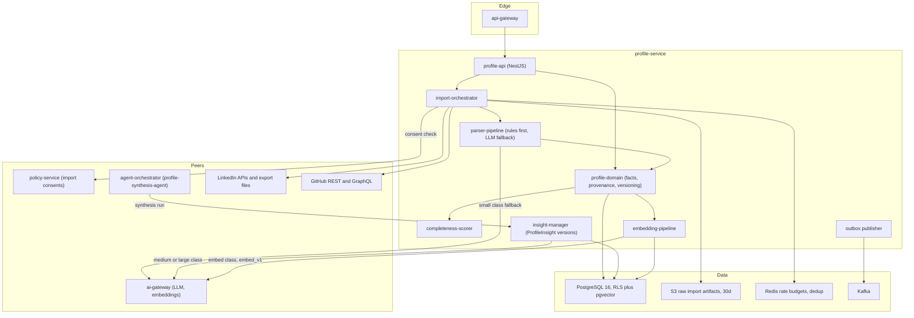
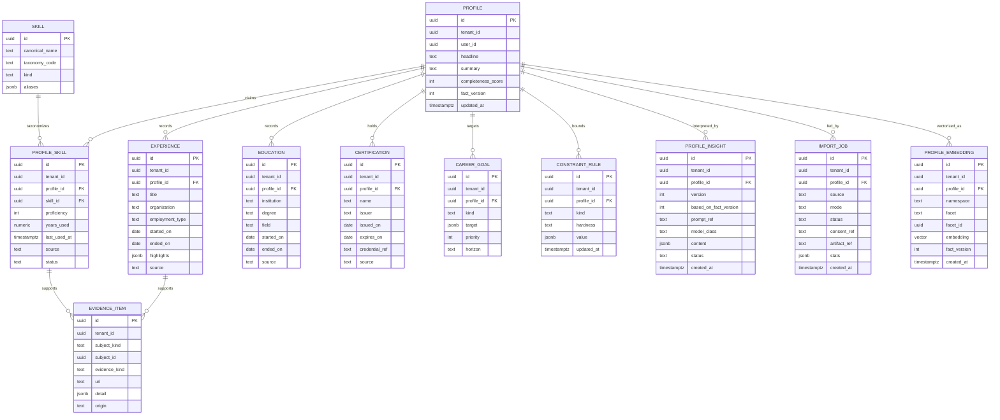
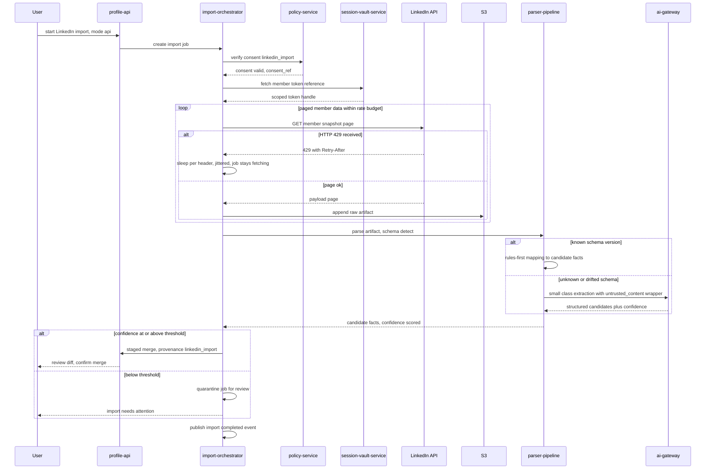
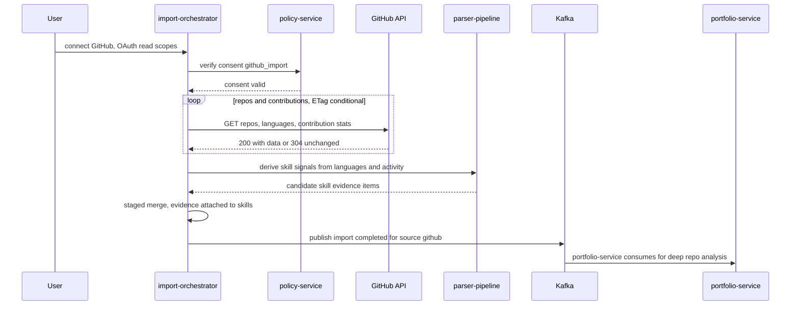
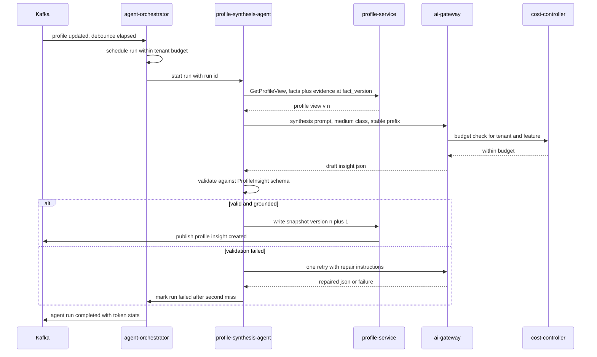

# 13 — Profile Service

| | |
|---|---|
| Document ID | ACA-SAS-13 |
| Volume | 2 — Core Services |
| Status | Draft v1.0 |
| Depends on | [00 — Architecture Canon](../00-architecture-canon.md), [12 — User Service](12-user-service.md), [18 — AI Gateway](18-ai-gateway.md), [Volume 3 — AI Architecture](../volume-3-ai-architecture/), [Volume 4 — Data Platform](../volume-4-data-platform/) |

## 1. Overview

`profile-service` owns the career profile — the platform's model of *who the user is professionally*: skills with proficiency and evidence, experience, education, certifications, goals, and hard constraints (visa, location, salary, remote posture). Per canon §4.2 it owns profiles, skills, and imports, and orchestrates LinkedIn/GitHub ingestion. Every downstream capability — matching quality (`matching-service`, this volume), resume tailoring, cover-letter evidence, interview prep — is bounded above by the fidelity of this model. The profile is the product's compounding asset: jobs expire in weeks, but a deeply understood profile appreciates for the life of the account.

The service holds two representations of the same person, deliberately separated. The **structured profile** is user-owned ground truth: explicit, editable, versioned facts with provenance on every field. The **ProfileInsight** is machine interpretation: versioned snapshots produced by `profile-synthesis-agent` runs through [`ai-gateway`](18-ai-gateway.md), containing narrative synthesis, inferred seniority, strength/gap analysis, and target-role hypotheses. Ground truth and interpretation never mix in one table: insights cite facts, facts never silently absorb inferences, and a user correction always outranks a model guess. This separation is what keeps the AI layer re-runnable, evaluable, and erasable without touching user data.

Ingestion is adversarial in a mundane way: LinkedIn and GitHub exports and APIs change shape without notice, rate limits are real, and user consent must gate every byte. The import pipelines are therefore built anti-fragile — schema-versioned rules-first parsers with small-model LLM fallback, staged merges with provenance, and per-provider rate budgets — rather than assuming stable upstream contracts (§4).

This chapter specifies the component architecture, the domain model and DDL, the import pipelines, the AI Profile Understanding loop, completeness scoring, the embedding pipeline (`embed_v1`), API and event contracts, and the standard closing sections.

## 2. Service Architecture

### 2.1 Component View



### 2.2 Components

| Component | Purpose | Key decisions |
|---|---|---|
| `profile-api` | REST surface + internal gRPC reads | Field-level PATCH semantics; every mutation records provenance (§3.2) |
| `profile-domain` | Fact model, merge engine, field versioning | Single writer for profile facts; staged import merges (§4.4); user edits always win over imports |
| `import-orchestrator` | Runs LinkedIn/GitHub import jobs end-to-end | Consent-gated, resumable, rate-budgeted; raw artifacts to S3 (30-d retention per canon §11) before any parsing |
| `parser-pipeline` | Raw artifact → candidate facts | Rules-first, schema-versioned; `small`-class LLM fallback via ai-gateway on unknown shapes; confidence-scored output, low confidence → quarantine (§4.3) |
| `completeness-scorer` | Deterministic profile completeness rubric | Pure function of facts; no LLM (must be explainable and free) (§6) |
| `insight-manager` | ProfileInsight snapshot lifecycle | Append-only versions; schema-validated agent output; latest-pointer + diff (§5) |
| `embedding-pipeline` | Facet embeddings in `embed_v1` | Debounced re-embedding; dual-read migration support per canon §10.5 (§7) |

**Interactions.** All model and embedding calls go through `ai-gateway` (canon §9 invariant — no provider SDKs here). Synthesis runs execute on `agent-orchestrator` as `profile-synthesis-agent`; `profile-service` triggers runs and owns the resulting snapshots, but agent scheduling, budget enforcement, and HITL rules stay in the orchestrator. Consumers of profile data (`matching-service`, `resume-service`, agents via context builder) read through gRPC (`GetProfileView`, versioned read models) or subscribe to events — never this database. `job_search` preference defaults arrive from [12 — User Service](12-user-service.md) events to pre-populate constraint UX; the authoritative constraint facts live here.

## 3. Career Profile Domain Model

### 3.1 Entity Model



### 3.2 Model Decisions

- **Skills are taxonomy-anchored claims with evidence.** `SKILL` is a platform-global taxonomy (seeded from ESCO + a curated tech extension; `taxonomy_code` keeps the seam to swap or dual-map taxonomies). `PROFILE_SKILL` is the user's claim: `proficiency` 1–5 (1 exposed, 2 working, 3 proficient, 4 advanced, 5 expert — the calibration rubric shown in UX and used verbatim in prompts, so model and user share one scale), `years_used`, recency, and attached `EVIDENCE_ITEM`s (repo, certification, experience highlight, resume line, assessment). Evidence-free skills are permitted but marked `unverified` — matching weights them lower and generation agents must not fabricate support for them ([Volume 3](../volume-3-ai-architecture/) grounding rules).
- **Provenance on every fact.** Each row's `source` records origin (`user`, `linkedin_import`, `github_import`, `resume_parse`, `synthesis_suggestion`). Merge precedence: `user` > imports > suggestions; an import may never overwrite a `user`-sourced field (§4.4). This is the mechanism that keeps ground truth user-owned.
- **Constraints are typed rules, not preferences.** `CONSTRAINT_RULE.kind` ∈ `visa_work_authorization`, `location`, `salary_floor`, `remote_posture`, `industry_exclusion`, `company_exclusion`, `notice_period`. `hardness` ∈ `hard` (filter — a violating job is never surfaced for autopilot) / `soft` (rank penalty). Salary floors carry currency + period in `value` (jsonb). Visa/work-authorization is P1-sensitive (immigration status is quasi-special-category) and is field-encrypted; agents receive only the derived boolean predicates they need (e.g. `requires_sponsorship`), never the raw narrative.
- **`fact_version`** is a monotonically increasing profile-level counter bumped on any fact mutation. Insights and embeddings record `based_on_fact_version` / `fact_version`, making staleness a computable property (`insight.based_on_fact_version < profile.fact_version` ⇒ stale badge, re-synthesis trigger input) rather than a guess.
- **One profile per (user, tenant).** A university-tenant seat and a personal tenant hold distinct profiles with an optional user-initiated copy — tenants must not see each other's edits (RLS makes this structural), and the copy is explicit consented data movement, not a shared row.

DDL excerpt (constraint and skill-claim fragments; the remainder follows the same pattern):

```sql
CREATE TABLE constraint_rule (
    id          uuid PRIMARY KEY,                 -- UUIDv7
    tenant_id   uuid NOT NULL,
    profile_id  uuid NOT NULL REFERENCES profile(id),
    kind        text NOT NULL CHECK (kind IN
                ('visa_work_authorization','location','salary_floor','remote_posture',
                 'industry_exclusion','company_exclusion','notice_period')),
    hardness    text NOT NULL CHECK (hardness IN ('hard','soft')),
    value       jsonb NOT NULL,                   -- schema per kind, registry-validated
    updated_at  timestamptz NOT NULL DEFAULT now(),
    UNIQUE (profile_id, kind)                     -- one rule per kind; value holds lists
);
ALTER TABLE constraint_rule ENABLE ROW LEVEL SECURITY;
CREATE POLICY tenant_isolation ON constraint_rule
    USING (tenant_id = current_setting('app.tenant_id')::uuid);

CREATE TABLE profile_skill (
    id            uuid PRIMARY KEY,
    tenant_id     uuid NOT NULL,
    profile_id    uuid NOT NULL REFERENCES profile(id),
    skill_id      uuid NOT NULL REFERENCES skill(id),
    proficiency   int  NOT NULL CHECK (proficiency BETWEEN 1 AND 5),
    years_used    numeric(4,1),
    last_used_at  timestamptz,
    source        text NOT NULL DEFAULT 'user',
    status        text NOT NULL DEFAULT 'active'
                  CHECK (status IN ('active','unverified','archived','quarantined')),
    UNIQUE (profile_id, skill_id)
);
```

RLS follows the reference pattern in [12 — User Service §8](12-user-service.md); the global `skill` taxonomy table is platform-scoped (no `tenant_id`, read-only to the runtime role).

## 4. Import Pipelines

### 4.1 Common Pipeline Contract

Every import, regardless of source, follows: **consent check → acquire (API or file) → raw artifact to S3 → parse to candidate facts → confidence gate → staged merge → user review where required → events**. Invariants:

| Invariant | Rationale |
|---|---|
| Consent verified against `policy-service` at job start, and the `consent_ref` is stored on the job | Imports touch third-party data on the user's behalf — the canon guardrail (§1) demands provable consent per action, and revocation must stop scheduled refreshes |
| Raw artifact persisted before parsing (S3, 30-d retention) | Reparse after parser fixes without re-fetching (rate-limit respect); debugging evidence; 30 d per canon §11 raw-crawl retention |
| Parsers never write to live facts — they emit candidate facts into a staging set | A bad parser run must be discardable; merge is a separate, audited step |
| All external fetches run under per-provider rate budgets (Redis token buckets) with full `Retry-After`/backoff compliance | ACA is a guest on these APIs; provider bans are a platform-level incident |
| Import jobs are resumable state machines (`queued → fetching → parsing → review → merging → completed / failed / quarantined`) | Multi-minute jobs must survive pod restarts; long-running orchestration beyond one pod's lifetime escalates to a `workflow-service` Temporal workflow (file-based imports stay in-process, API refresh crawls use Temporal) |

Rate budget defaults (tunable per provider config, enforced in Redis):

| Provider | Budget | Rationale |
|---|---|---|
| LinkedIn Member APIs | 80% of documented per-member daily quota | Headroom for user-initiated retries; never exhaust a user's quota on background refresh |
| GitHub REST | 4,000 req/h of the 5,000 OAuth limit, ETag-conditional first | Conditional requests are free when unchanged; 20% headroom for other consented uses |
| GitHub GraphQL | 800 points/h of 1,000 | Same headroom principle |

### 4.2 LinkedIn Import

LinkedIn offers no general-purpose profile-read API; ACA supports two consented modes. **Mode A (API)**: OAuth via LinkedIn's member-authorized products (member snapshot / data-portability APIs where the tenant's LinkedIn product access allows) — scopes are member-read-only, tokens stored in `session-vault-service` (P0, never in this service's DB). **Mode B (export upload)**: the user requests their LinkedIn GDPR export and uploads the ZIP; this is fully user-mediated, universally available, and the reference path for individual users. Both converge at the raw-artifact stage. ACA does **not** scrape LinkedIn profiles — a ToS-driven product decision recorded here deliberately (the browser fleet could, and must not, be pointed at this).



### 4.3 Anti-Fragile Parsing

The parser pipeline assumes upstream formats **will** drift:

- **Schema fingerprinting first.** Each artifact is fingerprinted (file inventory, header sets, key paths) against a registry of known schema versions. Known fingerprint → deterministic rules parser (fast, free, exhaustively unit-tested against fixture corpora).
- **LLM fallback, small class, extraction-only.** Unknown or partially drifted shapes route the *unmapped remainder* through `ai-gateway` with a `small`-class extraction prompt (prompt-registry `profile.import.extract@semver`). Content is wrapped as `untrusted_content` per canon §13 — an uploaded ZIP is an untrusted input channel and prompt-injection surface. Output is JSON-Schema-validated; the model maps to the candidate-fact schema and never to live facts.
- **Confidence gating.** Every candidate fact carries a confidence score (rules = 1.0; LLM = model-reported calibrated by offline evals). Job-level gate: mean < 0.8 or any date-arithmetic inconsistency (overlapping employment > 100%, end before start) → `quarantined`, surfaced for user-assisted mapping. 0.8 chosen from fixture-corpus evals as the point where silent-error rate drops below 1%.
- **Drift telemetry.** New fingerprints emit `aca.profile.import.schema_drift.v1`; three occurrences of one unknown fingerprint auto-open an engineering ticket with the (PII-scrubbed) structural fingerprint. LLM fallback thus buys time while a deterministic parser is written — fallback share is a tracked cost/quality metric, not a steady state.

### 4.4 Staged Merge

Candidate facts merge into live facts through the `profile-domain` merge engine: entity resolution (experience matched on org + overlapping dates; skills via taxonomy alias map), precedence enforcement (`user` fields untouchable; import-vs-import latest-wins per field), and a user-facing diff. Merges of `source=user`-conflicting values require explicit user confirmation; net-new facts merge automatically but remain provenance-tagged and individually revertible (`import_job.id` back-reference enables one-click "undo this import").

### 4.5 GitHub Import



Boundary with `portfolio-service` (canon §4.2): `profile-service` extracts only *profile-relevant signals* — languages, framework markers from manifests, contribution recency/volume — as `EVIDENCE_ITEM`s attached to skill claims (an evidence item, e.g. "TypeScript, 41 repos, active 4 y", strengthens a claim; it does not auto-create proficiency, which remains the user's assertion, capped at `unverified` status when auto-suggested). Deep repository analysis (README quality, project narratives, portfolio presentation) belongs to `portfolio-service`, which consumes the same completed-import event and the shared raw artifact reference — one fetch, two consumers, no duplicate GitHub quota spend.

Scheduled refreshes (GitHub monthly, LinkedIn per-mode availability) are `scheduler-service` triggers, skipped automatically when consent has been revoked or the account is not `active`.

## 5. AI Profile Understanding

### 5.1 profile-synthesis-agent

**Extension to canon §5** (recorded in §12 Alternatives; proposed for canon promotion): `profile-synthesis-agent` — mission: *transform the structured profile plus evidence into versioned, schema-valid ProfileInsight snapshots that downstream matching and generation consume.* It runs on `agent-orchestrator` like all agents (canon: agents are logical workers, not services) at autonomy `L0` — it only writes suggestions and snapshots, never user-visible external actions, so no HITL checkpoint is required beyond schema validation.

Triggers (event-driven, debounced):

| Trigger | Debounce / condition | Rationale |
|---|---|---|
| `aca.profile.updated.v1` burst | 10-min quiet period | Editing sessions touch many fields; one synthesis per session, not per keystroke |
| `aca.profile.import.completed.v1` | immediate | Imports are the largest single-step information gain |
| `aca.resume.parsed.v1` | immediate | New resume evidence materially changes synthesis input |
| Scheduled refresh | 30 d since last snapshot, only if `fact_version` advanced | Zero-change re-runs waste tokens; staleness without change is impossible by construction (§3.2) |
| User-requested re-analysis | rate-limited 3/day per user | Cost guard against refresh-spamming |

### 5.2 Run Anatomy



Decisions:

- **Model routing:** `medium` class default; `large` for profiles with > 10 y experience across ≥ 3 domains (complexity heuristic: cross-domain seniority synthesis measurably degrades at `medium` in evals). Routing is an ai-gateway policy, not agent code, per canon §10.2. Non-interactive scheduled refreshes ride the batch lane (≈50% cost, ≤ 24-h SLA — acceptable for a 30-day cadence).
- **Prompt:** `profile.synthesis@semver` from `prompt-registry-service`, pulled by channel (`stable`; `canary` for the experiment cohort). Context assembly follows the canon context-builder ordering — stable system prefix, then profile facts, then volatile evidence — for provider-side prompt-cache friendliness.
- **Grounding rule:** every claim in the insight must cite fact IDs (`evidence` arrays in the content schema). The validator rejects uncited strength claims; rejected twice → run fails rather than storing ungrounded output. This keeps hallucinated qualifications structurally out of the pipeline that feeds resume and cover-letter generation.
- **ProfileInsight content schema (v1):** `narrative_summary`, `seniority_estimate` (level + rationale + confidence), `strengths[]` (claim + evidence refs), `gaps[]` (gap + severity + remediation hint), `target_role_hypotheses[]` (role family + fit rationale + blocking constraints), `keyword_bank` (ATS-relevant terms by facet), `suggested_facts[]` (proposed profile edits, which land as `synthesis_suggestion` candidates for user approval — the agent proposes, the user disposes).
- **Versioning:** snapshots are append-only with `based_on_fact_version`; latest-valid pointer per profile; diffs between versions power the "what changed in your analysis" UX. Retention: last 10 versions + one per quarter (bounded storage, preserves longitudinal narrative for `learning-pipeline`).
- **Quality:** golden-set evals per prompt version gate promotion (canon §10.4); online sampling routes 2% of production snapshots to a `small`-model judge scoring grounding and rubric adherence, feeding `learning-pipeline` dashboards.

## 6. Completeness Scoring

Deterministic, explainable, LLM-free — the score gates autonomy and must be disputable field-by-field:

| Dimension | Weight | Full-credit criteria |
|---|---|---|
| Basics | 10 | Headline, summary ≥ 200 chars, location |
| Experience | 25 | ≥ 2 roles with dates + ≥ 3 highlights each; no unexplained gap > 6 mo (gap explanation field exists) |
| Skills & evidence | 25 | ≥ 8 skills; ≥ 50% with evidence; proficiency distribution non-degenerate (not all 5s) |
| Education & certifications | 10 | ≥ 1 entry or explicit none-declared flag |
| Goals | 10 | ≥ 1 prioritized goal with horizon |
| Constraints | 15 | Visa, location, salary floor, remote posture all answered (answers may be "flexible") — weighted high because missing constraints make autopilot **unsafe**, not just imprecise |
| Verification | 5 | ≥ 1 completed import or parsed resume cross-confirming ≥ 30% of experience facts |

Thresholds: **< 40** — matching disabled (scores would be noise); **< 60** — autopilot L2/L3 blocked (canon §9 autonomy ladder; the platform must not auto-apply from a profile it half-knows); **≥ 80** — "analysis-grade" badge. Score recomputes synchronously on every fact mutation (pure function, < 1 ms) and publishes `aca.profile.completeness.changed.v1` on band transitions only (consumers care about bands, not points).

## 7. Embeddings for Matching

- **Namespace:** `embed_v1` (canon §10.5), bge-class via ai-gateway `embed` model class; namespace metadata records model + dimension (1024-d reference).
- **Facet strategy:** one vector per facet — `summary`, `skills_rollup` (taxonomy-normalized skill sentences), one per `experience` row, `goals_rollup` — rather than one whole-profile vector. Rationale: job↔profile matching needs facet-level alignment signals (title↔experience, requirements↔skills); a single vector averages away exactly the structure `matching-service` scores on. Typical profile ⇒ 6–12 vectors.
- **Storage:** pgvector rows in this service's DB behind the `embedding-store` interface (canon seam; Qdrant is the phase-2 swap with no consumer change).
- **Freshness:** re-embedding debounced 5 min after fact mutation, per changed facet only (embedding cost scales with edits, not profile size); each row records `fact_version`.
- **Distribution:** `profile-service` publishes `aca.profile.embedding.updated.v1` (facet, fact_version, vector payload ≤ 8 KiB inline; canon-compliant CQRS). `matching-service` maintains its own projection for kNN joins against job vectors — no cross-service DB access, and matching's query load never lands on profile's OLTP store.
- **Migration:** `embed_v2` (model upgrade) runs per canon §10.5 — per-namespace re-embed jobs, dual-read scoring during cutover, then `embed_v1` retirement. `learning-pipeline` owns the quality comparison that authorizes cutover.
- **Erasure:** embeddings are derived P2 data keyed to the profile; the deletion saga's `PurgeUserData` activity ([12 §7.2](12-user-service.md)) deletes them with the facts, and the embedding-updated tombstone (empty payload, `deleted=true`) clears downstream projections.

## 8. REST API

| Method | Path | Auth | Purpose |
|---|---|---|---|
| GET | `/v1/profile` | JWT | Full profile (facts + provenance + completeness) |
| PATCH | `/v1/profile` | JWT | Headline/summary/basics |
| GET / PUT | `/v1/profile/skills`, `/v1/profile/skills/{id}` | JWT | Skill claims with proficiency + evidence links |
| CRUD | `/v1/profile/experiences`, `/{id}` | JWT | Experience entries |
| CRUD | `/v1/profile/education`, `/v1/profile/certifications` | JWT | Education / certifications |
| CRUD | `/v1/profile/goals` | JWT | Prioritized goals |
| GET / PUT | `/v1/profile/constraints` | JWT | Typed constraint rules (§3.2); visa fields require `aal2` |
| POST | `/v1/imports` | JWT + consent | Start import (`source`, `mode`); 409 if same-source job active |
| GET | `/v1/imports/{id}` | JWT | Job status, stats, quarantine detail |
| POST | `/v1/imports/{id}/review` | JWT | Approve/adjust staged merge or quarantined mapping |
| POST | `/v1/imports/{id}/revert` | JWT | Undo a completed import's surviving facts |
| GET | `/v1/profile/insights` | JWT | Insight version list |
| GET | `/v1/profile/insights/latest` | JWT | Latest valid snapshot |
| POST | `/v1/profile/insights/refresh` | JWT | User-triggered synthesis (3/day limit) |
| POST | `/v1/profile/suggestions/{id}/accept` | JWT | Promote a `suggested_fact` to a user-owned fact |
| gRPC | `GetProfileView`, `GetConstraints`, `GetLatestInsight`, `ExportUserData`, `VerifyErasure` | mesh mTLS + OPA | Internal consumers + DSR contract |

Idempotency, pagination, and RFC 9457 errors per canon §7.

## 9. Events

### 9.1 Published

| Topic | Key | Payload sketch | Notes |
|---|---|---|---|
| `aca.profile.updated.v1` | profile_id | changed facets, fact_version, source | Canon core topic; synthesis + embedding trigger |
| `aca.profile.import.completed.v1` | profile_id | import id, source, mode, stats, artifact ref | Canon core topic; portfolio-service consumes GitHub runs |
| `aca.profile.import.failed.v1` | profile_id | import id, source, failure class | Notification + ops triage |
| `aca.profile.import.schema_drift.v1` | source | fingerprint hash, sample structure, PII-scrubbed | Parser-engineering feed (§4.3) |
| `aca.profile.insight.created.v1` | profile_id | insight id, version, based_on_fact_version | Matching/resume agents refresh context |
| `aca.profile.completeness.changed.v1` | profile_id | old band, new band, score | Autonomy gating consumers (agent-orchestrator) |
| `aca.profile.embedding.updated.v1` | profile_id | namespace, facet, fact_version, vector or tombstone | matching-service projection feed (§7) |

### 9.2 Consumed

| Topic | Reaction |
|---|---|
| `aca.user.registered.v1` / `aca.user.verified.v1` | Bootstrap empty profile; enable imports at verification |
| `aca.user.deleted.v1` | Backstop purge check (primary purge is the saga activity) |
| `aca.user.suspended.v1` | Pause scheduled refreshes and imports |
| `aca.resume.parsed.v1` | Candidate facts from resume parse enter the staged-merge path with `source=resume_parse` |
| `aca.user.preferences.updated.v1` | `job_search` namespace changes pre-populate constraint-rule UX defaults (§2.2); never mutate constraint facts directly |
| `aca.policy.consent.changed.v1` | Revocation cancels scheduled refreshes and running jobs for that source |

## 10. Failure Scenarios

| Scenario | Impact | Mitigation |
|---|---|---|
| LinkedIn/GitHub API outage or ban | Imports stall; profile editing unaffected | Resumable jobs retry with backoff ≤ 72 h then fail visibly; rate-budget compliance makes bans unlikely; Mode B (file upload) is always available for LinkedIn |
| Upstream schema drift | Rules parser yields sparse output | Fingerprint mismatch → LLM fallback → quarantine gate; drift telemetry opens fix ticket; raw artifact enables free reparse after fix |
| `ai-gateway` down or budget-exhausted | No synthesis, no LLM fallback, no fresh embeddings | Profile CRUD fully functional (deliberate: the structured profile never depends on AI availability); synthesis triggers queue and drain on recovery; stale-insight badge computed from `fact_version`, so users see honest staleness |
| Poisoned import (prompt injection in uploaded ZIP) | Malicious instructions reach the extraction model | `untrusted_content` wrapping + extraction-only prompt + JSON-Schema output validation + staged merge (nothing lands without gates) + security-agent screening per canon §13 |
| Synthesis produces ungrounded output | Bad insight could feed generation agents | Citation validator rejects; two failures → failed run, previous snapshot remains latest-valid |
| Embedding projection lag in matching-service | Matching scores on stale vectors | `fact_version` in events lets matching detect skew; p95 lag SLO 60 s alerts before quality drifts |
| Redis loss (rate budgets, dedup) | Budgets reset; duplicate-event risk | Budgets rebuild conservatively (start at 50% until window refills); consumers also dedup on DB unique keys for merge operations |
| Quarantine pile-up (parser regression) | User imports stuck in review | Quarantine-rate alert (§13); rollback parser version; reparse affected jobs from S3 artifacts |

## 11. Scaling Strategy

Profile OLTP is modest (rows ∝ users × tens); the scaling pressures are import bursts, embedding writes, and read fan-out. (1) Import workers are a separate deployment from the API (`import-orchestrator` consumers scale on queue depth; API pods on QPS) so a marketing-driven import wave cannot starve interactive traffic. (2) Embedding pipeline batches ai-gateway `embed` calls (≤ 64 texts/call — provider-efficient without head-of-line latency). (3) pgvector at phase-1 scale (10 M profiles × ~10 facets = 100 M vectors worst case) exceeds comfortable single-node HNSW memory — but `profile-service` itself only ever does per-profile lookups (no ANN search); the ANN-heavy consumer is matching's projection, which owns the Qdrant phase-2 decision. This asymmetry is why vectors-with-owner + projection-for-search is the right topology. (4) Cell deployment: profile is cell-resident with its tenants; the global `skill` taxonomy replicates read-only to cells via a versioned dataset artifact, not cross-cell DB reads. (5) gRPC `GetProfileView` responses cache in-process for 30 s keyed on `(profile_id, fact_version)` — version-keyed caching is invalidation-free.

## 12. Security Considerations

- Career data is P2 baseline; **visa/work-authorization and salary constraints are treated as P1** (field-encrypted, `aal2`-gated API, minimized to derived predicates in agent contexts) — immigration and compensation are the profile's most abusable fields.
- Import consent is checked at job start **and** at each scheduled refresh; `consent_ref` on every job makes each fetch attributable to a live consent (canon guardrail §1).
- OAuth tokens for providers live in `session-vault-service` (P0) only; this service holds opaque handles.
- Uploaded archives: size cap 200 MiB, zip-bomb guard (compression-ratio + entry-count limits), MIME sniffing, malware scan before parsing; parsing runs in a no-egress worker pod (an artifact must not be able to exfiltrate via a parser exploit).
- All LLM-bound content from imports is `untrusted_content`-wrapped; suggested facts from synthesis are never auto-committed — user approval is the trust boundary between model output and ground truth.
- RLS per reference pattern; `skill` taxonomy is the only platform-global table and is runtime-read-only.

## 13. Observability

| Signal | Detail | Alert |
|---|---|---|
| `import_success_rate` | By source and mode | < 90% daily per source → ops review |
| `import_duration` | p95 by source | > 10 min (API mode) → provider or budget issue |
| `parser_fallback_share` | % of facts via LLM fallback | > 20% weekly per source → parser drift backlog page |
| `quarantine_rate` | Jobs quarantined / completed | > 10% daily → parser regression alert |
| `provider_rate_limit_hits` | 429s per provider | Any sustained → budget tuning; spike → incident (ban risk) |
| `synthesis_success_rate` | Valid snapshots / runs | < 97% → prompt or schema regression |
| `synthesis_grounding_rejections` | Citation-validator failures | Trend input to prompt-registry eval gate |
| `insight_staleness` | % profiles with stale latest insight > 7 d | > 15% → trigger/debounce tuning |
| `embedding_lag` | Fact mutation → embedding updated, p95 | > 60 s → pipeline backlog |
| `completeness_distribution` | Score bands across actives | Product KPI; < 60 band share drives onboarding work |
| `token_spend_by_feature` | Synthesis + fallback, from `aca.ai.request.completed.v1` | Budget alerts via cost-controller thresholds |

Traces: import jobs carry one trace across fetch/parse/merge; synthesis runs join agent-orchestrator run traces to ai-gateway spans per canon §14.

## 14. Future Improvements

- **Skill assessments** (consented micro-evaluations, coding-task evidence) upgrading `unverified` claims to verified with issuer-grade evidence.
- **Third-party verifications** (credential APIs, education verification) as new `EVIDENCE_ITEM.origin` classes.
- **Cross-profile learning:** `learning-pipeline`-derived priors ("users with this stack succeed in these role families") feeding synthesis as explicitly-marked population evidence — never presented as the user's own facts.
- **Multilingual profiles:** facet-level language tags with cross-lingual `embed` models; synthesis prompt localization via prompt-registry channels.
- **Structured career-gap narratives** (parental leave, visa transitions) as first-class facts with generation-agent handling rules, replacing today's free-text gap explanations.
- **Import connector SDK:** the LinkedIn/GitHub pipeline contract (§4.1) generalized to a plugin surface (Xing, Behance, university transcript systems) aligned with the plugin framework in [Volume 8](../volume-8-business-platform/).

## 15. Alternatives Considered & Tradeoffs

| Decision | Alternatives | Why this choice |
|---|---|---|
| Separate ground truth (facts) from interpretation (ProfileInsight) | Single enriched profile document; insights as mutable profile fields | A merged model makes AI output indistinguishable from user assertions — corrupting generation grounding, complicating erasure, and breaking re-runnability. Cost: two read models and a citation layer; accepted as the price of a trustworthy substrate. |
| `profile-synthesis-agent` on agent-orchestrator | In-service synthesis worker calling ai-gateway directly | In-service would duplicate scheduling, budget enforcement, run telemetry, and supervision that the orchestrator already owns; canon §5 defines agents as the unit of AI work. Cost: cross-service run coordination — bounded by the event-trigger design. **Canon note:** agent name is an extension pending canon §5 amendment. |
| Rules-first parsing with `small`-class LLM fallback | LLM-parse everything; rules-only | LLM-everything: 100× cost at import scale, nondeterministic regressions, injection surface on every field. Rules-only: brittle against guaranteed upstream drift. The hybrid pays tokens only for drift and converts drift into parser backlog via telemetry. |
| No LinkedIn scraping; API + user-export modes only | Browser-fleet scraping of member profiles | Scraping member data violates LinkedIn ToS and the canon guardrail's platform-compliance principle; ban risk endangers unrelated browser-fleet work. Cost: Mode B UX friction (user fetches their own export) — accepted. |
| Facet-level embeddings | Single whole-profile vector; chunked free-text embedding | Whole-profile vectors average away the structure matching scores on; naive chunking loses facet semantics. Cost: ~10× vector count — cheap at 1 KiB-scale rows relative to match-quality gain. |
| Vectors owned here, ANN search in matching's projection | Central shared vector service; matching reads profile DB | Shared vector store recreates the shared-database anti-pattern canon §11 forbids; direct reads couple matching's query load to profile OLTP. Event-fed projection keeps ownership clean and lets matching choose its own index technology (Qdrant phase 2). Cost: vector duplication — storage is the cheapest resource in this tradeoff. |
| Deterministic completeness rubric | LLM-scored completeness | The score gates autonomy (L2/L3); a gate must be explainable, disputable, instant, and free. LLM judgment belongs in ProfileInsight, where it is versioned and evaluable. |
| One profile per (user, tenant) | Single global profile shared across tenants | Cross-tenant visibility of edits violates tenant isolation expectations (university counselors seeing personal-tenant edits); explicit copy keeps data movement consented. Cost: possible divergence — surfaced in UX as a sync suggestion, never auto-merged. |
