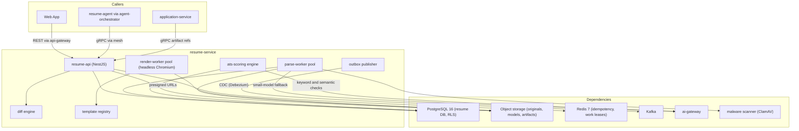
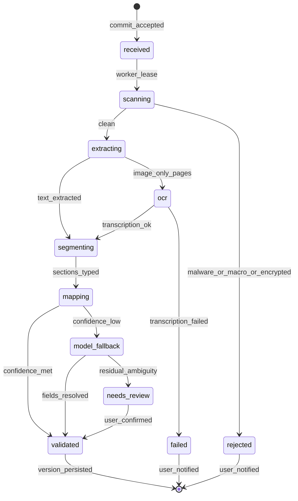
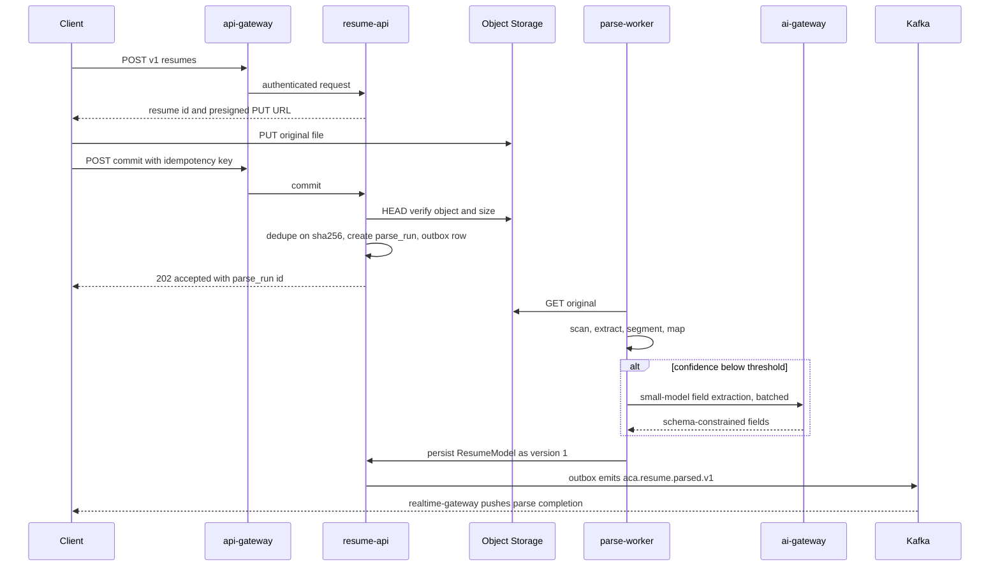
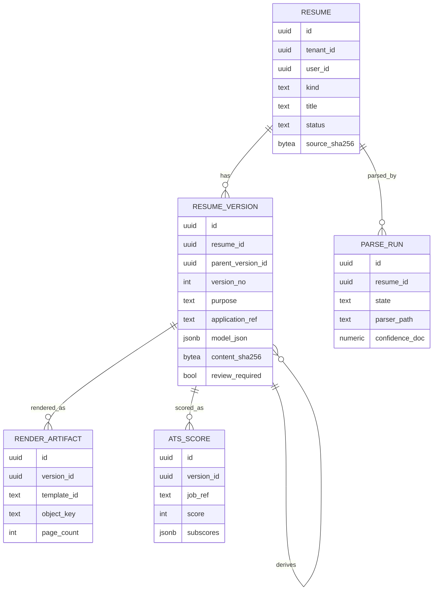
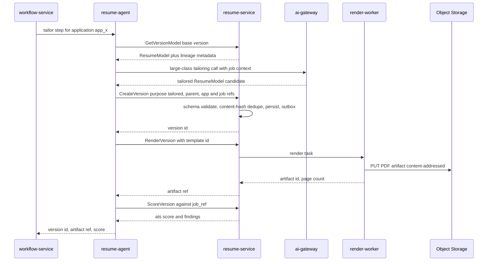

# 14 — Resume Service

| | |
|---|---|
| Document ID | ACA-SAS-14 |
| Volume | 2 — Core Services |
| Status | Draft v1.0 |
| Depends on | [00 — Architecture Canon](../00-architecture-canon.md), [09 — Microservice Architecture](09-microservice-architecture.md), [13 — Profile Service](13-profile-service.md), [17 — Application Service](17-application-service.md), [18 — AI Gateway](18-ai-gateway.md), [Volume 3 — AI Architecture](../volume-3-ai-architecture/), [Volume 5 — Security](../volume-5-security/) |

## 1. Overview

`resume-service` owns the resume domain: storage, parsing, versioning, tailoring artifacts, and ATS-optimization scoring (canon §4.2). It converts arbitrary user uploads (PDF/DOCX) into a canonical, machine-readable **ResumeModel**, maintains an immutable version lineage from each base resume to every tailored variant produced per application, renders any version back to a pixel-faithful PDF through a template pipeline, and scores versions for ATS compatibility. It is a Tier-1 dependency of the application-submission saga: `resume-agent` cannot tailor, and [`application-service`](17-application-service.md) cannot attach documents, without this service's version and artifact APIs.

Three design commitments shape the chapter. First, **parsing is a ladder, not a model call**: deterministic extractors handle the bulk of documents at near-zero cost, and the canon's escalation ladder (§9) is applied literally — rules → cached results → small-model fallback — with every escalation logged and budgeted through [`ai-gateway`](18-ai-gateway.md). Second, **versions are immutable facts**: a resume version is never edited in place; tailoring, correction, and user edits each append a new version with explicit parentage, giving the platform a verifiable lineage from any submitted PDF back to the base resume and the agent run that produced it — required for user trust, HITL review, and audit. Third, **rendering is a first-party, isolated concern**: PDF generation runs on a dedicated in-service renderer pool (headless Chromium), deliberately *not* on `browser-fleet-service`; §6 records the decision and its tradeoffs.

The service is a NestJS (TypeScript) domain service per canon §3, with one logical PostgreSQL 16 database (RLS by `tenant_id`), object storage for originals and artifacts, Redis for idempotency and work coordination, and Kafka via the outbox pattern for all cross-service effects. Resume content is career data (PII class `P2`); contact fields inside the ResumeModel are identity PII (`P1`, field-level AES-256-GCM). Parse and tailoring intelligence (which model classes, which prompts) is consumed from the AI plane; this chapter specifies the contracts, not the prompt content (see [Volume 3](../volume-3-ai-architecture/)).

Out of scope here: profile synthesis from parsed resumes (owned by [`profile-service`](13-profile-service.md), which consumes `aca.resume.parsed.v1`), cover letters (`cover-letter-agent` writes them; `application-service` stores their linkage), and portal upload mechanics ([Volume 7](../volume-7-browser-intelligence/)).

## 2. Service Architecture

### 2.1 Component View



### 2.2 Components

| Component | Purpose | Key responsibilities |
|---|---|---|
| `resume-api` | Single API surface (REST external, gRPC internal) | Upload orchestration, version CRUD (append-only), artifact access via presigned URLs, diff API, entitlement checks (versions per application by plan), outbox writes |
| `parse-worker` | Async parse pipeline executor | Malware scan gate, format detection, deterministic extraction, section segmentation, model-fallback escalation, confidence assembly, ResumeModel validation |
| `render-worker` | Deterministic HTML→PDF rendering | Template instantiation, headless Chromium print-to-PDF, artifact content-addressing, render verification (page count, text layer present) |
| `ats-scoring` engine | ATS-compatibility scoring | Rules battery (layout/format/parseability), round-trip re-parse check, keyword coverage vs. a target job via small model, weighted score + findings |
| `diff` engine | Version comparison | Structural diff (RFC 6902 JSON Patch) + per-section text hunks; deterministic, no model calls by default |
| `template registry` | Versioned render templates | HTML/CSS template packs (`template_id@semver`), font manifest, per-tenant template entitlements |
| `outbox publisher` | Atomic DB-write + event publish | Debezium CDC from `outbox` table to Kafka per canon §8 |

**Interactions.** Inbound: web app (user uploads/edits) through `api-gateway`; `resume-agent` (tailoring) and `application-service` (artifact resolution during submission) over mesh gRPC with OPA per-method authz. Outbound: `ai-gateway` only for model calls (canon §9 — no provider SDKs), object storage, and Kafka. `profile-service` and `application-service` consume this service's events; there are no synchronous calls *from* `resume-service` to any domain service — the parse→profile flow is strictly event-driven so a profile outage never blocks resume processing.

## 3. Ingestion & Parsing Pipeline

### 3.1 Upload Contract

Uploads never stream through the API pods. `POST /v1/resumes` allocates a resume `id` and returns a presigned S3 PUT URL scoped to `tenants/{tenant_id}/resumes/{resume_id}/source/` with an exact `Content-Length` bound and 15-minute expiry. The client uploads directly, then calls `POST /v1/resumes/{id}/commit` (idempotent on `Idempotency-Key` plus object SHA-256). Commit verifies object existence and size, records `source_sha256`, and enqueues a `parse_run`. A commit whose SHA-256 matches an existing non-deleted resume for the same user short-circuits and returns the existing resume (`409` with pointer) — duplicate uploads are common and re-parsing them wastes budget.

| Limit | Value | Rationale |
|---|---|---|
| Max upload size | 10 MB | p99.9 of genuine resumes < 2 MB; bound caps parser and scanner memory |
| Accepted types | `application/pdf`, DOCX, `text/plain` | Cover observed uploads; DOC/RTF/ODT rejected with client-side conversion guidance rather than maintaining fragile converters |
| Type verification | Magic-byte sniff, not extension | Extension spoofing is the cheapest attack |
| Max pages | 15 | Beyond this it is a CV/dossier; parser cost and ResumeModel assumptions break down; hard-fail with message |
| Presigned URL TTL | 15 min | Long enough for slow mobile links; short enough to limit URL leakage value |
| Commit idempotency window | 24 h (Redis) | Canon §7 default |

### 3.2 Pipeline Stages and the Escalation Ladder

The parse pipeline applies the canon §9 ladder to document understanding. Each stage emits per-field **provenance** (byte/char spans in the source text) and **confidence**; escalation happens per-section, not per-document, so one ambiguous section does not send the whole resume to a model.

1. **Scan gate.** ClamAV scan; DOCX inspected for macro parts (`vbaProject.bin` → reject, we accept DOCX not DOCM semantics regardless of extension); PDF checked for encryption (reject with "remove password" guidance), JavaScript and embedded files (stripped), and decompression bombs (output-size budget 200 MB inflated).
2. **Deterministic extraction.** PDF: text + layout via pdfium bindings — glyph runs with coordinates, reading-order reconstruction (column detection via x-clustering), style runs (bold/size) preserved as segmentation hints. DOCX: direct OOXML traversal (paragraphs, runs, tables, styles) — the highest-fidelity path since structure is explicit. TXT: passthrough.
3. **OCR branch.** If extracted text density < 150 chars/page (scanned-image resume), rasterize at 300 dpi and run Tesseract. Only if OCR confidence < 80% does the pipeline escalate to the `vision` model class via `ai-gateway` for page transcription — the ladder's model tiers are a last resort, and this is the only vision usage in the service.
4. **Section segmentation (rules).** Header/footer isolation, then heading detection against a curated multilingual lexicon (~40 canonical headings with fuzzy variants: Experience, Employment History, Education, Skills, ...), style-run boosts, and positional priors. Output: ordered typed sections with residual "unknown" blocks.
5. **Field mapping (rules).** Per-section deterministic extractors: date-range grammar (30+ formats), org/title splitting heuristics, contact extraction (RFC-compliant email, E.164-normalized phone, URL classification for LinkedIn/GitHub/portfolio), skills tokenization against the platform skills taxonomy (shared read model from `profile-service` events).
6. **Small-model fallback.** Sections or fields below confidence thresholds (doc-level < 0.80, field-level < 0.85 — thresholds chosen from labeled-corpus calibration where deterministic output above them agreed with human labels ≥ 98%) are batched into at most **2** `small`-class calls per document (extraction with JSON-Schema-constrained output, source text passed inside `untrusted_content` wrappers per canon §13). The model fills only the low-confidence fields; deterministic results are never overwritten by lower-confidence model output.
7. **Validation & assembly.** ResumeModel JSON-Schema validation, cross-field checks (date ordering, overlap sanity), document classifier gate (a small deterministic scorer that rejects non-resumes — invoices, cover letters — before they pollute the profile), confidence rollup, persistence as version 1, outbox event.

A `needs_review` outcome (residual low-confidence fields after fallback) is not a failure: the version persists with `review_required=true` and the client renders a guided correction UI; user confirmation appends a corrected version (§5).

### 3.3 Parse Run State Machine



Terminal `failed`/`rejected` runs keep the original object (user data, not a crawl artifact) and surface an actionable problem-detail; `POST /v1/resumes/{id}/reparse` re-enqueues after user remediation.

### 3.4 Ingestion Sequence



`profile-service` consumes `aca.resume.parsed.v1` to seed/refresh the career profile; that flow is specified in [13 — Profile Service](13-profile-service.md).

### 3.5 Parse Failure Modes (component-level)

| Failure | Detection | Handling |
|---|---|---|
| Encrypted PDF | pdfium open error | Reject at scan stage; problem-detail with remediation; no retry |
| Truncated/corrupt file | Parser exception, xref/zip CRC failures | One salvage attempt (tolerant parser mode); then `failed` with re-upload guidance |
| DOCX with macros | OOXML part inspection | Reject (`rejected`); macro docs are a malware vector with no legitimate resume use |
| Zip/decompression bomb | Inflation budget exceeded | Abort, reject, flag account signal to `security-agent` on repeat |
| Scanned-image resume | Text density heuristic | OCR branch (§3.2); `vision`-class only on OCR failure |
| Non-resume document | Classifier gate | `failed` with explicit "not a resume" code — prevents profile pollution |
| Parse ambiguity | Field confidence < threshold post-fallback | `needs_review` + guided correction UI; never silent guessing |
| `ai-gateway` unavailable/budget-denied | gRPC error / 429 budget verdict | Persist deterministic-only version flagged `review_required`; enqueue fallback retry on the batch lane; user unblocked immediately |
| Malware positive | ClamAV | Reject, quarantine object (separate prefix, 30-day hold), audit event |

## 4. Canonical ResumeModel

### 4.1 JSON Structure

The ResumeModel is the single canonical representation; renders, diffs, tailoring, ATS scoring, and profile sync all operate on it, never on the source file. Schema is registered in the Schema Registry as `aca.resume.model` with semver (`model_schema: "1.x"`); BACKWARD-compatible evolution within a major.

```jsonc
{
  "model_schema": "1.2",
  "locale": "en-US",
  "contact": {                        // P1 — field-encrypted at rest
    "full_name": "…", "email": "…", "phone": "+1…",
    "location": {"city": "…", "region": "…", "country": "US"},
    "links": [{"kind": "linkedin|github|portfolio|other", "url": "…"}]
  },
  "summary": {"text": "…"},
  "experience": [{
    "id": "exp_01…",                  // stable within lineage for diffing
    "company": "…", "title": "…",
    "start": "2021-03", "end": null,  // null = present
    "location": "…", "employment_type": "full_time",
    "bullets": [{"id": "blt_01…", "text": "…", "skills": ["k8s"], "evidence_refs": []}]
  }],
  "education": [{ "id": "edu_…", "institution": "…", "degree": "…", "field": "…", "start": "…", "end": "…", "details": [] }],
  "skills": [{"name": "Kubernetes", "taxonomy_id": "skl_…", "level": null, "years": null}],
  "certifications": [], "projects": [], "languages": [], "publications": [],
  "custom_sections": [{"heading": "…", "blocks": ["…"]}],
  "provenance": {                     // absent on authored (non-parsed) versions
    "source_object": "s3-key", "extractor": "pdfium-2.x",
    "spans": {"experience[0].title": {"page": 1, "start": 812, "end": 840}}
  },
  "confidence": {"doc": 0.94, "fields": {"experience[0].start": 0.71}}
}
```

Stable element IDs (`exp_`, `blt_`) are assigned at first parse and preserved across versions in a lineage; the diff engine and tailoring prompts key on them, which turns "reworded bullet 3" into a tracked mutation instead of a delete+insert.

### 4.2 DDL (owned schema, excerpt)

```sql
CREATE TABLE resume (
    id                uuid PRIMARY KEY,             -- UUIDv7
    tenant_id         uuid NOT NULL,
    user_id           uuid NOT NULL,
    kind              text NOT NULL DEFAULT 'uploaded',  -- uploaded | authored
    title             text NOT NULL,
    source_object_key text,
    source_mime       text,
    source_sha256     bytea,
    head_version_id   uuid,                         -- convenience pointer, not authority
    status            text NOT NULL DEFAULT 'active',    -- active | archived | purging
    created_at        timestamptz NOT NULL DEFAULT now(),
    updated_at        timestamptz NOT NULL DEFAULT now()
);
-- RLS: USING (tenant_id = current_setting('app.tenant_id')::uuid)  (canon §6)

CREATE TABLE resume_version (
    id                 uuid PRIMARY KEY,
    tenant_id          uuid NOT NULL,
    resume_id          uuid NOT NULL REFERENCES resume(id),
    parent_version_id  uuid REFERENCES resume_version(id),
    version_no         int  NOT NULL,               -- monotonic per resume
    purpose            text NOT NULL,               -- base | tailored | corrected | edited
    application_ref    text,                        -- opaque app_… id; no cross-service FK (canon §11)
    job_ref            text,                        -- opaque job_… id
    created_by_kind    text NOT NULL,               -- user | agent
    created_by_ref     text NOT NULL,               -- usr_… | agt_… + run_…
    model_json         jsonb NOT NULL,              -- canonical ResumeModel (contact fields encrypted)
    model_schema       text  NOT NULL,
    content_sha256     bytea NOT NULL,              -- hash of canonical-serialized model
    review_required    bool  NOT NULL DEFAULT false,
    created_at         timestamptz NOT NULL DEFAULT now(),
    UNIQUE (resume_id, version_no),
    UNIQUE (resume_id, content_sha256)              -- idempotent version creation
) PARTITION BY RANGE (created_at);                  -- monthly; tailored volume is unbounded

CREATE TABLE parse_run (
    id             uuid PRIMARY KEY,
    tenant_id      uuid NOT NULL,
    resume_id      uuid NOT NULL REFERENCES resume(id),
    state          text NOT NULL,                   -- §3.3 states
    parser_path    text,                            -- deterministic | ocr | small_model | vision
    confidence_doc numeric,
    error_code     text,
    timings_ms     jsonb,
    created_at     timestamptz NOT NULL DEFAULT now(),
    finished_at    timestamptz
);

CREATE TABLE render_artifact (
    id            uuid PRIMARY KEY,
    tenant_id     uuid NOT NULL,
    version_id    uuid NOT NULL REFERENCES resume_version(id),
    template_id   text NOT NULL,                    -- template@semver
    object_key    text NOT NULL,                    -- content-addressed (§8)
    content_sha256 bytea NOT NULL,
    page_count    int,
    render_ms     int,
    created_at    timestamptz NOT NULL DEFAULT now(),
    UNIQUE (version_id, template_id)                -- one artifact per version+template; re-render is a no-op
);

CREATE TABLE ats_score (
    id           uuid PRIMARY KEY,
    tenant_id    uuid NOT NULL,
    version_id   uuid NOT NULL REFERENCES resume_version(id),
    job_ref      text,                              -- null = generic parseability score
    score        int  NOT NULL,                     -- 0..100
    subscores    jsonb NOT NULL,                    -- parseability, format, keywords, completeness
    findings     jsonb NOT NULL,                    -- actionable rule hits
    engine_ver   text NOT NULL,
    created_at   timestamptz NOT NULL DEFAULT now(),
    UNIQUE (version_id, job_ref, engine_ver)        -- cache key; rescoring only on engine bump
);
```

### 4.3 Entity View



**JSONB-vs-normalized decision.** The ResumeModel lives as a single JSONB document per version rather than normalized experience/education tables. Versions are immutable and read whole (render, diff, tailor all need the full document); normalizing would multiply write amplification per version by 20–50 rows for zero query benefit — the platform's queryable projection of career data is `profile-service`'s job, not this store's. Skills-level analytics read from events, not from this schema. Recorded in §17.

## 5. Versioning & Immutable Lineage

### 5.1 Rules

1. **Append-only.** `resume_version` rows are never updated (except nothing — no mutable columns) or deleted outside GDPR purge. Any change — user edit, agent tailoring, needs-review correction — creates a child version with `parent_version_id` set.
2. **Lineage is a tree per resume.** The base parse is version 1; user edits advance a main line; each application's tailored version branches from whatever version the user designated as current at draft time. `head_version_id` is a UX convenience pointer, never an integrity authority.
3. **Content addressing.** `content_sha256` over canonically-serialized model JSON (sorted keys, normalized whitespace) makes version creation idempotent: an agent retry that produces byte-identical output maps to the existing version instead of a duplicate.
4. **Attribution.** `created_by_kind/ref` binds every version to a user action or an agent run (`agt_…`/`run_…`), joining cleanly to `agent-orchestrator` run records and the audit trail. A tailored version additionally carries `application_ref` and `job_ref` (opaque IDs — no cross-service FK per canon §11).
5. **Caps.** 500 versions per resume (runaway-agent guard: an agent loop appending versions is a defect, and 500 bounds storage and diff-UI damage while being ~10× any legitimate use). Tailored versions per application are plan-gated (Free: 1 per canon §12; the entitlement check runs here, fine-grained, per canon §12).

### 5.2 Tailoring Sequence (resume-agent)

`resume-agent` is a logical agent on the agent runtime (canon §5); `resume-service` sees authenticated gRPC calls attributed to the agent run. The application-submission saga in `workflow-service` drives the flow.



`resume-service` validates every agent-submitted model against the schema and against tailoring invariants it owns: contact identity fields must equal the parent's (agents may not alter who the user is), employment dates may not change, and no experience entries may be invented (entry IDs must be a subset of the parent's; bullets may be reworded/reordered/dropped). Violations reject the version with a typed error the agent can self-correct on — this is the service-side backstop against hallucinated credentials, independent of prompt-level guardrails.

### 5.3 Retention & Purge

Versions live as long as the account, since users legitimately revisit old applications. GDPR deletion (triggered by `aca.user.deleted.v1`) hard-deletes rows and S3 objects within 30 days (canon §11) and emits tombstones; `application-service` retains only opaque refs, which then dangle by design and render as "document removed".

## 6. Rendering Pipeline

### 6.1 Decision: dedicated renderer pool, not browser-fleet-service

Both options use headless Chromium, so the choice is about placement and isolation, not engine. **Decision: a `render-worker` deployment owned by `resume-service`.**

| Criterion | `browser-fleet-service` | Dedicated `render-worker` (chosen) |
|---|---|---|
| Isolation model | gVisor + per-session egress netpol to *external portals*, proxy egress, session-vault sidecar — machinery for hostile third-party web | gVisor pod with **zero egress** netpol; renders first-party templates + user data only |
| Latency | Fleet scheduler queueing, session warm-up ~2–5 s; sized/prioritized for portal workflows | Pre-warmed Chromium with persistent browser and per-render contexts; p95 render < 5 s |
| Blast radius | Autopilot portal surges would starve renders (and vice versa); render load would distort fleet capacity math | Independent scaling; render availability decoupled from portal automation health |
| Determinism | Fleet images track portal-compat needs | Renderer image pins Chromium + full font manifest; byte-stable output per (model, template, image digest) |
| Cost | Fleet sessions are heavyweight (per-session pods) | Long-lived pods, ~200 ms context per render, >50× cheaper per document |

The render path is on the application-draft critical path (canon SLO: draft generation p95 < 60 s); coupling it to the fleet would import the fleet's failure modes into that SLO for no benefit. Tradeoff accepted: a second Chromium image to maintain (mitigated by sharing the base layer and Playwright tooling with the fleet build).

### 6.2 Pipeline

1. Template pack resolution (`template_id@semver` from the registry; packs are HTML + CSS Paged Media + font manifest, reviewed like code).
2. Model injection via a strict templating layer: all user strings HTML-escaped; no user-controlled URLs fetched (links render as text/hyperlink only); CSP `default-src 'none'` inside the page; fonts and assets from the image only.
3. Chromium print-to-PDF (A4/Letter per locale), PDF/A-2b post-processing, metadata scrub (no author/tool fingerprints beyond product name), deterministic PDF ID from content hash.
4. Verification: page count within template bounds, extractable text layer present (a render whose text layer is empty would be an ATS catastrophe — hard-fail), file size < 2 MB.
5. Artifact persisted content-addressed (§8); `(version_id, template_id)` uniqueness makes re-render a cache hit.

Render requests are synchronous-optimistic: the API attempts inline render (budget 20 s timeout — generous over the p95 to avoid spurious failures on cold pods) and degrades to async-with-notification under queue pressure.

## 7. ATS-Compatibility Scoring Engine

Scoring follows the ladder: a deterministic rules battery produces most of the signal; the `small` class contributes only keyword/semantic coverage against a specific job. Two modes: **generic** (`job_ref` null — format/parseability only, cacheable indefinitely per engine version) and **targeted** (against a job's requirements).

| Subscore | Weight | Method | Example rules |
|---|---|---|---|
| Parseability | 35 | Deterministic round-trip: render → re-parse with own §3 pipeline → field-recovery ratio | Recovery ≥ 0.97 required for full marks; own parser is the proxy for third-party ATS parsers, and portal-observed parse outcomes recalibrate it (see below) |
| Format | 25 | Deterministic rules on model + rendered PDF | Single-column layout, no tables/text-boxes, standard section headings, contact block in body (not header/footer — classic ATS blind spot), embedded fonts, selectable text, ≤ 2 pages for non-academic roles, consistent date formats |
| Keyword coverage | 30 | Embedding similarity + `small`-class gap analysis vs. job requirements | Required-skill lexical presence (exact + expanded acronyms), semantic coverage of responsibilities, seniority-language match |
| Completeness | 10 | Deterministic | Email + phone present, dated experience, no unexplained gaps > 6 months without a marker |

Findings are actionable (`rule_id`, severity, section pointer, suggested fix) and feed both the user UI and `resume-agent`'s tailoring loop. Engine versioning: any rule/weight change bumps `engine_ver`, invalidating cached scores; weights are recalibrated by `learning-pipeline` against observed outcomes (application → response rates by score band), closing the canon's learn-from-results loop. Ground truth for parseability additionally arrives from Volume 7: when `browser-agent` uploads a resume into a live portal and the portal echoes parsed fields back, `portal-intelligence-service` events let us score our proxy against reality.

## 8. Object Storage Layout

Bucket `aca-resume-{env}` (S3-compatible per canon; versioning on, cross-region replication per canon §11):

| Prefix | Content | Encryption | Lifecycle |
|---|---|---|---|
| `tenants/{tenant_id}/resumes/{resume_id}/source/{sha256}.{ext}` | Original upload, immutable | SSE-KMS, per-tenant KEK | Retained until resume purge (user data, not a crawl artifact) |
| `tenants/{tenant_id}/resumes/{resume_id}/models/{content_sha256}.json` | Canonical model export (archival/export copy; Postgres is authority) | SSE-KMS per-tenant | Until purge |
| `tenants/{tenant_id}/resumes/{resume_id}/artifacts/{content_sha256}.pdf` | Rendered PDFs, content-addressed | SSE-KMS per-tenant | Until purge; orphan sweep for versions past cap |
| `quarantine/{tenant_id}/{object}` | Malware-positive uploads | SSE-KMS platform key | 30-day hold then delete |
| `tmp/parse/{parse_run_id}/` | Extraction intermediates (page rasters, OCR output) | SSE-S3 | 7-day TTL — debug value only |

Content-addressing (SHA-256 in the key) gives free dedup across re-renders and makes artifact references tamper-evident: `application-service` stores `(artifact_id, content_sha256)` and the submission saga verifies the hash before upload to a portal — the submitted document provably equals the approved one. All access is via short-lived presigned URLs minted by `resume-api` after RLS-scoped authorization; no service reads the bucket directly.

## 9. Diff / Compare API

`GET /v1/resume-versions/{id}/diff?against={otherId}` returns, for any two versions sharing a resume lineage:

- **Structural diff:** RFC 6902 JSON Patch computed on canonical serialization, keyed by stable element IDs — so bullet rewording surfaces as `replace` on `bullets/blt_x/text`, not positional noise.
- **Section hunks:** per-section word-level text hunks for human review UI (the HITL approval screen for L1 autonomy renders exactly this).
- **Summary block:** deterministic counters (bullets changed/removed, skills added, sections reordered) — no model call; a natural-language change summary is available behind `?narrative=true` (small class, cached by version-pair hash) for digest emails only.

Cross-lineage diffs are rejected (`422`) — comparing unrelated resumes is a UX smell and the ID-stability assumption breaks. Diff responses cache in Redis keyed by ordered version-pair hash (immutability makes this cache permanently valid; TTL 7 d only to bound memory).

## 10. API Surface

External REST (via `api-gateway`, `/v1`, RFC 9457 errors, cursor pagination — canon §7). Internal gRPC mirrors the starred rows for agent/service callers with OPA per-method authz.

| Method & Path | Caller | Purpose | Notes |
|---|---|---|---|
| `POST /v1/resumes` | user | Create resume, get presigned upload | Idempotency-Key required |
| `POST /v1/resumes/{id}/commit` | user | Finalize upload, start parse | 202 + `parse_run` id; sha256 dedupe |
| `GET /v1/resumes` / `GET /v1/resumes/{id}` | user | List/read with head version summary | |
| `PATCH /v1/resumes/{id}` | user | Rename, archive | Metadata only — content is versions |
| `POST /v1/resumes/{id}/reparse` | user | Re-run parse after remediation | Rate: 5/day/resume — parse is not free |
| `GET /v1/resumes/{id}/versions` | user | Lineage listing (tree order) | |
| `POST /v1/resumes/{id}/versions` * | user, `resume-agent` | Append version (edit/tailored/corrected) | Validates §5.2 invariants; entitlement check |
| `GET /v1/resume-versions/{id}` * | user, agents, `application-service` | Full model + metadata | |
| `POST /v1/resume-versions/{id}/render` * | user, `resume-agent` | Render to PDF via template | Returns artifact ref; idempotent per template |
| `GET /v1/resume-versions/{id}/artifacts/{aid}` * | user, `application-service` | Presigned GET (15 min) | Hash included for verification |
| `POST /v1/resume-versions/{id}/ats-score` * | user, `resume-agent` | Score (generic or vs `job_ref`) | Cached per §7 |
| `GET /v1/resume-versions/{id}/diff` | user | §9 | |
| `DELETE /v1/resumes/{id}` | user | Purge flow (soft → hard ≤ 30 d) | Tombstone events |

## 11. Events

Producer topics (outbox-published; envelope per canon §8; partition key noted):

| Topic | Key | Emitted when | Payload sketch |
|---|---|---|---|
| `aca.resume.parsed.v1` | `resume_id` | Parse run reaches `validated` | resume_id, user_id, version_id, parser_path, confidence_doc, review_required, skills[] summary |
| `aca.resume.parse.failed.v1` | `resume_id` | Terminal `failed`/`rejected` | resume_id, error_code, parser_path |
| `aca.resume.version.created.v1` | `resume_id` | Any version append | version_id, parent_version_id, purpose, application_ref, job_ref, created_by |
| `aca.resume.rendered.v1` | `resume_id` | Artifact persisted | version_id, artifact_id, template_id, content_sha256 |
| `aca.resume.ats.scored.v1` | `resume_id` | Score computed (cache miss) | version_id, job_ref, score, subscores |

Key = `resume_id` preserves per-resume ordering (a consumer never sees a version event before its resume's parse event). Consumed topics: `aca.user.deleted.v1` (purge saga), `aca.application.submitted.v1` (marks tailored versions as submitted for retention analytics). Retry/DLQ per canon §8.

## 12. Failure Scenarios (chapter-level)

| Scenario | Impact | Mitigation / recovery |
|---|---|---|
| Object storage regional outage | Uploads, renders, artifact reads fail; parse/tailor stall | API returns 503 with retry-after; parse/render tasks are durable (Kafka/DB-backed) and drain on recovery; cross-region replica serves read-only artifact access for submission saga (stale-tolerant) |
| Postgres failover | Writes pause ≤ 30 s (canon RTO posture) | Idempotent commits + content-hash version dedupe make client/agent retries safe |
| `ai-gateway` degraded or budget-exhausted | Fallback extraction and targeted scoring unavailable | Ladder degrades gracefully: deterministic-only results flagged `review_required`; scoring returns rules-only subscores with `partial=true`; retries route to batch lane |
| Render-worker crash loop (Chromium fault on pathological content) | Render queue backlog | Per-render context isolation; poisoned task quarantined after 2 attempts with template+model repro bundle to `tmp/`; pool health-ejects pods on RSS/zombie thresholds |
| Runaway agent appending versions | Storage/cost churn | 500-version cap + per-run version rate limit (10/min) + `agent-supervisor` loop detection on repeated `CreateVersion` |
| Template pack regression (broken CSS) | Bad PDFs at scale | Packs versioned + canary-rendered against a golden model corpus in CI; render verification (§6.2) hard-fails empty text layers before an artifact ever reaches a portal |
| Outbox/CDC lag | `profile-service` sync delayed | Monitored lag SLO (< 60 s); no correctness impact — consumers are idempotent and state converges |

## 13. Scaling Strategy

Load profile is asymmetric: uploads are low-volume (peak ~10 k/day new + reparse), while tailoring scales with applications. Sizing anchor: 100 k applications/day platform-wide (Premium-heavy growth case) → ~100 k tailored versions + renders + targeted scores/day ≈ 1.2/s average, 5/s peak (3–4× diurnal factor, applications cluster in local evenings).

| Dimension | Approach | Numbers |
|---|---|---|
| `resume-api` | Stateless HPA on CPU/RPS | 3 → 12 pods; each ~300 RPS headroom |
| `parse-worker` | KEDA on work-queue lag | 1 doc ≈ 1.5 s CPU deterministic path; 4 workers × 4 concurrency cover 10× upload peak |
| `render-worker` | KEDA on render queue depth; pre-warmed Chromium | 2 s CPU/render → 5/s peak needs 10 concurrent contexts → 6 pods × 2 contexts incl. headroom |
| Postgres | Monthly partitions on `resume_version` (~30 KB/row JSONB → ~3 GB/day at anchor load); read replicas for GET-heavy version reads | Single-writer comfortably < 200 writes/s; partition pruning keeps lineage queries on ≤ 2 partitions |
| Redis | Idempotency + diff cache | < 2 GB working set; cluster-mode per canon |
| Object storage | Content-addressing dedupes re-renders (~30% of render requests are repeats) | ~25 GB/day artifacts at anchor load |

Cell placement: `resume-service` is cell-local (canon §15) — resume data follows the tenant's cell, including EU residency pinning.

## 14. Security Considerations

- **Untrusted input, twice.** Uploaded files are hostile until scanned (§3.2 gate; parsing runs in a seccomp-restricted, no-egress worker sandbox — pdfium/OOXML parsers have CVE history). Resume *text* entering prompts is wrapped as `untrusted_content` (canon §13) even though it is the user's own document — poisoned uploads targeting the tailoring agent are an expected attack.
- **PII.** Contact block is `P1`: field-level AES-256-GCM inside `model_json` before persistence (envelope keys per tenant via KMS); the rest of the model is `P2` under storage encryption. Encrypted fields are decrypted only in `resume-api` for authorized reads — parse/render workers receive already-plaintext models only within the pod boundary, never log them.
- **Agent containment.** §5.2 invariants (identity fields immutable, no invented experience) are enforced server-side; combined with tool allowlists (canon §9) the tailoring agent cannot fabricate credentials even if its prompt is compromised.
- **Artifact integrity.** Content hashes bind approved version → rendered artifact → portal submission (§8); any mismatch aborts the submission saga and pages.
- **Render isolation.** Zero-egress netpol, escaped injection, CSP — a malicious payload in resume text cannot exfiltrate via the renderer.
- **Access.** RLS + service-layer tenant guard (canon §6); OPA per-method on gRPC; presigned URLs are the only artifact access path; all consequential operations audit-logged to `audit-service` via `aca.audit.event.v1`.

## 15. Observability

OTel throughout; `trace_id` flows upload → parse → events → profile sync (canon §14).

| Metric (Prometheus) | Type | Alert / SLO |
|---|---|---|
| `resume_parse_duration_seconds` (by `parser_path`) | histogram | Interactive parse p95 < 30 s (feeds first-session UX) |
| `resume_parse_outcome_total` (validated/needs_review/failed/rejected) | counter | needs_review ratio > 8% over 6 h → investigate (segmentation drift) |
| `resume_parse_deterministic_ratio` | gauge | < 0.60 sustained → alert; the ladder economics depend on it |
| `resume_model_fallback_calls_total` (by model class) | counter | Cost regression guard with `cost-controller` budgets |
| `resume_render_duration_seconds` / `resume_render_failures_total` | histogram/counter | p95 < 5 s; success ≥ 99.5% weekly |
| `resume_version_created_total` (by purpose, creator kind) | counter | Per-run rate anomaly → `agent-supervisor` signal |
| `resume_ats_score_bucket` | histogram | Distribution shift after engine bump → rollback gate |
| `resume_outbox_lag_seconds` | gauge | > 60 s → page |

Dashboards: parse funnel (stage drop-off), ladder economics (deterministic vs. model share, cost/document), render health, version-creation by agent run. Structured logs carry `parse_run_id`/`version_id`, never model content.

## 16. Future Improvements

- **Typst render backend** behind the same template-pack interface — deterministic, milliseconds-fast, no Chromium; adopt once template parity is proven on the golden corpus.
- **Layout-aware small model** (donut/layoutlm-class, self-hosted via vLLM) as the fallback tier for scanned/creative resumes, cutting `vision`-class spend.
- **ATS ground-truth loop v2:** systematic per-ATS-family parseability profiles from Volume 7 portal echoes, replacing the single own-parser proxy with family-specific round-trip scoring.
- **Multi-locale ResumeModel** extensions (photo/DoB fields where regionally customary, with per-region policy gating) for EU/APAC markets.
- **Client-side redaction preview** using provenance spans to show exactly which source text produced each parsed field.

## 17. Alternatives Considered & Tradeoffs

| Decision | Alternatives | Why rejected |
|---|---|---|
| Dedicated render-worker (chosen §6) | Render on `browser-fleet-service`; third-party HTML→PDF API; LaTeX; react-pdf/pdfkit | Fleet: wrong isolation/latency/blast-radius fit (§6.1). SaaS API: resume PII egress to a vendor for a commodity capability. LaTeX: deterministic but template authoring/hiring cost, poor designer iteration. Programmatic PDF libs: re-implement typography (hyphenation, pagination) that CSS Paged Media gives free |
| In-house parse ladder | Resume-parsing SaaS (Affinda-class); LLM-only parsing | SaaS: PII egress, per-doc pricing at odds with unit economics, no provenance spans, vendor schema lock. LLM-only: 100× cost of the deterministic path, hallucination risk on the platform's most identity-sensitive artifact, and no ladder compliance (canon §9) |
| JSONB document per version | Normalized relational resume schema | §4.3 — immutable whole-document reads; queryable projections belong to `profile-service` |
| Immutable version tree | Mutable head + history/audit table | Mutable head reintroduces lost-update races between user edits and concurrent agent tailoring; immutability makes caching, diffing, artifact binding, and audit trivially correct. Cost: storage growth — bounded by caps + partitioning |
| Own ATS scorer (rules + small model) | License a commercial ATS-score vendor | Vendor scores are opaque (no findings to feed the tailoring loop), unverifiable, and unlearnable; our round-trip proxy is falsifiable against Volume 7 ground truth |
| Presigned direct-to-S3 upload | Streaming through API pods | Pod memory/network amplification for zero benefit; presigned pattern is the platform standard |
| Element-ID-stable structural diff | Plain text diff; model-generated diff | Text diff loses semantics across re-renders; model diff is non-deterministic and costs per view — deterministic-first per canon ladder |

Numbers marked as thresholds (confidence 0.80/0.85, 500-version cap, 20 s render timeout) are initial calibrations owned by this chapter; `learning-pipeline` evaluation may retune them with changes recorded in the service config registry, not by editing invariants.
