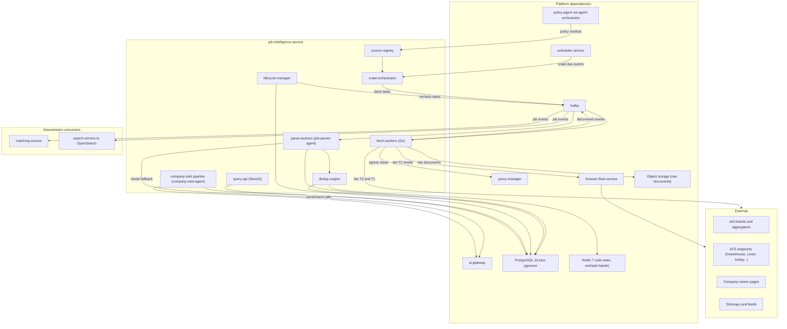
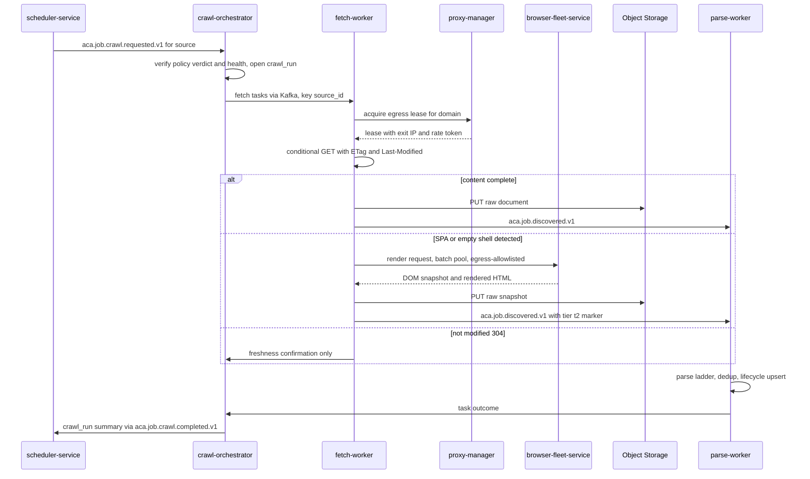
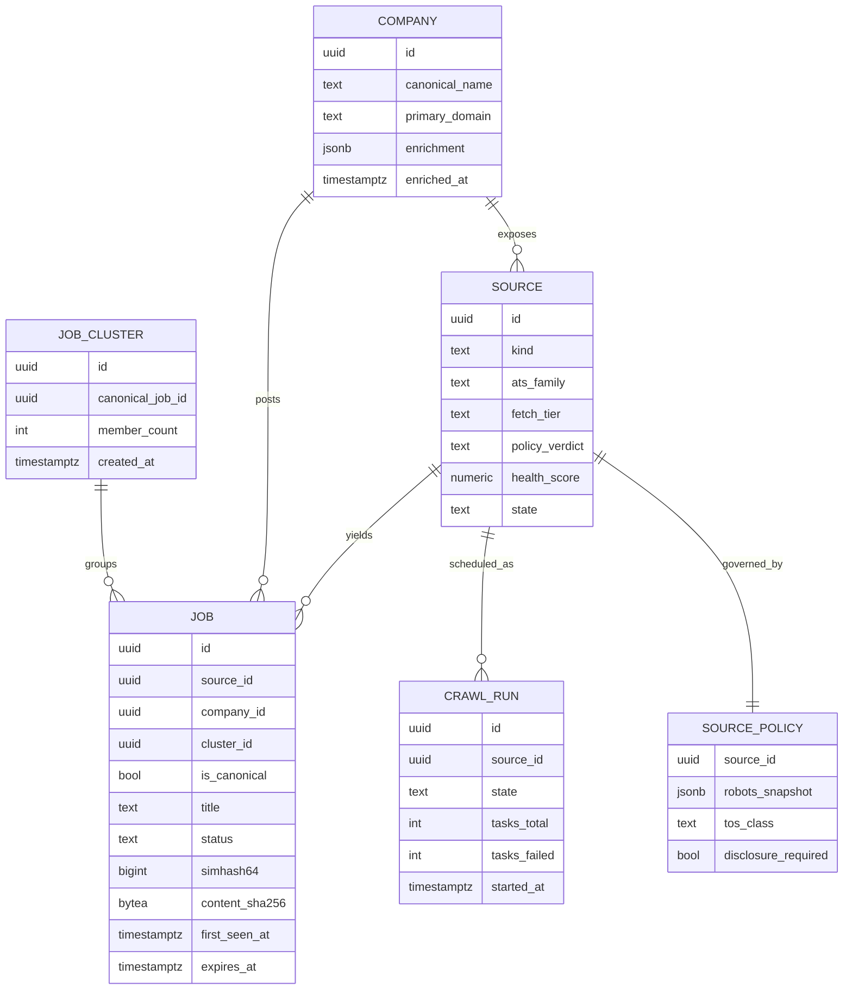
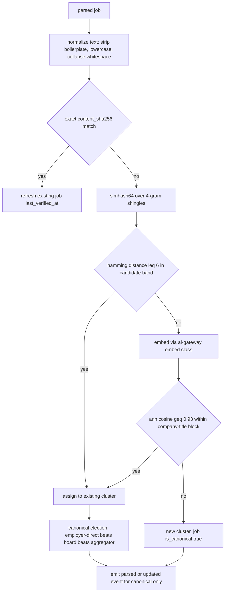
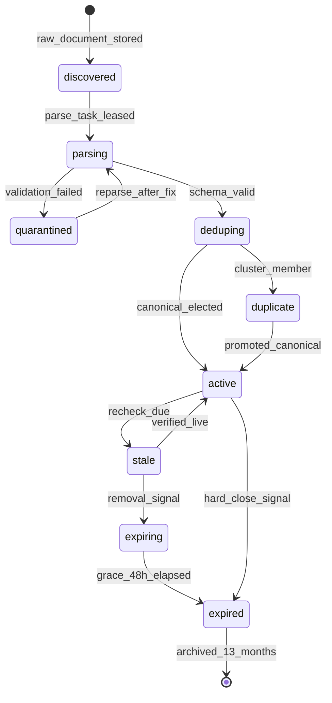

# 15 — Job Intelligence Service

| | |
|---|---|
| Document ID | ACA-SAS-15 |
| Volume | 2 — Core Services |
| Status | Draft v1.0 |
| Depends on | [00 — Architecture Canon](../00-architecture-canon.md), [09 — Microservice Architecture](09-microservice-architecture.md), [16 — Matching Service](16-matching-service.md), [18 — AI Gateway](18-ai-gateway.md), [Volume 4 — Data Platform](../volume-4-data-platform/), [Volume 7 — Browser Intelligence](../volume-7-browser-intelligence/) |

## 1. Overview

`job-intelligence-service` is ACA's discovery machine: it finds jobs across the internet, normalizes them into one canonical Job schema, deduplicates the heavily-syndicated market into canonical postings, keeps freshness honest through a verified lifecycle, and enriches every posting with company intelligence. Per canon §4.3 it owns jobs, companies, sources, and crawl state. Everything downstream — [`matching-service`](16-matching-service.md) scoring, `search-service` indices, autopilot decisions — is only as good as this corpus, and the canon SLO *job discovered → scored p95 < 15 min* starts its clock inside this service.

The design is governed by four principles. **Cheapest tier first:** fetching follows an escalation ladder mirroring the AI ladder (canon §9) — structured feeds/APIs, then plain HTTP, then headless rendering via `browser-fleet-service` only when a source demonstrably requires JavaScript; parsing likewise runs rules-first (`job-parser-agent`, canon §5) with small-model fallback. At 2 M raw postings/day (§15), tier discipline is the difference between a viable cost structure and an unviable one. **Compliance is architectural, not aspirational:** every source carries a machine-readable policy verdict from `policy-agent` (robots.txt, ToS class), every egress passes `proxy-manager` per-site rate budgets, and a source without a current *allow* verdict cannot be scheduled — the code path does not exist. **The corpus is shared:** job data is public/derived (`P3`), maintained once for all tenants; per-tenant visibility is a query-time concern, with a narrow tenant-scoped exception for recruiter-submitted postings. **Freshness is verified, not assumed:** a posting is `active` only while re-verification confirms it; users applying to dead jobs is the fastest way to destroy trust.

The service is polyglot per canon §3: Go for the fetch plane (high-fanout I/O), TypeScript (NestJS) for the API/control plane, with `job-parser-agent` and `company-intel-agent` executing on the shared agent runtime under `agent-orchestrator`. Crawl scheduling is externalized to `scheduler-service`; long-running source onboarding and full-recrawl flows run as Temporal workflows via `workflow-service`; the steady-state fetch/parse pipeline is Kafka work-queues (the tradeoff is recorded in §21).

This chapter specifies the source registry, crawl orchestration, fetch tiers, compliance guardrails, parsing/normalization with the canonical Job DDL, dedup, the freshness lifecycle, company enrichment, the OpenSearch indexing contract, and the capacity math behind 2 M jobs/day.

## 2. Service Architecture

### 2.1 Component View



### 2.2 Components

| Component | Purpose | Key responsibilities |
|---|---|---|
| `source-registry` | System of record for every crawlable origin | Source CRUD, tiering, health scoring, per-source fetch/parse config, policy-verdict cache, discovery intake for new sources |
| `crawl-orchestrator` | Turns schedule fires into bounded fetch work | Expands a source into fetch tasks (feed pages, sitemap diffs, detail URLs), enforces per-source concurrency caps, tracks `crawl_run` state |
| `fetch-workers` | Tiered content acquisition (Go) | Conditional HTTP fetch, SPA detection, T2 escalation to `browser-fleet-service`, raw-document persistence, per-domain politeness via `proxy-manager` leases |
| `parse-workers` | Normalization host for `job-parser-agent` | JSON-LD/microdata extraction, ATS-schema mapping, learned CSS templates, small-model fallback, canonical Job validation |
| `dedup-engine` | Collapse syndication into canonical postings | Exact hash, simhash near-dup banding, embedding clustering, canonical-record election |
| `lifecycle-manager` | Freshness and expiry | Recheck scheduling (demand-weighted), removal-signal interpretation, expiry grace, archival |
| `company-intel` pipeline | Company resolution + enrichment host for `company-intel-agent` | Name/domain canonicalization, company dedup, enrichment (funding, size, stack, hiring signals), refresh cadence |
| `query-api` | Read/admin surface | Job/company reads for services and clients, source admin, crawl-run inspection, requeue tooling |

**Interactions.** Inbound triggers only via events (`scheduler-service` fires) and admin APIs. Outbound synchronous calls are confined to platform infrastructure (`proxy-manager` leases, `browser-fleet-service` session API, `ai-gateway`); no domain service is called synchronously. All corpus changes leave as events (§14); `matching-service` and `search-service` are pure consumers — canon §2's "no shared databases" applies with force here because the job corpus is the platform's most tempting table to reach into.

## 3. Source Registry

### 3.1 Source Model

A **source** is a crawlable origin with one fetch strategy: a Greenhouse board token, a careers sitemap, an RSS feed, a board search endpoint, a career page section. Companies map 1:N to sources; large boards are one source with high fan-out.

```sql
CREATE TABLE source (
    id               uuid PRIMARY KEY,            -- UUIDv7
    kind             text NOT NULL,               -- ats_api | feed | sitemap | board | career_page
    ats_family       text,                        -- greenhouse | lever | ashby | workday | taleo | icims | successfactors | null
    base_url         text NOT NULL,
    company_id       uuid,                        -- null for multi-company boards
    fetch_tier       text NOT NULL,               -- t0_structured | t1_http | t2_render
    parse_strategy   text NOT NULL,               -- ats_schema | jsonld | template | model
    template_ref     text,                        -- learned extraction template id@version
    schedule_class   text NOT NULL,               -- hot_15m | hourly | daily | weekly
    rate_budget_ref  text NOT NULL,               -- proxy-manager budget id
    policy_verdict   text NOT NULL,               -- allow | restricted | deny (from policy-agent)
    policy_checked_at timestamptz NOT NULL,
    health_score     numeric NOT NULL DEFAULT 1.0, -- EWMA of yield, error, drift signals
    state            text NOT NULL DEFAULT 'active', -- proposed | active | degraded | quarantined | retired
    expected_daily_yield int,                     -- anomaly-detection baseline
    created_at       timestamptz NOT NULL DEFAULT now(),
    updated_at       timestamptz NOT NULL DEFAULT now()
);

CREATE TABLE source_policy (
    source_id        uuid PRIMARY KEY REFERENCES source(id),
    robots_snapshot  jsonb NOT NULL,              -- parsed rules + crawl-delay
    robots_fetched_at timestamptz NOT NULL,
    tos_class        text NOT NULL,               -- open | public_index | restricted
    disclosure_required bool NOT NULL DEFAULT false,
    notes            text,
    decided_by       text NOT NULL                -- policy-agent run ref or admin usr_
);
```

Known ATS families are, per canon §16, high-confidence fingerprint families — `ats_family` selects a mature structured mapping (`parse_strategy = ats_schema`), not a hardcoded adapter; the mapping packs are versioned data maintained with `portal-intelligence-service` fingerprints.

### 3.2 Source Discovery & Onboarding

New sources arrive from: `job-scout-agent` proposals (a user's target company has no registered source), sitemap/link expansion during crawls, aggregator postings that reveal an employer-direct origin (always preferred — §8), and admin/partner intake. Onboarding is a Temporal workflow: probe fetch → `policy-agent` verdict (robots + ToS classification) → fingerprinting (ATS family detection via `portal-intel-agent` fingerprints) → trial crawl (bounded to 50 URLs) → parse-quality gate (≥ 90% schema-valid) → `active`, else `proposed` with findings for admin review. A source can never skip the policy step: `state = active` requires `policy_verdict = allow` as a DB check constraint plus service guard.

**Health scoring.** `health_score` is an EWMA over fetch error rate, parse validity rate, yield vs. `expected_daily_yield`, and drift signals (template failure spikes). Below 0.5 → `degraded` (halved cadence, alert); below 0.2 or any policy violation → `quarantined` (no scheduling until re-onboarded). This is the auto-immune system that keeps 50 k sources maintainable by a small team.

## 4. Crawl Orchestration

### 4.1 Scheduling

`scheduler-service` owns cadence (canon §4.5): each source registers a schedule (`schedule_class` → cron/RRULE) and `scheduler-service` publishes `aca.job.crawl.requested.v1` per due source. The orchestrator is therefore stateless with respect to time — restarts miss nothing (missed fires are re-delivered), and cadence changes are a registry update, not a deploy.

| Schedule class | Cadence | Assignment rationale |
|---|---|---|
| `hot_15m` | 15 min | High-yield ATS APIs and top boards; feeds the 15-min discovered→scored SLO for the freshest inventory |
| `hourly` | 1 h | Mid-size boards, active feeds |
| `daily` | 24 h | Long-tail career pages (median posting rate ≪ 1/day) |
| `weekly` | 7 d | Dormant/seasonal sources; cheap liveness probe |

`scheduler-agent` (per-user autopilot cadence, canon §5) influences *demand weighting* (§9), not source cadence — user intent must not multiply crawl load per user.

### 4.2 From Fire to Fetch Tasks

On a fire, `crawl-orchestrator` opens a `crawl_run`, expands the source into fetch tasks — feed/API pages first, then a frontier of new/changed detail URLs (sitemap `lastmod` diffing, feed deltas, listing-page diffing against known URL hashes) — and enqueues them on `aca.job.crawl.task.v1` keyed by `source_id` (per-source ordering; per-domain politeness is enforced at the proxy layer, not by partition). Caps: 10 k tasks per run (a source larger than this is mis-modeled and should be split), per-source in-flight concurrency ≤ 4 (politeness independent of worker count).

### 4.3 Crawl Sequence



**Failure handling at this level:** a `crawl_run` that ends with error rate > 20% marks the source `degraded` and emits an ops signal; individual task failures follow canon retry/DLQ (3 tries → `.retry.1m` → `.retry.10m` → `.dlq`), with DLQ'd tasks carrying the raw fetch context for replay.

## 5. Fetch Tiers

| Tier | Mechanism | Unit cost (rel.) | Target share | Escalation trigger |
|---|---|---|---|---|
| **T0 structured** | ATS JSON APIs, RSS/Atom, sitemap XML, licensed feed drops | 1× | ≥ 55% of postings | Never escalates; structurally complete |
| **T1 HTTP** | Go fetcher, HTTP/2, conditional GET, gzip/brotli, polite UA | ~2× | ~40% | Text density < 2 KB after boilerplate strip, known SPA fingerprint, or JSON-LD absent where expected |
| **T2 render** | `browser-fleet-service` batch pool: Chromium, network-idle wait, DOM + JSON-LD extraction post-JS | ~40× | ≤ 6% (budget-capped) | Only from T1 escalation or registry pre-classification; never default |

T2 discipline is enforced economically: the T2 share is a per-day budget (`cost-controller` scope `feature=job_crawl_t2`); breach degrades T2-dependent sources to a slower cadence rather than silently exploding fleet spend. Escalation *learns*: two consecutive successful T2 fetches whose content was later found present in T1 output (server-side rendering was actually sufficient) demote the source back to T1. Fleet sessions for crawling run in the fleet's **batch pool** — isolated from user portal-automation capacity so a crawl surge can never starve application submissions (see [Volume 7](../volume-7-browser-intelligence/)).

All tiers — including T2, via fleet egress config — route through `proxy-manager`: geo-appropriate exit IPs, per-domain token buckets, reputation-aware rotation. Fetch-workers never open direct egress; the NetworkPolicy admits only the proxy plane.

## 6. Compliance Guardrails

Canon §1's guardrail principle applied to crawling:

- **Robots.txt is binding.** Parsed and cached 24 h (re-fetched on cache miss or 4xx change); disallowed paths are excluded at frontier-expansion time, not at fetch time, so a disallowed URL never even becomes a task. `crawl-delay` overrides our default politeness when larger.
- **ToS classification** (`source_policy.tos_class`): `open` (APIs/feeds published for consumption) and `public_index` (public pages, robots-permitted) are crawlable; `restricted` (robots-disallowed, ToS-prohibited, or login-walled) is **never crawled by this service** — such content is reachable only through user-directed, user-consented `browser-agent` flows under Volume 7's policy regime, which is a different legal and technical posture (user acting with own identity vs. platform crawling).
- **`policy-agent` is the decider.** Verdicts are produced by `policy-agent` (rules + policy registry from `policy-service`), recorded with the deciding run reference, and re-evaluated every 30 days or on drift signals (robots change, ToS URL content-hash change). Orchestrator honors verdicts mechanically.
- **Identification & disclosure.** T0/T1 fetches use a stable, honest UA (`ACA-JobBot/1.0 (+https://aca.dev/bot)`) with a published bot page and opt-out contact; sources honoring the opt-out are retired within 72 h. T2 renders use the same disclosure headers. No captcha solving, no login-wall circumvention, no header spoofing — a source that requires any of these is by definition `restricted`.
- **Rate budgets** live in `proxy-manager` (per-domain token buckets; default 0.5 req/s sustained, burst 5 — conservative enough to be invisible in a target site's traffic; T2 renders debit 4 tokens reflecting their server cost). Partner/licensed sources carry negotiated higher budgets.
- **Kill switch.** Platform-scope crawl kill (canon §1) is a `feature-flag-service` flag checked by the orchestrator per dispatch batch; per-source kill is `quarantined` state. Both take effect within one dispatch cycle (≤ 30 s).
- **Personal data in postings** (recruiter names/emails) is `P3` public data but supports erasure requests: a takedown API removes the field values and adds the value-hash to a suppression list that filters future parses.

## 7. Parsing & Normalization (`job-parser-agent`)

### 7.1 The Parse Ladder

`job-parser-agent` (canon §5: rules-first, LLM fallback) runs on parse-workers. Order and expected coverage at steady state:

1. **ATS structured mapping** (~20%): versioned field maps for `ats_family` JSON — highest fidelity, near-zero cost.
2. **JSON-LD / microdata** (~45%): schema.org `JobPosting` extraction with validation and sanitization; the single highest-yield deterministic path on the open web.
3. **Learned templates** (~12%): per-source CSS/XPath extraction templates learned by `portal-intel-agent` tooling (same template-learning machinery as Volume 7, applied to public pages), trust-laddered per canon §16 (`discovered → candidate → trusted → stale`); only `trusted` templates run unattended.
4. **Small-model extraction** (~20%): boilerplate-stripped text → `small`-class schema-constrained extraction via [`ai-gateway`](18-ai-gateway.md), content wrapped as `untrusted_content` (canon §13). Two lanes (§15): fresh lane (synchronous, hot sources) and bulk lane (provider batch API, ≈50% cost, canon §10.2).
5. **Medium-model escalation** (≤ 1%): only on small-model schema-validation failure for high-value sources; logged routing policy per canon §9.

Every parse records `parser_path` and `parse_confidence`; validation is JSON Schema (Schema Registry: `aca.job.model@1.x`) plus semantic checks (salary sanity by currency/period, location resolvability, posted-date not in future). Validation failure → `quarantined` job state + template-drift signal to the registry.

### 7.2 Canonical Job DDL (owned schema, excerpt)

```sql
CREATE TABLE job (
    id                uuid NOT NULL,               -- UUIDv7; external ref job_…
    source_id         uuid NOT NULL,
    company_id        uuid,                        -- resolved by company-intel (§10)
    cluster_id        uuid,                        -- dedup cluster (§8)
    is_canonical      bool NOT NULL DEFAULT false, -- elected representative of its cluster
    title             text NOT NULL,
    normalized_title  text NOT NULL,               -- taxonomy-normalized (shared role taxonomy)
    seniority         text,                        -- intern | junior | mid | senior | staff | exec
    employment_type   text,                        -- full_time | part_time | contract | internship
    remote_mode       text,                        -- onsite | hybrid | remote
    locations         jsonb NOT NULL DEFAULT '[]', -- [{country, region, city, lat, lon}]
    comp_min          numeric, comp_max numeric,
    comp_currency     text, comp_period            text, -- year | month | day | hour
    description_md    text NOT NULL,               -- sanitized markdown
    requirements      jsonb,                       -- structured requirement items
    skills            text[] NOT NULL DEFAULT '{}',-- taxonomy ids
    apply_url         text NOT NULL,
    apply_channel     text NOT NULL,               -- ats_family | external | email
    posted_at         timestamptz,
    first_seen_at     timestamptz NOT NULL,
    last_verified_at  timestamptz NOT NULL,
    expires_at        timestamptz,
    status            text NOT NULL,               -- lifecycle §9
    content_sha256    bytea NOT NULL,
    simhash64         bigint NOT NULL,
    embedding_ref     text,                        -- embed_v1 id in embedding-store (canon §10.5)
    raw_document_key  text NOT NULL,               -- S3, 30-day retention (canon §11)
    parser_path       text NOT NULL,
    parse_confidence  numeric NOT NULL,
    visibility_scope  text NOT NULL DEFAULT 'public', -- public | tenant
    tenant_id         uuid,                        -- set only when visibility_scope = tenant
    schema_version    int  NOT NULL,
    created_at        timestamptz NOT NULL DEFAULT now(),
    updated_at        timestamptz NOT NULL DEFAULT now(),
    PRIMARY KEY (id, first_seen_at)
) PARTITION BY RANGE (first_seen_at);               -- weekly partitions (canon §11 high-volume)
```

**Tenancy note (canon extension).** The job corpus is platform-shared `P3` data: rows default to `visibility_scope = 'public'` with `tenant_id` NULL, exempted from the every-row-tenant RLS pattern by an explicit documented policy (RLS policy: `visibility_scope = 'public' OR tenant_id = current_setting`). Tenant-scoped rows exist only for recruiter-submitted postings ingested from `recruiter-service` events. This is the least-surprising reading of canon §6 for shared corpora and is flagged for canon promotion (§21).

### 7.3 Entity View



## 8. Deduplication

The job market is massively syndicated: one opening appears on the employer's ATS, three boards, and two aggregators, with boilerplate variation. Dedup runs at ingest (not query time) so that matching, budgets, and analytics all count openings once.



- **Stage 1 — exact:** `content_sha256` over normalized text; ~25% of daily raw volume. A hit is a freshness confirmation, not a new job.
- **Stage 2 — simhash:** 64-bit simhash over 4-gram shingles; candidates retrieved via 4-band LSH tables in Redis (16 bits/band — one exact band match is necessary for Hamming ≤ 6, keeping lookups O(band bucket) at 2 M/day); threshold Hamming ≤ 6 calibrated on a labeled syndication corpus for ≥ 99.5% precision (false merges are worse than false splits: a wrongly-merged job hides a real opening, so thresholds favor splitting). ~20% of volume.
- **Stage 3 — embedding:** remaining candidates embedded (`embed` class, batch lane; `embed_v1` per canon §10.5) and ANN-searched in pgvector **within a blocking key** (company + normalized title family) — blocking keeps the search space tiny and prevents cross-company merges of template-identical postings (the classic embedding-dedup failure). Cosine ≥ 0.93 (below the semantic-cache 0.97 since syndicated copies differ in boilerplate) joins a cluster.
- **Canonical election:** employer-direct source > named board > aggregator; ties broken by parse confidence then recency. Re-election on member expiry: if the canonical dies but a board copy lives, the cluster re-elects and emits `aca.job.updated.v1` with a `canonical_changed` marker so downstream projections re-point.

Cluster merges are supported (late-arriving evidence); cluster splits are admin-tooling only — automatic splitting on drifting content proved unstable in design review.

## 9. Freshness & Expiry Lifecycle



**Recheck cadence** is demand-weighted: base cadence by age, boosted for jobs with active matches (the service consumes `aca.match.scored.v1` to maintain a demand counter — a job ten users are watching gets verified before a job nobody matched).

| Job age | Base recheck | With demand boost | Rationale |
|---|---|---|---|
| < 7 d | 24 h | 12 h | Freshest inventory carries most application traffic |
| 7–30 d | 48 h | 24 h | Posting half-life ~3 weeks; balance cost vs. staleness |
| > 30 d | 7 d | 48 h | Most are zombies; cheap liveness probe suffices |

**Removal signals**, strongest first: ATS API `closed` status (hard close — straight to `expired`); HTTP 404/410 on the apply URL; disappearance from source feed/listing (soft — enters `expiring` with 48 h grace to absorb transient CMS glitches); source-declared `validThrough` passing; default TTL 45 d from `posted_at` when no signal exists (observed p90 posting lifetime). Expiry emits `aca.job.expired.v1`; expired rows are retained 13 months for `learning-pipeline` (aligned with AI-log archival, canon §11) then partition-dropped, raw documents having already aged out at 30 d.

`application-tracker-agent` events ("applied and portal said position filled") short-circuit to `expired` — user-side evidence beats crawl-side inference.

## 10. Company Intelligence (`company-intel-agent`)

**Resolution** runs at parse time, deterministically: legal-suffix stripping, unicode/punctuation normalization, apply-URL and career-domain matching against `company.primary_domain`, then fuzzy match (trigram ≥ 0.92) with new-company creation below threshold. Resolution mistakes are corrosive (they poison matching and analytics), so ambiguous cases (score 0.85–0.92) park the job with `company_id` NULL and enqueue an agent adjudication rather than guessing.

**Enrichment** is `company-intel-agent`'s asynchronous loop (canon §5): triggered on first resolution, refreshed on a 30-day cadence for companies with active jobs (staleness beyond that misleads users in interviews), and on hiring-signal deltas (posting-velocity spikes). The agent composes: crawled about/careers pages (same fetch tiers and compliance regime — company pages are sources of `kind = career_page`), structured registries where licensed, and `medium`-class synthesis into a schema'd enrichment document (culture summary, funding stage, headcount band, tech stack, hiring velocity) with per-field source citations — uncited fields are dropped by the validator; the graph projection of company↔skill↔outcome relationships feeds `knowledge-graph-service` via events. Output → `company.enrichment` JSONB + `aca.company.enriched.v1`.

## 11. OpenSearch Indexing Flow

Per canon §4.5, `search-service` owns the OpenSearch indices; this service owns the *contract feeding them*:

1. Canonical-only events (`aca.job.parsed.v1`, `aca.job.updated.v1`, `aca.job.expired.v1`) carry a denormalized `index_document` block (title, normalized fields, skills, locations, comp, company name + enrichment summary, status) — consumers index without calling back, keeping the pipeline one-directional.
2. `search-service` maintains `jobs-v{major}` behind an alias; event `schemaversion` gates mapping migrations.
3. **Reconciliation:** event streams drift under replay/DLQ edge cases, so a nightly manifest (canonical job ids + `content_sha256` + status, exported to object storage) lets `search-service` diff and repair its projection; the same manifest bootstraps full reindexes.
4. **Latency budget:** discovered → indexed p95 ≤ 8 min (fetch ≤ 4, parse+dedup ≤ 3, event+index ≤ 1), leaving ≥ 7 min of the 15-min discovered→scored SLO to `matching-service`.

## 12. API Surface

Reads are internal-first: end-user job search goes through `search-service`; this API serves detail reads, agents, and admin.

| Method & Path | Caller | Purpose | Notes |
|---|---|---|---|
| `GET /v1/jobs/{jobId}` | services, clients via gateway | Canonical job detail | Cluster-aware: duplicate ids redirect to canonical |
| `GET /v1/jobs/{jobId}/sources` | clients | Syndication provenance (which sites carry it) | Trust/UX feature |
| `GET /v1/companies/{companyId}` | services, clients | Company profile + enrichment | |
| `POST /v1/admin/sources` | admin-service | Register source (starts onboarding workflow) | |
| `PATCH /v1/admin/sources/{id}` | admin-service | Tiering, cadence, state overrides | Audit-logged |
| `POST /v1/admin/sources/{id}/crawl` | admin-service | Manual crawl fire | Idempotency-Key; respects policy verdict — no override exists |
| `GET /v1/admin/sources/{id}/health` | admin-service | Health score components, recent runs | |
| `POST /v1/admin/jobs/{id}/requeue-parse` | admin-service | Reparse from stored raw document | Raw must be within 30-d retention |
| `POST /v1/admin/takedowns` | admin-service | Personal-data suppression (§6) | |
| gRPC `GetJob` / `GetJobsBatch` / `ResolveCompany` | `matching-service`, agents | Bulk detail reads, company resolution | Batch ≤ 200; 2 s deadline per canon §7 |

## 13. Configuration & Limits

| Parameter | Value | Rationale |
|---|---|---|
| Per-domain default rate | 0.5 req/s, burst 5 | Invisible against target-site traffic; overridden downward by robots crawl-delay, upward only by negotiated budget |
| T2 render debit | 4 tokens | Reflects ~4× server-side cost of a rendered page vs. HTTP |
| T2 daily share cap | 6% of detail fetches | Cost ceiling; breach degrades cadence, never budget |
| Per-source in-flight | 4 | Politeness independent of fleet size |
| Crawl-run task cap | 10 k | Larger sources are mis-modeled; forces splitting |
| Robots cache TTL | 24 h | Freshness vs. fetch overhead on 50 k sources |
| Policy re-verdict | 30 d or on drift | Legal posture requires bounded staleness |
| Simhash threshold | Hamming ≤ 6 / 64-bit | ≥ 99.5% merge precision on labeled corpus |
| Embedding dedup cosine | ≥ 0.93, blocked | Below cache threshold 0.97; blocking prevents cross-company merges |
| Company fuzzy-match band | auto ≥ 0.92, adjudicate 0.85–0.92 | Resolution errors poison matching; prefer deferral |
| Default job TTL | 45 d | Observed p90 posting lifetime |
| Expiry grace | 48 h | Absorbs transient CMS/listing glitches |
| Fresh-lane parse p95 | 3 min | SLO budget slice (§11) |
| Batch-lane share of model calls | ≥ 70% | Canon §10.2 batch economics |

## 14. Events

| Topic | Key | Direction | Payload sketch |
|---|---|---|---|
| `aca.job.crawl.requested.v1` | `source_id` | consumed (from `scheduler-service`) | source_id, schedule_class, fire_time |
| `aca.job.crawl.task.v1` | `source_id` | internal | crawl_run_id, url, tier, conditional headers |
| `aca.job.crawl.completed.v1` | `source_id` | produced | crawl_run_id, counts, error_rate, duration |
| `aca.job.discovered.v1` | `source_id` | internal→produced | provisional job_id, source_id, raw_document_key, tier |
| `aca.job.parsed.v1` | `job_id` | produced | canonical job summary + `index_document` block |
| `aca.job.updated.v1` | `job_id` | produced | changed fields, `canonical_changed` marker when applicable |
| `aca.job.expired.v1` | `job_id` | produced | job_id, reason (`closed`, `removed`, `ttl`), last_verified_at |
| `aca.company.enriched.v1` | `company_id` | produced | company_id, enrichment summary, citation count |
| `aca.match.scored.v1` | — | consumed | demand-weighting input (§9) |
| `aca.application.submitted.v1` | — | consumed | triggers priority re-verification of the applied job |

All produced topics use the outbox pattern (Debezium CDC, canon §8); `job_id`-keyed topics guarantee per-job ordering for projections.

## 15. Capacity & Throughput Math — 2 M Jobs/Day

Design point: **2 M raw postings/day** discovered (pre-dedup), design peak 3× average (crawl fires cluster on the hour and follow source-locale business hours).

| Quantity | Average | Peak | Derivation |
|---|---|---|---|
| Raw postings discovered | 23/s | 70/s | 2 M/day target |
| HTTP operations (listing + detail + rechecks) | 47/s | 150/s | 0.4 M listing/feed + 2.2 M detail + 1.5 M recheck = 4.1 M/day |
| T2 renders | 1.5/s | 5/s | 6% of 2.2 M detail ≈ 130 k/day |
| Fleet concurrency for T2 | 12 avg | 45 | 130 k × 8 s wall ≈ 1.04 M browser-seconds/day; batch-pool reservation 50 sessions |
| Small-model parses | 3.5/s | — (batched) | 15% of 2 M = 300 k/day; ≈ 3.5 k tok in / 700 out each → ~1.05 B in / 0.21 B out tokens/day on `small`, ≥ 70% via batch lane |
| Embeddings for dedup | 14/s | — (batched) | ~55% of raw volume reaches stage 3 ≈ 1.2 M/day |
| New canonical jobs stored | ~900 k/day | — | 2 M minus 25% exact + 20% simhash + ~10% embedding dupes |
| Postgres writes (insert+update) | 35/s | 120/s | Canonical inserts + freshness updates + lifecycle transitions |
| `job` table growth | 5.4 GB/day | — | ~6 KB/row × 900 k; weekly partitions; 13-month retention ≈ 2.6 TB + indexes ≈ 4 TB provisioned |
| Raw documents to S3 | 126 GB/day | — | 3.6 M stored docs × ~35 KB gz; 30-d retention → ~3.8 TB rolling |
| Kafka | ~70 msg/s avg | 250/s | 24 partitions on high-volume topics — 10× headroom over peak at target per-partition throughput |
| OpenSearch (via `search-service`) | 900 k upserts + 1.5 M partial updates/day | — | ~25 M active docs × ~2 KB ≈ 50 GB primary; 3 data nodes with 1 replica |

**Cost shape check:** fetch plane ≈ 8 Go pods (fetch is I/O-bound; each sustains ~20 req/s politely); parse plane ≈ 6 workers deterministic + model spend dominated by the 300 k small-class calls/day — this is why the deterministic-coverage metric (§19) is an economic alert, not a vanity number. Postgres stays single-writer with read replicas; the first scaling wall is OpenSearch index fan-out, owned by `search-service`.

Scale path to 10 M/day: partition fetch plane by source shard, promote dedup band tables from Redis to a dedicated keyspace, move `job` to hash-partitioned cells by source shard, and lift the T2 cap only with a renegotiated fleet reservation — no architectural change, only quota moves.

## 16. Failure Scenarios (chapter-level)

| Scenario | Impact | Mitigation / recovery |
|---|---|---|
| Source layout drift (template breaks) | Parse validity drops for source | Validity-rate monitor → template demoted to `stale` (canon §16 ladder), parses fall through to model tier (cost ↑, correctness preserved), relearn workflow queued |
| IP blocks / captcha walls | Fetch failures spike on domain | `proxy-manager` reputation rotation + exponential backoff; persistent blocking → source `quarantined` + policy re-review (a site actively blocking is signaling; we respect it) |
| Robots/ToS change mid-operation | Continued crawling would violate policy | Drift detector on robots hash → immediate re-verdict; frontier for affected paths flushed; in-flight tasks completed-then-discarded |
| Aggregator repost storms | Dedup load spike, cluster churn | Stage-1/2 absorb cheaply; per-source discovered-rate anomaly cap (5× baseline) throttles the offender, not the platform |
| Prompt injection via posting text | Downstream agent manipulation | `untrusted_content` wrappers at every model boundary (canon §13); `security-agent` screening on parse output; description sanitization (markdown-only, links neutralized) |
| Spam/fraud postings | Corpus pollution, user harm | Deterministic fraud heuristics (pay-to-apply markers, crypto-fee patterns) + `small`-class classifier; flagged jobs quarantined for review, never matched |
| `ai-gateway` outage / budget exhaustion | Model-tier parsing stalls | Deterministic tiers unaffected (~80% of volume); model-tier tasks queue durably; fresh-lane degrades to bulk lane; discovered→scored SLO at risk is alerted with cause attribution |
| Embedding store degraded | Stage-3 dedup unavailable | Fall back to simhash-only with `dedup_pending` marker; reconciliation job re-clusters when service recovers (temporary duplicate rate ↑ ~10%, acceptable vs. stalling) |
| `scheduler-service` outage | No crawl fires | Corpus ages but serves; on recovery, catch-up logic collapses missed fires into one run per source (no thundering herd) |
| Kafka partition backlog | Parse latency grows | KEDA scales parse plane on lag; fresh-lane topics isolated from bulk topics so backfill can never starve fresh discovery |
| S3 outage | Raw persistence fails → fetch must stop (parse depends on raw) | Fetch plane pauses (tasks are durable); freshness rechecks that need only HTTP status continue |

## 17. Scaling Strategy

- **Fetch plane:** stateless Go workers, KEDA on task-topic lag; politeness is enforced by `proxy-manager` leases, so worker count scales freely without violating per-domain budgets.
- **Parse plane:** KEDA on lag with two lanes (fresh/bulk) as separate consumer groups and topics; model-tier concurrency additionally capped by `cost-controller` budget state.
- **Dedup:** Redis LSH bands sized for 90 days of simhash sliding window (~80 M entries × 24 B ≈ 2 GB); pgvector ANN partitioned by blocking key.
- **Postgres:** weekly range partitions; freshness updates are HOT-friendly (touch `last_verified_at`, `status` only); read replicas serve `query-api`.
- **Cell posture:** the corpus is a **shared regional data plane**, not cell-local — cells consume its events into their own projections. EU cell independence is achieved by full pipeline replication per region rather than replicating a global DB (each region crawls with its own geo-appropriate egress and maintains its own corpus; cross-region job visibility via event federation, Volume 6).

## 18. Security Considerations

- **All fetched content is hostile.** Parsing runs in no-egress sandboxed workers; HTML sanitized before storage-as-markdown; SSRF hard-blocked (frontier validator rejects private/link-local IP ranges, DNS re-resolution pinning at the proxy).
- **Egress discipline:** fetch pods' NetworkPolicy admits only `proxy-manager` and platform dependencies; a compromised parser cannot exfiltrate via arbitrary egress.
- **Prompt-injection posture** per canon §13 at every model call; posting text never concatenates with instructions un-wrapped.
- **No credentialed crawling, ever.** This service holds zero user credentials; `session-vault-service` is not a dependency. Anything requiring identity is Volume 7 territory under user consent.
- **Corpus integrity:** admin overrides (source state, cluster splits, takedowns) are JIT-elevated and audit-logged (`aca.audit.event.v1`); the policy verdict has no override path by design.
- **Data classification:** corpus is `P3`; takedown suppression list handles personal-data erasure (§6); raw documents auto-expire at 30 d (canon §11).

## 19. Observability

| Metric | Type | Alert / SLO |
|---|---|---|
| `jis_discovery_funnel_total` (fetched/discovered/parsed/canonical/indexed) | counter | Funnel-stage drop > 15% vs. 7-d baseline per source tier |
| `jis_discovered_to_indexed_seconds` | histogram | p95 ≤ 8 min (SLO budget §11); burn-rate alerts per canon §14 |
| `jis_parser_path_total` (by path) | counter | Deterministic share < 75% sustained → economic alert |
| `jis_parse_validity_ratio` (by source) | gauge | < 0.90 → source drift signal |
| `jis_dedup_stage_total` / `jis_dup_ratio` | counter/gauge | Dup ratio shift ±10 pts → clustering health investigation |
| `jis_freshness_age_seconds` (active jobs since last verify) | histogram | p95 > 2× cadence target → recheck pipeline unhealthy |
| `jis_source_health_score` | gauge | Sources in `degraded`/`quarantined` trending up |
| `jis_t2_share_ratio` | gauge | > 6% cap → cost guard |
| `jis_robots_violations_total` | counter | **Any** > 0 pages immediately — zero-tolerance invariant |
| `jis_crawl_cost_per_1k_jobs` | gauge | Unit-economics dashboard with `cost-controller` attribution |

Dashboards: discovery funnel, source-tier health, parser-path economics, dedup quality (sampled human-audit precision), freshness histogram, per-domain politeness compliance. Traces span scheduler fire → fetch → parse → event → index via `traceparent` (canon §14).

## 20. Future Improvements

- **Predictive scheduling:** per-source posting-rate models (learned by `learning-pipeline`) replacing static schedule classes — crawl when a source is *likely* to have news.
- **Salary/benefits normalization v2:** cross-market compensation normalization with cost-of-living adjustment, feeding `negotiation-agent`.
- **Closed-loop expiry ground truth:** systematic feedback from `application-tracker-agent` outcomes to recalibrate TTL and removal-signal weights per source family.
- **Licensed-feed expansion:** treat commercial feeds as premium T0 sources where unit economics beat crawling (the source abstraction already models them).
- **Cross-region event federation** for global-role visibility across regional corpora (with Volume 6).

## 21. Alternatives Considered & Tradeoffs

| Decision | Alternatives | Why rejected |
|---|---|---|
| Own crawl + hybrid licensed feeds | Buy job data wholesale (aggregator APIs only) | Wholesale feeds lag (hours–days vs. our 15-min SLO for hot sources), miss long-tail career pages where competition is lowest for users, and cede the freshness/dedup quality that differentiates matching. Licensed feeds are still used — as T0 sources, not as the architecture |
| Kafka work-queues for steady-state crawl; Temporal only for onboarding/full-recrawl | Temporal for every fetch task | Millions of daily activities would make Temporal history storage the bottleneck for work that is stateless, idempotent, and individually valueless; Temporal earns its cost on long-lived, stateful, compensating flows (onboarding, recrawls) per canon §2 |
| Custom Go fetch plane | Scrapy/Nutch/Heritrix fleet | Frameworks optimize breadth-first web crawling; our workload is registry-driven, politeness-leased, tier-escalating micro-crawls with per-source contracts — the framework's scheduler is exactly the part we must replace, leaving little residual value |
| Simhash + banded LSH for near-dup | MinHash/LSH over shingle sets; embedding-only dedup | MinHash costs more per doc for no precision gain at our duplicate structure; embedding-only inverts the ladder (400× cost of stage 1–2) and merges cross-company template postings without blocking |
| Ingest-time dedup with canonical election | Query-time collapse in OpenSearch | Query-time hides the problem from search only — matching, budgets, analytics, and dedup-quality measurement all need one canonical record; ingest-time pays once |
| `search-service` owns indexing, fed by events + nightly manifest | Direct OpenSearch writes from this service | Canon §4.5 ownership; direct writes would couple corpus deploys to index mappings and break the one-writer-per-projection rule. Manifest reconciliation covers event-stream drift |
| Shared `P3` corpus with `visibility_scope` (canon extension, §7.2) | Full per-tenant RLS on `job` | Duplicating a 25 M-row public corpus per tenant is absurd; the scoped-visibility column preserves the RLS mechanism for the genuinely tenant-scoped recruiter rows. Flagged for canon promotion |
| Demand-weighted freshness rechecks | Uniform recheck cadence | Uniform cadence wastes ~60% of recheck budget on jobs nobody is matched to while letting high-demand postings go stale; demand weighting aligns spend with user harm |
| `policy-agent` verdict as hard scheduling precondition | Advisory compliance flags | Advisory flags rot; making `allow` a DB constraint + guard makes non-compliant crawling structurally impossible, which is the posture legal review requires |

Thresholds in §13 are initial calibrations owned by this chapter; `learning-pipeline` retunes them via the config registry with eval gates, never by silent edit.
