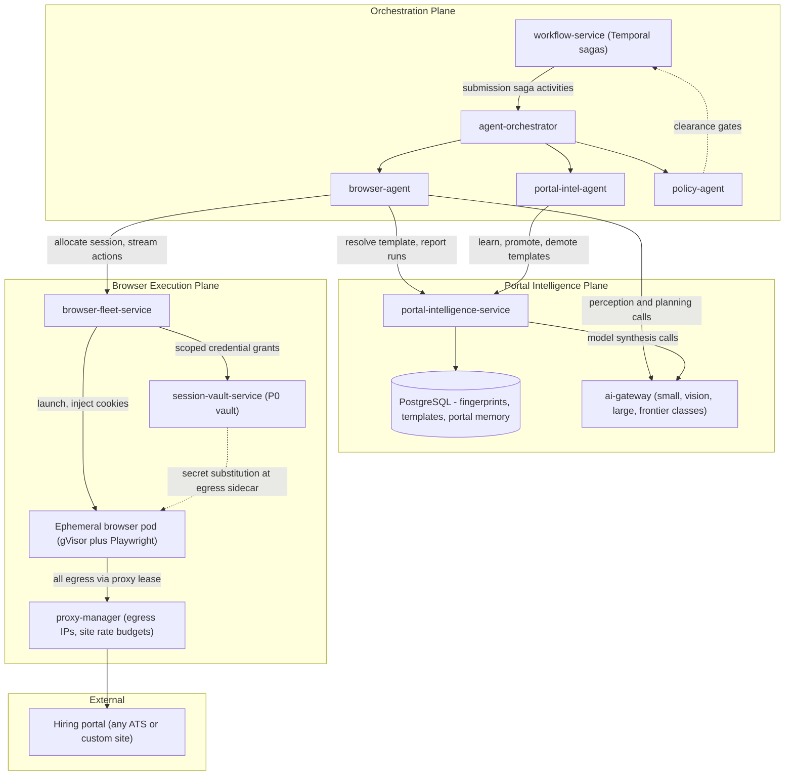
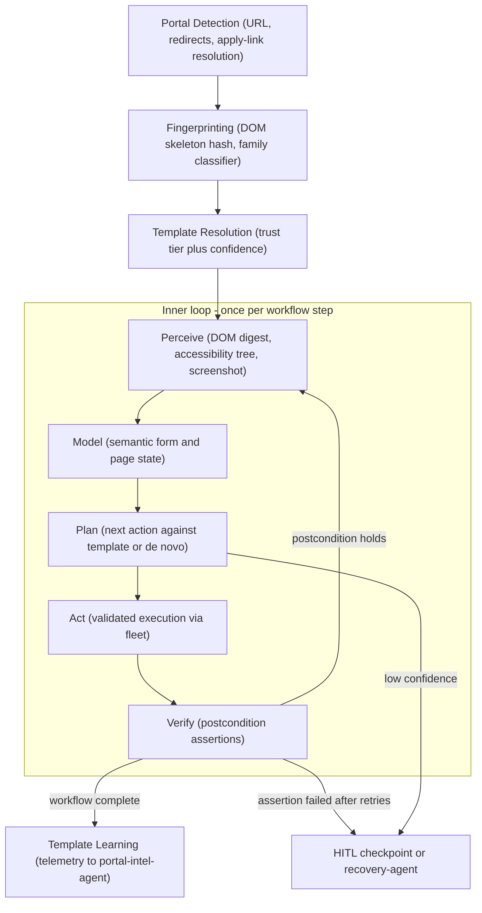
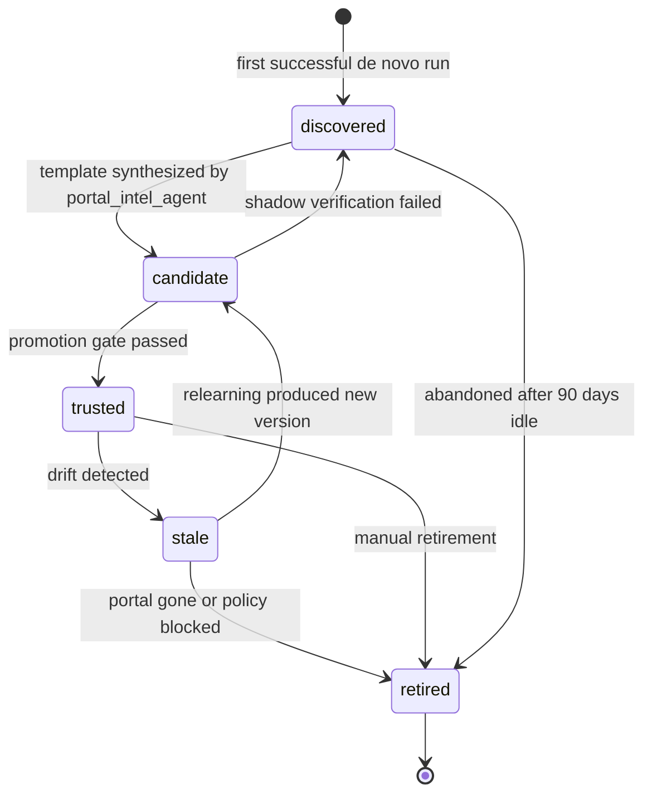
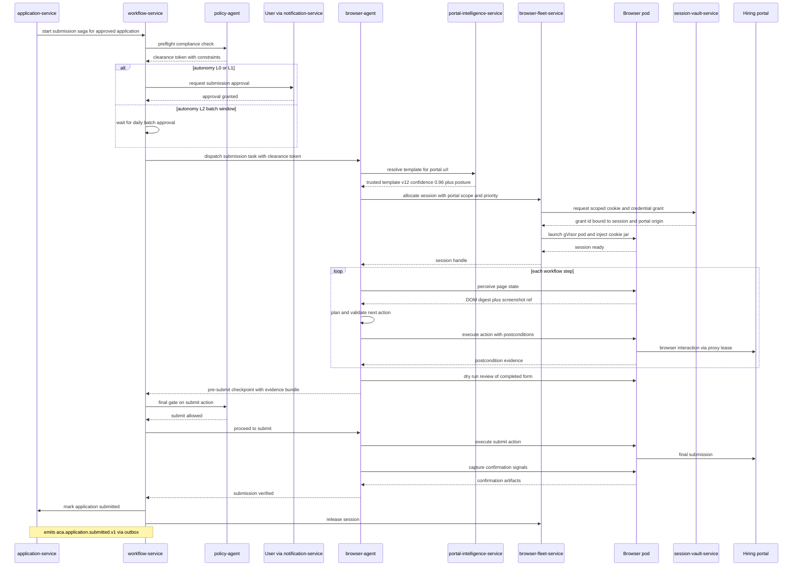
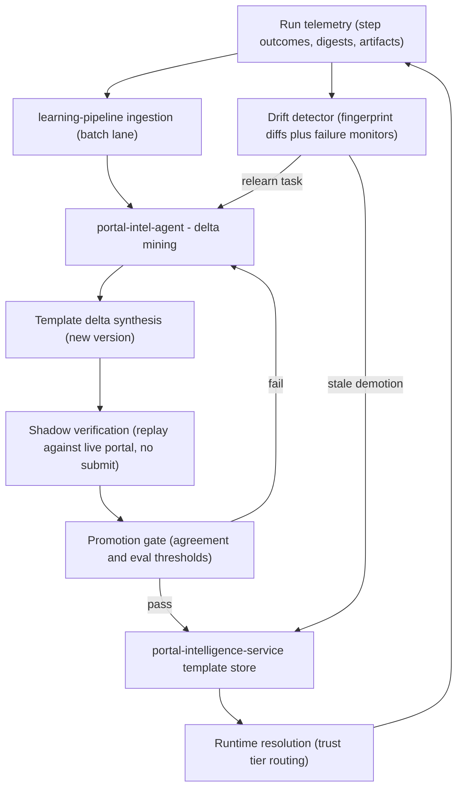

# 16 — Universal Portal Engine

| | |
|---|---|
| Document ID | ACA-SAS-16 |
| Volume | 2 — Core Services |
| Status | Draft v1.0 |
| Depends on | [00 — Architecture Canon](../00-architecture-canon.md) §16, [05 — High-Level Architecture](../volume-1-foundation/05-high-level-architecture.md), [09 — Microservice Architecture](09-microservice-architecture.md), [17 — Browser Fleet](17-browser-fleet.md), [18 — AI Gateway](18-ai-gateway.md), [Volume 7 — Browser Intelligence](../volume-7-browser-intelligence/) |

## 1. Overview

The Universal Portal Engine (UPE) is ACA's flagship differentiator: the subsystem that submits applications on hiring portals it has **never seen before**, and gets measurably better at every portal it touches. The canon's governing rule ([canon §16](../00-architecture-canon.md)) is absolute: **never hardcode per-site automation**. There is no `GreenhouseAdapter` class anywhere in the codebase. Greenhouse, Lever, Ashby, Workday, Taleo, iCIMS, and SuccessFactors are high-confidence *fingerprint families* with mature learned templates — data, not code. The engine that fills a Workday form is byte-for-byte the engine that fills a form on a 12-employee startup's homegrown careers page; the only difference is how much it already knows.

The UPE is not a single service. It is a plane of five canonical components with sharply separated concerns: `portal-intelligence-service` (the brain: fingerprints, templates, navigation graphs, semantic form models), `browser-agent` (the hands: a logical agent executing perceive→model→plan→act→verify steps), `browser-fleet-service` (the body: ephemeral gVisor-sandboxed Playwright pods — [Chapter 17](17-browser-fleet.md)), `session-vault-service` (the keys: P0-encrypted credentials and cookies, injected at egress and never into agent context), and `proxy-manager` (the footprint: egress IPs, per-site rate budgets, geo routing). Two more logical agents complete the picture: `portal-intel-agent` runs the learning loop that turns execution telemetry into reusable `PortalTemplate@version` artifacts, and `policy-agent` gates every consequential action.

This chapter is the **architecture overview** of the UPE: component topology, the generic automation pipeline, fingerprinting and the template trust ladder, the application-submission saga end to end, the template learning feedback loop, the Adapter SDK surface, and success-rate SLO management. Deep dives — perception model internals, template representation and diffing, anti-bot and CAPTCHA posture, portal memory, navigation-graph search — live in [Volume 7 — Browser Intelligence](../volume-7-browser-intelligence/). The fleet's pool mechanics, pod anatomy, and cost model live in [Chapter 17](17-browser-fleet.md).

The stakes justify the complexity budget. Application submission is the single most consequential action ACA takes on a user's behalf: it is irreversible, identity-bearing, and rate-limited by the outside world. Every design decision below traces back to three constraints: the canon's guardrail principle (act only with the user's identity, consent, and policy approval), the Browser workflow success rate SLO (≥ 92% weekly on known portals, [canon §14](../00-architecture-canon.md)), and unit economics (a submission must cost cents, not dollars, which forces the escalation ladder of [canon §10](../00-architecture-canon.md) into the heart of the pipeline).

## 2. Component Topology



### 2.1 Component responsibility matrix

The UPE's separation of concerns is the load-bearing design decision. Each component can be scaled, hardened, and reasoned about independently; no component holds more than one kind of dangerous material (credentials, model access, or network egress).

| Component | Kind | Purpose in the UPE | Owns | Never does | Deep dive |
|---|---|---|---|---|---|
| `portal-intelligence-service` | Microservice (Python/FastAPI) | Fingerprint registry, template store, trust-ladder state machine, navigation graphs, semantic form models, portal memory | portal fingerprints, templates, portal memory (PostgreSQL) | Touch a browser; hold credentials | §5, [Vol 7](../volume-7-browser-intelligence/) |
| `browser-agent` | Logical agent on `agent-orchestrator` | Execute one portal workflow step-by-step: perceive→model→plan→act→verify | Nothing persistent (run state in Temporal + memory-service) | See raw credentials; call providers directly (all via `ai-gateway`) | §3, §6 |
| `portal-intel-agent` | Logical agent | Mine run telemetry into template deltas; shadow-verify; drive promotions/demotions | Nothing persistent (writes via `portal-intelligence-service` API) | Execute live submissions | §7 |
| `policy-agent` | Logical agent | Pre-action compliance: site policy posture, user consent, autonomy level, approval requirements | Nothing (reads `policy-service` bundles) | Get bypassed — saga is structured so submit cannot be reached without its token | §6 |
| `browser-fleet-service` | Microservice (TypeScript/NestJS control plane, Node runner) | Session scheduling, pod lifecycle, artifact capture, health/retry | browser sessions (ephemeral), fleet state | Interpret pages or plan actions | [Ch 17](17-browser-fleet.md) |
| `session-vault-service` | Microservice | P0 credential/cookie custody; scoped grants; egress-time secret substitution | encrypted vault (per-user DEK, per-tenant KEK) | Release plaintext to any agent context | [Vol 5](../volume-5-security/), [Ch 17 §7](17-browser-fleet.md) |
| `proxy-manager` | Microservice (Go) | Egress IP pools, per-site rate budgets, geo routing, IP reputation health | proxy pool state | Make policy decisions (enforces budgets set by `policy-service`) | [Vol 7](../volume-7-browser-intelligence/) |

Interactions are asymmetric by design: the brain (`portal-intelligence-service`) is consulted before and after execution but is **not on the per-step hot path** — `browser-agent` downloads the resolved template once per session and executes against it locally, reporting telemetry asynchronously. This keeps a template-store brownout from stalling in-flight sessions (see §10, F3).

## 3. The Generic Automation Pipeline

The canon fixes the stage sequence: Portal Detection → Fingerprinting → Perception → Semantic Form/Workflow Model → Action Planning → Validated Execution → Verification → Template Learning. The first two and the last are session-boundary stages; the middle five form the **inner loop** that `browser-agent` runs once per workflow step — the perceive→model→plan→act→verify cycle, which is the canonical agent loop of [canon §9](../00-architecture-canon.md) specialized for browsers.



### 3.1 Stage contracts and model routing

Every stage has a defined input/output contract and a position on the escalation ladder ([canon §10](../00-architecture-canon.md)). The ladder is what makes the UPE economically viable: a trusted-template run on a known Greenhouse tenant should complete with **zero large-model calls**, while a never-seen portal may legitimately escalate to `frontier` (behind the routing-policy flag).

| Stage | Input | Output | Escalation ladder position |
|---|---|---|---|
| Portal Detection | Job apply URL from `job-intelligence-service` | Canonical portal URL, redirect chain, embedded-iframe resolution | Deterministic rules only |
| Fingerprinting | Landing DOM + URL structure | `fingerprint_id`, family classification, confidence | Rules + exact hash match → `small` classifier fallback |
| Perception | Live page via fleet | Page digest: pruned DOM, accessibility tree, screenshot ref, detected controls | Deterministic extraction; `vision` class only when DOM is hostile (canvas forms, heavy obfuscation) |
| Semantic Modeling | Page digest | Semantic form model: fields → profile-schema bindings, constraints, step graph position | Template lookup (free) → `small` field classifier → `medium` for ambiguous bindings |
| Action Planning | Semantic model + template + goal | Next action batch with preconditions and postconditions | Template replay (free) → `large` planner → `frontier` for novel multi-step workflows (flagged) |
| Validated Execution | Action batch | Applied actions + step artifacts | No model calls — mechanical, via fleet action API |
| Verification | Post-action page digest + postconditions | Pass/fail per assertion, confirmation signals | Deterministic assertions → `small`/`vision` judge for fuzzy confirmations |
| Template Learning | Full run telemetry | Template deltas, stat updates, drift signals | Batch lane (`≈50%` cost, ≤ 24 h SLA) — never inline |

Three invariants on the inner loop:

1. **Plan against the model, act against the page.** Actions reference semantic descriptors (`field:legal_name`, `control:submit_button`), which the execution layer resolves to concrete locators at act time. This indirection is what lets one template survive DOM churn that would break a recorded CSS selector script.
2. **Every action carries postconditions.** An action without a verifiable postcondition is rejected at plan validation. "Click submit" is really "click `control:submit_button`; expect URL change or confirmation banner within 10 s". This turns silent failures into detected failures — the difference between 92% *measured* success and 92% *claimed* success.
3. **Untrusted content stays untrusted.** All portal-derived text entering any prompt is wrapped in `untrusted_content` markers per [canon §13](../00-architecture-canon.md); the planner's tool allowlist cannot be extended by page content; `security-agent` screens perception outputs for injection patterns before they reach planning context.

## 4. Portal Fingerprinting and the Template Trust Ladder

### 4.1 Fingerprint composition

A **portal fingerprint** identifies "the same application experience" across visits, tenants of the same ATS, and cosmetic redesigns. It is a layered composite, not a single hash — each layer degrades gracefully:

| Layer | Content | Stability | Use |
|---|---|---|---|
| L1 — URL structure | Normalized host + path grammar (`boards.greenhouse.io/{org}/jobs/{id}`) | High | Family fast-path |
| L2 — DOM skeleton | SHA-256 of pruned structural tree (tags + landmark roles + form topology, text/styling stripped) | Medium | Exact-version match; drift diffing |
| L3 — Form signature | Ordered set of semantic field types detected on each step | Medium-high | Template applicability check |
| L4 — Behavioral probes | Framework markers, XHR patterns, anti-bot vendor signatures | Low-medium | Execution-posture selection (pacing, proxy class) |

Fingerprint matching yields a `(family, version, confidence)` triple. Confidence ≥ 0.90 on L1+L2 selects the family's template set directly; 0.70–0.90 runs the template in **hybrid mode** (template proposes, planner verifies each binding before acting — one extra `small` call per step); < 0.70 is treated as a novel portal. The 0.90 threshold is set where historical replay shows template step-agreement exceeds 99%; the 0.70 floor is where agreement drops below 90% and hybrid verification stops paying for itself.

### 4.2 Trust ladder

The canon fixes the ladder: `discovered` → `candidate` (shadow-verified) → `trusted` (auto-usable) → `stale` (drift detected), with automatic re-learning. This chapter adds one terminal state, `retired`, for portals that disappear or are policy-blocked (recorded in §15 as a canon-extension decision).



Transition gates, with rationale for every number:

| Transition | Gate | Rationale |
|---|---|---|
| `discovered → candidate` | `portal-intel-agent` synthesizes a template from ≥ 3 successful de novo runs with consistent step graphs | One run can succeed by luck; three consistent runs establish a repeatable path |
| `candidate → trusted` | ≥ 20 shadow verifications with ≥ 95% step-level agreement AND ≥ 10 supervised live runs with 100% submission verification | 20 shadows bound the agreement estimate's error to ±10% at 95% confidence; live runs prove the last mile (submission + confirmation) that shadows cannot |
| `candidate → discovered` | Step agreement < 80% over any 10-shadow window | Below 80% the template is guessing; regenerate rather than patch |
| `trusted → stale` | Rolling 7-day success < 85% (min 20 runs) OR L2 fingerprint diff score > 0.35 OR 3 consecutive verification failures | 85% is the family error budget floor (§9); 0.35 diff empirically correlates with structural redesigns; 3 consecutive failures fast-paths obvious breakage without waiting for the window |
| `stale → candidate` | Re-learning run produces new template version passing synthesis checks | Auto re-learning per canon; new version restarts shadow verification |
| `* → retired` | Portal 404/410 for 14 days, `policy-service` block, or operator action via `admin-service` | Terminal; retains history for audit |

Trust tier drives runtime behavior directly: `trusted` templates execute at the user's autonomy level with the free replay path; `candidate` templates run only in shadow mode or under mandatory HITL (`L1`-equivalent regardless of user setting); `discovered`/novel portals run the full de novo pipeline with mandatory HITL and are excluded from the known-portal SLO denominator (§9); `stale` templates are immediately demoted to hybrid mode while re-learning runs.

### 4.3 Drift detection

Drift is detected from two independent signals, because each alone has a failure mode: fingerprint diffs catch redesigns *before* failures accumulate (proactive re-fingerprint on a 7-day cadence per active family, prioritized by run volume), while failure-rate monitors catch behavioral drift that leaves the DOM skeleton intact (server-side validation changes, new required fields, anti-bot escalation). Both feed the same `aca.portal.drift.detected.v1` event; `portal-intel-agent` triages, schedules re-learning, and the trust ladder does the rest.

## 5. portal-intelligence-service

**Purpose.** The system of record for everything the platform knows about portals: fingerprints, `PortalTemplate@version` artifacts, navigation graphs, semantic form models, per-portal execution posture (pacing, proxy class, quirks), and portal memory (aggregated outcomes). It is a Python/FastAPI service (AI-plane language per [canon §3](../00-architecture-canon.md)) because template synthesis and fingerprint classification share ML tooling with the learning stack.

**Responsibilities.**

- Fingerprint registry: ingest, classify, version, and diff fingerprints; family management.
- Template store: versioned CRUD, trust-ladder state machine enforcement (all transitions go through it), template resolution API (`portal_url → best template + tier + confidence`).
- Navigation graphs: multi-step workflow graphs per family (login → profile → questions → review → submit), used by the planner for lookahead.
- Portal memory: rolling success/failure stats, error taxonomies, field-level friction data per portal — the substrate for §7's learning loop and §9's SLO management.
- Template pack distribution: signed pack export/import for the Adapter SDK (§8).

**Interactions.** Read-heavy from `browser-agent` (template resolution at session start), write-heavy from `portal-intel-agent` (telemetry digests, template deltas), administrative from `admin-service` (fleet ops review, manual retirement), and event-driven from `learning-pipeline` (offline eval results gating promotions).

### 5.1 API surface (internal gRPC; REST projection for admin)

| RPC / Route | Caller | Purpose | Notes |
|---|---|---|---|
| `ResolveTemplate(portal_url, job_context)` | `browser-agent` | Fingerprint match + best template + tier + execution posture | p99 < 150 ms; serves from Redis-backed resolution cache |
| `GetTemplate(template_id, version)` | `browser-agent` | Full template artifact download | Immutable, CDN-cacheable internally |
| `ReportRun(run_digest)` | `browser-agent` via outbox | Async run telemetry ingestion | Fire-and-forget; never blocks a session |
| `SubmitTemplateDelta(delta)` | `portal-intel-agent` | Proposed template change from learning | Enters shadow-verification queue |
| `TransitionTrust(template_id, transition, evidence)` | `portal-intel-agent`, `admin-service` | Trust-ladder transitions with evidence bundle | State machine validates legality; all transitions audit-logged |
| `GET /v1/admin/portals`, `/v1/admin/templates/{id}` | `admin-service` | Ops review UI | Paginated per [canon §7](../00-architecture-canon.md) |
| `POST /v1/admin/template-packs:import` | `admin-service` | Signed pack import (SDK, §8) | Signature + review pipeline mandatory |

### 5.2 Data model (owned schema, excerpt)

```sql
CREATE TABLE portal (
  id            uuid PRIMARY KEY,           -- UUIDv7
  family        text NOT NULL,              -- 'greenhouse', 'workday', 'custom', ...
  canonical_url text NOT NULL,
  status        text NOT NULL,              -- active | retired
  exec_posture  jsonb NOT NULL DEFAULT '{}',-- pacing, proxy class, quirks
  created_at    timestamptz NOT NULL DEFAULT now()
);

CREATE TABLE portal_fingerprint (
  id             uuid PRIMARY KEY,
  portal_id      uuid NOT NULL REFERENCES portal(id),
  l1_url_grammar text NOT NULL,
  l2_dom_hash    bytea NOT NULL,            -- SHA-256 of pruned skeleton
  l3_form_sig    jsonb NOT NULL,            -- ordered semantic field types per step
  l4_probes      jsonb NOT NULL DEFAULT '{}',
  observed_at    timestamptz NOT NULL,
  UNIQUE (portal_id, l2_dom_hash)
);

CREATE TABLE portal_template (
  id             uuid PRIMARY KEY,
  portal_id      uuid NOT NULL REFERENCES portal(id),
  version        int  NOT NULL,             -- PortalTemplate@version
  trust_tier     text NOT NULL,             -- discovered|candidate|trusted|stale|retired
  artifact_ref   text NOT NULL,             -- S3 ref: steps, bindings, assertions, nav graph
  source         text NOT NULL,             -- learned | pack:<publisher>
  created_by     text NOT NULL,             -- portal-intel-agent | pack import
  promoted_at    timestamptz,
  UNIQUE (portal_id, version)
);

CREATE TABLE template_run_stat (            -- portal memory, time-partitioned
  template_id    uuid NOT NULL,
  window_start   timestamptz NOT NULL,
  runs           int NOT NULL,
  successes      int NOT NULL,
  step_failures  jsonb NOT NULL,            -- error taxonomy counts
  p95_steps      int,
  PRIMARY KEY (template_id, window_start)
) PARTITION BY RANGE (window_start);
```

RLS note: `portal`, `portal_fingerprint`, and `portal_template` are **platform-global** (portals are not tenant data); `template_run_stat` aggregates are global with tenant-attributed raw telemetry retained in `learning-pipeline` under standard tenancy. This is an explicit exception to the every-row-`tenant_id` default and is recorded in §15.

### 5.3 Events

| Topic | Key | Producer → Consumers | Payload sketch |
|---|---|---|---|
| `aca.portal.fingerprinted.v1` | `portal_id` | portal-intelligence-service → learning-pipeline, analytics-service | portal_id, family, confidence, new_version |
| `aca.portal.template.promoted.v1` | `portal_id` | portal-intelligence-service → agent-orchestrator, analytics-service | template_id, version, from_tier, to_tier, evidence_ref |
| `aca.portal.template.stale.v1` | `portal_id` | portal-intelligence-service → portal-intel-agent, admin-service | template_id, trigger (drift_diff, failure_rate, consec_fail) |
| `aca.portal.drift.detected.v1` | `portal_id` | portal-intelligence-service → portal-intel-agent | diff_score, failing_steps, sample_run_ids |

All four are chapter-defined domain topics following the [canon §8](../00-architecture-canon.md) convention.

**Failure posture, scaling, monitoring** for this service are consolidated in §10–§13; the one component-specific point worth stating here: template resolution is the only latency-sensitive path, and it is protected by a Redis resolution cache (5-min TTL, event-invalidated on promotion/demotion) plus a `browser-agent`-side last-known-good template cache, so the service can be fully down without failing in-flight sessions — new session starts degrade per §10 F3.

## 6. Application Submission Saga

Submission is a Temporal saga owned by `workflow-service` ([canon §8](../00-architecture-canon.md): sagas are orchestrated, never choreographed). The saga encodes the canon's four mandatory gates — policy-agent clearance, autonomy-level check, dry-run validation, post-submit verification — as **structural** checkpoints: the workflow definition has no code path to the submit activity that bypasses them.



### 6.1 Checkpoint semantics

| Checkpoint | Enforced by | Failure behavior |
|---|---|---|
| Preflight clearance | `policy-agent`: site automation posture (ToS awareness), user consent record for this portal class, tenant kill-switch state, rate budget headroom via `proxy-manager` | Hard stop → saga ends `blocked_by_policy`; user notified with reason; no browser session ever allocated |
| Autonomy gate | User's per-action-class setting ([canon §9](../00-architecture-canon.md); submission defaults to **L1**) | L0/L1: `aca.agent.approval.requested.v1` → approval or 72 h expiry; L2: parked to batch window; L3: proceeds within policy budget |
| Pre-submit dry run | `browser-agent` presents filled-form evidence (field-by-field diff against intended values, screenshot) before the irreversible action | Mismatch → bounded repair loop (max 2 repair cycles); still failing → HITL escalation regardless of autonomy level |
| Final policy gate | `policy-agent` re-check with the actual evidence bundle (clearance may have expired; budget may be exhausted mid-flight) | Deny → compensation, never submit |
| Post-submit verification | Confirmation capture: confirmation page fingerprint, confirmation number extraction, email receipt watch (via `email-agent`, 24 h window), portal status re-check | No signal → `submitted_unverified` state; `application-tracker-agent` escalates verification; counts **against** the success SLO |

### 6.2 Compensation table

Temporal makes compensation explicit per activity:

| Failed activity | Compensation |
|---|---|
| Session allocation | Release vault grant; retry per [Ch 17 §9 retry engine](17-browser-fleet.md) with fresh pod |
| Mid-form step failure (after retries) | Capture failure artifacts; release session; classify (drift vs transient vs anti-bot); drift → `aca.portal.drift.detected.v1`; saga retries once on transient, else parks for `recovery-agent` |
| Submit action failed | **Duplicate-submission guard**: verification probe determines whether the submission landed before any retry; ambiguous → `submitted_unverified`, never blind-retry an irreversible action |
| Post-submit verification timeout | No compensation (submission may exist); mark `submitted_unverified`, hand to `application-tracker-agent` |
| Saga-level abort | Cookie jar re-sealed to vault (session may have refreshed tokens worth keeping); artifacts retained 90 d; `aca.application.status.changed.v1` with terminal reason |

## 7. Template Learning Feedback Loop

Every run — success or failure — is raw material. The loop turns execution telemetry into template improvements without ever risking a live user application on an unproven change.



Design decisions:

- **Shadow verification is non-negotiable and non-submitting.** A shadow run replays the candidate template against the live portal up to — never through — the submit boundary, on `maintenance`-priority fleet capacity ([Ch 17 §6](17-browser-fleet.md)) within the portal's rate budget. Shadow traffic is capped at 5% of a portal's rate budget so learning never crowds out user work.
- **Learning is batch-lane.** Delta mining and synthesis run on the provider batch APIs (≈50% cost, ≤ 24 h SLA per [canon §10](../00-architecture-canon.md)). Portal drift on a high-volume family can be expedited by `portal-intel-agent` raising priority, but the default posture is cheap and slow.
- **Promotions are evidence-gated, not confidence-gated.** The gate consumes counted shadow agreements and supervised-live results (§4.2 thresholds), plus `learning-pipeline` offline evals where template changes touch semantic bindings. A model *feeling* confident is not evidence.
- **Failures teach more than successes.** The error taxonomy in `template_run_stat.step_failures` (selector-miss, validation-reject, unexpected-page, anti-bot-challenge, timeout) directly prioritizes the mining queue; a selector-miss cluster on one step is a cheap, high-yield fix.
- **Global learning, tenant-clean.** Templates are platform-global (§5.2); telemetry entering the mining pipeline is stripped of P1/P2 field *values* — the learner sees that `field:phone` bound successfully, never the phone number.

## 8. Adapter SDK / Plugin Framework

Known ATS families are data, so third parties (and ACA's own portal team) improve coverage by shipping **template packs**, not code. The Adapter SDK is the authoring, validation, and distribution surface for those packs.

### 8.1 Pack surface

```yaml
apiVersion: aca.portal/v1
kind: TemplatePack
metadata:
  name: greenhouse-core
  publisher: aca-first-party        # or verified third-party publisher id
  version: 3.4.1
spec:
  fingerprintFamily: greenhouse
  minEngineVersion: "1.8"
  fingerprints:                     # L1-L3 layers; L4 probes optional
    - urlGrammar: "boards.greenhouse.io/{org}/jobs/{id}"
      domSkeletonRefs: [ "sha256:..." ]
  templates:
    - name: standard-apply
      navigationGraph: graphs/standard.json
      steps:
        - id: basics
          bindings:                 # semantic descriptors -> profile schema
            - field: legal_name
              descriptor: { role: textbox, labelPattern: "(full|legal) name" }
              source: profile.legal_name
          assertions:
            - kind: field_reflects_value
      executionPosture: { pacing: humanlike-standard, proxyClass: residential }
  conformance:
    fixtures: fixtures/            # recorded page digests for offline validation
signing:
  method: cosign
  identity: publisher-keyless-oidc
```

The pack format is **declarative only in Phase 1**: semantic descriptors, bindings, assertions, navigation graphs, posture hints. No executable code — a pack cannot exfiltrate, cannot call tools, cannot widen an egress allowlist. Phase 2 adds sandboxed WASM hook functions for gnarly cases (custom widget interaction protocols), executed in the runner with no network, no filesystem, capability-passed page handles only (recorded in §14).

### 8.2 Distribution pipeline

| Stage | Mechanism | Rationale |
|---|---|---|
| Authoring | SDK CLI: scaffold from recorded runs, local validation against fixtures | Packs start from real telemetry, not hand-written selectors |
| Signing | Sigstore cosign; publisher identity via OIDC | Supply-chain integrity for artifacts that drive browsers holding user credentials |
| Submission | `POST /v1/admin/template-packs:import` (first-party) or partner portal via `public-api-service` (third-party) | Single choke point |
| Review | Automated: schema + conformance fixtures + static policy lint (no ToS-violating postures). Manual: required for third-party packs | A malicious "template" is an attack on users' identities; human review is cheap relative to that risk |
| Rollout | Imported templates enter the ladder at `candidate` — **never** `trusted` | Trust is earned by shadow verification on our infrastructure, regardless of publisher |
| Attribution | `portal_template.source = pack:<publisher>`; run stats reported back to publishers via `public-api-service` webhooks | Ecosystem feedback loop |

The critical rule is the rollout row: the trust ladder is the same for learned and imported templates. The SDK changes who writes the first draft; it never changes who verifies.

## 9. Success-Rate SLO Management

The canon sets one number: **browser workflow success rate ≥ 92% weekly on known portals**. This section defines the denominator, decomposes the budget, and specifies the automated response when a component eats it.

**Definitions.** A run counts as *success* only on verified submission (confirmation signal captured, §6.1). *Known portals* = portals whose resolved template was `trusted` at session start. Novel and `candidate`-tier runs are tracked separately (target ≥ 70% with mandatory HITL) and excluded from the 92% denominator — otherwise coverage expansion would be punished, and the team would be incentivized to stop learning new portals.

**Budget decomposition** (weekly, reference allocation):

| Failure class | Budget share of the 8% | Owner | Primary lever |
|---|---|---|---|
| Template correctness (drift, bad bindings) | 3.0% | `portal-intelligence-service` + `portal-intel-agent` | Faster drift → re-learn cycle |
| Fleet/infra (pod, proxy, timeout) | 1.5% | `browser-fleet-service` | Retry engine, pool health ([Ch 17](17-browser-fleet.md)) |
| Anti-bot friction (challenges, blocks) | 1.5% | `proxy-manager` + posture tuning | IP reputation, pacing ([Vol 7](../volume-7-browser-intelligence/)) |
| Portal-side transient (5xx, maintenance) | 1.0% | External (measured, not owned) | Retry with backoff |
| Verification gaps (`submitted_unverified`) | 1.0% | `browser-agent` + `application-tracker-agent` | Confirmation-signal coverage |

**Automated management.** Per-family success monitors (1 h and 7 d windows) drive the trust ladder (§4.2) — demotion to `stale` is the *automatic* circuit breaker. Above the family level, the degradation ladder for a failing family is: trusted template → previous trusted version (kept warm for instant rollback) → hybrid mode → de novo pipeline with HITL → **manual apply assist** (user does it, ACA pre-fills what it can via clipboard/artifact handoff). Every rung trades cost and user effort for reliability; the rung is chosen by `agent-orchestrator` from the family's live stats, and every downgrade emits an event consumed by `analytics-service` and the ops dashboard. Burn-rate alerts follow the canon: 2%/1 h and 5%/6 h on the SLO budget page `browser-fleet-service` and portal on-call jointly.

## 10. Failure Scenarios

| # | Scenario | Blast radius | Detection | Response |
|---|---|---|---|---|
| F1 | Major ATS family redesign (e.g., Workday tenant UI migration wave) | All submissions on that family | Fingerprint diff score spike; consec-failure fast path (§4.3) | Auto-demote to `stale`; hybrid mode; expedited re-learning; if success < 70%, family switched to HITL-assist; users informed of delays |
| F2 | Anti-bot escalation on a family (new vendor, tightened thresholds) | Family submissions; possibly IP pool reputation | L4 probe changes; challenge-rate metric; `aca.browser.action.failed.v1` taxonomy | `proxy-manager` rotates pool class; posture switched to slower pacing; volume shed to L1 HITL; see [Vol 7](../volume-7-browser-intelligence/) anti-bot chapter |
| F3 | `portal-intelligence-service` down | New session starts (in-flight sessions unaffected — templates cached at start) | Health checks; resolution error rate | `browser-agent` serves last-known-good template cache (24 h validity); unknown portals queue rather than run de novo blind; saga activities retry with Temporal backoff |
| F4 | Prompt-injection attempt via portal page content | Single session (defense in depth) | `security-agent` screening flags; output validator anomalies | Session terminated, artifacts quarantined for review, portal flagged in memory, `aca.audit.event.v1` |
| F5 | Duplicate submission risk (submit succeeded but response lost) | Single application; user trust | Submit activity timeout with ambiguous state | §6.2 guard: verification probe before any retry; ambiguous → `submitted_unverified`, tracker follow-up, never blind retry |
| F6 | Template pack with malicious or broken content passes automated checks | Bounded by `candidate` cap + declarative format | Shadow-verification failures; manual review (third-party mandatory) | Pack rejected/revoked (cosign revocation list); publisher suspended; incident review of the automated gate |
| F7 | Learning loop poisoning (portal serves adversarial pages to skew templates) | Family template quality | Shadow agreement vs live-run divergence; eval-set regression in `learning-pipeline` | Promotion gate blocks (evidence-gated); affected fingerprints quarantined; mining excludes flagged sources |
| F8 | Kill switch engaged (user, tenant, or platform scope) | Scope-dependent | `policy-service` bundle push | Preflight gate fails closed; in-flight sagas checkpoint and park before the next consequential action; resumable after clearance |

## 11. Scaling Strategy

The UPE's scale axes are independent by design:

- **Session throughput** is the fleet's problem — [Ch 17 §Scaling](17-browser-fleet.md) covers KEDA on queue depth and the 100k sessions/day capacity model. The UPE contributes the *demand shape*: autopilot cadence from `scheduler-agent` is deliberately smoothed (jittered per-user windows) to keep peak/mean below 4×.
- **Template resolution** scales as a read-mostly cache problem: Redis resolution cache + immutable template artifacts on S3 with internal CDN. Target: 50k resolutions/day at p99 < 150 ms on 3 service replicas; headroom is horizontal.
- **Learning throughput** scales with the batch lane and is deliberately deprioritized under load — stale templates degrade to hybrid mode (more `small` calls per step) rather than blocking. The cost of slow learning is a temporary success-rate dip inside the error budget, not an outage.
- **Model spend** scales sub-linearly with volume because volume concentrates on trusted templates (zero-model replay path). The dangerous cost regime is a drift wave (F1) forcing de novo runs at scale; `cost-controller` budgets cap frontier-class usage per family per day, and the degradation ladder (§9) sheds to HITL before spend runs away.

## 12. Security Considerations

Consolidated highlights; full treatment in [Volume 5](../volume-5-security/) and the browser-isolation chapter of [Volume 7](../volume-7-browser-intelligence/):

- **Credential custody.** P0 material never enters agent context ([canon §13](../00-architecture-canon.md)). `browser-agent` plans `type {{vault:password}}`; substitution happens in the pod's session-vault egress sidecar; screenshots during secure entry are redacted at capture ([Ch 17 §7](17-browser-fleet.md)).
- **Injection defense.** All portal content is `untrusted_content`-wrapped; instruction/data separation in every prompt; per-agent tool allowlists that page content cannot extend; `security-agent` screening on perception outputs; output validators on planner actions (an action targeting a descriptor not present in the semantic model is rejected mechanically).
- **Consequential-action integrity.** The saga's gates are structural (§6); the submit activity requires an unexpired `policy-agent` clearance token bound to the specific application id — replay across applications is cryptographically impossible.
- **Supply chain.** Template packs are signed (cosign), reviewed, and capability-less in Phase 1 (§8.2); the trust ladder quarantines all imported content at `candidate`.
- **Compliance posture.** `policy-agent` preflight encodes per-site automation posture from `policy-service`'s registry — sites where automation is not permitted are hard-blocked at preflight and the UPE degrades to manual apply assist. Disclosure requirements (where a portal requires disclosing automated assistance) are enforced as template-level mandatory steps.
- **Audit.** Every trust transition, clearance, approval, submission, and pack import emits `aca.audit.event.v1` into the hash-chained audit log.

## 13. Observability

Tracing: one trace spans the saga — `workflow-service` activity spans, `browser-agent` step spans, fleet action spans, and `ai-gateway` call spans share the `traceparent` propagated through events per [canon §14](../00-architecture-canon.md). The *evidence bundle* (screenshots, DOM digests, field diffs) is linked from the trace, making every submission fully replayable in review tooling.

| Metric | Type | Labels | Alert |
|---|---|---|---|
| `upe_submission_success_ratio` | gauge (windowed) | family, trust_tier, autonomy | SLO burn 2%/1h, 5%/6h |
| `upe_template_resolution_latency_ms` | histogram | outcome | p99 > 150 ms |
| `upe_trust_transitions_total` | counter | from, to, trigger | `trusted→stale` spike (drift wave) |
| `upe_steps_per_run` | histogram | family | p95 drift ±30% vs baseline (template inefficiency or portal change) |
| `upe_model_calls_per_run` | histogram | family, model_class | trusted-tier mean > 2 (replay path regressing) |
| `upe_hitl_checkpoints_total` | counter | reason, outcome | approval expiry rate > 20% (users ignoring prompts — product signal) |
| `upe_shadow_agreement_ratio` | gauge | family, template_version | < 0.95 blocks promotion (gate metric) |
| `upe_verification_gap_ratio` | gauge | family | `submitted_unverified` > 1% weekly |
| `upe_cost_per_submission_usd` | histogram | family, trust_tier | trusted-tier p50 > $0.25 reference threshold |

Dashboards: the **Portal Health** board (per-family success, trust-tier mix, drift queue depth, budget burn) is the primary on-call surface; the **Learning Throughput** board tracks mining backlog, shadow queue, and promotion latency (target: drift-to-recovered p50 < 48 h for top-20 families, because those families carry ~80% of volume).

## 14. Future Improvements

- **Phase 2 — WASM hook functions** in template packs for custom-widget protocols, sandboxed (no network/filesystem, capability-passed handles) — extends declarative coverage without reopening the arbitrary-code question.
- **Cross-family generalization:** train the semantic form modeler on the full template corpus so novel portals start from a learned prior rather than zero — measured as de novo first-run success (target lift from ~55% to 75%).
- **Speculative pre-fingerprinting:** fingerprint portals at job-discovery time (from `job-intelligence-service` crawl artifacts) so submission-time resolution is always warm.
- **User-visible trust surface:** expose per-portal automation confidence in the product ("we've successfully applied here 1,240 times") — trust ladder as a feature.
- **Federated template stats for enterprise cells:** dedicated cells contribute anonymized run stats to global portal memory without raw telemetry leaving the cell.

## 15. Alternatives Considered & Tradeoffs

### 15.1 Why not hardcoded per-ATS adapters (the central tradeoff)

The obvious alternative — and the one every competitor ships first — is a hand-written adapter per ATS: `GreenhouseAdapter`, `WorkdayAdapter`, each encoding selectors and flows in code. It was rejected deliberately, and the reasoning deserves honesty because the rejected option is *genuinely better* on two axes:

| Axis | Hardcoded adapters | Universal engine (chosen) |
|---|---|---|
| Time-to-first-portal | Days per adapter — **wins** | Months to build the engine |
| Per-run determinism on a stable portal | Near-perfect — **wins** | 96%+ on trusted templates, verified not assumed |
| Coverage of the long tail (custom career pages, ~40% of postings) | Never — engineering cost per site exceeds value | The point of the design: same engine, learned template |
| Breakage response | Human notices → engineer patches → deploy (days; scales with adapter count × change rate) | Drift detected → auto-demote → re-learn → shadow-verify → promote (target < 48 h, no deploy, scales with fleet capacity) |
| Marginal cost of portal #5,000 | Linear in engineering headcount | Near-zero engineering; compute-bounded |
| Failure visibility | Silent until user complains | Postconditions make failure measurable per step |
| Organizational scaling | Adapter team grows with the internet | Portal team size ~constant; corpus grows |

The decision rule: ACA's product thesis requires the long tail (a job the user wants is on whatever portal it is on), and requires breakage response that does not scale with human headcount. Both are structurally impossible with hardcoded adapters. The costs accepted in exchange: a large upfront engine investment, per-run cost and latency overhead on portals where a hardcoded adapter would be trivially fast, and a probabilistic system that demands the entire trust-ladder/verification apparatus of this chapter to be safe. Mature templates recover most of the determinism (the replay path is effectively a *generated* adapter — the difference is that a machine wrote it, a machine verifies it, and a machine repairs it).

### 15.2 Other alternatives

| Decision | Alternative | Why rejected |
|---|---|---|
| Learned templates in `portal-intelligence-service` | Pure LLM-per-step agent, no templates (maximum generality) | 10–50× model cost per run, non-repeatable failures, unbondable latency; templates amortize intelligence into cheap replay |
| Templates as data + trust ladder | Generated code artifacts (engine emits Playwright scripts) | Code artifacts reintroduce the adapter problem (review, sandboxing, drift-patching of code); data templates are diffable, statically checkable, and safely shadow-verifiable |
| Shadow verification on live portals | Verification against recorded fixtures only | Fixtures go stale precisely when portals drift — the moment verification matters most; fixtures retained for *offline* regression only |
| Trust ladder with counted evidence gates | Confidence-score promotion (model self-assessment) | Self-assessed confidence is uncalibrated on distribution shift, which is exactly what drift is |
| `retired` terminal state (canon extension) | Reuse `stale` for dead portals | Conflates "needs re-learning" with "must never re-learn"; drift tooling would perpetually retry dead portals |
| Platform-global portal tables without `tenant_id` RLS (canon exception, §5.2) | Tenant-scoped portal knowledge | Portals are facts about the internet, not tenant data; per-tenant duplication would fragment the learning corpus — the network effect *is* the moat. Raw telemetry attribution remains tenant-scoped in `learning-pipeline` |
| Saga-structured gates in Temporal | Gate checks inside `browser-agent` logic | Agent-internal checks are advisory; workflow-structural checks are provable — the submit activity is unreachable without clearance, which is auditable from the workflow definition itself |
| Packs enter at `candidate` | Publisher-tiered fast-track to `trusted` | Publisher reputation is not evidence about *this* template version against *today's* portal; the shadow cost (~hours) is trivial vs. a bad submission |

---

*Deep dives: perception pipeline, template representation, navigation-graph planning, anti-bot posture, CAPTCHA policy, and portal memory in [Volume 7 — Browser Intelligence](../volume-7-browser-intelligence/). Fleet mechanics in [17 — Browser Fleet](17-browser-fleet.md). Model routing and cost enforcement in [18 — AI Gateway](18-ai-gateway.md). Saga orchestration standards in [09 — Microservice Architecture](09-microservice-architecture.md).*
