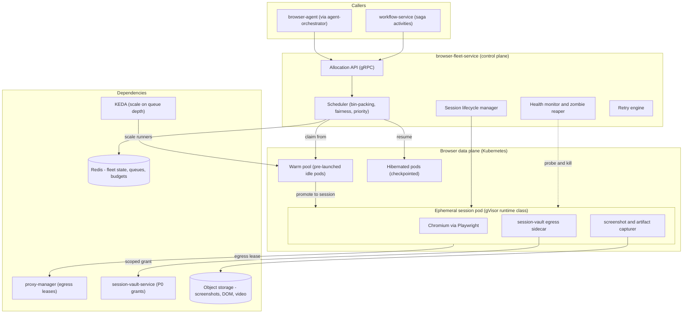
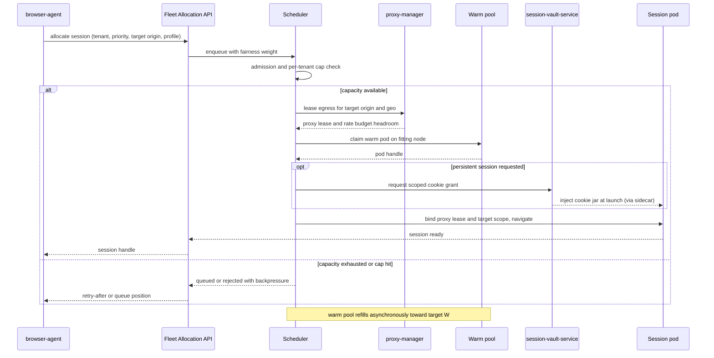
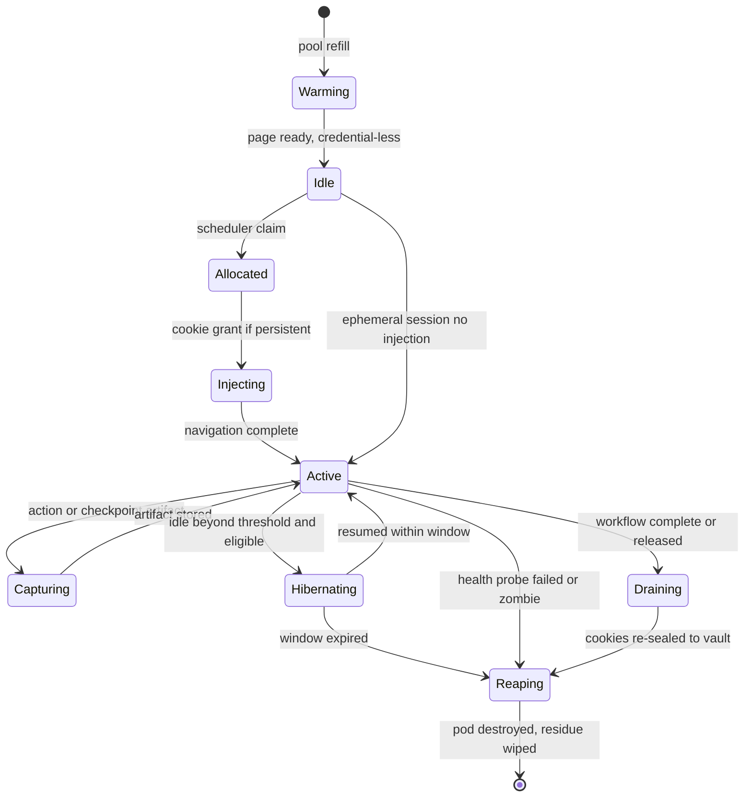

# 17 — Browser Fleet

| | |
|---|---|
| Document ID | ACA-SAS-17 |
| Volume | 2 — Core Services |
| Status | Draft v1.0 |
| Depends on | [00 — Architecture Canon](../00-architecture-canon.md) §13 §16, [09 — Microservice Architecture](09-microservice-architecture.md), [16 — Universal Portal Engine](16-universal-portal-engine.md), [18 — AI Gateway](18-ai-gateway.md), [Volume 5 — Security](../volume-5-security/), [Volume 6 — Operations](../volume-6-operations/), [Volume 7 — Browser Intelligence](../volume-7-browser-intelligence/) |

## 1. Overview

`browser-fleet-service` is the platform's controlled interface to the hostile web. Every browser interaction ACA performs — a portal application, a shadow verification, a login-cookie refresh, a screenshot for company intel — runs inside an ephemeral, gVisor-sandboxed Playwright pod that this service schedules, launches, monitors, and reaps. The canon fixes the technology and isolation model ([canon §3, §13](../00-architecture-canon.md)): Playwright on Chromium, one gVisor pod per session, per-session network policy (egress allowlist to target portal + proxy only), no cross-user browser reuse, credentials injected via a session-vault sidecar at egress and never into agent context.

The fleet is deliberately *dumb*. It knows nothing about portals, forms, ATS families, or application semantics — that intelligence lives in [`portal-intelligence-service`](16-universal-portal-engine.md) and `browser-agent`. The fleet's contract is narrow and mechanical: given an allocation request (tenant, priority, target origin, session profile, optional persistent-session handle), return a ready session handle bound to an isolated pod through which `browser-agent` issues perceive/act primitives, then capture artifacts and tear the pod down to zero residue. This separation is what lets the fleet be operated, scaled, and cost-optimized as pure infrastructure while the portal engine evolves independently.

The dominant forces on this design are cost, capacity, and containment. A Chromium pod is expensive relative to a stateless HTTP handler (hundreds of MB of RAM, real CPU, cold-start seconds), the platform must sustain **100k sessions/day** at launch with autopilot-driven burstiness, and each pod briefly holds a user's authenticated identity while executing untrusted-content-driven actions — a containment failure is a cross-tenant credential incident. Every number in this chapter (warm-pool size, hibernation thresholds, per-session cost budget, reap timers) is chosen against those three forces.

This chapter specifies the pool architecture and warm/cold tradeoff, the scheduler and allocation model, the pod anatomy, the session lifecycle, persistent-session support via `session-vault-service`, the screenshot/artifact path, health monitoring and zombie reaping, the retry engine, autoscaling to the capacity target, isolation and egress policy, and the cost model. Anti-bot posture, proxy reputation, and CAPTCHA handling are `proxy-manager` / [Volume 7](../volume-7-browser-intelligence/) concerns and are referenced, not owned, here.

## 2. Fleet Topology



Component inventory (all part of the canonical `browser-fleet-service`; the scheduler, reaper, and retry engine are deployment components, not new catalog services):

| Component | Language/runtime | Purpose | Failure posture |
|---|---|---|---|
| Allocation API | TypeScript/NestJS | gRPC allocate/release/status; the only caller-facing surface | Stateless; N+2 replicas |
| Scheduler | TypeScript (perf-critical loop) | Bin-packing placement, per-tenant fairness, priority classes | Leader-elected; hot-standby |
| Lifecycle manager | Node controller | Pod launch/inject/ready/drain/reap state machine | Reconciler; idempotent |
| Health monitor + reaper | Go | Liveness/zombie detection and forced teardown | Independent of scheduler (must survive scheduler outage) |
| Retry engine | TypeScript | Classified retry with fresh isolation | Bounded; hands unrecoverables to `recovery-agent` |
| Session pod | gVisor + Chromium + sidecar | The actual browser | Ephemeral by design; failure = discard |

## 3. Pool Architecture and the Warm/Cold Tradeoff

A cold Chromium pod is not free to start: image pull (mitigated by node-local caching and pre-pull), gVisor sandbox init, Chromium process launch, and first-page readiness sum to a **p50 ≈ 4 s, p95 ≈ 9 s** cold start on the reference node class. For an interactive user who just clicked "apply", 9 s of dead air before the first action is unacceptable; for a maintenance-priority shadow run, it is irrelevant. The fleet therefore keeps a **warm pool** of pre-launched, page-ready, credential-*less* pods that the scheduler promotes to sessions in **p50 ≈ 250 ms** (cookie injection + navigation).

### 3.1 Warm-pool sizing math

Warm-pool size is a queueing problem, not a guess. Model interactive session arrivals as Poisson with rate λ (sessions/sec) and mean hold time not relevant to *warmth* (warmth is consumed only during the promotion window). What matters is the arrival burst during the cold-start refill interval: after a warm pod is claimed, a replacement takes cold-start time `T_c` to become warm again. To hold the probability of an *empty warm pool* (forcing an interactive caller onto a cold start) below target `p_miss`, the warm count `W` must cover arrivals during `T_c` at a high quantile:

```
W  ≥  ceil( λ · T_c  +  z(1 − p_miss) · sqrt(λ · T_c) )
```

Worked reference (primary region, business-hours peak): interactive λ ≈ 6 sessions/sec, `T_c` (p95) ≈ 9 s → `λ·T_c` ≈ 54; for `p_miss = 1%` (z ≈ 2.33) the safety term ≈ 2.33·√54 ≈ 17, so **W ≈ 71 warm pods**. Rounded to **80** for headroom and AZ spread (min per-AZ floor so a single-AZ loss cannot empty the pool). Off-peak, λ falls ~5× and the target auto-scales down to a floor of **12** (3 per AZ × 4, the minimum that keeps the miss rate sane at low volume where the √ term dominates). These bounds are enforced by KEDA + an HPA floor, not hand-tuned (§9).

The tradeoff is explicit money: a warm pod costs full pod-RAM reservation while idle. 80 warm pods at reference sizing is a fixed ~$X/day floor (see §10) — the price of interactive latency. Maintenance and batch priorities are deliberately **excluded** from the warm-pool guarantee: they tolerate cold starts, so they never inflate `W`.

### 3.2 Priority classes

| Class | Source | Warm-pool eligible | Preemptible | SLO |
|---|---|---|---|---|
| `interactive` | User clicked apply / live HITL flow | Yes | No | First action p95 < 1 s (warm) |
| `autopilot` | L2/L3 scheduled submissions | Partial (spillover to cold) | By interactive | Complete within cadence window |
| `maintenance` | Shadow verification, cookie refresh, drift probes | No | By interactive + autopilot | Best-effort, ≤ 24 h |
| `batch` | Bulk screenshotting, enrichment crawls | No | By all above | Best-effort |

Priority is the primary lever for protecting the interactive SLO under load: when capacity is scarce, the scheduler preempts `maintenance`/`batch` pods (checkpoint or discard) to free nodes for `interactive`, and `browser-fleet-service` sheds `batch` first. This is why the warm-pool math only accounts for `interactive` arrivals.

## 4. Scheduler and Allocation

**Purpose.** Place session pods onto nodes to minimize cost (bin-pack tightly onto fewer nodes → fewer nodes to pay for) while honoring per-tenant fairness (no tenant starves another) and priority (interactive never waits behind batch).

**Responsibilities.**

- Bin-packing placement: pack pods onto the fewest nodes that satisfy resource + isolation constraints, biasing new pods toward nodes already warm to avoid scale-out; drain-and-consolidate half-empty nodes during low tide.
- Per-tenant fairness: weighted fair queuing on the allocation queue keyed by `tenant_id`, weight = plan tier, so a single tenant flooding autopilot cannot monopolize the fleet. Per-tenant concurrent-session caps by plan ([canon §12](../00-architecture-canon.md)).
- Priority + preemption: strict priority classes (§3.2) with preemption of lower classes when higher-class demand exceeds free capacity.
- Admission control: reject/queue when the global cap (protecting node budget) or a per-tenant cap is hit, surfacing backpressure to `agent-orchestrator` rather than silently overcommitting.

**Interactions.** Consumes allocation requests from `browser-agent` (via the API); reads plan entitlements from cached `billing-service` snapshots; leases egress from `proxy-manager` at placement time (so a pod is never scheduled onto a node whose egress geo cannot reach the target portal); emits fleet-state to Redis and `aca.browser.session.started.v1` on success.

### 4.1 Bin-packing vs fairness tension

Tight bin-packing (cost-optimal) and fairness/isolation (correctness) pull against each other: the cheapest placement crams every tenant onto one node, but the isolation model forbids implicit trust and the fairness model forbids starvation. Resolution: **bin-pack within a priority-and-fairness envelope**. The scheduler first admits requests through weighted fair queuing (fairness decides *order*), then places the admitted pod on the tightest-fitting node that satisfies gVisor isolation and egress-geo constraints (packing decides *location*). gVisor keeps co-tenancy on a node safe, so packing does not weaken isolation — the sandbox boundary, not the node boundary, is the security boundary ([canon §13](../00-architecture-canon.md), §8 below).

### 4.2 Allocation sequence



## 5. Ephemeral Pod Anatomy

Every session runs in a pod created for that session and destroyed after it. There is no pod reuse across users — the pod *is* the isolation unit.

```yaml
apiVersion: v1
kind: Pod
metadata:
  labels: { aca.fleet/priority: interactive, aca.fleet/tenant: ten_xxx }
spec:
  runtimeClassName: gvisor            # canon-mandated sandbox
  automountServiceAccountToken: false # pod holds no cluster identity
  enableServiceLinks: false
  containers:
    - name: chromium
      image: registry.internal/aca/playwright-chromium:pinned-digest  # distroless base
      resources:
        requests: { cpu: "1", memory: "1.5Gi" }
        limits:   { cpu: "2", memory: "2Gi" }     # Chromium OOMs are contained, not fatal to node
      securityContext:
        readOnlyRootFilesystem: true
        allowPrivilegeEscalation: false
        runAsNonRoot: true
        capabilities: { drop: ["ALL"] }
      volumeMounts:
        - { name: scratch, mountPath: /tmp }       # emptyDir, memory-backed, wiped on teardown
    - name: vault-egress-sidecar
      image: registry.internal/aca/session-vault-sidecar:pinned-digest
      # performs secret substitution on the egress path; agent never sees plaintext
  volumes:
    - name: scratch
      emptyDir: { medium: Memory, sizeLimit: 512Mi }
  # NetworkPolicy (separate object): egress allowlist = proxy-manager lease + DNS only
```

Design points, each load-bearing:

- **`runtimeClassName: gvisor`** — the sandbox is the security boundary; a Chromium RCE from a malicious page is contained to a userspace kernel, not the host ([canon §13](../00-architecture-canon.md)).
- **No service-account token, no cluster identity** — a compromised pod has nothing to pivot with; it cannot talk to the Kubernetes API.
- **Memory-backed scratch, read-only root** — nothing persists to disk; teardown of the pod is teardown of all session residue (P0 hygiene).
- **Egress-only-via-lease NetworkPolicy** — the pod can reach the leased proxy egress and DNS, nothing else. It cannot reach internal services, other pods, or the internet directly. Credentials flow *out* through the sidecar; they never flow *in* to the Chromium/agent context.
- **Resource limits sized for containment** — a runaway page hits the 2Gi limit and OOM-kills its own pod (reaped and retried), never the node.

## 6. Session Lifecycle



Lifecycle rules with rationale:

| Transition | Trigger / timer | Rationale |
|---|---|---|
| `Warming → Idle` | Chromium page-ready | Only page-ready pods count toward warm target W (§3.1) |
| `Idle → Allocated` | Scheduler claim | Warm promotion path, p50 ≈ 250 ms |
| `Injecting` | Persistent session requested | Cookies injected at launch by sidecar (§7), never mid-session into agent context |
| `Active → Hibernating` | Idle > 30 s during multi-step flow with external wait (e.g., awaiting HITL approval, portal async processing) | Holding a live Chromium idle burns RAM; hibernation checkpoints and frees it (§10) |
| `Hibernating → Active` | Resume within 15 min window | Beyond 15 min the saga is better off starting fresh than resuming a possibly-stale portal session |
| `Active → Reaping` | Health probe fail or hard cap | Max session wall-clock 10 min (interactive) / 20 min (autopilot multi-step) — a session running longer is stuck; reap and let retry engine classify |
| `Draining → Reaping` | Clean completion | Cookies re-sealed to vault before teardown so a refreshed session token is not lost |
| `* → Reaping` | Terminal | Pod destroyed; memory scratch wiped; `aca.browser.session.completed.v1` emitted |

## 7. Persistent Sessions via session-vault-service

Some portals require an authenticated session (the user's LinkedIn, a Workday tenant login) that must survive across ACA visits. The fleet supports this without ever exposing credentials to `browser-agent`:

- **Storage (P0).** Cookies and session artifacts live in `session-vault-service`, envelope-encrypted with a per-user DEK wrapped by a per-tenant KEK ([canon §11](../00-architecture-canon.md), P0 class). The fleet control plane never sees plaintext.
- **Injection at launch, not at prompt.** When a session requests a persistent identity, the scheduler requests a **scoped grant** from the vault bound to `(session_id, target_origin)`. The vault-egress **sidecar** in the pod injects the cookie jar into Chromium's context at launch — before any page loads, before the agent issues any action. The agent's planning context contains a *reference* (`{{vault:linkedin-session}}`), never a value; secret substitution for typed credentials happens inside the sidecar on the egress path.
- **Re-seal on drain.** Portals frequently rotate session tokens during a visit. On clean drain the sidecar re-seals the current cookie jar back to the vault so the next visit starts authenticated. On abnormal teardown the jar is discarded (fail-safe: a possibly-corrupted session is not persisted).
- **Scope and revocation.** Grants are single-session, origin-bound, and time-boxed to session wall-clock. A user revoking a portal connection deletes the vault entry; in-flight grants are invalidated. Cross-user reuse is structurally impossible — grants are keyed to the requesting user's tenant and DEK.

This is the mechanism behind the canon's "credentials injected via session-vault sidecar at egress, never into agent context" invariant. Full vault cryptography and key rotation are in [Volume 5](../volume-5-security/).

## 8. Screenshots, Artifacts, and Egress Isolation

**Screenshot / artifact service.** Every step can emit artifacts: a screenshot, a pruned DOM snapshot, and (for HITL review and failure diagnosis) an optional video of the session. Artifacts are the evidence bundle the submission saga ([16 §6](16-universal-portal-engine.md)) links from its trace, and the raw material for template learning ([16 §7](16-universal-portal-engine.md)).

| Artifact | When | Storage | Retention |
|---|---|---|---|
| Screenshot (PNG/WebP) | Per step + on failure | S3, tenant-prefixed | 90 d ([canon §11](../00-architecture-canon.md)) |
| DOM snapshot (pruned) | Per perceive | S3, gzip | 90 d |
| Session video | Failures + HITL-flagged sessions only (cost) | S3 | 90 d, or per-tenant policy |
| Confirmation artifact | Post-submit | S3, linked to application | With application record |

Capture rules: screenshots taken during secure credential entry are **redacted at capture** (the sidecar signals "secure field active"; the capturer masks the region) so P0 material never lands in an artifact. Artifacts are written directly from the pod to object storage via a scoped, write-only presigned path — they do not transit the fleet control plane, keeping it stateless and off the data path.

**Egress isolation.** All pod network egress flows through the `proxy-manager` lease bound at allocation (§4.2). The pod's NetworkPolicy allowlists exactly that egress plus DNS; there is no route to internal services or the open internet. This serves three goals at once: containment (a compromised pod cannot phone home or scan the internal network), attribution/reputation (all portal traffic exits through managed IPs `proxy-manager` can rotate and health-check), and compliance (per-site rate budgets are enforced at the egress `proxy-manager` owns, not trusted to the pod). Anti-bot posture and IP reputation management are `proxy-manager` / [Volume 7](../volume-7-browser-intelligence/) concerns.

## 9. Health Monitoring, Zombie Reaping, and Retries

**Health monitor + reaper.** Runs independently of the scheduler (it must survive a scheduler outage — a stuck scheduler must not also stop reaping). It tracks per-pod liveness (heartbeat from the Chromium controller), progress (steps advancing), and resource pressure, and force-reaps on:

| Condition | Threshold | Rationale |
|---|---|---|
| No heartbeat | 30 s | Chromium hung or crashed; longer wastes RAM and a warm-equivalent slot |
| No step progress ("zombie") | 90 s in `Active` | Agent stuck in a loop or portal deadlocked; `agent-supervisor` also watches this from the agent side |
| Session wall-clock cap | 10 / 20 min (§6) | Hard ceiling on cost per session |
| Node pressure eviction | Node memory > 90% | Preempt lowest-priority pods to protect interactive |
| Orphaned pod (no owning session in Redis) | Reconcile loop, 60 s | Control-plane crash can orphan pods; reaper is the backstop that prevents cost leaks |

The orphan reconciler is the critical zombie-reaping guarantee: the reaper periodically lists all fleet pods and cross-checks against Redis session state; any pod with no live owner is destroyed. This makes a control-plane crash **cost-safe** — no orphaned Chromium pods silently accrue spend.

**Retry engine.** Failures are classified before retry, because retrying the wrong class wastes money or duplicates an irreversible action:

| Failure class | Retry policy |
|---|---|
| Transient infra (pod launch fail, proxy lease flake, OOM) | Retry immediately on a fresh pod, max 2, exponential backoff |
| Portal transient (5xx, timeout, maintenance banner) | Retry with longer backoff, max 2, fresh session |
| Anti-bot challenge | No blind retry; hand to `proxy-manager` for pool rotation + posture change, then one retry ([Vol 7](../volume-7-browser-intelligence/)) |
| Template/drift (step assertion fail) | No retry on same template; signal `aca.portal.drift.detected.v1`, escalate to HITL or `recovery-agent` ([16 §6.2](16-universal-portal-engine.md)) |
| Post-submit ambiguous | **Never retry** — verification probe first; ambiguous → `submitted_unverified` ([16 §6.2](16-universal-portal-engine.md)) |

Retries always use a **fresh isolated pod** — never reuse the failed pod's context — preserving the no-cross-contamination invariant even within a retry chain. Unrecoverable sessions are handed to `recovery-agent` with the full artifact bundle.

## 10. Scaling and the 100k Sessions/Day Capacity Model

**Autoscaling.** The runner data plane scales on **KEDA against allocation-queue depth** (per priority class), not CPU — CPU is a lagging signal for a workload where the cost is holding a pod, not burning cycles. Cluster Autoscaler adds nodes when pending pods cannot be placed; the warm-pool target (§3.1) is itself a KEDA ScaledObject driven by the interactive arrival-rate estimate.

**Capacity model for 100k sessions/day.** The target is not uniform — autopilot and business hours concentrate load. Assume a peak-to-mean of ~4× and a mean session hold of ~90 s of *active pod time* (multi-step submissions; screenshots are seconds):

```
mean rate           = 100,000 / 86,400            ≈ 1.16 sessions/sec
peak rate (4x)                                     ≈ 4.6 sessions/sec (all classes)
concurrent pods (Little's law, peak) = 4.6 · 90    ≈ 415 concurrent session pods
+ warm pool (interactive)                          ≈ 80
+ hibernated (awaiting HITL/async)                 variable, RAM-cheap
peak pod footprint                                 ≈ 500 pods
node fit (reference node ~16 pods at 2Gi limit)    ≈ 32 peak session nodes
```

The model drives three decisions: (1) the fleet is **bursty**, so reserved capacity is sized to mean and burst rides on spot/on-demand overflow (§ cost); (2) 500 concurrent pods at ~500 sessions/day/pod-slot leaves comfortable headroom to 100k — the binding constraint is peak concurrency, not daily total; (3) `scheduler-agent` smooths autopilot cadence (jittered windows) specifically to keep peak-to-mean near 4× rather than the ~10× an un-jittered "run everyone at 9am" schedule would produce, which would nearly triple peak node count and cost.

## 11. Isolation and Egress Policy (summary)

Consolidated from §5, §8, and [canon §13](../00-architecture-canon.md); full treatment in [Volume 5](../volume-5-security/) and [Volume 7](../volume-7-browser-intelligence/):

- One gVisor pod per session; the sandbox is the security boundary, so node co-tenancy (from bin-packing) is safe.
- No cluster identity in the pod; no route to internal services; egress only via `proxy-manager` lease + DNS.
- Credentials injected by the vault sidecar at launch/egress; never in agent context; secure-entry screenshots redacted at capture.
- Memory-backed scratch + read-only root; teardown wipes all residue; no pod reuse across users.
- Per-session, origin-scoped, time-boxed vault grants; revocation invalidates in-flight grants.

## 12. Failure Scenarios

| # | Scenario | Blast radius | Detection | Response |
|---|---|---|---|---|
| F1 | Warm pool exhausted (interactive burst > refill) | Interactive latency (cold-start fallback) | `fleet_warm_pool_available` near 0; miss-rate metric | Fall back to cold start (degraded, not failed); KEDA scales warm target; preempt `maintenance`/`batch` to free nodes |
| F2 | Node loss (AZ event) | Sessions on that node fail mid-flight | Node NotReady; pod loss | Per-AZ warm floors absorb; failed sessions retried on fresh pods (transient class); sagas compensate ([16 §6.2](16-universal-portal-engine.md)) |
| F3 | Control-plane (scheduler) outage | No new allocations | Health checks; queue not draining | Hot-standby leader takeover; **reaper runs independently** so no cost leak; in-flight pods continue (agent talks to pods directly) |
| F4 | Orphaned pods after control-plane crash | Cost leak | Orphan reconciler (§9) | Reconciler destroys ownerless pods within 60 s |
| F5 | gVisor/pod escape attempt from malicious page | Contained to one pod (goal) | `security-agent` signals; anomalous egress attempts blocked by NetworkPolicy | Pod killed, quarantined for forensics, portal flagged; `aca.audit.event.v1`; no cross-tenant exposure (no shared identity, no cross-pod route) |
| F6 | Proxy pool degraded/blocked for a portal | Sessions to that portal | Lease failures; challenge-rate spike | `proxy-manager` rotates pool/geo; posture slowed; volume shed to HITL ([Vol 7](../volume-7-browser-intelligence/)) |
| F7 | Zombie session (agent loop / portal deadlock) | One session + a held pod | No-progress reaper (90 s); `agent-supervisor` | Reap pod; retry engine classifies; drift-suspect signals portal engine |
| F8 | Cost runaway (drift wave forces mass de novo + video capture) | Fleet spend | Per-session budget breach; spend-rate alert | Per-session cost cap aborts overspending sessions; video capture auto-disabled under budget pressure; `cost-controller` throttles `batch`/`maintenance` first |

## 13. Cost Optimization

The fleet is the platform's most compute-intensive subsystem; cost discipline is a first-class design goal, not an afterthought.

| Lever | Mechanism | Tradeoff |
|---|---|---|
| Spot nodes for burst | Reserved/on-demand sized to *mean*; peak burst (§10) rides spot with on-demand fallback | Spot reclaim risk — only `maintenance`/`batch` and preemptible `autopilot` placed on spot; interactive stays on-demand |
| Hibernation | Idle-during-external-wait sessions checkpointed, RAM freed (§6) | Resume latency vs. holding a live idle Chromium; capped at 15 min window |
| Bin-packing consolidation | Drain-and-consolidate half-empty nodes at low tide (§4) | Brief session churn during consolidation; only preemptible classes moved |
| Warm-pool right-sizing | Warm target auto-scales with arrival rate (§3.1), floored per-AZ | Lower floor = higher cold-start miss risk off-peak; floor chosen at 1% miss |
| Per-session cost budget | Each session carries a cost ceiling (pod-seconds + model calls attributed via `ai-gateway` + proxy cost); breach aborts | An expensive novel portal may abort → falls to HITL assist rather than burning unbounded spend |
| Artifact frugality | Video only on failures/HITL flags; screenshots WebP; DOM gzipped; 90 d retention | Less forensic coverage on successful runs (acceptable — successes need less diagnosis) |
| Model-tier concentration | Trusted-template replay path uses zero large-model calls ([16 §3](16-universal-portal-engine.md)) | Cost is dominated by novel/drift runs, which the trust ladder minimizes over time |

The **per-session cost budget** is the backstop that makes all the others safe: even if every other control fails, a single session cannot spend without bound. Reference ceiling: **$0.25 p50 / $1.50 hard cap** per trusted-portal submission (pod-seconds + attributed model spend + proxy); novel-portal sessions carry a higher cap tied to the routing-policy flag, because a first-ever portal legitimately costs more to solve.

## 14. Observability

Tracing: fleet action spans join the submission-saga trace ([16 §13](16-universal-portal-engine.md)) via the propagated `traceparent`; a session handle carries the trace context so every pod action is attributable to a saga and a user.

| Metric | Type | Labels | Alert |
|---|---|---|---|
| `fleet_session_allocation_latency_ms` | histogram | priority, warm/cold | interactive warm p95 > 1 s |
| `fleet_warm_pool_available` | gauge | az | near 0 during peak (miss risk) |
| `fleet_cold_start_ratio` | gauge | priority | interactive > 5% (warm pool undersized) |
| `fleet_concurrent_sessions` | gauge | priority, node | approaching capacity model ceiling |
| `fleet_pod_reap_total` | counter | reason (zombie, orphan, cap, oom) | orphan or zombie spike |
| `fleet_session_wall_clock_ms` | histogram | priority, outcome | p95 nearing wall-clock cap (stuck sessions) |
| `fleet_cost_per_session_usd` | histogram | priority, family | p50 > $0.25 reference (trusted) |
| `fleet_spot_reclaim_total` | counter | class | reclaim rate degrading batch SLA |
| `fleet_egress_denied_total` | counter | reason | NetworkPolicy denials (containment or misconfig signal) |
| `aca.browser.session.*` | events | — | per canon [§8](../00-architecture-canon.md) event stream |

Primary on-call surface: the **Fleet Capacity** board (concurrency vs. model ceiling, warm-pool health, cold-start ratio, node count, spot reclaim) plus the **Fleet Cost** board (cost/session by class and family, budget breaches, artifact spend). Canonical events `aca.browser.session.started.v1`, `aca.browser.session.completed.v1`, and `aca.browser.action.failed.v1` are emitted per session/action and consumed by `analytics-service`, the portal engine's learning loop, and `cost-controller`.

## 15. Future Improvements

- **Snapshot/restore warm pods (CRIU-style)** to cut cold start below 1 s and shrink the warm-pool floor, reducing the fixed idle-RAM cost.
- **Predictive warm scaling** from `scheduler-agent` cadence plans — the fleet already knows the autopilot schedule, so warm capacity can be pre-provisioned exactly ahead of known bursts rather than reacting to queue depth.
- **Per-portal pod profiles** — lighter pod resource envelopes for known-simple portals (single-page forms) vs. heavy SPA portals (Workday), improving pod density and node fit.
- **Regional egress affinity** — schedule pods in the region whose proxy geo best matches the portal, cutting proxy hops and latency (ties into cell architecture, [Vol 6](../volume-6-operations/)).
- **WASM-based lightweight interaction** for portals that expose structured application APIs, bypassing full browser rendering where possible (large cost win where applicable).

## 16. Alternatives Considered & Tradeoffs

| Decision | Alternative | Why rejected |
|---|---|---|
| Ephemeral pod per session (gVisor) | Long-lived browser pool with context reuse | Cross-user context reuse violates the canon isolation invariant; a session's residue could leak to the next user; ephemerality is the containment guarantee |
| gVisor sandbox | Standard containers (namespaces only) | Chromium executing untrusted-content-driven actions is a realistic RCE surface; namespace isolation shares the host kernel — gVisor's userspace kernel is the boundary the canon mandates |
| Warm pool + cold fallback | Always cold-start | 9 s p95 cold start fails the interactive SLO; warm pool is the price of interactive latency |
| Warm pool + cold fallback | Always-warm large pool (no cold path) | Enormous idle-RAM cost for the long tail of maintenance/batch that tolerates cold; warm only what interactive needs |
| KEDA on queue depth | HPA on CPU | The cost is holding a pod, not CPU; CPU lags demand and under-provisions bursty allocation |
| Bin-pack within fairness/priority envelope | Pure bin-packing (cheapest) | Starves tenants and lets batch block interactive; fairness+priority gate admission, packing only picks location |
| Bin-pack within fairness/priority envelope | One node per tenant (max isolation) | gVisor already isolates at the pod level; per-tenant nodes multiply cost with no security gain |
| Credentials via vault sidecar at egress | Pass cookies through agent/control plane | Puts P0 material in agent context and on the control-plane path — direct canon violation; sidecar keeps plaintext out of both |
| Per-session cost budget with hard cap | Global spend throttle only | Global throttles let one pathological session burn unbounded before the aggregate trips; per-session caps bound the worst case |
| Independent reaper process | Reaping inside the scheduler | A scheduler outage would then also stop reaping → cost leak; independence makes control-plane failure cost-safe |
| Spot for burst, on-demand for interactive | All-spot (cheapest) | Spot reclaim mid-submission risks the most consequential action; interactive/consequential work stays on stable capacity |

---

*Related: portal intelligence, templates, and the submission saga in [16 — Universal Portal Engine](16-universal-portal-engine.md); credential cryptography in [Volume 5](../volume-5-security/); anti-bot posture, proxy reputation, and CAPTCHA policy in [Volume 7 — Browser Intelligence](../volume-7-browser-intelligence/); cells and multi-region operations in [Volume 6](../volume-6-operations/); model routing and cost attribution in [18 — AI Gateway](18-ai-gateway.md).*
