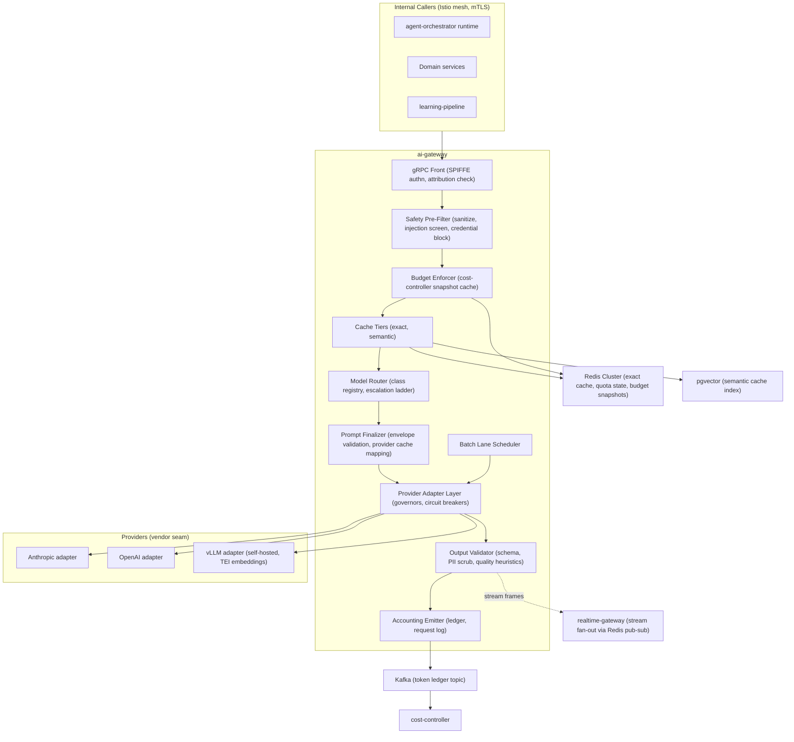
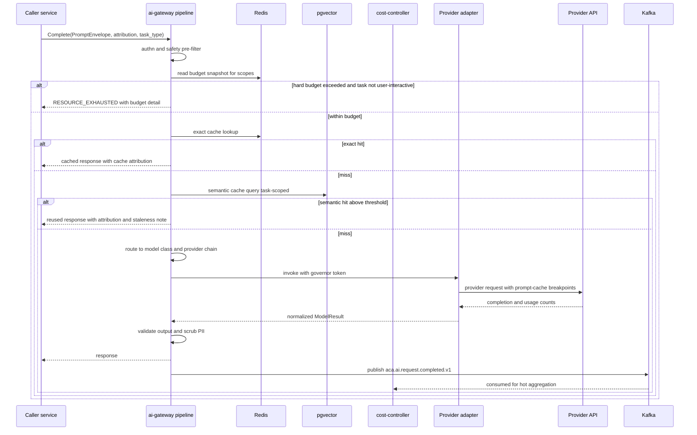
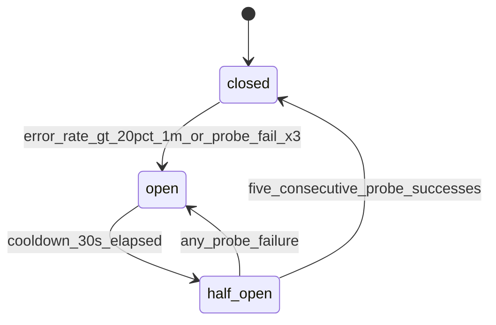
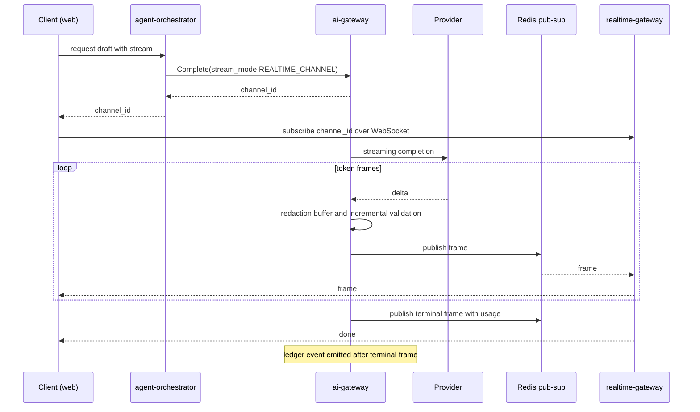

# 18 — AI Gateway

| | |
|---|---|
| Document ID | ACA-SAS-18 |
| Volume | 2 — Core Services |
| Status | Draft v1.0 |
| Depends on | [00 — Architecture Canon](../00-architecture-canon.md), [09 — Microservice Architecture](09-microservice-architecture.md), [10 — API Gateway](10-api-gateway.md), [19 — Agent Orchestrator](19-agent-orchestrator.md), [20 — Workflow Engine](20-workflow-engine.md) |

## 1. Overview

`ai-gateway` is the single entry point for every model call on the platform — completions, embeddings, vision, and moderation. The canon's first AI invariant ([§9](../00-architecture-canon.md)) is absolute: **no service or agent calls a provider SDK directly.** Everything that touches a model passes through this service, which is what makes the platform's cost controls, safety filters, caching, provider portability, and token accounting enforceable rather than aspirational. It is an internal-only gRPC service (Python, per the canon's language split for AI-plane services); it has no route at `api-gateway` and no external surface.

The service is a pipeline, not a proxy. Each request flows through a fixed stage sequence — authenticate → policy/safety pre-filter → budget check → cache tiers → route → provider adapter → output validation → accounting — and every stage is independently instrumented, independently degradable, and has a declared failure posture (§3). The pipeline exists to enforce the canon's escalation ladder ([§9](../00-architecture-canon.md)): deterministic rules and caches must be exhausted before a model is invoked, and cheaper model classes before expensive ones, with any tier-skip carried by an explicit, logged routing policy.

`ai-gateway` is sized for **50M calls/day** at GA scale (§12): roughly 580 requests/s average, 2,000 requests/s design peak. At that volume the dominant engineering constraints are concurrency (thousands of multi-second provider calls in flight), provider quota management (per-provider token-per-minute ceilings), and ledger throughput (every call emits `aca.ai.request.completed.v1`). The chapter covers the pipeline, the provider adapter layer with health-based failover, the model class registry, streaming to `realtime-gateway`, safety filtering, the token ledger, the batch lane, the prompt-cache-friendly assembly contract shared with the context builder (Volume 3 — AI Architecture), the internal gRPC API, capacity math, and failure modes.

What this chapter does *not* own: prompt content and versioning (`prompt-registry-service`), budget policy decisions (`cost-controller` — this service only *enforces* budgets it is handed), memory retrieval (`memory-service`), and agent orchestration ([Chapter 19](19-agent-orchestrator.md)). Model serving infrastructure for self-hosted models (vLLM/TEI pools) is operated by the platform team and consumed here through the vLLM adapter like any other provider.

## 2. Component Architecture



| Component | Purpose | Failure posture |
|---|---|---|
| gRPC Front | mesh authn (SPIFFE), attribution validation, deadline classing, admission control | fail-closed (unattributed requests rejected) |
| Safety Pre-Filter | input sanitization, untrusted-content wrapping check, credential detection, injection screen | fail-closed for untrusted-content prompts, fail-open for trusted internal prompts (logged) |
| Budget Enforcer | per-scope budget check against cached cost-controller snapshots | degraded mode on stale snapshot (§13) |
| Cache Tiers | exact (Redis) then semantic (pgvector) lookup | fail-open (skip tier, flag `cache_degraded`) |
| Model Router | class selection, provider chain selection, ladder enforcement | fail-closed on unknown task type |
| Prompt Finalizer | PromptEnvelope validation, provider prompt-cache breakpoint mapping | fail-closed on malformed envelope |
| Provider Adapter Layer | one interface over Anthropic/OpenAI/vLLM; rate governors; circuit breakers; failover | per-provider circuit breaking, chain failover |
| Output Validator | schema validation, PII scrub, refusal/quality heuristics | fail-closed for structured outputs; redact-and-flag for prose |
| Accounting Emitter | ledger event publish, request-log projection, metrics | never blocks response path; local disk spool on Kafka outage |
| Batch Lane Scheduler | aggregates batch jobs, drains to provider batch APIs | degrade to synchronous small-model lane only on explicit override |

All components are stages inside the `ai-gateway` deployment (single service, one pod fleet) except the Batch Lane Scheduler, which runs as a separate `ai-gateway-batch` deployment sharing the same codebase and datastore — batch drains must not compete for connection pools with interactive traffic.

## 3. Request Pipeline

### 3.1 Stage contract

| # | Stage | Action | Budget (p99) | On failure |
|---|---|---|---|---|
| 1 | Authn | mesh mTLS peer identity → caller service; verify attribution fields (`tenant_id`, `user_id?`, `agent_id?`, `feature`) | 0.2 ms | `PERMISSION_DENIED` |
| 2 | Policy + safety pre-filter | OPA method check; sanitization; credential/secret detector; injection screen (rules; plus `small`-class screen when `untrusted_content` present) | 15 ms rules / 250 ms with model screen | `INVALID_ARGUMENT` with safety code |
| 3 | Budget check | Redis-cached budget snapshot per scope (tenant, user, agent, feature); soft/hard threshold logic (canon §10.2) | 2 ms | degrade class or `RESOURCE_EXHAUSTED` |
| 4 | Exact cache | SHA-256 over canonical request (envelope hash + model class + tool schemas); Redis GET | 3 ms | skip tier |
| 5 | Semantic cache | task-scoped ANN query, cosine ≥ 0.97, staleness policy | 25 ms | skip tier |
| 6 | Route | model class registry lookup → concrete model + provider chain | 1 ms | `FAILED_PRECONDITION` |
| 7 | Finalize prompt | validate PromptEnvelope, map stable segments to provider cache breakpoints | 2 ms | `INVALID_ARGUMENT` |
| 8 | Provider call | adapter invoke through governor + circuit breaker; failover on chain | dominant (class-dependent) | failover → error after chain exhausted |
| 9 | Validate output | JSON-schema check, PII scrub, refusal detection, length/quality heuristics | 5–40 ms | retry-once (structured) → `FAILED_PRECONDITION` |
| 10 | Account | emit ledger event, update hot counters, write-behind request log | async, off response path | spool locally, alert |

Rationale for the 250 ms screening budget: the injection screen on untrusted content uses the `small` class with a 200-token verdict; 250 ms is that class's p99 for short classification and is only paid when external content (job posts, portal DOM, email bodies) enters a prompt.

### 3.2 Unary sequence



### 3.3 Request envelope

Every RPC carries a `RequestContext` and a `PromptEnvelope` (the assembly contract, §5.3):

| Field | Req | Semantics |
|---|---|---|
| `tenant_id`, `user_id`, `agent_id`, `feature` | tenant+feature mandatory | attribution for budgets and ledger; platform-scope features (e.g. `job-parsing-global`) use a reserved platform tenant, allowlisted |
| `task_type` | yes | drives cache TTL class, safety profile, routing table row (e.g. `resume.tailor`, `job.parse`, `agent.plan`) |
| `model_class_request` | no | caller hint; router may downgrade (budget) but upgrades require routing-policy flag (ladder rule) |
| `routing_flags` | no | explicit logged overrides: `allow_frontier`, `skip_semantic_cache`, `require_provider` |
| `envelope` | yes | ordered prompt segments with cache hints (§5.3) |
| `tool_schemas`, `response_schema` | no | JSON Schema; presence switches output validation to structured mode |
| `safety_profile` | yes | `trusted_internal` \| `contains_untrusted` \| `user_authored` — selects pre-filter depth |
| `pii_profile` | yes | which PII classes may appear in prompt/response for this task (§7.3) |
| `stream_mode` | no | `NONE` \| `GRPC_STREAM` \| `REALTIME_CHANNEL` (§8) |
| `idempotency_key` | writes | dedup window 24 h in Redis, canon §7 |
| `deadline_class` | yes | see below |

Deadline classes (the canon's 2 s/5 s internal defaults are for control-plane RPCs; model calls need their own classes — an explicit, logged deviation):

| Class | Deadline | Used by | Rationale |
|---|---|---|---|
| `fast` | 3 s | `embed`, `small` classification | p99 of small class ≤ 1.5 s; 2× headroom |
| `interactive` | 30 s | user-facing drafting (`medium`/`large`) | inside the 60 s draft-generation SLO with retry room |
| `agent` | 120 s | agent planning steps, `frontier` | frontier p99 ≈ 45 s; agents tolerate latency, workflows heartbeat around it |
| `batch` | async | batch lane | ≤ 24 h SLA per canon §10.2 |

## 4. Model Class Registry & Routing

### 4.1 Registry

The registry is the runtime embodiment of canon §10.1 — configuration (versioned in git, hot-reloaded via `feature-flag-service`), not code. Callers name a **class**; only the registry maps class → concrete model + provider chain.

| Class | Primary (reference) | Failover chain | Context budget | Latency target (p99) | Batch-eligible |
|---|---|---|---|---|---|
| `embed` | bge-class via vLLM/TEI (self-hosted) | provider embeddings (OpenAI adapter) | 8 k tokens/text | 300 ms / 96-text batch | yes |
| `small` | Claude Haiku class (Anthropic) | vLLM open-weight 8B class → OpenAI mini class | 16 k | 1.5 s | yes |
| `medium` | Claude Sonnet class (Anthropic) | OpenAI mid class → vLLM 70B class | 64 k | 6 s | yes |
| `large` | Claude Opus class (Anthropic) | OpenAI large class | 128 k | 20 s | yes |
| `frontier` | highest-capability available (Fable class) | `large` primary (degrade, flagged) | 200 k | 60 s | no |
| `vision` | vision-capable medium class | vision-capable large class | 32 k + 8 images | 10 s | yes |

Context budgets are hard caps enforced at the Prompt Finalizer — an envelope exceeding its class budget is rejected, never silently truncated (truncation is the context builder's job, upstream, where it can be done semantically).

### 4.2 Routing decision

Router inputs per canon §10.2: task type, complexity score (heuristic + optional small-model estimate cached per task template), tenant plan, remaining budget, latency SLO, historical quality stats (fed back from `learning-pipeline`). The decision procedure:

1. **Ladder position** — the router refuses to select a class higher than the task type's registered ceiling unless `routing_flags` carries an explicit override (logged with caller identity; audited).
2. **Plan gate** — `free` plan is capped at `small`/`medium`; `frontier` requires `premium`+ and the `allow_frontier` flag (canon §12).
3. **Budget degrade** — at soft threshold (80 % of scope budget) the router downgrades one class and the response carries `degraded_reason=budget_soft`; at hard threshold (100 %) non-interactive work is queued to the batch lane or rejected, while user-interactive requests are always served within the plan floor (`small`) — users must never see a dead assistant because an agent burned the budget.
4. **Health gate** — providers whose circuit is open are skipped in the chain (§6.3).
5. **Quality stats** — if `learning-pipeline` has flagged a (model, task-type) pair below the 95 % eval-pass SLO, the router shifts that task type to the next chain entry until the flag clears (§13, degraded quality).

Every routing decision is recorded in the ledger event (`routing_reason` field) so `cost-optimization-agent` and `learning-pipeline` can audit ladder skips and degrade frequency.

## 5. Cache Tiers & Prompt-Cache-Friendly Assembly

### 5.1 Exact cache

Key: `SHA-256(canonical_envelope || model_class || tool_schema_hash || response_schema_hash)`, where `canonical_envelope` uses canonical JSON (sorted keys, normalized whitespace). Value: compressed response + usage metadata. Storage: the gateway-scoped Redis Cluster.

| Task class | TTL | Rationale |
|---|---|---|
| `job.parse`, `job.classify` | 7 d | postings are immutable once fetched; re-crawls produce new inputs |
| `company.enrich` | 24 h | company intel drifts slowly; daily refresh is the crawl cadence |
| `match.explain` | 6 h | profile edits must surface same-day |
| `resume.tailor`, `cover_letter.generate` | 0 (bypass) | user-specific creative output; reuse would be visibly templated |
| `agent.plan` | 0 (bypass) | plans depend on live state; caching creates stale-action risk |
| `moderation.screen` | 30 d | verdict on identical content is stable |

Hit-rate expectation: ≈ 18 % blended (dominated by parse/classify traffic, §12) — measured, alert if < 10 % (indicates key instability, usually a non-deterministic envelope upstream).

### 5.2 Semantic cache

pgvector index per task class (only task classes explicitly flagged cacheable — generative user-facing tasks are never semantically cached). Query embedding via the `embed` class; cosine ≥ **0.97** task-scoped threshold per canon §10.2. Guards: (a) staleness policy per task class (entry invalidated when its source entity — job, company — emits an update event); (b) tenant scoping for any entry derived from tenant data (global scope only for public-content tasks like job parsing); (c) reuse responses carry `cache_tier=semantic` attribution and the original request id for auditability. Expected additional hit rate ≈ 7 %.

### 5.3 PromptEnvelope: the assembly contract with the context builder

The context builder (Volume 3 — AI Architecture; embedded as a library in the agent runtime and in domain services) produces the envelope; `ai-gateway` validates and finalizes it. The contract exists for one reason: **provider-side prompt caching only pays when the prefix is byte-stable**, so stability is a wire-format obligation, not a convention.

Envelope = ordered segments, each `{segment_id, cache_hint, content, content_hash}`:

| Order | Segment | `cache_hint` | Source |
|---|---|---|---|
| 1 | System prompt | `stable` | `prompt-registry-service`, `prompt_id@semver`, channel-resolved |
| 2 | Tool schemas | `stable` | tool registry (Chapter 19), sorted by tool id |
| 3 | Tenant/agent standing context | `semi` | memory-service long-term snapshot, refreshed ≤ 1/h |
| 4 | Task context (retrieval) | `volatile` | context builder retrieval |
| 5 | Conversation/turn | `volatile` | caller |

Contract rules (validated at stage 7; violations are `INVALID_ARGUMENT`, never silently fixed):

- **R1 — deterministic order:** segments must arrive in the order above; within a segment, collections sorted by stable keys.
- **R2 — canonical serialization:** canonical JSON; no locale-dependent formatting.
- **R3 — no volatile data in stable segments:** timestamps, request ids, and user turns are forbidden in `stable`/`semi` segments (a lint the gateway enforces via regex + hash-stability sampling).
- **R4 — hash honesty:** `content_hash` must match content; the gateway samples 1 % for verification (cheap tripwire for buggy builders).
- **R5 — minimum cacheable prefix:** provider cache breakpoints are only set when the stable prefix ≥ 1024 tokens (below that, provider cache overhead exceeds savings).
- **R6 — untrusted content tagging:** any segment containing external content must wrap it in `untrusted_content` markers with a `source` attribute (canon §13); the pre-filter rejects untagged external content it detects.
- **R7 — budget fit:** total tokens ≤ class context budget (§4.1).

The Prompt Finalizer maps `stable` (and, when hash-unchanged for ≥ 5 min, `semi`) segment boundaries to provider prompt-cache breakpoints (e.g., Anthropic `cache_control` blocks). Measured target: ≥ 60 % of agent-loop input tokens served from provider prefix cache — this is the single largest cost lever in the system and is tracked as a first-class dashboard metric (§16).

## 6. Provider Adapter Layer

### 6.1 One interface

Adapters implement a single Python interface; nothing above the adapter layer knows provider wire formats:

| Method | Semantics |
|---|---|
| `complete(model, finalized_prompt, params) -> ModelResult` | unary completion; normalized stop reasons, usage, provider request id |
| `stream(model, finalized_prompt, params) -> AsyncIterator[Frame]` | token frames + terminal usage frame |
| `embed(model, texts[]) -> vectors[]` | ≤ 96 texts per call (largest common batch across providers) |
| `count_tokens(model, envelope) -> int` | provider-accurate counting for budget fit |
| `submit_batch(jobs[]) -> batch_ref` / `poll_batch(batch_ref)` | batch lane (§9) |
| `health() -> HealthSample` | synthetic probe result + rolling stats |

Normalization decisions worth pinning: stop reasons map to `{completed, max_tokens, tool_use, refusal, filtered, error}`; tool-call deltas are normalized to a single incremental JSON representation; provider-side safety refusals are surfaced as `refusal`, never as transport errors — the caller must be able to distinguish "model declined" from "provider down."

### 6.2 Adapters

| Adapter | Backs classes | Quota model | Notes |
|---|---|---|---|
| Anthropic | `small`–`frontier`, `vision` (primary) | RPM + input/output TPM per model | prompt caching via `cache_control`; Message Batches for batch lane |
| OpenAI | failover for `medium`/`large`, `embed` fallback | RPM + TPM per model | Batch API for batch lane |
| vLLM (self-hosted) | `embed` primary (TEI), `small` failover, phase-2 `medium` | cluster capacity (queue depth) | in-cluster; no egress cost; governor throttles on queue depth not TPM |

### 6.3 Health scoring and circuit breaking

Each (provider, model) pair maintains a rolling health score from: error rate (5xx + timeouts, 1-min window), 429 rate, latency p95 vs class target, and a synthetic probe (1 req/30 s, 10-token completion). Circuit breaker per (provider, model):



Thresholds: 20 % error rate over 1 min opens (low enough to catch brownouts, high enough to ride out single-pod blips); 30 s cooldown (provider incidents rarely resolve faster; shorter cooldowns thrash). Circuit state is pod-local with Redis-published transitions so the fleet converges within ~1 s without a coordination dependency on the hot path.

Failover is **chain-based per class** (§4.1), evaluated per request: skip open circuits, respect `require_provider` flags (rare, logged), and mark the response `degraded_reason=provider_failover` when a non-primary provider served a class — `learning-pipeline` monitors quality deltas on failover traffic specifically.

### 6.4 Per-provider rate governors

Client-side token buckets per (provider, model), tracking both requests/min and tokens/min against provisioned quota (config table below; values are contract-dependent placeholders updated with vendor agreements). The governor:

- reserves estimated tokens (via `count_tokens` + max_output) before dispatch, reconciles with actual usage after;
- on any 429, multiplicatively reduces the local ceiling to 80 % and recovers additively (+2 %/min) — AIMD keeps the fleet just under the true remote limit without a shared coordinator;
- sheds **batch-lane and background traffic first** when the bucket is tight; interactive traffic has strict priority (two-priority weighted queue per bucket).

| Bucket (reference) | RPM | TPM (in) | Rationale |
|---|---|---|---|
| Anthropic `medium` | 4,000 | 4 M | provisioned throughput for the dominant interactive class |
| Anthropic `large` | 1,000 | 2 M | tailoring + planning peak with 40 % headroom |
| Anthropic `frontier` | 100 | 400 k | premium-plan budgeted usage only |
| OpenAI `medium` (failover) | 2,000 | 2 M | sized to absorb 50 % of primary traffic during an outage |
| vLLM `embed` | queue-depth ≤ 512 | — | GPU pool saturation point measured at 600; margin for latency SLO |

## 7. Safety Filters

### 7.1 Input side

1. **Sanitization** — strip control characters, normalize Unicode (NFC), collapse suspicious homoglyph sequences, cap segment sizes.
2. **Untrusted-content enforcement** — R6 above: external content (job postings, portal DOM, email bodies) must arrive wrapped and source-tagged; the filter additionally scans *outside* the wrappers for instruction-like patterns that suggest an upstream tagging failure.
3. **Credential and secret detection** — deterministic detectors (key/token formats, high-entropy strings, cookie syntax, password-field echoes). Any P0 hit is a **hard block + security event** — the canon is explicit that raw credentials never enter prompts; credentials exist only in `session-vault-service` and are injected at browser egress, never into model context.
4. **Prompt-injection screen** — layered: rule set (instruction-override phrases, role-play jailbreak markers, encoded-payload heuristics) for all traffic; `small`-class classifier for `contains_untrusted` traffic; verdicts `pass | flag | block`. `flag` proceeds but notifies `security-agent` for async review; repeated flags from one source escalate to source quarantine in `job-intelligence-service`.

### 7.2 Output side

- **Structured mode** (when `response_schema` present): strict JSON Schema validation; one automatic repair retry (same model, validator errors appended) — one retry recovers ≈ 90 % of malformed structured outputs at bounded cost; then `FAILED_PRECONDITION` to the caller, whose workflow policy decides ([Chapter 20](20-workflow-engine.md)).
- **Refusal/quality heuristics** — refusal detection (normalized stop reason + patterns), degenerate-output detection (repetition ratio, truncation at max_tokens on tasks that should fit). Flagged responses are still returned (caller-visible `quality_flags`) but sampled into `learning-pipeline` evals.
- **Moderation** — task classes that produce user-visible or portal-submitted text run a `small`-class moderation pass (batched, ≈ 60 ms) for harmful/defamatory content; block + HITL fallback on hit.

### 7.3 PII scrubbing

Enforced against the request's `pii_profile` (which classes the task is allowed to emit); detection = deterministic patterns (email, phone, government-id formats, IBAN) + `small`-class NER only when the profile forbids P1 (avoids paying NER on resume tailoring, which legitimately contains identity PII).

| PII class | In prompts | In outputs |
|---|---|---|
| P0 (credentials/sessions) | never — hard block (§7.1) | never — hard block + security event |
| P1 (identity PII) | only if `pii_profile` allows (resume/letter tasks do) | allowed if present in input allowlist; otherwise redacted `[REDACTED_P1]` + flag |
| P2 (career data) | allowed | allowed |
| P3 (public/derived) | allowed | allowed |

Streaming complicates scrubbing: frames pass through a **48-token sliding redaction buffer** — enough lookahead to catch split patterns (an email address spanning frames) while adding ≤ 150 ms perceived latency at typical token rates.

## 8. Streaming Support

Two modes. `GRPC_STREAM` returns a server-streaming RPC to the caller (used by `agent-orchestrator` for tool-call streaming). `REALTIME_CHANNEL` decouples generation from delivery for user-facing streams: the gateway pushes frames to a Redis pub/sub channel; `realtime-gateway` (already subscribed to Redis per canon §3) fans out over WebSocket/SSE. The caller gets `channel_id` immediately and returns it to the client via its own API response.



Contract points: frames are ordered and numbered (client-side gap detection; `realtime-gateway` delivery is at-most-once per canon's 2 s p95 realtime SLO — the terminal frame always carries the full text hash so clients can re-fetch the consolidated result from the caller's API on gap). Channel TTL 10 min. Backpressure: if Redis publish lags > 2 s, the gateway continues generation but drops intermediate frames, guaranteeing the terminal frame — a slow dashboard must never make an agent's model call fail. Safety: the redaction buffer (§7.3) and incremental structured validation run *before* publish; a mid-stream hard safety hit terminates the stream with a `filtered` terminal frame.

## 9. Batch Lane

Non-interactive work (bulk job parsing, company enrichment, offline evals, re-embedding) uses provider batch APIs at ≈ 50 % cost with a ≤ 24 h SLA (canon §10.2). Design:

- `SubmitBatch` accepts up to 10,000 items (aligned to provider batch caps) with the same per-item envelope contract as unary calls; items pass stages 1–7 (safety + budget + cache) **at submit time** — cache hits are removed from the batch before it ever reaches a provider, and budget reservation happens up front so a batch cannot ambush a tenant's budget mid-window.
- The Batch Lane Scheduler aggregates accepted items into provider batch jobs per (provider, model), drains on a 15-min tick or 5,000-item watermark (whichever first — small enough for steady progress, large enough for provider batch efficiency), polls, then fans results through stages 9–10 (validation, accounting) identically to unary traffic.
- Results are delivered by callback event: `aca.ai.batch.completed.v1` (this chapter's domain extension of the canon topic set) with per-item status and result references (inline ≤ 64 KiB, else object storage reference per canon §9 tool-result convention).
- Failure handling: items failing provider-side are retried once in the next drain; then surfaced failed. Batch jobs against an open-circuit provider re-queue against the failover chain only if the class quality flag permits (bulk parse may fail over; eval runs pin their model by design).

Escape hatch: `cost-controller` may promote starved batch work to the synchronous lane during sustained low interactive load (overnight troughs) — utilization smoothing, at standard cost, capped at 20 % of momentary capacity.

## 10. Token Ledger & Accounting

**Kafka-first ledger.** Every completed call (unary, stream, batch item) emits `aca.ai.request.completed.v1`; the event is the source of truth, and the `ai_request_log` Postgres table is a *projection* built by an internal consumer. This deliberately deviates from the outbox default (canon §8): at 580 events/s average the outbox would double Postgres write load for no benefit, since the ledger event does not need atomicity with any gateway-owned state — the event *is* the state. Reconciliation (below) covers the residual dual-write risk. Recorded as a decision for canon promotion.

| Topic | Key | Payload sketch |
|---|---|---|
| `aca.ai.request.completed.v1` | `tenant_id` | `request_id, tenant_id, user_id?, agent_id?, feature, task_type, model_class, model_id, provider, cache_tier (none|exact|semantic), provider_prefix_cached_tokens, tokens_in, tokens_out, cost_usd, latency_ms, status, routing_reason, degraded_reason?, safety_flags[], quality_flags[], batch_ref?, trace context` |
| `aca.ai.batch.completed.v1` | `tenant_id` | `batch_ref, feature, item_count, ok/failed counts, result_refs` |
| `aca.ai.provider.health.changed.v1` | `provider` | `provider, model, old_state, new_state, window_stats` |

Consumers: `cost-controller` (hot Redis aggregation, budget snapshots), `analytics-service` (warm), `billing-service` metering path (via cost-controller per canon §12), `learning-pipeline` (quality sampling), request-log projector (below).

```sql
-- ai-gateway owns this schema; projection of the ledger topic
CREATE TABLE ai_request_log (
  id            uuid PRIMARY KEY,          -- = request_id (UUIDv7)
  tenant_id     uuid NOT NULL,
  user_id       uuid,
  agent_id      text,
  feature       text NOT NULL,
  task_type     text NOT NULL,
  model_class   text NOT NULL,
  model_id      text NOT NULL,
  provider      text NOT NULL,
  cache_tier    text NOT NULL,
  tokens_in     int  NOT NULL,
  tokens_out    int  NOT NULL,
  tokens_prefix_cached int NOT NULL DEFAULT 0,
  cost_usd      numeric(12,6) NOT NULL,
  latency_ms    int  NOT NULL,
  status        text NOT NULL,
  routing_reason text,
  safety_flags  jsonb,
  payload_ref   text,                      -- object storage pointer (90d per canon retention)
  created_at    timestamptz NOT NULL
) PARTITION BY RANGE (created_at);         -- daily partitions; 90d hot then archived 13 months (canon §11)
```

Prompt/response payloads never enter Postgres — they go to object storage (90-day retention, canon §11) referenced by `payload_ref`, with P1 fields encrypted field-level before write.

**Delivery guarantees:** publisher uses `acks=all`, idempotent producer, `request_id` as the dedup key for consumers (at-least-once, canon §8). On Kafka unavailability the emitter spools to local disk (bounded 15 min at peak rate ≈ 1.6 GB/pod) and replays; if the spool fills, *non-interactive* admission stops — the platform will not run unmetered bulk AI spend, but it also will not fail a user's interactive request over telemetry. An hourly reconciliation job compares provider-invoice usage APIs and Redis hot counters against the ledger; drift > 0.5 % pages (metering feeds billing — silent drift is a revenue and trust bug).

## 11. Internal gRPC API

All methods: mesh mTLS + per-method OPA (canon §7); attribution mandatory (§3.3).

| RPC | Kind | Deadline class | Principal callers |
|---|---|---|---|
| `aca.ai.v1.Inference/Complete` | unary | `fast`/`interactive`/`agent` | agent runtime, domain services |
| `aca.ai.v1.Inference/CompleteStream` | server-stream | `agent` (120 s cap) | agent runtime |
| `aca.ai.v1.Embeddings/Embed` | unary | `fast` | matching-service, memory-service, portal-intelligence-service, search-service |
| `aca.ai.v1.Embeddings/CountTokens` | unary | `fast` | context builder library |
| `aca.ai.v1.Batch/Submit` | unary | 5 s | learning-pipeline, job-intelligence-service |
| `aca.ai.v1.Batch/Get` / `Batch/Cancel` | unary | 2 s | same |
| `aca.ai.v1.Safety/Screen` | unary | `fast` | security-agent, notification-service (outbound content) |
| `aca.ai.v1.Admin/GetProviderHealth` | unary | 2 s | admin-service, cost-optimization-agent |
| `aca.ai.v1.Admin/SetRoutingOverride` | unary | 2 s | admin-service (JIT-elevated), learning-pipeline rollback automation |

`SetRoutingOverride` mutations (pin/unpin providers, disable a class, force degrade) are audit-logged to `aca.audit.event.v1` and TTL-bounded (max 24 h) so emergency overrides cannot silently become permanent configuration.

## 12. Capacity Plan — 50M Calls/Day

| Quantity | Value | Derivation |
|---|---|---|
| Average rate | 580 req/s | 50M / 86,400 |
| Design peak | 2,000 req/s | 3.5× average — autopilot morning waves + US-evening interactive overlap, measured shape from Volume 1 load model |
| Class mix | embed 40 %, small 30 %, medium 20 %, large 8 %, frontier+vision 2 % | agent-loop telemetry model: most calls are retrieval embeddings and small-class classification (ladder working as designed) |
| Cache removal | ≈ 25 % | 18 % exact + 7 % semantic (§5) |
| Provider egress | ≈ 37.5M calls/day | 50M × 0.75 |
| In-flight concurrency (peak) | ≈ 3,800 | 2,000 req/s × 1.9 s weighted mean latency (class-mix weighted) |
| Gateway pods | 24 (min 10) | async gRPC pods hold ~400 concurrent calls at < 60 % event-loop utilization; 10 pods carry peak, 24 gives AZ-loss + deploy-surge headroom across 3 AZs |
| Redis exact cache | 60 GB cluster | ~10M live entries × ~6 KB avg compressed |
| Ledger topic | 64 partitions, keyed `tenant_id` | 580 msg/s avg is trivial; 64 partitions sized for consumer parallelism (cost-controller hot path), not throughput |
| Request-log storage | ~50 GB/day metadata | 50M rows × ~1 KB; payloads in object storage (~300 GB/day, 90 d = ~27 TB, lifecycle-managed) |
| Embedding GPU pool | 4× L4-class (phase 1) | 20M embeds/day ≈ 230/s avg, batched ×32 on TEI ≈ 60 % pool utilization at peak |

The scaling signal is **event-loop lag and in-flight count, not CPU** — the workload is almost purely I/O wait; HPA on a custom `inflight_requests_per_pod` metric (target 300) with CPU as a secondary guard.

## 13. Failure Scenarios

| Scenario | Detection | Behavior | Blast radius / recovery |
|---|---|---|---|
| Primary provider outage (e.g., Anthropic regional) | circuit opens per (provider, model); probe failures | chain failover per class (§4.1); `frontier` degrades to `large` with flag; quality-sensitive tasks marked `degraded_reason` | interactive continues on failover quota (sized for 50 %, §6.4); batch defers; alert + `aca.ai.provider.health.changed.v1` |
| Provider quota exhaustion (429 storm) | governor 429 rate | AIMD ceiling reduction; batch/background shed first; interactive protected by priority queue; spillover to chain | background latency grows; interactive SLO holds; recovers additively |
| Degraded output quality (provider model regression) | learning-pipeline eval pass rate < 95 % on (model, task) | router shifts task type to next chain entry; `SetRoutingOverride` auto-invoked by rollback automation; incident opened | scoped to affected task types; rollback is config, ≈ instant |
| Redis (cache/quota) degraded | client errors, latency | cache tiers skipped (`cache_degraded`); budget checks fall back to last-known snapshot ≤ 15 min old, then plan-floor defaults; governors fall back to static local ceilings | cost rises (no cache) — cost anomaly alert at +20 %/h; correctness unaffected |
| Kafka unavailable | producer errors | local disk spool 15 min; spool-full → stop non-interactive admission (§10) | metering gap reconciled on replay; interactive unaffected up to spool horizon |
| cost-controller down | snapshot staleness | stale snapshots honored ≤ 15 min; then interactive fail-open at plan floor, `frontier` fail-closed, batch paused | bounded over-spend ≈ 15 min × plan floor rates |
| pgvector (semantic cache) down | query errors | tier skipped | ≈ 7 % extra provider cost until recovery |
| Malformed envelopes from a buggy caller release | R1–R7 validation failure spike per caller | reject with precise violation; per-caller error-rate alert names the service | contained to caller; no partial/corrupt prompts reach providers |
| Injection screen model unavailable | small-class chain exhausted | `contains_untrusted` traffic falls back to rules-only screening **+ forced HITL flag** on consequential downstream actions (defense in depth via policy-agent) | throughput unaffected; risk posture temporarily tighter, not looser |

## 14. Scaling Strategy

Stateless pipeline pods scale horizontally on in-flight concurrency (§12); Redis Cluster scales by shard count (cache keyspace is naturally shardable); the semantic cache partitions by task class (independent pgvector indexes, phase-2 path to Qdrant behind the `embedding-store` interface per canon §3). Per-cell deployment: each cell (canon §15) runs its own `ai-gateway` fleet and Redis; provider quota buckets are partitioned per cell with a global reserve pool (10 %) reallocated hourly by `cost-controller` — prevents one cell's surge from starving another while keeping governors coordinator-free on the hot path. The batch deployment scales independently on queue depth. Growth beyond 50M/day is linear in pods and provider quota; the first structural change on the horizon is dedicated per-class pod pools (isolating `frontier` head-of-line effects), deferred until frontier traffic > 5 %.

## 15. Security Considerations

- **Zero trust:** mesh mTLS + SPIFFE caller identity; per-method OPA; no ambient "internal = trusted" — attribution is verified against caller identity (a service cannot bill another tenant's scope).
- **Prompt-injection defense in depth** (canon §13): source tagging enforced at the wire (R6), instruction/data separation in the envelope structure itself, screening (§7.1), output validation (§7.2), and — crucially — *the gateway never executes tools*; tool execution and allowlists live in the agent runtime ([Chapter 19](19-agent-orchestrator.md)), so a successful injection here can at most corrupt text, not act.
- **Credential hygiene:** P0 hard block (§7.1); provider API keys from Vault via External Secrets, rotated 90 d, per-environment; vLLM in-cluster traffic still mTLS.
- **Payload confidentiality:** payload objects encrypted (P1 field-level per canon §11), access via short-lived presigned URLs only through `admin-service` JIT-elevated debugging flows, audit-logged.
- **Tenant isolation:** cache keys and semantic-cache namespaces carry tenant scope for tenant-derived content (§5.2) — a cache hit can never cross tenants for non-public content.

## 16. Observability

OTel end-to-end; `trace_id` flows from caller through pipeline stages (span per stage) into the ledger event (`traceparent` extension, canon §8).

| Signal | Target / alert |
|---|---|
| Pipeline availability | 99.95 % (Tier-0 dependency of draft-generation SLO) |
| Added latency (stages 1–7 + 9, excl. provider) | p99 < 60 ms; alert at 100 ms |
| Exact / semantic cache hit rate | ≥ 18 % / ≥ 7 %; alert on −30 % relative drop (key instability) |
| Provider prefix-cache token share (agent loops) | ≥ 60 %; weekly review — top cost lever |
| Provider error / failover rate | failover > 1 % of class traffic for 10 min pages |
| Budget degrade / deny rates | dashboards per plan; deny spike alerts product + on-call |
| Ledger publish lag / spool depth | spool > 0 for 5 min pages (metering at risk) |
| Reconciliation drift | > 0.5 % pages (§10) |
| Safety blocks by type | security-agent dashboard; injection-block anomaly alerts |
| Quality flags sample rate | feeds learning-pipeline; regression alarms own rollback automation (§13) |

Dashboards: cost (by class/provider/tenant-tier/feature), capacity (in-flight, governor headroom), quality (eval pass, degraded-traffic share), safety. Cost anomaly detection (+20 %/h vs seasonal baseline) pages — runaway agent loops surface here first.

## 17. Future Improvements

- **Speculative small-model draft + large-model verify** for structured extraction tasks (measured cost cut on parse-heavy traffic) once quality harness matures.
- **Semantic router v2:** learned complexity estimator replacing heuristic scores, trained by learning-pipeline on routing-outcome pairs.
- **Cross-region quota federation** for active-active phase 2 (currently per-cell partitions + reserve).
- **Response-schema-constrained decoding** on vLLM (guided generation) to cut structured-output retries to ~0 on self-hosted classes.
- **Per-tenant provider pinning** for enterprise data-processing agreements (contract seam exists in the registry today).

## 18. Alternatives Considered & Tradeoffs

| Decision | Alternatives | Why this way |
|---|---|---|
| Build a first-party gateway | LiteLLM proxy, portkey-class hosted gateways, per-service SDK usage | Hosted/OSS gateways cover routing but not our budget enforcement, PromptEnvelope contract, PII regimes, or ledger-as-billing-source; per-service SDKs make every invariant unenforceable. Cost: we own more code — accepted as core IP. |
| Kafka-first ledger (no outbox) | Canonical outbox via Postgres + Debezium | Outbox doubles OLTP writes at 580/s for atomicity the ledger doesn't need (event is the fact; DB is a projection). Tradeoff: reconciliation machinery required (§10) — cheaper than the write amplification. |
| Client-side AIMD governors | Central rate-limit coordinator service | Coordinator adds a Tier-0 dependency + RTT on every call; AIMD converges within seconds and degrades gracefully. Tradeoff: transient overshoot after quota cuts (bounded by provider 429s, which AIMD absorbs). |
| Envelope validation fail-closed | Auto-repair malformed envelopes in the gateway | Silent repair hides caller bugs and destabilizes cache keys (the exact thing the contract protects). Tradeoff: stricter integration burden on callers, paid once per client library. |
| Semantic cache in pgvector (phase 1) | Dedicated vector DB now; no semantic cache | Canon's phased seam (§3); ~7 % hit rate justifies existence but not new infrastructure. Revisit at Qdrant migration. |
| Streaming via Redis pub/sub to realtime-gateway | gRPC stream hop chain gateway→orchestrator→realtime | Decouples generation from delivery; one fan-out mechanism for all realtime traffic (canon §3); at-most-once frames acceptable given terminal-frame reconciliation. Tradeoff: ordering/gap handling pushed to a thin client protocol. |
| Deadline classes overriding canon's 2 s/5 s | Force model calls into control-plane deadlines | Physically impossible for `large`/`frontier`; explicit classes with logged selection beat scattered per-call overrides. |
