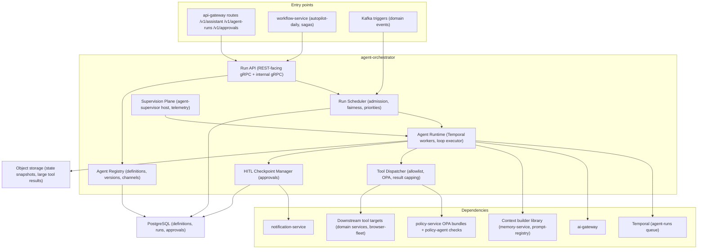
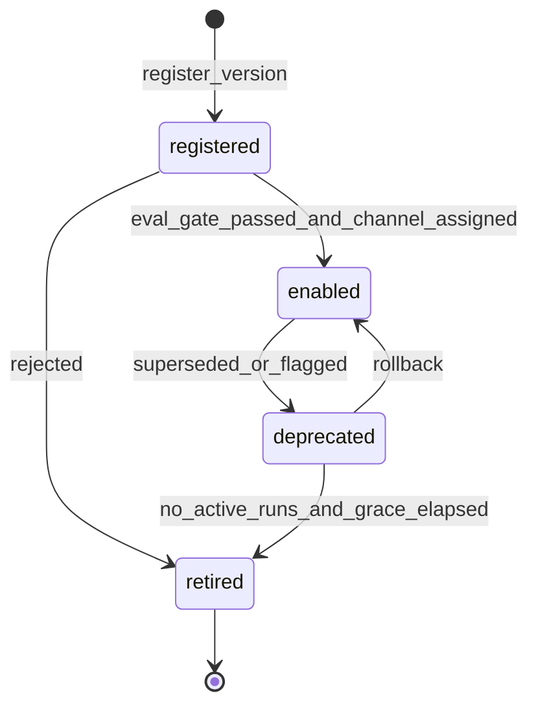
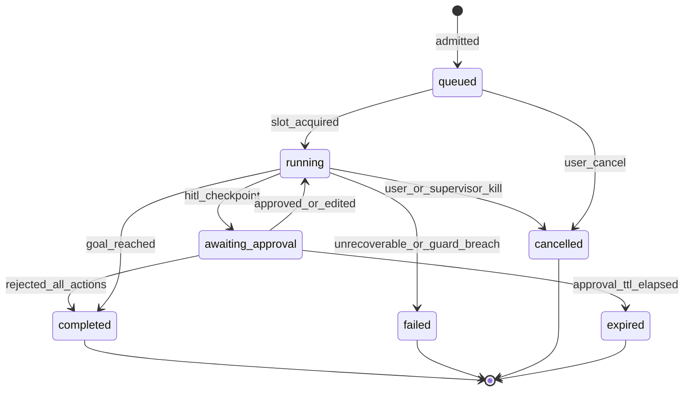
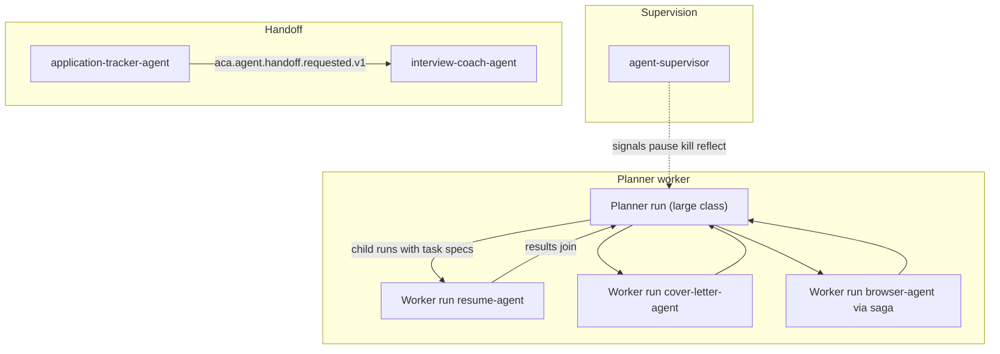
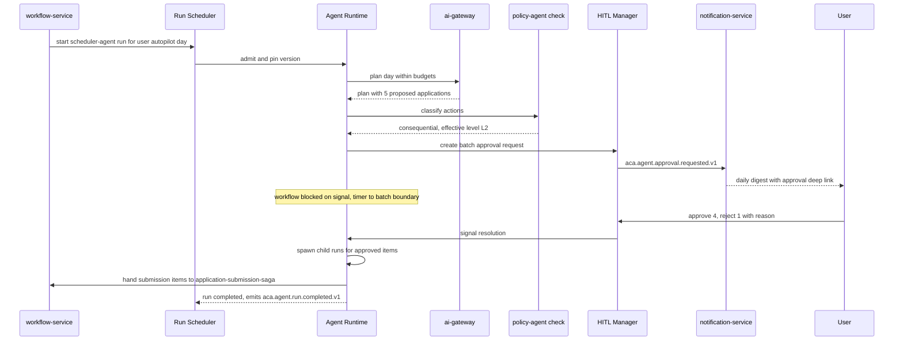

# 19 — Agent Orchestrator

| | |
|---|---|
| Document ID | ACA-SAS-19 |
| Volume | 2 — Core Services |
| Status | Draft v1.0 |
| Depends on | [00 — Architecture Canon](../00-architecture-canon.md), [09 — Microservice Architecture](09-microservice-architecture.md), [16 — Universal Portal Engine](16-universal-portal-engine.md), [17 — Browser Fleet](17-browser-fleet.md), [18 — AI Gateway](18-ai-gateway.md), [20 — Workflow Engine](20-workflow-engine.md) |

## 1. Overview

`agent-orchestrator` is the runtime and control plane for the canonical agent catalog (canon [§5](../00-architecture-canon.md)): 23 logical AI workers, from `job-scout-agent` to `agent-supervisor`. Agents are **not microservices** — they are versioned definitions (tools, prompts, model class, autonomy constraints, budgets) executed on a shared runtime that this service owns. That design choice is the load-bearing wall of the AI plane: one runtime means one place to enforce tool allowlists, budget caps, HITL checkpoints, checkpointing, and supervision for every agent, and one registry means agents ship like configuration (register → canary → stable) instead of like deployments.

The service has four planes. The **registry** holds agent definitions and versions with a lifecycle (`registered → enabled → deprecated → retired`) and channel-based rollout (stable/canary, mirroring `prompt-registry-service`). The **scheduler** admits run requests under per-tenant concurrency and fairness controls. The **runtime** executes the canonical agent loop (Perceive → Retrieve → Plan → Act → Verify → Reflect/Learn, canon §9) as Temporal workflows — every agent run is durable, checkpointed, and resumable across pod loss, provider outages, and multi-day human approvals. The **supervision plane** (`agent-supervisor`, plus run telemetry) detects loops, stalls, and cost runaways.

Durability is delegated: agent runs execute as `AgentRunWorkflow` on the `agent-runs` task queue of the Temporal cluster operated by `workflow-service` ([Chapter 20](20-workflow-engine.md)); `agent-orchestrator` owns the workers, workflow code, and all agent-domain state. This is a deliberate division — [Chapter 20 §3](20-workflow-engine.md) records it — that keeps one Temporal cluster (operational cost) while keeping agent logic inside the agent service (ownership).

This chapter specifies the definition model and registry lifecycle, run scheduling and concurrency control, the loop implementation and its checkpointing, multi-agent collaboration patterns (planner/worker, supervisor, event-based handoff), HITL checkpoint mechanics end to end, sandboxing and tool allowlists, agent health monitoring, canary rollout of agent versions, the event and API surface, and failure modes.

## 2. Component Architecture



| Component | Purpose | Failure posture |
|---|---|---|
| Run API | start/inspect/cancel runs, approvals, assistant entry | stateless; fail-closed on authz |
| Agent Registry | definitions, versions, lifecycle, channel weights | read-heavy; serves from cache with 60 s TTL if DB degraded |
| Run Scheduler | admission control, per-tenant concurrency, fair queuing | fail-closed for new runs; running work unaffected |
| Agent Runtime | Temporal workers executing the loop | pod loss is invisible (durable execution) |
| Tool Dispatcher | allowlist + OPA + schema validation + result capping | fail-closed per tool call |
| HITL Checkpoint Manager | approval records, notification, resume signals | approvals persist; resume is idempotent |
| Supervision Plane | agent-supervisor execution, run telemetry aggregation | advisory; its loss degrades detection, never execution |

## 3. Agent Definition Model & Registry

### 3.1 Definition model

An agent version is a complete, immutable execution contract. Nothing about an agent's behavior is ambient — if it is not in the version record, the runtime will not do it.

| Field | Content | Enforced by |
|---|---|---|
| `agent_id` | canonical catalog name (`resume-agent`, …); only canon §5 names admissible — new agents require canon amendment | registry validation |
| `version` | semver; immutable once registered | registry |
| `model_class` | default class per canon §10.1; optional per-phase overrides (e.g., `plan: large`, `verify: small`) | runtime → ai-gateway request |
| `prompt_refs` | `prompt_id@semver` per loop phase, resolved through prompt-registry channels | context builder |
| `tool_allowlist` | tool registry ids this version may call | Tool Dispatcher (hard) |
| `autonomy_ceiling` | per action class, the max autonomy level (L0–L3) this agent may exercise regardless of user setting — effective level = `min(user setting, agent ceiling, policy)` | HITL manager + policy-agent |
| `budgets` | `max_steps` (default 24), `max_cost_usd`, `max_duration`, `max_tool_calls`, per-phase token budgets | runtime loop guard |
| `triggers` | events/schedules/API entry points allowed to start this agent | scheduler admission |
| `collaboration` | roles this version may play (planner, worker, handoff source/target list) | runtime |
| `checkpoint_policy` | snapshot cadence, continue-as-new threshold | runtime |
| `channel_weights` | stable/canary split for rollout (§10) | scheduler version pin |

Default `max_steps` 24: p99 of successful runs across the catalog design model is 18 steps; 24 gives headroom without letting a looping agent burn a run budget slowly.

```sql
-- agent-orchestrator owns this schema
CREATE TABLE agent_version (
  id               uuid PRIMARY KEY,               -- UUIDv7
  agent_id         text NOT NULL,                  -- canonical catalog name
  version          text NOT NULL,                  -- semver
  status           text NOT NULL,                  -- registered|enabled|deprecated|retired
  model_class      text NOT NULL,
  phase_overrides  jsonb NOT NULL DEFAULT '{}',
  prompt_refs      jsonb NOT NULL,
  tool_allowlist   jsonb NOT NULL,
  autonomy_ceiling jsonb NOT NULL,
  budgets          jsonb NOT NULL,
  triggers         jsonb NOT NULL,
  collaboration    jsonb NOT NULL DEFAULT '{}',
  checkpoint_policy jsonb NOT NULL,
  channel_weights  jsonb NOT NULL DEFAULT '{"stable":100}',
  created_by       text NOT NULL,
  created_at       timestamptz NOT NULL,
  UNIQUE (agent_id, version)
);

CREATE TABLE agent_run (
  id              uuid PRIMARY KEY,                -- run_ prefixed externally
  tenant_id       uuid NOT NULL,
  user_id         uuid,
  agent_id        text NOT NULL,
  agent_version   text NOT NULL,
  channel         text NOT NULL,                   -- stable|canary|shadow
  parent_run_id   uuid,                            -- planner/worker + handoff lineage
  goal            jsonb NOT NULL,
  status          text NOT NULL,
  priority        text NOT NULL,                   -- interactive|autopilot|backfill
  temporal_wf_id  text NOT NULL,
  state_ref       text,                            -- object storage snapshot pointer
  steps           int NOT NULL DEFAULT 0,
  cost_usd        numeric(12,6) NOT NULL DEFAULT 0,
  started_at      timestamptz,
  ended_at        timestamptz,
  end_reason      text,
  created_at      timestamptz NOT NULL
) PARTITION BY RANGE (created_at);                 -- daily partitions (high volume, canon §11)
```

Row-Level Security on `tenant_id` per canon §6; `agent_version` is platform-scoped (definitions are not tenant data).

### 3.2 Registry lifecycle



- **registered:** version exists, runnable only in `shadow` channel (no side effects; L0 forced). Gate to `enabled`: golden-set eval pass on its prompt refs (prompt-registry, canon §10.4) + successful shadow runs ≥ 50 (enough for stable success-rate estimates on low-variance tasks).
- **enabled:** eligible for channel traffic per `channel_weights` (§10).
- **deprecated:** accepts no new runs; in-flight runs complete (a multi-day HITL wait must not be orphaned by a rollout). Grace: 7 days or last active run, whichever is later.
- **retired:** immutable history only. Versions are never deleted — run records reference them for audit.

Registration is API-driven from CI (agent definitions live in a git repo; merge → register → shadow → promote), never hand-edited in production. `SetChannel` and `Deprecate` are JIT-elevated admin operations, audit-logged.

## 4. Run Scheduling & Concurrency Control

Run requests arrive from three sources: interactive APIs (assistant, explicit user actions), `workflow-service` (autopilot-daily plans, saga steps), and Kafka triggers (e.g., `aca.offer.received.v1` admitting `negotiation-agent` per the definition's `triggers`). All pass one admission path:

1. **Entitlement/plan check** — agent class availability per plan (canon §12: e.g., `negotiation-agent` is Premium+).
2. **Budget precheck** — `cost-controller` scope headroom ≥ the version's `max_cost_usd` floor; else defer (autopilot) or degrade-and-warn (interactive).
3. **Concurrency admission** — per-tenant token buckets (table below). Over-limit: interactive requests queue FIFO ≤ 60 s then reject with retry-hint; autopilot/backfill requests park in a Temporal-backed deferral queue (durable, resumes when slots free).
4. **Fairness** — global capacity is shared by weighted fair queuing over tenants within each priority band (`interactive` > `autopilot` > `backfill`), weight = plan tier. Prevents one enterprise tenant's import backfill from starving individual users; bands prevent any background class from delaying interactive runs.
5. **Version pin** — channel selection (§10) fixes `agent_version` at admission; a run never changes version mid-flight.

| Plan | Concurrent runs/tenant | Runs/day/tenant | Rationale |
|---|---|---|---|
| Free | 1 | 20 | matches 10 tracked applications/mo posture; assist-level usage |
| Professional | 4 | 300 | autopilot L2 daily batch + interactive headroom |
| Premium | 8 | 1,200 | autopilot L3 at 400 applications/mo ceiling with retries |
| Enterprise | custom (default 16/seat-pool) | contract | sized in the tenant's cell |

Per-agent global concurrency caps also apply (e.g., `browser-agent` runs are additionally capped by browser-fleet pool capacity — the scheduler consults `browser-fleet-service` advertised headroom rather than admitting runs that will block on browsers).

## 5. Agent Loop Implementation

The canonical loop (canon §9) maps onto a Temporal workflow with each externally-effectful phase as an activity. The workflow is the deterministic spine; all I/O, model calls, and clock reads live in activities.

| Phase | Implementation | Activity? |
|---|---|---|
| Perceive | normalize trigger payload; load run goal + constraints; fetch entity state | yes (`perceive`) |
| Retrieve | context builder → PromptEnvelope (memory-service tiers, prompt-registry channel resolution, task retrieval) | yes (`build_context`) |
| Plan | `ai-gateway` Complete (phase model class; structured plan schema) | yes (`llm_call`) |
| Act | Tool Dispatcher per planned tool call; policy-agent pre-check on consequential actions; HITL checkpoint if required | yes (`tool_call`, `policy_check`) |
| Verify | validators: tool postconditions, task-specific checks, output schema | yes (`verify`) |
| Reflect/Learn | outcome extraction → memory-service write + learning-pipeline event; decide continue/finish | yes (`reflect`) |

Loop guards evaluated in workflow code between iterations: step count vs `max_steps`, accumulated cost vs `max_cost_usd` (cost returned by each `llm_call`/`tool_call` activity), wall clock vs `max_duration`, and supervisor directives (§9) delivered as Temporal signals. Guard breach → structured termination with `end_reason` (`budget_exhausted`, `step_limit`, `superseded`, …) — never a silent stop.

### 5.1 State checkpointing to Temporal

- **Primary state = workflow event history.** Every activity result (model outputs, tool results ≤ 64 KiB inline) is durably recorded by Temporal; a runtime pod crash resumes the run at the exact step boundary on another worker.
- **Large payloads** (DOM snapshots, long transcripts) go to object storage with references in history (canon §9 tool-result convention) — keeps history events small and replay fast.
- **AgentState snapshot** (compressed working memory: message window refs, scratchpad, plan graph) is written to object storage every N steps (default 6, per `checkpoint_policy`) with the pointer in `agent_run.state_ref`. Purpose: human-readable debugging, supervisor inspection, and cheap handoff context (§6.3) without replaying history.
- **Continue-as-new** at 200 history events or 2 MB (Temporal history hygiene; long autopilot runs cross this) carrying the latest snapshot pointer forward.
- **Determinism rules:** no clock/random/network in workflow code; version markers via Temporal patching for loop-logic changes ([Chapter 20 §8](20-workflow-engine.md) governs the patching policy).

### 5.2 Run lifecycle



`failed` runs emit `aca.agent.run.failed.v1` and, for retry-worthy classes (browser flows), are picked up by `recovery-agent` via that event — recovery is a *new linked run*, not a mutation of the failed one (clean audit lineage via `parent_run_id`).

## 6. Multi-Agent Collaboration Patterns

Three sanctioned patterns. Anything else (free-form agent-to-agent chatter) is deliberately unsupported — collaboration must be legible to supervision, budgeting, and audit.



### 6.1 Planner/worker

A planner run (e.g., `scheduler-agent` composing an autopilot day, or an assistant task decomposition) produces a typed task DAG; workers execute as **Temporal child workflows** of the planner's workflow — cancellation, budget, and failure semantics compose for free (planner cancel cascades; child failure surfaces as a typed result, not a lost thread). Worker results join at the planner, which owns synthesis. Budget rule: the planner's admitted budget is the envelope; child budgets are carved from it at spawn (sum of child `max_cost_usd` ≤ remaining planner budget) so fan-out can never multiply spend past admission.

### 6.2 Supervisor

`agent-supervisor` never sits in the data path. It observes (telemetry + events) and intervenes via signals (§9). This asymmetry is intentional: a supervision outage degrades detection, not execution.

### 6.3 Handoff protocol (via events)

Handoff transfers *goal ownership* between agents across time (e.g., `application-tracker-agent` detects an interview invitation and hands off to `interview-coach-agent`; `browser-agent` hands a thrice-failed portal flow to `recovery-agent`).

| Topic | Key | Payload sketch |
|---|---|---|
| `aca.agent.handoff.requested.v1` | `tenant_id` | `handoff_id, from_run_id, from_agent, to_agent, goal, context_ref (snapshot in object storage), reason, deadline` |
| `aca.agent.handoff.accepted.v1` | `tenant_id` | `handoff_id, to_run_id` |

Rules: (a) target must list the source in its definition's `collaboration.handoff_from` — the registry, not runtime improvisation, defines who may hand to whom; (b) the source run terminates (`end_reason=handed_off`) only on `accepted` — until then it owns the goal (no orphaned goals); acceptance timeout 15 min → source escalates to supervisor; (c) `context_ref` points to an AgentState snapshot — the receiving run starts from Perceive with that context, it does not resume the source's history (clean version boundaries); (d) exactly one active owner per goal, enforced by a uniqueness guard on (`tenant_id`, goal fingerprint) among active runs. Both topics are agent-domain extensions of the canon topic set (recorded for promotion).

## 7. HITL Checkpoint Mechanics

The runtime inserts a checkpoint whenever a planned action is **consequential** (policy-agent classification: submissions, outbound communications, credential-touching flows, spend above threshold) and the effective autonomy level — `min(user setting per action class, agent autonomy_ceiling, policy-agent verdict)` — requires approval (L1 per action; L2 batched daily). Application submission defaults to L1 (canon §9).

Mechanics:

1. Runtime persists an `approval_request` row (proposed action, rendered human-readable diff/preview, evidence refs, expiry) and emits `aca.agent.approval.requested.v1`.
2. The Temporal workflow blocks on a signal with a timer (TTL default 72 h — long enough for a weekend, short enough that stale actions die; L2 batch items expire at the next batch boundary instead).
3. `notification-service` consumes the event; channel + urgency per user preferences; the approval deep-links into the dashboard approval inbox (`GET /v1/approvals`).
4. User resolves: approve / approve-with-edits (edited payload replaces the proposal — treated as user-authored input, `safety_profile=user_authored` downstream) / reject (with optional reason, captured for learning-pipeline).
5. Run API validates the resolver (tenant + user match, one-shot idempotent resolution) and signals the workflow; the loop resumes at Act with the resolved action, or skips it on reject.
6. Expiry → workflow proceeds as reject-all with `end_reason=expired_pending_approval` and a notification (users must learn the cost of ignoring approvals from the product, not from silence).

Approvals are auditable artifacts: resolution actor, timestamp, and payload hash mirror to `aca.audit.event.v1`.

### 7.1 Sequence — autopilot plan with L2 batch approval



## 8. Sandboxing & Tool Allowlists

Agents act **only** through the Tool Dispatcher; there is no other effectful pathway out of the runtime.

- **Tool registry:** each tool = JSON Schema (params/result), target service + gRPC method, required scopes, consequential flag, cost weight, result size policy. Tools are platform-defined; agent versions reference them by id in `tool_allowlist` — the dispatcher hard-fails any call outside the pinned allowlist (an injected "use tool X" instruction fails closed even if the model emits it).
- **Per-call enforcement:** schema-validate params → OPA check (`agent_id`, version, tenant, autonomy, tool, param classification — policy bundles from `policy-service`) → consequential-flag HITL routing (§7) → invoke over mesh with the *runtime's* SPIFFE identity plus `run_id` attribution headers → result size cap 64 KiB inline, overflow to object storage + reference (canon §9) → full call audit-logged.
- **Network sandbox:** runtime pods carry a NetworkPolicy with **no public egress**; the only routes are mesh services on the tool registry's target list. Browser actions exist solely as tools that call `browser-fleet-service` — the runtime cannot reach the internet, and per canon §13 credentials are injected by the session-vault sidecar at browser egress, never present in runtime memory or model context.
- **Data sandbox:** the runtime holds no standing DB credentials to other services (no cross-service DB access, canon §11); everything is API-mediated and therefore RLS/OPA-guarded at the owner.
- **Prompt-side defense** is layered with [Chapter 18 §7](18-ai-gateway.md): the gateway screens content; the dispatcher constrains capability. An injection must defeat both to act — and consequential actions still hit policy-agent + HITL.

## 9. Agent Health Monitoring (`agent-supervisor`)

`agent-supervisor` is itself a catalog agent executing on this runtime (dogfooding, with a guard: it runs at `small`/`medium` class, its tool allowlist contains only supervision signals, and it is excluded from supervising itself — a stuck supervisor is caught by plain Prometheus alerts on its run cadence).

Inputs: run telemetry stream (step events with cost/latency/tool outcomes), `aca.agent.run.*` events, and sampled AgentState snapshots.

| Detection | Rule (default) | Action ladder |
|---|---|---|
| Loop | identical (tool, params-hash) 3× consecutively, or plan-state hash repeats 3× | inject reflection prompt → pause + HITL escalate → kill |
| Stall | no step progress > 5 min (interactive) / > 30 min (background), excluding legitimate waits (HITL, browser session queue) | probe → reschedule activity → escalate |
| Cost runaway | > 80 % run budget consumed before 50 % plan progress | downgrade model class for remaining steps → pause + escalate |
| Thrash | plan revised > 4 times without an executed action | force HITL on next action |
| Behavioral anomaly | security-agent flag on run content (injection suspicion, policy probe patterns) | pause + security review queue |

Rule rationale: thresholds are set at ~p99.5 of healthy-run telemetry from the design model, tightened per-agent as production data accrues (thresholds are per-agent config in the supervisor's definition, not code). Interventions are Temporal signals (§5); every intervention emits an event consumed by `learning-pipeline` (systemic loop patterns are prompt bugs, and the feedback loop fixes them at the source).

Fleet-level health: the supervision plane aggregates per-agent success rate, median cost, HITL rejection rate, and handoff rates into the agent fleet dashboard (`admin-service` ops view) — the same metrics that gate canary promotion (§10).

## 10. Versioned Agent Rollout (Canary Agents)

Rollout is a registry operation, not a deployment:

1. New version registers from CI → `shadow` channel: runs execute against real triggers (sampled ≤ 5 % of matching runs) with side effects suppressed (L0 forced, tools in dry-run where supported); outputs land in eval storage.
2. Eval gate (prompt-registry golden sets + shadow success stats) → `enabled` with `channel_weights {stable: 95, canary: 5}`. Canary assignment: `hash(tenant_id, agent_id) mod 100 < 5` — sticky per tenant so a tenant sees consistent behavior, and skewed away from Free tenants' consequential actions (canary + consequential forces HITL for the first 48 h regardless of autonomy level — new agent versions earn autonomy).
3. Promotion: `learning-pipeline` compares canary vs stable on success rate, cost/run, duration, HITL rejection rate, supervisor intervention rate over a minimum 500 runs or 7 days (statistical floor for the noisier agents). Pass → weights shift 5 → 25 → 100 (mirroring the platform's Argo canary shape); fail → weights to 0 (instant rollback — a pointer flip, no deploy) + incident.
4. Old version → `deprecated` after 7 days at 0 %, → `retired` per §3.2.

Version pinning at admission (§4) means rollback never yanks a version out from under a running multi-day workflow.

## 11. API & Events

### 11.1 External REST (via `api-gateway`, routes per [Chapter 10 §3.2](10-api-gateway.md))

| Method & path | Purpose | Notes |
|---|---|---|
| `POST /v1/agent-runs` | start an interactive run | Idempotency-Key honored; returns `run_` id |
| `GET /v1/agent-runs/{id}` | run status + step timeline | step timeline is the user-visible activity feed source |
| `POST /v1/agent-runs/{id}:cancel` | cancel | cascades to child runs |
| `GET /v1/agent-runs?status=&agent=` | list, cursor-paginated | canon §7 pagination |
| `GET /v1/approvals?status=pending` | approval inbox | |
| `POST /v1/approvals/{id}:approve` / `:reject` | resolve (supports `edits` payload) | one-shot; 409 on already-resolved |
| `POST /v1/assistant/messages` | conversational entry → assistant run | streams via realtime channel ([Chapter 18 §8](18-ai-gateway.md)) |

### 11.2 Internal gRPC

| RPC | Callers | Purpose |
|---|---|---|
| `aca.agent.v1.Runs/Start` / `Get` / `Cancel` / `Signal` | workflow-service, domain services | run control; `Signal` carries HITL resolutions + supervisor directives |
| `aca.agent.v1.Registry/RegisterVersion` / `SetChannel` / `Deprecate` | CI pipeline, admin-service | lifecycle (§3.2); SetChannel/Deprecate JIT-elevated |
| `aca.agent.v1.Registry/GetDefinition` | runtime, learning-pipeline | resolved definition by channel |
| `aca.agent.v1.Supervision/Report` | agent-supervisor | intervention reporting |

### 11.3 Events

| Topic | Key | Emitted when |
|---|---|---|
| `aca.agent.run.started.v1` | `tenant_id` | run leaves `queued` |
| `aca.agent.run.completed.v1` | `tenant_id` | terminal success (payload: outcome summary, cost, steps, child run ids) |
| `aca.agent.run.failed.v1` | `tenant_id` | terminal failure (payload: `end_reason`, last step ref) — `recovery-agent` trigger |
| `aca.agent.approval.requested.v1` | `tenant_id` | HITL checkpoint created |
| `aca.agent.approval.resolved.v1` | `tenant_id` | resolution (actor, decision, edit hash) — domain extension, recorded |
| `aca.agent.handoff.requested.v1` / `accepted.v1` | `tenant_id` | §6.3 — domain extension, recorded |

## 12. Failure Scenarios

| Scenario | Detection | Behavior | Recovery |
|---|---|---|---|
| Runtime pod loss mid-run | Temporal task timeout | activity retried on another worker from history; at-least-once activities are idempotent ([Chapter 20 §7](20-workflow-engine.md)) | invisible to users beyond latency |
| ai-gateway degraded/failover | activity errors / `degraded_reason` | loop retries per activity policy; on class degrade, verify-phase tightens (cheaper models get stricter validation); sustained outage → runs park durably, scheduler pauses admission of non-interactive runs | resume on recovery; no lost runs |
| Temporal cluster outage | workflow-service alerts | new admissions rejected (interactive gets clear retry-after); running state is durable in Temporal persistence | runs resume on cluster recovery; [Chapter 20 §10](20-workflow-engine.md) DR |
| Approval never answered | TTL timer | `expired_pending_approval` path (§7) with notification | user re-triggers if still wanted |
| notification-service down during approval | delivery-receipt gap | approval still visible in inbox API (pull path); TTL unchanged; alert on receipt-gap rate | push catch-up on recovery |
| Registry DB degraded | read errors | runtime serves cached definitions (60 s TTL, then extended-stale up to 15 min with alert); registrations/channel changes fail closed | definitions are slow-moving; stale reads are safe |
| Supervisor blind (telemetry lag) | supervisor heartbeat metric | execution unaffected (§6.2); loop/cost guards in workflow code still bound worst case | supervision resumes; backlog scan on recovery |
| Buggy canary version | canary metric deltas / supervisor interventions spike | weights → 0 (instant), incident, affected runs completed or killed per severity | stable path unaffected (95 %) |
| Tenant flood (event-trigger storm) | admission queue depth per tenant | fair queuing confines impact to the tenant's own bands; deferral queue absorbs | drains within tenant limits |

## 13. Scaling Strategy

Stateless planes (API, scheduler, dispatcher logic) scale on RPS. The runtime scales on **Temporal task backlog**: HPA on `agent-runs` task-queue schedule-to-start p95 (target < 2 s; the queue metric is the true demand signal, pod CPU is not). Design point: 2M runs/day at ~10 model calls per run — the dominant single share of the 50M ai-gateway calls/day ([Chapter 18 §12](18-ai-gateway.md)), the remainder being domain-service and pipeline traffic; average 25 in-flight steps/s per 1,000 concurrent runs; worker pods sized at ~200 concurrent activities (I/O-bound Python, same profile as ai-gateway pods) → baseline fleet 30 pods, HPA to 90. Postgres: `agent_run`/step telemetry partitioned daily, 90-day hot (aligned with AI request logs), archived to object storage. Per-cell: the whole service deploys per cell; the registry is control-plane data replicated read-only into cells (definitions are global, runs are cell-local). Supervisor scales by sharding tenants across supervisor run instances.

## 14. Security Considerations

- **Capability confinement:** allowlists + OPA + no-egress NetworkPolicy (§8) mean a fully compromised model output still cannot exceed its tool surface; consequential tools additionally require policy-agent clearance + HITL per autonomy.
- **Identity:** runs execute under the runtime's SPIFFE identity with `run_id`/`tenant_id` attribution — downstream services enforce tenant scoping via RLS/OPA; the runtime never holds user credentials (session-vault boundary, canon §13).
- **Approval integrity:** approvals resolved only by authenticated tenant users with the required role; one-shot resolution; payload-hash binding prevents approve-then-swap; mirrored to the hash-chained audit log.
- **Injection posture:** dual-layer with ai-gateway (§8); `security-agent` consumes run telemetry for behavioral screening; canary versions earn autonomy (§10).
- **Registry supply chain:** definitions flow from signed CI artifacts; production channel changes are JIT-elevated and audited.

## 15. Observability

| Signal | Target / alert |
|---|---|
| Run success rate per agent | per-agent SLO (browser-adjacent agents track the ≥ 92 % portal-success canon SLO); regression alerts feed rollback |
| Schedule-to-start p95 (`agent-runs` queue) | < 2 s; scaling signal + page at 10 s |
| Steps per run, cost per run (p50/p99) per agent+version | canary comparison inputs; runaway alerts |
| HITL funnel (requested → notified → resolved, resolution latency, rejection rate) | product + trust dashboard; expiry rate > 10 % alerts UX owner |
| Supervisor interventions by type | spike alerts; weekly review feeds prompt fixes |
| Handoff acceptance latency | > 15 min timeout rate alert |
| Deferral queue depth per tenant band | capacity planning; per-tenant flood visibility |
| Autopilot end-to-end (trigger → scored → drafted) | inside the 15-min discovery-to-scored and 60 s draft SLOs (canon §14) |

Every run carries `trace_id` from trigger through workflow, activities, ai-gateway calls, and emitted events (`traceparent` extension) — one trace shows a complete agent decision path; the step timeline API (§11.1) is a projection of the same data, so support and users see what engineering sees.

## 16. Future Improvements

- **Learned admission control:** predict run cost/duration at admission (learning-pipeline model) to pack concurrency slots better than static per-plan caps.
- **Cross-agent shared plan memory:** planner DAG reuse for recurring autopilot shapes (currently re-planned daily; caching candidate identified by cost dashboards).
- **Policy-aware speculative execution:** pre-compute L2 batch actions in dry-run so approval → submit latency drops to near zero.
- **Tenant-scoped custom agents** (enterprise): registry namespaces for tenant-authored definitions constrained to platform tool registry + tightened ceilings — the definition model already carries the constraint surface.

## 17. Alternatives Considered & Tradeoffs

| Decision | Alternatives | Why this way |
|---|---|---|
| Agents as data on one runtime | agent-per-microservice; framework-per-team (LangGraph et al. embedded in each service) | One enforcement point for allowlists/budgets/HITL/supervision; agents ship like config. Tradeoff: the runtime is a critical shared component — mitigated by durable execution and per-cell deployment. |
| Runs as Temporal workflows | custom run-state machine in Postgres + queue; in-memory loops with periodic snapshots | Multi-day HITL waits, crash resume, child-workflow semantics, and signals are exactly Temporal's contract; a custom engine would re-implement it worse ([Chapter 20 §1](20-workflow-engine.md)). Tradeoff: Temporal becomes a hard dependency of the AI plane — accepted platform-wide. |
| Workers owned here, cluster owned by workflow-service | orchestrator runs its own Temporal cluster | One cluster = one operational surface (upgrades, DR); ownership split documented in [Chapter 20 §3](20-workflow-engine.md). Tradeoff: shared-cluster noisy-neighbor risk — bounded by per-queue quotas. |
| Handoff via events + snapshot, not shared history | transfer the Temporal workflow itself; shared mutable memory between agents | Clean ownership + version boundaries; receiving agent starts from Perceive with explicit context (auditable). Tradeoff: context loss beyond the snapshot — acceptable, snapshots are the designed context contract. |
| Effective autonomy = min(user, agent ceiling, policy) | user setting alone | An agent bug or injected instruction must never *raise* autonomy; the ceiling makes the safe bound structural. Tradeoff: occasional user surprise ("why did it ask?") — surfaced in the approval UI reason field. |
| Supervisor as observing agent (signals only) | inline supervision middleware in the loop | Inline supervision couples every run's latency and availability to the supervisor; observation + signals degrades safe. Tradeoff: detection lag (seconds) — acceptable for the failure classes involved. |
| Registry-driven canary (config flip) | version rollout via service deployment (Argo) | Agent behavior changes are data changes; pointer-flip rollback in seconds beats redeploys, and shadow channel gives pre-traffic evidence. Tradeoff: two rollout systems on the platform (deploys + registry) — aligned by mirroring the 5/25/100 shape. |
