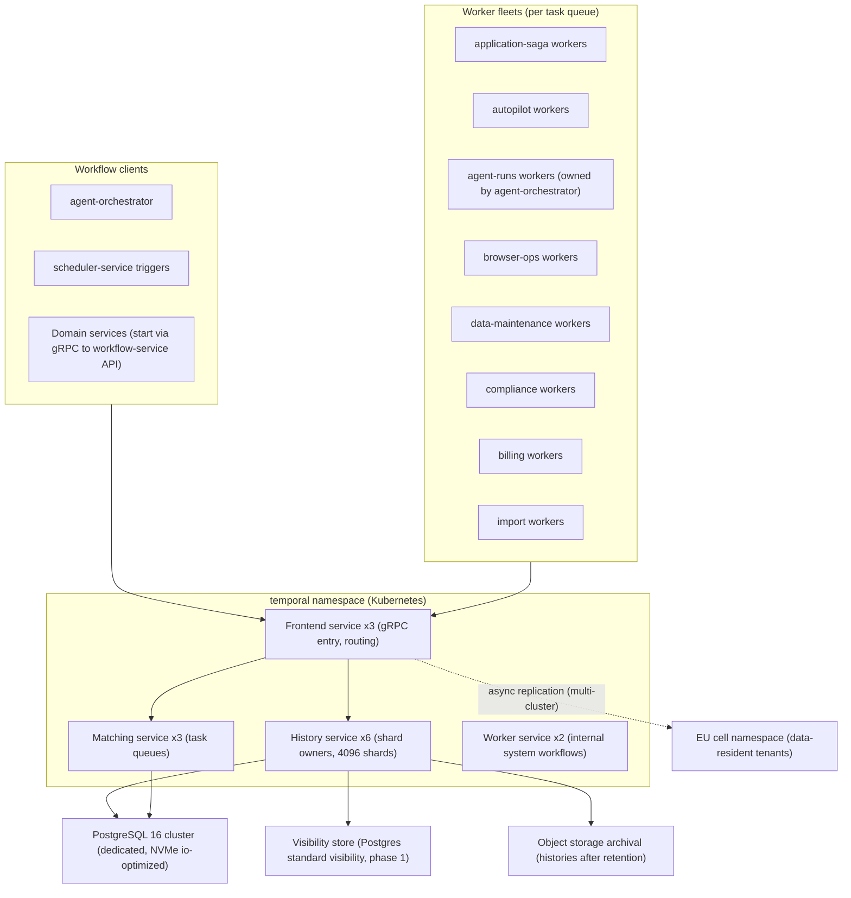
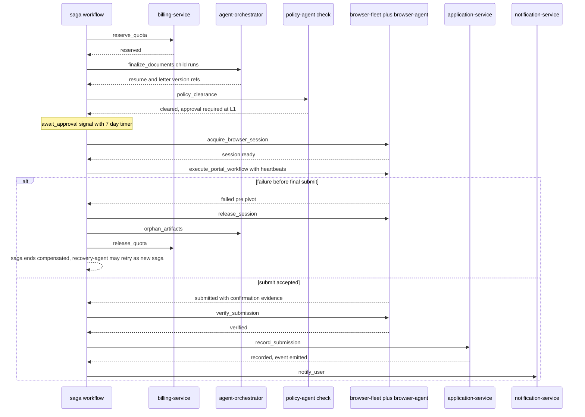
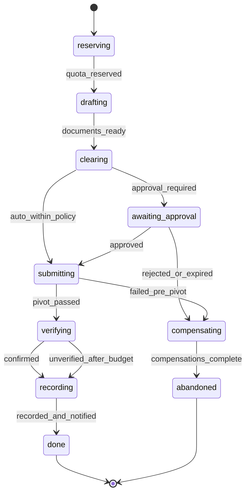
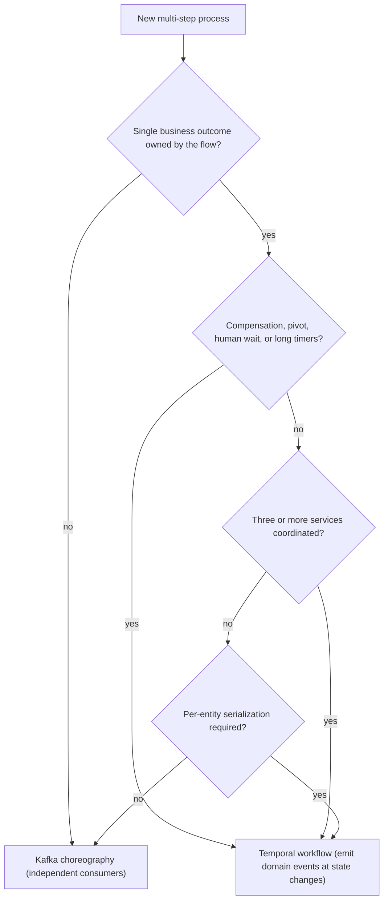

# 20 — Workflow Engine

| | |
|---|---|
| Document ID | ACA-SAS-20 |
| Volume | 2 — Core Services |
| Status | Draft v1.0 |
| Depends on | [00 — Architecture Canon](../00-architecture-canon.md), [09 — Microservice Architecture](09-microservice-architecture.md), [16 — Universal Portal Engine](16-universal-portal-engine.md), [17 — Browser Fleet](17-browser-fleet.md), [18 — AI Gateway](18-ai-gateway.md), [19 — Agent Orchestrator](19-agent-orchestrator.md) |

## 1. Overview

`workflow-service` is the platform's durable-execution backbone: a self-hosted Temporal cluster plus the worker fleets that run ACA's long-running orchestrations (canon [§3](../00-architecture-canon.md)). Everything on this platform that spans minutes to weeks — an autopilot day, an application submission that waits three days for a human approval and then drives a browser for eleven minutes, a GDPR deletion fanning out across thirty services — executes as a Temporal workflow, not as hand-rolled state machines glued together with cron jobs and Kafka consumers.

**Why durable execution.** The alternative is the architecture every team builds accidentally: state columns (`status = 'awaiting_docs'`), scheduled sweepers that find stuck rows, retry bookkeeping per integration, and compensation logic scattered across consumers — a distributed state machine with no single definition, no replayability, and failure modes discovered in production. Temporal collapses all of it into ordinary code with a persistence guarantee: workflow state *is* the event history; a crashed worker resumes mid-flow on another pod; timers survive restarts and region failovers; retries, heartbeats, and compensation are declarative. The canon makes this structural (§2, §8): sagas are **orchestrated via Temporal, not choreographed** — cross-service transactions have exactly one authoritative definition, in one file, testable by replay. The cost — operating a stateful cluster, determinism discipline in workflow code, a versioning regime for in-flight histories — is the subject of this chapter.

Ownership split, stated precisely: `workflow-service` owns the Temporal cluster (server, persistence, visibility, upgrades, DR) **and** the worker fleets for platform/domain workflows (§4). One exception, recorded here as the authoritative decision: the `agent-runs` task queue's workers (workflow + activity code for agent runs) are owned and deployed by `agent-orchestrator` ([Chapter 19 §5](19-agent-orchestrator.md)) — agent-loop logic belongs to the agent service, the cluster stays singular. Domain workflow *code* (e.g., the submission saga's activities) lives in this service but calls domain services exclusively through their public gRPC APIs — the no-cross-service-DB rule (canon §11) applies to activities with no exceptions.

This chapter covers cluster topology and persistence sizing, task queues and worker fleets, the canonical workflow catalog with a full walkthrough of `application-submission-saga` including compensation, retry/timeout/heartbeat policy classes, idempotent activity design, versioning of long-running workflows, the Temporal-vs-choreography boundary rules, scaling and multi-region DR, and workflow observability.

## 2. Cluster Topology & Persistence Sizing

Deployment decisions:

| Item | Choice | Rationale |
|---|---|---|
| Temporal server pods | frontend ×3, history ×6, matching ×3, worker ×2 (3 AZs) | history is the hot tier (shard ownership); 6 pods keep per-pod shard count ≤ ~700 at 4096 shards |
| History shards | **4096**, fixed at cluster creation | shards cannot be changed later without a new-cluster migration; 4096 supports ~10k state transitions/s ceiling — 5-year headroom over the design load (below) |
| Persistence | dedicated PostgreSQL 16 cluster (CloudNativePG), 3 nodes, 32 vCPU / 128 GB, NVMe-class ≥ 20k IOPS | Temporal's dominant cost is persistence write latency; sharing the OLTP fleet would couple workflow liveness to domain load. Postgres over Cassandra: one database competency platform-wide (canon), and the write rate (below) is comfortably in Postgres range |
| Visibility | Postgres standard visibility (phase 1); Elasticsearch-compatible advanced visibility deferred to phase 2 | avoids a new stateful system at GA; list/filter needs at GA volume fit Postgres; decision recorded for canon promotion |
| Retention | 3 days after workflow close, then archival to object storage (13 months, aligned with AI request logs, canon §11) | 3 days covers post-incident inspection of recent runs; archival serves audits without bloating hot storage |
| Namespaces | `platform` (system), `agents`, `applications`, `data`, `compliance`, `billing`; separate namespace per EU cell | namespace = blast-radius + retention + replication unit; compliance flows get stricter archival |

**Persistence sizing (design load).** Dominant load is agent runs: 2M runs/day ([Chapter 19 §13](19-agent-orchestrator.md)) × ~60 state transitions per run (activities × events per activity, continue-as-new included) ≈ 120M transitions/day ≈ 1,400/s average, ~4,200/s at the 3× peak. Everything else (autopilot-daily 500k/day, submissions 100k/day, maintenance) adds < 15 %. At ~4 KB average per history event write (payload-capped, §7), peak write throughput ≈ 20 MB/s and ~12k IOPS with indexes — the 20k IOPS floor gives ~40 % headroom. Hot storage: 120M events/day × 4 KB × (avg 2-day open + 3-day retention) ≈ **2.4 TB** steady-state; provision 6 TB (growth + bloat + reindex slack). PITR per canon §11 (5-min RPO).

Payload discipline makes this math hold: activity inputs/results are capped at 64 KiB inline with object-storage overflow references ([Chapter 19 §5.1](19-agent-orchestrator.md)); a data-size codec enforces the cap at the SDK layer, so a careless activity cannot quietly turn history into a blob store.

## 3. Worker Fleets & Task Queues

One task queue per domain; one worker deployment per queue (independent scaling, independent failure). Queue-level rate limits protect downstream systems; worker-level `maxConcurrentActivities` protects the workers.

| Task queue | Workers owned by | Lang | Workloads | Key limits | Scaling signal |
|---|---|---|---|---|---|
| `agent-runs` | agent-orchestrator | Python | AgentRunWorkflow + loop activities | per-queue 3,000 activities/s | schedule-to-start p95 < 2 s |
| `autopilot` | workflow-service | Python | autopilot-daily per user | starts smoothed over the user's local-morning window (§4) | queue backlog vs window |
| `application-saga` | workflow-service | TypeScript | submission saga | 200 saga starts/s cap (downstream protection) | schedule-to-start p95 |
| `browser-ops` | workflow-service | TypeScript | long browser activities (heartbeating), verification steps | concurrency ≤ browser-fleet advertised capacity | fleet headroom |
| `import` | workflow-service | TypeScript | import-pipeline (LinkedIn/GitHub) | per-tenant 2 concurrent imports | backlog |
| `data-maintenance` | workflow-service | Python | re-embedding, backfills, index maintenance | 500 activities/s, yields to interactive queues | backlog age |
| `compliance` | workflow-service | TypeScript | gdpr-deletion, exports | none (must always drain) | backlog age > 1 h alerts |
| `billing` | workflow-service | TypeScript | billing-dunning, invoice retries | 50/s (Stripe rate posture) | backlog |

Language split follows the canon's service languages: AI-plane queues in Python, domain queues in TypeScript — activities reuse the owning domain's client libraries and types. All workers run the shared worker chassis (OTel interceptors, payload codec with cap + field-level encryption for P1 payloads, idempotency helpers §7, replay-test harness §8).

## 4. Canonical Workflow Catalog

| Workflow | Queue | Trigger | Typical / max duration | Pattern |
|---|---|---|---|---|
| `autopilot-daily` | `autopilot` | `scheduler-service` per-user cron event | 10 min / 24 h (L2 approval wait) | fan-out orchestration → child sagas |
| `application-submission-saga` | `application-saga` | approved application (agent plan or user click) | 4 min / 7 d (HITL TTL) | saga with compensation + pivot (§5) |
| `import-pipeline` | `import` | user connects LinkedIn/GitHub | 2 min / 2 h | pipeline with per-stage retry, partial-result commit |
| `gdpr-deletion` | `compliance` | `aca.user.deleted.v1` | 1 h / 30 d (canon §11 deadline) | fan-out to all data owners, per-service ack activities, certificate of completion → audit |
| `re-embedding` | `data-maintenance` | embedding version bump (canon §10.5) | days (paced) | batched iteration, continue-as-new per 10k items, dual-read cutover step |
| `billing-dunning` | `billing` | `aca.billing.subscription.changed.v1` payment-failed | 21 d | timer-driven retry ladder + entitlement downgrade steps |

Catalog notes: `autopilot-daily` starts are jittered across each user's local-morning window (uniform over 2 h) — 500k simultaneous starts would be a self-inflicted thundering herd on matching and ai-gateway. `gdpr-deletion` completion emits a hash-chained certificate event to `audit-service`; the workflow itself is retained only 3 days, the audit record 7 years (canon §11) — compliance evidence lives in the audit log, not in Temporal. `re-embedding` runs strictly in the ai-gateway batch lane ([Chapter 18 §9](18-ai-gateway.md)).

### 4.1 Saga walkthrough — `application-submission-saga`

The saga coordinates five services and one human. Steps, in order, with compensation defined per step:

| # | Step (activity) | Target | Compensation | Notes |
|---|---|---|---|---|
| 1 | `reserve_quota` | billing-service | `release_quota` | plan application quota (canon §12); reservation, not consumption |
| 2 | `finalize_documents` | agent-orchestrator (resume-agent, cover-letter-agent runs) | `orphan_artifacts` (mark for GC) | child agent runs; results are resume/letter version refs |
| 3 | `policy_clearance` | policy-agent check | — (read-only) | site policy, consent, autonomy requirements (canon §16) |
| 4 | `await_approval` | HITL if effective level requires ([19 §7](19-agent-orchestrator.md)) | — | signal + 7 d timer for submissions; reject ends saga cleanly |
| 5 | `acquire_browser_session` | browser-fleet-service | `release_session` | session with session-vault sidecar credential injection |
| 6 | `execute_portal_workflow` | browser-agent via browser-fleet | best-effort `abort_portal_flow` **before pivot only** | long activity, 15 s heartbeats; dry-run validation precedes final submit click (canon §16) |
| 7 | `verify_submission` | browser-agent verification + confirmation capture | — (post-pivot) | confirmation signal (page state, email hook) per canon §16 |
| 8 | `record_submission` | application-service | — (forward-only) | event-sourced application timeline; emits `aca.application.submitted.v1` |
| 9 | `notify_user` | notification-service | — | forward-only |

**The pivot.** Step 6's final submit action is the saga's point of no return: once the portal accepts the submission, the outside world has changed and compensation is a lie — there is no reliable "unsubmit." Before the pivot, any failure triggers reverse-order compensation of completed steps. After the pivot, the saga switches to **forward recovery only**: verification and recording retry until success or escalate to `recovery-agent` and support tooling; they never roll back. If verification cannot confirm within its budget, the application is recorded as `submitted_unverified` — deliberately: a false "not submitted" causes duplicate applications (user-visible harm at the portal), a conservative "unverified" causes a check task. Duplicate protection on retry of step 6 itself comes from the portal-workflow idempotency design (dry-run + pre-submit fingerprint check + per-application submission lock in application-service).

Saga phases as a state model (the `application_event` timeline in application-service mirrors these transitions as domain events):

## 5. Retry, Timeout & Heartbeat Policy Classes

Policies are named classes in the worker chassis — activities declare a class, not ad-hoc numbers. Every number's rationale, one line each:

| Class | start-to-close | schedule-to-close | Retry (initial / factor / max interval / max attempts) | Heartbeat | Used by |
|---|---|---|---|---|---|
| `idempotent-io` | 10 s | 24 h | 1 s / 2.0 / 60 s / unlimited within s2c | — | domain-service gRPC calls: cheap, safe to hammer gently for as long as the flow can wait |
| `llm-call` | per deadline class ([18 §3.3](18-ai-gateway.md)) | 1 h | 2 s / 2.0 / 30 s / **5** | — | model calls cost money; 5 attempts bounds spend, then workflow-level policy decides |
| `browser-step` | 10 min | 2 h | 30 s / 2.0 / 5 min / **3** | **15 s** | portal steps: heartbeat catches dead sessions in ≤ 30 s; 3 attempts, then hand to recovery-agent (blind retries against portals look like abuse) |
| `human-wait` | — (timer + signal) | workflow TTL | n/a | — | approvals; not an activity retry problem |
| `payment` | 30 s | 48 h | 1 min / 2.0 / 1 h / **1 automatic** | — | double-charge risk dominates; one auto-retry, then dunning logic decides explicitly |
| `bulk-batch` | 26 h | 72 h | 5 min / 2.0 / 1 h / 10 | 60 s | wraps ai-gateway batch lane (24 h SLA + margin); heartbeat proves the poller is alive |
| `fanout-ack` | 30 s | 30 d | 10 s / 2.0 / 10 min / unlimited | — | gdpr-deletion per-service acks: must eventually succeed, deadline is the legal 30 d |

Cross-cutting rules: every retry policy sets non-retryable error types (validation failures, policy denials, `FAILED_PRECONDITION` — retrying a rejected action is noise); heartbeats carry progress details (current portal step, batch offset) so post-mortems read from history; workflow-level run timeouts exist for every catalog entry (nothing runs unbounded).

## 6. Temporal vs Event Choreography — Boundary Rules

Both exist on this platform; the failure mode is using the wrong one. The rules:

**Use Temporal when** (any of): the flow needs compensation or a pivot (§4.1); it waits on humans or long timers; it must serialize per entity ("one active submission per application"); it coordinates ≥ 3 services toward a single outcome; retry/timeout logic is flow-specific rather than consumer-generic.

**Use Kafka choreography when** (all of): consumers react independently with no shared outcome; each consumer's retry policy is its own business; ordering needs are per-key only; volume is high and per-event coordination would be waste (projections, notifications, analytics, cache invalidation, audit mirroring).

**Hybrid rule (the important one):** Temporal workflows **emit domain events at every state change they cause** — the saga emits `aca.application.submitted.v1`; choreography consumers (analytics, notifications, learning-pipeline) react to facts. Workflows coordinate; events publish truth. The anti-patterns are both banned: choreographed sagas (compensation via reacting consumers — canon §8 forbids it; nobody can read the transaction), and workflow-as-message-bus (a workflow fanning out to consumers that don't affect its outcome — that's Kafka's job).

Boundary litmus applied to the catalog: job discovery → parse → score is *choreography* (independent stages, high volume, no shared transactional outcome — the 15-min discovery-to-scored SLO is met by consumer capacity, not coordination); application submission is a *saga*; autopilot-daily is a *workflow that starts sagas and reacts to their typed results*, not a consumer of their events.

## 7. Idempotent Activity Design

Temporal guarantees at-least-once activity execution; every side-effecting activity must be safe under replay and retry. Chassis-enforced conventions:

- **Deterministic idempotency keys:** `SHA-256(workflow_id || run_id || activity_id || attempt-independent salt)` generated by the chassis and passed as the `Idempotency-Key` header on every mutating call — landing directly on the platform-wide 24 h dedup window (canon §7). The key is attempt-independent by construction: retries of the same logical step carry the same key.
- **Reservation over consumption** for quotas and money (§4.1 step 1): reserve → confirm/release two-phase shapes make compensation exact instead of approximate.
- **Conditional writes** for state transitions: activities assert expected prior state (`record_submission` carries the application's expected version; a concurrent manual edit surfaces as `FAILED_PRECONDITION`, non-retryable, workflow decides).
- **External-world idempotency** where APIs allow (Stripe idempotency keys; portal submissions via the pre-submit fingerprint check, §4.1); where the world offers none, the activity brackets the action with intent-recording (write-ahead intent row → act → confirm) so recovery can distinguish "never sent" from "sent, unconfirmed."
- **Read-only activities are marked** and get liberal retry classes; the chassis refuses a mutating call from an activity declared read-only (catches classification drift in review and at runtime).
- **No hidden side effects in workflow code:** enforced by SDK sandbox/lint in CI — workflow code that touches network, clock, or randomness outside Temporal APIs fails the build.

## 8. Versioning & Patching of Long-Running Workflows

In-flight histories must replay correctly against future code. Three-tier strategy, chosen per change scope:

1. **Worker Versioning (build IDs) — default for long-lived workflows.** Queues with multi-day workflows (`application-saga`, `autopilot`, `agent-runs`, `compliance`, `billing`) run with build-ID–pinned workers: in-flight workflows stay pinned to the build that started them; new starts go to the new build. Old builds drain and are decommissioned when their pinned set empties (dashboard-tracked, §11).
2. **`patched()` markers — for small fixes that must apply to in-flight histories** (a wrong timer, a missing guard). Discipline: every patch gets a ticket; markers are removed (with `deprecatePatch`) only after visibility queries confirm zero pre-patch histories remain; more than 3 live patches in one workflow file blocks further patches until cleanup (patch sprawl is how replay bugs breed).
3. **New workflow type — for semantic changes.** A different flow is a different name (`application-submission-saga-v2`); old type drains. Activity contracts follow the same rule: changed semantics = new activity name, never a silent behavior change under an existing name.

CI gates (mandatory, chassis-provided): replay tests run recorded production histories (sampled nightly per workflow type, scrubbed via the payload codec) against every candidate build — a determinism break fails the merge, not the on-call's night. Staging soak: new builds process a cloned traffic sample for 24 h before production rollout via the standard canary (canon §15).

## 9. Scaling Strategy

- **Workers:** each fleet scales independently on its queue's schedule-to-start p95 (the true demand signal; CPU is secondary). KEDA/HPA on the Temporal queue metrics exported by the server.
- **Matching:** partitioned task queues (default 4 partitions; `agent-runs` at 8) keep matching hot-partition-free at design load.
- **History:** scale history pods before shard heat becomes latency (per-shard QPS dashboards); the 4096-shard ceiling (§2) is the structural limit — at sustained > 60 % of transition ceiling, stand up a second cluster per cell and split namespaces (the cell model, canon §15, makes this a routine growth event, not an emergency migration).
- **Persistence:** vertical first (NVMe/IOPS), then per-cell clusters. Payload cap (§2) is the guardrail that keeps write volume linear in *transitions*, not in payload creep.
- **Cells:** each cell runs its own namespace(s) and worker fleets against its own data plane; the shared control-plane cluster carries platform namespaces. EU-resident tenants' workflows execute only in the EU cell namespace (data residency at the workflow layer, not just the store layer).

## 10. Multi-Region DR

Aligned with the canon's active-passive posture (§15) and the platform RPO ≤ 5 min / RTO ≤ 30 min:

- **Temporal Multi-Cluster Replication** per namespace: primary in the primary region, standby in the warm-standby region, async replication (measured lag alerting at 2 min — half the RPO). EU cell namespaces are primary *in* the EU; their standby is a second EU-zone cluster (residency over geography).
- **Failover:** runbooked promotion of standby namespaces + worker fleet activation (standby fleets run warm at 10 % — enough to take `compliance` and `application-saga` immediately; others scale up within minutes). Workflows continue from replicated history; the un-replicated tail (≤ RPO) re-executes activities — which is precisely why §7's idempotency regime is non-negotiable: failover correctness *is* activity idempotency.
- **Reconciliation on failback:** conflicting histories (progress made in both clusters during a split) resolve via Temporal's conflict resolution to a single branch; activities from the losing branch are, again, idempotent re-executions. A post-failover reconciliation workflow (dogfooded, `platform` namespace) sweeps pivot-adjacent sagas (`submitting`/`verifying` states, §4.1) for manual review — the one place where automated resolution is not trusted, because the outside world (a portal) may hold state from the losing branch.
- **Game days:** quarterly namespace-failover drills in staging with production-shape load; the drill includes a mid-saga failover for the submission saga specifically (canon §15 game-day requirement).

## 11. Failure Scenarios

| Scenario | Detection | Behavior | Recovery |
|---|---|---|---|
| Worker fleet crash/deploy gone bad | schedule-to-start spike on the queue | workflows pause (durably); no state loss; other queues unaffected (fleet isolation) | roll back build; backlog drains; long-tail alert if backlog age > SLA of the queue |
| History pod loss | shard rebalance events | shards reassign (seconds); in-flight tasks retry | automatic; page only on repeated flaps |
| Persistence degradation (latency/IOPS) | persistence latency p99 alarm | cluster-wide slowdown — the one true SPOF; queue rate limits shed background queues first (`data-maintenance` yields, §3) | scale/fail over Postgres (PITR/replica promote, 5-min RPO) |
| Temporal frontend unreachable | client error rates | new starts fail fast → callers apply their posture: api-gateway surfaces retry-after (interactive), Kafka triggers park in consumer retry/DLQ ladder (canon §8), scheduler-service re-fires | in-flight state safe; drains on recovery |
| Downstream service outage mid-saga | activity retries exhaust or circuit-break | saga compensates (pre-pivot) or parks in forward-recovery with escalation (post-pivot, §4.1) | recovery-agent + support tooling for the parked set |
| Stuck workflows (logic bug) | stuck-detector visibility scan (no progress > 2× expected duration, excluding legitimate waits) | report to admin-service ops view; batch signal/terminate tooling with audit | patch via §8; replay tests prevent recurrence |
| Patch/versioning mistake (nondeterminism in prod) | workflow task failures spike on one build | affected workflows block (do not corrupt); tasks retry against fixed build after rollback | build-ID pinning confines blast radius to the bad build's starts |
| Replication lag breach | lag metric > 2 min | page; if sustained, throttle `data-maintenance` (largest history producer) to protect RPO for consequential flows | lag drains; RPO restored |
| Clock skew on workers | NTP drift metrics | timers are server-side (skew does not fire timers early); activity timestamps annotated | fix node; no workflow impact |

## 12. Security Considerations

- **Cluster access:** Temporal frontend is mesh-internal (mTLS/SPIFFE); namespace-scoped authorization maps caller identity → allowed namespaces (agent-orchestrator can start `agents` workflows only; admin tooling is JIT-elevated and audited). No public exposure; Temporal Web UI is behind `admin-service` ZTNA with read-only default.
- **Payload protection:** the chassis payload codec encrypts P1 fields (AES-256-GCM, canon §11) *before* persistence — Temporal history storage never holds cleartext identity PII; P0 material is structurally absent (credentials never transit workflows — session-vault boundary, canon §13).
- **Signal integrity:** external signals (approvals) arrive only via agent-orchestrator/API-validated paths ([19 §7](19-agent-orchestrator.md)); workers accept signals from the mesh only.
- **Least privilege for activities:** worker deployments carry per-queue service identities; an `import` worker cannot call billing mutation APIs — OPA method policies keyed to the worker's SPIFFE ID.
- **Audit:** every workflow start/terminate/signal by a human operator mirrors to `aca.audit.event.v1`.

## 13. Observability

`trace_id` propagates from trigger → workflow → activities → emitted events via OTel interceptors and Temporal headers (canon §14); one trace spans an autopilot day including its sagas and agent runs.

| Signal | Target / alert |
|---|---|
| Schedule-to-start p95 per queue | < 2 s interactive-adjacent, < 30 s background; page at 5× |
| Workflow success rate per type | saga success feeds the ≥ 92 % portal-success SLO decomposition; regression alerts |
| End-to-end duration per type (p50/p95) | autopilot within the 15-min discovered-to-scored SLO share; drift review weekly |
| Activity failure rate by class + error type | non-retryable spikes page the owning domain, not workflow on-call (routing by activity target) |
| Persistence latency p99 / IOPS headroom | page at > 25 ms p99 (leading indicator for cluster-wide stall) |
| Shard distribution / hot-shard QPS | rebalance review; hot-shard alert |
| Replication lag per namespace | > 2 min pages (§10) |
| Build-ID drain progress | dashboards per deploy; stuck-drain (> 7 d) alerts for cleanup |
| Stuck-workflow scan results | daily report; zero-tolerance for `compliance` queue |
| Compensation rate per saga | > 5 % of submission sagas compensating pages — upstream quality signal (drafting, portal templates), not just a workflow signal |

Dashboards: per-queue capacity, per-workflow-type funnel (started → completed → compensated → escalated), DR posture (lag, standby readiness), and a business-facing autopilot funnel joining workflow metrics with domain events.

## 14. Future Improvements

- **Advanced visibility** (Elasticsearch-compatible store) when operational queries outgrow Postgres visibility — the trigger is ops-team query latency, tracked quarterly (§2 decision).
- **Schedule consolidation:** migrate `scheduler-service`-fired per-user autopilot crons to Temporal Schedules once schedule volume tooling matures — one fewer trigger hop; requires the scheduler's RRULE surface to map cleanly.
- **Per-tenant workflow rate shaping:** today fairness lives in agent-orchestrator admission and queue rate limits; a per-tenant token layer at workflow start would close the gap for direct-start callers.
- **Second-cluster automation:** scripted namespace split/migration for the §9 growth event, rehearsed before it is needed.

## 15. Alternatives Considered & Tradeoffs

| Decision | Alternatives | Why this way |
|---|---|---|
| Temporal (self-hosted) | AWS Step Functions; Cadence; camunda/Zeebe; hand-rolled state machines + outbox + sweepers | Step Functions locks the coordination layer to a vendor (canon demands the seam) and prices poorly at 120M transitions/day; Cadence is Temporal's ancestor with a smaller ecosystem; hand-rolled is the disease this chapter cures. Tradeoff: we operate a stateful cluster with real expertise requirements — accepted, it is the platform's coordination backbone. |
| Postgres persistence | Cassandra (Temporal's high-scale default) | One database competency platform-wide; design load fits Postgres with 40 % headroom; per-cell clusters are the scale path. Tradeoff: a Cassandra migration would be a major event if a single cell ever exceeds Postgres range — mitigated by the cell split coming first (§9). |
| 4096 shards day one | 512 (fits GA load) / 8192 (more headroom) | Shard count is unchangeable without cluster migration; 4096 buys 5-year headroom at modest idle cost; 8192 doubles per-pod shard management overhead for headroom the cell model already provides. |
| Sagas in Temporal, events as facts (§6) | full choreography; workflow-as-bus | Canon §8 mandates orchestrated sagas; the hybrid rule keeps Kafka doing what it is good at. Tradeoff: two coordination idioms to teach — paid once, in this chapter and code review. |
| Workers per domain in workflow-service, agent-runs workers in agent-orchestrator | all workers here; all workflow code in owning domain services | Centralized chassis + operational ownership for platform flows; the agent exception keeps fast-moving agent logic with its team ([19 §17](19-agent-orchestrator.md)). Tradeoff: split ownership needs the explicit statement this chapter provides. |
| Build-ID pinning for long flows + bounded `patched()` | patch-only (Temporal classic); drain-only | Patch-only accumulates replay hazards across multi-week histories; drain-only can never ship an urgent fix to in-flight flows. The pairing bounds both risks; the 3-live-patch cap forces hygiene. |
| 3-day retention + object-storage archival | 30-day hot retention | 10× hot storage for inspection convenience rarely used after 72 h; archival serves audits. Tradeoff: post-3-day debugging reads from archive (slower) — acceptable frequency. |
| `submitted_unverified` over rollback-on-unverified (§4.1) | treat unverifiable as failed and retry submission | Retrying an actually-submitted application creates portal-visible duplicates — user-facing harm and portal-reputation damage; a check task is strictly cheaper. |
