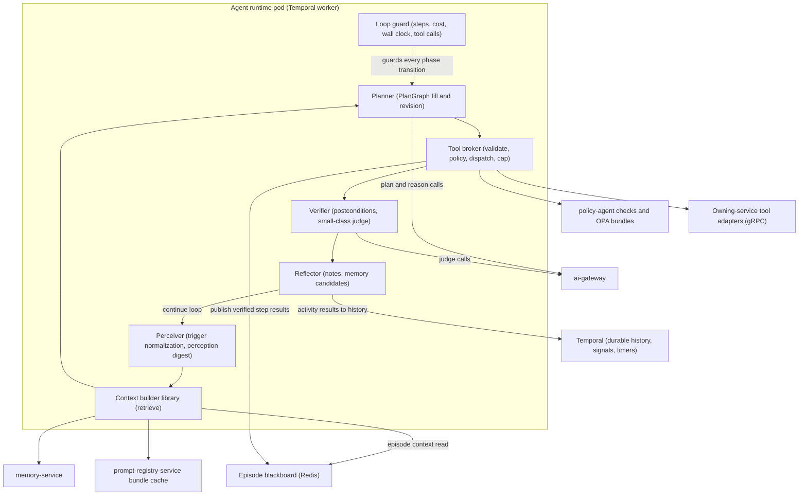
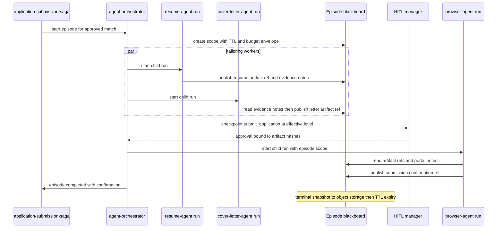
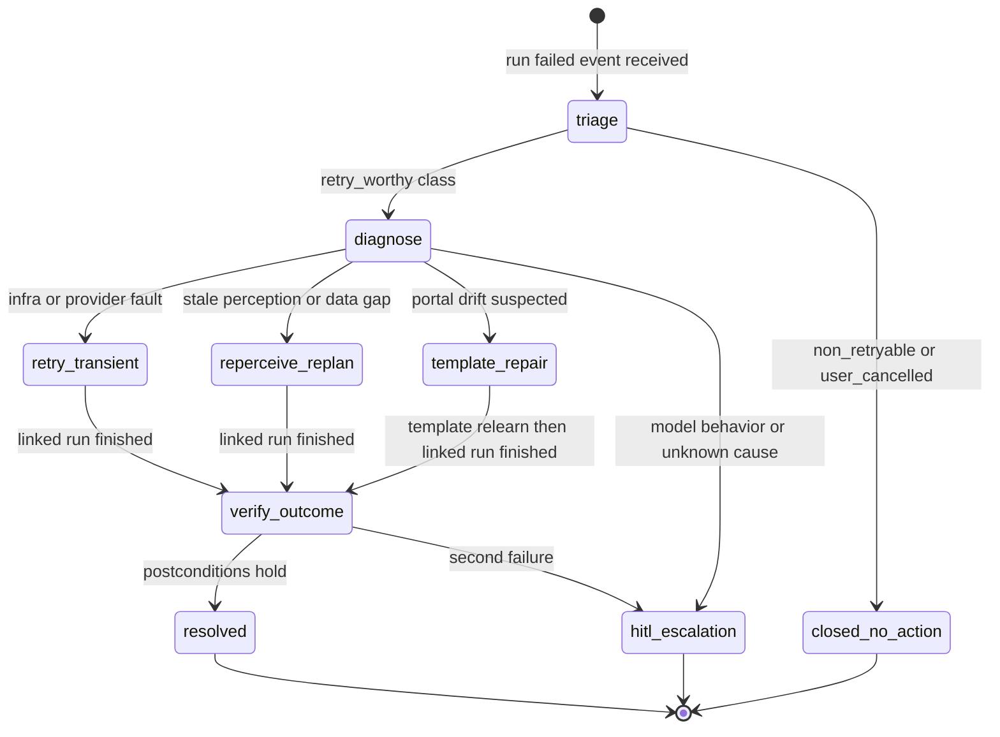
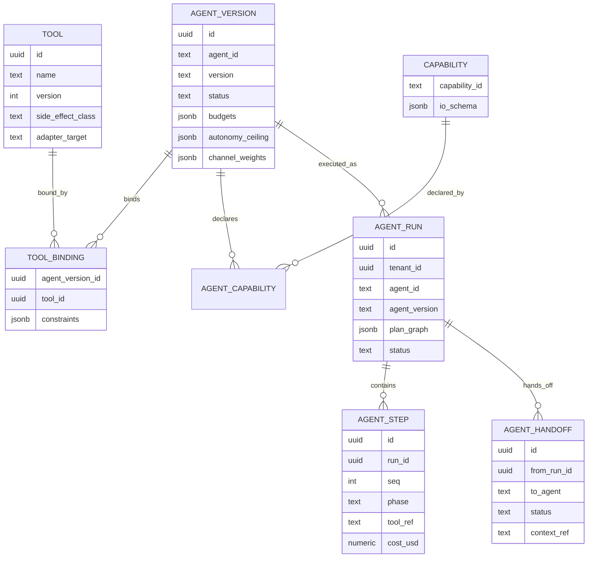

# 22 — Multi-Agent Framework

| | |
|---|---|
| Document ID | ACA-SAS-22 |
| Volume | 3 — AI Architecture |
| Status | Draft v1.0 |
| Depends on | [00 — Architecture Canon](../00-architecture-canon.md) §5, §9–§10, [19 — Agent Orchestrator](../volume-2-core-services/19-agent-orchestrator.md), [20 — Workflow Engine](../volume-2-core-services/20-workflow-engine.md), [21 — AI Architecture](21-ai-architecture.md), [23 — Prompt Registry](23-prompt-registry.md), [24 — Memory System](24-memory-system.md) |

## 1. Overview

This chapter defines the framework the 23 canonical agents ([canon §5](../00-architecture-canon.md)) run on: the agent abstraction (typed perceive/plan/act/verify interfaces over one shared runtime), the inter-agent communication fabric (event handoffs, the episode blackboard, and the deliberate rejection of direct agent-to-agent calls), the collaboration topologies each product journey uses, the supervision and recovery design (`agent-supervisor`, `recovery-agent`), the registry with capability discovery, agent lifecycle and versioned rollout, per-agent budget and timeout guardrails, the full agent catalog, and the testing machinery (replay harness, simulation environments) that makes agent changes shippable with evidence.

The division of labor with sibling chapters is strict. [Chapter 19](../volume-2-core-services/19-agent-orchestrator.md) specifies `agent-orchestrator` as a *service* — its planes, admission control, Temporal execution, HITL mechanics, and API. [Chapter 21](21-ai-architecture.md) specifies the AI plane's connective tissue — planner/reasoner, context builder, tool calling, autonomy mechanics. This chapter specifies the *framework contract*: what an agent is as a typed artifact, how agents may talk to each other, which collaboration shapes are sanctioned per journey, and the complete per-agent parameterization of the catalog. Where Chapter 19 defined a mechanism (e.g., the handoff protocol), this chapter does not restate it; it defines the framework-level rules and data the mechanism executes.

Two framework principles govern every design below. First, **agents are data, not deployments** — an agent version is prompt refs + tool bindings + capability declarations + guardrails, executed by shared runtime code; behavior changes ship through the registry, not through Argo. Second, **all collaboration is legible** — every inter-agent interaction is either a Temporal child-workflow edge, a Kafka handoff event, or a blackboard write from a verified step result. There is no side channel, which is what makes supervision, budgeting, audit, and replay complete rather than best-effort.

## 2. Agent Abstraction — Perceive / Plan / Act / Verify Interfaces

**Purpose.** One typed execution contract for all 23 agents, so runtime enforcement (budgets, allowlists, checkpoints, supervision, replay) is written once and applies uniformly.

**Responsibilities.** Phase interface definitions; the standard implementations most agents use unmodified; the override points for specialist agents; the loop-guard contract.

**Interactions.** Executes as `AgentRunWorkflow` activities on the `agent-runs` Temporal queue ([Chapter 19 §5](../volume-2-core-services/19-agent-orchestrator.md)); context via the context builder library ([Chapter 21 §4](21-ai-architecture.md)); model calls via `ai-gateway` only; tools via the tool broker (the component [Chapter 19 §2](../volume-2-core-services/19-agent-orchestrator.md) names the Tool Dispatcher — one component, one implementation; this volume uses "tool broker").

### 2.1 Phase interfaces

Each phase is a Python interface with a single required method; agent definitions bind implementations by name. The framework ships standard implementations; only agents whose column in the catalog (§9) says otherwise override them.

| Interface | Signature (conceptual) | Standard implementation | Override examples |
|---|---|---|---|
| `Perceiver` | `perceive(trigger, run_goal) -> Perception` | normalize trigger payload, load entity state via read tools, compute perception digest (stable hash for loop detection) | `browser-agent`: DOM + accessibility tree + screenshot digest via `browser.observe@3`; `application-tracker-agent`: mailbox delta perception |
| `Planner` | `plan(perception, context_bundle, plan?) -> PlanGraphDelta` | skeleton-first residual planning per [Chapter 21 §3.1](21-ai-architecture.md); emits `PlanGraph v1` deltas | `policy-agent` and `security-agent`: rules-only planner (no model call on the happy path) |
| `Actor` | `act(step) -> StepResult` | tool broker dispatch: schema-validate args → policy check → adapter call → result capping | none — acting is never overridable; all effects pass the broker |
| `Verifier` | `verify(step, result) -> Verdict` | machine-checkable postconditions first; `small`-class judge only for fuzzy postconditions | `browser-agent`: post-action DOM assertion + confirmation-signal capture ([canon §16](../00-architecture-canon.md)) |
| `Reflector` | `reflect(run_trace) -> ReflectionNote` | structured `{cause_class, evidence_refs, plan_delta?, memory_candidate?}` written to `memory-service` working tier ([Chapter 24 §4](24-memory-system.md)) | `learning-agent`: batch reflection miner over other runs' notes |

Design rules pinned here:

- **Phases are pure with respect to the world except Act.** Perceive uses read-class tools only (enforced by the broker: a `write`/`consequential` tool call from any phase but Act is rejected). This makes replay of Perceive/Plan/Verify side-effect-free by construction.
- **The perception digest is mandatory.** Every `Perception` carries a stable content hash; `agent-supervisor` loop detection (§5) and the replay harness (§10) both depend on it. An agent that cannot digest its perception cannot be supervised for loops — so the interface makes it non-optional.
- **Verdicts are ternary** (`pass`, `fail`, `uncertain`). `uncertain` routes to a `small`-class judge once; a second `uncertain` is treated as `fail` — unbounded judge recursion is a cost pathology, and two opinions never beat a replan.
- **The loop guard is not a phase.** Step/cost/wall-clock/tool-call guards evaluate in deterministic workflow code between phases ([Chapter 19 §5](../volume-2-core-services/19-agent-orchestrator.md)); no model output can suppress them.



**Failure scenarios.** Phase implementation raises → Temporal activity retry policy (3 attempts, exponential); persistent failure → step `on_fail` policy ([Chapter 21 §3.2](21-ai-architecture.md)). A buggy override implementation is caught pre-rollout by the replay suite (§10) because overrides are versioned with the agent definition. **Scaling/monitoring** consolidated in §12/§14.

## 3. Inter-Agent Communication Fabric

**Purpose.** Define the complete, closed set of channels agents may use to coordinate — and record the blackboard-vs-direct-calls decision the framework is built on.

### 3.1 The decision — three channels, no direct calls

| Channel | Mechanism | Used for | Time horizon |
|---|---|---|---|
| **Control flow** | Temporal parent/child workflows ([Chapter 19 §6.1](../volume-2-core-services/19-agent-orchestrator.md)) | spawning workers, joining results, cascading cancel/budget | within one episode |
| **Handoff** | Kafka events `aca.agent.handoff.requested.v1` / `accepted.v1` ([Chapter 19 §6.3](../volume-2-core-services/19-agent-orchestrator.md)) | transferring goal ownership across time (tracker → coach; browser → recovery) | across episodes, hours–days |
| **Shared context** | **Episode blackboard in Redis** (§3.2) | artifacts, evidence notes, and progress state shared by concurrent collaborators | within one episode, TTL-bounded |

**Direct agent-to-agent calls (gRPC or in-process) are rejected.** The reasons are structural, not stylistic: a direct call bypasses admission control (unbudgeted work), supervision (invisible interaction), audit (no envelope), and version pinning (caller binds to callee behavior outside the registry). Every appearance of "agent A asks agent B" in a design review must resolve to one of the three channels above; anything else is a framework violation caught in review and by the broker's adapter allowlist (there is no agent-runtime adapter target, so the call is unmakeable).

The blackboard decision, precisely: Redis is chosen **as a scoped episode workspace**, not as a durable shared memory. Durable cross-run knowledge belongs to `memory-service` ([Chapter 24](24-memory-system.md)); goal transfer across time belongs to handoff events. This preserves [Chapter 19 §17](../volume-2-core-services/19-agent-orchestrator.md)'s rejection of shared mutable memory *between* runs while giving concurrent collaborators (resume + cover-letter + browser in one application episode) a cheap, observable shared surface.

### 3.2 Episode blackboard contract

| Property | Value | Rationale |
|---|---|---|
| Store | Redis Cluster (agent-plane keyspace), `bb:{tenant_id}:{episode_id}:{section}` | episode data is hot, small, and disposable; Redis is already the canon cache/KV layer |
| Structure | one hash per section (`artifacts`, `evidence`, `progress`) + one append-only stream `bb:...:log` | hashes for state, stream for watchers (supervisor tails the stream instead of polling) |
| Entry size | ≤ 8 KiB inline; larger values become object-storage `artifact_ref`s | mirrors the tool-result capping convention (canon §9); the blackboard must never become a payload store |
| Write path | **runtime-only**: entries are published by the runtime from *verified* step results — models cannot invoke a blackboard-write tool | removes the blackboard as a prompt-injection persistence surface; an unverified hallucinated artifact never becomes shared truth |
| Write ownership | single-writer per section key (writer = producing run id, enforced at publish) | conflict-free by construction; last-write-wins semantics never actually race |
| Read path | any run within the episode, via the context builder (episode context section) | reads are part of assembled context, so they appear in the context manifest and are replayable |
| TTL | episode end + 7 days | covers the 72 h HITL approval window plus weekend latency plus post-hoc inspection; terminal snapshot to object storage before expiry for audit/replay |
| Budget linkage | the episode carries the budget envelope; blackboard metadata records per-run spend contributions | fan-out cannot multiply spend past the admitted envelope ([Chapter 19 §6.1](../volume-2-core-services/19-agent-orchestrator.md)) |

**Failure scenarios.** Redis loss destroys in-flight episode context: running episodes degrade — workers finish from their own Temporal state, joins fall back to child-workflow results (the control-flow channel is the source of truth for results; the blackboard is an acceleration and shared-evidence layer). Terminal snapshots make completed episodes recoverable. **Security.** Keys are tenant-prefixed; the runtime's Redis ACL restricts it to the `bb:` keyspace; entries never contain P0/P1 material (artifact refs point to encrypted objects).

## 4. Collaboration Topologies per Journey

Topologies are declared, not improvised: each journey's shape is registered configuration (which agents, which channel, which coordinator), so supervision and capacity planning know the expected interaction graph.

| Journey | Topology | Coordinator | Channels used |
|---|---|---|---|
| Job pipeline (discover → parse → match) | staged event pipeline | none — each stage is event-triggered | Kafka domain events only |
| Application episode (tailor → approve → submit) | planner/worker fan-out with episode blackboard | `application-submission-saga` (Temporal, [Chapter 20](../volume-2-core-services/20-workflow-engine.md)) | child workflows + blackboard + HITL |
| Autopilot day | planner/worker | `scheduler-agent` run ([Chapter 19 §7.1](../volume-2-core-services/19-agent-orchestrator.md)) | child workflows |
| Interview/negotiation journey | sequential handoff chain | goal ownership transfers | handoff events |
| Meta/control plane | observers | none — never in the data path | telemetry + Temporal signals |

### 4.1 Job pipeline — staged event pipeline

`job-scout-agent` → `job-parser-agent` → `matching-agent` is deliberately **not** a planner/worker episode: stages are independently scalable, per-stage backpressure is Kafka-native, and no coordinator is a single point of failure for a pipeline that must meet the 15-minute discovered→scored p95 (canon §14). `company-intel-agent` runs as an enrichment branch; matching re-scores affected matches when enrichment lands.

```mermaid
flowchart LR
  scout["job-scout-agent"]
  t1["aca.job.discovered.v1"]
  parser["job-parser-agent"]
  t2["aca.job.parsed.v1"]
  ci["company-intel-agent"]
  t3["aca.company.enriched.v1"]
  match["matching-agent"]
  t4["aca.match.scored.v1"]
  scout -->|"publish"| t1
  t1 -->|"trigger"| parser
  parser -->|"publish"| t2
  t2 -->|"trigger"| match
  t2 -->|"trigger on stale company"| ci
  ci -->|"publish"| t3
  t3 -->|"re-score affected matches"| match
  match -->|"publish"| t4
```



Latency budget across the 15-minute SLO: discovery batching ≤ 5 min, parse ≤ 2 min p95 (rules-first, `small` fallback), matching ≤ 3 min p95, leaving ≈ 5 min for queueing and retries. Enrichment is off the critical path by design — a match may score before company intel lands and re-score after.

### 4.2 Application episode — planner/worker under supervision

The saga plays the planner role deterministically (the plan skeleton for a submission is stable; residual planning is inside the worker runs, not the coordinator — a Temporal workflow must stay deterministic). `resume-agent` and `cover-letter-agent` run in parallel as child runs sharing the episode blackboard; the HITL checkpoint binds approval to artifact hashes ([Chapter 21 §6](21-ai-architecture.md)); `browser-agent` executes only after clearance. `agent-supervisor` observes the blackboard stream and run telemetry throughout — it is oversight, never the coordinator.



The evidence-note flow is why the blackboard earns its place: `cover-letter-agent` reuses the profile-to-job evidence `resume-agent` already extracted (same episode, same job), cutting duplicate retrieval and keeping the two artifacts *consistent* — a letter claiming skills the tailored resume dropped is a real failure mode the shared evidence section prevents.

### 4.3 Handoff chain — coaching journey

`application-tracker-agent` detects an interview invitation → hands off to `interview-coach-agent` (prep episode) → on `aca.offer.received.v1`, `negotiation-agent` is event-triggered directly (registry `triggers`, not a handoff — no prior owner holds the offer goal). Chain rules are [Chapter 19 §6.3](../volume-2-core-services/19-agent-orchestrator.md)'s: registry-declared handoff edges, single goal owner, snapshot-based context transfer.

## 5. Supervision & Recovery Design

### 5.1 `agent-supervisor` — detection heuristics

The supervisor is an observing agent (signals only, never in the data path — [Chapter 19 §6.2](../volume-2-core-services/19-agent-orchestrator.md)). Its detector set, deepened from [Chapter 19 §9](../volume-2-core-services/19-agent-orchestrator.md), with the signal inputs the framework guarantees exist:

| Detector | Signal inputs | Rule (default, per-agent tunable) | Why this rule |
|---|---|---|---|
| Tight loop | tool envelope stream | identical `(tool, args_hash)` 3× consecutively | the cheapest, highest-precision loop signature; near-zero false positives on healthy runs |
| Windowed loop | tool envelope stream | identical `(tool, args_hash)` ≥ 3 within any 10-step window | catches A-B-A-B oscillation that defeats the consecutive rule |
| Perception loop | perception digests (§2.1) | digest unchanged across 3 successive Perceive phases while Act phases executed | acting without changing the world = the action is wrong, not the plan pace |
| Plan churn | `PlanGraph` revision diffs | > 4 revisions with zero executed consequential steps | replanning as displacement activity; forces HITL on next action |
| Stall | step heartbeats | no phase transition > 5 min (interactive) / > 30 min (background), excluding legitimate waits (HITL timer, browser session queue, batch lane) | separates "stuck" from "waiting"; legitimate waits are typed in the run state so the exclusion is mechanical |
| Cost-progress divergence | run cost ledger vs plan progress | > 80% budget consumed before 50% of plan steps completed | catches slow burn that per-step caps miss |
| Behavioral anomaly | `security-agent` flags on run content | any flag | injection suspicion pauses first, investigates second |

Intervention ladder (Temporal signals): inject reflection prompt → pause + snapshot → escalate (HITL or `recovery-agent`) → kill. Every intervention emits an event consumed by `learning-pipeline`; a detector that fires repeatedly on one agent version is a prompt bug, and the fix ships through [Chapter 23](23-prompt-registry.md), not through supervisor tuning.

Supervisor blind spots are bounded by design: the in-workflow loop guards (§2.1) enforce hard caps even if the supervisor is down, so supervision improves failure *latency and diagnosis*, never failure *possibility*.

### 5.2 `recovery-agent` — diagnosis and repair

`recovery-agent` consumes `aca.agent.run.failed.v1` for retry-worthy classes (browser flows foremost) and runs a diagnosis-then-repair episode. Recovery is always a **new linked run** (`parent_run_id` lineage) — the failed run's history is evidence, never a substrate to mutate.



| Diagnosis class | Evidence examined | Repair strategy |
|---|---|---|
| Transient infra/provider | error taxonomy of last step, provider health events | delayed retry (backoff 5 min) of the failed segment only |
| Stale perception / data gap | perception digest age, missing context sections in manifest | fresh Perceive, replan with augmented retrieval (the gap named explicitly in the plan goal) |
| Portal drift | fingerprint diff from `portal-intelligence-service`, failure step is a browser action | flag template via `portal.template_flag@1` (trust ladder demotion to `stale`, [canon §16](../00-architecture-canon.md)); retry only after relearn or with next-trusted template |
| Model behavior / unknown | validator failures, supervisor flags, none of the above | no autonomous retry — package evidence and escalate to HITL with a human-readable diagnosis |

Caps: **max 2 recovery attempts per original run** (a third attempt on the same evidence is spend without information), recovery runs inherit the *remaining* budget of the original envelope, and a recovered consequential action re-enters the user's HITL flow at the original autonomy level — recovery never launders an approval.

## 6. Agent Registry & Capability Discovery — Data Model

The registry's service behavior (lifecycle states, channels, admission) is [Chapter 19 §3](../volume-2-core-services/19-agent-orchestrator.md). This section owns the framework's data model: the tool registry, capability index, plan persistence, and step records that Chapters 19 and 21 reference.

### 6.1 Capability discovery

A **capability** is a typed, versioned declaration of what an agent can do (`job.discover`, `doc.tailor`, `portal.execute`, `status.track`, `coaching.interview`), with an I/O schema. Agent versions declare capabilities; the registry maintains the index; planners that compose work dynamically (assistant task decomposition, `scheduler-agent`) resolve workers by capability, not by agent name:

- `Registry/FindByCapability(capability, constraints)` → ranked agent list (channel-resolved versions), constraints covering tenant plan entitlements, autonomy requirements, and cost ceiling.
- Static journey topologies (§4) pin agents directly — discovery is for dynamic composition and for decoupling planner prompts from agent naming so catalog evolution (and Phase-2 tenant-scoped agents, [Chapter 19 §16](../volume-2-core-services/19-agent-orchestrator.md)) does not require prompt rewrites.
- The capability index is small (23 agents, ≈ 40 capabilities) — the value is the *contract*, not the search: a planner cannot spawn a worker whose declared I/O schema does not match the task spec, which turns a class of runtime failures into registration-time failures.

### 6.2 Schema (owned by `agent-orchestrator`)

`agent_version` and `agent_run` DDL are in [Chapter 19 §3.1](../volume-2-core-services/19-agent-orchestrator.md); the framework adds:

```sql
-- Tool registry: platform-defined, agent versions bind by id
CREATE TABLE tool (
  id                uuid PRIMARY KEY,            -- UUIDv7
  name              text NOT NULL,               -- e.g. resume.create_version
  version           int  NOT NULL,               -- tool contract major version
  side_effect_class text NOT NULL,               -- read | write | consequential
  args_schema       jsonb NOT NULL,              -- JSON Schema
  result_schema     jsonb NOT NULL,
  adapter_target    text NOT NULL,               -- service + gRPC method
  result_cap_policy jsonb NOT NULL,              -- inline cap, digest rules (Ch 21 §5.3)
  cost_weight       numeric(8,4) NOT NULL,       -- broker-side spend estimation
  status            text NOT NULL,               -- active | deprecated
  UNIQUE (name, version)
);

CREATE TABLE capability (
  capability_id text PRIMARY KEY,                -- e.g. doc.tailor
  description   text NOT NULL,
  io_schema     jsonb NOT NULL                   -- task spec in/out contract
);

CREATE TABLE agent_capability (
  agent_version_id uuid NOT NULL REFERENCES agent_version(id),
  capability_id    text NOT NULL REFERENCES capability(capability_id),
  PRIMARY KEY (agent_version_id, capability_id)
);

-- Plan persistence: PlanGraph v1 lives on the run row (Ch 21 §3.2)
ALTER TABLE agent_run ADD COLUMN plan_graph jsonb;         -- current revision
ALTER TABLE agent_run ADD COLUMN plan_revisions int NOT NULL DEFAULT 0;

-- Step records: queryable projection of Temporal history for analytics/supervision
CREATE TABLE agent_step (
  id            uuid PRIMARY KEY,
  run_id        uuid NOT NULL,
  tenant_id     uuid NOT NULL,
  seq           int  NOT NULL,
  phase         text NOT NULL,                   -- perceive|plan|act|verify|reflect
  kind          text NOT NULL,                   -- tool_call|reason|checkpoint|verify
  tool_ref      text,                            -- name@version when kind=tool_call
  args_hash     bytea,                           -- loop-detection input
  perception_digest bytea,                       -- when phase=perceive
  result_digest jsonb,
  verdict       text,                            -- pass|fail|uncertain
  cost_usd      numeric(12,6) NOT NULL DEFAULT 0,
  latency_ms    int,
  created_at    timestamptz NOT NULL
) PARTITION BY RANGE (created_at);               -- daily partitions, 90d hot (canon §11)
```

RLS on `tenant_id` for `agent_step`; `tool`, `capability`, and bindings are platform-scoped control-plane data, replicated read-only into cells ([Chapter 19 §13](../volume-2-core-services/19-agent-orchestrator.md)).



## 7. Agent Lifecycle & Versioned Rollout

An **agent version is prompt refs + tool bindings + capability declarations + guardrails** — nothing else. The lifecycle machinery (registered → enabled → deprecated → retired; shadow → canary → stable channels; 500-run/7-day promotion floors; instant pointer-flip rollback) is specified in [Chapter 19 §3.2 and §10](../volume-2-core-services/19-agent-orchestrator.md). Framework-level rules this chapter adds:

- **Version composition is validated at registration**, not at run time: every `prompt_id@semver` in `prompt_refs` must exist and be `stable`- or `canary`-channel-eligible in [Chapter 23](23-prompt-registry.md); every tool id in `tool_allowlist` must be `active`; every declared capability's `io_schema` must be satisfiable by the bound tools (static check). A version referencing a yanked prompt fails registration — dangling references are impossible.
- **Prompt and agent rollouts compose, never race.** An agent version pins prompt *ids* and minimum versions but resolves the concrete prompt version through the prompt-registry channel at context-build time. Rule: an agent canary may ride a prompt canary only when both were promoted through a joint eval run (the eval record links both artifacts); otherwise canary agents resolve `stable` prompts. Two independent 5% canaries multiplying into an untested combination is the failure this rule exists to prevent.
- **Capability compatibility across versions:** removing a capability or narrowing an `io_schema` is a breaking change requiring a major version and a registry scan for planners/topologies referencing it — surfaced as a registration warning with the affected journey list.
- **Deprecation honors long-lived runs:** in-flight runs (multi-day HITL waits) complete on their pinned version; the 7-day-or-last-run grace in Chapter 19 is the mechanism.

## 8. Per-Agent Budget & Timeout Guardrails

Guardrails live in the agent version's `budgets` block and are enforced by the loop guard (workflow code) and the tool broker — never by prompt instruction. Layers, innermost first:

| Layer | Guard | Default | Rationale |
|---|---|---|---|
| Per phase | activity timeout | perceive 30 s, plan 120 s (`agent` deadline class, [Chapter 18 §3.3](../volume-2-core-services/18-ai-gateway.md)), act = tool timeout, verify 30 s, reflect 30 s | phase-level timeouts convert hangs into typed retries instead of run-level stalls |
| Per tool call | broker timeout + result cap | per-tool config; browser tools heartbeat at 30 s | a tool without a deadline is an unbounded liability; heartbeats distinguish slow browser work from dead sessions |
| Per run | `max_steps`, `max_cost_usd`, `max_duration`, `max_tool_calls` | catalog §9.2 (archetype defaults, per-agent overrides) | the run envelope is admission's contract with `cost-controller`; nothing inside a run can exceed what admission reserved |
| Per run | max plan revisions 2, max parallel branches 4 | [Chapter 21 §3.1](21-ai-architecture.md) | replan and fan-out are the two multiplicative cost dimensions; both are capped |
| Per user | concurrent runs: Free 1, Professional 2, Premium 4 | inside the per-tenant caps of [Chapter 19 §4](../volume-2-core-services/19-agent-orchestrator.md); Premium's 4 matches the max-parallel-branch cap so one user's episode can always fan out fully | per-user caps keep one hyperactive user inside a team/enterprise tenant from consuming the tenant's slots |
| Per episode | budget envelope with carve-outs at spawn | sum of child `max_cost_usd` ≤ remaining envelope | fan-out cannot multiply spend (Chapter 19 §6.1) |
| Per scope | `cost-controller` daily/monthly budgets | canon §10.2 thresholds (80% soft / 100% hard) | the outermost wall; everything above bounds *rate*, this bounds *total* |

Breaches terminate with typed `end_reason` values and emit `aca.agent.run.failed.v1` (or complete-with-partial for soft degrades) — a guard firing is data for `learning-pipeline`, not a silent stop.

## 9. Agent Catalog — All 23 Agents

Authoritative parameterization of the canon §5 catalog. Model classes reference canon §10.1; "phase overrides" use the `phase: class` form from [Chapter 19 §3.1](../volume-2-core-services/19-agent-orchestrator.md). Tools are representative key bindings (full bindings live in the registry); every agent additionally binds `memory.write@1` unless noted.

### 9.1 Mission, model class, tools

| Agent | Mission (canon) | Model class (default → overrides) | Key tools |
|---|---|---|---|
| `job-scout-agent` | discover postings for user search intents | `small` → plan `medium` on novel sources | `source.fetch@1`, `job.ingest@1`, `search.query@1` |
| `job-parser-agent` | normalize postings to canonical Job schema | `small` (rules-first; `medium` fallback ≤ 2% of docs) | `job.upsert@2`, `artifact.fetch@1` |
| `company-intel-agent` | build/refresh company profiles | `medium` (batch lane) | `company.upsert@1`, `source.fetch@1`, `graph.query@1` |
| `matching-agent` | score and explain job↔profile fit | `medium` → verify `small` | `match.write@1`, `graph.query@1`, `search.query@1` |
| `resume-agent` | tailor resume versions, ATS optimization | `large` → verify `small` | `resume.create_version@2`, `resume.ats_score@1`, `artifact.fetch@1` |
| `cover-letter-agent` | tailored letters with evidence | `large` → verify `small` | `letter.create@1`, `graph.query@1`, `artifact.fetch@1` |
| `portfolio-agent` | optimize portfolio presentation | `medium` | `portfolio.update@1`, `repo.analyze@1` |
| `browser-agent` | execute portal workflows stepwise | `medium` → perceive `vision`, plan `large` | `browser.observe@3`, `browser.act@3`, `browser.execute_workflow@4`, `portal.template_fetch@2` |
| `portal-intel-agent` | fingerprint portals, learn templates | `vision` + `large` (batch lane) | `portal.fingerprint_write@1`, `portal.template_write@2`, `browser.observe@3` |
| `application-tracker-agent` | track application status from signals | `small` → `medium` on ambiguity | `email.read@1`, `application.update_status@1`, `portal.status_check@1` |
| `interview-coach-agent` | interview prep, mocks, feedback | `medium` → feedback synthesis `large` | `question_bank.query@1`, `session.transcript_write@1` |
| `negotiation-agent` | offer analysis, benchmarks, scripting | `large` → `frontier` (routing-policy flag, Premium+) | `offer.analyze@1`, `benchmark.query@1` |
| `calendar-agent` | scheduling, reminders, calendar sync | `small` | `calendar.propose@1`, `calendar.book@1` |
| `email-agent` | draft/parse application email | `medium` draft → `small` parse | `email.read@1`, `email.draft@1`, `email.send@1` |
| `notification-agent` | decide what/when/how to notify; digests | `small` | `notification.request@1`, `digest.compose@1` |
| `analytics-agent` | career insight narratives | `medium` | `analytics.query@1`, `narrative.publish@1` |
| `learning-agent` | mine outcomes for strategy improvements | `medium` batch → weekly synthesis `large` | `dataset.query@1`, `strategy.propose@1` |
| `policy-agent` | pre-action compliance checks | `small` (OPA rules first; model only for judgment calls) | `policy.evaluate@1`, `consent.check@1` |
| `security-agent` | injection screening, behavior anomaly detection | `small` | `security.screen@1`, `run.flag@1`, `source.quarantine@1` |
| `cost-optimization-agent` | spend monitoring, routing/caching recommendations | `small` → weekly review `medium` | `ledger.query@1`, `routing.recommend@1` |
| `agent-supervisor` | monitor runs, detect loops/stalls, escalate | `small` → diagnosis `medium` | `run.inspect@1`, `run.signal@1`, `run.flag@1` (signal-only surface; no memory.write) |
| `recovery-agent` | diagnose and repair failed workflows | `medium` → browser-flow diagnosis `large` | `run.inspect@1`, `run.restart@1`, `portal.template_flag@1` |
| `scheduler-agent` | plan per-user autopilot cadence in budget | `medium` | `budget.read@1`, `run.spawn@1`, `schedule.write@1` |

### 9.2 Autonomy ceilings and budgets

Autonomy ceiling = the maximum level the agent may exercise for its consequential action classes regardless of user setting (effective level = `min(user, ceiling, policy)`, [Chapter 19 §3.1](../volume-2-core-services/19-agent-orchestrator.md)). Agents with no consequential tools are marked `L3 (none)` — they cannot perform consequential actions at any level. Budgets are per-run; values are archetype defaults × per-agent adjustment, set at design-model p99 × 1.5 headroom and tuned from production telemetry through the registry (a budget change is a version change).

| Agent | Autonomy ceiling (consequential class) | max_steps | max_cost_usd | max_duration | max_tool_calls |
|---|---|---|---|---|---|
| `job-scout-agent` | L3 (none) | 16 | 0.15 | 10 min | 30 |
| `job-parser-agent` | L3 (none) | 6 | 0.05 | 2 min | 6 |
| `company-intel-agent` | L3 (none) | 10 | 0.25 | 15 min | 12 |
| `matching-agent` | L3 (none) | 8 | 0.10 | 5 min | 10 |
| `resume-agent` | L3 (none — artifact drafts only) | 12 | 0.60 | 5 min | 10 |
| `cover-letter-agent` | L3 (none — artifact drafts only) | 10 | 0.50 | 4 min | 8 |
| `portfolio-agent` | L3 (none) | 10 | 0.30 | 10 min | 10 |
| `browser-agent` | L3 (`submit_application`, `credential_use` via vault flow) | 40 | 2.50 | 30 min | 60 |
| `portal-intel-agent` | L3 (none — learning runs are shadow-verified) | 30 | 1.50 | 45 min | 40 |
| `application-tracker-agent` | L3 (`credential_use` read-only status checks) | 12 | 0.20 | 10 min | 15 |
| `interview-coach-agent` | L3 (none — coaching artifacts) | 20 | 0.80 | 45 min | 20 |
| `negotiation-agent` | L1 (all outputs HITL — stakes justify friction) | 14 | 1.20 | 15 min | 10 |
| `calendar-agent` | L3 (`schedule_event`) | 8 | 0.10 | 5 min | 8 |
| `email-agent` | L2 (`send_email` — outbound identity risk caps below autopilot) | 10 | 0.30 | 5 min | 10 |
| `notification-agent` | L3 (platform notifications are not user-identity actions) | 6 | 0.05 | 2 min | 6 |
| `analytics-agent` | L3 (none) | 10 | 0.40 | 20 min | 12 |
| `learning-agent` | L3 (proposals only; promotion is gated elsewhere) | 24 | 2.00 | 4 h (batch) | 30 |
| `policy-agent` | n/a — it is the check, not the actor | 4 | 0.02 | 30 s | 3 |
| `security-agent` | L3 (quarantine/flag only) | 6 | 0.05 | 2 min | 6 |
| `cost-optimization-agent` | L2 (`spend_above_threshold` routing changes need approval) | 10 | 0.15 | 10 min | 10 |
| `agent-supervisor` | L3 (signal-only tool surface) | 12 | 0.10 | 15 min/cycle | 20 |
| `recovery-agent` | L2 (recovered consequential actions re-enter user HITL) | 20 | 1.00 | 20 min | 25 |
| `scheduler-agent` | L3 (spawning runs is not consequential; child runs carry their own checks) | 12 | 0.25 | 5 min | 15 |

Rationales worth pinning: `browser-agent`'s 40 steps and 60 tool calls override the 24-step default because portal workflows are legitimately step-dense (observe/act pairs per form section); its $2.50 cap bounds a `vision`+`large` worst case at roughly 3× the mean successful submission cost. `policy-agent`'s microscopic budget is deliberate — a compliance check that needs 5 model calls is a design smell, and the guard enforces the smell detector. `negotiation-agent` at ceiling L1 encodes a product decision: comp negotiation output is never auto-sent at any plan tier.

## 10. Testing Agents

**Purpose.** Make agent changes falsifiable before they touch users: deterministic re-execution of recorded reality, and synthetic environments for what recordings cannot cover.

### 10.1 Replay harness

The replay bundle for any run is reconstructable from durable artifacts the platform already keeps: Temporal history, context manifests ([Chapter 21 §4.1](21-ai-architecture.md)), tool envelopes, model I/O payload refs (90-day retention, canon §11), and blackboard terminal snapshots (§3.2). Three replay modes:

| Mode | Models | Tools | Answers the question |
|---|---|---|---|
| Strict | stubbed from recorded outputs | stubbed from recorded envelopes | did a runtime/framework code change alter behavior on identical inputs (CI regression gate; byte-diff on step sequence) |
| Model-swap | live via `ai-gateway` (batch lane) | stubbed | does a new prompt/model class produce better plans/verdicts on real recorded contexts (feeds [Chapter 23](23-prompt-registry.md) evals) |
| Environment | live | simulated (§10.2) | does the agent handle counterfactuals — injected failures, drifted portals, adversarial content |

Replay determinism is a designed property, not luck: phases other than Act are side-effect-free (§2.1), plans are data, and perception digests make divergence detection exact. Replayed runs execute on the real runtime under a `replay` channel with side effects structurally disabled (broker in stub/sim mode) — the code path tested is the code path shipped. Bundles are sanitized (PII classes per canon §11) before entering shared eval datasets.

### 10.2 Simulation environments

| Sim | Contents | Primary consumers |
|---|---|---|
| `portal-sim` | deterministic mock portals generated from `portal-intelligence-service` fingerprint fixtures; fault injection: DOM drift, field renames, CAPTCHA interstitials, latency, mid-flow session loss | `browser-agent`, `portal-intel-agent`, `recovery-agent` |
| `job-corpus-sim` | versioned corpus of sanitized real + synthetic postings with ground-truth parses and match labels | `job-parser-agent`, `matching-agent`, `job-scout-agent` |
| `persona-sim` | `small`-class user simulator with persona scripts (goals, constraints, temperament) for multi-turn flows | `interview-coach-agent`, `negotiation-agent`, assistant flows |
| `mailbox-sim` | synthetic application email threads (offers, rejections, scheduling chains, phishing/injection attempts) | `application-tracker-agent`, `email-agent`, `security-agent` |
| `injection-suite` | adversarial content library (shared with [Chapter 23 §12](23-prompt-registry.md)); every incident contributes a case | all agents with untrusted-content exposure |

CI gates: an agent version must pass strict replay (zero unexplained divergence), its sim suite (per-agent thresholds registered with the version), and the injection suite (block rate ≥ 99.5%, [Chapter 21 §9](21-ai-architecture.md)) before it may enter the `shadow` channel — shadow, canary, and promotion then proceed per [Chapter 19 §10](../volume-2-core-services/19-agent-orchestrator.md). Sim environments are versioned artifacts: a sim change invalidates comparability, so eval results record `(agent_version, sim_version)` pairs.

## 11. Failure Scenarios

| # | Scenario | Blast radius | Response |
|---|---|---|---|
| F1 | Blackboard (Redis) loss mid-episode | in-flight episodes' shared context | workers complete from Temporal state; joins use child-workflow results; episodes flagged `context_degraded`; completed episodes intact via terminal snapshots |
| F2 | Handoff target agent disabled between request and accept | single goal | 15-min acceptance timeout → supervisor escalation; source run still owns the goal (Chapter 19 §6.3 rule b) — no orphan |
| F3 | Capability index stale in a cell (replication lag) | dynamic planner composition | planners resolve against last-replicated index (definitions change rarely); registrations are control-plane-only, so a stale cell can never see a *wrong* binding, only a late one |
| F4 | Supervisor detector false-positive storm (bad threshold push) | paused healthy runs | thresholds are per-agent registry config → rollback is a config flip; paused runs resume via signal; detector changes ride the same shadow evaluation as agent versions |
| F5 | Recovery loop (recovery of a recovery) | budget of one goal | structurally impossible: `recovery-agent` triggers only on original-run failures (`parent_run_id` null-lineage check) and caps at 2 attempts |
| F6 | Sim/replay infra down | release pipeline | promotion to `shadow` freezes (fail-closed, mirroring [Chapter 21 F4](21-ai-architecture.md)); production channels unaffected |
| F7 | Tool contract change breaks a bound agent | agents binding the tool | tools are versioned; a new major registers alongside the old; the old is `deprecated` only after zero active bindings — the registry makes silent breakage unrepresentable |
| F8 | Event-pipeline stage backlog (parse lag) | job pipeline SLO | KEDA scales the stage's runs on Kafka lag; scout batching backs off via `scheduler-agent` budget awareness; discovered→scored SLO burn alerts before user impact |

## 12. Scaling Strategy

- **Per-tenant fairness (referenced by [Chapter 21 §11](21-ai-architecture.md)):** admission uses weighted fair queuing within priority bands (`interactive` > `autopilot` > `backfill`), weights by plan tier — Free 1, Professional 4, Premium 8, Enterprise 16 (per seat-pool contract). Implementation is deficit round robin per band over per-tenant queues; a tenant's unused weight does not accumulate (no burst credit across bands), so a quiet enterprise tenant cannot detonate a stored burst into the interactive band. Per-user concurrency (§8) nests inside per-tenant caps ([Chapter 19 §4](../volume-2-core-services/19-agent-orchestrator.md)).
- **Topology-aware scaling:** event-pipeline stages scale independently on Kafka lag (KEDA); episode topologies scale on Temporal `agent-runs` schedule-to-start p95 ([Chapter 19 §13](../volume-2-core-services/19-agent-orchestrator.md)); `browser-agent` admission is additionally gated by browser-fleet advertised headroom — the framework never admits runs that will block on browsers.
- **Blackboard capacity:** ≈ 25k concurrent episodes at design peak × ≤ 64 KiB per episode ≈ 1.6 GB — a minor tenant of the agent-plane Redis; keyspace sharding is natural (`episode_id` in the key).
- **Catalog growth:** the framework is sized for the canonical 23; new agents are canon amendments. The cost of a new agent is a definition + sim suite + catalog row — no new infrastructure — which is the point of the shared-runtime decision.
- **Cell deployment:** everything here deploys per cell with the orchestrator; control-plane data (definitions, tools, capabilities) replicates read-only into cells.

## 13. Security Considerations

- **Closed communication fabric:** three channels, all mediated, all audited; no agent-to-agent RPC exists to secure because it does not exist at all (§3.1).
- **Blackboard hardening:** runtime-only writes from verified step results (§3.2) mean injected model output cannot persist to shared context; tenant-prefixed keys + Redis ACLs bound the read surface; no P0/P1 inline.
- **Supervision cannot be socially engineered:** supervisor and recovery interventions are Temporal signals from authenticated platform identities; an agent cannot emit a "pause that other agent" tool call — no such tool is bindable to non-meta agents, and meta-agent allowlists are the tightest in the catalog (§9.1).
- **Capability discovery respects entitlements:** `FindByCapability` filters by tenant plan and autonomy constraints, so a planner cannot compose a Premium-only agent into a Free tenant's episode.
- **Autonomy ceilings are structural** (§9.2): the effective-level `min()` composition means no user setting, prompt, or injected instruction can raise an agent past its registered ceiling.
- Testing data is sanitized per canon §11 PII classes; the injection suite is treated as a security artifact (additions reviewed by the security-agent owning team).

## 14. Observability

| Signal | Details / alert |
|---|---|
| Topology conformance | interaction-graph deltas vs registered topology per journey; an unexpected edge (agent pair never declared) alerts — it indicates a framework violation or a compromised definition |
| Blackboard health | episode count, entry sizes, snapshot success rate; entry > 8 KiB inline attempts alert (capping bug) |
| Fabric latency | handoff request→accept p95 (< 15 min timeout budget); child-run spawn latency; blackboard publish-to-visible p99 < 100 ms |
| Detector performance | supervisor detections by type, precision (detections overturned on review), intervention outcomes; false-positive rate > 5% triggers threshold review |
| Recovery funnel | failed → triaged → diagnosis class mix → resolved rate; browser-flow recovery success feeds the ≥ 92% portal success SLO (canon §14) |
| Catalog dashboards | per-agent success, cost, steps, HITL rejection, guard-breach rates by version — the §9.2 budget table rendered live against actuals |
| Replay/sim CI | suite pass rates, divergence counts, sim-version drift; flaky-sim quarantine list |

All framework events carry `traceparent`; one trace stitches an episode across saga, child runs, blackboard writes, and HITL waits.

## 15. Future Improvements

- **Typed task-spec negotiation:** workers counter-propose task specs at spawn (capability `io_schema` mismatch today fails; tomorrow it negotiates within planner constraints).
- **Cross-episode evidence reuse:** blackboard evidence sections promoted to `memory-service` episodic tier when the same (user, company) pair recurs — currently rebuilt per episode.
- **Learned detector thresholds:** per-agent supervisor thresholds fitted from labeled intervention outcomes rather than p99.5 heuristics.
- **Adversarial sim agents:** a red-team agent that mutates injection-suite cases against canary versions continuously, promoting successful attacks into the suite.
- **Tenant-scoped agents (Phase 2):** the registry constraint surface (ceilings, allowlists, capability schemas) already bounds tenant-authored definitions; the remaining work is namespace isolation and marketplace review flow.

## 16. Alternatives Considered & Tradeoffs

| Decision | Alternatives | Why this way |
|---|---|---|
| Episode blackboard in Redis for shared context; events for handoff; **no direct agent calls** | (a) direct gRPC between agent runs; (b) all sharing via Temporal results only; (c) durable blackboard in Postgres | (a) bypasses admission/supervision/audit/version-pinning — unacceptable in an autonomy system; (b) forces all sharing through the coordinator, serializing parallel workers and bloating workflow history; (c) durability invites cross-run memory semantics that belong to `memory-service` and complicates GDPR erasure. Tradeoff: Redis loss degrades in-flight episodes — bounded by Temporal-side results and terminal snapshots |
| Blackboard writes runtime-only (no model-visible write tool) | `blackboard.write` as a bindable tool | A writable shared surface reachable by model output is a first-class injection persistence vector; verified-result publication keeps the blackboard trustworthy by construction. Tradeoff: agents cannot share speculative notes — reflection notes via `memory-service` working tier cover that need with provenance tagging |
| Declared topologies per journey | emergent collaboration (any agent may engage any other) | Declared graphs make supervision, capacity planning, and anomaly detection tractable; emergent webs are unauditable and untestable. Tradeoff: new collaboration shapes need registration — a review step, deliberately |
| Job pipeline as event stages, application as episode | one pattern for both | The pipeline is high-volume, stateless-per-item, latency-budgeted — Kafka's exact shape; the episode is low-volume, stateful, approval-gated — Temporal's exact shape. Forcing either into the other's pattern costs backpressure semantics or durability semantics respectively |
| Capability discovery inside the agent registry | separate service-discovery-style component; no discovery (hardcode names in prompts) | 23 agents do not justify a service; hardcoded names couple prompt text to catalog evolution. Registry-integrated discovery is one query against data that must exist anyway. Tradeoff: registry API surface grows — acceptable |
| Per-agent budget table as registry data | global defaults only; budgets in code | Per-agent telemetry-tuned budgets with version history and instant rollback; code-resident budgets need deploys to fix a runaway. Tradeoff: 23 × 4 numbers to govern — the catalog dashboard (§14) renders them against actuals precisely so governance is looking at evidence, not guessing |
| Verdict ternary with single judge escalation | binary pass/fail; unlimited judge retries | Binary forces premature failure on genuinely fuzzy postconditions; unlimited judging is unbounded spend. One escalation captures most of the value at fixed cost |
