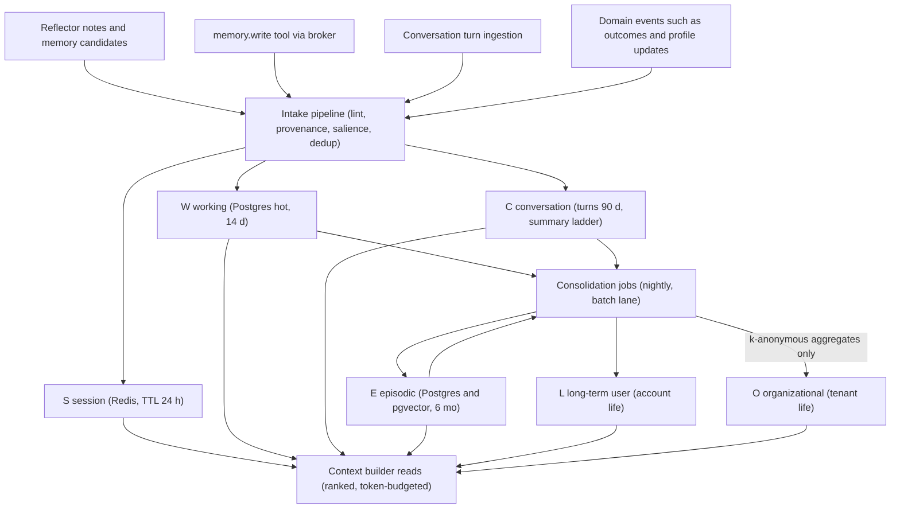
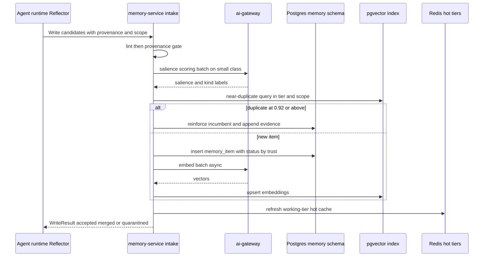
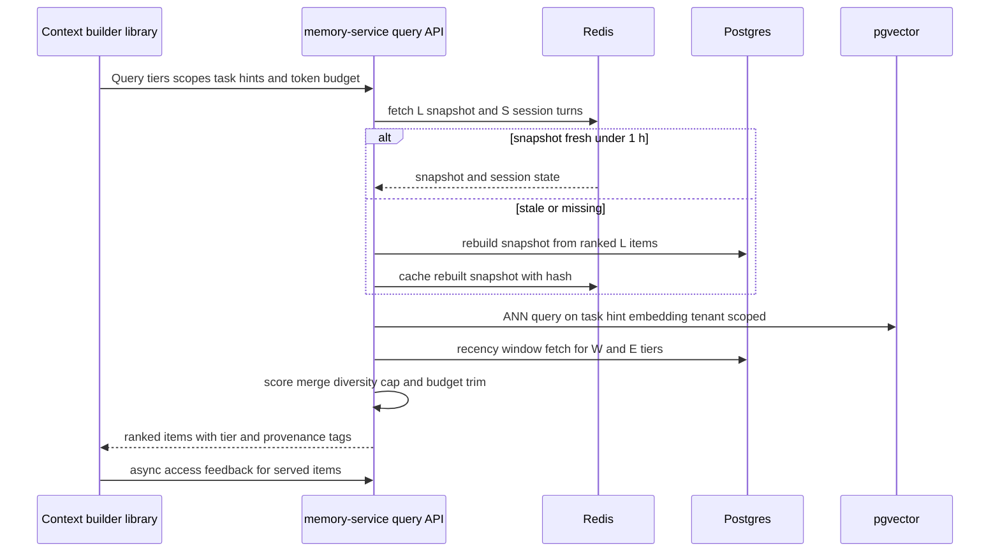
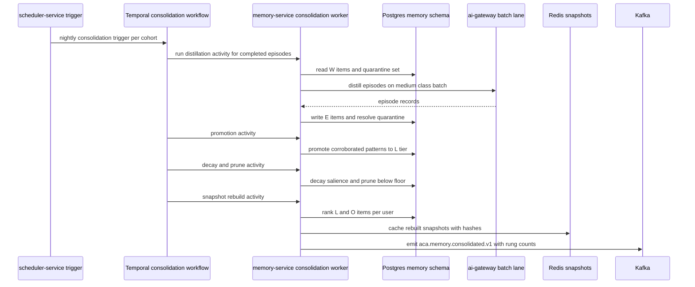
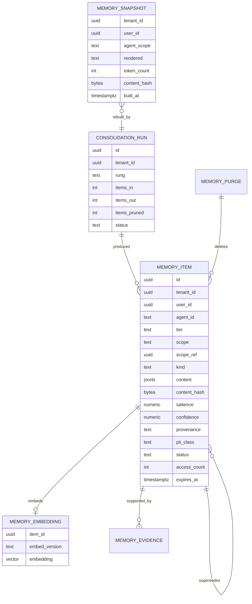

# 24 — Memory System

| | |
|---|---|
| Document ID | ACA-SAS-24 |
| Volume | 3 — AI Architecture |
| Status | Draft v1.0 |
| Depends on | [00 — Architecture Canon](../00-architecture-canon.md) §6, §9, §11; [12 — User Service](../volume-2-core-services/12-user-service.md) (GDPR sagas); [18 — AI Gateway](../volume-2-core-services/18-ai-gateway.md) §5.3; [19 — Agent Orchestrator](../volume-2-core-services/19-agent-orchestrator.md); [21 — AI Architecture](21-ai-architecture.md) §4, §8; [22 — Multi-Agent Framework](22-multi-agent-framework.md) §2–§3; [26 — Semantic Cache](26-semantic-cache.md) |

## 1. Overview

An agent without memory re-derives the user on every run: it re-reads the profile, re-learns that this user rejects startups under 50 people, re-discovers that Greenhouse applications for them convert twice as well as Workday ones, and pays for those tokens every time. `memory-service` is the durable substrate that turns per-run experience into standing capability — the difference between an agent that *executes* job searches and one that *runs* a job search campaign. It owns the canon's memory tiers, the consolidation jobs that move information between them, and the retrieval surface the context builder queries on every prompt assembly ([Chapter 21 §4](21-ai-architecture.md), sections 4 and 7 of the assembly order).

The design is governed by four forces. **Token economics:** memory competes for the hardest-budgeted resource in the platform — context tokens ([Chapter 21 §4.2](21-ai-architecture.md)) — so the service's job is ruthless selection, not accumulation. **Trust:** memory is the primary persistence vector for context poisoning ([Chapter 21 §8](21-ai-architecture.md)); every item carries provenance, and low-trust writes are quarantined, not blended. **Tenancy:** memory is the most personal data derived in the platform; the privacy boundary is absolute — no read path can cross a tenant, structurally (§10). **Cost:** extraction, scoring, and consolidation run on `small`/`medium` classes and the batch lane; memory must earn multiples of its own maintenance cost in avoided retrieval and improved outcomes, and §11 measures exactly that.

Boundaries with adjacent systems, stated once: the **episode blackboard** ([Chapter 22 §3.2](22-multi-agent-framework.md)) is a TTL-bounded Redis workspace for *concurrent collaborators within one episode* — it is not memory and never consolidates automatically; only Reflector output distilled from *verified* results enters memory. The **knowledge-graph-service** stores entity/relationship facts (companies, skills, outcomes) with corroboration rules; memory stores *user- and agent-scoped experience*. The **semantic cache** ([Chapter 26](26-semantic-cache.md)) stores reusable model *outputs*; memory stores distilled *knowledge*. The profile in `profile-service` remains ground truth for user-stated career facts; memory holds derived, behavioral, and episodic knowledge *about working with* the user, referencing profile fields rather than copying them where possible.

## 2. Memory Taxonomy

Six tiers, each with a distinct retention contract and storage mapping. Tier codes are used in APIs, keys, and diagrams; [Chapter 21 §4.1](21-ai-architecture.md)'s "S-tier" read covers `S`+`W`, and its "L-tier" read covers `L` (+`O` where tenant-scoped context applies).

| Tier | Code | Content | Scope | Store | Retention | Written by |
|---|---|---|---|---|---|---|
| Session | `S` | conversational turns, in-session scratch state, UI context | user × session | Redis (Cluster), hash + stream per session | TTL 24 h after last activity | conversation ingestion, runtime |
| Short-term working | `W` | run notes, ReflectionNotes, verified step evidence, in-flight task state | run / episode | Postgres (hot partition) + Redis read-through cache | 14 d, then consolidated or pruned | agent runtime Reflector ([Chapter 22 §2.1](22-multi-agent-framework.md)), `memory.write@1` tool |
| Conversation | `C` | durable dialog history + rolling summaries (turn → daily → monthly ladder) | user | Postgres; verbatim turns 90 d, summaries retained | summaries for account life; verbatim 90 d | conversation ingestion |
| Agent episodic | `E` | distilled episodes: what was attempted, what happened, why (per application, per portal session, per coaching session) | user × agent | Postgres + pgvector embeddings | 6 mo raw episodes; distilled outcomes promoted to `L` | consolidation from `W` |
| Long-term user | `L` | stable facts, preferences, strategy, calibration ("rejects sub-50-person startups", "responds best to Tuesday digests", "Greenhouse conversion 2× Workday") | user | Postgres + pgvector; materialized snapshot in Redis | account life, subject to decay + GDPR (§7) | consolidation from `E`/`C`; explicit user confirmations |
| Organizational | `O` | tenant-scope knowledge: university career-center guidance, enterprise policy notes, recruiter org practices, k-anonymous cohort aggregates | tenant | Postgres + pgvector | tenant life | tenant-admin curation; consolidation aggregates with k ≥ 20 (§10) |



Storage-mapping rationale: `S` is pure Redis because session data is hot, small, and disposable — durability would be waste. `W` is Postgres-first (it feeds consolidation and must survive pod loss mid-run) with Redis read-through for the active run. `C`/`E`/`L`/`O` are Postgres with pgvector embeddings because they need durability, RLS tenancy, relational lifecycle management (supersession, quarantine, purge), and ANN retrieval — exactly the pgvector phase-1 seam the canon defines, with the Qdrant scale path behind the `embedding-store` interface untouched.

## 3. Component Architecture

One stateless deployment fronts all tiers. The intake pipeline (gRPC `Write` plus Kafka event consumers) feeds the lint → salience → dedup stages of §4; the query path (`Query`/`GetSnapshot`) serves the context builder through the ranker (§5); consolidation workers execute as Temporal activities on `workflow-service` task queues, calling models via the `ai-gateway` batch lane (§6); purge handlers implement §7. Postgres 16 with pgvector holds the durable tiers under RLS; Redis holds `S`, the hot `W` cache, and `L` snapshots; every model call — salience scoring, distillation, embedding — goes through `ai-gateway` ([canon §9](../00-architecture-canon.md)).

| Component | Purpose | Failure posture |
|---|---|---|
| Intake API | accepts write candidates from runtime, tool broker, event consumers | fail-closed on lint; backpressure via bounded queue, spool on overload |
| Lint + provenance gate | reject P0-shaped content, classify PII, assign provenance | fail-closed — unlintable candidates rejected |
| Salience scorer | heuristics prefilter + `small`-class scoring batch | degrade to heuristics-only on gateway pressure (flagged) |
| Dedup/reinforcement | exact-hash then ANN near-dup within tier+scope; merge instead of duplicate | fail-open to insert-with-flag (consolidation re-dedups nightly) |
| Query API + Ranker | budgeted, ranked, provenance-tagged retrieval | degrade ladder: snapshot-only → empty memory section (never blocks prompt assembly) |
| Consolidation workers | nightly summarization ladder, promotion, decay | idempotent per (scope, window); missed night self-heals next run |
| Purge handlers | GDPR erasure, retention enforcement, poisoning rollback | saga with completion proof to `user-service` |

## 4. Write Path

All memory writes pass one pipeline: **candidate → lint → provenance gate → salience scoring → dedup → placement**. Writers and their trust postures:

| Writer | Path | Default provenance |
|---|---|---|
| Reflector (`ReflectionNote.memory_candidate`, [Chapter 22 §2.1](22-multi-agent-framework.md)) | runtime → `Write` gRPC, batched at run end | `agent_derived` |
| `memory.write@1` tool ([Chapter 21 §5.1](21-ai-architecture.md)) | tool broker → `Write` | `agent_derived`, or `untrusted_source` when the item's evidence originates in external content |
| Conversation ingestion | `realtime-gateway`-fed turn stream → intake consumer | `user_stated` (user turns), `agent_derived` (agent turns) |
| Domain events (`aca.application.status.changed.v1`, `aca.offer.received.v1`, `aca.profile.updated.v1`) | Kafka consumers | `verified_outcome` |
| User confirmation UI ("remember this" / correction) | REST via owning surface → `Write` | `user_stated` |

### 4.1 Pipeline stages

1. **Lint (fail-closed).** Reject anything P0-shaped (credential/secret detector shared with `ai-gateway` — canon §13: credentials never persist outside `session-vault-service`). Classify PII: memory items are `P2` by default; `P1` identity fields are stored as *references* to `profile-service`/`user-service` records (`{ref: profile.email}`), never copied — erasure then has one owner.
2. **Provenance gate.** Trust ladder `user_stated > verified_outcome > agent_derived > untrusted_source`. `untrusted_source` items are written with `status='quarantined'`: retrievable only by consolidation review, never by the context builder — this is the anti-poisoning mechanic [Chapter 21 §8](21-ai-architecture.md) relies on. Quarantined items enter active memory only when corroborated by a `verified_outcome` or explicit user confirmation.
3. **Salience scoring.** Heuristics first (novelty vs existing scope memory, writer trust, outcome linkage, explicit user emphasis); candidates in the ambiguous band (0.3–0.7 heuristic) go to a `small`-class scorer in batches of ≤ 32 with a 6-item rubric (durable? actionable? user-specific? time-bound? contradicts existing? sensitive?). Scoring output: `salience` 0–1, `kind` label, optional `expires_at` for time-bound facts ("interviewing at Acme this week"). Below floor 0.2 → dropped at intake; memory that would never rank into a prompt should not be stored at all.
4. **Dedup / reinforcement.** Exact `content_hash` match in (tier, scope) → reinforce: bump `salience` (capped), increment `evidence_count`, append source ref. Else ANN near-dup at cosine ≥ 0.92 within (tier, scope) → merge into the incumbent with evidence appended; 0.92 sits below the semantic-cache serve threshold (0.97, [Chapter 26 §4.3](26-semantic-cache.md)) deliberately — for dedup, false merges of paraphrases are cheap, while duplicate near-facts pollute ranking.
5. **Placement.** Write `memory_item` (+ async embed via `embed` class, batched ≤ 96); update Redis hot cache for the active run/session; contradiction check against same-scope `L` items (NLI-style `small`-class check for `kind=fact|preference`): contradictions mark the *older* item `superseded` when the newer has ≥ provenance rank, else flag both for consolidation review.



Write-path SLO: p95 ≤ 150 ms for the synchronous acknowledgment (lint + gate + enqueue; scoring and embedding complete async ≤ 60 s) — Reflector runs at run end and must not stretch run latency; nothing downstream reads a memory in the same second it is written.

## 5. Read Path

The single consumer that matters is the context builder ([Chapter 21 §4](21-ai-architecture.md)); its token budgets, not storage volume, dictate the API shape. Two read patterns:

**Snapshot read (assembly section 4).** `GetSnapshot(tenant, user, agent_scope)` returns the materialized `L`(+`O`) standing-context snapshot: ≤ 2,000 tokens, deterministic ordering, `content_hash` included — rebuilt at most hourly so it is a `semi`-stable envelope segment eligible for provider prompt-cache mapping ([Chapter 18 §5.3](../volume-2-core-services/18-ai-gateway.md)). The snapshot is *rendered selection*, not a dump: top-ranked `L` items per kind (strategy, preferences, calibration, constraints) with per-kind caps.

**Ranked query (assembly sections 6–7 contributions).** `Query(tiers[], scopes[], task_hints[], k, token_budget)` — task hints are embedded (`embed` class, exact-cache-deduped) and matched via ANN plus recency windows:

```
score = 0.45·relevance (cosine vs task hints)
      + 0.25·recency   (exp decay, half-life per tier: W 3 d, E 30 d, C 30 d, L 180 d)
      + 0.20·salience  (stored, reinforced)
      + 0.10·confidence (provenance rank × evidence_count saturation)
```

Weights are starting policy, tuned via [Chapter 21 §7](21-ai-architecture.md)-gated experiments like any retrieval-mix change. Post-scoring: per-kind diversity cap (≤ 3 items per kind — five variants of the same preference is budget theft), contradiction suppression (superseded items never serve), greedy fill to `token_budget`, deterministic tie-break on `id` (UUIDv7 = time-ordered) for cache-stable assembly. Every served item carries `{tier, provenance, created_at, item_id}` so generation prompts can qualify stale or low-trust evidence and the context manifest can attribute exactly what memory influenced an output.



Access feedback (`served item_ids` + downstream outcome linkage when available) updates `access_count`/`last_accessed_at` — inputs to decay (§7.1) and quality measurement (§11). Read SLO: p95 ≤ 120 ms for `Query` (inside the context-assembly budget alongside graph and search fan-out); `GetSnapshot` p95 ≤ 15 ms (Redis hit ≥ 98 %).

## 6. Consolidation — the Nightly Summarization Ladder

Consolidation is what makes the taxonomy a *system* rather than six buckets: a nightly Temporal workflow per (tenant, user) cohort, executing on the `ai-gateway` batch lane (≈ 50 % cost, ≤ 24 h SLA fits a nightly cadence with full-day slack). Idempotent per (scope, window) — reruns overwrite, never duplicate.

| Rung | Input → output | Model class | Policy |
|---|---|---|---|
| Run distillation | `W` items per completed run/episode → one `E` episode record (goal, actions, outcome, surprise, cost) | `medium` | only *verified* evidence distills; quarantined `W` items reviewed here — corroborated items promote, uncorroborated expire with the tier |
| Episode promotion | recurring `E` patterns → `L` facts | `medium` + rules | promotion requires corroboration: ≥ 2 independent episodes agreeing, or 1 episode + `verified_outcome` event, or user confirmation — single-episode generalization is how one bad run becomes a permanent false belief |
| Conversation ladder | verbatim `C` turns → daily summary → monthly summary | `small` daily, `medium` monthly | verbatim turns hard-deleted at 90 d; summaries carry forward; user-visible ("what the agent remembers") |
| Organizational aggregation | cross-user `E`/outcome patterns within a tenant → `O` aggregates | `medium` | k-anonymity k ≥ 20 contributing users, aggregates only, no user-attributable content (§10); enterprise/university tenants only |
| Decay & prune | all durable tiers | rules only | salience decays per tier half-life unless reinforced by access or new evidence; below floor 0.15 → `pruned` (soft-delete 30 d, then hard delete); `expires_at` honored absolutely |
| Snapshot rebuild | `L`/`O` → per-user standing snapshots | rules + `small` compression when over 2 k tokens | runs last; hash-stable output unless content changed (prompt-cache friendliness) |



Consolidation is also the memory-integrity checkpoint: contradiction sweeps (sampled NLI checks across `L` items per user), provenance audits (quarantine leakage must be zero), and poisoning rollback support — because every item records `source_ref` and provenance, an identified injection incident can revoke *all* items derived from a tainted source in one pass ([Chapter 21 §8](21-ai-architecture.md), context poisoning: "memory rollback by provenance tag").

Cost envelope: ~1,800 batched `small`/`medium` calls per 1,000 active users nightly ≈ $8–12/night/1,000 users at reference pricing — bounded by per-tier item caps (§9) and the salience floor at intake; `cost-controller` budgets the `memory-consolidation` feature scope explicitly ([Chapter 25 §3](25-cost-optimization-engine.md)).

## 7. Forgetting & GDPR Alignment

### 7.1 Forgetting as a feature

Unbounded memory degrades retrieval precision (ranking noise), inflates cost, and violates data-minimization principles. Three mechanisms: **decay** (salience half-life per tier, §6), **supersession** (contradiction resolution keeps the best-provenance newest item authoritative; superseded items are retained 90 d for forensics, never served), and **caps** (per-tier budgets §9 evict lowest-score items when exceeded — eviction is decay accelerated by pressure, same scoring).

### 7.2 GDPR erasure and export

`memory-service` participates in the `user-service` GDPR sagas ([Chapter 12](../volume-2-core-services/12-user-service.md)) as a hard-delete participant:

| Trigger | Action | Deadline |
|---|---|---|
| `aca.user.deleted.v1` | purge saga: delete all tiers for user (Postgres rows + embeddings + Redis keys + snapshots), emit `aca.memory.purged.v1` with counts as completion proof | ≤ 30 d (canon §11); target ≤ 24 h — there is no analytical reason to hold erased memory |
| Export request (DSAR) | serialize active `C` summaries, `E` episodes, `L` items with provenance — memory is user-legible by design (content is structured JSON + text, not opaque vectors) | per `user-service` SLA |
| Selective erasure ("forget X") | user-facing deletion of specific `L`/`C` items; tombstone prevents re-derivation of the same `content_hash` for 12 mo | immediate |
| Tenant offboarding | `O` tier + all member scopes purge under the same saga pattern | contract-defined |

`O`-tier aggregates survive individual erasure lawfully because k ≥ 20 anonymization removes personal-data character — but the consolidation job excludes the erased user's contributions from *future* aggregate rebuilds, and aggregates are rebuilt monthly, bounding residual influence to one rebuild cycle. Selective-erasure tombstones store only the hash, not the content.

## 8. Storage Model



DDL excerpt:

```sql
CREATE TABLE memory_item (
  id            uuid NOT NULL,                      -- UUIDv7
  tenant_id     uuid NOT NULL,
  user_id       uuid,                               -- NULL only for O-tier tenant items
  agent_id      text,
  tier          text NOT NULL CHECK (tier IN ('S','W','C','E','L','O')),
  scope         text NOT NULL,                      -- user|run|episode|conversation|tenant
  scope_ref     uuid,
  kind          text NOT NULL,                      -- fact|preference|strategy|reflection|summary|outcome|constraint
  content       jsonb NOT NULL,
  content_hash  bytea NOT NULL,
  salience      numeric(4,3) NOT NULL,
  confidence    numeric(4,3) NOT NULL,
  provenance    text NOT NULL CHECK (provenance IN
                ('user_stated','verified_outcome','agent_derived','untrusted_source')),
  source_ref    text,                               -- run id, event id, conversation turn, external source tag
  pii_class     text NOT NULL DEFAULT 'P2' CHECK (pii_class IN ('P1','P2','P3')),
  status        text NOT NULL DEFAULT 'active' CHECK (status IN
                ('active','quarantined','superseded','pruned')),
  supersedes    uuid,
  evidence_count int NOT NULL DEFAULT 1,
  access_count  int NOT NULL DEFAULT 0,
  last_accessed_at timestamptz,
  expires_at    timestamptz,
  created_at    timestamptz NOT NULL DEFAULT now(),
  PRIMARY KEY (tenant_id, tier, id)
) PARTITION BY LIST (tier);
-- W and C partitions sub-partitioned by month (time-based, canon §11) for cheap retention drops.

ALTER TABLE memory_item ENABLE ROW LEVEL SECURITY;
CREATE POLICY memory_tenant_isolation ON memory_item
  USING (tenant_id = current_setting('app.tenant_id')::uuid);

CREATE TABLE memory_embedding (
  tenant_id     uuid NOT NULL,
  item_id       uuid NOT NULL,
  embed_version text NOT NULL DEFAULT 'embed_v1',   -- canon §10.5 dimension versioning
  embedding     vector(1024) NOT NULL,
  PRIMARY KEY (tenant_id, item_id)
);
CREATE INDEX memory_emb_hnsw ON memory_embedding
  USING hnsw (embedding vector_cosine_ops) WITH (m = 16, ef_construction = 128);
-- ANN queries always carry tenant_id + tier predicates; RLS applies identically.
```

`S` lives only in Redis (`mem:s:{tenant_id}:{session_id}`, hash + stream, TTL 24 h); Redis ACLs restrict `memory-service` to the `mem:` keyspace. Embedding re-versioning follows canon §10.5: per-namespace re-embedding jobs with dual-read during migration.

## 9. Per-Tier Size Budgets

Budgets bound cost, ranking noise, and worst-case purge time. Every cap has an eviction policy (lowest combined score first), and cap pressure is a monitored signal — sustained eviction at cap means salience calibration is off, not that the cap is wrong.

| Tier | Cap | Rationale |
|---|---|---|
| `S` | 200 turns / 256 KiB per session | beyond this a session needs summarization, not retention; bounds Redis memory per active user |
| `W` | 150 items / run; 8 KiB/item inline (overflow → object storage ref, mirroring tool-result caps [Chapter 21 §5.3](21-ai-architecture.md)) | 150 > the max 40-step browser run's plausible note volume; larger means the Reflector is dumping, not distilling |
| `C` | verbatim 90 d; summaries ≤ 400 tokens/day, ≤ 1,200 tokens/mo | summary caps keep a year of conversation ≤ ~15 k tokens — retrievable selectively without dominating budgets |
| `E` | 2,000 episodes / user / agent, 6 mo rolling | Premium's 400 applications/mo × handful of agents fits with headroom; older episodes exist as `L` promotions |
| `L` | 1,500 active items / user; snapshot ≤ 2,000 tokens | 1,500 ranked items is far beyond any prompt's consumption; the snapshot cap equals the smallest class's memory budget ([Chapter 21 §4.2](21-ai-architecture.md) — `small` memory+graph cap 2 k) so every class can afford the standing context |
| `O` | 20,000 items / tenant | curated + aggregate content; enterprise-scale tenants with 10 k members stay well under |

## 10. Privacy Boundaries

- **Never cross-tenant, structurally.** Every query executes under `SET app.tenant_id` with Postgres RLS ([canon §6](../00-architecture-canon.md)); the composite PK and ANN predicates carry `tenant_id`; Redis keys are tenant-prefixed with keyspace ACLs. There is no API shape that accepts multiple tenants. Cross-tenant learning happens only in `learning-pipeline` over sanitized, aggregated data — never via memory reads.
- **Never cross-user within a tenant** for `S`/`W`/`C`/`E`/`L`: `user_id` is a mandatory predicate on those tiers. `O` is the only shared tier, and it admits only tenant-admin-curated content and k ≥ 20 aggregates — no user-attributable items, enforced by the consolidation writer being the *only* principal with `O`-write grants besides admin curation.
- **PII discipline:** `P0` unrepresentable (intake lint, §4.1); `P1` by reference only; memory content is `P2` (career data, field-encrypted at rest via storage encryption per canon §11).
- **Poisoning containment:** `untrusted_source` quarantine (§4.1) + provenance-tagged rollback (§6) + the blackboard's runtime-only write path upstream ([Chapter 22 §3.2](22-multi-agent-framework.md)) — three independent layers between an injected job posting and a durable false belief.
- **User legibility:** the `L` and `C` tiers are surfaced in the product ("what your agent remembers"), with per-item delete (§7.2). Memory the user cannot see and correct is a trust liability, not an asset.

## 11. Memory Quality Evaluation

Memory ships changes through the same evaluation-first loop as prompts ([Chapter 21 §7](21-ai-architecture.md)); "the ranker feels better" is not evidence. `learning-pipeline` owns thresholds; probes run nightly on the batch lane.

| Metric | Method | Target | Consequence of breach |
|---|---|---|---|
| Retrieval precision@10 | labeled probe set (curated query → relevant-item judgments per task family, refreshed monthly) | ≥ 0.70 | ranker weight rollback; scoring calibration review |
| Snapshot faithfulness | `small`-judge rubric: every snapshot claim traceable to an active `L` item | ≥ 98 % | snapshot compressor prompt rollback (it is a registry artifact, [Chapter 23](23-prompt-registry.md)) |
| Contradiction rate (active `L`, sampled NLI sweep) | ≤ 1 % of sampled pairs | consolidation contradiction-resolution audit |
| Ablation uplift | 2 % holdout runs with memory sections suppressed; compare task quality SLIs + tokens + outcomes quarterly | positive uplift ≥ cost of memory ops | tier-level value review — a tier that never moves outcomes gets its budget cut |
| Poisoning resistance | planted-injection suite (attempts to write attacker-controlled memories via untrusted content) replayed continuously | ≥ 99 % quarantine/block | security incident process, shared suite with [Chapter 23 §12](23-prompt-registry.md) |
| Staleness serve rate | served items past `expires_at` or superseded | 0 (hard invariant) | bug — page |

The ablation holdout is the keystone: it is the only metric that measures whether memory *earns its keep* end to end (quality + cost + outcome), rather than whether retrieval is internally consistent.

## 12. Failure Scenarios

| Scenario | Impact | Response |
|---|---|---|
| Redis loss | `S` tier lost (sessions restart contextually cold); `W` cache and snapshots rebuilt from Postgres on demand | accept `S` loss (24 h TTL data); snapshot rebuild storm throttled by per-tenant rebuild rate limit |
| Postgres primary failover | writes pause ≤ 30 s (canon DR); reads from replica | intake spools; Reflector writes retry (idempotent on `content_hash` + scope) |
| pgvector ANN degradation (index bloat) | recall drops silently | nightly recall probe vs exact scan on sample; reindex when recall < 0.95 |
| `ai-gateway` pressure during intake scoring | salience falls back to heuristics-only, flagged | consolidation re-scores flagged items next night — self-healing |
| Consolidation job failure | tiers age one extra day; no data loss | idempotent rerun; alert after 2 consecutive missed windows |
| Quarantine leak (untrusted item served) | poisoning exposure | hard invariant monitor (served-item provenance check in ranker, belt-and-suspenders); page + provenance rollback |
| Runaway write volume (buggy agent floods candidates) | cap pressure, eviction churn | per-writer rate limits at intake (500 candidates/run — 3× the `W` cap; beyond that the writer is broken); `agent-supervisor` notified |

## 13. Scaling Strategy

Scaling dimension is (active users × memory ops), not raw storage: 100 k autopilot users ≈ 2–4 M candidate writes/day (dominated by run distillation inputs) and 5–8 M queries/day (every context assembly) — comfortably a 3–6 pod stateless service in front of one Postgres cluster per cell. Partitioning by tier (list) + time (range) keeps hot sets small; per-tenant cells shard everything by construction ([canon §15](../00-architecture-canon.md)). pgvector holds to ~10–20 M embedded rows per cell under the §9 caps; the Qdrant phase-2 seam activates per the same trigger as the platform-wide vector-store migration ([canon §3](../00-architecture-canon.md)), behind the `embedding-store` interface with no API change. Consolidation parallelizes per (tenant, user) cohort on Temporal task queues — embarrassingly parallel, bounded by batch-lane budget rather than compute.

## 14. Security Considerations

- mTLS/SPIFFE mesh identity; per-method OPA authz (writers cannot query; `O`-tier writes restricted to consolidation + admin curation identities).
- RLS as enforced tenancy root (§10); service-layer tenant guard as second check per canon §6.
- Intake lint as P0 firewall; provenance gate as poisoning firewall; `security-agent` consumes `aca.memory.quarantined.v1` for anomaly correlation (a spike in quarantines from one source is an active injection campaign).
- Purge saga completion proofs to `user-service`; purge actions mirrored to `audit-service`.
- Backups PITR per canon §11; erased users' data disappears from restore surfaces via tombstone replay on restore drills (quarterly, canon §11).

## 15. Observability

| Signal | Type | Alert |
|---|---|---|
| `memory_write_result_total{result}` (accepted/merged/quarantined/rejected) | counter | quarantine ratio > 5 % — injection campaign or upstream tagging bug |
| `memory_query_latency_seconds` / `memory_snapshot_hit_ratio` | histogram / gauge | p95 > 120 ms; snapshot hit < 98 % |
| `memory_served_provenance_total{provenance}` | counter | any `untrusted_source` — hard invariant breach, page |
| `memory_tier_items{tier}` + cap-pressure eviction rate | gauge / counter | sustained eviction at cap — salience calibration review |
| `memory_consolidation_rung_duration` / failures | histogram / counter | 2 missed nightly windows |
| `memory_purge_duration_seconds` | histogram | p99 > 24 h — GDPR deadline risk (30 d hard limit) |
| Quality probe metrics (§11) | gauges via `learning-pipeline` | per-metric thresholds |

Traces: `Query`/`Write` spans join agent-run traces via `traceparent`; the context manifest ([Chapter 21 §4.1](21-ai-architecture.md)) records served item ids, making "which memory caused this output" a query, not an investigation.

## 16. Future Improvements

- **Graph-linked memory:** typed edges from `L` items to `knowledge-graph-service` entities (company, skill), enabling joint memory+graph retrieval instead of parallel fan-out.
- **Learned ranking:** replace hand-set §5 weights with a model trained on access-feedback + outcome linkage, shipped through the §11 eval gate.
- **Cross-agent memory contracts:** explicit share/subscribe declarations between agents (e.g., `negotiation-agent` subscribing to `interview-coach-agent` episode summaries) instead of scope-wide reads.
- **Selective re-embedding:** salience-weighted prioritization for embed-version migrations, cutting migration cost ~70 % by re-embedding the tail lazily.
- **User memory editing UX depth:** inline correction that generates `user_stated` supersessions — turning users into the highest-trust write path at scale.

## 17. Alternatives Considered & Tradeoffs

| Decision | Alternative | Why rejected / tradeoff accepted |
|---|---|---|
| Dedicated `memory-service` | Memory embedded in `agent-orchestrator` | Memory outlives runs and serves non-agent consumers (conversation surfaces, GDPR flows); embedding couples retention/tenancy machinery to the runtime's release cadence. Cost: one more network hop in context assembly — bounded by the 120 ms query SLO. |
| Postgres + pgvector phase 1 | Dedicated vector DB (Qdrant) now | One database for items *and* vectors gives transactional lifecycle (quarantine, supersede, purge touch both atomically) and RLS tenancy for free; canon already defines the Qdrant scale seam. Accepted: ANN performance ceiling — monitored via recall probes, caps keep row counts inside pgvector's comfort zone. |
| Salience via `small`-class scoring at intake | Store everything, rank at read time | Read-time-only ranking makes every query pay for hoarding, and caps become arbitrary; intake scoring costs ~$0.002/candidate and halves stored volume. Accepted: a scoring model change re-scores only go-forward writes (consolidation re-scores the durable tiers nightly, closing the gap). |
| Six explicit tiers | Unified store with metadata filters | Tiers carry *different contracts* (retention, consolidation, sharing, GDPR), not just labels; making them structural makes the contracts enforceable (partitions, ACLs, per-tier caps). Accepted: occasional ambiguity (is a coaching note `E` or `C`?) resolved by writer convention. |
| Corroboration-gated `L` promotion | Promote on first observation | Single-run generalization is the dominant memory-corruption mode short of injection; requiring 2 episodes or a verified outcome trades slower personalization for compounding correctness. Users can bypass via explicit confirmation — the trust ladder's top rung. |
| k ≥ 20 for `O` aggregates | k = 5 (common analytics default) | Career data is sensitive; small-k aggregates over niche cohorts (one department's offer rates) can deanonymize. Accepted: small tenants get no cohort aggregates — correct outcome for a 15-person team. |
