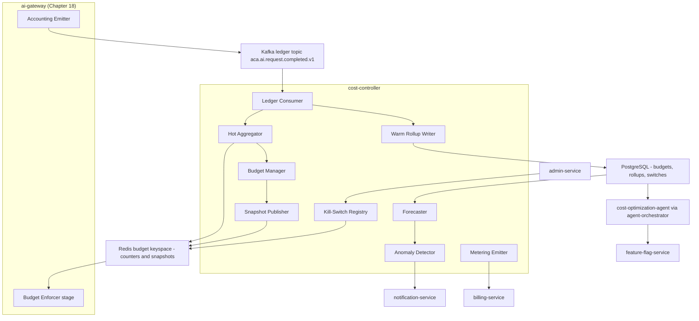
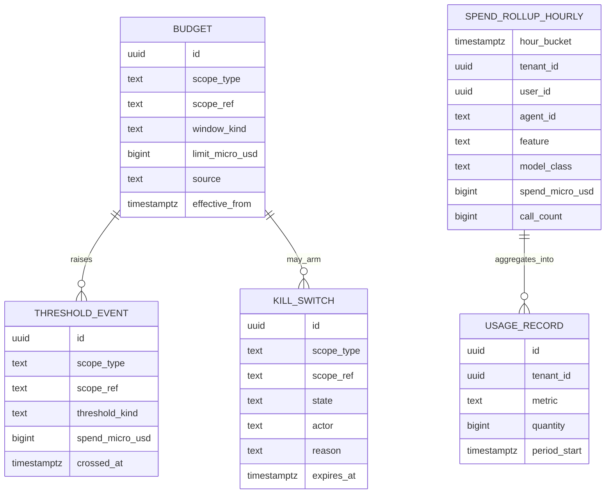
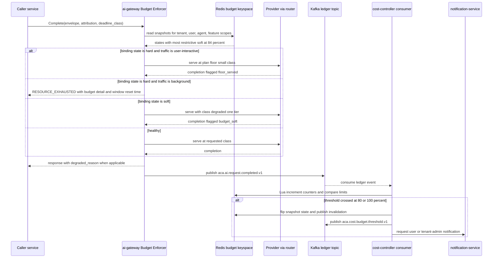
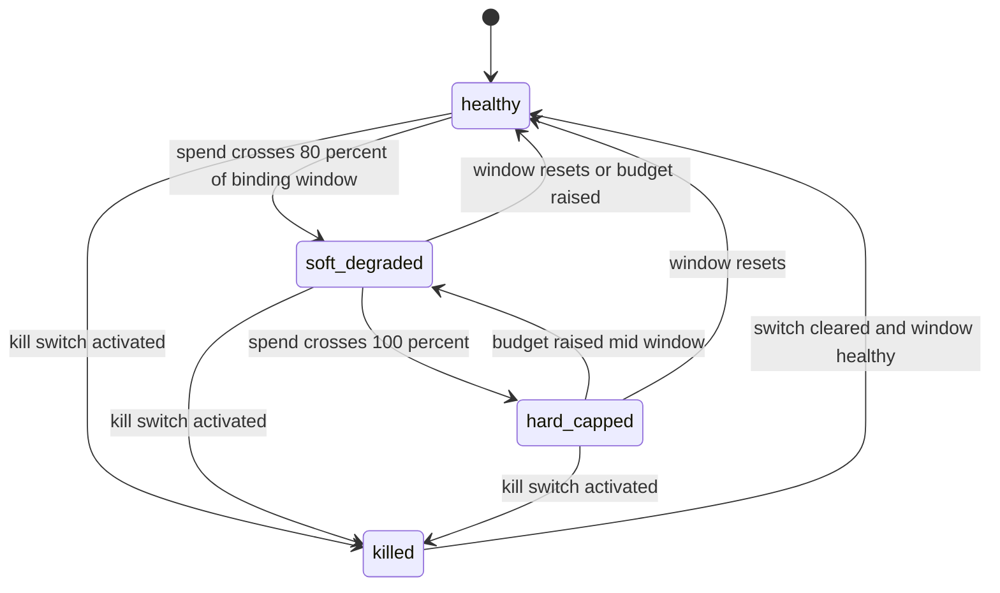

# 25 — Cost Optimization Engine

| | |
|---|---|
| Document ID | ACA-SAS-25 |
| Volume | 3 — AI Architecture |
| Status | Draft v1.0 |
| Depends on | [00 — Architecture Canon](../00-architecture-canon.md) §10, §12, §14; [04 — Non-Functional Requirements](../volume-1-foundation/04-non-functional-requirements.md) §8 (cost model, NFR-060–066); [18 — AI Gateway](../volume-2-core-services/18-ai-gateway.md); [21 — AI Architecture](21-ai-architecture.md); [26 — Semantic Cache](26-semantic-cache.md); [28 — Model Routing](28-model-routing.md) |

## 1. Overview

For an AI-native product, cost is a correctness property. The [Volume 1 cost model](../volume-1-foundation/04-non-functional-requirements.md) shows why: naive spend at target scale is ≈ $6.1M/mo, and the business is only viable at ≤ 0.40× naive (≤ $2.4M/mo, ≈ $4.85 per autopilot MAU). The gap between those two numbers is not closed by finance review; it is closed by architecture — the escalation ladder, the cache tiers ([Chapter 26](26-semantic-cache.md)), the routing engine ([Chapter 28](28-model-routing.md)), the batch lane — and by the enforcement machinery this chapter specifies. `cost-controller` is that machinery: the service that turns the token ledger into budgets, budgets into enforcement decisions, and spend patterns into optimization pressure.

This chapter owns four things. First, the **budget model**: five scopes (platform, tenant, user, agent, feature) × two windows (daily, monthly), how budgets are derived from plan entitlements, and how scopes compose when several apply to one request. Second, the **spend ledger pipeline**: how `aca.ai.request.completed.v1` events become hot Redis aggregates (the enforcement source) and warm Postgres rollups (the analytical and billing source), with the reconciliation that keeps the two honest. Third, **enforcement**: the decision flow executed inside `ai-gateway`'s Budget Enforcer stage — soft degrade at 80%, hard stop at 100%, and the always-allow interactive floor that guarantees cost control never reads as an outage (NFR-017). Fourth, the **control loop**: `cost-optimization-agent` pattern mining, forecasting and anomaly detection, unit-economics dashboards, billing metering integration, and the kill-switch design that bounds worst-case damage from a runaway agent.

The division of labor with [Chapter 18](../volume-2-core-services/18-ai-gateway.md) is strict and canonical: **`cost-controller` decides, `ai-gateway` enforces.** The gateway holds no budget policy — it evaluates snapshots the controller publishes. This keeps the enforcement hot path free of a synchronous dependency on `cost-controller` (a budget check is a Redis read, ≈ 2 ms) and keeps all budget semantics in one service that can be reasoned about, audited, and drilled. The enforcement latency SLO — threshold cross to applied decision ≤ 60 s (NFR-063) — is a property of the pipeline in §4, not of any request path.

`cost-controller` is a TypeScript/NestJS service (control-plane semantics, not AI-plane inference) owning its own PostgreSQL schema and a keyspace in the gateway-scoped Redis cluster for hot counters and snapshots. `cost-optimization-agent` is a logical agent per canon §5, executed by `agent-orchestrator` on the batch lane — it holds no infrastructure of its own.

## 2. Component Architecture



| Component | Purpose | Failure posture |
|---|---|---|
| Ledger Consumer | Consumes `aca.ai.request.completed.v1` (64 partitions, keyed `tenant_id`); idempotent via `request_id` dedup set | lag alarm at 30 s (NFR-063 at risk); at-least-once, dedup absorbs replays |
| Hot Aggregator | Increments per-scope Redis counters (micro-USD integers); detects threshold crossings inline | Redis loss → rebuild from warm rollups + ledger replay (§13) |
| Warm Rollup Writer | Buffers and flushes hourly-grain rollups to Postgres every 60 s | buffered ≤ 5 min on Postgres brownout, then backpressure on consumer (hot path unaffected) |
| Budget Manager | Materializes effective budgets from plan entitlements + overrides; evaluates scope state | fail-static — last materialized budgets remain in force |
| Snapshot Publisher | Writes per-scope enforcement snapshots to Redis; pub/sub invalidation push to gateway pods | gateway honors stale snapshots ≤ 15 min, then conservative defaults ([Ch 18 §13](../volume-2-core-services/18-ai-gateway.md)) |
| Forecaster | Hourly seasonal forecasts per scope (§8) | non-critical; alerts suppressed, enforcement unaffected |
| Anomaly Detector | Burn-rate and pattern anomalies; pages and can arm automatic kill switches (§11) | non-critical for enforcement; loss widens time-to-detect only |
| Kill-Switch Registry | Authoritative switch state (Postgres) + Redis push distribution | fail-static; active switches survive controller restart (persisted) |
| Metering Emitter | Daily + threshold-triggered `aca.billing.usage.recorded.v1` to billing | replayable from warm rollups; billing tolerates late usage records |

### 2.1 Interfaces

Internal gRPC (`aca.cost.v1`), mesh mTLS + per-method OPA per canon §7:

| RPC | Callers | Purpose |
|---|---|---|
| `Budgets/GetSnapshot` | `ai-gateway` (cold-start fill), `agent-orchestrator` (run admission) | Effective budget + current spend for a scope set |
| `Budgets/List` / `Budgets/Set` | `admin-service`, `billing-service` (entitlement sync) | Budget CRUD; `Set` is override-only — plan-derived budgets are computed, not stored per user |
| `KillSwitch/Activate` / `KillSwitch/Clear` | `admin-service` (JIT-elevated), `agent-supervisor` (agent scope only, §11) | Switch lifecycle; every mutation audit-logged |
| `Forecast/Get` | `admin-service`, `analytics-service`, `cost-optimization-agent` | Scope forecast + variance |
| `Ledger/Reconcile` | scheduled internal | Trigger reconciliation pass (§4.3) |

Admin REST surfaces (budget explorer, switch console, unit-economics views) are exposed via `admin-service`, not directly; `cost-controller` has no route at `api-gateway`.

### 2.2 Events

| Topic | Direction | Key | Payload sketch |
|---|---|---|---|
| `aca.ai.request.completed.v1` | consume | `tenant_id` | canonical ledger event ([Ch 18 §10](../volume-2-core-services/18-ai-gateway.md)) |
| `aca.billing.subscription.changed.v1` | consume | `tenant_id` | plan changes → budget re-materialization |
| `aca.agent.run.completed.v1` | consume | `run_id` | per-run cost actuals → run-cap calibration (§3.2) |
| `aca.cost.budget.threshold.v1` | produce | scope ref | `{scope_type, scope_ref, window, threshold (soft\|hard), spend_micro_usd, limit_micro_usd, crossed_at}` |
| `aca.cost.anomaly.detected.v1` | produce | scope ref | `{scope, anomaly_class, observed, baseline, severity, evidence_ref}` — domain extension |
| `aca.cost.killswitch.changed.v1` | produce | switch id | `{switch_id, scope_type, scope_ref, action, actor, reason, ttl}` — domain extension |
| `aca.cost.forecast.breach.v1` | produce | scope ref | `{scope, window, forecast_micro_usd, limit_micro_usd, projected_breach_date}` — domain extension |
| `aca.billing.usage.recorded.v1` | produce | `tenant_id` | AI usage metering records (§10) |

## 3. Budget Model

### 3.1 Scopes and windows

A budget is `(scope_type, scope_ref, window) → limit`. Five scope types; the platform scope extends the canon's four (recorded in §18 for canon promotion):

| Scope | `scope_ref` | Protects against | Typical owner of the number |
|---|---|---|---|
| `platform` | cell id or `global` | Aggregate COGS breach; provider-bill catastrophe | FinOps + NFR-061 ceiling |
| `tenant` | `ten_…` | One org consuming a cell's capacity; enterprise contract overage | Plan default; contract override |
| `user` | `usr_…` | Per-seat COGS ceiling breach (NFR-060) | Plan default |
| `agent` | agent slug, optionally `agent@version`, optionally per-user | A single agent class going pathological (loop, retrieval storm) | This chapter's defaults; `cost-optimization-agent` tuning proposals |
| `feature` | feature attribution string (e.g. `job-parsing-global`) | A pipeline (not a user) blowing its envelope — bulk parse, re-embedding campaigns | Platform team per-feature envelopes |

Two windows per scope: **daily** (00:00 UTC reset — matches the metering day and keeps window arithmetic trivial across cells) and **monthly** (aligned to the tenant's billing anchor from `billing-service`, so budget month = invoice month and overage conversations reference one window). Both windows are always evaluated; the binding constraint is whichever is tighter at decision time.

### 3.2 Budget derivation and defaults

Budgets are **materialized, not hand-set**: the Budget Manager computes effective budgets from plan entitlements (signed snapshots from `billing-service`, canon §12) plus explicit overrides. Reference defaults (derived from the NFR-060 COGS ceilings; all values reference, tuned via §7 recommendations):

| Budget | Free | Professional | Premium | Enterprise (default) | Rationale |
|---|---|---|---|---|---|
| `user` monthly | $0.30 | $4.50 | $12.00 | $8.00 blended | = NFR-060 per-plan COGS ceilings verbatim |
| `user` daily | $0.05 | $0.75 | $2.00 | contract | monthly ÷ 6 — job search is bursty (application sprees); one hot day may take ~17% of the month, a runaway day cannot take more |
| `tenant` daily/monthly | Σ member user budgets × 0.8 | same | same | contract | statistical multiplexing — members do not all burst the same day; the 0.8 factor reclaims that headroom while still bounding the org |
| `platform` daily | $120k | — | — | — | ≈ 1.5× engineered average spend ($80k/day at target scale) — absorbs legitimate peak days, caps catastrophe below 2× plan |
| `platform` monthly | $2.4M soft / $2.6M hard | — | — | — | NFR-061 ceiling; soft = forecast gate, hard = platform-wide degrade |

Agent-scope defaults (per agent slug, per user, daily — the anti-pathology layer; sized ≈ 3× the engineered per-user daily cost of that agent's normal duty cycle):

| Agent scope | Daily/user | Rationale |
|---|---|---|
| `browser-agent` | $0.60 | ~5 sessions/day × engineered ~$0.04/session, ×3 retry headroom |
| `resume-agent` + `cover-letter-agent` (shared `generation` bucket) | $0.50 | Premium peak ≈ 13 drafts/day × ~$0.12 engineered generation cost |
| `interview-coach-agent` | $0.60 | interactive sessions are user-present; generous but bounded |
| all other agents (default) | $0.25 | background agents have no legitimate reason to exceed cents/user/day |

Per-run cost caps complement scope budgets and are enforced by the agent runtime ([Chapter 21 §3.2](21-ai-architecture.md)) using budget slices issued at run admission: application-submission run ≤ $1.50, autopilot scan ≤ $0.30, mock-interview session ≤ $0.80 — each ≈ 3× the engineered cost of the happy path, so two retries fit and a loop does not. Actuals from `aca.agent.run.completed.v1` recalibrate these quarterly.

Feature-scope envelopes (platform-level, daily, reference at target scale): discovery + parse + enrichment $13k; matching + explanations $39k; application generation $20k; browser intelligence $16k; tracking $5k; coaching + negotiation $8k; platform internal (evals, memory consolidation, supervision) $10k. Each envelope = engineered forecast × 1.3 — enough headroom that envelopes fire on genuine anomalies, not on good weeks.

### 3.3 Precedence and composition

Every request carries mandatory attribution (`tenant_id`, `user_id?`, `agent_id?`, `feature` — NFR-064: 100% completeness). The enforcer evaluates **all applicable scopes** and combines verdicts with **most-restrictive-wins**: `deny > queue > floor > degrade > allow`. There is no scope hierarchy override — a healthy tenant budget never un-caps an exhausted user budget, and vice versa. Two deliberate exceptions:

1. **Interactive floor** (§3.4) overrides `deny` for user-interactive traffic — by design, per canon §10.2.
2. **Platform hard cap** overrides everything including the floor when a platform-scope kill switch is active (§11) — the one state where the platform chooses visible degradation over unbounded spend, requiring human activation.

### 3.4 The interactive floor

The floor guarantees that budget exhaustion degrades autonomy, never presence: a user who opens the app always gets a working assistant. Specification:

| Property | Value | Rationale |
|---|---|---|
| Eligibility | `deadline_class ∈ {fast, interactive}` AND request originates from a user-present session (attribution flag set by the calling service, verified against caller identity) | agents must not costume batch work as interactive; the flag is attested, not self-declared |
| Floor class | `small` for all plans | canon plan floor ([Ch 18 §4.2](../volume-2-core-services/18-ai-gateway.md)); cheap enough that the floor cannot itself be a cost problem |
| Floor accounting | spend is ledgered and attributed normally, flagged `floor_served` | the floor is unmetered *enforcement*, not unmetered *spend* — it still appears in COGS |
| Floor abuse guard | per-user floor spend > 3× the plan's daily user budget in a day → anomaly event + `security-agent` review | a "user-present" flag being gamed by a compromised client shows up here |

## 4. Spend Ledger Pipeline

### 4.1 Hot path — Redis aggregates

The Ledger Consumer group (parallelism ≤ 64, one worker per partition) processes ≈ 580 events/s average, 6k/s burst design (Kafka backbone math, Volume 1 §2.2). Per event, the Hot Aggregator executes one Lua script per applicable scope (atomicity: increment + threshold compare + state flip in one round trip):

| Key pattern | Content | TTL | Rationale |
|---|---|---|---|
| `sp:{scope}:{ref}:d:{yyyymmdd}` | integer micro-USD counter + per-class hash | 50 h | integer micro-USD avoids float drift at billing precision; 50 h survives a full day plus reconciliation lag |
| `sp:{scope}:{ref}:m:{yyyymm}` | monthly counter | 35 d | window + close-out margin |
| `spts:{scope}:{ref}:{yyyymmddhhmm}` | 1-min burn buckets — **platform, tenant, feature, agent scopes only** | 48 h | burn-rate anomaly detection needs time series; per-user minute buckets would be ~500k × 1440 keys/day for no enforcement benefit |
| `dedup:req:{request_id}` | dedup marker | 25 h | at-least-once consumption; 25 h covers the maximum replay window (retry ladder + DLQ triage) |
| `bud:{scope}:{ref}` | enforcement snapshot (limit, spend, state, floor policy, switch refs) | none (managed) | the document `ai-gateway` reads; rewritten on state change and every 60 s heartbeat |

Threshold detection is **inline in the consumer**, not a scanner: the same Lua script that increments compares against the materialized limit and, on an 80%/100% crossing, flips the snapshot state and publishes the invalidation. Measured path: ledger event → snapshot flip ≈ p99 2 s (consumer lag budget 30 s alarm). Against NFR-063's 60 s ceiling this leaves margin for one full component restart.

Sizing: ~500k active users × ~3 scope-window keys + tenant/feature/agent keys + dedup set ≈ 4–5M keys, < 2 GB — a rounding error in the gateway Redis cluster; isolated in its own logical keyspace with a dedicated connection pool so cache traffic cannot starve budget reads.

### 4.2 Warm path — Postgres rollups

The Warm Rollup Writer aggregates events in memory and flushes hourly-grain rows every 60 s (upsert on conflict; a flush is ≤ a few thousand rows, trivial write load vs. 50M raw events/day, which stay in Kafka and the `ai-gateway` request-log projection):

```sql
-- cost-controller owns this schema
CREATE TABLE spend_rollup_hourly (
  hour_bucket    timestamptz NOT NULL,
  tenant_id      uuid        NOT NULL,
  user_id        uuid,                  -- null for platform/feature-scope traffic
  agent_id       text,
  feature        text        NOT NULL,
  model_class    text        NOT NULL,
  provider       text        NOT NULL,
  cache_tier     text        NOT NULL,  -- none | exact | semantic
  call_count     bigint      NOT NULL,
  tokens_in      bigint      NOT NULL,
  tokens_out     bigint      NOT NULL,
  tokens_prefix_cached bigint NOT NULL DEFAULT 0,
  spend_micro_usd bigint     NOT NULL,
  floor_served_count bigint  NOT NULL DEFAULT 0,
  degraded_count bigint      NOT NULL DEFAULT 0,
  PRIMARY KEY (hour_bucket, tenant_id, user_id, agent_id, feature, model_class, provider, cache_tier)
) PARTITION BY RANGE (hour_bucket);     -- daily partitions; 90 d hot, then daily-grain archive 25 months

CREATE TABLE budget (
  id             uuid PRIMARY KEY,      -- UUIDv7
  scope_type     text NOT NULL,         -- platform | tenant | user | agent | feature
  scope_ref      text NOT NULL,
  window_kind    text NOT NULL,         -- daily | monthly
  limit_micro_usd bigint NOT NULL,
  source         text NOT NULL,         -- plan_derived | override | contract
  set_by         text,                  -- principal for overrides; audit-logged
  effective_from timestamptz NOT NULL,
  effective_to   timestamptz,
  UNIQUE (scope_type, scope_ref, window_kind, effective_from)
);
```

Retention: hourly grain 90 d (matches AI request-log hot retention, canon §11), compacted to daily grain for 25 months (two year-over-year cycles for seasonality baselines and finance close). Warm rollups — not raw events — are the source for forecasting (§8), unit economics (§9), metering (§10), and `cost-optimization-agent` mining (§7).



### 4.3 Reconciliation

Three independent comparisons, because metering feeds billing and silent drift is a revenue bug:

| Comparison | Cadence | Tolerance | Action on breach |
|---|---|---|---|
| Redis hot counters vs. warm rollups | hourly | 0.5% | page; rebuild hot counters from rollups + ledger tail replay |
| Warm rollups vs. provider invoice/usage APIs | hourly (shared with [Ch 18 §10](../volume-2-core-services/18-ai-gateway.md)) | 0.5% | page; usually a price-table or prefix-cache accounting gap |
| Warm rollups vs. billing usage records | monthly close | 1% (NFR-064) | finance escalation; metering replay from rollups |

## 5. Enforcement at ai-gateway

### 5.1 Snapshot distribution

`ai-gateway` pods hold an in-memory LRU of `bud:*` snapshots (5 s local TTL) over the Redis documents, subscribed to the invalidation pub/sub channel — a state flip reaches the whole fleet in ≈ 1 s without a per-request Redis round trip beyond the first. Staleness contract (canonical, [Ch 18 §13](../volume-2-core-services/18-ai-gateway.md)): snapshots honored ≤ 15 min stale; beyond that the gateway falls back to conservative defaults — interactive at plan floor, `frontier` fail-closed, batch paused. Bounded over-spend under total controller failure ≈ 15 min × plan-floor rates.

### 5.2 Decision table

Evaluated per request in the Budget Enforcer stage (stage 3 of the Chapter 18 pipeline), after most-restrictive-wins composition across scopes:

| Binding scope state | User-interactive traffic | Agent / background traffic | Batch lane |
|---|---|---|---|
| healthy (< 80%) | allow requested class | allow requested class | allow |
| soft (80–100%) | allow; router degrades one class tier; response flagged `degraded_reason=budget_soft`; user notified once per window | degrade one tier; batch-eligible work re-routed to batch lane | continue (already cheapest lane) |
| hard (≥ 100%) | **floor**: serve at `small`, flag `floor_served`, surface budget banner | deny (`RESOURCE_EXHAUSTED` with budget detail) or queue to next window if the workflow declared deferrable | pause drains for the scope |
| kill switch active at scope | per switch policy — default floor for user/tenant switches, deny for agent/feature switches | deny | pause |
| platform switch active | deny non-critical; floor only for support/abuse-response allowlist | deny | pause |

Degradation is delegated: the enforcer emits a *verdict* (`allow | degrade | floor | queue | deny`); the router ([Chapter 28 §8](28-model-routing.md)) translates `degrade` into a concrete class using the feature's degradation ladder (§6) — the enforcer knows budgets, the router knows what a tier down means for each task type.

### 5.3 Enforcement sequence



### 5.4 Budget scope state machine



Every transition is a `aca.cost.budget.threshold.v1` or `aca.cost.killswitch.changed.v1` event and a Grafana annotation — degradation is a designed state machine (NFR-005), drilled monthly in staging.

## 6. Degradation Ladders per Feature

The core design rule: **two degradation axes — quality and deferral — and consequential outputs only degrade by deferral.** ACA never submits a worse application because a budget is tight; it queues the application for the next window instead. Non-consequential surfaces (explanations, digests, enrichment) degrade quality first because a cheaper answer now beats no answer.

| Feature | Rung 0 (healthy) | Rung 1 (soft, 80%) | Rung 2 (hard, 100%) | Axis rationale |
|---|---|---|---|---|
| Job parse fallback | `small`, interactive lane for fresh postings | batch lane only | rules-only parsing; LLM-fallback backlog queued to next window | deferral — a posting parsed 12 h late is still useful; a mis-parsed one is not |
| Company enrichment | `medium` refresh at crawl cadence | serve stale from knowledge cache ([Ch 26 §5](26-semantic-cache.md)); refresh only companies with active applications | pause refresh entirely | deferral — company facts drift over days, not hours |
| Match explanations | `medium` narrative | `small` template-backed rationale | scores shown without narrative, backfilled next window | quality — an approximate explanation is still decision-useful |
| Resume tailoring + cover letters | `large` (plan-gated) | `large` retained, retrieval budget tightened 25% | queued to next window; user sees ETA | **deferral only** — consequential output |
| Screening-question answers | `medium` | `medium` retained | queued with the draft | deferral only — consequential |
| Browser submission flows | class per template trust ([Ch 28 §4](28-model-routing.md)) | non-urgent status checks deferred | submissions with prior approval proceed at full class; new sessions queued | deferral only — a degraded perception model risks mis-submission, worse than waiting |
| Interview coaching (interactive) | `medium` | mock-transcript length halved | floor: `small` Q&A, long-form feedback deferred | quality — floor guarantee applies, user is present |
| Notifications / digests | `small`/`medium` composition | digest-only (no per-event decisions) | template digests, no generation | quality — deterministic fallback exists |
| Analytics narratives | `medium` weekly | biweekly | paused | deferral — pure nice-to-have under pressure |

Ladders are configuration (per-feature entries in the routing policy bundle, [Chapter 28 §11](28-model-routing.md)), versioned and hot-reloadable — a ladder change is a config rollout with canary, not a deploy.

## 7. cost-optimization-agent

**Purpose.** The closed-loop optimizer: mine the warm ledger for spend patterns, join them with quality statistics from `learning-pipeline`, and produce ranked, evidence-backed optimization actions — enacting the safe ones, proposing the rest.

**Responsibilities.** Pattern mining over `spend_rollup_hourly` + routing-decision logs; recommendation generation; bounded autonomous enactment; weekly cost review preparation; anomaly investigation narratives on `aca.cost.anomaly.detected.v1`.

**Interactions.** Runs nightly on the batch lane (agent-orchestrator scheduled goal) plus on-demand on anomaly events. Reads: `cost-controller` Postgres (read replica), routing decision logs ([Ch 28 §10](28-model-routing.md)), cache telemetry ([Ch 26 §7](26-semantic-cache.md)), eval statistics from `learning-pipeline`. Writes: recommendations to `admin-service` review queue; autonomous actions via `feature-flag-service` and config PRs through the [Chapter 28 §11](28-model-routing.md) rollout gates.

Mining targets (each a named detector, not open-ended LLM exploration — the agent's model calls summarize and rank, deterministic queries find):

| Pattern | Detector | Typical action |
|---|---|---|
| Class over-provisioning | (task_type, class) pairs where a lower class passes ≥ 99% of evals at ≥ 30% cost delta | routing rule proposal (one tier down) via Ch 28 gates |
| Cache-miss clusters | task types with hit rate < 50% of target and high input similarity | semantic-cache eligibility or TTL proposal via Ch 26 rollout |
| Prefix-cache erosion | prompt versions whose provider prefix-cache share dropped ≥ 10 pts | flag to prompt owner — usually a volatile token snuck into a stable segment |
| Batch-eligible sync traffic | non-interactive calls with deadline slack ≥ 1 h running in the sync lane | lane reassignment (autonomous, bounded) |
| Retrieval bloat | features whose tokens-in grew > 20% without output-quality change | context-builder budget review flag |
| Per-agent cost drift | agent versions whose cost/run rose > 25% vs. prior version | flag to agent owner; supervisor correlation |

**Enactment guardrails** — the agent's autonomy is deliberately narrow: it may autonomously (a) reassign batch-eligible traffic lanes, (b) tune cache TTLs within ±50% of the configured value, (c) adjust feature-scope envelope alerts. Everything touching routing policies, budgets, thresholds, or plan-visible behavior ships as a **proposal** through human review plus the Chapter 28 config gates. All actions — autonomous or proposed — are audit-logged with the evidence bundle that justified them. Expected yield: the difference between the ladder working *as shipped* and *as tuned*; Volume 1's compound 0.40× target assumes this loop runs.

## 8. Forecasting & Anomaly Detection

**Forecasting.** Hourly job per scope (platform, tenant > $50/mo spend, all features, all agents): seasonal baseline = weekday×hour profile over a 28-day EWMA window (job-search traffic has strong weekly seasonality — Monday/Tuesday posting surges, business-hours interactivity). Month-end projection = actual-to-date + baseline-shaped remainder. Outputs: `aca.cost.forecast.breach.v1` when a projection exceeds its window limit, and the NFR-061 FinOps gate (forecast > 80% of aggregate ceiling → sustained alert).

**Anomaly detection**, evaluated on the 1-min burn series (§4.1) and hourly rollups:

| Detector | Trigger | Severity / action |
|---|---|---|
| Platform burn spike | +20%/h vs. seasonal baseline (canonical, [Ch 18 §16](../volume-2-core-services/18-ai-gateway.md)) | page — runaway loops surface here first |
| Scope burn z-score | z > 4 over trailing 28-day same-hour distribution, min $5/h absolute | agent/feature scope: auto-arm spend breaker (§11); tenant/user: notify + soft-degrade early at 70% |
| Class-mix shift | `frontier` share of spend > 5% (NFR-066) or `large` share +10 pts day-over-day | page + routing-policy audit — someone is skipping the ladder |
| Cache-hit collapse | blended no-provider-spend share < 30% for 30 min (NFR-062 at risk) | page — usually a cache-key instability or invalidation storm ([Ch 26 §10](26-semantic-cache.md)) |
| Floor-spend anomaly | per-user floor spend > 3× plan daily budget | `security-agent` review (§3.4) |
| Ledger silence | consumer lag > 30 s or event rate < 50% of baseline | page — enforcement is flying blind; staleness clock (§5.1) is running |

Absolute-dollar minimums on every relative detector prevent alert noise from small scopes; z-score windows exclude previously-flagged anomaly hours to avoid baseline contamination.

## 9. Unit Economics & Dashboards

Unit economics translate the ledger into the numbers the business actually steers by. Computed daily from warm rollups, served to `analytics-service` dashboards and the weekly cost review:

| Metric | Definition | Reference target | Rationale |
|---|---|---|---|
| Direct cost per submitted application | generation + browser + validation spend attributed to the application's feature chain ÷ submissions | ≤ $0.25 | engineered path ≈ $0.20 (tailor + letter + screening + browser at cache-adjusted rates); 25% headroom |
| Fully-loaded AI cost per application | total AI spend ÷ submissions | ≤ $0.60 | $80k/day ÷ 150k submissions ≈ $0.53 at target scale; amortizes discovery/matching/tracking |
| AI COGS per active user per plan | plan-attributed spend ÷ plan MAU, monthly | NFR-060 ceilings | the contractual viability number; monthly close artifact |
| Cost per autopilot MAU | platform AI spend ÷ autopilot MAU | forecast $4.85, ceiling $7.28 | NFR-061 |
| Cost per discovered-and-scored job | discovery + parse + embed + match spend ÷ jobs scored | ≤ $0.01 | keeps the top-of-funnel affordable at 2M jobs/day |
| Cache leverage | spend avoided by cache tiers (counterfactual at list price) ÷ actual spend | ≥ 0.45 | makes Chapter 26's contribution a first-class business metric |
| Floor burden | floor-served spend ÷ total spend | < 2% | a rising floor burden means budgets are chronically too tight — a product problem, not an abuse problem |

Dashboards (Grafana, warm-rollup-backed): **Executive** (spend vs. plan, per-MAU trajectory, forecast fan); **Engineering** (spend by service/agent/feature/class/provider, degrade and deny rates, cache leverage, prefix-cache share); **Tenant drill-down** in `admin-service` (support and enterprise account reviews); **Anomaly console** (active detectors, armed breakers, switch states).

## 10. Billing Metering Integration

`cost-controller` is the **metering source for AI usage** (canon §10.3, §12); `billing-service` owns pricing, invoicing, and entitlements. The seam:

- **Usage records**: daily `aca.billing.usage.recorded.v1` per (tenant, user, metric) — `ai_spend_micro_usd`, `ai_tokens_in/out`, `ai_calls_by_class` — emitted at window close from warm rollups (not hot counters: rollups are replayable and reconciled). Threshold-triggered interim records at 80%/100% let billing surface in-product usage meters without polling.
- **Entitlement sync**: `aca.billing.subscription.changed.v1` re-materializes budgets within 60 s (plan upgrade takes effect at the next request; downgrade at next window to avoid mid-session cliffs).
- **Overage semantics**: plans are budget-capped, not metered-overage, for individuals (predictability is a trust feature); enterprise contracts may enable metered overage — `billing-service` flags the entitlement, and `cost-controller` then converts `hard` state to `soft-with-overage-accrual` for that tenant, ledgering overage separately.
- **Reconciliation**: monthly close per NFR-064 (§4.3); the ledger event stream is the audit trail for every billed unit.

## 11. Kill-Switch Design

Kill switches are the last rung below budget enforcement: budget states bound *rate*, switches bound *existence*. Canon §1 mandates user, tenant, and platform scope; this chapter adds agent, feature, provider, and model-class scopes (same registry, same distribution path — recorded for canon promotion).

| Property | Design | Rationale |
|---|---|---|
| Authority | Humans via `admin-service` JIT elevation for all scopes; **automation may activate only agent- and feature-scope switches** (Anomaly Detector + `agent-supervisor` co-signal, §12) | automation stops runaway code fast; only humans stop users, tenants, providers, or the platform |
| State | Postgres (authoritative, survives restart) + Redis push distribution; enforcement points: `ai-gateway` (model calls), `agent-orchestrator` (run admission), `browser-fleet-service` (session admission) | a switch must hold through a controller crash; three enforcement points because model calls are not the only spend |
| Propagation | pub/sub push ≤ 10 s fleet-wide; 60 s poll fallback | NFR-063-compatible worst case |
| TTL | automated switches expire ≤ 24 h (mirror of [Ch 18 §11](../volume-2-core-services/18-ai-gateway.md) override TTL); human switches indefinite but re-attested weekly | emergency state must not fossilize into configuration |
| Re-enable | platform scope requires two-person action (NFR-005 state machine); all others single JIT-elevated operator | asymmetry: platform-off is a business decision, agent-off is an operational one |
| Audit | every transition → `aca.cost.killswitch.changed.v1` + `aca.audit.event.v1` with actor, reason, evidence ref | 7-year WORM trail for a control that can stop revenue-bearing flows |

## 12. Chaos Scenarios

Cost controls are drilled like availability controls (NFR-005: monthly staging, quarterly prod game-days). The flagship scenario:

**CH-1: Runaway agent.** Inject a canary agent version whose reflection step loops at `large` class (the classic pathology, [Chapter 21 §8](21-ai-architecture.md)). Expected containment, layered — each layer assumes every earlier one failed:

| Layer | Mechanism | Time-to-stop | Max damage (single user run) |
|---|---|---|---|
| 1. Per-run cost cap | runtime budget slice exhausted ($1.50) | seconds | $1.50 |
| 2. `agent-supervisor` loop heuristics | identical-call and plan-churn detection | < 10 steps | ≈ $1 |
| 3. Agent-scope per-user daily budget | hot-path enforcement at next call | ≤ NFR-063 60 s | ≤ $0.60/user/day |
| 4. Agent-scope burn z-score → auto breaker | §8 detector arms agent-scope kill switch fleet-wide | ≤ 5 min | ≤ $50 fleet-wide at `large` rates |
| 5. Feature envelope hard cap | feature-scope hard state | ≤ 60 s after envelope | envelope × 1.0 |
| 6. Platform burn spike page | +20%/h — human engages | ≤ 15 min | bounded by layers above |

Drill pass criteria: layer 4 fires ≤ 5 min with total injected spend < $50; every layer's firing visible on the anomaly console; post-drill ledger reconciles to the cent.

Other drilled scenarios: **CH-2** budget-breach injection (NFR-063 verification — threshold cross to enforced decision ≤ 60 s); **CH-3** ledger-lag injection (consumer paused 20 min → gateway conservative fallback engages at 15 min, over-spend within modeled bound); **CH-4** threshold-event storm (10k simultaneous user-scope crossings — notification collapse to digests, no pub/sub saturation); **CH-5** kill-switch drill (activation + two-person platform re-enable path); **CH-6** provider price-table error (wrong price loaded → reconciliation catches within one hourly cycle).

## 13. Failure Scenarios

| Scenario | Detection | Behavior | Blast radius / recovery |
|---|---|---|---|
| `cost-controller` fully down | snapshot heartbeat staleness at gateway | canonical fallback: stale snapshots ≤ 15 min, then interactive at plan floor, `frontier` fail-closed, batch paused | bounded over-spend ≈ 15 min × floor rates; no user-visible outage |
| Ledger consumer lag > 30 s | lag alarm | enforcement decisions age; staleness clock bounds exposure; consumers scale to partition ceiling | over-spend bounded by lag × burn rate; replay is idempotent |
| Redis budget keyspace lost | keyspace miss rate | counters rebuilt from warm rollups + ledger tail replay (≤ 10 min); gateway on conservative defaults meanwhile | budget states restored slightly conservative (rebuild rounds up) |
| Postgres (warm) brownout | flush failures | consumer buffers 5 min then applies backpressure; hot path and enforcement unaffected | rollup gap backfilled from Kafka on recovery |
| Threshold-event storm | event rate anomaly | notification collapse to per-tenant digests; snapshot writes batched | user notification latency only |
| Budget mis-materialization (bug sets limits to 0) | deny-rate spike alert (§16) + materialization diff guard (> 20% of budgets changing in one pass requires operator ack) | diff guard blocks the pass before publication | prevented; worst case = one scope batch, rollback to prior materialization |
| Kill switch stuck active (clear fails) | switch-state vs. Postgres divergence probe | poll fallback reconciles within 60 s; manual Redis purge runbook | ≤ 60 s excess restriction |
| Clock skew across windows | window-boundary reconciliation | counters keyed by event time, not ingest time; late events land in their true window | drift absorbed by 50 h key TTL |

## 14. Scaling Strategy

The pipeline scales with ledger volume, which scales with AI calls (21M avg → 50M design peak/day). Ledger Consumer parallelism is bounded by the topic's 64 partitions — at 6k msg/s burst each worker handles < 100 msg/s, two orders of magnitude below Redis Lua throughput per connection. Hot-counter cardinality grows with active users (linear, small). Warm writes are aggregated (≤ ~5k rows/min) regardless of event volume — the aggregation ratio *improves* with scale. Per-cell deployment mirrors the platform (canon §15): each cell runs its own consumer group and Redis keyspace; platform-scope aggregation runs in the control-plane cell consuming all cells' rollup streams; the 10% cross-cell provider-quota reserve reallocation ([Ch 18 §14](../volume-2-core-services/18-ai-gateway.md)) is computed here hourly. Forecasting cost grows with scope count — capped by the $50/mo tenant threshold (small tenants get plan-default alerting only).

## 15. Security Considerations

- **Budget mutations are privileged**: `Budgets/Set` and switch RPCs require JIT-elevated principals via `admin-service` + OPA; every mutation audit-logged to `aca.audit.event.v1`. A compromised domain service cannot raise its own budgets — attribution is verified against SPIFFE caller identity at the gateway ([Ch 18 §15](../volume-2-core-services/18-ai-gateway.md)), and budget writes are not exposed to domain services at all.
- **Spend data is commercially sensitive** (P3 derived, but tenant-confidential): tenant drill-downs RLS-scoped; cross-tenant views only in `admin-service` with role gates; usage records carry no prompt content.
- **Kill-switch abuse**: an attacker with switch access has a platform-wide denial-of-service lever — hence JIT elevation, two-person platform re-enable, automation restricted to agent/feature scopes, and switch-state change alerting to the security channel.
- **Floor-flag attestation** (§3.4): the user-present flag is set by calling services from authenticated session context and validated against caller identity — an agent workload cannot claim it; anomalous floor spend routes to `security-agent`.
- **Ledger integrity**: enforcement and billing both derive from the same at-least-once, dedup-keyed stream; reconciliation (§4.3) is the tamper/bug tripwire.

## 16. Observability

| Signal | Target / alert |
|---|---|
| Threshold-cross → enforced decision lag | ≤ 60 s (NFR-063); measured by budget-breach injection in prod (synthetic scope), alert at 45 s |
| Ledger consumer lag | alarm 30 s; page 60 s |
| Snapshot heartbeat age at gateway | alert 5 min (15-min conservative fallback approaching) |
| Deny rate / degrade rate by plan and feature | dashboards; deny-rate spike > 5× baseline pages (mis-materialization tripwire) |
| Floor-served share | < 2% of spend; trend review weekly |
| Forecast error (MAPE, platform daily) | < 10%; sustained > 20% → baseline model review |
| Reconciliation drift (all three, §4.3) | 0.5% / 0.5% / 1% — page on breach |
| Anomaly detector precision | > 70% of pages actionable, reviewed monthly — noisy detectors get retuned or demoted to tickets |
| Switch state | any active switch is a standing dashboard banner + daily reminder — switches must be conspicuous |

All spans OTel; `trace_id` propagated from the originating request through the ledger event into threshold events, so a budget denial can be traced back to the exact calls that consumed the window.

## 17. Future Improvements

- **Per-tenant budget marketplaces** (enterprise): admins re-allocate seat budgets within a tenant pool via self-serve, replacing support tickets.
- **Predictive pre-degrade**: use the §8 forecaster to begin soft degradation *before* 80% when the projection says the window will breach — smoother than a cliff at the threshold.
- **Learned anomaly models** replacing z-score detectors once two full seasonal cycles of rollups exist (25-month retention is sized for exactly this).
- **Spot/batch-price arbitrage**: extend the batch-lane promotion logic to schedule deferrable work against provider off-peak pricing windows where offered.
- **Carbon accounting**: the ledger already attributes every token; adding per-provider energy factors makes a sustainability report a rollup query.

## 18. Alternatives Considered & Tradeoffs

| Decision | Alternatives | Why this way |
|---|---|---|
| Asynchronous enforcement (ledger → snapshot → gateway) | Synchronous budget check RPC to `cost-controller` per call | A sync check puts a Tier-0 dependency + RTT on 580–2,000 req/s and fails closed on controller trouble. Async bounds staleness (≤ 60 s enforcement, ≤ 15 min fallback) at the cost of small transient over-spend — dollars are the cheapest currency to buy availability with. |
| Platform scope added to canon's four | Keep four scopes; treat platform as the sum of tenants | Tenant-sum misses unattributed platform features (global parsing, evals) and gives no single lever for the NFR-061 ceiling; a fifth scope is cheaper than a reconciliation convention. Recorded for canon promotion. |
| Integer micro-USD counters | Float USD; token-denominated budgets | Floats drift under billions of increments and break billing reconciliation; token budgets don't compose across classes with different prices. Micro-USD is exact at any realistic magnitude and composes trivially. |
| Budgets materialized from plans + overrides | Per-user budget rows managed directly | 500k+ hand-managed rows drift from entitlements and make plan changes a migration; materialization makes `billing-service` the single source and overrides the exception. Tradeoff: a materialization bug has wide blast radius — mitigated by the diff guard (§13). |
| Deferral-first degradation for consequential outputs | Uniform class-degradation ladders everywhere | A budget-degraded cover letter silently harms the user's job prospects to save cents — a catastrophic trade for a product whose mission is getting users hired. Deferral costs latency, which is visible, explainable, and reversible. |
| Automation may only trip agent/feature switches | Full auto-kill at all scopes; no automated switches | Auto-killing tenants/users on a detector false positive is a trust incident; auto-killing runaway agent code is exactly what detectors are for. The split matches blast radius to confidence. |
| Daily budget = monthly ÷ 6 | Monthly ÷ 30 (uniform); no daily window | Uniform daily caps break legitimate burst usage (application sprees), generating support load; no daily cap lets a runaway consume a month in hours. ÷ 6 is the measured burstiness compromise; `cost-optimization-agent` re-fits it from actuals. |
| Warm store in cost-controller Postgres (phase 1) | ClickHouse/OLAP now | Rollup volumes (≤ ~5k rows/min) are comfortably Postgres-scale; the canon's phase-2 OLAP path via `analytics-service` remains open. Revisit when rollup query latency degrades dashboard SLAs. |
