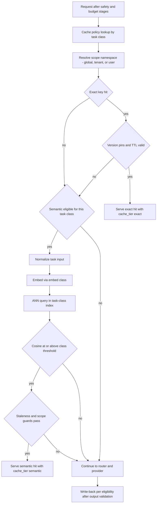
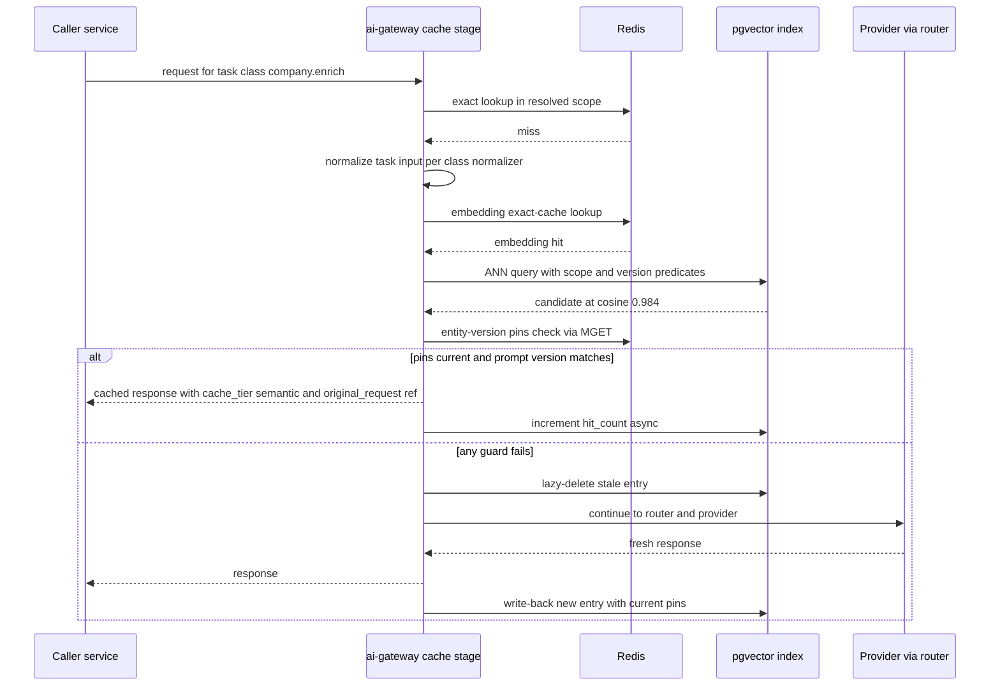
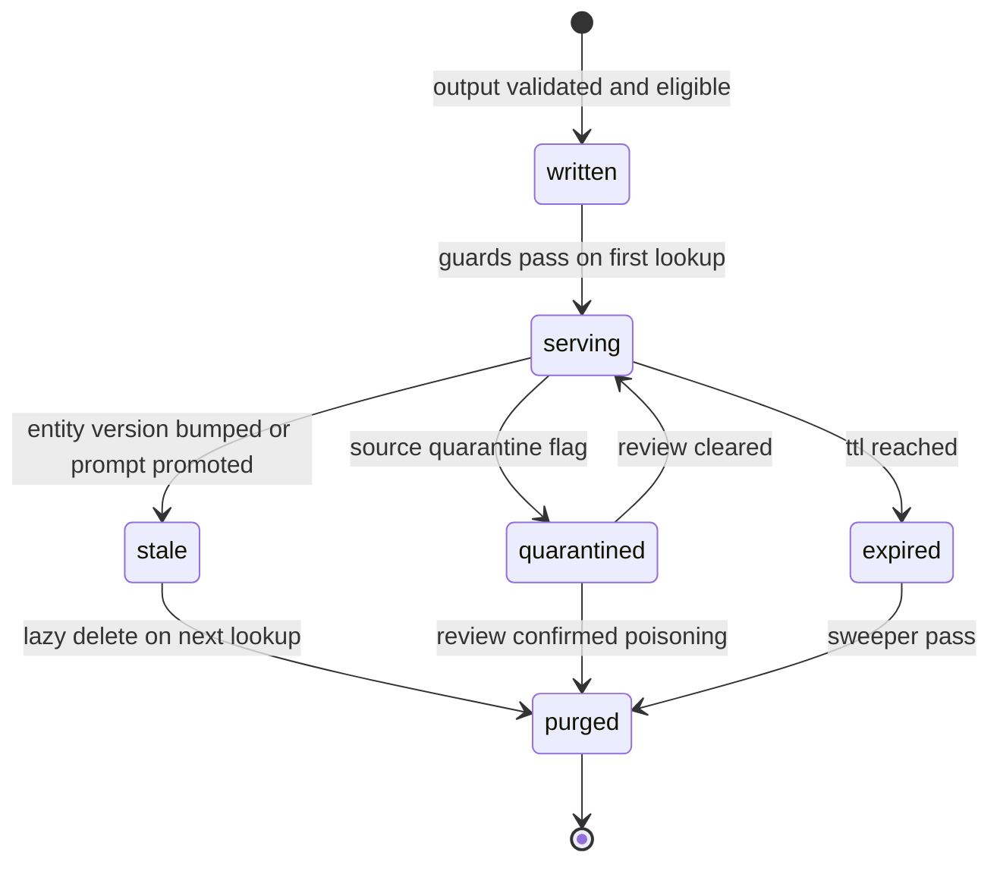

# 26 — Semantic Cache

| | |
|---|---|
| Document ID | ACA-SAS-26 |
| Volume | 3 — AI Architecture |
| Status | Draft v1.0 |
| Depends on | [00 — Architecture Canon](../00-architecture-canon.md) §9–§11; [18 — AI Gateway](../volume-2-core-services/18-ai-gateway.md) §5; [21 — AI Architecture](21-ai-architecture.md) §4; [25 — Cost Optimization Engine](25-cost-optimization-engine.md); [28 — Model Routing](28-model-routing.md); [04 — Non-Functional Requirements](../volume-1-foundation/04-non-functional-requirements.md) NFR-062 |

## 1. Overview

Caching is the second rung of the canon's escalation ladder and the single largest deterministic cost lever after routing: NFR-062 requires that ≥ 35% of `small`+`medium` gateway calls complete without provider spend, and the Volume 1 cost model books a −30% call reduction against caching before the platform's unit economics close. [Chapter 18 §5](../volume-2-core-services/18-ai-gateway.md) placed the cache tiers inside the `ai-gateway` pipeline and fixed their canonical parameters (SHA-256 exact keys, pgvector cosine ≥ 0.97 task-scoped semantic threshold). This chapter is the full specification behind those parameters: what is and is not in the exact-cache key, per-task-class TTLs and similarity thresholds with their justifications, the staleness and personalization guards that make reuse safe, the knowledge cache that substitutes model calls with materialized facts, the invalidation machinery, and — because a cache that returns wrong answers is worse than no cache — the correctness risk analysis and the guarded rollout process every cacheable task class must pass.

The design premise is that **cache correctness is a per-task-class property, not a global one.** A cached parse of an immutable job posting is safe almost indefinitely; a cached match explanation is safe only for one user and only until their profile changes; a cached agent plan is never safe. Accordingly, everything in this chapter — eligibility, scope, TTL, threshold, invalidation triggers, rollout stage — is configured per task class in a versioned cache policy table owned by `ai-gateway` configuration, and the default for any new task class is **not cacheable** until it has been explicitly analyzed and rolled out through §8.

Three tiers are specified. The **exact cache** (Redis) returns byte-identical responses for byte-identical canonical requests — zero correctness risk beyond staleness, highest hit precision, ~18% blended hit rate. The **semantic cache** (pgvector) returns responses for *meaning-equivalent* inputs — the risky tier, bounded by task-scoped thresholds, staleness guards, and a hard personalization rule: **cached personalized output is never served across users.** The **knowledge cache** (company facts, portal templates) is not a response cache at all but materialized derived knowledge that lets the ladder exit before any model call — it is owned by domain services; this chapter specifies its serving contract with the AI plane.

Non-goals: provider-side prompt caching (a prefix-stability contract, [Chapter 18 §5.3](../volume-2-core-services/18-ai-gateway.md)); memory tiers (`memory-service`, which is recall, not response reuse); HTTP/CDN caching at the edge (Volume 2).

## 2. Cache Tier Architecture



| Tier | Store | Answers the question | Hit target (blended) | Correctness risk |
|---|---|---|---|---|
| Exact | Redis Cluster (gateway-scoped) | "Have we executed *this exact request* before?" | ≥ 18% | staleness only |
| Semantic | pgvector (per-task-class indexes) | "Have we answered *this meaning* before?" | ≥ 7% | false-hit + staleness + scope |
| Knowledge | Domain-service Postgres/graph + Redis read-through | "Do we already *know* this, so no model is needed?" | ≥ 25% of would-be enrichment/perception calls exit at this rung | staleness (governed by owners' refresh/trust policies) |

Lookup latency budgets are pipeline stages 4–5 of [Chapter 18 §3.1](../volume-2-core-services/18-ai-gateway.md): exact 3 ms, semantic 25 ms p99. Both tiers **fail open** (skip tier, flag `cache_degraded`) — a cache outage is a cost event, never an availability event.

## 3. Exact Cache

### 3.1 Canonical request hashing — what is in the key, and what is not

Key: `SHA-256(canonical_envelope || model_class || tool_schema_hash || response_schema_hash)`, prefixed by the scope namespace (§3.2). The correctness of the whole tier reduces to one question: does every field that can change the response participate in the key, and does nothing else?

**Included in the key (changes the answer):**

| Component | Via | Note |
|---|---|---|
| All prompt segments, in canonical order | `canonical_envelope` | includes the system prompt *content*, so a prompt version bump changes the key automatically — prompt-version invalidation is structural, not operational |
| Generation parameters (temperature, top_p, max_tokens, stop sequences) | serialized inside `canonical_envelope` | temperature quantized to 0.05 steps before serialization — sub-step jitter from config drift must not fragment the keyspace |
| Model class | key component | class determines quality tier of the answer |
| Tool schemas / response schema | hash components | schema changes change valid outputs |
| `safety_profile` + `pii_profile` | serialized inside `canonical_envelope` | output post-processing (scrub depth) differs by profile; a response scrubbed for one profile is not valid for another |
| Embedding model version (embed requests) | serialized in envelope | canon §10.5 — vectors from different spaces must never collide |

**Excluded from the key (must not change the answer):**

| Component | Why excluded |
|---|---|
| Attribution (`tenant_id`, `user_id`, `agent_id`, `feature`) | personalization already lives in the envelope *content*; keying on attribution would destroy cross-caller reuse of identical public-content work. Isolation is enforced by scope namespace (§3.2), not by key entropy |
| Concrete `model_id` / provider | class-level reuse is deliberate: a `medium`-class parse is a `medium`-class parse regardless of which provider served it. Residual provider-variance risk is analyzed in §8.1 (R5) |
| `request_id`, trace context, `idempotency_key`, timestamps | pure request identity; including any of them yields a 0% hit rate (the classic cache-poisoning-by-noise bug — R3 of the envelope contract exists to keep them out of segments too) |
| `deadline_class`, `stream_mode` | delivery mechanics; a cached response can be replayed as a stream |
| `routing_flags` | must not change output semantics; the one exception — `require_provider` — **bypasses the cache entirely** (a caller pinning a provider is asking for that provider's answer, not an equivalent one) |

### 3.2 Scope namespaces

Every cacheable task class declares a scope in the cache policy; the scope becomes the key prefix and is chosen by configuration, never by the caller:

| Scope | Prefix | For | Example classes |
|---|---|---|---|
| global | `g:` | public-content tasks with no tenant/user data in the envelope | `job.parse`, `job.classify`, `moderation.screen`, public-page perception digests |
| tenant | `t:{tenant_id}:` | tenant-derived but user-agnostic content | `company.enrich` with tenant-private notes, recruiter-pipeline summaries |
| user | `u:{user_id}:` | personalized cacheable outputs | `match.explain` (same user + same job), screening-answer *retrieval* checks |

A policy-time linter cross-checks scope against the task's `pii_profile`: any class whose envelope may contain P1/P2 user data cannot be scoped `global` — the build fails, not the request.

### 3.3 TTL table by task class

Extends the canonical table of [Chapter 18 §5.1](../volume-2-core-services/18-ai-gateway.md); TTLs carry ±10% jitter to prevent synchronized expiry stampedes.

| Task class | Scope | TTL | Rationale |
|---|---|---|---|
| `job.parse`, `job.classify` | global | 7 d | postings are immutable once fetched; re-crawls produce new input bytes and thus new keys |
| `job.enrich` (inference-backed enrichment) | global | 7 d | derived from the immutable posting |
| `company.enrich` | global / tenant | 24 h | company intel drifts on the daily crawl cadence |
| `match.explain` | user | 6 h | profile edits must surface same-day; event invalidation (§6) usually beats the TTL |
| `moderation.screen` | global | 30 d | verdict on identical content is stable |
| `embed.*` (all embedding requests) | global per embed version | 30 d | embeddings are deterministic per model version; the single cheapest-to-serve, highest-volume class (5.2M calls/day) |
| `browser.perceive` (DOM-digest keyed) | global | 24 h | popular portal pages produce identical digests across users; 24 h bounds drift against portal changes |
| `tracking.email.parse` | user | 7 d | inputs are unique per email so hits are rare, but retries and reprocessing dedup for free |
| `resume.tailor`, `cover_letter.generate`, `screening.answer` | — | 0 (bypass) | user-specific creative output; reuse would be visibly templated — reputational, not just correctness, risk |
| `agent.plan`, `agent.reflect` | — | 0 (bypass) | depend on live state; caching creates stale-action risk |
| `interview.coach`, `negotiation.*` | — | 0 (bypass) | conversational, stateful, user-present |

### 3.4 Write path

Write-back happens **after output validation** (pipeline stage 9) and only for `status=completed` responses with no safety flags — refusals, truncations, and flagged outputs are never cached (caching a refusal amplifies a transient into a policy). Values are zstd-compressed (≈ 6 KB average); writes are fire-and-forget off the response path. Each write also registers the entry's key into the relevant invalidation tag sets (§6).

## 4. Semantic Cache

### 4.1 What gets embedded — normalized task inputs, not envelopes

Semantic lookup does not embed the full envelope (which contains stable boilerplate that would dominate the vector and make everything similar to everything). A per-task-class **normalizer** extracts the semantic payload — for `job.classify`: title + company + normalized body text, with posted-dates, tracking codes, salary boilerplate, and markup stripped; for `company.enrich`: company canonical name + domain + fact-request facet. Normalizer versions are part of the entry metadata: a normalizer change orphans old entries (they become unreachable at query time by version filter) rather than risking cross-version similarity artifacts.

Embedding uses the `embed` class (bge-class, 1024-dim per the Volume 1 storage model), which the exact cache §3.3 already dedupes — repeated lookups of similar content do not pay repeated embedding costs.

### 4.2 Index design

One pgvector table partitioned by task class, HNSW index per partition (`m=16`, `ef_construction=64`, `ef_search=80` — recall ≥ 0.98 at the §9 corpus sizes with p99 well inside the 25 ms stage budget; `ef_search` is the runtime knob if recall SLIs sag). Cosine distance. Scope is a filtered column, applied **in the query predicate** — a global-scope query is structurally unable to touch tenant/user rows.

```sql
-- ai-gateway owns this schema (semantic cache index)
CREATE TABLE semantic_cache_entry (
  id               uuid PRIMARY KEY,             -- UUIDv7
  task_class       text NOT NULL,
  scope_type       text NOT NULL,                -- global | tenant | user
  scope_ref        uuid,                          -- null for global
  normalizer_ver   text NOT NULL,
  embed_ver        text NOT NULL,                -- canon §10.5
  input_vector     vector(1024) NOT NULL,
  input_digest     text NOT NULL,                -- for lexical secondary checks
  prompt_version   text NOT NULL,                -- prompt_id@semver serving this entry
  source_entities  jsonb NOT NULL,               -- [{kind, id, version}] staleness pins
  response_ref     text NOT NULL,                -- Redis value key or object-storage ref
  original_request uuid NOT NULL,                -- audit attribution
  hit_count        bigint NOT NULL DEFAULT 0,
  created_at       timestamptz NOT NULL,
  expires_at       timestamptz NOT NULL
) PARTITION BY LIST (task_class);
```

### 4.3 Similarity thresholds per task class

The canon fixes the floor at cosine ≥ 0.97; classes may only be stricter. Thresholds are set by **offline calibration**: for each class, sample candidate pairs across a threshold sweep, judge answer-equivalence (deterministic field comparison where outputs are structured; `small`-class judge + human sample where not), and pick the threshold where the false-hit rate is below the class's tolerance — 0.5% for anything user-visible, 1% for background enrichment. Calibration reruns quarterly and on any normalizer or embed-version change.

| Task class | Threshold | Secondary guard | Justification |
|---|---|---|---|
| `job.classify` | 0.97 | — | classification labels are coarse; calibration shows label-flip rate < 0.3% at 0.97 |
| `job.parse` | 0.995 | MinHash lexical similarity ≥ 0.90 | structured *extraction* is unforgiving — two postings 0.97-similar can differ exactly in the fields being extracted (salary, location). The dual guard restricts reuse to near-duplicate reposts, which are ~15% of discovery volume and the actual prize here |
| `company.enrich` | 0.98 | company-id must match when resolvable | facet phrasing varies, facts do not; entity mismatch is the real risk, hence the id guard |
| `moderation.screen` | 0.98 | — | verdicts are stable under paraphrase, but false-pass on adversarial near-duplicates argues for margin above floor |
| `browser.perceive` | not eligible | — | actions must ground to the *live* DOM; a semantically-similar page is precisely the trap (portal drift) |
| `match.explain` | not eligible | — | personalized narrative; exact-tier user-scoped reuse only |
| all generative user-facing classes | not eligible | — | §4.5 personalization rule |

### 4.4 Staleness guards

A semantic hit must pass all of the following at serve time; any failure falls through to the model (and lazily deletes the entry):

1. **Entity-version pins**: every `source_entities` entry (job@version, company@version) must still be current — checked against a Redis entity-version map maintained by the invalidation consumer (§6), one MGET, no cross-service call.
2. **Prompt-version match**: entry's `prompt_version` must equal the *currently resolved* stable-channel version for the task — a prompt promotion instantly orphans all prior entries without a purge storm.
3. **Embed-version match** and **normalizer-version match**: cross-space similarity is meaningless (canon §10.5).
4. **Max-age cap**: `expires_at` regardless of pins — bounded exposure to guard bugs. Set to the class's exact-cache TTL.

### 4.5 Personalization safety — the hard rule

**Personalized output is never served across users, at any similarity.** Mechanically: (a) task classes are labeled `personalization ∈ {none, tenant, user}` in the cache policy; (b) only `none` classes may write global-scope entries, only `none`/`tenant` classes may use the semantic tier at all; (c) `user`-personalized classes are exact-tier only, `u:{user_id}`-scoped, so reuse requires byte-identical input *from the same user*; (d) the scope predicate is part of the SQL query, verified by an integration test suite that plants cross-scope canary entries and fails the build if any query can retrieve them. The rule is structural because the failure mode — user A receiving a cover-letter fragment grounded in user B's profile — is a privacy incident, not a quality bug.

### 4.6 Semantic serve sequence



Every semantic hit carries `cache_tier=semantic` and the `original_request` id in the ledger event — reuse is always attributable and auditable, and [Chapter 25](25-cost-optimization-engine.md) prices avoided spend from exactly these fields.

## 5. Knowledge Cache

The knowledge cache is the ladder rung *before* any response cache: structured facts that make a model call unnecessary. It is a **serving contract, not a new store** — content is owned and governed by domain services; the AI plane consumes it through read-through Redis projections with the owners' freshness semantics.

| Knowledge asset | Owner / source of truth | Freshness governance | Consumed by | Substitutes |
|---|---|---|---|---|
| Company fact sheets (funding, size, stack, culture signals) | `job-intelligence-service` (built by `company-intel-agent`) | refresh 24 h for companies with active applications, 7 d otherwise — activity-weighted crawl budget | context builder §4.3 retrieval; `cover-letter-agent` evidence | `company.enrich` model calls when the requested facet is already materialized |
| Portal templates + navigation graphs | `portal-intelligence-service` | **trust ladder, not TTL**: `discovered → candidate → trusted → stale` (canon §16); drift detection demotes | `browser-agent` planning | perception + planning calls on trusted portals — the reason trusted-template submissions plan with no `large` calls ([Ch 21 §3.1](21-ai-architecture.md)) |
| Job dedup fingerprints | `job-intelligence-service` | immutable per posting | discovery pipeline | re-parsing of reposts (feeds the `job.parse` 0.995 semantic tier) |
| Entity relationship facts | `knowledge-graph-service` | corroboration-gated writes ([Ch 21 §8](21-ai-architecture.md) context poisoning) | context builder graph section | free-text "what do we know about X" model calls |

Serving path: Redis read-through (5-min local TTL on hot keys) in front of the owner's API; a knowledge-cache hit is recorded in the context manifest so the ledger can attribute "calls avoided at the knowledge rung" (§7 measurement). Target: ≥ 25% of would-be enrichment/perception `small`/`medium` calls exit here — this is where the trusted-template flywheel and company-intel investment pay off as COGS.

## 6. Invalidation

Invalidation is event-driven, executed by a dedicated `ai-gateway-cache-invalidator` deployment (same codebase, separate consumer group — invalidation load must not compete with serving).

| Trigger event | Affected entries | Mechanism |
|---|---|---|
| `aca.profile.updated.v1` | all `u:{user_id}` exact entries; user-scoped semantic entries | Redis tag-set purge `tag:user:{id}`; SQL delete by scope_ref |
| `aca.resume.version.created.v1` | user-scoped entries derived from the prior resume version | tag-set purge `tag:resume:{id}` |
| `aca.job.updated.v1` / `aca.job.expired.v1` | job-tagged entries (exact + semantic pins) | entity-version map bump (pins fail lazily) + tag-set purge for exact |
| `aca.company.enriched.v1` | company-tagged semantic entries; knowledge-cache projection refresh | version bump + read-through refresh |
| Prompt promotion (channel pointer change, from `prompt-registry-service`) | all entries for the task class | **lazy**: prompt-version guard (§4.4) — no purge storm; exact tier keys change structurally (§3.1) |
| Embed-version migration (canon §10.5) | entire semantic partition | dual-read during migration, old partition dropped after cutover |
| `aca.user.deleted.v1` | all user-scoped entries + semantic rows | hard purge ≤ 24 h — well inside the 30-day GDPR bound, because caches must not be the last place data survives |
| Source quarantine (`security-agent`) | entries whose `source_entities` include the quarantined source | quarantine flag → entries excluded at serve time pending review (§8.1 R4) |

Mechanics: every exact write registers into Redis SET tag indexes (`tag:{kind}:{id}` → member keys, TTL = max member TTL); semantic invalidation prefers **version-bump-and-lazy-check** over eager deletes (an entity-version map write is O(1) regardless of fan-out; eager deletes are reserved for privacy-driven purges where lazy is not acceptable). Invalidation lag SLO: p99 ≤ 30 s from event to guard effectiveness — inside the staleness tolerance of every class that admits event-driven invalidation.

### 6.1 Entry lifecycle



## 7. Hit-Rate Targets & Measurement

| Metric | Target | Source |
|---|---|---|
| Exact hit rate, blended | ≥ 18% | `cache_tier=exact` share in ledger events ([Ch 18 §5.1](../volume-2-core-services/18-ai-gateway.md)) |
| Semantic hit rate, blended | ≥ 7% | `cache_tier=semantic` share |
| `small`+`medium` no-provider-spend share | ≥ 35% | NFR-062 — exact + semantic on those classes; the contractual number |
| Embedding-class exact hit rate | ≥ 30% | repeated content across retrieval fan-out; highest-volume win |
| Knowledge-rung exit share (enrichment + perception families) | ≥ 25% | context-manifest knowledge-hit flags joined to ledger |
| Planning-family blended hit rate | ≥ 30% | [Ch 21 §11](21-ai-architecture.md) autopilot unit-economics assumption |
| Semantic false-hit rate | < 0.5% user-visible / < 1% background | verification sampling (below) |

Measurement machinery, in order of importance:

1. **Ledger attribution** — `cache_tier` on every event; hit rates by task class, scope, and tenant plan are rollup queries in [Chapter 25 §4.2](25-cost-optimization-engine.md).
2. **Verification sampling** — a sampled fraction of semantic hits (rollout-stage-dependent, §8.2; steady state 1%) *also* executes the model and compares: deterministic diff for structured outputs, `small`-judge equivalence for prose. This is the false-hit SLI — the only honest way to measure it in production.
3. **Shadow counters** — during rollout, would-have-hit rates logged without serving (§8.2), and permanently for bypass classes (quantifies the opportunity cost of each bypass decision, reviewed quarterly).
4. **Alerting** — −30% relative hit-rate drop pages (key instability upstream — usually a non-deterministic envelope, [Ch 18 §16](../volume-2-core-services/18-ai-gateway.md)); false-hit SLI breach auto-disables the class's semantic tier (§8.2).

## 8. Correctness Risk Analysis & Guarded Rollout

### 8.1 Risk register

| # | Risk | Severity | Mitigations |
|---|---|---|---|
| R1 | **False semantic hit** — meaning-adjacent input served a wrong answer | user-visible wrongness; per-class | calibrated thresholds (§4.3), secondary lexical/entity guards, verification sampling with auto-disable, eligibility whitelist (default not-cacheable) |
| R2 | **Stale reuse** — source entity changed, cached answer survives | acting on dead jobs, outdated facts | entity-version pins + event invalidation (§6) + max-age caps; classes with unmodelable staleness are bypass |
| R3 | **Cross-scope leak** — personalized content served to another user/tenant | privacy incident (P1/P2 exposure) | structural scope predicates (§3.2, §4.5), policy linter vs. `pii_profile`, cross-scope canary entries in CI and as live probes |
| R4 | **Poisoned entry** — injection-influenced output cached, amplifying one attack into many | integrity incident | write-back only after full safety validation; `source_entities` provenance; quarantine flow on source quarantine; semantic entries record `original_request` for forensics |
| R5 | **Provider variance** — class-keyed entry served after a provider failover that would have answered differently | quality inconsistency | entries were output-validated at write time; failover windows are quality-monitored by `learning-pipeline` ([Ch 18 §6.3](../volume-2-core-services/18-ai-gateway.md)); accepted residual — revisit if failover-window false-hit sampling shows deltas |
| R6 | **Invalidation storm** — mass event (bulk job expiry) triggers purge load that degrades serving | availability of the cache path | version-bump lazy invalidation for semantic; tag purges rate-limited; separate invalidator deployment; fail-open serving |
| R7 | **Stampede** — synchronized expiry or invalidation causes provider-call burst | cost spike, quota pressure | TTL jitter ±10%; per-key singleflight (request coalescing) so N concurrent misses produce one provider call |
| R8 | **Refusal/error caching** — transient refusal becomes sticky policy | silent feature breakage | only `completed`, unflagged responses cached (§3.4) |

### 8.2 Guarded rollout — per task class

No task class reaches full semantic serving without walking this ladder; the ladder is also the *rollback* path (auto-demotion on SLI breach):

| Stage | Behavior | Promotion gate |
|---|---|---|
| 0 — bypass | not cached; shadow counters only | opportunity ≥ 3% of class spend justifies analysis |
| 1 — shadow | lookups executed and logged; nothing served | 7 d of data; projected false-hit < class tolerance at calibrated threshold |
| 2 — serve 5% | 5% of eligible hits served; **100% verification sampling** | false-hit SLI < tolerance over ≥ 1k verified hits |
| 3 — serve 50% | 50% served; 5% sampling | SLI holds 7 d; no R3/R4 events |
| 4 — full | 100% served; 1% sampling (permanent) | steady state |

Controls: per-task-class kill switch via `feature-flag-service` (semantic tier off, exact tier off, or both — independently); automatic demotion to stage 1 on false-hit SLI breach; every stage transition logged and annotated. Exact-tier rollout is lighter (stages 1 → 4, no verification sampling — byte-identity carries the correctness argument) but still per-class and still switchable.

## 9. Storage Sizing

| Store | Sizing basis | Provisioned | Growth driver |
|---|---|---|---|
| Exact cache (Redis) | ~10M live entries × ~6 KB compressed ([Ch 18 §12](../volume-2-core-services/18-ai-gateway.md)) | 60 GB cluster | call volume × TTL mix; embedding entries dominate count, parse entries dominate bytes |
| Embedding exact entries (within above) | 5.2M embeds/day × 30 d TTL × ~35% unique-miss rate × 2.2 KB (vector + key) | ≈ 25 GB of the 60 | re-embedding campaigns temporarily double — lifecycle-evict by LRU under pressure |
| Semantic index (pgvector) | ~2.5M eligible writes/day, ~40% surviving dedup, TTL-mix ≈ 12 d average → ~12M rows × ~4 KB (1024-dim fp16 + metadata + HNSW ≈ 1.5× overhead) | 75 GB, provisioned 150 GB | eligibility expansion via §8; per-class partitions cap blast radius |
| Response payloads for semantic entries | inline in Redis ≤ 64 KiB, else object storage ref | within exact-cache budget + S3 | large structured outputs (rare in eligible classes) |
| Knowledge cache Redis projection | hot company facts + trusted templates, ~2M keys × 5 KB | 12 GB | active-application company count |
| Invalidation tag sets + entity-version map | ~30M tag memberships × ~100 B | 4 GB | tracked-entity churn |

Scale path: semantic index migrates to Qdrant behind the `embedding-store` interface at the canonical trigger (> 25M active vectors or kNN p95 > 200 ms — the cache index alone stays below this until eligibility roughly triples; the trigger is shared with the retrieval corpus, Volume 4).

## 10. Failure Scenarios

| Scenario | Detection | Behavior | Blast radius / recovery |
|---|---|---|---|
| Redis cache cluster degraded | client error/latency | both response tiers skipped, `cache_degraded` flag; singleflight suppressed (no coordination point) — provider governors absorb the miss surge | cost +≈ 25% while down; [Ch 25 §8](25-cost-optimization-engine.md) cache-collapse alert fires |
| pgvector down or slow | stage-5 timeout (25 ms budget) | semantic tier skipped | ≈ 7% extra provider cost |
| Invalidator consumer lag | lag > 30 s alarm | staleness guards weaken; classes with tight staleness tolerance (match.explain) auto-bypass at lag > 2 min | bounded staleness; no wrong-scope risk (scope is structural) |
| Verification-sampling pipeline down | sampling silence alert | false-hit SLI goes blind → affected classes demote one rollout stage automatically after 24 h blind | conservative posture, modest cost increase |
| Embedding pool degraded | embed latency/error | semantic lookups skipped (embedding is on the lookup path); exact tier unaffected | semantic hit contribution lost |
| Mass invalidation event (bulk job expiry) | invalidation rate spike | version-bump path absorbs (O(1) per entity); tag purges rate-limited and queued | lazy deletes spread over subsequent lookups |
| Cross-scope canary probe retrieves a planted entry | live probe alert | **sev-1 security incident**: both tiers globally disabled via kill switch pending analysis | cost regression accepted; privacy exposure stopped ≤ probe interval (5 min) |
| Poisoned-source discovery | `security-agent` quarantine event | quarantine flag excludes tagged entries at serve time; forensic query by `original_request` | attack amplification window = time-to-quarantine |

## 11. Scaling Strategy

The exact tier scales with Redis Cluster shards (hash-slot sharding over SHA-256 keys is naturally uniform). The semantic tier scales per-partition: each task class's index grows and is queried independently, so a hot class (e.g., `job.classify` during a discovery surge) can be re-provisioned or migrated to Qdrant alone. The invalidator scales by consumer-group partition count, bounded by the source topics. Per-cell deployment mirrors the gateway (canon §15): each cell serves its own caches; global-scope entries are **not replicated cross-cell** phase 1 (duplicate compute across cells ≈ 2–3% of spend, cheaper than cross-cell cache coherence; revisit with active-active phase 2). Verification sampling and calibration run on the batch lane and scale with sampled volume, not traffic.

## 12. Security Considerations

- **Tenant/user isolation is structural**: scope namespaces in keys, scope predicates in SQL, linter-enforced scope/PII compatibility, CI + live canary probes (§8.1 R3). No lookup path exists in which scope is a post-filter.
- **Cached values inherit payload protections**: P1-bearing responses are stored with the same field-level encryption as request-log payloads ([Ch 18 §10](../volume-2-core-services/18-ai-gateway.md)); object-storage refs use the same presigned, audited access path.
- **Poisoning containment** (R4): safety validation precedes write-back; provenance (`source_entities`, `original_request`) makes every entry traceable to its origin; quarantine is entry-level, fast, and reviewable.
- **GDPR erasure**: user-scoped purge ≤ 24 h on `aca.user.deleted.v1`; semantic rows carry `scope_ref` precisely so deletion is an indexed operation, not a scan.
- **No cache on `require_provider` or overridden-routing requests**: pinned requests reflect contractual or forensic intent; serving an equivalent answer would silently violate it.

## 13. Observability

| Signal | Target / alert |
|---|---|
| Hit rates by tier × task class × scope | §7 targets; −30% relative drop pages |
| NFR-062 composite (`small`+`medium` no-spend share) | ≥ 35%; regression alert at −5 pts |
| Semantic false-hit SLI (verified sample) | < 0.5% / 1%; breach auto-demotes class + pages |
| Serve-time guard failure mix (which guard, which class) | dashboard — rising prompt-version failures after a promotion are expected; rising entity-pin failures are an invalidation-lag symptom |
| Invalidation lag (event → guard effect) | p99 ≤ 30 s; alarm 60 s |
| Stage latencies | exact 3 ms / semantic 25 ms p99 (pipeline budget); breach sheds the semantic tier before it sheds requests |
| Cross-scope canary probes | any retrieval = sev-1 (§10) |
| Storage: Redis memory, pgvector rows/partition, HNSW recall probe | recall probe ≥ 0.98 weekly; Qdrant trigger metrics tracked continuously |
| Avoided-spend (counterfactual list price) | feeds [Ch 25 §9](25-cost-optimization-engine.md) cache-leverage metric ≥ 0.45 |

## 14. Future Improvements

- **Learned equivalence verifier**: replace threshold-only admission with a trained cross-encoder verdict on (query, candidate) pairs for high-value classes — tighter than cosine, still cheap at `small`-class cost; ships through §8.2 like any change.
- **Cross-cell global-content replication** (phase 2, with active-active): job-parse entries are cell-agnostic; replication trims the 2–3% duplicate compute.
- **Semantic TTL from observed volatility**: per-entity staleness models (how often does this company's fact sheet actually change) replacing class-uniform max-age caps.
- **Negative caching**: cache validated "cannot answer / not found" verdicts for repeated doomed lookups (portal fingerprint misses), with short TTLs.
- **Qdrant migration** behind the `embedding-store` interface at the canonical trigger, per-partition.

## 15. Alternatives Considered & Tradeoffs

| Decision | Alternatives | Why this way |
|---|---|---|
| Default not-cacheable; per-class opt-in via rollout ladder | Default cacheable with a blocklist | The failure asymmetry decides it: a missed caching opportunity costs cents; a wrong or leaked cached answer costs trust. Opt-in costs adoption speed — accepted, and §7's shadow counters keep the opportunity visible. |
| Scope isolation by namespace + structural predicates | Attribution folded into the hash key | Key-folding "isolates" by entropy, destroys legitimate global reuse, and cannot be audited (you cannot query "which entries could user B see"). Namespaces make isolation inspectable and testable. Tradeoff: scope resolution is config the linter must police. |
| Semantic tier embeds normalized task inputs | Embed the full envelope | Envelope boilerplate compresses cosine range (everything ≥ 0.9 similar to everything), forcing thresholds so high the tier is useless. Normalizers cost per-class engineering — the price of a usable similarity signal. |
| Version-bump lazy invalidation for semantic entries | Eager delete fan-out on every entity event | Eager deletes turn bulk expiry days into write storms against the serving index; lazy checks cost one MGET per hit and make invalidation O(1) per entity. Privacy purges stay eager — the one case lazy is unacceptable. |
| Verification sampling (dual execution) as the false-hit SLI | Trust offline calibration; user complaint signal | Offline calibration drifts with content distribution; complaints arrive after damage. Sampling buys a continuous ground-truth estimate at ~1% of hit volume — the cheapest insurance in this chapter. |
| Class-level (not model-id-level) exact keys | Key on concrete model id | Model-id keys fragment the cache on every failover and registry update for marginal consistency gain; class is the platform's quality contract ([Ch 28](28-model-routing.md)). Residual variance accepted as R5 with monitoring. |
| Knowledge cache as domain-owned contract | Central "facts store" inside ai-gateway | Centralizing facts duplicates domain ownership (canon: data is owned; integration via APIs/events) and would rot without the owners' refresh machinery — the portal template trust ladder cannot be re-implemented in a cache. Tradeoff: the AI plane depends on per-owner freshness SLOs, made explicit in §5. |
| pgvector phase 1 for the semantic index | Qdrant now; Redis vector search | Canon's phased seam; the index shares operational tooling with other pgvector uses and stays well under the migration trigger. Redis vector search would couple cache memory pressure to index recall — two SLOs on one resource. |
