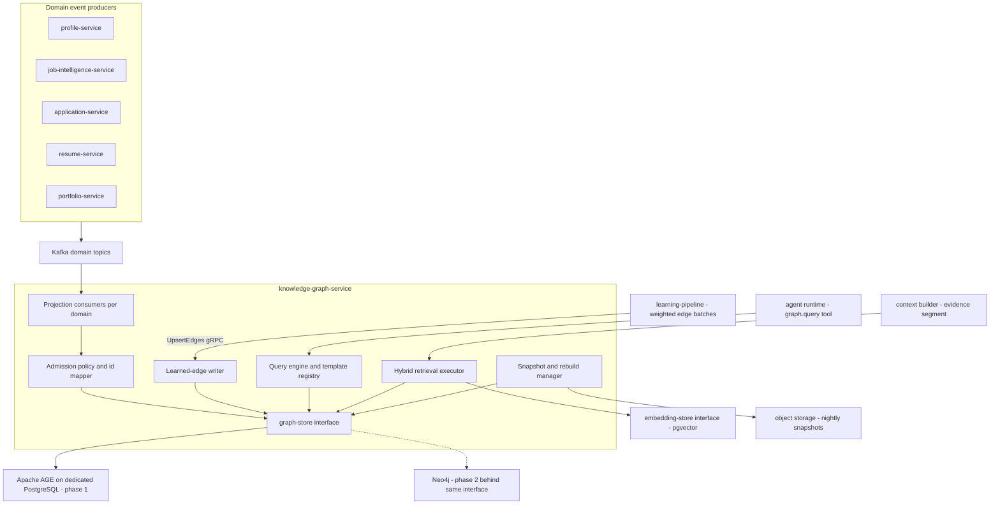
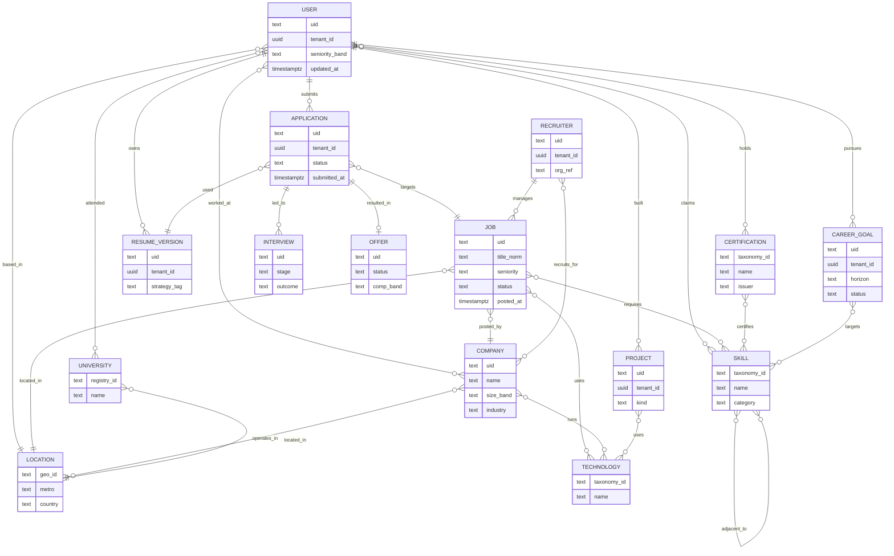
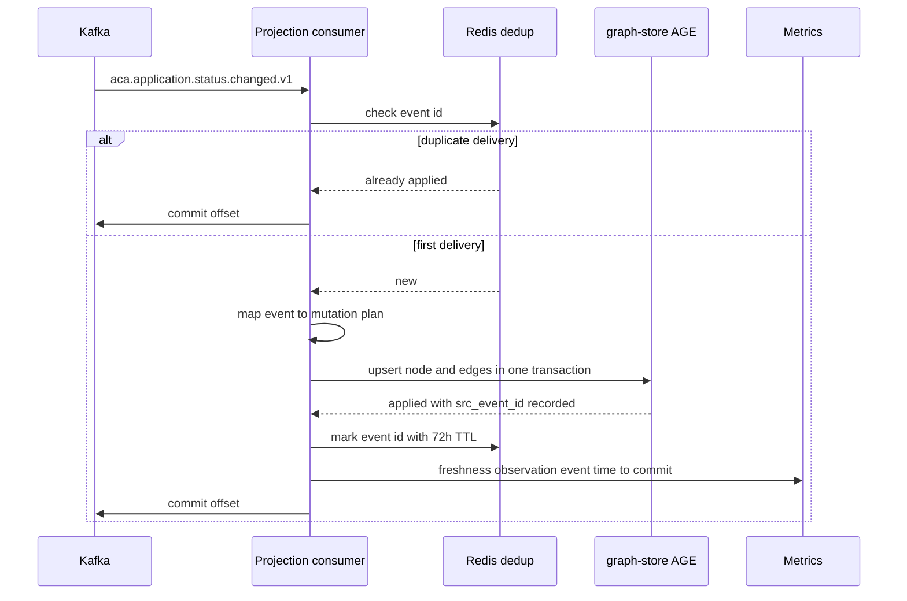
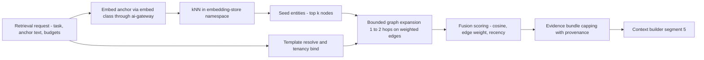
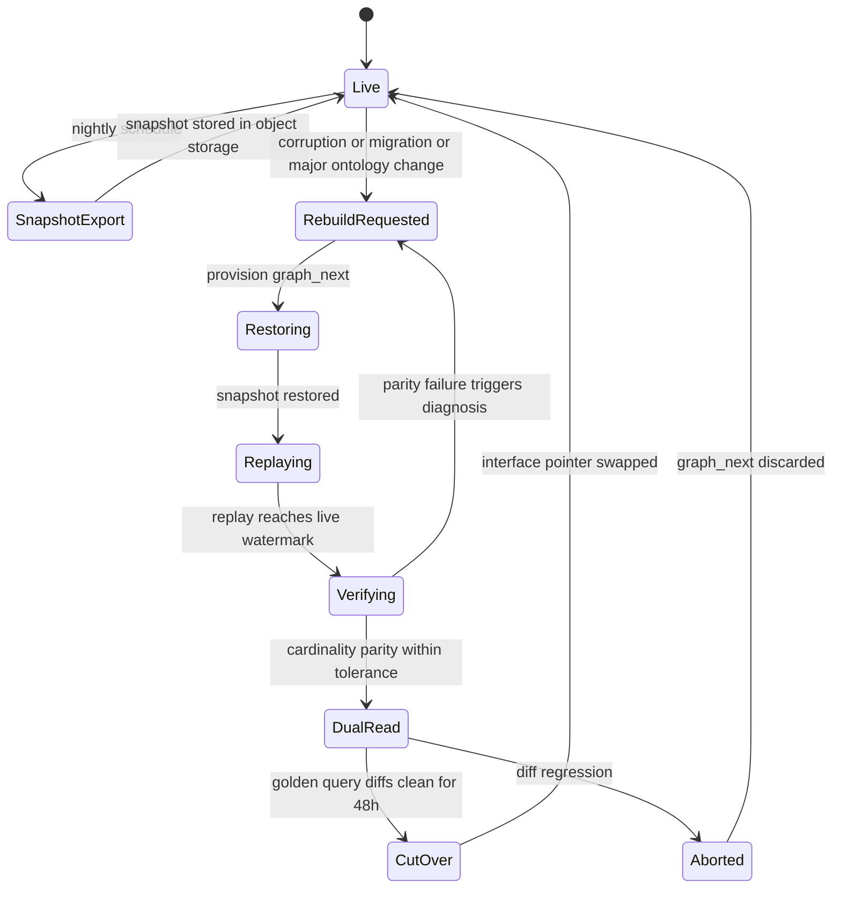

# 27 — Knowledge Graph

| | |
|---|---|
| Document ID | ACA-SAS-27 |
| Volume | 3 — AI Architecture |
| Status | Draft v1.0 |
| Depends on | [00 — Architecture Canon](../00-architecture-canon.md) §3, §4.4, §9, §11; [13 — Profile Service](../volume-2-core-services/13-profile-service.md); [15 — Job Intelligence Service](../volume-2-core-services/15-job-intelligence-service.md); [18 — AI Gateway](../volume-2-core-services/18-ai-gateway.md); [21 — AI Architecture](21-ai-architecture.md) §4–§5; [22 — Multi-Agent Framework](22-multi-agent-framework.md); [24 — Memory System](24-memory-system.md); [29 — Learning Pipeline](29-learning-pipeline.md); [06 — Technology Stack](../volume-1-foundation/06-technology-stack.md) §9.3 |

## 1. Overview

`knowledge-graph-service` is the platform's relational memory: the entity/relationship graph over users, companies, jobs, applications, skills, and outcomes that lets agents answer *structural* questions no vector index or SQL join can answer well — "what roles do people with this skill profile move into next", "which companies are adjacent to this one in talent and technology", "which required skills does this user lack and which of their existing skills bridge the gap", "which of this user's institutions feed into that employer". It is the **knowledge/graph lookup rung of the canonical escalation ladder** ([canon §9](../00-architecture-canon.md)): a graph hit that substitutes for a model call is the cheapest correct answer the AI plane can produce, and graph evidence is assembly section 5 of every context build ([Chapter 21 §4](21-ai-architecture.md)).

The single most consequential design decision in this chapter: **the graph is a projection, never a source of truth.** Every node and edge is derived from domain events published by owning services (`profile-service`, `job-intelligence-service`, `application-service`, `resume-service`, `portfolio-service`) or from learned aggregates computed by `learning-pipeline` ([Chapter 29](29-learning-pipeline.md)). The graph can be dropped and rebuilt from snapshots plus event replay without data loss. That one property drives everything downstream: the consistency model is honest eventual consistency with measured freshness (§8), GDPR erasure is subgraph deletion with no reconciliation debt (§14), and the Apache AGE → Neo4j migration (§5) collapses from a data-migration project into a rebuild-and-cutover exercise.

Two logical graphs partition the data by trust and tenancy. The **global market graph** (`aca_global`: Company, Job, Skill, Technology, Location, University, Certification and their interconnections) holds public and derived data (P3, some P2) shared across all tenants. The **tenant career graph** (`aca_tenant`: User, Application, Interview, Offer, ResumeVersion, CareerGoal, Project, Recruiter, plus edges into global entities) carries `tenant_id` on every element and is partitioned along the cell architecture ([canon §15](../00-architecture-canon.md)). Learned, weighted edges (§9) are computed by `learning-pipeline` under aggregation thresholds and written into the global graph with full provenance — the graph stores and serves them; it never computes them.

Non-goals, to fix boundaries: the skill taxonomy is owned by `profile-service` ([Chapter 13 §3](../volume-2-core-services/13-profile-service.md)) — the graph projects it. Company enrichment is owned by `job-intelligence-service` ([Chapter 15 §10](../volume-2-core-services/15-job-intelligence-service.md)). Embedding vectors live in the `embedding-store` interface (pgvector), never in the graph — the graph stores references (§7). Episodic agent memory is `memory-service` ([Chapter 24](24-memory-system.md)); the graph is shared relational knowledge, not per-agent recall.

## 2. Component Architecture

`knowledge-graph-service` is a TypeScript/NestJS service (projection and query serving are control-plane semantics, not AI-plane inference — same reasoning as `cost-controller`, [Chapter 25 §1](25-cost-optimization-engine.md)). It owns a dedicated PostgreSQL 16 instance running Apache AGE (phase 1) behind the `graph-store` interface, isolated from all other OLTP workloads so graph traversal load can never contend with a domain service's transactions.



| Component | Purpose | Key interactions |
|---|---|---|
| Projection consumers | One consumer group per source domain; map domain events to idempotent graph mutations | Kafka in; `graph-store` writes; Redis dedup |
| Admission policy + id mapper | Decide which entities enter the graph (jobs especially, §4.2) and map canonical upstream IDs to graph node keys — **no fuzzy entity resolution here** (§4.3) | Projection consumers |
| Query engine + template registry | Execute versioned, parameterized query templates; enforce tenancy binding, depth and result caps | Agent runtime (`graph.query@1`), internal gRPC callers |
| Hybrid retrieval executor | Combine embedding kNN seeds with bounded graph expansion into capped evidence bundles (§7) | `embedding-store`, context builder |
| Learned-edge writer | Validate and upsert weighted edges from `learning-pipeline` with provenance and TTL (§9) | `learning-pipeline` gRPC |
| Snapshot + rebuild manager | Nightly snapshots to object storage; blue-green rebuild orchestration; parity verification (§8) | Object storage, Kafka replay |
| `graph-store` interface | openCypher-subset abstraction over AGE (phase 1) and Neo4j (phase 2) (§5) | All of the above |

A deliberate omission: **the service publishes no domain events.** It is a projection sink; re-publishing derived facts would create event echo and a second, weaker source of truth. Downstream consumers who need graph-derived facts query the API. (Recorded for canon promotion in §17.)

## 3. Ontology

### 3.1 Design rules

- **Closed label set, versioned as `ontology@semver`.** Node labels and edge types are code-reviewed schema, not runtime-extensible data. Adding a label is a minor version; changing semantics of an existing one is major and requires a projection rebuild.
- **Naming:** node labels PascalCase singular (`User`, `ResumeVersion`); edge types UPPER_SNAKE (`HAS_SKILL`); properties snake_case. (The ER diagram below uses UPPER_SNAKE entity names per documentation convention; the mapping is mechanical.)
- **Provenance on everything:** every node and edge carries `src` (producing topic or `learned`), `src_event_id` (last applied event, UUIDv7), `updated_at`. Debuggability of a projection is the ability to answer "which event made this edge look like this".
- **Keys are upstream canonical IDs** (`usr_`, `job_`, `app_` prefixed opaque IDs per [canon §6](../00-architecture-canon.md); taxonomy IDs for Skill/Technology; normalized geo IDs for Location). The graph never mints identity for domain entities.
- **Temporal facts are edge properties, not history nodes.** `WORKED_AT` carries `start_month`/`end_month`; parallel edges represent multiple stints. Full bitemporal history stays in owning services' event stores; the graph holds current-plus-career-timeline state (tradeoff in §17).

### 3.2 Entity-relationship view



### 3.3 Node catalog

| Label | Scope | Key | Source of truth | Projected from | Phase-1 est. |
|---|---|---|---|---|---|
| User | tenant | `uid` (usr_) | `user-service` / `profile-service` | `aca.user.registered.v1`, `aca.profile.updated.v1` | 625 k |
| Company | global | `uid` | `job-intelligence-service` | `aca.company.enriched.v1`, `aca.job.parsed.v1` | 1.5 M |
| Job | global | `uid` (job_) | `job-intelligence-service` | `aca.job.parsed.v1` / `updated` / `expired` (admission-gated, §4.2) | ~3 M steady |
| Application | tenant | `uid` (app_) | `application-service` | `aca.application.*` lifecycle topics | 5.5 M/yr |
| Interview | tenant | `uid` | `application-service` | `aca.interview.scheduled.v1`, `aca.application.status.changed.v1` | 400 k/yr |
| Offer | tenant | `uid` | `application-service` | `aca.offer.received.v1` | 60 k/yr |
| Skill | global | `taxonomy_id` | `profile-service` taxonomy (ESCO + tech extension) | nightly taxonomy sync (§4.4) | 18 k |
| Technology | global | `taxonomy_id` | taxonomy tech extension | nightly taxonomy sync | 6 k |
| Certification | global | `taxonomy_id` | taxonomy | nightly taxonomy sync | 8 k |
| Location | global | `geo_id` | upstream normalizers (job-intelligence, profile) | carried on job/profile events | 60 k |
| University | global | `registry_id` | `profile-service` education resolution | `aca.profile.updated.v1` (resolved entries only) | 25 k |
| Project | tenant | `uid` | `portfolio-service` | `aca.portfolio.project.updated.v1` (portfolio-domain topic per [canon §8](../00-architecture-canon.md) convention) | 1.9 M |
| ResumeVersion | tenant | `uid` | `resume-service` | `aca.resume.version.created.v1` | 6.6 M/yr |
| CareerGoal | tenant | `uid` | `profile-service` | `aca.profile.updated.v1` | 950 k |
| Recruiter | tenant | `uid` | `recruiter-service` | recruiter-domain topics (Phase 2, Volume 8) | Phase 2 |

### 3.4 Edge catalog (core, projected)

| Edge | From → To | Cardinality | Key properties | Source |
|---|---|---|---|---|
| SUBMITS | User → Application | 1:N | — | application lifecycle |
| HAS_SKILL | User → Skill | M:N | `proficiency` 1–5, `verified`, `evidence_count`, `years_used` | `aca.profile.updated.v1` |
| WORKED_AT | User → Company | M:N, multi-edge per stint | `title_norm`, `seniority`, `start_month`, `end_month`, `is_current` | `aca.profile.updated.v1` |
| ATTENDED | User → University | M:N | `degree`, `field`, `end_year` | profile events |
| HOLDS | User → Certification | M:N | `issued_at`, `expires_at` | profile events |
| PURSUES | User → CareerGoal | 1:N | `priority` | profile events |
| BUILT | User → Project | 1:N | `role` | portfolio events |
| BASED_IN | User → Location | N:1 | `remote_pref` | profile events |
| OWNS | User → ResumeVersion | 1:N | — | resume events |
| TARGETS | Application → Job | N:1 | — | application events |
| USED | Application → ResumeVersion | N:1 | `strategy_tag` | `aca.application.submitted.v1` |
| LED_TO | Application → Interview | 1:N | `stage`, `scheduled_at`, `outcome` | interview events |
| RESULTED_IN | Application → Offer | 1:0..1 | `status` | offer events |
| POSTED_BY | Job → Company | N:1 | — | `aca.job.parsed.v1` |
| REQUIRES | Job → Skill | M:N | `weight` 0–1, `must_have`, `min_proficiency` | `aca.job.parsed.v1` |
| JOB_USES | Job → Technology | M:N | — | job parse |
| LOCATED_IN | Job / University → Location | N:1 | — | job parse / profile |
| RUNS | Company → Technology | M:N | `confidence`, `cited` | `aca.company.enriched.v1` |
| OPERATES_IN | Company → Location | M:N | `is_hq` | company enrichment |
| CERTIFIES | Certification → Skill | M:N | — | taxonomy sync |
| PROJECT_USES | Project → Technology | M:N | — | portfolio events |
| GOAL_TARGETS | CareerGoal → Skill | M:N | — | profile events |
| RECRUITS_FOR | Recruiter → Company | M:N | consent-scoped | recruiter events (Phase 2) |
| MANAGES | Recruiter → Job | 1:N | — | recruiter events (Phase 2) |

Learned, weighted edges (`ADJACENT_TO`, `CO_DEMANDED`, `SIMILAR_TO`, `TALENT_FLOW`, `FEEDS_INTO`, `RESPONDS_TO`) are specified in §9 — they follow different production, provenance, and lifecycle rules than projected edges and are deliberately excluded from the core catalog above.

## 4. Ingestion — Projection Consumers

### 4.1 Consumer topology and contracts

One consumer group per source domain (`kg-profile`, `kg-job`, `kg-application`, `kg-resume`, `kg-portfolio`), partitioned per source topic's key (`tenant_id` or entity id per [canon §8](../00-architecture-canon.md)), so per-entity ordering is inherited from the producers. Retry/DLQ follows the canon ladder (3 tries → `.retry.1m` → `.retry.10m` → `.dlq`), with DLQ triage via `admin-service` and replay tooling reusing the rebuild manager's replay path.

| Topic consumed | Projection effect |
|---|---|
| `aca.user.registered.v1` / `aca.user.deleted.v1` | Create User node / detach-delete user subgraph (§14) |
| `aca.profile.updated.v1` | Upsert User properties, HAS_SKILL, WORKED_AT, ATTENDED, HOLDS, PURSUES, BASED_IN, GOAL_TARGETS |
| `aca.profile.import.completed.v1` | Trigger full re-projection of the profile's claim edges (import merges can retract facts) |
| `aca.resume.version.created.v1` | Upsert ResumeVersion node + OWNS |
| `aca.job.parsed.v1` / `aca.job.updated.v1` | Admission check (§4.2) → upsert Job, POSTED_BY, REQUIRES, JOB_USES, LOCATED_IN |
| `aca.job.expired.v1` | Mark Job `status = expired`; schedule prune if unreferenced (§4.2) |
| `aca.company.enriched.v1` | Upsert Company properties, RUNS, OPERATES_IN |
| `aca.match.scored.v1` | **Admission trigger only** (§4.2) — raw scores are never materialized as edges (20 M pairs/day of weak evidence would dominate storage for negligible query value) |
| `aca.application.drafted/approved/submitted.v1`, `aca.application.status.changed.v1` | Upsert Application node + SUBMITS/TARGETS/USED; status property transitions |
| `aca.interview.scheduled.v1`, `aca.offer.received.v1` | Upsert Interview/Offer + LED_TO/RESULTED_IN |
| `aca.portfolio.project.updated.v1` | Upsert Project + BUILT + PROJECT_USES |

### 4.2 Job admission policy

Projecting the full discovery firehose (2 M postings/day at target, [NFR L6](../volume-1-foundation/04-non-functional-requirements.md)) would put the graph past any store's comfortable ceiling for zero reasoning value — most discovered jobs never intersect any user. Admission rules:

| Rule | Value | Rationale |
|---|---|---|
| Admit on application reference | always | Applications are the learning substrate; their jobs are permanent context |
| Admit on surfaced match | top 10 surfaced matches per user per day | Bounds graph growth by *engaged-user* activity, not crawl volume; 10 covers what a user realistically reviews daily |
| Market statistics | computed by `learning-pipeline`/`analytics-service` from the full firehose **without** per-job nodes | Aggregate demand does not need job identity in the graph |
| Prune expired, unreferenced jobs | expiry + 14 d | 14 d covers late-arriving tracker updates that would re-reference the job |
| Application-referenced jobs | retained for account life | Outcome learning and interview prep reach back months |

### 4.3 Determinism rule — no entity resolution in the graph

Projection consumers perform **id mapping only**. Company resolution, skill normalization, location geocoding, and university registry matching all happen in owning services before events are published; events carry canonical IDs. Profile education entries that `profile-service` could not resolve to a registry ID remain properties on the User's claim and create **no** University node. Rationale: fuzzy resolution inside a projection makes rebuilds non-deterministic — two replays of the same event stream must always produce byte-identical graphs, because rebuild parity checking (§8.3) depends on it.

### 4.4 Taxonomy sync

Skill/Technology/Certification nodes and CERTIFIES edges are synchronized nightly from `profile-service`'s read API (the taxonomy is platform-global, versioned, and has no event stream — it changes by curated release). The sync job records the taxonomy version in graph metadata; templates that join across taxonomy versions during a release window pin the older version until sync completes.

### 4.5 Projection sequence



Idempotency is layered: the Redis dedup check (72 h TTL — covers the full retry ladder plus a DLQ replay window) is an optimization; the mutations themselves are **idempotent upserts keyed by canonical ID with last-writer-wins on `src_event_id` ordering** (UUIDv7 is time-ordered), so a lost dedup entry causes harmless re-application, never corruption.

## 5. Graph Store Abstraction & Migration

### 5.1 The `graph-store` interface

All graph access goes through the `graph-store` interface ([canon §3](../00-architecture-canon.md); seam analysis in [Chapter 06 §9.3](../volume-1-foundation/06-technology-stack.md)). The interface contract is an **openCypher subset both engines support**, verified by contract tests in CI against AGE and Neo4j containers:

- Allowed: `MATCH`, `OPTIONAL MATCH`, `WHERE`, `WITH`, `RETURN`, `ORDER BY`, `LIMIT`, `CREATE`/`MERGE`/`SET`/`DELETE` (writer paths only), variable-length paths bounded to `*1..3`.
- Forbidden: engine-specific procedures (APOC, AGE-specific functions), unbounded variable-length paths, `CALL` subqueries, engine-side full-text (search belongs to `search-service`).
- All statements are **parameterized templates** (§6.1); the interface exposes no raw-string query method to callers outside the service.

### 5.2 Phase 1 — Apache AGE physical design

Dedicated PostgreSQL 16 instance (CloudNativePG/Aurora reference per canon), two AGE graphs (`aca_global`, `aca_tenant`). AGE label stores are ordinary Postgres tables, so standard operational tooling (PITR, logical dumps, expression indexes) applies:

```sql
-- Illustrative AGE setup (phase 1)
SELECT ag_catalog.create_graph('aca_global');
SELECT ag_catalog.create_graph('aca_tenant');

-- Canonical-key and tenancy expression indexes on label tables
CREATE INDEX user_uid_idx ON aca_tenant."User"
    (ag_catalog.agtype_access_operator(properties, '"uid"'::agtype));
CREATE INDEX user_tenant_idx ON aca_tenant."User"
    (ag_catalog.agtype_access_operator(properties, '"tenant_id"'::agtype));
CREATE INDEX job_uid_idx ON aca_global."Job"
    (ag_catalog.agtype_access_operator(properties, '"uid"'::agtype));
CREATE INDEX job_status_idx ON aca_global."Job"
    (ag_catalog.agtype_access_operator(properties, '"status"'::agtype));
```

AGE does not natively partition label tables; phase-1 scale management relies on the admission policy (§4.2), pruning, and **cell sharding** (§10) rather than intra-instance partitioning. Declarative partitioning of the underlying label tables is technically possible and held as an escape hatch, not the plan — if we need it, we are already past the migration trigger.

### 5.3 Phase 2 — Neo4j migration plan

Because the graph is a projection, migration = rebuild + verified cutover, not data migration.

**Triggers (any one, sustained):**

| Trigger | Threshold | Rationale |
|---|---|---|
| Edge count | > 80 M | Begin migration with headroom below the ~100 M-edge AGE traversal ceiling ([Chapter 06 §9.3](../volume-1-foundation/06-technology-stack.md)); migration must *finish* before the ceiling |
| Template latency | 2-hop template p99 > 400 ms for 14 d | 2× the §6 budget; sustained breach means index tuning is exhausted |
| Expressivity | A required query pattern needs depth > 3 at acceptable latency | AGE's per-hop join cost makes deep traversal quadratic-feeling |

**Steps:** (1) contract tests green on both engines (standing CI requirement from day 1, per the seam's "weeks" swap-cost budget); (2) commercial licensing decision for Neo4j clustering documented and approved (Community is GPLv3, clustering is Enterprise — [Chapter 06 §16](../volume-1-foundation/06-technology-stack.md) flags this cost line deliberately); (3) full rebuild into Neo4j from the latest snapshot + Kafka replay using the **same projection code** via the interface; (4) dual-read shadow — mirror a sample of production template executions to both engines, diff normalized results, require ≥ 99.5% row parity over 7 days (residual diffs must be explained, e.g., tie-break ordering); (5) per-cell cutover behind the interface pointer; (6) AGE retained warm for 30 days as rollback target.

## 6. Query Patterns Serving Agents

### 6.1 Template registry

Models never write graph queries. The `graph.query@1` tool ([Chapter 21 §5](21-ai-architecture.md): "parameterized templates only, no raw Cypher/Gremlin from models") binds to a **template registry**: versioned (`template_id@semver`), code-reviewed openCypher templates with declared parameters, tenancy binding, cost class, latency budget, and result caps. A template linter enforces at review time: every template touching `aca_tenant` labels must bind `$tenant_id` from the authenticated call context (never from a model-supplied parameter); depth ≤ 3; `LIMIT` present; forbidden constructs absent.

| Template | Purpose | Primary consumers | Cost class | Latency budget p99 |
|---|---|---|---|---|
| `skill_gap.for_job@1` | Missing/underleveled skills for a target job, with bridge skills | `matching-agent`, `resume-agent`, `interview-coach-agent` | 1-hop ×2 | 80 ms |
| `career_path.next_roles@1` | Likely next roles + skills to acquire from current position | `analytics-agent`, `interview-coach-agent`, assistant surfaces | 2-hop + matrix | 200 ms |
| `company.similar@1` | Peer companies by learned similarity, with active-job counts | `job-scout-agent`, `company-intel-agent` | 1-hop | 60 ms |
| `referral.paths@1` | Institution bridges from user history into a target company | `analytics-agent`, application strategy surfaces | 2-hop | 150 ms |
| `evidence.for_generation@1` | Company-fit proof points for a (user, job) pair | `cover-letter-agent`, `resume-agent` via context builder | 2-hop | 200 ms |
| `outcome.context@1` | User's application history around a company/role family | `application-tracker-agent`, `negotiation-agent` | 1-hop | 80 ms |

### 6.2 Career path inference

Composes two signals: aggregated **role-transition statistics** (a service-side materialization computed weekly from `WORKED_AT` stint sequences across consenting users, k ≥ 50 per transition cell — roles are `title_norm` values from the shared role taxonomy, deliberately *not* graph nodes in phase 1, see §17) and **skill adjacency** (`ADJACENT_TO` learned edges):

```cypher
-- career_path skill-frontier component (illustrative, contract subset)
MATCH (u:User {uid: $user_id, tenant_id: $tenant_id})-[h:HAS_SKILL]->(s:Skill)
MATCH (s)-[a:ADJACENT_TO]->(next:Skill)
WHERE a.weight >= 0.15
OPTIONAL MATCH (u)-[owned:HAS_SKILL]->(next)
WITH next, a, owned WHERE owned IS NULL
WITH next, sum(a.weight) AS affinity
ORDER BY affinity DESC LIMIT 25
RETURN next.taxonomy_id, next.name, affinity
```

The query engine merges the skill frontier with the transition matrix's next-role distribution conditioned on the user's current `title_norm` and seniority — composition happens in service code, not in one statement (keeps each part within the contract subset and independently testable).

### 6.3 Skill-gap analysis

```cypher
-- skill_gap.for_job@1 (illustrative)
MATCH (j:Job {uid: $job_id})-[r:REQUIRES]->(s:Skill)
OPTIONAL MATCH (u:User {uid: $user_id, tenant_id: $tenant_id})-[h:HAS_SKILL]->(s)
WITH s, r, h
WHERE h IS NULL OR h.proficiency < r.min_proficiency
OPTIONAL MATCH (s)-[c:CO_DEMANDED]-(bridge:Skill)
WHERE c.npmi >= 0.3
RETURN s.taxonomy_id, s.name, r.weight, r.must_have,
       h.proficiency AS current_level, collect(bridge.taxonomy_id)[0..3] AS bridges
ORDER BY r.must_have DESC, r.weight DESC LIMIT 50
```

Gap output feeds match explanations ("you're missing X, but your Y is adjacent"), resume tailoring emphasis, and interview-prep focus. The `bridges` field is what makes the answer *actionable* rather than a rejection list.

### 6.4 Company similarity

`SIMILAR_TO` learned edges (weighted blend of shared technology, skill-demand overlap, and talent-flow, §9) queried directly with a weight floor. Used by `job-scout-agent` to widen discovery ("companies like the ones you engage with") and by `company-intel-agent` to prioritize enrichment refresh for peers of active-interest companies.

### 6.5 Referral paths

Privacy-first design: for `individual` tenants, referral-path answers are **institution-level only** — the user's own past companies and universities ranked by aggregated flow into the target (`TALENT_FLOW`, `FEEDS_INTO` learned edges, both k-thresholded). The platform never reveals *named third parties* ("your ex-colleague Jane is now at TargetCo") from cross-user data. Person-level referral edges are a Phase 2 capability restricted to consented `team`/`university` tenant scopes where members explicitly opt in to intra-tenant visibility (e.g., a university career center's alumni network), enforced by `policy-service` consent checks at query time.

```cypher
-- referral.paths@1 (illustrative)
MATCH (u:User {uid: $user_id, tenant_id: $tenant_id})-[w:WORKED_AT]->(c:Company)
MATCH (c)-[f:TALENT_FLOW]->(t:Company {uid: $target_company_id})
RETURN c.uid, c.name, 'employer' AS bridge_kind, f.weight, w.end_month
UNION
MATCH (u2:User {uid: $user_id, tenant_id: $tenant_id})-[:ATTENDED]->(uni:University)
MATCH (uni)-[f2:FEEDS_INTO]->(t2:Company {uid: $target_company_id})
RETURN uni.registry_id, uni.name, 'alumni' AS bridge_kind, f2.weight, null
```

### 6.6 Evidence bundles for generation

`evidence.for_generation@1` assembles the graph's contribution to context builds ([Chapter 21 §4](21-ai-architecture.md) allocates 15% of the generation-family retrieval mix to graph evidence, 20–25% for coaching and planning): overlap facts (shared technologies between user projects and company stack, skill matches with proficiency and evidence counts, prior applications to similar companies with outcomes). Output is a structured evidence bundle — typed facts with provenance references, capped at 8 KiB — never free prose; the generation agent decides phrasing, the graph supplies verifiable facts, which is the grounding rule from [Chapter 13 §3](../volume-2-core-services/13-profile-service.md) (no fabricated support for unverified claims) made mechanical.

## 7. Hybrid Retrieval — Graph + Embeddings

Vectors stay in the `embedding-store` interface (pgvector phase 1); the graph stores **embedding references** (`embed_ns`, `entity_id`, `embed_version`) as node properties. One owner for vectors means embedding-space versioning ([canon §10.5](../00-architecture-canon.md)) has one migration machinery, not two.



Two composition patterns, chosen per template:

- **Anchor-and-expand** (default): embed the task anchor (job description facet, goal statement) → kNN top-k (k = 12) in the relevant namespace (company, skill, job facets) → expand 1–2 hops from seed nodes along template-declared edge types → fuse.
- **Filter-then-rank:** graph traversal produces the candidate set (e.g., peer companies via `SIMILAR_TO`), then candidates are ranked by embedding cosine against the anchor. Used when structural constraints dominate (must be hiring, must be in region).

Fusion score: `0.55 · cosine + 0.30 · normalized_edge_weight + 0.15 · recency_decay` — starting weights, per-template overridable, tuned by `learning-pipeline` experiments ([Chapter 29 §7](29-learning-pipeline.md)) through the same eval gate as any retrieval change. Degraded modes: embedding-store unavailable → graph-only expansion with `retrieval_degraded` flag; graph unavailable → kNN-only (the ladder still works, evidence is weaker and flagged).

## 8. Consistency Model & Rebuild Strategy

### 8.1 Eventual consistency, measured

The graph is eventually consistent with owning services by construction. The contract is **measured freshness**, not synchrony:

| Projection family | Freshness SLO (event publish → queryable) | Rationale |
|---|---|---|
| Profile, application, resume, interview/offer | p95 ≤ 60 s, p99 ≤ 5 min | Agent decisions follow user actions within minutes; 60 s keeps evidence current for same-session builds |
| Job, company | p95 ≤ 5 min | Bulk pipelines; nothing interactive reads a just-parsed job from the graph |
| Taxonomy sync | ≤ 24 h | Curated releases, not operational data |
| Learned edges | weekly batch (§9) | Aggregates over weeks of signal; daily refresh would add noise, not signal |

**No read-your-writes.** A consumer that needs an entity's authoritative current state reads the owning service; the graph answers relational questions where minutes of staleness are immaterial. Every query response carries `as_of` watermarks (max applied event time per involved domain) so callers — and evals — can reason about staleness explicitly.

### 8.2 Drift detection

Nightly reconciliation compares projection cardinalities (node/edge counts per label, per tenant sample) against owning-service counts via their read APIs; divergence > 0.1% on any label opens an incident and identifies the repair scope. Per-entity repair re-projects a single entity subgraph from the owning service's export API (the same APIs GDPR export already requires — no new surface).

### 8.3 Rebuild



Mechanics: nightly logical snapshot of both graphs to object storage (versioned, 35-day retention aligned with backup canon); rebuild restores the latest snapshot into `graph_next`, then replays Kafka from the snapshot watermark — 24 h snapshot cadence against 7-day hot retention ([canon §11](../00-architecture-canon.md)) leaves ≥ 6 days of margin before replay depends on tiered storage. Determinism (§4.3) makes verification meaningful: parity is expected to be exact modulo in-flight events. Blue-green cutover is a pointer swap in the `graph-store` interface; the old graph is retained 72 h.

## 9. Learning Signals as Weighted Edges

Division of labor is strict: **`learning-pipeline` computes, `knowledge-graph-service` stores and serves.** Learned edges arrive via the `Learned/UpsertEdges` gRPC batch API (the only writer besides projections), each carrying mandatory provenance. The graph validates schema, k-threshold attestations, and signal versions; it never re-derives weights.

| Edge | From → To | Weight semantics | Aggregation floor | Refresh |
|---|---|---|---|---|
| `CO_DEMANDED` | Skill ↔ Skill | NPMI of co-occurrence in job requirements (global, P3 — derived from postings, no user data) | n ≥ 200 postings | weekly |
| `ADJACENT_TO` | Skill → Skill | Probability of acquiring skill B within 18 months given skill A, from career histories | k ≥ 50 distinct users | weekly |
| `SIMILAR_TO` | Company ↔ Company | Blend: shared tech 0.4, skill-demand overlap 0.4, talent-flow 0.2 (`basis` records components) | talent-flow component k ≥ 25, else component dropped | weekly |
| `TALENT_FLOW` | Company → Company | Normalized employee transition volume | k ≥ 25 distinct users | weekly |
| `FEEDS_INTO` | University → Company | Normalized alumni placement flow | k ≥ 50 distinct users | weekly |
| `RESPONDS_TO` | Company → Skill | Interview-conversion uplift for applications emphasizing the skill | k ≥ 25 applications | weekly |

Mandatory provenance properties on every learned edge: `weight`, `sample_n`, `basis` (component breakdown), `signal_version`, `computed_at`, `producer` (pipeline job id), `ttl_expires_at`. **TTL 45 days** (two missed refresh cycles): a stale learned weight silently misleads ranking, so unrefreshed edges expire rather than linger — absence degrades gracefully (templates fall back to unweighted structure), staleness does not. k-floors match [Chapter 29 §9](29-learning-pipeline.md) exactly; the graph rejects batches whose attestation is below floor — defense in depth, since the pipeline should never send them. User deletion never requires learned-edge surgery: aggregates are k-anonymous and recomputed without the user within one refresh cycle, inside the 30-day GDPR window with margin.

## 10. Scale Estimates & Partitioning

| Quantity | Phase 1 (150 k MAU) | Target (1.2 M MAU) | Basis |
|---|---|---|---|
| User nodes | 625 k | 5 M | registered users ([NFR L1–L2](../volume-1-foundation/04-non-functional-requirements.md)) |
| Company nodes | 1.5 M | 6 M | companies with admitted jobs or enrichment |
| Job nodes (steady) | ~3 M | ~20 M | admission policy §4.2: ~50 k admitted/day phase 1, 30–45 d posting lifetime + retained referenced jobs |
| Application nodes | 5.5 M/yr | 55 M/yr | 15 k → 150 k submissions/day |
| ResumeVersion nodes | 6.6 M/yr | 66 M/yr | ~1.2 versions per application |
| Taxonomy + geo nodes | ~120 k | ~220 k | Skill/Tech/Cert/Location/University |
| **Total edges** | **≈ 60 M** | **≈ 550 M** | REQUIRES dominates (~8/job), then HAS_SKILL (~12/user), application edges |
| Storage (nodes + edges + indexes) | ≈ 45 GB | ≈ 400 GB | ~0.5 KB/node, ~0.2 KB/edge incl. index overhead |
| Template QPS | ~40 peak | ~350 peak | agent runs × graph-touching steps; hybrid retrieval adds embedding-store QPS, not graph QPS |

Phase 1 fits AGE comfortably (60 M edges vs ~100 M ceiling); the growth curve crosses the 80 M migration trigger at roughly 2–3× phase-1 load — **Neo4j migration is expected on the road to target scale and is planned, not exceptional** (§5.3).

Partitioning strategy, in order of application:

1. **Global/tenant split** — the two graphs scale and replicate independently; the global graph is read-heavy and cache-friendly.
2. **Cells** ([canon §15](../00-architecture-canon.md)) — each cell runs its own `knowledge-graph-service` + store holding that cell's tenant graph; the global graph is replicated read-only into each cell (single writer in the primary cell; standard Postgres streaming replication phase 1), so a cell's queries never leave the cell.
3. **Read replicas** — template execution is ≥ 95% reads; replicas scale query QPS; projections and learned-edge writes go to the primary only.
4. **Pruning as capacity policy** — §4.2 retention rules are the graph's compaction story; aggregates outlive raw admission.

## 11. API Surface

Internal gRPC only (`graph.v1`), mTLS + OPA per-method authz per canon §7; the service is not exposed through `api-gateway` — end users never query the graph directly, agents and services do. Admin operations surface through `admin-service`.

| RPC | Purpose | Caller | Deadline |
|---|---|---|---|
| `Query/ExecuteTemplate` | Run a registered template with typed params | agent runtime (`graph.query@1`), domain services | 2 s (canon sync-read) |
| `Query/GetEntity` | Node + property bundle by canonical id | services, debugging | 500 ms |
| `Query/GetNeighborhood` | Bounded 1–2 hop neighborhood of a node | `company-intel-agent`, admin tooling | 1 s |
| `Retrieval/HybridEvidence` | Hybrid graph+embedding evidence bundle (§7) | context builder | 1.5 s |
| `Learned/UpsertEdges` | Batch learned-edge writes with provenance (§9) | `learning-pipeline` only (OPA-enforced) | 5 s |
| `Admin/TriggerRepair` | Entity-scope reprojection (§8.2) | `admin-service` | async, job id returned |
| `Admin/RebuildStatus` | Snapshot/rebuild/dual-read state (§8.3) | `admin-service`, runbooks | 500 ms |

Errors follow RFC 9457 problem semantics mapped to gRPC status codes; every response carries `as_of` watermarks (§8.1) and the executed `template_id@version` for reproducibility.

Operational limits (one-line rationale each):

| Limit | Value | Rationale |
|---|---|---|
| Max traversal depth | 3 | Bounded latency; beyond 3 hops evidentiary value collapses while cost explodes |
| Template result cap | 200 rows | Larger sets are analytics, not agent evidence — that is `analytics-service`'s job |
| Evidence bundle cap | 8 KiB | Fits context-builder memory+graph section budgets ([Chapter 21 §4](21-ai-architecture.md)) |
| `ExecuteTemplate` concurrency per replica | 64 | Protects Postgres worker pool; excess queues with 250 ms max wait then sheds |
| `UpsertEdges` batch size | 5 000 edges | Amortizes transaction overhead without long-held locks |
| Dedup TTL | 72 h | Covers retry ladder (1 m + 10 m) plus DLQ triage-and-replay window |
| kNN seed count (hybrid) | 12 | Enough anchors for 2-hop expansion diversity; more seeds inflate expansion cost superlinearly |

## 12. Failure Scenarios

| # | Scenario | Blast radius | Detection | Response |
|---|---|---|---|---|
| F1 | Projection consumer lag (Kafka backlog) | Stale evidence; freshness SLO burn | Per-topic freshness gauges, consumer lag alerts | KEDA scales consumers on lag; agents keep working on stale-but-flagged data (`as_of` honesty); no availability impact |
| F2 | Poison event (schema-valid, projection-crashing) | One partition stalls | Retry-ladder exhaustion → DLQ alert | DLQ triage via `admin-service`; projection fix; replay from DLQ; dedup makes replay safe |
| F3 | Graph store down | `graph.query@1` and hybrid graph legs fail | Health probes, error-rate SLI | Callers degrade per ladder: context builds proceed without graph segment (flagged `retrieval_degraded`); escalation ladder skips the graph rung — cost event, not outage |
| F4 | Silent projection bug (wrong edges, no crash) | Wrong evidence in prompts | Nightly reconciliation (§8.2) cardinality divergence; eval regression on graph-grounded tasks | Entity-scope repair or targeted rebuild; postmortem adds a golden query to the dual-read set |
| F5 | Redis dedup loss | Duplicate event application | None needed | Upserts are idempotent (§4.5); duplicates are wasted work, not corruption |
| F6 | Learned-edge batch with bad weights | Ranking quality degradation on similarity/path templates | Batch validation (schema, k-attestation); template-level quality metrics from `learning-pipeline` | Reject batch at API; if landed, TTL bounds exposure to 45 d and pipeline reissues corrected batch; `signal_version` pinning enables targeted delete |
| F7 | Dual-read divergence during migration | None (shadow only) | Parity diff pipeline | Cutover blocked; divergence classified (ordering vs semantic); semantic diffs are engine-contract bugs fixed before proceeding |
| F8 | Snapshot job failure | Rebuild RPO grows toward Kafka retention edge | Snapshot-age gauge alert at 30 h | Rerun; if > 5 days snapshot age, freeze risky ontology changes until restored |

## 13. Scaling Strategy

- **Reads:** template QPS scales on Postgres read replicas (≥ 95% of load); the query engine routes by template class — learned-edge-heavy templates tolerate replica lag trivially (weekly data). Hot templates (`company.similar`, `skill_gap`) get a 5-minute Redis result cache keyed by (template, params-hash, watermark bucket) — safe because freshness SLOs already concede minutes.
- **Writes:** projection throughput is bounded by per-partition ordering; scaling unit is Kafka partitions × consumer instances. Phase-1 write load (~600 k mutations/day average, bursts on import completions) is far below a single primary's ceiling; target-scale bursts ride the same KEDA scaling as F1.
- **Data volume:** admission + pruning (§4.2) hold steady-state size; cells shard tenant data; the global graph is the singleton to watch — its growth (jobs, companies) is exactly what the §5.3 migration triggers monitor.
- **Hybrid retrieval:** embedding kNN load lands on `embedding-store` (scaled per its own chapter); the graph leg adds only bounded expansions.

## 14. Security Considerations

- **Tenancy.** Every `aca_tenant` element carries `tenant_id`; the template linter makes an unbound tenant predicate unshippable, and the query engine binds `$tenant_id` from the authenticated peer context (SPIFFE identity → tenant claim), never from caller parameters. The global graph is readable by all tenants by design (market data); it must therefore never contain user-derived facts below the k-floors of §9 — the learned-edge validation is a security control, not just a quality one.
- **No raw queries from models.** `graph.query@1` resolves to registry templates only ([Chapter 21 §5](21-ai-architecture.md)); the gRPC surface exposes no string-query method to runtime roles. Injection via graph *content* (job titles, company names are untrusted external text) is mitigated downstream: evidence bundles are data, and the context builder wraps them in `untrusted_content` per [canon §13](../00-architecture-canon.md).
- **PII minimization.** The graph stores **no P1 fields** — no names, emails, or contact data; User nodes are opaque `uid`s with career attributes (P2). Rendering layers join display names from `user-service`. ResumeVersion nodes hold strategy tags and references, never document text. P0 never appears anywhere near this service.
- **GDPR erasure.** `aca.user.deleted.v1` → detach-delete of the user's tenant subgraph (User, Applications, Interviews, Offers, ResumeVersions, Projects, CareerGoals and incident edges) within the consumer's normal freshness SLO — minutes, not the 30-day ceiling; snapshots age out within 35 days, satisfying erasure in backups by retention; learned aggregates need no action (§9).
- **Writer separation.** OPA policy: only projection consumers (service-internal) mutate projected elements; only `learning-pipeline`'s identity may call `Learned/UpsertEdges`; `Admin/*` requires `admin-service` JIT-elevated identity. All admin mutations emit `aca.audit.event.v1`.

## 15. Observability

- **Freshness:** per-projection-family gauges (event publish → commit), alerting on §8.1 SLOs; consumer lag per group; DLQ depth.
- **Query health:** per-template latency histograms, QPS, error rate, result-cap truncation rate (a template that constantly truncates is mis-designed); replica lag; result-cache hit rate.
- **Graph shape:** node/edge cardinality per label (daily), growth forecast vs the 80 M-edge migration trigger — **alert at 70 M edges** so migration starts with runway; learned-edge coverage (share of companies with ≥ 5 `SIMILAR_TO` edges) as a retrieval-quality proxy.
- **Evidence utilization:** join with context-builder manifest metrics ([Chapter 21 §4](21-ai-architecture.md)) — how often graph evidence is included, truncated, or cited in generated outputs; an unused evidence source is cost without value and shows up here first.
- **Reconciliation:** nightly parity results, repair counts by cause; rebuild state and dual-read diff rates during migrations.
- **Tracing:** OTel spans for template execution with `template_id@version` attribute; `traceparent` follows events into projections per canon §14.

## 16. Future Improvements

- **Role nodes.** Promote normalized role titles from edge/node properties to first-class nodes once the transition matrix's value is proven — makes career-path queries single-hop and opens role-centric templates; deferred because it doubles path-maintenance complexity before evidence of need (decision, §17).
- **Person-level referral graph** for consented `team`/`university` tenants (Phase 2), gated on `policy-service` consent registry and intra-tenant visibility controls.
- **Graph neural embeddings** (node2vec-class) as an additional embedding namespace for structural similarity, versioned per canon §10.5 — candidate once hybrid retrieval metrics show structural signal the current blend misses.
- **Temporal graph queries** ("as of last March") via snapshot-backed time travel for `learning-pipeline` backtests, avoiding bitemporal storage in the live graph.
- **Differential-privacy noise** on learned-edge weights, coordinated with [Chapter 29 §9](29-learning-pipeline.md)'s Phase 2 DP adoption.

## 17. Alternatives Considered & Tradeoffs

| Decision | Alternatives | Why this way | Tradeoff accepted |
|---|---|---|---|
| Projection-only graph, rebuildable from events | Graph as system of record for relationships; dual-write from services | One source of truth per fact (canon §11); rebuild = migration = recovery, one machinery; dual-write is a consistency bug factory | Eventual consistency everywhere; no read-your-writes (§8.1) |
| AGE phase 1, Neo4j phase 2 behind `graph-store` | Neo4j/Memgraph day 1; Neptune | Zero new infrastructure while query volume is unproven; licensing cost deferred until justified ([Chapter 06 §9.3](../volume-1-foundation/06-technology-stack.md)); Neptune is AWS-locked | Known migration mid-growth (planned, §5.3); AGE query tuning effort is partially throwaway |
| Property graph + openCypher subset | RDF/SPARQL triple store | Weighted evidentiary edges and bounded traversals fit the property model; openCypher is the portable seam both engines share; team skill | Lose standard ontology tooling (OWL reasoners) — acceptable, we do statistics, not inference |
| Templates only, no ad-hoc model queries | LLM-generated Cypher with validation | A query generator is an injection and cost surface with unbounded blast radius; templates are reviewable, budgetable, cacheable | Agents can't ask novel structural questions without a template PR — deliberate friction |
| Embedding refs in graph, vectors in `embedding-store` | Store vectors as node properties | Single owner for embedding versioning/migration (canon §10.5); graph stays small and cache-friendly | Hybrid retrieval always touches two stores — mitigated by parallel legs and degraded modes (§7) |
| Job admission policy vs full firehose | Project all parsed jobs | 20 M-node/200 M-edge graph of mostly never-queried jobs would force Neo4j (and its license) in phase 1 for zero reasoning value | Market-wide stats must come from `analytics-service`/`learning-pipeline`, not graph traversal |
| Raw match scores not materialized | `MATCHED` edges per score event | 20 M edges/day of weak, rapidly-staling evidence; aggregate calibration ([Chapter 29 §8](29-learning-pipeline.md)) captures the signal | "Why was this surfaced" provenance lives in `matching-service`, not the graph |
| No entity resolution in projections | Fuzzy company/school matching at ingest | Deterministic rebuilds (§4.3); resolution quality is an upstream ownership with its own eval loops | Unresolved entities are invisible to graph queries until upstream resolves them |
| Roles as properties, not nodes (phase 1) | Role node label + `TRANSITIONS_TO` edges | Avoids maintaining a derived node class before career-path query value is proven; matrix materialization is cheaper to iterate | Career-path template composes two sources in service code (§6.2) |
| No published events | `aca.knowledge.*` change topics | A projection re-publishing derived state creates event echo and a shadow source of truth | Consumers must pull; no push invalidation for graph-derived caches (result cache TTL covers it) |

Decisions recorded for canon promotion: the two-graph global/tenant partition; the job admission policy; the no-events rule for projection services; the learned-edge provenance schema and k-floors (shared with Chapter 29); the 80 M-edge migration trigger with 70 M alert.
