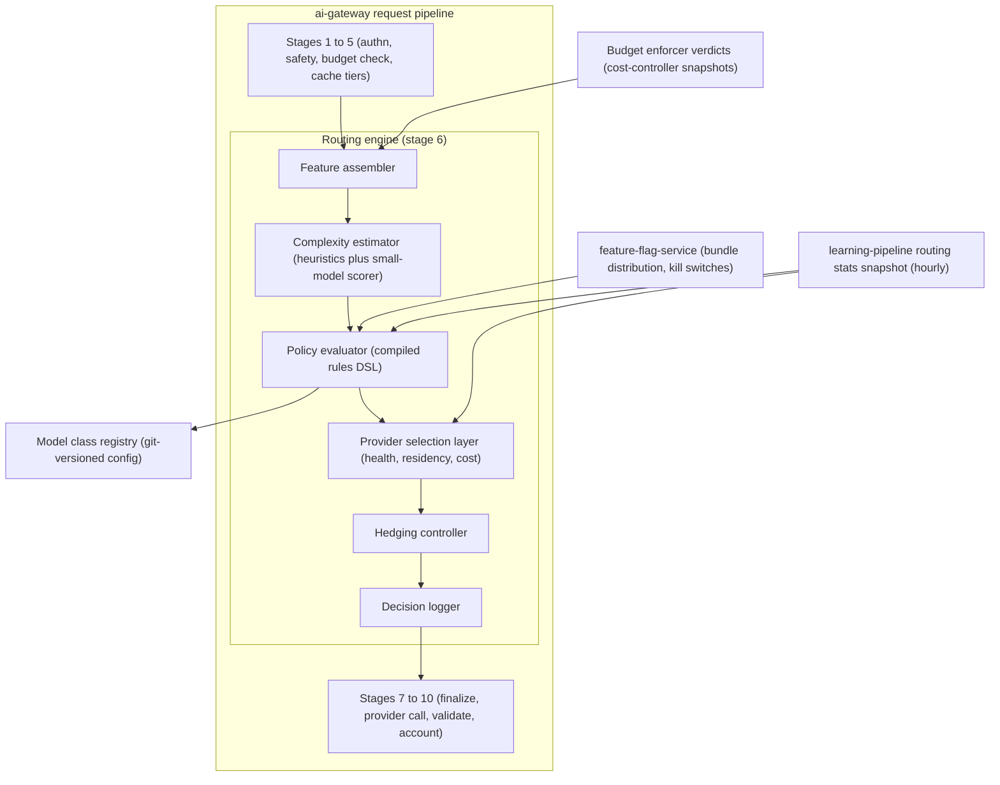
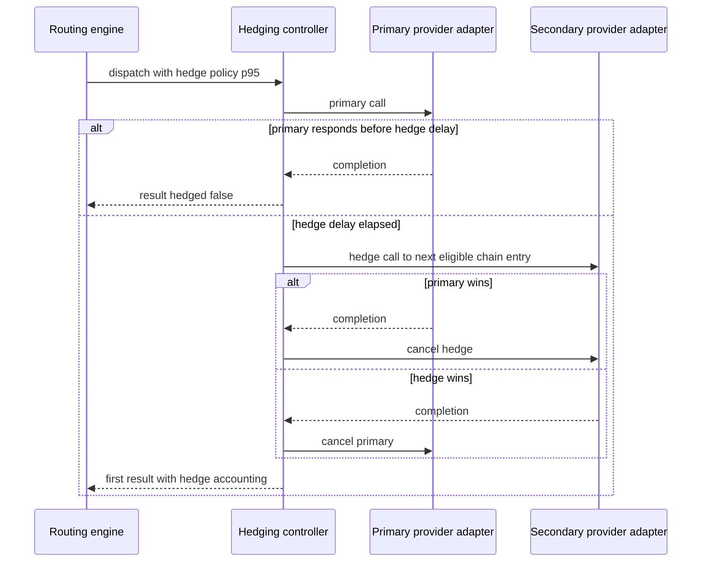
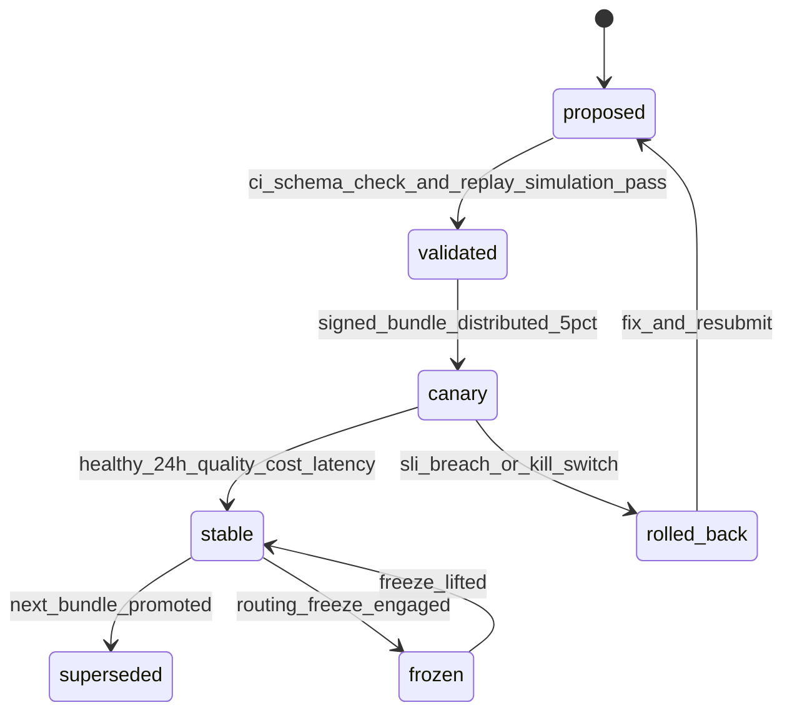
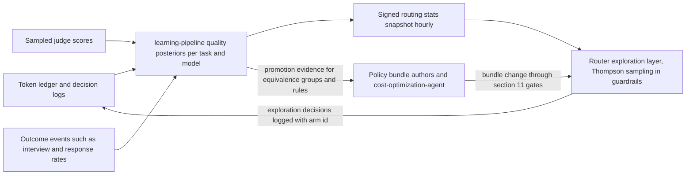

# 28 — Model Routing

| | |
|---|---|
| Document ID | ACA-SAS-28 |
| Volume | 3 — AI Architecture |
| Status | Draft v1.0 |
| Depends on | [00 — Architecture Canon](../00-architecture-canon.md) §9–§10, §12, §15; [18 — AI Gateway](../volume-2-core-services/18-ai-gateway.md) §3–§6; [21 — AI Architecture](21-ai-architecture.md) §4, §7; [23 — Prompt Registry](23-prompt-registry.md) §8; [25 — Cost Optimization Engine](25-cost-optimization-engine.md) §5–§6; [26 — Semantic Cache](26-semantic-cache.md); [16 — Universal Portal Engine](../volume-2-core-services/16-universal-portal-engine.md) (template trust ladder) |

## 1. Overview

Routing is where the platform's economics and quality meet on every single model call: which class, which concrete model, which provider, which lane — decided in ~1 ms, tens of millions of times a day. [Chapter 18 §4](../volume-2-core-services/18-ai-gateway.md) placed the router as stage 6 of the `ai-gateway` pipeline and fixed its external contract (class registry, five-rule decision procedure). This chapter specifies the engine behind that contract: the decision inputs and feature vector, the rules DSL that routing policy is written in, complexity estimation, the provider selection layer with data-residency constraints, fallback chains and the hedged-request policy, budget-verdict translation and per-plan ceilings, batch/interactive lane mechanics, decision logging and audit, config rollout with kill switches, adaptive routing fed by `learning-pipeline`, and how routing changes themselves are evaluated.

Two invariants frame everything here. First, the **escalation ladder** ([canon §9](../00-architecture-canon.md)): deterministic rules → caches → knowledge lookup → embeddings → `small` → `medium` → `large` → `frontier`; skipping tiers requires an explicit, logged routing policy. The router is the ladder's mechanical enforcer above the cache tiers. Second, **classes, not models**: callers request task outcomes; policy maps task types to classes; only the registry maps classes to concrete models and providers ([Chapter 18 §4.1](../volume-2-core-services/18-ai-gateway.md)). This indirection is the vendor-agnostic seam the canon demands, and it is why the [Chapter 26](26-semantic-cache.md) exact cache can key on class rather than model id.

The router's design bias is **deterministic and boring on the hot path**: policy is compiled configuration evaluated in microseconds, all statistical adaptation happens *off* the request path (hourly snapshots, §12), and every deviation from the default — ladder skip, failover, degrade, exploration — is a logged, attributable event (§10). A router that cannot explain a decision after the fact is a router that cannot be audited, debugged, or improved.

## 2. Routing Engine Architecture



| Component | Purpose | Latency budget (p99) | Failure posture |
|---|---|---|---|
| Feature assembler | build the §3 feature vector from request context, budget verdict, cached stats | 0.2 ms | missing optional features → defaults; missing mandatory (task type) → fail-closed `FAILED_PRECONDITION` ([Chapter 18 §2](../volume-2-core-services/18-ai-gateway.md)) |
| Complexity estimator | heuristic score; optional cached `small`-model score (§5) | 0.1 ms (heuristic path) | scorer unavailable → heuristic-only, flagged |
| Policy evaluator | first-match evaluation of the compiled policy bundle for the task type | 0.3 ms | bundle unloadable → last-known-good (fail-static, §11) |
| Provider selection layer | filter + order the class's provider chain (§6) | 0.2 ms | empty eligible set → degrade path (§6.3) |
| Hedging controller | duplicate-dispatch policy for latency-critical calls (§7.2) | 0 on non-hedged path | hedging disabled by kill switch → primary-only |
| Decision logger | assemble the decision record, attach to request log + ledger | async, off response path | spool with the accounting emitter |

All components are in-process within `ai-gateway` pods — routing state (bundles, snapshots, circuit states) is pod-local, refreshed via `feature-flag-service` and Redis pub/sub; **no network call on the decision path**. Total stage-6 budget: 1 ms ([Chapter 18 §3.1](../volume-2-core-services/18-ai-gateway.md)).

## 3. Decision Inputs & Feature Vector

Every routing decision consumes one immutable feature vector, assembled once and logged whole (§10) — the same bytes that drove the decision are the bytes available to audit and replay it.

| Feature | Source | Values / notes |
|---|---|---|
| `task_type` | request envelope | e.g. `job.parse`, `resume.tailor`, `agent.plan`, `browser.perceive` — the policy bundle's primary key |
| `feature`, `agent_id` | attribution fields | degradation-ladder selection ([Chapter 25 §6](25-cost-optimization-engine.md)); per-agent stats |
| `model_class_request` | caller hint | router may downgrade; upgrades need policy flag (ladder rule) |
| `routing_flags` | caller, logged | `allow_frontier`, `require_provider`, `skip_semantic_cache` |
| `complexity` | estimator (§5) | 0–1 + `estimator_kind` (heuristic \| scored) |
| `input_tokens_est`, `tool_count`, `response_schema_present` | envelope inspection | budget fit, structured-output constraints |
| `deadline_class` | envelope | `fast` \| `interactive` \| `agent` \| `batch` ([Chapter 18 §3.3](../volume-2-core-services/18-ai-gateway.md)) |
| `interactive` | derived | user-waiting flag — drives the plan floor guarantee (§8) |
| `tenant_plan`, `plan_ceiling` | entitlement snapshot | §8 ceilings table |
| `budget_verdict` | budget enforcer (stage 3) | `allow` \| `degrade` \| `floor` \| `queue` \| `deny` per scope ([Chapter 25 §5.2](25-cost-optimization-engine.md)) |
| `residency_domain` | tenant record (cell pinning, [canon §15](../00-architecture-canon.md)) | `default` \| `eu` |
| `template_trust` | request context (browser tasks only) | `discovered` \| `candidate` \| `trusted` \| `stale` ([canon §16](../00-architecture-canon.md)) |
| `quality_flags` | `learning-pipeline` snapshot (§12) | per (task_type, model) below-SLO flags |
| `provider_health` | circuit states + governor pressure ([Chapter 18 §6](../volume-2-core-services/18-ai-gateway.md)) | pod-local, Redis-converged |
| `retry_attempt`, `prior_failure` | pipeline state | escalation-on-retry rules |
| `explore_assignment` | exploration layer (§12) | arm id or none |
| `prompt_compat` | bundle compatibility rows ([Chapter 23 §8](23-prompt-registry.md)) | verified classes for the resolved prompt version |

## 4. Routing Policy DSL

### 4.1 Language

Routing policy is written in a declarative YAML DSL, compiled at load time into per-task-type decision tables. Design rules: **first-match-wins** within a task block (priority is textual order — reviewable in a diff); **default fail-closed** (a task type with no block is rejected, per [Chapter 18 §2](../volume-2-core-services/18-ai-gateway.md)); predicates are pure functions of the §3 feature vector (no I/O, no time-of-day implicit state — schedules are expressed as explicit predicates so replay is deterministic); every rule has a mandatory `id` and `rationale` (the decision record cites the rule id, §10).

```yaml
# grammar sketch
policy_bundle:
  version: <semver>                # bundle version, §11
  defaults: { lane: interactive, hedge: none }
  tasks:
    <task_type>:
      ceiling: <class>             # ladder ceiling for this task type
      rules:
        - id: <string>
          when: <predicate-expr>   # boolean over feature vector fields
          then:
            class: <class> | +1 | -1      # absolute, or relative to prior rule outcome
            lane: interactive | batch
            hedge: none | p95 | p90
            chain: <named-chain>          # optional per-rule provider chain override
            ladder_skip: true             # explicit, makes the skip legal AND logged
          rationale: <string>
```

### 4.2 Example policies per task type

```yaml
tasks:
  job.parse:
    ceiling: medium
    rules:
      - id: parse-default
        when: "complexity < 0.7"
        then: { class: small, lane: batch }
        rationale: "rules-first parser upstream; small handles the LLM fallback for 90% of postings"
      - id: parse-complex
        when: "complexity >= 0.7 or retry_attempt >= 1"
        then: { class: medium, lane: batch }
        rationale: "layout-anomalous or previously-failed postings need medium; still never interactive"

  match.explain:
    ceiling: medium
    rules:
      - id: explain-interactive
        when: "interactive"
        then: { class: small, hedge: p95 }
        rationale: "user-visible read path; small meets quality SLO, hedge protects read-latency p99"
      - id: explain-batch
        when: "not interactive"
        then: { class: small, lane: batch }
        rationale: "bulk rescoring after profile edits rides the batch lane"

  resume.tailor:
    ceiling: large
    rules:
      - id: tailor-free
        when: "tenant_plan == 'free'"
        then: { class: medium }
        rationale: "plan gate: free is capped at medium (canon 12); quality floor verified by evals"
      - id: tailor-paid
        when: "tenant_plan in ['professional','premium','enterprise']"
        then: { class: large }
        rationale: "large-model tailoring is the paid-plan entitlement; 60 s draft SLO holds at large"

  agent.plan:
    ceiling: frontier
    rules:
      - id: plan-default
        when: "complexity < 0.6 and retry_attempt == 0"
        then: { class: medium }
        rationale: "skeleton-first planning (Ch 21) keeps most plan fills medium-sized"
      - id: plan-hard
        when: "complexity >= 0.6 or replan_count >= 2"
        then: { class: large }
        rationale: "replan churn is the strongest signal a plan needs deeper reasoning"
      - id: plan-frontier
        when: "routing_flags.allow_frontier and tenant_plan in ['premium','enterprise']"
        then: { class: frontier, ladder_skip: true }
        rationale: "frontier requires explicit flag plus plan gate (canon 10.1); logged as ladder skip"

  browser.perceive:
    ceiling: frontier
    rules:
      - id: perceive-trusted
        when: "template_trust == 'trusted'"
        then: { class: small }
        rationale: "trusted templates need verification-grade perception only; the template does the work"
      - id: perceive-candidate
        when: "template_trust in ['candidate','stale']"
        then: { class: vision }
        rationale: "shadow-verification and drift re-checks need real DOM+screenshot understanding"
      - id: perceive-novel
        when: "template_trust == 'discovered'"
        then: { class: vision, hedge: none }
        rationale: "novel portals get full perception; frontier planning is a separate task type behind its flag"
```

The `browser.perceive` block is the template-trust coupling [Chapter 25 §6](25-cost-optimization-engine.md) references: perception cost tracks the trust ladder ([canon §16](../00-architecture-canon.md)) — mature templates make cheap models sufficient, and the router is where that economy is enforced rather than hoped for.

### 4.3 What the DSL deliberately cannot express

No per-tenant custom logic (tenancy enters only via `plan` and `residency` — per-tenant routing forks would make quality SLOs unattributable); no provider names in task rules (only named chains defined in the registry section — the vendor seam stays sealed); no unlogged ladder skips (the compiler rejects a `class` jump of ≥ 2 tiers above the previous rung without `ladder_skip: true`).

## 5. Complexity Estimation

Two-stage, cheap-first, mirroring the platform's escalation doctrine:

**Heuristic score (always, ~50 µs).** Weighted normalized features: input token count vs task-type median; schema depth of requested structured output; tool count; novelty (semantic-cache nearest-neighbor distance for the task's normalized input, already computed at stage 5 — free at the router); `template_trust` (browser tasks); historical retry rate for the (task_type, input-size decile) cell from the stats snapshot. Weights live in the policy bundle and are tuned offline (§13).

**`small`-model scorer (conditional).** Invoked only when the heuristic lands in the ambiguous band **[0.4, 0.7]** *and* the task family is flagged scorer-eligible in the bundle — outside the band the heuristic is already decisive, and the band boundaries are calibrated quarterly against realized escalation outcomes. The scorer emits `{complexity, reason_tags}` from a 150-token classification; results are exact-cached 7 d keyed on the normalized task input ([Chapter 18 §5.1](../volume-2-core-services/18-ai-gateway.md) conventions), so repeated similar inputs (bulk parsing, re-crawls) pay once. Guardrails: scorer spend is attributed to the `routing-scorer` feature scope with a `cost-controller` budget cap of 1 % of the owning family's spend — an estimator that costs more than the escalations it avoids is dead weight; the scorer call itself uses the `fast` deadline class and degrades to heuristic-only on any failure (flagged `estimator_kind=heuristic_fallback`).

Estimation quality is a measured artifact: `learning-pipeline` computes escalation regret weekly — the rate at which calls routed low were retried upward (under-estimation) and the sampled-judge rate at which calls routed high would have passed one class lower (over-estimation, measured on a 0.5 % shadow sample re-run on the batch lane). Both feed §13's evaluation loop; persistent regret > 5 % in either direction re-opens the weights.

## 6. Provider Selection Layer

The policy evaluator outputs a **class**; provider selection turns it into a concrete `(provider, model)` dispatch plan under four constraint families. Selection is filter-then-order over the class's registered chain ([Chapter 18 §4.1](../volume-2-core-services/18-ai-gateway.md)):

### 6.1 Filters (hard constraints, applied in order)

| Filter | Rule | Rationale |
|---|---|---|
| Health | skip open circuits ([Chapter 18 §6.3](../volume-2-core-services/18-ai-gateway.md)); skip governors above 90 % bucket utilization for non-interactive traffic | brownout avoidance beats brownout recovery |
| Data residency | `residency_domain=eu` tenants: only chain entries with EU processing endpoints or in-cell vLLM; **fail-closed** — if no eligible entry serves the class, degrade class within eligible entries rather than ever crossing the residency boundary | residency is a legal property; latency and quality degrade, jurisdiction does not |
| Quality flags | skip (task_type, model) pairs flagged below the 95 % eval-pass SLO by `learning-pipeline` | [Chapter 18 §4.2](../volume-2-core-services/18-ai-gateway.md) rule 5, enforced here |
| Prompt compatibility | skip entries whose class is `incompatible` for the resolved prompt version; trigger compatibility fallback per [Chapter 23 §8](23-prompt-registry.md) when unavoidable | never knowingly run a prompt on a class it fails on |
| `require_provider` flag | honor (rare, logged, audited) | provider-specific replay/debug only |

### 6.2 Ordering

Chain order from the registry is the default (it encodes the platform's quality judgment per class). Reordering is permitted **only within equivalence groups** — chain entries tagged quality-equivalent for the task family by joint eval evidence — and there it is cost-then-latency: cheapest first, tie-broken by rolling latency headroom vs the class p99 target. This keeps the [Chapter 18 §6.3](../volume-2-core-services/18-ai-gateway.md) chain semantics intact (failover order is meaningful) while letting the router harvest price differences between genuinely interchangeable deployments (e.g., self-hosted vLLM vs provider `small` at off-peak).

### 6.3 Empty-set degradation

If filtering empties the chain: degrade one class down and re-select (logged `degraded_reason=provider_unavailable`); iterate to the plan floor; below floor, interactive requests return `UNAVAILABLE` with retry-after and non-interactive work parks to the batch lane for deferred dispatch. The degrade-not-queue bias for interactive traffic is deliberate: a `medium` answer now beats a `large` answer in 40 minutes for every interactive task family evaluated so far ([Chapter 25 §6](25-cost-optimization-engine.md) ladders encode the exceptions, notably browser submission, which defers rather than degrades).

## 7. Fallback Chains & Hedged Requests

### 7.1 Fallback chains

Chains are per-class, registry-defined, evaluated per request after filtering (§6). Failover triggers: transport errors, timeouts vs deadline class, 429 after governor backoff, and provider-side `error` stop reasons — but never `refusal` ([Chapter 18 §6.1](../volume-2-core-services/18-ai-gateway.md)): a model that declined does not get its answer shopped to a second provider; refusal handling belongs to the caller and the safety pipeline. Chain exhaustion → §6.3 degradation. Failovers mark `degraded_reason=provider_failover`; `learning-pipeline` monitors failover-traffic quality separately ([Chapter 18 §6.3](../volume-2-core-services/18-ai-gateway.md)).

### 7.2 Hedged requests

Hedging duplicates a request to the next chain entry after a delay, taking the first response — buying tail latency with money. The policy is therefore class- and lane-gated:

| Class / lane | Hedge policy | Delay trigger | Cap | Rationale |
|---|---|---|---|---|
| `embed` | allowed, default on | p95 of rolling class latency | ≤ 10 % of calls hedged | cheap calls, latency-critical for context assembly fan-out |
| `small`, interactive lane | allowed via rule (`hedge: p95`) | p95 | ≤ 5 % | protects the < 300 ms read-path SLO contribution; cost of a duplicate `small` call is sub-cent |
| `small`, batch lane | never | — | — | batch has no tail-latency SLO |
| `medium` interactive | flag-gated per task rule, `p90` only when deadline at risk (elapsed > 50 % of deadline) | p90 | ≤ 2 % | duplicate `medium` calls are real money; only deadline-endangered requests qualify |
| `large`, `frontier`, `vision` | never | — | — | duplicate cost dominates any tail benefit; agents tolerate latency ([Chapter 18 §3.3](../volume-2-core-services/18-ai-gateway.md)) |
| streaming requests | never | — | — | first-token semantics make late winners unusable |



Both legs are token-accounted; cancelled legs report actual partial usage where providers support it, else estimated reservation ([Chapter 18 §6.4](../volume-2-core-services/18-ai-gateway.md)). `hedge_waste_usd` is a first-class dashboard metric; the hedging controller auto-suspends a task rule whose realized waste exceeds 3× its p99 latency benefit (computed weekly by `cost-optimization-agent`), and the global `hedging.disable` kill switch (§11) zeroes the mechanism in one flag.

## 8. Budget Integration, Plan Ceilings & Degradation Translation

The budget enforcer (stage 3) emits a *verdict*; the router owns *translation* — the enforcer knows budgets, the router knows what a tier down means per task ([Chapter 25 §5.2](25-cost-optimization-engine.md)):

| Verdict | Router translation |
|---|---|
| `allow` | policy outcome unchanged |
| `degrade` | step down the **feature degradation ladder** ([Chapter 25 §6](25-cost-optimization-engine.md)) — a per-feature sequence (class reductions, lane shifts, deferrals), not a blind class decrement; the ladder entry is part of the policy bundle |
| `floor` | interactive requests pinned to plan-floor class (`small`), never denied — the canon's user-facing guarantee that an agent burning budget cannot kill the assistant ([canon §10.2](../00-architecture-canon.md)) |
| `queue` | non-interactive work re-laned to batch with deferred dispatch; position honors scope priority |
| `deny` | non-interactive, hard-capped scopes only: `RESOURCE_EXHAUSTED` with budget detail |

### 8.1 Per-plan class ceilings

Entitlement snapshots ([canon §12](../00-architecture-canon.md)) bind the ceiling; the router enforces it after policy evaluation (a rule cannot out-vote a plan):

| Plan | Interactive ceiling | Batch ceiling | `frontier` access | Notes |
|---|---|---|---|---|
| Free | `medium` | `small` | no | free batch work (bulk parsing benefits) rides platform scopes, not user entitlement |
| Professional | `large` | `medium` | no | large-model tailoring is the headline entitlement |
| Premium | `large` | `large` | yes — budgeted, `allow_frontier` flag still required per call | frontier is doubly gated: plan + explicit routing flag ([canon §10.1](../00-architecture-canon.md)) |
| Enterprise / University / Recruiter | contract-defined (default `large`) | contract-defined | optional rider | ceilings distributed via entitlement snapshot like any plan |

Ceiling collisions resolve downward silently for batch work and with `degraded_reason=plan_ceiling` for interactive work — the response metadata is how the product surfaces "upgrade for better drafts" honestly rather than dark-patterning quality.

## 9. Batch vs Interactive Lanes

Lane is a routing output, not just a caller declaration. Assignment rules, in order: (1) `deadline_class=batch` → batch lane; (2) budget `queue` verdict → batch lane; (3) policy rule `lane: batch` (bulk families: `job.parse`, `company.enrich`, eval runs, consolidation, re-scoring) → batch; (4) default interactive. The batch lane drains through provider batch APIs at ≈ 50 % cost with ≤ 24 h SLA ([canon §10.2](../00-architecture-canon.md)) via the separate `ai-gateway-batch` deployment ([Chapter 18 §2](../volume-2-core-services/18-ai-gateway.md)).

Lane mechanics the router owns: **starvation guard** — batch jobs exceeding 20 h in queue get deadline promotion to the interactive lane at `small`-class-equivalent cost ceilings (the 24 h SLA is a contract, and blowing it to save 50 % on a stale job is a false economy); **anti-affinity** — a request that failed on the batch lane retries interactively at most once (batch provider incidents must not double-bill the SLA clock); **lane accounting** — ledger events carry `lane`, so the batch-share-of-tokens metric (target ≥ 35 % of non-interactive eligible volume) is directly measurable.

## 10. Routing Decision Logging & Audit

Every decision produces a **decision record**, attached to the AI request log (90 d hot, archived 13 mo — [canon §11](../00-architecture-canon.md)) with a compact summary (`routing_reason`) in the `aca.ai.request.completed.v1` ledger event ([canon §10.3](../00-architecture-canon.md)):

```json
{
  "request_id": "req_01J...",
  "bundle_version": "3.14.2",
  "feature_vector_hash": "sha256:...",
  "feature_vector": { "task_type": "agent.plan", "complexity": 0.63, "...": "..." },
  "matched_rule": "plan-hard",
  "class_selected": "large",
  "class_requested": "medium",
  "ladder_skip": false,
  "provider_plan": [ {"provider": "anthropic", "model": "large-ref", "filtered": null},
                     {"provider": "openai", "model": "large-ref", "filtered": "governor_pressure"} ],
  "budget_verdict": "allow",
  "degraded_reason": null,
  "lane": "interactive",
  "hedge": { "policy": "none" },
  "explore_arm": null,
  "estimator_kind": "scored"
}
```

Audit posture: the record is evidence, so three event classes are additionally mirrored to `audit-service` (`aca.audit.event.v1`, hash-chained, 7-year retention): **ladder skips** (with the authorizing rule id and caller identity — the canon requires skips be explicit and logged), **`require_provider` uses**, and **kill-switch/bundle-change actions** (§11). Standing audit queries shipped as `admin-service` reports: skip frequency by caller (creeping ladder erosion), degrade frequency by tenant (budget-fit health), failover-quality deltas, exploration exposure by tenant (§12 guardrail proof), residency-filter hit counts for EU tenants (compliance evidence). `cost-optimization-agent` reads decision logs nightly as its primary optimization input ([Chapter 25 §7](25-cost-optimization-engine.md)).

## 11. Config Rollout & Kill Switches

### 11.1 Policy bundle lifecycle

The **routing policy bundle** (task blocks, chains, hedging rules, estimator weights, degradation-ladder entries) is git-versioned configuration, semver'd, and deployed like code but decoupled from deploys:



CI validation includes **replay simulation**: the candidate bundle is evaluated against the last 24 h of production decision records (feature vectors are logged whole precisely for this), producing a decision-diff report — which traffic shifts class/lane/provider, projected cost delta, prompts whose reachable-class set changes (re-opening [Chapter 23 §8](23-prompt-registry.md) G3 checks). A bundle whose diff touches > 20 % of any task family's traffic requires explicit sign-off from that family's owning team; silent large-blast-radius changes are the failure mode this gate exists for. Canary: 5 % of traffic by tenant hash, 24 h soak, `learning-pipeline` monitoring quality/cost/latency SLIs with the same auto-rollback machinery as prompt canaries ([Chapter 23 §7.2](23-prompt-registry.md)). Bundles are Ed25519-signed and distributed via `feature-flag-service`; pods converge ≤ 30 s.

### 11.2 Kill switches

All are feature flags, effective fleet-wide ≤ 30 s, every actuation audit-mirrored:

| Switch | Effect | Blast radius intent |
|---|---|---|
| `routing.freeze` | pin last-known-good stable bundle; reject bundle updates | stop a bad rollout without redeploying |
| `routing.conservative` | ignore stats snapshot + exploration + reordering; registry chain order, policy defaults only | when adaptation itself is suspect |
| `provider.<name>.disable` | remove provider from all chains | provider incident or contract event |
| `class.frontier.disable` | frontier requests degrade to `large`, flagged | cost or safety incident containment |
| `exploration.disable` | zero exploration traffic (§12) | quality incident during an experiment |
| `hedging.disable` | no hedged dispatches | cost spike containment |

The platform kill switch ([canon §1](../00-architecture-canon.md)) composes: user/tenant/platform-scope stops are enforced upstream at admission ([Chapter 19](../volume-2-core-services/19-agent-orchestrator.md)); the routing switches cover the *how* of calls that remain legitimately in flight.

## 12. Adaptive Routing — Learning-Pipeline Feedback with Guardrailed Exploration

Static policy decays: providers drift, prompts evolve, price sheets change. The adaptation loop closes **off the hot path**:



**Exploitation** consumes the hourly signed stats snapshot: quality flags (§6.1), equivalence-group membership (§6.2), estimator calibration cells (§5). The router never fits models itself — it reads posteriors computed and signed by `learning-pipeline`, so a corrupted or stale snapshot is detectable (signature, timestamp) and survivable (`routing.conservative`).

**Exploration** is bandit-style (Thompson sampling over per-arm quality/cost posteriors) inside hard guardrails:

| Guardrail | Value | Rationale |
|---|---|---|
| Arm eligibility | only (task_type, class/model) pairs that passed offline eval at ≥ 90 % (`provisional`+ in [Chapter 23 §8](23-prompt-registry.md) terms) | exploration refines rankings among known-viable arms; it never discovers viability on users |
| Traffic share | ≤ 1 % per task family; ≤ 0.5 % for user-visible generative families | detection power at busy-family volumes without perceptible exposure |
| Exclusions | consequential-action steps, `frontier` class, `floor`-verdict traffic, `residency`-constrained requests outside their domain | never explore where an error is an action, a legal breach, or a user already degraded |
| Spend cap | exploration premium ≤ $50/day/family (`cost-controller` scope `routing-exploration`) | upper-bounds the cost of curiosity |
| Quality tripwire | family judge-score drop > 2 points on exploration traffic → family exploration auto-halts | plus the global `exploration.disable` switch |
| Attribution | every exploration decision carries `explore_arm` in the record and ledger | posterior updates and audit both need exact exposure accounting |

Adaptation *outputs* graduate through configuration, not through drift: when posteriors support a better default (reorder an equivalence group, change a rule's class), `cost-optimization-agent` or the owning team proposes a bundle change that rides §11's gates. The bandit tunes *within* the sandbox policy defines; only the governed rollout path *moves* the sandbox.

## 13. Evaluation of Routing Changes

Routing changes are model-visible behavior and fall under the evaluation-first doctrine ([Chapter 21 §7](21-ai-architecture.md)). Three instruments, in escalating cost order:

1. **Decision replay (no model calls).** Candidate bundle vs 24 h of logged feature vectors → decision diff (§11.1). Answers "what changes" exactly; answers "is it better" not at all. Runs in CI, minutes.
2. **Quality replay (batch lane).** For the diff's shifted traffic, re-execute a stratified sample (≥ 200/family — pairwise-judge resolution at the 2–3-point level) on the new class/model via the model-swap replay mode ([Chapter 22 §10](22-multi-agent-framework.md)); pairwise judges score old vs new outputs. Produces the quality-vs-cost evidence a promotion decision actually needs; feeds [Chapter 23 §8](23-prompt-registry.md) compatibility rows as a side effect.
3. **Online canary.** §11.1's 5 %/24 h soak with `learning-pipeline` SLI monitoring: eval-pass proxy (sampled judges), cost per task, latency vs class targets, downstream signals where fast enough (draft-acceptance rate). Promotion criteria: quality non-inferiority (judge delta ≥ −1 point per family), realized cost within ±10 % of replay projection (a projection miss means the diff model is wrong — stop and understand it), latency SLOs held.

Estimator-weight and stats-snapshot-schema changes follow the same path — §5's regret metrics are the acceptance criteria for estimator changes. The asymmetry with prompts is worth pinning: prompt changes optimize *quality at a class*; routing changes optimize *class assignment itself* — so routing evaluation always reports the quality/cost pair, never either number alone.

## 14. Failure Scenarios

| Scenario | Impact | Response |
|---|---|---|
| Policy bundle corrupt / unloadable | pods keep last-known-good (fail-static) | alert; `routing.freeze` if the bad bundle partially propagated |
| Stats snapshot stale (> 3 h) or signature-invalid | router drops adaptive inputs, runs registry defaults (`routing.conservative` behavior automatically) | flagged `adaptive_degraded`; `learning-pipeline` paged |
| Complexity scorer outage | heuristic-only estimation, slight escalation-regret increase | self-heals; monitor regret drift |
| Primary provider regional outage | chains absorb per [Chapter 18 §6.3](../volume-2-core-services/18-ai-gateway.md); failover-quality monitoring intensifies | capacity governors sized for 50 % absorption; batch lane sheds first |
| Budget verdict stream stale | stage-3 degraded mode governs ([Chapter 18 §13](../volume-2-core-services/18-ai-gateway.md)); router treats verdict as `allow` with conservative ceilings | bounded over-spend risk, time-boxed |
| Residency-eligible set empty for a class (EU) | in-domain class degradation, never cross-domain dispatch | standing gap alert — an EU capacity/contract problem, not a routing problem |
| Exploration misbehavior (bad arm posterior) | ≤ 1 % family exposure, tripwire halts family | guardrails bound the blast radius by construction |
| Thundering escalation (systemic complexity inflation, e.g. estimator bug rates everything 0.9) | class-mix cost spike | class-mix anomaly monitor (§15) + `cost-controller` spend breakers ([Chapter 25 §8](25-cost-optimization-engine.md)); `routing.conservative` |

## 15. Scaling Strategy

The engine is stateless-per-pod compute measured in microseconds — it scales with `ai-gateway` pods and adds no independent bottleneck. The scaling risks are informational: bundle size (compiled tables held in memory; O(task types × rules) — trivial at any plausible catalog size), snapshot fan-out (hourly, KB-scale, via existing flag distribution), and decision-record volume (~50 M/day at target scale, riding the existing request-log write-behind path and its object-storage archive — [Chapter 18 §10](../volume-2-core-services/18-ai-gateway.md)). Per-cell isolation ([canon §15](../00-architecture-canon.md)) applies naturally: cells receive the same signed bundles; residency filters differ only by data, not code.

## 16. Security Considerations

- **Routing config is an attack surface:** a malicious bundle could exfiltrate volume to an attacker-controlled "provider" or strip safety-relevant class floors. Mitigations: bundles signed with a Vault-held key; provider endpoints definable only in the registry (not per-rule); registry changes require the same JIT-elevated review as code; CI replay-simulation makes traffic-shift visible pre-merge.
- **Flag integrity:** kill switches and `require_provider` are OPA-authorized mutations, audit-mirrored; `security-agent` watches for anomalous switch actuation patterns.
- **No routing on content:** the feature vector deliberately contains no prompt text — routing sees shapes (tokens, schemas, trust levels), never content, so the router cannot become a data-dependent side channel and decision records stay `P3`.
- **Ladder-skip audit** (§10) is the enforcement teeth behind the canon's "skipping tiers requires an explicit, logged routing policy."
- **Residency fail-closed** (§6.1) is the router's contribution to GDPR/data-residency posture; the audit trail of residency-filter hits is compliance evidence.

## 17. Observability

| Signal | Type | Alert |
|---|---|---|
| `routing_class_mix{task_type,class}` | gauge | z > 3 shift vs 28-day same-hour baseline — estimator or policy regression |
| `routing_decision_duration_seconds` | histogram | p99 > 1 ms — engine budget breach |
| `routing_ladder_skips_total{caller}` | counter | new caller or +50 % week-over-week — audit review |
| `routing_degraded_total{reason}` | counter | budget-degrade sustained > 4 h on a paid tenant — plan-fit signal to billing |
| `routing_failover_ratio{provider}` | gauge | > 5 % sustained — provider health review |
| `routing_hedge_rate` / `hedge_waste_usd` | gauge / counter | rate > policy cap; waste > 3× benefit |
| `routing_exploration_share{family}` | gauge | > guardrail cap — hard bug, page |
| `routing_bundle_version` (per pod) | info gauge | version skew > 5 min — distribution failure |
| `routing_snapshot_age_seconds` | gauge | > 3 h — adaptive degraded |
| `escalation_regret{direction,family}` (weekly) | gauge | > 5 % — estimator recalibration |
| Batch share of eligible tokens | gauge | < 35 % — lane policy leaking money |

Dashboards pair every quality panel with its cost panel (§13's doctrine); the routing overview is a standing panel on the FinOps dashboard ([Chapter 25 §9](25-cost-optimization-engine.md)).

## 18. Future Improvements

- **Per-request cost-of-error weighting:** route on expected loss (probability of downstream failure × cost of that failure, e.g. a browser mis-perception forcing a full session retry) instead of scalar complexity.
- **Joint prompt+class optimization:** co-select (prompt version, class) pairs using [Chapter 23 §8](23-prompt-registry.md) compatibility economics — sometimes the older prompt on the cheaper class dominates.
- **Cross-cell load shifting for batch:** route batch-lane work to whichever region's provider quotas have overnight headroom, within residency constraints.
- **Contextual bandits:** condition exploration posteriors on feature-vector cells (input-size decile, template trust) rather than family-level arms, once per-cell volume supports it.
- **Predictive provider health:** replace reactive circuit breaking with short-horizon failure prediction from latency-variance leading indicators.

## 19. Alternatives Considered & Tradeoffs

| Decision | Alternative | Why rejected / tradeoff accepted |
|---|---|---|
| Declarative first-match DSL | General-purpose scripting (Lua/CEL hooks) in the router | Scriptable routing is unauditable and un-replayable at exactly the place the canon demands logged explicitness; the DSL's expressiveness ceiling is the feature. Accepted: genuinely novel routing behavior needs an engine change. |
| Model-based routing decisions on the hot path | LLM-as-router per request | Adds a model call to save a model call — latency and cost inversion; the `small` scorer survives only as a *cached, banded* estimator input, not a decision-maker. |
| Off-path adaptation via signed snapshots | Online learning in the router (live posterior updates per pod) | Live learners drift per pod, resist audit, and turn a stats bug into an instant fleet-wide behavior change; hourly signed snapshots bound both skew and blast radius. Accepted: adaptation lags by up to an hour — acceptable for signals that move over days. |
| Guardrailed Thompson exploration | Pure A/B experiments only | A/B at 50/50 exposes far more users to the losing arm for the same statistical power; bandits concentrate exposure on winners. Accepted: bandit assignment complicates attribution — solved by logging `explore_arm` on every record. |
| Chain-order default + equivalence-group reordering | Full scoring-based provider selection per request | Free-form scoring makes provider mix non-deterministic and quality attribution muddy; equivalence groups confine cost-chasing to pairs with eval-proven interchangeability. Accepted: leaves some marginal cost savings unharvested. |
| Hedging restricted to cheap classes | Uniform hedging for all latency-sensitive traffic | Duplicate `large` calls at 50 M calls/day scale is a seven-figure annual bill for tail-latency nobody SLO'd; the restriction follows the money. |
| Fail-static bundle + `routing.conservative` | Fail-closed on config subsystem failure | Routing config failure must never take down the AI plane; last-known-good is by definition a state that was serving traffic acceptably. Accepted: a freeze can pin a subtly-bad bundle — mitigated by the freeze being loud (paged) and time-boxed by runbook. |
