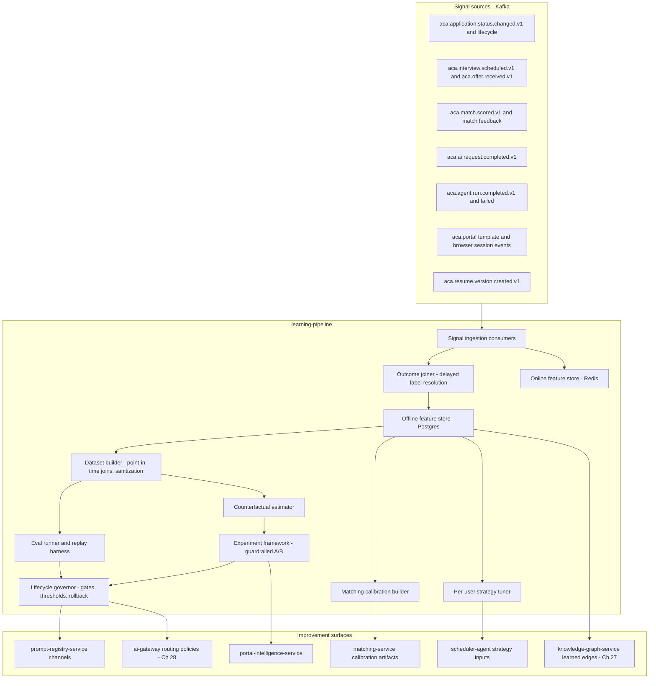
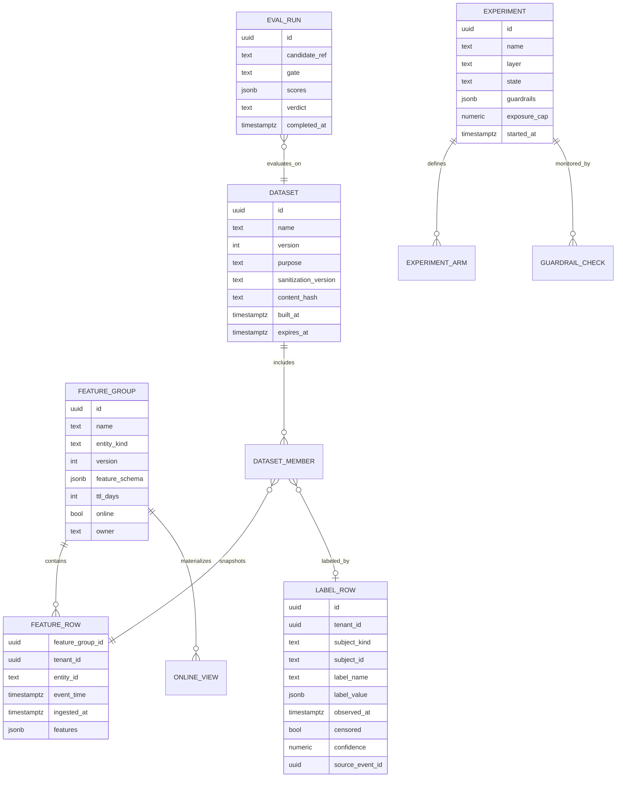
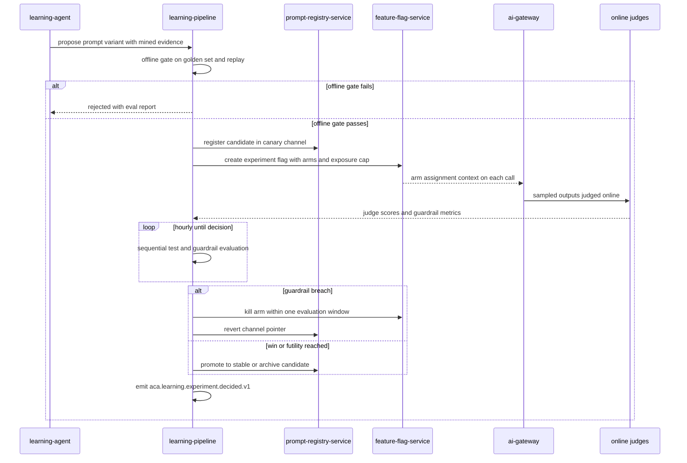
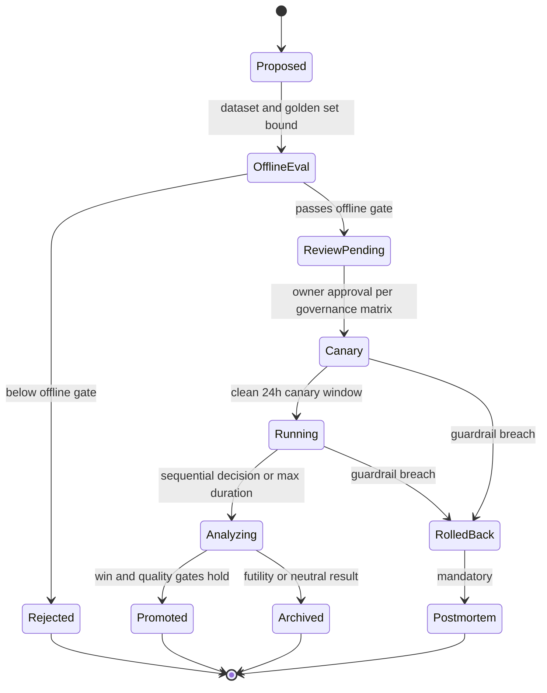

# 29 — Learning Pipeline

| | |
|---|---|
| Document ID | ACA-SAS-29 |
| Volume | 3 — AI Architecture |
| Status | Draft v1.0 |
| Depends on | [00 — Architecture Canon](../00-architecture-canon.md) §5, §9–§11; [21 — AI Architecture](21-ai-architecture.md) §7–§9; [22 — Multi-Agent Framework](22-multi-agent-framework.md); [23 — Prompt Registry](23-prompt-registry.md); [25 — Cost Optimization Engine](25-cost-optimization-engine.md); [26 — Semantic Cache](26-semantic-cache.md); [27 — Knowledge Graph](27-knowledge-graph.md) §9; [28 — Model Routing](28-model-routing.md); [16 — Universal Portal Engine](../volume-2-core-services/16-universal-portal-engine.md); [18 — AI Gateway](../volume-2-core-services/18-ai-gateway.md) §9–§10 |

## 1. Overview

`learning-pipeline` is the service that closes ACA's loop: it turns outcomes — employer responses, interview conversions, user edits, template runs, routing results — into measured improvements to prompts, routing policies, portal strategy, matching calibration, and per-user autopilot strategy. Per [canon §4.4](../00-architecture-canon.md) it owns **training sets, eval runs, and the feature store**; per [Chapter 21 §7–§9](21-ai-architecture.md) it owns quality **thresholds, online judging, and automatic rollback** — the enforcement side of the evaluation-first doctrine. It is a Python/FastAPI service (AI-plane per canon §3) with a PostgreSQL feature store, a Redis online store, and batch compute on the gateway's batch lane (provider batch APIs, ≈50% cost, ≤24 h SLA per canon §10.2).

The chapter's central discipline: **learning changes ship like code, or they do not ship.** Every improvement — a prompt variant, a routing policy, a strategy-tuner rule, a calibration artifact — moves through the same lifecycle: offline evaluation against golden sets and replayed traces, guardrailed online experiment with automatic kill, explicit promotion, and reversible deployment. There is no path where an aggregate quietly rewrites behavior. The counterpart discipline is attribution: signals are joined to the *decision* that produced them (which prompt version drafted this letter, which routing policy chose the model, which template ran the portal, which strategy set the pace), because an outcome that cannot be attributed cannot teach.

Privacy is load-bearing, not appended: cross-tenant learning happens only on `individual`-class tenants by default (enterprise/university/team/recruiter tenants are excluded absent contractual opt-in), all cross-user aggregates carry k-anonymity floors shared with [Chapter 27 §9](27-knowledge-graph.md), users hold an opt-out honored within 24 hours, and no model fine-tuning on user artifacts occurs in Phase 1 — the learning surface is prompts, policies, templates, and calibration, all of which operate on aggregates and sanitized traces.

Boundaries: golden sets and per-prompt eval results *live in* `prompt-registry-service` ([Chapter 23](23-prompt-registry.md)); this service curates cases, runs evals, and owns pass thresholds. Portal template learning is owned by `portal-intelligence-service`'s trust ladder ([Chapter 16 §4](../volume-2-core-services/16-universal-portal-engine.md)); this service supplies cross-portal success analytics and experiment machinery. Spend optimization is [Chapter 25](25-cost-optimization-engine.md)'s `cost-optimization-agent`; this service supplies the quality half of its cost-quality tradeoffs. `learning-agent` ([canon §5](../00-architecture-canon.md)) is the logical miner that *proposes*; `learning-pipeline` is the infrastructure that validates, experiments, and promotes.

## 2. Component Architecture



| Component | Purpose | Interactions |
|---|---|---|
| Signal ingestion consumers | Consume canonical topics; normalize into signal records; idempotent (event-id dedup per canon §8) | Kafka in; feature stores |
| Outcome joiner | Resolve delayed labels: join outcomes to the decisions that produced them, with right-censoring | Feature store; application/attribution keys |
| Offline feature store | Bitemporal feature and label rows in Postgres (schema §5) | Dataset builder, tuners |
| Online feature store | Redis-materialized feature views for hot paths (scheduler, matching, routing) | Serving API §11 |
| Dataset builder | Immutable, versioned, sanitized datasets with point-in-time-correct joins | Eval runner, counterfactuals, calibration |
| Eval runner + replay | Golden-set evals, trace replay against candidates (§6) | `prompt-registry-service`, `ai-gateway` batch lane |
| Counterfactual estimator | Off-policy estimates from logged propensities (§6.3) | Routing/matching decision logs |
| Experiment framework | Guardrailed A/B with sequential testing and auto-kill (§7.2) | `feature-flag-service`, online judges |
| Strategy tuner | Per-user strategy vectors within hard clamps (§7.1) | `scheduler-agent`, `learning-agent` proposals |
| Calibration builder | Per-user and global matching calibration artifacts (§8) | `matching-service` |
| Lifecycle governor | Promotion gates, quality-budget accounting, automatic rollback ([Chapter 21 §9](21-ai-architecture.md)) | `prompt-registry-service`, routing config, audit |

## 3. Signal Taxonomy

Every signal class is defined by its source events, label latency (the time between the decision and the truth about it), and the loops it feeds. Label latency is the taxonomy's most important column — it dictates joiner design (§4) and puts a floor under every learning cadence.

| ID | Signal class | Example signals | Source topics | Label latency | Phase-1 volume | Feeds |
|---|---|---|---|---|---|---|
| SG-1 | Application outcomes | employer response, rejection, interview invite, offer, hire | `aca.application.status.changed.v1`, `aca.interview.scheduled.v1`, `aca.offer.received.v1` | hours–6 weeks; censored at 21 d | ~45 k transitions/day | calibration (§8), strategy (§7.1), template scoring, `RESPONDS_TO` edges |
| SG-2 | Response-rate aggregates | per company, portal family, seniority, send window, tailoring depth | derived from SG-1 joins | daily rollup | — | strategy tuner, benchmark features, Ch 27 learned edges |
| SG-3 | Interview conversion | interview → offer rates by role family, prep usage, mock-interview count | SG-1 + `aca.agent.run.completed.v1` (`interview-coach-agent`) | weeks | — | coaching prompt improvements, analytics narratives |
| SG-4 | User edits to AI drafts | edit distance draft→approved, approve-without-edit rate, section-level rewrite map, tone shifts | `aca.resume.version.created.v1`, `aca.application.approved.v1` (diff refs to object storage) | minutes–days | ~18 k drafts/day | prompt improvement mining, golden-set curation, per-user style signals (routed to `memory-service`, not stored here) |
| SG-5 | Template success rates | portal template run success, step-failure taxonomy, trust transitions, drift | `aca.browser.session.completed.v1`, `aca.browser.action.failed.v1`, `aca.portal.template.promoted.v1` / `stale.v1`, `aca.portal.fingerprinted.v1` | immediate | ~10 k sessions/day | portal mining priorities ([Ch 16 §7](../volume-2-core-services/16-universal-portal-engine.md)), browser-agent routing class |
| SG-6 | Routing quality | escalation success, judge scores, cache-hit correctness, degraded-mode outcome deltas | `aca.ai.request.completed.v1` (`quality_flags`, `routing_reason`, `cache_tier`) | immediate–hours | ~5 M calls/day (50 M at target) | [Ch 28](28-model-routing.md) policies, [Ch 26](26-semantic-cache.md) thresholds |
| SG-7 | Explicit user feedback | save / dismiss-with-reason / apply, draft ratings, coaching ratings | matching-domain feedback events (FR-052) | immediate | ~50 k/day | per-user calibration ≤ 24 h (§8.1), strategy tuner |
| SG-8 | Agent health | run failures, guard breaches ([Ch 22 §8](22-multi-agent-framework.md)), supervisor interventions, HITL rejection reasons | `aca.agent.run.failed.v1`, `aca.agent.run.completed.v1`, supervision events | immediate | — | prompt bug detection, adversarial/regression case mining ([Ch 21 §8](21-ai-architecture.md)) |

Attribution keys carried on every signal record: `tenant_id`, `user_id` (pseudonymized at dataset build, §9), and the decision references available on the source event — `prompt_id@semver`, `agent_version`, `template_id@version`, `routing_reason`, `strategy_version`, `calib_version`, `experiment_arm`. Producers already carry these per their chapters; the joiner treats a missing attribution key as a data-quality defect (metric, not silent drop).

## 4. Ingestion & Outcome Joining

Consumers follow canon §8 conventions (consumer-group per domain, idempotency by event id, retry ladder → DLQ). The interesting problem is **delayed labels**: an application submitted today gets its truth over the following weeks, arriving as further events keyed by `application_id`.

- **Decision records** are written at decision time (submission, draft approval, routing choice, template run) with their attribution keys and `event_time`.
- **Label resolution** appends label rows as outcome events arrive, joined on the subject key (`application_id`, `request_id`, `run_id`). Nothing is updated in place — the store is append-only and bitemporal (`event_time` = when the fact was true, `ingested_at` = when we learned it), which is what makes point-in-time-correct datasets possible (§5).
- **Right-censoring:** an application with no employer response by **21 days** is labeled `no_response` with `censored = true` — 21 days captures ~90% of observed employer responses; later responses append a correcting label row, and downstream consumers rebuild from the corrected store on their next cycle. Censoring keeps learning cadence weekly instead of month-lagged.
- **Label noise:** SG-1 statuses inferred by `application-tracker-agent` (email parsing, portal checks) carry the tracker's confidence; labels below confidence 0.8 are excluded from calibration training but retained for volume analytics — training on noisy labels quietly poisons calibration, the most compounding artifact this service ships.

## 5. Feature Store

Phase 1 is deliberately boring: Postgres offline store + Redis online views, behind an internal serving API (§11) so a dedicated feature platform (Feast-class) can replace the implementation without touching consumers (seam recorded in §17).



DDL excerpt (owned schema; partitioning per canon §11):

```sql
CREATE TABLE feature_row (
    feature_group_id uuid  NOT NULL REFERENCES feature_group(id),
    tenant_id        uuid  NOT NULL,
    entity_id        text  NOT NULL,
    event_time       timestamptz NOT NULL,   -- when the fact was true
    ingested_at      timestamptz NOT NULL DEFAULT now(),
    features         jsonb NOT NULL,
    PRIMARY KEY (feature_group_id, tenant_id, entity_id, event_time)
) PARTITION BY RANGE (event_time);           -- monthly partitions, 13-month retention

CREATE TABLE label_row (
    id               uuid PRIMARY KEY,
    tenant_id        uuid NOT NULL,
    subject_kind     text NOT NULL,           -- application | draft | routing_decision | template_run | match
    subject_id       text NOT NULL,
    label_name       text NOT NULL,           -- employer_response | interview | offer | edit_bucket | judge_pass ...
    label_value      jsonb NOT NULL,
    observed_at      timestamptz NOT NULL,
    censored         bool NOT NULL DEFAULT false,
    confidence       numeric NOT NULL DEFAULT 1.0,
    source_event_id  uuid NOT NULL
) PARTITION BY RANGE (observed_at);
-- RLS: tenant_id policies per canon §6 on both tables
```

Representative feature groups (versioned; additions are minor versions, semantic changes are new groups):

| Group | Entity | Example features | Online |
|---|---|---|---|
| `user_outcome_stats@3` | user | apps_30d, response_rate_90d, interview_rate_90d, edit_rate_30d, best_send_windows | yes |
| `user_strategy@2` | user | current strategy vector + provenance (§7.1) | yes |
| `company_response_profile@2` | company | response_rate, median_response_days, autoreject_rate, dominant portal family | yes |
| `portal_template_stats@1` | template | success_rate_7d, step-failure taxonomy counts, drift score | yes |
| `prompt_variant_stats@1` | prompt version | judge score distribution, edit-distance distribution, guardrail flags | no |
| `route_quality@1` | task_type × model_class | escalation rate, judge pass rate, cost per accepted output | yes |
| `match_calibration_obs@1` | score bucket × segment | surfaced, applied, response, interview counts | no |

**Point-in-time correctness is enforced by construction:** the dataset builder generates joins that only admit feature rows with `event_time ≤` the decision's timestamp and labels observed *after* it — hand-written training queries against the raw store are prohibited (CI lint on repository queries). Label leakage is the classic silent failure of outcome learning; the defense is that the only path to a dataset is the builder API.

## 6. Offline Evaluation Infrastructure

### 6.1 Golden sets

Golden sets live in `prompt-registry-service` ([Chapter 23](23-prompt-registry.md)); `learning-pipeline` owns curation supply and pass thresholds. Curation sources: sanitized production traces sampled by outcome extremes (best/worst judge scores, heaviest user edits), every incident from the [Chapter 21 §8](21-ai-architecture.md) failure taxonomy (mandatory: each incident contributes ≥ 1 regression case), and authored adversarial cases. Set sizes: ≥ 200 cases per task family, refreshed ≤ 25% per quarter so scores stay comparable across time; a wholesale set replacement is a rebaseline event, flagged in every dashboard that trends the metric.

### 6.2 Replay harness

Replay re-executes recorded production traces against a candidate (prompt version, routing policy, context-builder change) with **pinned context**: the recorded retrieval results, tool outputs, and memory snapshots are substituted, not re-fetched, so the diff isolates the candidate's effect. Costs ride the batch lane (≤ 24 h turnaround per canon §10.2). Replay answers "what would this candidate have produced on last month's real work" — the strongest pre-experiment evidence available, and mandatory for routing-policy changes where golden sets under-represent the traffic mix.

### 6.3 Counterfactual estimation

For decisions with logged alternatives — routing (which model class), matching (which jobs surfaced), strategy (which pace) — off-policy estimators (inverse-propensity-weighted and doubly-robust) score candidate policies from historical logs before any live exposure. Hard requirement this imposes on decision producers: **any randomized or stochastic policy must log its propensities at decision time** — `ai-gateway` routing records (`routing_reason` + sampled exploration probability, [Chapter 28](28-model-routing.md)) and matching ranking records carry them. Estimator health is monitored via effective sample size; when ESS < 100 for a candidate, the framework refuses a counterfactual verdict and forces the experiment path — a weak counterfactual is worse than none because it launders confidence.

### 6.4 Judges

Online and offline judging reuse [Chapter 21 §7](21-ai-architecture.md)'s machinery: `small`-class rubric judges for constraint checks, pairwise comparison for generative quality, weekly human calibration sample (n = 50 per task family). Judge scores land as SG-6/SG-4-adjacent label rows, which is what lets prompt experiments read quality without bespoke plumbing.

## 7. Improvement Loops

### 7.1 Per-user strategy tuning (scheduler-agent inputs)

Each autopilot user has a **strategy vector** — the knobs `scheduler-agent` reads when planning cadence ([canon §5](../00-architecture-canon.md); [Chapter 22 §8](22-multi-agent-framework.md) run-budget context). The tuner adjusts it from the user's own outcome features plus cohort priors; `learning-agent` may propose adjustments (`strategy.propose@1`), which land through the same validation.

| Field | Range | Default | Hard clamp (never learned away) |
|---|---|---|---|
| `daily_app_target` | 0 – plan cap | plan-based | plan entitlement (canon §12) and user-set cap |
| `quality_bar` (min match score) | 55–90 | 70 | floor 55 — guards the spam equilibrium ([02 — Product Vision §9](../volume-1-foundation/02-product-vision.md)) |
| `send_windows` | weekly windows | Tue–Thu 08:00–11:00 local | never inside user quiet hours |
| `portal_mix` | weights | uniform over eligible | `trusted`-tier templates preferred; `candidate` tier ≤ 20% |
| `tailoring_depth` | light / standard / deep | by plan | per-application AI cost ceiling (NFR-060) |
| `exploration_rate` | 0 – 0.15 | 0.10 | cap bounds the cost of trying non-obvious jobs/pacing |

Mechanics: weekly batch re-tune per active user (event-triggered fast path on notable outcomes — first interview, streak of rejections); contextual-bandit selection *within clamps* using the exploration rate above; every change versioned (`strategy_version`), logged, user-visible ("why this pace" explanation surface), and reversible. Cold start: cohort priors by segment (role family × seniority × market). Distribution: written to the online store and announced via `aca.learning.strategy.updated.v1`; `scheduler-agent` reads the current vector during its Retrieve stage. **Staleness TTL 14 days** — if the tuner stalls, `scheduler-agent` falls back to cohort priors rather than driving on a stale personal vector.

### 7.2 Global improvements — the guardrailed experiment framework

Global changes (prompt versions, routing policies, template strategies, fusion weights, notification tactics) go through controlled experiments. Framework rules:

- **Unit of randomization:** user (consistent experience; outcomes are user-level). Assignment via `feature-flag-service` deterministic hashing; the assignment context flows on gateway calls so every `aca.ai.request.completed.v1` and downstream outcome carries `experiment_arm`.
- **Layers:** one active experiment per user per layer — `prompt`, `routing`, `strategy`, `template`, `retrieval` — so attribution never requires untangling interactions; cross-layer interaction studies are explicit multi-factor designs, rare and reviewed.
- **Exposure caps:** ≤ 10% of autopilot users per experiment (blast-radius bound; at phase-1 volumes this still powers a 2 pp response-rate MDE in ~2–3 weeks); `enterprise`/`university` tenants excluded from global experiments by default (§9).
- **Guardrails with auto-kill:** guardrail breach kills the arm within one evaluation window (hourly), no human required — mirroring the automatic prompt rollback of canon §10.4.
- **Sequential testing** (mixture-SPRT, α = 0.05) so experiments stop when the evidence is in; minimum runtime 7 days regardless (hiring activity has strong weekly seasonality); maximum 6 weeks (label latency beyond that starves the test).
- **Never randomized:** `policy-agent` checks, autonomy-level enforcement, consent handling, safety filters. Experiments tune quality and efficiency, never safety posture.

| Guardrail metric | Kill threshold | Rationale |
|---|---|---|
| Approval-without-edit rate | arm < control − 5 pp | Direct user-trust proxy (product-vision guardrail ≥ 70%) |
| Submission success rate (browser flows) | arm < control − 2 pp | Portal failures burn user goodwill and browser-fleet cost |
| Judge pass rate | arm < 90% absolute | Canon quality SLO is 95%; 90% is the do-not-cross floor |
| Complaint / kill-switch / downgrade rate | any statistically resolvable increase | Trust incidents are asymmetric — one bad batch outweighs weeks of uplift |
| Cost per accepted output | arm > control + 25% | A quality win at runaway cost is [Chapter 25](25-cost-optimization-engine.md)'s problem to veto |



### 7.3 Experiment lifecycle



Every terminal state emits `aca.learning.experiment.decided.v1` with the full evidence bundle reference; `RolledBack` additionally requires a postmortem and a regression case (§6.1) before the same hypothesis may re-enter `Proposed`.

## 8. Feedback into Matching Calibration

Two loops at different speeds, both delivering **versioned artifacts** so FR-050's reproducibility holds (a score is a function of inputs *and* `calib_version`).

### 8.1 Per-user calibration (fast, FR-052)

Explicit feedback (SG-7: dismiss-with-reason, save, apply) adjusts the user's matching thresholds and facet weights **within 24 hours** (FR-052 SLA): a dismiss-with-reason down-weights the implicated facet for similar jobs; sustained apply behavior above/below the surfaced threshold nudges `quality_bar` via the strategy tuner. All adjustments are bounded (±15% facet weight change per week — larger swings chase noise), reversible, and visible to the user.

### 8.2 Global calibration (weekly)

The calibration builder fits an isotonic regression from match score → observed response probability per segment (role family × seniority band), from point-in-time datasets over `match_calibration_obs@1`. Output artifact `match_calib@vN` (mapping table + metadata) is published to object storage and announced via `aca.learning.calibration.published.v1`; `matching-service` loads and pins the version per scoring run. Promotion gate: backtest AUC and Brier score must not regress vs the incumbent, plus a 24 h shadow-scoring diff (score distribution shift < 5% mass beyond ±5 points) before the pointer moves.

**Feedback-loop hygiene** — calibration trained on outcomes of jobs *we chose to surface* is self-reinforcing by construction. Three mitigations, all mandatory: exploration traffic (the strategy `exploration_rate` guarantees off-policy coverage), propensity logging on ranking (§6.3) so estimators can de-bias, and the global holdout (§10) as the unbiased yardstick. This is the single most dangerous failure mode of the pipeline (F4 in §12) and is treated as a standing design constraint, not an incident type.

## 9. Privacy in Learning

- **Tenant isolation.** Cross-tenant learning draws only on `individual`-class tenants by default. `enterprise`, `university`, `team`, and `recruiter` tenants are excluded from cross-tenant datasets, aggregates, and experiments unless their contract/DPA opts in; their data still powers **tenant-scoped** tuning (their own calibration and strategy) inside their boundary. Dedicated-cell tenants' data never leaves the cell; only k-thresholded aggregate *statistics* may cross (per the cell contract, [canon §15](../00-architecture-canon.md)).
- **Aggregation thresholds.** All cross-user aggregates carry k-floors, identical to [Chapter 27 §9](27-knowledge-graph.md): k ≥ 25 (company-level outcome aggregates, talent flow), k ≥ 50 (career transitions, alumni flows), n ≥ 200 postings (skill co-demand). Enforced twice: at computation (aggregates below floor are not emitted) and at serving (the query layer refuses sub-floor slices — a drill-down that would isolate < k users returns a suppression marker).
- **Opt-out.** A user-level learning opt-out (consent flag in `policy-service`'s consent registry, surfaced in user settings) is honored within **24 hours**: the user's rows are excluded from all subsequent dataset builds, aggregate computations, and experiment assignment; existing aggregates recompute without them on their next cycle (≤ 7 days, within any reasonable expectation and far inside GDPR obligations). Opt-out never degrades the user's own service: per-user calibration and strategy tuning continue (they are service delivery, not cross-user learning) unless the user disables autopilot features themselves.
- **Sanitization at dataset build.** P0 never reaches this service; P1 fields are stripped or pseudonymized (per-dataset HMAC salt, so identifiers do not join across datasets); quasi-identifiers generalized (location → metro, dates → ISO week); free text passes the PII scrubber and `security-agent` injection screening before entering any eval or golden set. Datasets are immutable, hashed, versioned, and expire at **13 months** (aligned with the AI-request-log archive window, canon §11).
- **Erasure.** `aca.user.deleted.v1` → hard-delete of the user's feature and label rows within 30 days; datasets referencing them apply a tombstone filter at read time immediately and are physically rebuilt on their next scheduled build. Because per-dataset pseudonymization is keyed, the tombstone maps cleanly without retaining a reverse index beyond the deletion window.
- **No fine-tuning on user data in Phase 1.** The learning surface is prompts, policies, templates, calibration — aggregate and sanitized-trace driven. Fine-tuning (Phase 2, §16) will require its own consent class, dataset lineage attestation, and canon amendment.

## 10. Metrics of Learning Efficacy

If the loop cannot show measured uplift, it is cost without value. The yardstick is a **global optimization holdout**: 5% of `individual`-tenant autopilot users, rotated quarterly, receive the stable baseline (no *new* global optimizations; they always receive safety fixes, per-user tuning, and all product features). Rotation caps any individual's time in the holdout; the design is disclosed in terms of service.

| Metric | Definition | Target / expectation |
|---|---|---|
| Cumulative outcome uplift | Response rate and interview rate, optimized cohort vs holdout | ≥ +10% relative by GA + 2 quarters |
| Approval-without-edit rate | SG-4 trend on stable prompts | ≥ 70% and rising (product-vision guardrail) |
| Median draft edit distance | SG-4 trend per task family | declining quarter over quarter |
| Eval pass rate (stable prompts) | canon §14 quality SLO | ≥ 95%, error-budget governed |
| Regression escape rate | quality regressions reaching `stable` per quarter | < 1; each funds regression cases |
| Experiment throughput | experiments reaching a terminal decision per quarter | ≥ 6 — a stalled framework is a dead loop |
| Calibration quality | Brier score and reliability slope of `match_calib@vN` | improving; slope → 1.0 |
| Strategy uplift | tuned users vs cohort-prior users (interviews per 100 applications) | positive and monotone with tenure |
| Time-to-first-interview | median days from autopilot start, cohort trend | supports the north-star metric ([02 §2](../volume-1-foundation/02-product-vision.md)) |

## 11. API Surface & Events

Internal gRPC (`learning.v1`), mTLS + OPA; no external exposure through `api-gateway`. Admin/review surfaces go through `admin-service`.

| RPC | Purpose | Caller | Deadline |
|---|---|---|---|
| `Features/GetOnline` | Online feature view read | `scheduler-agent` runtime, `matching-service`, `ai-gateway` router | 50 ms (hot path; p99 10 ms budget internally) |
| `Strategy/Get` | Current strategy vector + provenance | `scheduler-agent` (Retrieve stage) | 100 ms |
| `Calibration/GetArtifact` | Resolve `match_calib@vN` metadata + storage ref | `matching-service` | 200 ms |
| `Datasets/Build` | Build immutable dataset from a declared spec | eval runner, calibration builder, authorized jobs | async, job id |
| `Evals/Run` | Execute eval run (golden set or replay) for a candidate | `prompt-registry-service` promotion flow, CI | async |
| `Experiments/Create` / `Decide` / `Kill` | Experiment lifecycle control (§7.3) | governance surfaces, auto-kill internal | 1 s |
| `Signals/Backfill` | Re-consume a topic window after a joiner fix | `admin-service` (JIT-elevated) | async |

Events produced (topics follow canon §8 conventions; all carry `tenantid`, `traceparent`):

| Topic | Key | Payload sketch |
|---|---|---|
| `aca.learning.strategy.updated.v1` | `user_id` | user_id, strategy_version, changed_fields, reason_class, clamps_applied |
| `aca.learning.calibration.published.v1` | `artifact` | calib_version, segment_coverage, backtest metrics, storage_ref |
| `aca.learning.experiment.decided.v1` | `experiment_id` | experiment_id, layer, verdict, arms, effect estimates, guardrail history ref |
| `aca.learning.eval.completed.v1` | `candidate_ref` | candidate_ref, gate, scores, verdict, dataset_id |
| `aca.learning.dataset.built.v1` | `dataset_id` | dataset_id, purpose, content_hash, sanitization_version, row_count |

Promotions, rollbacks, and threshold changes additionally mirror to `aca.audit.event.v1` — the learning system's changes to production behavior are audit-grade actions.

Config/limits (rationale one-liners):

| Parameter | Value | Rationale |
|---|---|---|
| Censoring window | 21 d | ~90% of employer responses observed; keeps weekly cadence viable |
| Per-user calibration SLA | 24 h | FR-052 acceptance criterion |
| Facet-weight adjustment cap | ±15% / week | Larger per-user swings fit noise, not preference |
| k-floors | 25 / 50 / 200 | Shared with Ch 27 §9; rarer signals get higher floors (re-identification risk scales inversely with frequency) |
| Experiment exposure cap | 10% of autopilot users | Blast-radius bound that still powers 2 pp MDE in 2–3 weeks at phase-1 volume |
| Min / max experiment runtime | 7 d / 6 weeks | Weekly hiring seasonality / label-latency starvation |
| Guardrail evaluation window | 1 h | Auto-kill latency bound; matches canary evaluation cadence |
| Global holdout | 5%, rotating quarterly | Unbiased uplift yardstick; rotation caps individual cost |
| Strategy staleness TTL | 14 d | Stale personal vector is worse than cohort prior |
| Online feature read p99 | 10 ms | Sits in scheduler/matching/routing hot paths |
| Offline eval turnaround | ≤ 24 h | Batch-lane SLA (canon §10.2) |
| Feature/label retention | 13 months | Aligned with AI-log archive window (canon §11); covers year-over-year seasonality |

## 12. Failure Scenarios

| # | Scenario | Blast radius | Detection | Response |
|---|---|---|---|---|
| F1 | Label pipeline lag (joiner backlog) | Stale features; tuner and calibration drift toward old reality | Joiner lag gauges; label freshness SLIs | KEDA scales consumers; strategy TTL (14 d) and calibration pinning bound the damage; no user-facing outage |
| F2 | Label corruption (tracker misparse wave) | Poisoned calibration/strategy inputs | Confidence-mix monitors; sudden label-distribution shift alarms | Quarantine affected window (`Signals/Backfill` after fix); artifacts rebuilt from corrected store; pinned versions make rollback a pointer move |
| F3 | Experiment framework outage | No new experiments; running arms unmonitored | Guardrail-evaluation heartbeat | **Fail-safe: missed guardrail windows auto-pause arms** (assignment falls back to control) — unmonitored experiments never keep running |
| F4 | Self-reinforcing feedback loop (calibration narrows exposure, which confirms calibration) | Slow quality decay invisible to online metrics | Holdout divergence; exploration-coverage metric; ESS trends | §8.2 mitigations are standing; a detected loop freezes calibration promotion and forces exploration-rate floor review |
| F5 | Simpson's-paradox regression (plan-mix or segment shift flips an aggregate) | Wrong promote/kill decisions | Stratified analysis is the default; segment-consistency check on every decision | Decisions require directional consistency across major strata or explicit override with review |
| F6 | Online store loss (Redis) | Hot-path feature reads fail | Store health, read error rate | Serving API falls back to offline store (degraded latency, flagged); consumers' own defaults (cohort priors, incumbent calibration) as last resort |
| F7 | Judge drift (provider update shifts judge behavior) | All quality metrics shift without real change | Weekly human calibration sample (n = 50, Ch 21 §7); judge-score trend monitors | Rebaseline judges; freeze promotions during rebaseline; provider pinning where offered |
| F8 | Privacy regression (aggregate below k reaches a surface) | Compliance incident | Dual enforcement (§9) makes this require two independent bugs; release review includes suppression tests | Kill the serving path, purge the artifact, incident review; suppression tests added to CI |
| F9 | Runaway auto-promotion (governor bug promotes without gates) | Bad artifact in production | Promotions emit audit events; anomaly rule: promotion without matching eval-run reference pages | Channel pointers revert (all artifacts versioned); governor changes themselves ship through staged rollout |

## 13. Scaling Strategy

- **Ingestion:** dominant topic is `aca.ai.request.completed.v1` (~580 msg/s average at target, [NFR §4](../volume-1-foundation/04-non-functional-requirements.md)); consumers scale by partition count with KEDA on lag. Signal normalization is stateless; the joiner shards by subject key.
- **Storage:** feature/label rows on monthly partitions, 13-month retention; phase-1 volume ≈ 40 GB/month at target scale — Postgres-comfortable; the analytical scan path (dataset builds) runs on a read replica. ClickHouse adoption is tied to `analytics-service`'s phase-2 decision, not made independently here.
- **Compute:** eval runs, replay, counterfactuals, and weekly batch tuning all ride the batch lane (≈50% provider cost, ≤24 h SLA) — the learning loop must never compete with interactive traffic for provider quota ([Chapter 18 §9](../volume-2-core-services/18-ai-gateway.md)).
- **Online serving:** Redis views sized for `Features/GetOnline` p99 10 ms at scheduler/matching call rates; views are per-feature-group so hot groups scale independently.
- **Cells:** the pipeline is control-plane (shared) but reads per-cell Kafka; dedicated-cell tenant data is processed within the cell for tenant-scoped tuning, with only k-thresholded statistics leaving (§9).

## 14. Security Considerations

- Feature and label stores carry P2 career data under Postgres RLS (`tenant_id`) with the service-layer second check per canon §6; datasets are pseudonymized derivatives (§9) stored encrypted in object storage.
- Access is service-identity-scoped via OPA: only `matching-service` reads calibration; only `scheduler-agent` runtime reads strategies; `Experiments/*` and `Signals/Backfill` require elevated identities; humans reach data only through `admin-service` JIT elevation with audit.
- Free-text signal content (user edits, employer responses) is prompt-injection-relevant when it re-enters prompts via golden sets — sanitization includes `security-agent` screening precisely because eval sets are a persistence vector for injection ([canon §13](../00-architecture-canon.md)).
- Every artifact that changes production behavior (prompt promotion, routing policy, calibration version, strategy policy) is signed with its eval-evidence reference and mirrored to the hash-chained audit log — the learning system is an actuator on production and is audited like one.
- Experiments never touch safety machinery (§7.2 "never randomized" list); this is enforced structurally — the experiment framework has no binding surface to `policy-agent` configuration.

## 15. Observability

- **Loop health:** signal freshness per class, joiner lag, censoring-correction rate, attribution-key missingness (per producer — a rising miss rate is a producer regression).
- **Quality governance:** eval pass rates per task family and channel, quality error-budget burn (2%/1h, 5%/6h mirroring availability policy, [Chapter 21 §9](21-ai-architecture.md)), judge/human calibration gap, golden-set churn.
- **Experiments:** active experiments by layer/state, guardrail-evaluation heartbeat, time-in-state distributions, auto-kill counts, decision quality retrospectives (did promoted arms hold their effect at 30/90 days — regression here indicates winner's-curse or drift).
- **Efficacy:** the §10 table as a standing dashboard, holdout-vs-optimized cohort curves first.
- **Privacy:** suppression-marker rates, opt-out honoring latency, aggregate k-floor audit results, erasure completion latency.
- **Cost:** batch-lane spend attributed to learning (feature `learning-pipeline` in the token ledger) vs a budget from `cost-controller` — the learning loop has its own budget scope and can be degraded like any feature (canon §10.2).

## 16. Future Improvements

- **Fine-tuning program (Phase 2):** small open-weight models (vLLM-served) fine-tuned on aggregate, consented data for high-volume `small`-class tasks (parsing, routing) — requires a consent class, dataset lineage attestation, and canon amendment before any training run.
- **Differential privacy** on released aggregates and learned edges (coordinated with [Chapter 27 §16](27-knowledge-graph.md)), replacing pure k-anonymity where slice pressure grows.
- **Uplift modeling** for strategy tuning (who benefits from deep tailoring vs volume) instead of average-effect tuning.
- **Feature platform adoption** (Feast-class) behind the §5 serving seam when feature-group count or online-latency demands outgrow Postgres+Redis (revisit trigger: > 200 feature groups or sub-5 ms online p99 requirements).
- **Automated hypothesis mining:** `learning-agent` proposing experiments end-to-end from SG-4 edit clusters (today it proposes variants; ranking and scheduling of the experiment queue remains human-reviewed).
- **Causal-graph assisted analysis** for cross-layer interaction effects, relaxing the one-experiment-per-layer constraint safely.

## 17. Alternatives Considered & Tradeoffs

| Decision | Alternatives | Why this way | Tradeoff accepted |
|---|---|---|---|
| Postgres + Redis feature store behind a serving API | Feast/Tecton day 1 | Dozens of feature groups do not justify a new platform's ops surface; canon-stack skills; the API seam keeps swap cost low | Some feature-store conveniences (registry UI, drift detection) built minimally in-house |
| Guardrailed A/B with sequential tests | Bandits for global changes | Auditability and clean attribution — promotions must cite evidence a reviewer can re-derive; bandits blur exposure accounting | Slower convergence than adaptive allocation; mitigated by sequential stopping |
| Bandits *only* inside per-user strategy clamps | Full A/B for strategy too | Per-user strategy is personalization (n = 1 experiments are meaningless); clamps bound the risk that justifies A/B elsewhere | Per-user effects are estimated, not proven; cohort-level checks backstop |
| Batch label joining (hourly) on Postgres | Stream processing (Flink) for joins | Labels lag decisions by days–weeks; sub-hourly joins buy nothing; one less distributed system | Hour-scale label freshness — irrelevant against 21-day censoring |
| Prompt/policy/calibration learning only (no fine-tuning) in Phase 1 | Early fine-tuning on user data | Privacy machinery and eval maturity must precede weight-level learning; prompts and policies capture most available uplift first | Leaves some quality/cost gains unrealized until Phase 2 |
| 21-day censoring with correction rows | Wait for full labels | Uncensored learning would run on month-old reality; corrections keep the store eventually-exact | Small bias against slow responders; measured via correction-rate metric |
| Global holdout (5%, rotating) | Estimate uplift purely from experiment archives | Archived effects decay and interact; only a concurrent holdout measures *cumulative* uplift honestly | 5% of users get optimizations one quarter late; rotation and disclosure bound the cost |
| User-level randomization | Application-level randomization | Outcomes are user-level (response rates, trust); application-level would contaminate control via shared user state | Coarser units → larger samples needed; exposure caps sized accordingly |
| Governor auto-rollback without human approval | Human-in-loop rollback | Canon §10.4 mandates automatic rollback on quality regression; minutes matter when a bad prompt is live | Occasional false-positive rollbacks — cheap compared to a quality incident |
| Learning has its own cost budget scope | Untracked internal spend | The loop's batch compute is real COGS; `cost-controller` degrading learning before user-facing work is the correct priority order | Learning cadence can slow under budget pressure — by design |

Decisions recorded for canon promotion: the k-floor set (25/50/200, shared with Chapter 27); the experiment layer model and 10% exposure cap; the global-holdout design; the 21-day censoring window; the propensity-logging requirement on all stochastic decision producers; the `aca.learning.*` topic family; the rule that experiments may never randomize safety machinery.
