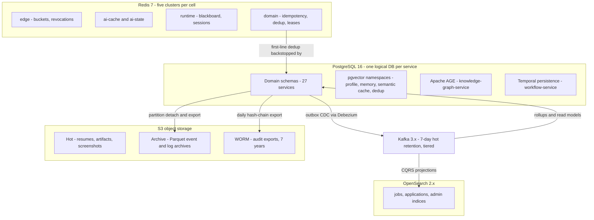
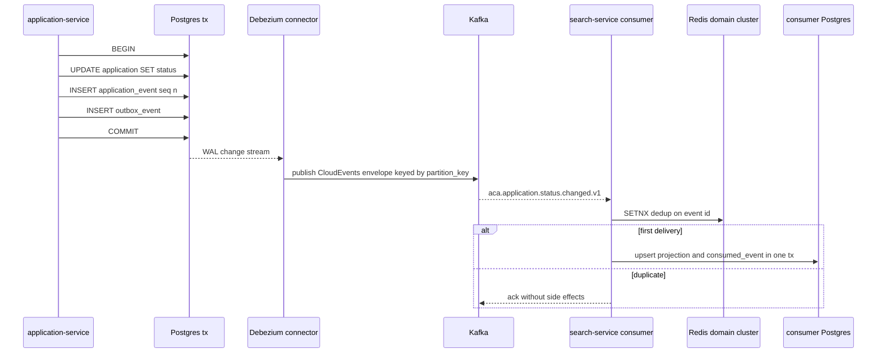
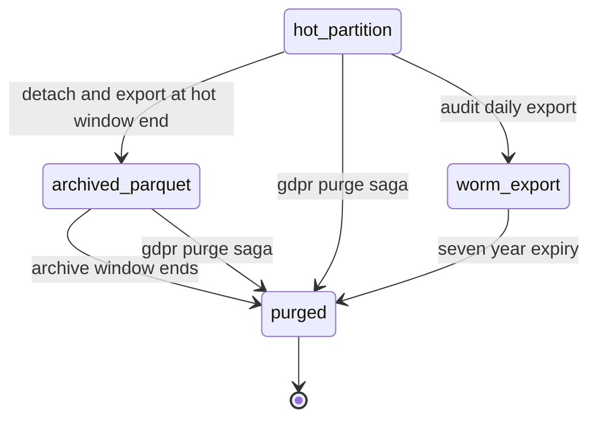
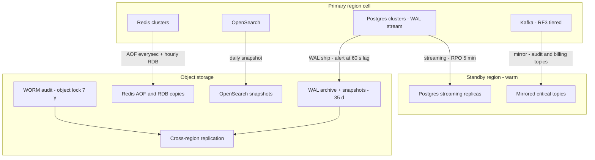

# 30 — Database Design

| | |
|---|---|
| Document ID | ACA-SAS-30 |
| Volume | 4 — Data Platform |
| Status | Draft v1.0 |
| Depends on | [00 — Architecture Canon](../00-architecture-canon.md) §6, §8, §11, §15; [04 — Non-Functional Requirements](../volume-1-foundation/04-non-functional-requirements.md) §2 (load model); [09 — Microservice Architecture](../volume-2-core-services/09-microservice-architecture.md) §6 (chassis DDL); [12 — User Service](../volume-2-core-services/12-user-service.md) (tenancy root); [31 — PostgreSQL Schema](31-postgresql-schema.md); [32 — Redis](32-redis.md) |

## 1. Overview

This chapter is the data-architecture spine of Volume 4: the authoritative map of **which of the 32 services owns which stores**, why the platform is polyglot in exactly the way it is, how consistency is achieved across service boundaries without shared databases, how tenant isolation is enforced at the data layer, and how every byte is classified, encrypted, retained, backed up, and governed. Sibling chapters own the depth: [Chapter 31](31-postgresql-schema.md) the concrete PostgreSQL DDL, [Chapter 32](32-redis.md) the Redis catalog; event contracts, search, vector, and graph stores get their own chapters as this volume completes.

Three canon rules generate almost everything below. First, **data is owned**: each service owns its schema; no service reads or writes another service's database ([canon §2, §11](../00-architecture-canon.md)); all integration is APIs and events. Second, **the database enforces tenancy**: Row-Level Security keyed on `app.tenant_id` is the isolation mechanism of record, with the service layer as a second, independent check ([canon §6](../00-architecture-canon.md)). Third, **consistency is explicit**: the outbox pattern makes state-change + event-publish atomic; Temporal sagas own multi-service transactions; CQRS projections own cross-service read models; event sourcing is used only where the timeline *is* the domain (application history, audit).

The stakes are concrete. At target scale ([Chapter 04 §2.1](../volume-1-foundation/04-non-functional-requirements.md)): 5 M registered users, 2 M jobs discovered/day, 150 k applications submitted/day, 21 M AI calls/day average (50 M design peak), 50 M Kafka events/day. The high-level architecture names Postgres write volume on `application_event` and `ai_request_log` as the third structural scale wall ([Chapter 05 §12](../volume-1-foundation/05-high-level-architecture.md)); this chapter's partitioning, lifecycle, and capacity decisions are the mitigation.

## 2. Data Architecture Overview

### 2.1 Store classes

The platform runs six store classes, each behind a named seam so vendors can change without architectural change:

| Store class | Technology (canon §3) | Role | Vendor seam |
|---|---|---|---|
| OLTP | PostgreSQL 16, one logical DB per service | System of record for all owned state | Postgres wire protocol; Aurora or CloudNativePG per deployment |
| Vector | pgvector (phase 1) | Embedding ANN for matching, memory, semantic cache | `embedding-store` interface; Qdrant phase 2 |
| Graph | Apache AGE on PostgreSQL (phase 1) | Entity/relationship reasoning in `knowledge-graph-service` | `graph-store` interface; Neo4j phase 2 |
| Cache/KV | Redis 7 Cluster (five clusters per cell, [Chapter 32](32-redis.md)) | Caches, counters, sessions, leases, pub/sub | Redis protocol |
| Search | OpenSearch 2.x | Jobs/applications/admin indices — rebuildable projections | `search-service` API; indices never system of record |
| Object | S3-compatible | Documents, artifacts, screenshots, archives, WORM audit | S3 API; MinIO for on-prem enterprise cells |

Kafka is the integration backbone, not a store class: hot retention 7 days (tiered storage), and nothing treats a topic as a database — durable state lives in an owner's OLTP schema, and replays beyond hot retention are deliberate operations ([Chapter 09 §6.3](../volume-2-core-services/09-microservice-architecture.md)). Temporal's persistence (workflow histories) is a Postgres cluster operated by `workflow-service` and treated as OLTP with its own sizing.

### 2.2 Design invariants

1. **One logical database per service**, even where several share a physical cluster in small cells — schema-level separation with distinct roles, so extraction to a dedicated cluster is an operation, not a migration.
2. **Rebuildable vs. authoritative** is declared per store: OpenSearch indices, Redis caches, analytics projections, and knowledge-cache projections are rebuildable from owners; everything rebuildable may be dropped in an incident without data loss, which simplifies the DR story to "restore OLTP + S3, replay the rest."
3. **References across services are soft**: opaque prefixed IDs (`job_…`, `app_…`), never foreign keys — [Chapter 31 §12](31-postgresql-schema.md) specifies the rule and its reconciliation machinery.
4. **Big payloads live in object storage** with references in OLTP/Kafka/Redis (gRPC 4 MiB cap, tool-result capping, blackboard 8 KiB cap all derive from this).

## 3. Database-per-Service Map

The authoritative ownership table for all 32 services (canon §4). "Redis" names the cluster and keyspace per [Chapter 32](32-redis.md); PII class is the *highest* class the store holds (canon §11).

| # | Service | PostgreSQL (logical DB) | Redis keyspace | Other stores | Max PII |
|---|---|---|---|---|---|
| 1 | `api-gateway` | — (stateless) | edge: rate buckets, revocation set, entitlement snapshot cache | — | P3 |
| 2 | `realtime-gateway` | — | runtime: connection registry; pub/sub subscriber | — | P3 |
| 3 | `identity-service` | identities, credentials, sessions, refresh tokens, login attempts | edge: revocation publisher | — | P1 |
| 4 | `policy-service` | policies, consents, approval rules | domain: bundle etag cache | S3: OPA bundles | P2 |
| 5 | `user-service` | tenant, user_account, membership, preference | domain: chassis idempotency/dedup | — | P1 |
| 6 | `profile-service` | profile, skills, constraints, imports + pgvector embeddings | domain: chassis | S3: import payloads | P1 |
| 7 | `resume-service` | resume, resume_version, parse_run, render_artifact, ats_score | domain: chassis | S3: source docs, rendered PDFs | P1 |
| 8 | `portfolio-service` | portfolio, project, analysis runs | domain: chassis | S3: site artifacts | P2 |
| 9 | `job-intelligence-service` | source, source_policy, crawl_run, job (weekly partitions), company, job_cluster | domain: simhash bands, crawl frontier | S3: raw docs (30 d); pgvector dedup ANN | P3 |
| 10 | `matching-service` | match_score (daily partitions), match_feature, calibration state | domain: hot candidate sets | — | P2 |
| 11 | `application-service` | application, application_event (monthly partitions), interview, offer | domain: chassis | S3: event archive | P2 |
| 12 | `workflow-service` | Temporal persistence (histories, queues, visibility) — dedicated cluster | — | S3: large payload offload | P2 (refs) |
| 13 | `agent-orchestrator` | agent_version, agent_run (daily partitions), checkpoint metadata | runtime: episode blackboard | S3: run state snapshots | P2 |
| 14 | `ai-gateway` | ai_request_log (daily partitions) | ai-cache: exact cache; ai-state: stream channels | S3: oversized payloads | P2 |
| 15 | `prompt-registry-service` | prompt, prompt_version, channel pointers, eval results | domain: bundle cache | S3: eval artifacts | P3 |
| 16 | `memory-service` | memory_item, memory_embedding (pgvector) | runtime: S tier, W cache, L snapshots | — | P2 |
| 17 | `knowledge-graph-service` | AGE graph on Postgres | domain: hot subgraph cache | — | P2 |
| 18 | `cost-controller` | budget, spend_rollup_hourly, kill_switch | ai-state: hot counters, budget snapshots | — | P3 |
| 19 | `learning-pipeline` | feature_row, label_row, eval runs, training-set registry | — | S3: Parquet datasets | P2 (sanitized) |
| 20 | `portal-intelligence-service` | portal, portal_fingerprint, portal_template, template_run_stat (partitioned) | domain: knowledge-cache projection | S3: fingerprint evidence | P3 |
| 21 | `browser-fleet-service` | fleet state, session ledger | runtime: session allocation | S3: screenshots, DOM snapshots (90 d) | P2 |
| 22 | `session-vault-service` | vault items (envelope-encrypted) | — (never Redis) | Cloud KMS: KEK hierarchy | **P0** |
| 23 | `proxy-manager` | proxy pool, reputation history | domain: per-site rate budgets, leases | — | P3 |
| 24 | `notification-service` | notifications, delivery receipts, preference projection | domain: send dedup, digest state | — | P1 |
| 25 | `scheduler-service` | schedules | domain: shard leases | — | P3 |
| 26 | `search-service` | projection checkpoints | domain: query cache (short TTL) | OpenSearch: jobs, applications, admin | P2 |
| 27 | `analytics-service` | OLAP star schemas + rollups (phase 1) | — | ClickHouse (phase 2 option); S3 exports | P2 |
| 28 | `billing-service` | subscription, entitlement, usage_record (monthly partitions), invoice | domain: entitlement snapshot publisher | Stripe via provider adapter | P1 (refs) |
| 29 | `admin-service` | support cases, admin audit shadow | domain: chassis | — | P2 |
| 30 | `recruiter-service` | recruiter orgs, postings, pipelines | domain: chassis | — | P2 |
| 31 | `audit-service` | audit_event (monthly partitions, hash-chained) | — | S3 WORM: exports, 7 y | P2 |
| 32 | `public-api-service` | api_key (hashes), webhook endpoints, delivery attempts | edge: key record push | — | P2 |

Notes. (a) `session-vault-service` is the **only** P0 store on the platform; its schema, KEK hierarchy, and access ceremony are normative in Volume 5. (b) Services 5–11 and 13–20 also carry the chassis tables (`outbox_event`, `consumed_event`) verbatim ([Chapter 09 §6.3](../volume-2-core-services/09-microservice-architecture.md)). (c) `workflow-service` runs Temporal persistence on its own Postgres cluster — its write profile (history appends) and tuning differ enough from domain OLTP that co-tenancy would couple failure domains.

## 4. Polyglot Persistence Rationale

**Purpose.** Justify each departure from "just Postgres," because every additional store class is an operational skill, a failure domain, and a backup surface.

The phase-1 posture is deliberately *Postgres-maximalist*: vector (pgvector), graph (AGE), analytics OLAP, and Temporal persistence all run on Postgres. This collapses five infrastructure classes into one operational competence at GA scale, at the cost of known ceilings — each with a named seam and a measured trigger:

| Departure | Why not Postgres | Why this store | Exit/scale trigger |
|---|---|---|---|
| Redis for caches/counters/leases | sub-ms latency, TTL semantics, atomic Lua counters at 10⁵ ops/s | in-memory KV is the right tool; all contents rebuildable or tolerably lossy ([Chapter 32 §9](32-redis.md)) | none — permanent |
| Kafka for integration | queues-in-tables couple producers to consumer availability and poison OLTP vacuum | replayable log, per-key ordering, consumer-group scaling | none — permanent |
| OpenSearch for search | Postgres FTS cannot serve 75 M-doc relevance + faceting + tenant filters at 3 M queries/day | inverted index, per-index scaling, rebuildable projection | none — permanent |
| S3 for blobs | multi-MB rows destroy Postgres cache locality and bloat WAL/backups | content-addressed objects, lifecycle rules, WORM, CRR | none — permanent |
| pgvector now, Qdrant later | — (it *is* Postgres) | shares RLS, backups, ops | ANN p99 > 150 ms or index > 50 M vectors/namespace ([Chapter 26 §12](../volume-3-ai-architecture/26-semantic-cache.md)) |
| AGE now, Neo4j later | — | graph co-located with RLS + backups | multi-hop p99 > 500 ms at production fan-out |
| Postgres OLAP now, ClickHouse later | — | one engine, CQRS projections suffice at GA | projection contention on analytics workloads ([Chapter 05 §12](../volume-1-foundation/05-high-level-architecture.md)) |

**Tradeoff accepted:** pgvector/AGE/OLAP-on-Postgres puts heterogeneous workloads on the OLTP engine. Mitigation: they run in *separate logical databases with separate resource envelopes* (dedicated instances where cell size warrants), so a runaway analytical query cannot starve a transactional service. The rejected alternative — best-of-breed everything at GA — was priced at roughly 3× the operational surface (five more on-call competencies) for capacity we will not need before the measured triggers fire.

## 5. Consistency Patterns

### 5.1 Outbox (state change + event, atomically)

Every state-changing service writes its domain rows and an `outbox_event` row in the **same transaction**; Debezium CDC relays the outbox to Kafka (canon §8). No dual-write anywhere: a service either committed (event will publish) or did not (nothing to publish). The chassis owns the table shape and the 7-day janitor ([Chapter 09 §6.3](../volume-2-core-services/09-microservice-architecture.md)).

Decisions that matter: partition key is `tenant_id` or entity ID (canon §8 ordering); Debezium runs per-service-DB connectors with `outbox_event` table filters; connector lag is a first-class SLI (budget: p99 relay ≤ 5 s — projections and notifications inherit this floor). Consumer idempotency is two-line: Redis `SETNX` (fast path) backstopped by the `consumed_event` table in the consumer's own transaction (crash-window correctness) — Redis alone is not a correctness mechanism ([Chapter 32 §5.6](32-redis.md)).

### 5.2 CQRS projections

Cross-service reads never join across databases; they consume events into local read models. The projection catalog (owner, source, staleness budget — every projection declares one, and dashboards show it):

| Projection | Owner | Sources | Staleness budget | Rationale |
|---|---|---|---|---|
| Jobs / applications / admin indices | `search-service` | `aca.job.*`, `aca.application.*` | 60 s | search freshness is UX, not correctness |
| Analytics star schemas | `analytics-service` | most domains | 15 min | funnels/benchmarks tolerate lag |
| Entitlement snapshots | `billing-service` → edge Redis | billing state | 60 s | plan gating at the gateway ([Chapter 10 §4](../volume-2-core-services/10-api-gateway.md)) |
| Budget snapshots | `cost-controller` → ai-state Redis | `aca.ai.request.completed.v1` | 60 s heartbeat | enforcement source for `ai-gateway` ([Chapter 25 §4](../volume-3-ai-architecture/25-cost-optimization-engine.md)) |
| Notification preference projection | `notification-service` | `aca.user.preferences.updated.v1` | 60 s | no read-call on the send hot path |
| Knowledge-cache projections | domain owners → domain Redis | owner refresh events | owner policy | ladder exit before model calls ([Chapter 26 §5](../volume-3-ai-architecture/26-semantic-cache.md)) |
| AI request-log projection | `ai-gateway` | `aca.ai.request.completed.v1` | 5 min | ledger queries off the hot path |

**Read-your-writes:** projections do not promise it. Where UX requires it (a user submits and immediately sees the application), the owning service serves its own state; the UI reads the owner for the entity page and projections for lists, with the entity page authoritative. This rule is part of the API design review checklist.

### 5.3 Sagas

Multi-service transactions are **orchestrated Temporal sagas**, never choreography (canon §8): the application-submission saga ([Chapter 20 §7](../volume-2-core-services/20-workflow-engine.md)) reserves plan quota (`billing-service`), produces artifacts (`resume-service`), obtains approval (HITL), executes the browser flow, records outcome (`application-service`), with compensation steps (quota release, artifact invalidation, status rollback) defined next to each forward step. Choreographed sagas were rejected: with 32 services and consequential external actions (a submission cannot be un-submitted), implicit event-chain recovery is unauditable; Temporal gives one place where the transaction's state, history, and compensation are inspectable.

### 5.4 Event sourcing — exactly two places

`application_event` (the timeline **is** the product: status provenance, HITL evidence, learning signals) and `audit_event` (append-only is the requirement). Everything else is state-stored + events (canon §8). The application projection row is maintained transactionally with each append — single-writer per aggregate through `application-service`, no async projector lag on the owner's own data ([Chapter 31 §7](31-postgresql-schema.md)). Generalized event sourcing was rejected: replay-defined state across 32 services multiplies schema-evolution cost for no product value outside these two domains.

## 6. Tenant Isolation: RLS + Cells

### 6.1 In-database enforcement

Per canon §6, every tenant-scoped row carries `tenant_id`; the chassis opens each request transaction with `SET LOCAL app.tenant_id` (and `app.user_id`) from validated JWT claims; RLS policies compare against `current_setting('app.tenant_id')`. Enforcement properties:

- `FORCE ROW LEVEL SECURITY` on every tenant-scoped table — policies bind even to the table owner.
- Runtime service roles have **no** `BYPASSRLS`; only the migration role does, and it is unavailable to running services ([Chapter 31 §13](31-postgresql-schema.md)).
- The service layer repeats the tenant check (defense in depth); a mismatch is a paged security event, not a 403.
- Documented exceptions are enumerated, not implied: the public job corpus (`visibility_scope='public'`, [Chapter 15 §7.2](../volume-2-core-services/15-job-intelligence-service.md)), platform-scoped registries (`agent_version`, prompts, portal templates — no tenant data), and the user-scoped `user_account` policy ([Chapter 12 §7](../volume-2-core-services/12-user-service.md)).

### 6.2 Cells

A cell is a complete data-plane stack — services, Postgres, Redis, Kafka consumers — serving a tenant shard, under a shared control plane (canon §15). Data-layer consequences:

| Concern | Pooled cell (default) | Dedicated cell (enterprise option) |
|---|---|---|
| Isolation mechanism | RLS + service guard within shared stores | physically separate stores; RLS still on (uniform code path, insider-error defense) |
| Residency | region-pinned cell (EU cell for EU-resident tenants) | contractually pinned region/provider; MinIO for on-prem |
| Noisy neighbor | per-tenant quotas + partitioning | eliminated by construction |
| Backup/restore scope | cluster-level, tenant-level restore via logical export | whole-cell restore, simplest possible story |
| Cross-cell data | prohibited in the data plane; only control-plane services (identity, billing, admin) and sanitized `learning-pipeline` aggregates span cells | same |

Tenant-to-cell assignment lives in `user-service` (`tenant.cell_id`); moving a tenant between cells is a runbooked saga (logical export, dual-write window, cutover) owned by Volume 6. Hash partitioning by `tenant_id` inside very large pooled cells (canon §11) is the intermediate step before granting a dedicated cell.

## 7. Data Classification → Storage & Encryption

Canon §11 defines P0–P3. This section maps classes to allowed stores and required cryptography — the normative table services are reviewed against (Volume 5 owns key ceremonies):

| Class | Definition | Allowed stores | Encryption | Explicitly prohibited |
|---|---|---|---|---|
| **P0** | portal credentials, session cookies | `session-vault-service` Postgres **only** | envelope: per-user DEK (AES-256-GCM) wrapped by per-tenant KEK in cloud KMS; decrypt only in the vault sidecar at browser egress ([canon §13](../00-architecture-canon.md)) | Redis, Kafka, logs, prompts, blackboard, backups outside vault scope, any other service |
| **P1** | identity PII: emails, names, phone, billing contact | owning service Postgres; refs elsewhere | field-level AES-256-GCM (`*_enc` columns) + HMAC lookup hashes; storage encryption beneath | plaintext in events (events carry opaque refs; consumers dereference via owner API), OpenSearch, analytics |
| **P2** | career data: profiles, resumes, applications, interviews, memories, screenshots | owning service Postgres, S3, OpenSearch (tenant-filtered), Redis (TTL-bounded, refs preferred) | encryption at rest (storage/TDE + encrypted EBS/S3-SSE-KMS); TLS in transit everywhere | cross-tenant aggregation outside `learning-pipeline` sanitization |
| **P3** | public/derived: job corpus, templates, fingerprints, spend aggregates | any store | storage encryption (uniform default) | — |

Key hierarchy: cloud KMS root → per-service data keys (storage encryption) and per-tenant KEKs (P0/P1 field crypto); Vault distributes; rotation quarterly for KEKs, annual for storage keys, with re-wrap (not re-encrypt) on KEK rotation. Field-level P1 crypto deliberately breaks database-side search on those columns — the HMAC hash column pattern (`email_hash`) is the sanctioned lookup path, and analytics never sees P1 at all.

## 8. Lifecycle & Archival per Data Class

### 8.1 Retention schedule

Canon §11 rows plus chapter-level extensions (marked ▸ — recorded in §17 for canon promotion):

| Data | Hot (Postgres/Redis/S3-hot) | Archive | Delete | Rationale |
|---|---|---|---|---|
| Raw crawl artifacts | 30 d (S3) | — | 30 d | canon; reparse window |
| Screenshots / DOM snapshots | 90 d or per-tenant policy (S3) | — | 90 d | canon; dispute/debug window |
| AI request logs | 90 d (PG partitions) | 13 mo (S3 Parquet) | 13 mo | canon; cost forensics + learning |
| Job corpus | 13 mo (PG, weekly partitions) | — | partition drop | [Chapter 15 §9](../volume-2-core-services/15-job-intelligence-service.md); aligned with AI-log archive |
| ▸ Match scores | 90 d (PG, daily partitions) | 13 mo (S3 Parquet) | 13 mo | 20 M rows/day; learning needs negatives, product needs 90 d |
| ▸ Application events | 13 mo hot (PG, monthly partitions) | account life (S3 Parquet, rehydratable) | with account deletion | timeline is product data; old partitions rarely read |
| ▸ Agent runs / steps | 90 d (PG, daily partitions) | 13 mo (S3) | 13 mo | supervision + replay window, then learning only |
| Audit events | 13 mo (PG) | 7 y (S3 WORM, object lock) | 7 y | canon; compliance |
| Memories | account life with decay/quarantine | — | GDPR purge ([Chapter 24 §7](../volume-3-ai-architecture/24-memory-system.md)) | owner-defined |
| User data (GDPR erasure) | — | — | hard delete + tombstone events ≤ 30 d | canon; deletion saga in [Chapter 12 §9](../volume-2-core-services/12-user-service.md) |

### 8.2 Mechanics

Time-partitioned tables age out by **partition detach → Parquet export to S3 → drop** — deletion by DDL, never by `DELETE` (no bloat, no vacuum debt, constant-time). The chassis janitor executes per-service retention as scheduled Temporal activities with per-table lag alerts. GDPR erasure overrides retention everywhere except the audit chain and invoices (legal-basis retention; those stores hold refs and hashes, not P1 payloads, precisely so erasure elsewhere is complete).

GDPR purge of archived Parquet uses per-user row filtering on rewrite (archives are partitioned by month and bucketed by `tenant_id`, bounding rewrite scope); tombstone events (`aca.user.deleted.v1`) drive every consumer's local purge, with completion proof events (e.g., `aca.memory.purged.v1`) collected by the deletion saga.

## 9. Capacity Model

At target scale (5 M users, 2 M jobs/day; L-numbers from [Chapter 04 §2.1](../volume-1-foundation/04-non-functional-requirements.md)). Sizes are provisioning envelopes (data + indexes + headroom), not raw data.

| Store | Driver | Daily growth | Steady-state (hot) | Notes |
|---|---|---|---|---|
| `job-intelligence` PG | L6: 2 M jobs/day, ~45% new canonical rows | 5.4 GB/day | ~4 TB | weekly partitions, 13 mo ([Chapter 15 §12](../volume-2-core-services/15-job-intelligence-service.md)) |
| `ai-gateway` PG (`ai_request_log`) | L13: 21 M calls/day avg × ~2 KB | 42 GB/day | ~5 TB (90 d) | **largest hot store**; daily partitions; 50 M/day peak → 100 GB/day burst |
| `application-service` PG | ~20 timeline events × L10 drafts ≈ 3.6 M events/day × 1.5 KB | 5.5 GB/day | ~2.5 TB (13 mo) | monthly partitions + projection tables |
| `matching-service` PG | L8: 20 M scores/day × ~300 B | 6 GB/day | ~600 GB (90 d) | daily partitions; explanations in S3 |
| `agent-orchestrator` PG | ~2.5 M runs/day × ~2 KB | 5 GB/day | ~500 GB (90 d) | steps/state in S3 refs |
| `audit-service` PG | ~10 M events/day × 1 KB | 10 GB/day | ~4 TB (13 mo) | plus 7-y WORM ≈ 26 TB cumulative |
| `memory-service` PG | consolidation net growth | ~2 GB/day | ~1 TB | decay keeps it sublinear ([Chapter 24 §8](../volume-3-ai-architecture/24-memory-system.md)) |
| `billing-service` PG | usage records ~5 M/day × 250 B | 1.3 GB/day | ~500 GB | monthly partitions, 7-y invoice retention |
| Other 20 service DBs | user/profile/resume/portal/etc. | < 2 GB/day combined | ~2 TB combined | per-service; none individually > 500 GB |
| Temporal PG | L10–L12 workflows + agent loops | ~8 GB/day churn | ~1.5 TB | history TTL + archival to S3 ([Chapter 20 §10](../volume-2-core-services/20-workflow-engine.md)) |
| OpenSearch | L7: 75 M job docs × ~4 KB + applications | — | ~700 GB incl. replica | rebuildable |
| Redis (all clusters/cell) | [Chapter 32 §7](32-redis.md) | — | ~210 GB provisioned | mostly `ai-cache` |
| S3 hot | screenshots ~100 GB/day dominant | ~130 GB/day | ~12 TB rolling | 90-d lifecycle rules |
| S3 archive + WORM | Parquet exports | ~25 GB/day | ~35 TB cumulative at year 2 | Glacier-class after 90 d |

Aggregate OLTP write pressure: ≈ 80 GB/day across ~30 clusters — no single Postgres cluster exceeds ~1 k sustained writes/s except `ai-gateway` (≈ 250–600 inserts/s, batched) and `application-service` (≈ 40/s) — comfortably single-writer-node territory with read replicas; the scale walls are storage lifecycle (solved by partition-drop) and vacuum on hot projection tables (solved by HOT-friendly updates and fillfactor tuning, [Chapter 31 §16](31-postgresql-schema.md)).

## 10. Backup & Restore Architecture

### 10.1 Per-store policy

Canon §11/§15 targets: Postgres RPO ≤ 5 min (PITR), platform RTO ≤ 30 min, snapshots 35-day retention, quarterly restore drills.

| Store | Method | RPO | Restore path | Drill cadence |
|---|---|---|---|---|
| Postgres (every service) | continuous WAL archiving to S3 + daily snapshots (35 d) + streaming replica in standby region | ≤ 5 min (WAL ship lag alerted at 60 s) | PITR to new cluster, or promote standby | quarterly, per-tier rotation |
| Temporal PG | same + Temporal archival to S3 | ≤ 5 min | PITR; workflows resume from history | quarterly |
| Redis | none for edge/ai-cache (rebuildable); runtime/domain/ai-state: AOF everysec + hourly RDB to S3 | ≤ 1 s (AOF) where enabled | restart from AOF; caches warm organically | semi-annual |
| Kafka | replication factor 3, rack-aware; tiered storage 7 d; audit topics mirrored to standby region | ≤ 5 min (mirror lag) | consumer replay from tiered storage | with region game-day |
| OpenSearch | daily snapshot to S3 (restore-speed optimization only) | 24 h acceptable | snapshot restore + event replay from checkpoint | semi-annual |
| S3 | versioning + cross-region replication; WORM via object lock (compliance mode, 7 y) | ~minutes (CRR lag) | native | with region game-day |

### 10.2 Topology and restore order

Restore order under whole-cell loss is dependency-ranked and runbooked (Volume 6 owns the runbook; this chapter owns the ranking): **Tier A** `identity-service`, `user-service`, `policy-service`, `billing-service`, `session-vault-service` (platform is unusable and unsafe without them) → **Tier B** `application-service`, `workflow-service`, `agent-orchestrator` (in-flight work) → **Tier C** remaining domain stores → **Tier D** rebuildables (OpenSearch, Redis caches, projections) restored by replay, not backup. Restore verification is automated: every PITR drill restores into an isolated VPC, runs schema + row-count + RLS-probe assertions, and posts evidence to `audit-service`.

Tenant-scoped restore (single tenant fat-fingered by an admin tool) does not use PITR — it uses logical export from the PITR clone filtered by `tenant_id`, merged via service APIs to respect invariants; direct row re-insertion is prohibited (it would bypass RLS-era checks, outbox, and audit).

## 11. Data Access Governance

**Purpose.** Bound who and what can read data, by construction rather than policy document.

- **Service path (the only hot path):** services access only their own logical DB via Vault-issued short-lived credentials; roles per [Chapter 31 §13](31-postgresql-schema.md) (runtime role: DML only, RLS-bound; migration role: DDL, CI-only).
- **No BI on OLTP.** Analysts and internal dashboards read `analytics-service` projections (P1-free by construction, §7) — never service databases. Ad-hoc engineering queries run against PITR clones or read replicas with a P1-masked role, requested through `admin-service` JIT elevation (audited, ≤ 4 h TTL).
- **Break-glass:** production write access exists only as a runbooked ceremony — JIT role via `admin-service` + `policy-service` approval, session-recorded, auto-revoked, mirrored to `audit-service`. Standing superuser credentials do not exist outside sealed break-glass storage.
- **Data catalog:** every table/index/topic/bucket carries ownership annotations (service, PII class, retention row, lawful basis where P1) generated from schema metadata in CI; a schema merge without complete annotations fails review. The catalog is the source for GDPR Article 30 records and for the DPIA trigger (new P1 collection ⇒ privacy review before merge).
- **Cross-service data requests** (service A wants service B's data) are API/event contract changes reviewed against purpose limitation — never a replication grant. `learning-pipeline` is the single sanctioned cross-tenant aggregation point, consuming sanitized events only ([Chapter 29](../volume-3-ai-architecture/29-learning-pipeline.md)).

## 12. Failure Scenarios

| Scenario | Detection | Behavior | Blast radius / recovery |
|---|---|---|---|
| Debezium connector down | outbox relay lag SLI | events delayed, never lost (outbox rows persist); projections/notifications stale | restart connector, resume from WAL LSN; consumers idempotent so overlap is safe |
| Projection corruption (bug) | reconciliation probes (row-count/checksum vs. owner) | rebuild from replay: reset checkpoint, replay tiered-storage window or owner export beyond 7 d | rebuild time bounded by topic throughput; UX degrades to owner-served reads |
| Postgres primary loss (one service) | health checks, replication monitors | automated failover to sync replica (≤ 30 s); RLS/roles identical on replica | single service degraded ≤ 30 s; outbox resumes from WAL |
| Regional loss | game-day-tested runbook | promote standby region per canon §15 (RTO ≤ 30 min); Tier A→D order (§10.2) | EU cell unaffected by US region loss and vice versa |
| Partition-management job stalls | partition-creation lookahead alert (< 14 d of future partitions) | inserts continue into existing partitions; alert before any risk window | janitor re-run; no data loss |
| Archive export fails | export lag per table | hot retention overruns (storage growth), no correctness impact | re-run export; partitions dropped only after verified export (checksum manifest) |
| RLS misconfiguration on new table | CI RLS-probe (attempts cross-tenant read in test) + runtime canary probe | merge blocked / paged security event | the two-layer check (DB + service) means a single-layer failure is contained |
| Backup silently broken | drill failure; daily restore-verify of one sampled cluster | discovered in drill, not incident | the daily sampled verify bounds discovery latency to 24 h for the sampled set |

## 13. Scaling Strategy

Vertical first for OLTP writers (no service is near single-node write ceilings at target scale, §9), read replicas for read scale, partitioning for lifecycle. The ordered levers when a store outgrows its envelope: (1) tune (indexes, HOT updates, fillfactor); (2) read replicas + projection offload; (3) time/hash partitioning; (4) cell split — move tenants to a new cell (the platform-blessed horizontal path, preserving RLS semantics); (5) engine exit through the named seam (§4). Sharding a single logical DB across clusters is deliberately **not** on the list: cells make it unnecessary, and cross-shard transactions would break the RLS + single-writer-per-aggregate model. The ClickHouse and Qdrant triggers are metrics, not dates — they are reviewed quarterly against production measurements.

## 14. Security Considerations

- The §7 classification table is enforceable in review: storage location is derivable from class, so a P1 column in an event payload or a P0 value outside the vault is a diff-visible violation.
- RLS is layered with mesh mTLS + OPA (canon §13): reaching a database at all requires workload identity; the DB then enforces tenancy independently — two uncorrelated failures required for cross-tenant exposure.
- Backups inherit classification: WAL archives and snapshots are encrypted with the owning service's storage keys; vault backups additionally remain envelope-encrypted (KMS compromise plus backup theft still yields ciphertext without per-tenant KEKs).
- Restore is an attack surface: PITR clones contain P1; clone environments are network-isolated, time-boxed, audited, and P1-masked for human access (§11).
- Deletion is provable: the GDPR saga collects per-service completion events; `audit-service` retains the proof chain (which contains refs/hashes, not the erased data).

## 15. Observability

| Signal | Source | Alert |
|---|---|---|
| Outbox relay lag (per service) | Debezium metrics + outbox row age | p99 > 5 s warn; > 60 s page |
| Projection staleness (per projection) | consumer lag × declared budget (§5.2) | budget exceeded → owner paged |
| Replication / WAL-ship lag | Postgres exporters | > 60 s page (RPO risk) |
| Partition lookahead / archive lag | janitor job metrics | < 14 d lookahead warn; export lag > 7 d warn |
| RLS probe failures | CI + runtime canary | any → security page |
| Storage growth vs. capacity model | per-store growth rate vs. §9 envelope | > 130% of modeled rate → capacity review |
| Backup verify results | drill automation | any failed verify → page |
| Vacuum health on hot tables | dead-tuple ratio, autovacuum runtime | table-specific thresholds ([Chapter 31 §19](31-postgresql-schema.md)) |

Dashboards: one per store class (OLTP fleet, Redis, Kafka, OpenSearch, S3 lifecycle) plus a **data-lifecycle dashboard** showing every §8.1 row's actual vs. declared retention — retention drift is a compliance bug and is treated as one.

## 16. Future Improvements

1. **ClickHouse offload** for `analytics-service` and possibly the AI request ledger when Postgres OLAP projections show contention (canon-flagged phase 2).
2. **Qdrant migration** for the highest-volume pgvector namespaces behind the `embedding-store` seam, per-namespace, dual-read during cutover (canon §10.5).
3. **Iceberg table format** over the S3 Parquet archives once `learning-pipeline` query patterns justify a lakehouse catalog (today: partition-pruned Parquet reads suffice).
4. **Automated tenant-level restore tooling** (self-service for support, saga-driven) — currently runbooked.
5. **Active-active edge (phase 2)** will require re-examining projection topologies for cross-region consumers; OLTP remains single-writer per cell.

## 17. Alternatives Considered & Tradeoffs

| Decision | Alternative | Why this way / cost accepted |
|---|---|---|
| Database-per-service (logical) with shared clusters allowed in small cells | one DB per service on dedicated clusters everywhere | 32 dedicated clusters at GA is cost/ops waste; logical separation + per-role isolation preserves the extraction path. Cost: noisy-neighbor risk inside shared clusters, bounded by resource envelopes |
| Outbox + Debezium CDC | transactional publish to Kafka (2PC), or listen-to-yourself | 2PC across PG+Kafka does not exist in useful form; outbox is crash-correct and replayable. Cost: CDC infra to operate + relay-lag SLI |
| Orchestrated sagas (Temporal) | choreography | auditable compensation for consequential external actions; canon §8 mandate. Cost: workflow-service is a critical dependency (mitigated in [Chapter 20](../volume-2-core-services/20-workflow-engine.md)) |
| Event sourcing only for application timeline + audit | ES everywhere | replay-defined state across 32 services multiplies evolution cost; product value exists in exactly two domains |
| RLS as primary tenancy enforcement | app-layer-only scoping | app-only fails open on a single bug; RLS fails closed. Cost: `SET LOCAL` discipline, RLS-aware connection pooling, ~2–5% query overhead |
| Postgres-maximalist phase 1 (pgvector, AGE, OLAP) | best-of-breed (Qdrant, Neo4j, ClickHouse) at GA | one operational competence vs. three more failure domains before scale demands them; measured exit triggers named in §4 |
| Retention extensions for match/application/agent data (§8.1 ▸) | canon silence → keep forever | unbounded high-volume tables are the known scale wall; flagged for canon promotion |
| Partition-drop lifecycle | DELETE-based purging | constant-time, no vacuum debt. Cost: unique constraints must include partition keys ([Chapter 31 §11](31-postgresql-schema.md)) |
| No BI access to OLTP | read-only BI replicas per service | replicas leak P1 and couple analyst load to prod; projections are P1-free by construction. Cost: analytics limited to modeled data — deliberate |
