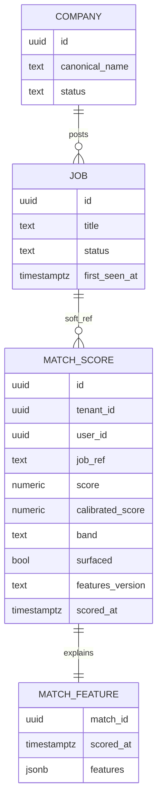
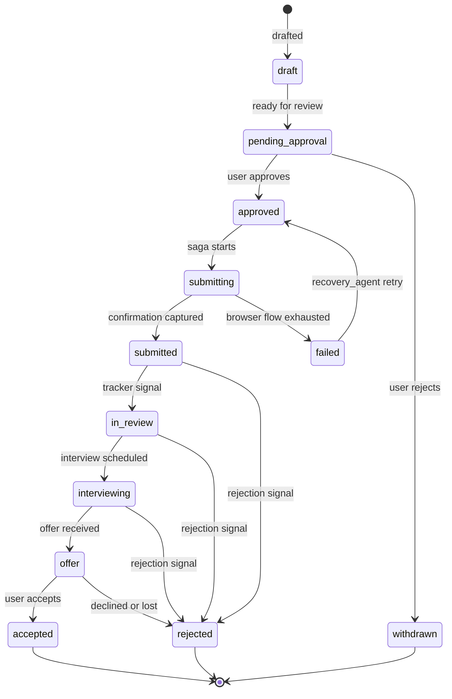
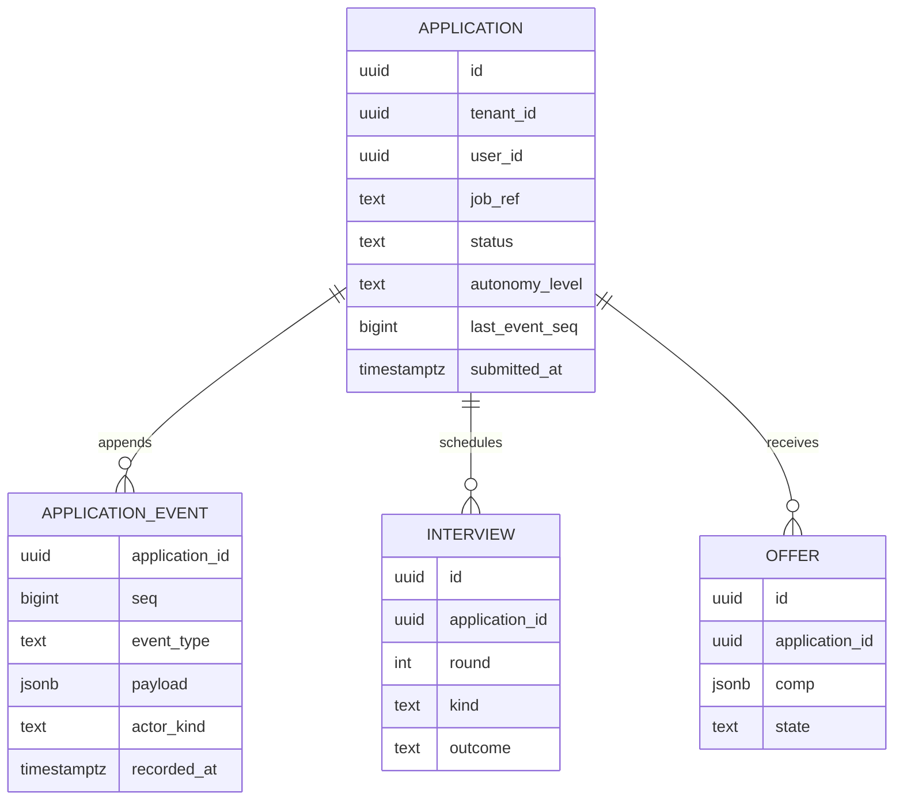
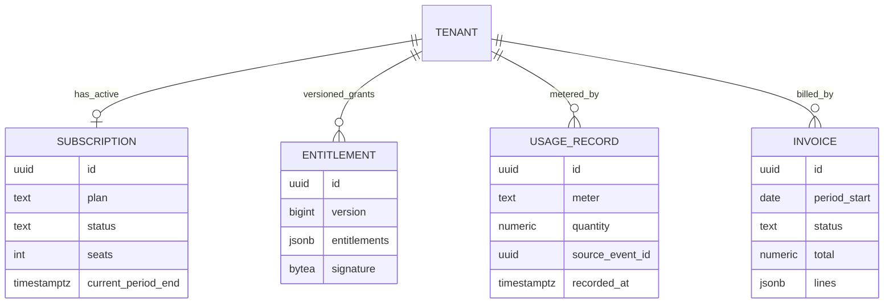
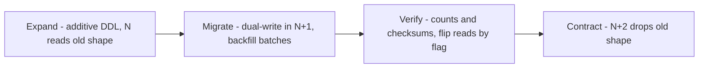

# 31 — PostgreSQL Schema

| | |
|---|---|
| Document ID | ACA-SAS-31 |
| Volume | 4 — Data Platform |
| Status | Draft v1.0 |
| Depends on | [00 — Architecture Canon](../00-architecture-canon.md) §6, §11; [30 — Database Design](30-database-design.md); owning-service chapters: [12](../volume-2-core-services/12-user-service.md), [13](../volume-2-core-services/13-profile-service.md), [14](../volume-2-core-services/14-resume-service.md), [15](../volume-2-core-services/15-job-intelligence-service.md), [19](../volume-2-core-services/19-agent-orchestrator.md), [25](../volume-3-ai-architecture/25-cost-optimization-engine.md) |

## 1. Overview

This chapter is the PostgreSQL engineering standard for the platform: schema conventions every service follows, concrete DDL for the core domains, the indexing and partitioning doctrine with rationale for every index class, RLS policy patterns and their enumerated exceptions, the cross-service reference rule (soft refs, never foreign keys), the zero-downtime migration procedure with a worked expand-migrate-contract example, and the query performance budgets with the anti-pattern list that code review enforces.

Ownership discipline: where a service chapter already published its DDL (user/tenant in [Chapter 12](../volume-2-core-services/12-user-service.md), profile in [13](../volume-2-core-services/13-profile-service.md), resume in [14](../volume-2-core-services/14-resume-service.md), job in [15](../volume-2-core-services/15-job-intelligence-service.md), agent registry/runs in [19](../volume-2-core-services/19-agent-orchestrator.md), budgets in [25](../volume-3-ai-architecture/25-cost-optimization-engine.md), memory in [24](../volume-3-ai-architecture/24-memory-system.md), prompts in [23](../volume-3-ai-architecture/23-prompt-registry.md), portal in [16](../volume-2-core-services/16-universal-portal-engine.md)), that chapter remains authoritative and this one summarizes the load-bearing decisions. Domains without a published service chapter yet — **company, match, application timeline, billing, audit** — get their full first-cut DDL here and will be inherited by those chapters when written.

Everything below assumes PostgreSQL 16, one logical database per service, chassis tables (`outbox_event`, `consumed_event`) present in every schema ([Chapter 09 §6.3](../volume-2-core-services/09-microservice-architecture.md)), and the RLS session contract `SET LOCAL app.tenant_id / app.user_id` opened by the chassis on every request transaction.

## 2. Schema Conventions

| Convention | Rule | Rationale |
|---|---|---|
| Primary keys | `uuid` (UUIDv7), generated app-side | time-ordered → B-tree append locality; ID exists before commit for outbox/event envelopes (canon §6) |
| External IDs | `external_id text` with opaque prefix (`usr_`, `app_`, `job_`…) | internal UUIDs never leak; prefix carries type for debuggability |
| Tenancy | `tenant_id uuid NOT NULL` on every tenant-scoped table, RLS-enforced (§13) | canon §6 |
| Timestamps | `timestamptz` only; `created_at NOT NULL DEFAULT now()`; `updated_at` app-maintained | UTC-normalized; no `timestamp` without zone, ever |
| Enumerations | `text` + `CHECK` constraints, not `ENUM` types | adding an enum value is a table lock-free check-constraint swap, not a type migration |
| Money | `numeric` + ISO currency `text` column | float money is a defect class; cost columns `numeric(12,6)` USD micro-precision |
| JSONB | allowed for genuinely schemaless payloads (preferences, features, event payloads); **prohibited** as a dodge for columns queried by hot predicates | schema-on-write where the query plan depends on it (§16) |
| Soft deletes | not default; only where the domain requires recoverability (`status` lifecycle instead) | dead rows poison indexes; the archive tier is the recovery mechanism |
| Naming | snake_case; singular table names; `<referenced>_ref` for cross-service soft references, `<referenced>_id` only for same-schema FKs | makes the FK-prohibition auditable by grep |
| Constraint posture | `NOT NULL` + `CHECK` aggressively; FKs within a schema where cardinality is sane | the DB is the last line of defense; cheap constraints beat data-repair jobs |

## 3. Identity & Tenancy Domain (`user-service`, `identity-service`)

Authoritative DDL in [Chapter 12 §4](../volume-2-core-services/12-user-service.md) (`tenant`, `user_account`, `membership`, preferences) and [Chapter 11 §9](../volume-2-core-services/11-identity-service.md) (`session`, `refresh_token`, `login_attempt`). Load-bearing decisions restated for the standard they set platform-wide:

- `tenant` is the RLS root: `plan`, `region`, `cell_id`, `class` gate everything downstream.
- P1 columns are stored as `*_enc bytea` (AES-256-GCM) + `*_hash text` (HMAC) pairs — lookup by hash, decrypt in-service only. Any schema adding P1 columns copies this pattern verbatim.
- `user_account` is the platform's single user-scoped (not tenant-scoped) RLS exception, documented in Chapter 12 §7 — not to be replicated without architecture review.

## 4. Profile & Resume Domains (`profile-service`, `resume-service`)

Authoritative DDL in [Chapter 13 §6](../volume-2-core-services/13-profile-service.md) and [Chapter 14 §4](../volume-2-core-services/14-resume-service.md). Standard-setting decisions:

- `resume_version` is immutable lineage (`parent_version_id`, `UNIQUE (resume_id, version_no)`, `UNIQUE (resume_id, content_sha256)` for idempotent creation) and is range-partitioned monthly — tailored-version volume is unbounded (one per application draft, L10 = 180 k/day at target).
- Cross-service links from resume versions are soft refs (`application_ref`, `job_ref` as `text`), the pattern §12 mandates.
- Embeddings live in pgvector namespaces keyed by `embed_version` (canon §10.5); the relational row stores `embedding_ref`, never the vector inline in domain tables — vector index lifecycle (rebuilds, re-embedding) stays decoupled from OLTP vacuum behavior.

## 5. Job & Company Domain (`job-intelligence-service`)

The `job` table (weekly range partitions on `first_seen_at`, public-corpus RLS exception, dedup fields) is authoritative in [Chapter 15 §7.2](../volume-2-core-services/15-job-intelligence-service.md). The company side, first cut:

```sql
CREATE TABLE company (
    id                 uuid PRIMARY KEY,              -- UUIDv7; external ref cmp_...
    canonical_name     text NOT NULL,
    normalized_name    text NOT NULL,                 -- lowercased, legal-suffix-stripped
    domains            text[] NOT NULL DEFAULT '{}',  -- website domains for resolution
    ats_families       text[] NOT NULL DEFAULT '{}',  -- observed portal families (canon §16)
    hq_location        jsonb,
    size_band          text,                          -- 1-10 | 11-50 | ... | 10000+
    industry_tags      text[] NOT NULL DEFAULT '{}',
    intel              jsonb NOT NULL DEFAULT '{}',   -- enrichment doc: funding, stack, signals
    intel_confidence   numeric,
    intel_refreshed_at timestamptz,
    embedding_ref      text,                          -- embed_v1 company-space vector
    status             text NOT NULL DEFAULT 'active'
                       CHECK (status IN ('active','merged','defunct')),
    merged_into_id     uuid REFERENCES company(id),   -- entity-resolution merges
    created_at         timestamptz NOT NULL DEFAULT now(),
    updated_at         timestamptz NOT NULL DEFAULT now()
);
-- Resolution path: exact domain match, else normalized-name trigram candidates + verifier.
CREATE UNIQUE INDEX company_norm_uq ON company (normalized_name)
    WHERE status = 'active';                          -- partial: merged rows keep their name
CREATE INDEX company_domains_gin ON company USING gin (domains);
CREATE INDEX company_name_trgm ON company USING gin (normalized_name gin_trgm_ops);
```

Company rows are platform-shared P3 (no `tenant_id`; RLS not applicable — same documented exception class as the public job corpus). `merged_into_id` implements entity-resolution merges without breaking soft refs: readers of a merged company follow the pointer; a nightly janitor rewrites high-traffic refs.

## 6. Match Domain (`matching-service`)

**Purpose.** Persist every scored user↔job pair (L8: 20 M/day) with enough feature provenance for explanation and learning, without letting the table grow unboundedly.

```sql
CREATE TABLE match_score (
    id               uuid NOT NULL,                  -- UUIDv7
    tenant_id        uuid NOT NULL,
    user_id          uuid NOT NULL,
    job_ref          text NOT NULL,                  -- soft ref: job_...
    company_ref      text,                           -- soft ref: cmp_... (denorm for explain UX)
    score            numeric(5,4) NOT NULL,          -- raw model score 0..1
    calibrated_score numeric(5,4),                   -- per-user calibration applied
    band             text NOT NULL CHECK (band IN ('strong','good','borderline','poor')),
    surfaced         bool NOT NULL DEFAULT false,    -- cleared user threshold (L9)
    ladder_exit      text NOT NULL,                  -- knn | small_model | medium_model (canon §9)
    explanation_ref  text,                           -- object storage; LLM rationale is large
    features_version text NOT NULL,                  -- feature-set semver for replay
    embed_version    text NOT NULL,                  -- canon §10.5
    scored_at        timestamptz NOT NULL DEFAULT now(),
    PRIMARY KEY (id, scored_at)
) PARTITION BY RANGE (scored_at);                    -- daily partitions; 90 d hot (Ch 30 §8.1)

-- Idempotent rescoring: one row per pair per feature epoch per day.
CREATE UNIQUE INDEX match_pair_uq
    ON match_score (user_id, job_ref, features_version, scored_at);
-- Feed query: surfaced matches for a user, newest first — partial + covering.
CREATE INDEX match_surfaced_ix
    ON match_score (tenant_id, user_id, scored_at DESC)
    INCLUDE (job_ref, band, calibrated_score)
    WHERE surfaced;
ALTER TABLE match_score ENABLE ROW LEVEL SECURITY;
ALTER TABLE match_score FORCE ROW LEVEL SECURITY;

CREATE TABLE match_feature (
    match_id    uuid NOT NULL,
    scored_at   timestamptz NOT NULL,                -- carries partition alignment
    features    jsonb NOT NULL,                      -- named feature values at scoring time
    tenant_id   uuid NOT NULL,
    PRIMARY KEY (match_id, scored_at)
) PARTITION BY RANGE (scored_at);                    -- co-partitioned with match_score
```

Decisions: the surfaced partial index is ~22% of rows (L9/L8) — the feed query never touches the 78% non-surfaced bulk. `match_feature` is separated from `match_score` because features (~1.5 KB) are written always but read only by `learning-pipeline` and explanation flows — keeping the hot row at ~300 B triples cache density. Explanations go to object storage: p95 explanation is 2–4 KB of model text, read once per user view.



(`JOB`→`MATCH_SCORE` crosses a service boundary; the edge is a soft reference — drawn for comprehension, no FK exists. §12.)

## 7. Application Domain (`application-service`) — Event-Sourced Timeline

**Purpose.** The application timeline is one of exactly two event-sourced domains (canon §8): the sequence of events *is* the product record — status provenance, HITL approvals, portal confirmations, interview/offer history — and feeds `learning-pipeline` as the platform's primary outcome signal.

### 7.1 DDL

```sql
-- Projection: current state, maintained transactionally with each append (single writer).
CREATE TABLE application (
    id                  uuid PRIMARY KEY,            -- UUIDv7; external ref app_...
    tenant_id           uuid NOT NULL,
    user_id             uuid NOT NULL,
    job_ref             text NOT NULL,               -- soft ref job_...
    company_ref         text,                        -- denormalized for list UX
    status              text NOT NULL CHECK (status IN
                        ('draft','pending_approval','approved','submitting','submitted',
                         'in_review','interviewing','offer','accepted',
                         'rejected','withdrawn','failed')),
    status_detail       text,                        -- e.g. phone_screen | onsite | ghosted
    autonomy_level      text NOT NULL CHECK (autonomy_level IN ('L0','L1','L2','L3')),
    resume_version_ref  text,                        -- soft ref into resume-service
    cover_letter_ref    text,
    submitted_at        timestamptz,
    submitted_channel   text CHECK (submitted_channel IN ('portal','email','manual_assist')),
    last_event_seq      bigint NOT NULL DEFAULT 0,   -- optimistic concurrency token
    created_at          timestamptz NOT NULL DEFAULT now(),
    updated_at          timestamptz NOT NULL DEFAULT now(),
    UNIQUE (user_id, job_ref)                        -- one live application per user per job
);

-- Event store: append-only, monthly partitions.
CREATE TABLE application_event (
    application_id uuid NOT NULL,
    seq            bigint NOT NULL,                  -- per-aggregate, gapless, from last_event_seq
    tenant_id      uuid NOT NULL,
    event_type     text NOT NULL,                    -- drafted|approved|submitted|status_changed|...
    payload        jsonb NOT NULL,                   -- schema-registry governed per event_type
    actor_kind     text NOT NULL CHECK (actor_kind IN ('user','agent','system','portal_signal')),
    actor_ref      text NOT NULL,                    -- usr_... | agt_...+run_... | signal source
    trace_id       text,
    occurred_at    timestamptz NOT NULL,
    recorded_at    timestamptz NOT NULL DEFAULT now(),
    PRIMARY KEY (application_id, seq, recorded_at)   -- partition key must be in the PK (PG rule)
) PARTITION BY RANGE (recorded_at);

CREATE TABLE interview (
    id              uuid PRIMARY KEY,
    tenant_id       uuid NOT NULL,
    application_id  uuid NOT NULL REFERENCES application(id),
    round           int  NOT NULL DEFAULT 1,
    kind            text NOT NULL,                   -- phone|technical|onsite|panel|final
    scheduled_at    timestamptz,
    calendar_ref    text,                            -- calendar-agent integration handle
    outcome         text,                            -- pending|passed|failed|cancelled
    prep_ref        text,                            -- interview-coach-agent artifact (S3)
    created_at      timestamptz NOT NULL DEFAULT now()
);

CREATE TABLE offer (
    id              uuid PRIMARY KEY,
    tenant_id       uuid NOT NULL,
    application_id  uuid NOT NULL REFERENCES application(id),
    received_at     timestamptz NOT NULL,
    comp            jsonb NOT NULL,                  -- base, bonus, equity, currency, period (P2)
    deadline_at     timestamptz,
    state           text NOT NULL DEFAULT 'received' CHECK (state IN
                    ('received','analyzing','negotiating','accepted','declined','expired')),
    negotiation_ref text,                            -- negotiation-agent workspace (S3)
    created_at      timestamptz NOT NULL DEFAULT now()
);
```

Concurrency: appends are CAS-guarded — `UPDATE application SET last_event_seq = last_event_seq + 1, status = ..., updated_at = now() WHERE id = $1 AND last_event_seq = $2` in the same transaction as the `application_event` insert and the `outbox_event` row; a CAS miss means a concurrent writer (e.g., a portal signal racing a user action) and retries with re-read. Single-writer-per-aggregate is thus enforced by the projection row, without advisory locks. The composite PK includes `recorded_at` only because PostgreSQL requires the partition key in unique constraints; logical identity is `(application_id, seq)` and the CAS guard makes duplicates impossible.

The `UNIQUE (user_id, job_ref)` constraint is a product decision enforced in the schema: duplicate applications to the same job are a reputational hazard for the user (canon guardrail principle); re-application after rejection reuses the aggregate with a `reopened` event.

### 7.2 Lifecycle



Every transition is an `application_event` row; the projection's `status` is derivable from the fold but maintained transactionally (§7.1) so reads never replay. A weekly reconciliation job folds a sample of aggregates and compares to projections — divergence is a paged defect, not a repair-in-place.



### 7.3 Indexes

```sql
-- Dashboard list: user's applications by activity — covering, avoids heap for list rows.
CREATE INDEX app_user_list_ix ON application (tenant_id, user_id, updated_at DESC)
    INCLUDE (job_ref, company_ref, status, submitted_at);
-- Ops/tracker scans: active pipeline states only (~10% of rows) — partial.
CREATE INDEX app_active_ix ON application (tenant_id, status, updated_at)
    WHERE status IN ('submitting','submitted','in_review','interviewing','offer');
-- Timeline read: PK (application_id, seq, recorded_at) serves it; no extra index.
-- Time-range analytics over events: BRIN — append-only, physically time-ordered.
CREATE INDEX app_event_brin ON application_event USING brin (recorded_at);
```

## 8. Agent Runs (`agent-orchestrator`)

Authoritative DDL in [Chapter 19 §3.1](../volume-2-core-services/19-agent-orchestrator.md): `agent_version` (platform-scoped registry, no tenant data) and `agent_run` (daily range partitions, RLS on `tenant_id`, `cost_usd numeric(12,6)`, Temporal workflow linkage). Additions this volume standardizes: run retention 90 d hot → 13 mo S3 archive ([Chapter 30 §8.1](30-database-design.md)); a BRIN on `created_at` per partition plus a partial index on non-terminal `status` for supervisor scans (running runs are < 1% of rows at any instant).

## 9. Billing Domain (`billing-service`)

**Purpose.** Subscriptions, entitlements, usage metering, invoices — the revenue system of record. Stripe is behind the provider adapter (canon §3): provider identifiers are opaque `provider_*_ref` columns, never semantic dependencies.

```sql
CREATE TABLE subscription (
    id                    uuid PRIMARY KEY,
    tenant_id             uuid NOT NULL,
    plan                  text NOT NULL CHECK (plan IN
                          ('free','professional','premium','enterprise')),
    status                text NOT NULL CHECK (status IN
                          ('trialing','active','past_due','paused','canceled')),
    seats                 int  NOT NULL DEFAULT 1,
    provider              text NOT NULL DEFAULT 'stripe',
    provider_customer_ref text,
    provider_sub_ref      text,
    current_period_start  timestamptz NOT NULL,
    current_period_end    timestamptz NOT NULL,
    cancel_at_period_end  bool NOT NULL DEFAULT false,
    created_at            timestamptz NOT NULL DEFAULT now(),
    updated_at            timestamptz NOT NULL DEFAULT now()
);
CREATE UNIQUE INDEX sub_active_uq ON subscription (tenant_id)
    WHERE status IN ('trialing','active','past_due');  -- one live subscription per tenant

-- Entitlements: derived, versioned, signed; the snapshot services and the edge verify.
CREATE TABLE entitlement (
    id            uuid PRIMARY KEY,
    tenant_id     uuid NOT NULL,
    version       bigint NOT NULL,                   -- monotonic per tenant
    entitlements  jsonb NOT NULL,                    -- {apps_per_month, autonomy_max, model_ceiling,...}
    signature     bytea NOT NULL,                    -- Ed25519 over canonical JSON (canon §12)
    valid_from    timestamptz NOT NULL,
    created_at    timestamptz NOT NULL DEFAULT now(),
    UNIQUE (tenant_id, version)
);

-- Usage metering: idempotent ingestion from aca.billing.usage.recorded.v1.
CREATE TABLE usage_record (
    id             uuid NOT NULL,
    tenant_id      uuid NOT NULL,
    meter          text NOT NULL,                    -- applications_submitted | ai_spend_usd | seats
    quantity       numeric(14,6) NOT NULL,
    source_event_id uuid NOT NULL,                   -- CloudEvents id — the dedup key
    recorded_at    timestamptz NOT NULL DEFAULT now(),
    PRIMARY KEY (id, recorded_at)
) PARTITION BY RANGE (recorded_at);                  -- monthly; 13 mo hot, 7 y archive with invoices
CREATE UNIQUE INDEX usage_dedup_uq
    ON usage_record (source_event_id, recorded_at);  -- at-least-once made exactly-once

CREATE TABLE invoice (
    id             uuid PRIMARY KEY,
    tenant_id      uuid NOT NULL,
    period_start   date NOT NULL,
    period_end     date NOT NULL,
    status         text NOT NULL CHECK (status IN
                   ('draft','open','paid','void','uncollectible')),
    currency       text NOT NULL,
    total          numeric(12,2) NOT NULL,
    provider_invoice_ref text,
    lines          jsonb NOT NULL,                   -- immutable at finalization
    finalized_at   timestamptz,
    created_at     timestamptz NOT NULL DEFAULT now(),
    UNIQUE (tenant_id, period_start, period_end)
);
```

Decisions: entitlements are **append-only versions**, not an updated row — the gateway caches by `(tenant_id, version)` and a version bump is the invalidation signal ([Chapter 10 §4](../volume-2-core-services/10-api-gateway.md)). `usage_record` dedup on `source_event_id` converts Kafka's at-least-once into billing's exactly-once; the unique index includes `recorded_at` only for the partition rule, with the ingestion window (≤ 48 h event lateness accepted) guaranteeing the dedup scan stays within two partitions. Invoice `lines` are jsonb because finalized invoices are immutable documents (validated against a registry schema at write), not queryable relational data.



(`TENANT` is owned by `user-service`; the edges from it are soft references by `tenant_id` value — drawn for comprehension.)

## 10. Audit Domain (`audit-service`)

**Purpose.** Immutable, hash-chained, append-only record of consequential actions (canon §4.5), hot in Postgres 13 months, exported daily to WORM object storage for the 7-year horizon.

```sql
CREATE TABLE audit_event (
    id           uuid NOT NULL,                      -- UUIDv7
    chain_scope  text NOT NULL,                      -- '{tenant_id}' or 'platform:{shard}'
    chain_seq    bigint NOT NULL,                    -- gapless per scope
    tenant_id    uuid,                               -- NULL for platform-scope events
    actor_kind   text NOT NULL CHECK (actor_kind IN ('user','agent','service','admin')),
    actor_ref    text NOT NULL,
    action       text NOT NULL,                      -- dotted verb taxonomy: application.submit.approved
    resource_ref text,
    payload      jsonb NOT NULL,                     -- refs and hashes, never P0/P1 values
    prev_hash    bytea NOT NULL,
    event_hash   bytea NOT NULL,                     -- SHA-256(prev_hash || canonical(row fields))
    trace_id     text,
    recorded_at  timestamptz NOT NULL DEFAULT now(),
    PRIMARY KEY (id, recorded_at)
) PARTITION BY RANGE (recorded_at);                  -- monthly
CREATE UNIQUE INDEX audit_chain_uq ON audit_event (chain_scope, chain_seq, recorded_at);
CREATE INDEX audit_brin ON audit_event USING brin (recorded_at);
CREATE INDEX audit_actor_ix ON audit_event (tenant_id, actor_ref, recorded_at DESC);

-- Append-only is enforced, not promised:
REVOKE UPDATE, DELETE, TRUNCATE ON audit_event FROM svc_audit_rw;
```

Decisions: the hash chain is **per scope** (per tenant, plus sharded platform scopes), not global — a global chain serializes all writes through one sequence; per-scope chains parallelize while keeping tamper-evidence complete within the unit that matters for disputes (a tenant's history). Chain-head state per scope lives in a small `chain_head` table updated in the append transaction (CAS on `chain_seq`, same pattern as §7.1). Daily export writes each day's partition slice per scope to S3 with object lock (compliance mode) and records the export manifest hash *back into the chain* — the WORM copy and the chain cross-attest. Verification jobs re-walk random scope segments weekly; a broken link pages security.

## 11. Indexing Doctrine

Every index is a write tax (~10 μs and WAL per index per insert) and a vacuum surface; each one requires a named query. The platform's index classes and when to use them:

| Class | Use when | Platform examples | Rationale |
|---|---|---|---|
| B-tree composite, leading `tenant_id` | tenant-scoped access path | `(tenant_id, user_id, updated_at DESC)` on `application` | RLS predicates always carry `tenant_id`; leading it makes every index tenant-pruned |
| Covering (`INCLUDE`) | list endpoints reading few columns | `app_user_list_ix`, `match_surfaced_ix` | index-only scans for the hottest lists; INCLUDE keeps the key small |
| Partial (`WHERE`) | queries touch a small, stable row subset | active applications (~10%), surfaced matches (~22%), active memberships | index size ∝ subset; writes to excluded rows pay nothing |
| GIN on `jsonb`/arrays | containment predicates on semi-structured data | `job.skills`, `job.locations` path ops ([Ch 15](../volume-2-core-services/15-job-intelligence-service.md)), `company.domains` | B-trees cannot serve `@>`; GIN fastupdate off on hot tables (predictable latency over amortized) |
| GIN trigram | fuzzy name resolution only | `company.normalized_name` | bounded, high-value; general fuzzy search belongs in OpenSearch |
| BRIN | append-only, physically time-ordered partitions | `application_event`, `audit_event`, `ai_request_log` | ~1000× smaller than B-tree for time-range scans; correlation guaranteed by append-only writes |
| HNSW (pgvector) | ANN namespaces | memory, semantic cache, dedup ([Ch 24](../volume-3-ai-architecture/24-memory-system.md), [Ch 26](../volume-3-ai-architecture/26-semantic-cache.md)) | owned by those chapters; listed for completeness |

Anti-doctrine: no single-column indexes on low-cardinality flags (use partials), no indexes "for the future" (create with the query that needs them), no hash indexes (B-tree equality is within noise and WAL-logged behavior is uniform), and unused-index review monthly from `pg_stat_user_indexes` (an index unused for 60 days is dropped unless annotated for a scheduled workload).

## 12. Cross-Service References: FK Prohibition

**The rule:** a foreign key may only reference a table in the same service schema. Cross-service links are opaque external IDs in `*_ref text` columns (`job_ref`, `application_ref`, `resume_version_ref`). CI greps for `REFERENCES` targets outside the schema and fails the migration.

Why (in force order): (1) **autonomy** — an FK would couple deploys and migrations across team boundaries, the exact failure the database-per-service rule exists to prevent; (2) **partition/archival freedom** — the owner must be able to detach-and-drop partitions (Ch 30 §8.2) without other services' constraints vetoing DDL; (3) **cells** — referenced entities may live in a different cell's database where an FK is physically impossible; (4) **soft-delete semantics** — GDPR erasure tombstones must propagate as events with owner-defined semantics, not cascade rules.

Cost accepted and managed: referential integrity across services is **eventual and probabilistic**, maintained by (a) validation at write time via the owner's API or a locally projected existence set, (b) tolerant readers (a dangling `job_ref` renders as "job no longer available", never a 500), and (c) reconciliation jobs consuming tombstone events (`aca.job.expired.v1`, `aca.user.deleted.v1`) to annotate or purge referrers. Dangling-ref rate is a monitored SLI per referencing table (budget < 0.1% — above that indicates a broken tombstone consumer, not normal drift).

## 13. RLS Policy Patterns

The standard template every tenant-scoped table uses ([Chapter 12 §7](../volume-2-core-services/12-user-service.md) set the pattern):

```sql
ALTER TABLE application ENABLE ROW LEVEL SECURITY;
ALTER TABLE application FORCE ROW LEVEL SECURITY;    -- binds the table owner too

CREATE POLICY tenant_isolation ON application
    USING (tenant_id = current_setting('app.tenant_id')::uuid);

-- Tighter variant for user-private rows inside a tenant (team plans):
CREATE POLICY user_private ON offer
    USING (tenant_id = current_setting('app.tenant_id')::uuid
       AND EXISTS (SELECT 1 FROM application a
                   WHERE a.id = offer.application_id
                     AND a.user_id = current_setting('app.user_id')::uuid));

-- Public-corpus pattern (job-intelligence, documented exception — Ch 15 §7.2):
CREATE POLICY corpus_visibility ON job
    USING (visibility_scope = 'public'
        OR tenant_id = current_setting('app.tenant_id')::uuid);
```

Role model per logical database:

| Role | Grants | RLS | Used by |
|---|---|---|---|
| `svc_<name>_rw` | DML on owned tables; no DDL | enforced (no BYPASSRLS) | the service runtime, via Vault-issued short-lived creds |
| `svc_<name>_ro` | SELECT only | enforced | read replicas, projection rebuilds |
| `migrator_<name>` | DDL + DML | `BYPASSRLS` | CI migration runner only; not resolvable from service pods |
| `masked_analyst` | SELECT on masked views on PITR clones only | enforced + column masks | JIT human access ([Chapter 30 §11](30-database-design.md)) |

Operational rules: `SET LOCAL` (transaction-scoped) not `SET` (session-scoped) — mandatory with transaction-mode connection pooling, where session state leaks across logical clients; the chassis wraps every unit of work in a transaction that begins with the tenant binding. Missing `app.tenant_id` makes `current_setting` raise (no default is configured) — queries fail closed. CI runs an RLS probe suite per service: for every table, attempt cross-tenant read/write under a foreign tenant binding; any row returned fails the build.

## 14. Partition Management

High-volume tables (canon §11: `job`, `application_event`, `ai_request_log`, `audit_event`, plus `match_score`, `agent_run`, `usage_record`, `resume_version`, `template_run_stat`) use native declarative range partitioning. Management is uniform, chassis-provided (pg_partman-equivalent implemented as Temporal activities — one mechanism for creation, detach, export, drop, observable like every other platform job):

```sql
-- Creation (lookahead 30 d, alert when < 14 d of future partitions exist):
CREATE TABLE application_event_2027m03 PARTITION OF application_event
    FOR VALUES FROM ('2027-03-01') TO ('2027-04-01');

-- Retirement at hot-window end: detach without blocking writers, export, verify, drop.
ALTER TABLE application_event DETACH PARTITION application_event_2026m01 CONCURRENTLY;
-- exporter: COPY partition rows to S3 Parquet, write manifest with row count + sha256
-- verifier: manifest checksums + row-count match, recorded to audit-service
DROP TABLE application_event_2026m01;
```

Sizing rules: target partition granularity keeps a partition ≤ ~50 GB and ≤ ~100 M rows (index rebuild and detach-export durations stay inside maintenance windows) — hence daily for `ai_request_log`/`match_score`/`agent_run`, weekly for `job`, monthly for `application_event`/`audit_event`/`usage_record`/`resume_version`. Every query on a partitioned table must carry a partition-key predicate (enforced by review + `auto_explain` sampling flagging full-hierarchy scans); UI-facing unbounded counts over partitioned tables are prohibited (§16). Hash partitioning by `tenant_id` is reserved for very large pooled cells (canon §11) and applied per-table when a single tenant exceeds ~20% of a partition set's volume.

## 15. Migration Strategy: Expand → Migrate → Contract

Per-service, forward-only (Flyway/Atlas per canon §11), decoupled from deploys ([canon §15](../00-architecture-canon.md)), executed by `migrator_<name>` through CI only. Rules: every step must be safe under both the previous and next application version (N/N+1 compatibility); no rollback migrations — a bad migration is corrected forward; lock discipline mandatory (`lock_timeout = 5s`, `statement_timeout = 60s` for DDL; retry with backoff on lock timeout rather than queueing behind traffic and blocking it).



Worked example — splitting `application.status` overloads into `status` + `status_detail` (the `interviewing` state was carrying round/stage semantics in ad-hoc suffixes):

```sql
-- EXPAND (release N ships before this runs; N ignores the new column)
ALTER TABLE application ADD COLUMN status_detail text;           -- no rewrite, no lock pain

-- MIGRATE (release N+1 dual-writes status + status_detail on every transition)
-- Backfill in keyset-paginated batches; small, committed, throttled:
UPDATE application
   SET status_detail = legacy_detail_from(status)
 WHERE id IN (SELECT id FROM application
               WHERE status_detail IS NULL ORDER BY id LIMIT 5000);
-- repeat until zero rows; sleep 100 ms between batches (replication-lag guard)

-- VERIFY: count(status_detail IS NULL) = 0 for non-terminal rows; sampled checksum
-- of derived vs. written values; reads flipped to new column via feature flag.

-- CONTRACT (release N+2 no longer writes legacy encodings)
ALTER TABLE application ADD CONSTRAINT status_detail_present
    CHECK (status NOT IN ('interviewing') OR status_detail IS NOT NULL) NOT VALID;
ALTER TABLE application VALIDATE CONSTRAINT status_detail_present;  -- separate, non-blocking step
```

The same skeleton covers the other recurring shapes: new NOT NULL column (expand nullable → backfill → `NOT VALID` check → validate → `SET NOT NULL` in PG16 uses the validated constraint, no full scan); index changes (`CREATE INDEX CONCURRENTLY` new → swap reads → `DROP INDEX CONCURRENTLY` old); type widening (new column, dual-write, backfill, rename-swap in contract). Prohibited without architecture review: table rewrites on hot tables (`ALTER COLUMN TYPE` on large tables, `VACUUM FULL`, `CLUSTER`), and any migration mixing DDL with bulk DML in one transaction.

## 16. Query Performance Budgets & Anti-Patterns

Budgets derive from the API SLOs (read p99 < 300 ms, write p99 < 800 ms, canon §14) minus gateway/mesh/service overhead — the database gets a minority share by design:

| Operation class | p99 budget | Enforcement |
|---|---|---|
| Point read by PK / unique | 5 ms | `auto_explain` sampling ≥ 100 ms; pg_stat_statements CI diff |
| Tenant-scoped list (≤ 100 rows, indexed) | 30 ms | same + index-only-scan assertion in perf tests |
| Aggregate for UI | 80 ms — via projection/rollup, never ad-hoc | review rule: no GROUP BY over partitioned raw tables in request paths |
| Write transaction (incl. outbox row) | 100 ms | slow-tx log; alert on p99 breach per service |
| Event append (`application_event`, `audit_event`) | 15 ms | dedicated dashboards — these are the volume writers |
| Statements per API request | ≤ 8 | chassis interceptor counts and reports; > 8 flags N+1 |
| `statement_timeout` | 1.5 s read roles / 4 s write roles | inside the 2 s/5 s gRPC deadlines (canon §7) so the DB never outlives the caller |
| `idle_in_transaction_session_timeout` | 10 s | idle-in-tx holds vacuum's xmin horizon and locks |

Anti-pattern list (each with its sanctioned alternative; enforced in code review and by `pg_stat_statements` audits):

1. **OFFSET pagination** → keyset/cursor pagination (canon §7 requires cursors at the API; the SQL must match).
2. **Leading-wildcard `LIKE`** → OpenSearch via `search-service`; trigram GIN only for the enumerated name-resolution cases (§11).
3. **Hot predicates on jsonb** → promote to typed columns; jsonb GIN is for containment on semi-structured data, not a schema dodge.
4. **Unbounded `IN (...)` lists** → `= ANY($1::uuid[])` with array params, capped at 200 entries (plan-cache friendliness; larger sets are a batch job, not a request).
5. **`SELECT *`** → explicit columns; covering indexes are useless otherwise and projection changes become silent contract changes.
6. **`count(*)` over partitioned tables for UI** → maintained counters or estimates (`pg_class.reltuples`) — exact counts are batch-lane.
7. **Tables as queues** (poll + `FOR UPDATE SKIP LOCKED`) → Kafka or Temporal; the single sanctioned in-DB queue is the chassis outbox drained by CDC, not by polling.
8. **Long transactions spanning external calls** → never hold a transaction across an HTTP/gRPC/model call; the outbox pattern exists so external effects follow the commit.
9. **Cross-service joins via FDW/dblink** → prohibited outright (§12); CQRS projections are the read-model mechanism.
10. **Triggers for business logic** → chassis/application code; the only sanctioned triggers are the audit append-guard and chain-head maintenance (§10).

## 17. Failure Scenarios

| Scenario | Detection | Behavior / recovery |
|---|---|---|
| CAS contention storm on one aggregate (§7.1) | retry-rate metric per aggregate | retries with jitter; a pathological aggregate (> 5 retries) routes to the owning saga for serialized processing |
| Partition missing at insert time | insert error rate + lookahead alert | writes error loudly (no default partition — silent misrouting is worse); janitor creates and replays from outbox/consumer retry |
| Backfill causes replication lag | replica-lag alert at 60 s | batch throttle (100 ms sleeps) tightens automatically; backfill pauses at lag > 5 min |
| RLS session variable missing (pool misuse) | `current_setting` errors | fail-closed by design; chassis bug, paged |
| Index bloat on hot partial indexes | `pg_stat_user_indexes` + bloat probes | `REINDEX CONCURRENTLY` in maintenance window; fillfactor tuned on offenders |
| Migration lock timeout in CI | migration job failure | automatic retry with backoff ×3, then human; never runs unbounded lock waits against prod traffic |
| Audit chain divergence | weekly chain-walk verifier | security page; scope frozen (writes buffer via outbox), forensic compare against WORM export |
| Dangling soft refs exceed budget | per-table SLI (§12) | tombstone-consumer defect; replay tombstone topic window |

## 18. Scaling Strategy

Schema-level levers in the order applied: HOT-update friendliness on hot projection rows (`application`: only `status`/`status_detail`/`last_event_seq`/`updated_at` change → non-indexed where possible, `fillfactor = 85` reserves heap room for HOT chains); covering/partial indexes before hardware; read replicas for list-heavy services (`application-service` dashboard reads pin to replicas with ≤ 1 s staleness disclosed); partition-grain tuning (daily ↔ weekly) as volumes shift; then the [Chapter 30 §13](30-database-design.md) ladder (cells, engine seams). Connection budget: 20 per pod through pgbouncer/RDS-Proxy in transaction mode ([Chapter 09 §6.4](../volume-2-core-services/09-microservice-architecture.md)) — which is precisely why `SET LOCAL` discipline (§13) is non-negotiable.

## 19. Security Considerations

- RLS + `FORCE` + no-BYPASSRLS runtime roles is the enforcement triad; the migration role's BYPASSRLS is compensated by CI-only execution and audit mirroring of every migration run.
- P1 columns follow the `*_enc` + `*_hash` pattern (§3); schema review rejects plaintext P1 additions mechanically (column-name lint + data-catalog annotations, [Chapter 30 §11](30-database-design.md)).
- `audit_event` and `application_event` are append-only via REVOKE — even the owning service cannot UPDATE; corrections are new events.
- `security_barrier` views for any masked exposure; masked-analyst access exists only on PITR clones, never primaries.
- SQL injection posture: parameterized statements only (chassis enforces — no string-built SQL passes review); `EXECUTE format()` prohibited outside migration tooling.

## 20. Observability

- `pg_stat_statements` per service, shipped to Prometheus: top-N by total/mean time, with CI diffing budgets (§16) release-over-release.
- `auto_explain` (sample rate 1%, threshold 100 ms, `analyze+buffers`) — plans land in Loki, correlated by `trace_id` via `application_name` tagging from the chassis.
- Per-table dashboards for the §14 volume writers: insert rate, partition lookahead, dead-tuple ratio, autovacuum duration, BRIN correlation health.
- Replication: WAL-ship lag, replica apply lag, slot retention (a forgotten Debezium slot retaining WAL is a disk-full incident — slot lag alerts at 10 GB retained).
- RLS canary probe per service per hour (synthetic foreign-tenant read must return zero rows) — the runtime complement to the CI probe suite (§13).

## 21. Future Improvements

1. **Automated index advisor loop** — mine `pg_stat_statements` + hypothetical-index (HypoPG) analysis in CI, proposing (never auto-applying) index changes with predicted cost deltas.
2. **Logical replication for cell moves** — productize the tenant cell-migration saga with per-tenant logical publication filtering, replacing export/import for large tenants.
3. **Declarative masking policies** — generate masked-analyst views from data-catalog P-class annotations instead of hand-maintaining them.
4. **PG17+ adoption review** — incremental backup and improved logical-replication failover are material to §14/§15 mechanics; revisit at first minor after GA.
5. **Promote §6/§7/§9/§10 DDL** into their owning service chapters as those chapters are written (application-service, billing-service, audit-service chapters in Volumes 4/8).

## 22. Alternatives Considered & Tradeoffs

| Decision | Alternative | Why this way / cost accepted |
|---|---|---|
| UUIDv7 app-generated PKs | bigserial; UUIDv4 | v4 shreds B-tree locality at our insert rates; serial requires round-trip-before-ID and complicates outbox envelope construction. Cost: 16-byte keys |
| text + CHECK for enums | native ENUM | ENUM value changes are DDL with awkward lock/ordering semantics; CHECK swap is online. Cost: 1–2 bytes/row more |
| Event store as partitioned table with CAS single-writer | dedicated ES store (EventStoreDB, Kafka-as-store) | one engine, RLS applies to the timeline, PITR covers it; canon limits ES to two domains — a dedicated store is unjustified. Cost: partition-key-in-PK wart |
| Projection maintained in append transaction | async projector | read-your-writes on the owner's own aggregate without staleness machinery; correct because single-writer. Cost: slightly larger write tx (budgeted, §16) |
| Per-scope audit hash chains | single global chain | global chain = global write serialization; per-scope preserves tamper-evidence where disputes occur. Cost: cross-scope ordering not attested (WORM export manifests cover it) |
| Soft refs + reconciliation | FDW joins; shared reference DB | both re-couple services and break cells; reconciliation cost is explicit and monitored (§12) |
| `NOT VALID` → `VALIDATE` constraint pattern | direct `SET NOT NULL` / immediate CHECK | avoids full-table scans under exclusive lock on hot tables. Cost: two-step ceremony |
| No default partition | default partition catch-all | a default partition silently absorbs misrouted rows and blocks partition drops; loud failure + lookahead alerting is safer |
| Counters/estimates for UI counts | exact `count(*)` | exact counts over 10⁸-row hierarchies burn the read budget for vanity precision. Cost: "about 1,240" UX, disclosed |
