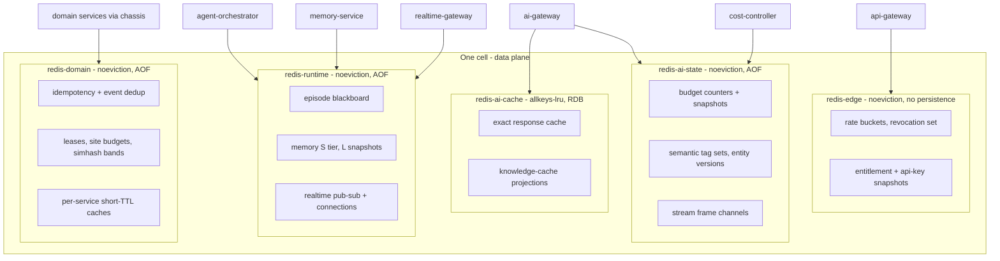
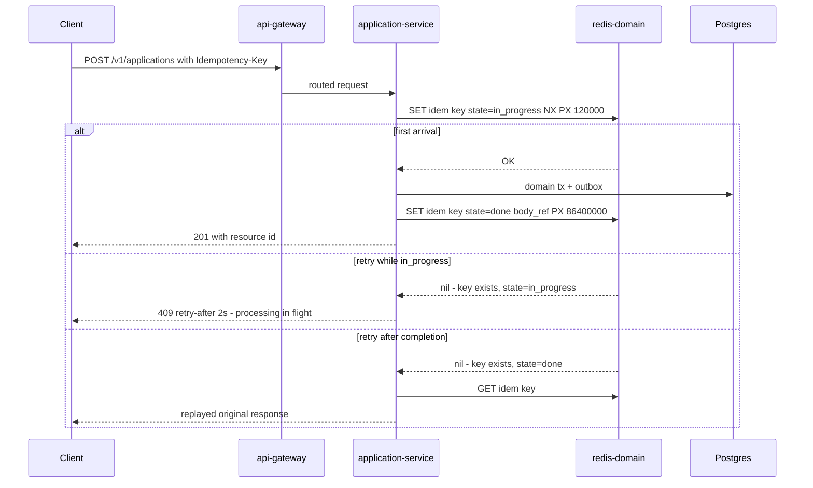
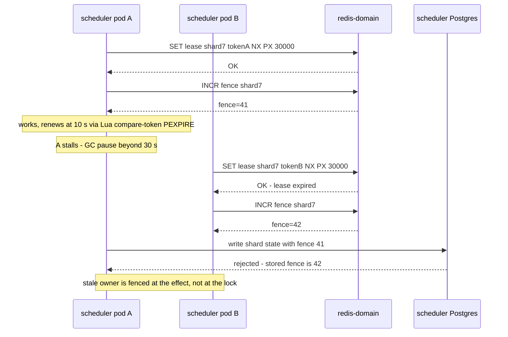

# 32 — Redis

| | |
|---|---|
| Document ID | ACA-SAS-32 |
| Volume | 4 — Data Platform |
| Status | Draft v1.0 |
| Depends on | [00 — Architecture Canon](../00-architecture-canon.md) §3, §7, §8; [30 — Database Design](30-database-design.md); [10 — API Gateway](../volume-2-core-services/10-api-gateway.md) §4–§5; [18 — AI Gateway](../volume-2-core-services/18-ai-gateway.md) §6, §10; [22 — Multi-Agent Framework](../volume-3-ai-architecture/22-multi-agent-framework.md) §3.2; [24 — Memory System](../volume-3-ai-architecture/24-memory-system.md); [25 — Cost Optimization Engine](../volume-3-ai-architecture/25-cost-optimization-engine.md) §4; [26 — Semantic Cache](../volume-3-ai-architecture/26-semantic-cache.md) |

## 1. Overview

Redis 7 (Cluster mode) is the platform's cache/KV layer (canon §3) and, deliberately, nothing more: every byte in Redis is either rebuildable from an authoritative store or tolerably lossy within a declared window. This chapter is the platform-wide Redis catalog — the complete inventory of use cases with data structures, key naming, TTLs, eviction, and sizing; the cluster topology per cell; persistence and failover choices per workload; client patterns; the distributed-lock policy (including why Redlock is rejected for correctness); the explicit "what does not go in Redis" list; and multi-tenant key isolation.

Prior chapters specified individual Redis consumers in depth — the exact cache ([Chapter 18 §6](../volume-2-core-services/18-ai-gateway.md)), rate limiting and revocations ([Chapter 10](../volume-2-core-services/10-api-gateway.md)), budget counters ([Chapter 25 §4](../volume-3-ai-architecture/25-cost-optimization-engine.md)), the episode blackboard ([Chapter 22 §3.2](../volume-3-ai-architecture/22-multi-agent-framework.md)), memory tiers ([Chapter 24](../volume-3-ai-architecture/24-memory-system.md)), semantic-cache metadata ([Chapter 26 §6](../volume-3-ai-architecture/26-semantic-cache.md)). This chapter does not restate their semantics; it consolidates them into one operable platform design and resolves the cross-cutting decisions no single consumer chapter could: cluster boundaries, eviction-policy classes, persistence, ACLs, and naming.

The organizing insight is that **eviction policy, persistence, and failure tolerance are per-node properties, not per-key properties**. Mixing a correctness keyspace (budget counters) with an evictable cache (LLM responses) on the same nodes means one `maxmemory` policy must serve both — an unresolvable conflict. Cluster boundaries below are therefore drawn by *policy class*, not by consuming service.

## 2. Cluster Topology

Five Redis Clusters per cell (canon §15: each cell runs its own Redis; enterprise dedicated cells get a full private set). Names, policy classes, and primary consumers:

| Cluster | Policy class | maxmemory-policy | Persistence | Primary consumers |
|---|---|---|---|---|
| `redis-edge` | correctness, TTL-bounded, reconstructable | `noeviction` | none | `api-gateway` (buckets, revocations, entitlement + API-key snapshots) |
| `redis-ai-cache` | pure cache, evictable | `allkeys-lru` | RDB every 15 min (warmth only) | `ai-gateway` exact cache; knowledge-cache projections |
| `redis-ai-state` | correctness, small, hot | `noeviction` | AOF everysec + hourly RDB | `cost-controller` counters/snapshots; semantic-cache tag sets + entity-version map; `ai-gateway` stream channels |
| `redis-runtime` | episode/session state, lossy-tolerable | `noeviction` (all keys TTL-bounded) | AOF everysec | `agent-orchestrator` blackboard; `memory-service` S tier, W cache, L snapshots; `realtime-gateway` connection registry + pub/sub |
| `redis-domain` | idempotency, dedup, leases, per-service caches | `noeviction` | AOF everysec + hourly RDB | chassis idempotency/dedup for all domain services; `job-intelligence-service` simhash bands; `proxy-manager` site budgets; `scheduler-service` leases; `notification-service` send dedup; `search-service` query cache |

**Canon reconciliation.** Chapters 10/18/25 refer to "the gateway-scoped Redis Cluster"; this chapter refines that into the pairs above — `redis-edge` for the API gateway, and `redis-ai-cache` + `redis-ai-state` jointly forming the AI-gateway-scoped group — because the exact cache's `allkeys-lru` must never be able to evict a budget counter. This is an extension recorded for canon promotion, not a contradiction: keyspace ownership and semantics in those chapters are unchanged.

`noeviction` semantics are used deliberately: when a `noeviction` cluster hits `maxmemory`, **writes fail loudly** instead of silently evicting correctness state. Clients classify every write as *cache-class* (failure swallowed, flagged `cache_degraded`) or *state-class* (failure surfaces per the consumer's declared degraded mode, §11); capacity alerts fire at 80% so this is a last-resort behavior, not a steady state.

Each cluster: 3-shard minimum (odd primaries for quorum-friendly topology), 1 replica per primary in a second AZ, cluster-bus TLS, client `READONLY` reads not used (all reads from primaries — replica staleness is not worth reasoning about at these sizes). Sharding here is for memory footprint and blast radius, not throughput: no cluster's peak op rate (§7) approaches a single node's ceiling.

### 2.1 Configuration baseline

Uniform across clusters except where the §2 table overrides; every value carries its one-line reason:

| Setting | Value | Rationale |
|---|---|---|
| `cluster-node-timeout` | 5000 ms | failover detection floor; lower values flap on AZ-level network jitter |
| `maxmemory` | 80% of container memory | headroom for fork-based RDB/AOF-rewrite copy-on-write spikes |
| `appendfsync` | `everysec` where AOF on (§8) | the declared ≤ 1 s loss window; `always` buys nothing the contracts need |
| `aof-use-rdb-preamble` | yes | bounded restart time as AOF grows |
| `repl-diskless-sync` | yes | replicas resync without disk staging; nodes are memory-sized, not disk-sized |
| `io-threads` | 4 (reads only) | TLS overhead absorption on the edge/domain clusters; writes stay single-threaded for ordering simplicity |
| `activedefrag` | yes on cache clusters, no on state clusters | fragmentation matters at `allkeys-lru` churn; defrag CPU jitter is unwelcome on latency-critical state |
| `lazyfree-lazy-expire` / `-eviction` | yes | large-key reclamation off the event loop; protects p99 |
| `notify-keyspace-events` | disabled | §13 — CPU and information-leak surface; invalidation is explicit channels |
| `timeout` | 0 (no idle kill) | pooled connections are long-lived by design; the chassis owns liveness |
| `tcp-keepalive` | 60 s | dead-peer detection for pool hygiene across NAT/mesh hops |
| `min-replicas-to-write` | 1 on state-class clusters, 0 on cache-class | §8 — unreplicated correctness state is refused; cache availability wins |

## 3. Key Naming & Multi-Tenant Isolation

### 3.1 Naming convention

Canonical template: **`aca:<svc>:<entity>:<id...>`** — platform prefix, owning-service short code, entity type, then identifying segments (tenant-scoped keys carry `tenant_id` as the first identifying segment). Service short codes are registered here (new codes require a row in this table):

| Code | Service | Code | Service |
|---|---|---|---|
| `gw` | api-gateway | `mem` | memory-service |
| `rtg` | realtime-gateway | `cost` | cost-controller |
| `idn` | identity-service | `ai` | ai-gateway |
| `usr` | user-service | `orch` | agent-orchestrator |
| `job` | job-intelligence-service | `portal` | portal-intelligence-service |
| `match` | matching-service | `bf` | browser-fleet-service |
| `app` | application-service | `proxy` | proxy-manager |
| `sch` | scheduler-service | `notif` | notification-service |
| `srch` | search-service | `bill` | billing-service |
| `papi` | public-api-service | `kg` | knowledge-graph-service |

Earlier chapters name keys relative to their service namespace (`bb:{tenant}:{episode}` in Chapter 22, `bud:{scope}:{ref}` in Chapter 25, `mem:s:{tenant}:{session}` in Chapter 24, `tag:{kind}:{id}` in Chapter 26). Physically these are `aca:orch:bb:…`, `aca:cost:bud:…`, `aca:mem:s:…`, `aca:ai:tag:…` — the service-relative shorthand remains valid in those chapters' prose; ACLs and tooling operate on the full form.

**Hash tags** (`{…}` in Redis Cluster routes keys by the tagged substring) are used *only* where atomic multi-key Lua requires co-location, and the tag is always the scope ref: `aca:cost:{ten_01H…}:cnt:d` and `aca:cost:{ten_01H…}:bud` co-locate one tenant's counter and snapshot for the increment-and-check script ([Chapter 25 §4.1](../volume-3-ai-architecture/25-cost-optimization-engine.md)). Untagged keys distribute uniformly; gratuitous hash tags create hot shards and are rejected in review.

### 3.2 Tenant isolation

Four layers, from physical to logical:

1. **Cells** — per-cell clusters; a dedicated-cell enterprise tenant's keys share hardware with no other tenant (canon §15).
2. **ACL users per service** — each service authenticates with a Vault-issued ACL user restricted to its key patterns (`aca:app:*` for `application-service`) and a command allowlist. `KEYS`, `FLUSHALL`, `FLUSHDB`, `CONFIG`, `DEBUG`, `CLUSTER` (mutating forms), and `SCRIPT` (outside registered SHAs) are denied to all service users; admin commands live on a break-glass ACL user gated by `admin-service` JIT elevation.
3. **Tenant-segmented keys** — tenant-scoped entities embed `tenant_id` in the key path; there is no key shape that aggregates across tenants (cross-tenant aggregation happens in Postgres rollups or `learning-pipeline`, never by SCANning Redis).
4. **No wildcard reads in code** — `SCAN` is denied to runtime ACL users (janitor and debug roles only); every runtime access is by constructed key, so a tenant-scoping bug cannot widen into enumeration.

## 4. Usage Catalog

The complete platform inventory. "Loss impact" is the declared consequence of losing the keyspace — every consumer must have one.

| # | Use case | Cluster | Structures | Key pattern (`aca:` elided) | TTL | Loss impact |
|---|---|---|---|---|---|---|
| 1 | Exact response cache | ai-cache | STRING (compressed) | `ai:exact:<sha256>` | by task class, 1 h–7 d ([Ch 18 §6](../volume-2-core-services/18-ai-gateway.md)) | cost +≈25% while cold |
| 2 | Semantic-cache metadata: tag sets, entity versions | ai-state | SET, STRING | `ai:tag:<kind>:<id>`, `ai:entv:<kind>:<id>` | tag = max member TTL; entv none | invalidation degraded → serve-stale risk; guard falls back to TTL-only ([Ch 26 §6](../volume-3-ai-architecture/26-semantic-cache.md)) |
| 3 | Knowledge-cache projections | ai-cache | HASH per entity | `ai:know:<kind>:<id>` | 1–24 h per owner policy | ladder exits at model call instead — cost only |
| 4 | Budget counters + snapshots | ai-state | STRING int (micro-USD), STRING json | `cost:{scope}:cnt:<win>`, `cost:{scope}:bud` | cnt 50 h; bud managed | enforcement on stale snapshots ≤ 15 min → conservative defaults ([Ch 25 §8](../volume-3-ai-architecture/25-cost-optimization-engine.md)) |
| 5 | Rate-limit buckets | edge | STRING via Lua token bucket | `gw:rl:<descriptor_hash>` | 2× window | fail-open to per-pod local limits scaled 1/N ([Ch 10 §5.3](../volume-2-core-services/10-api-gateway.md)) |
| 6 | Revocation set + auth generation | edge | SET, STRING | `gw:rev:sid`, `gw:authgen:<user_id>` | token lifetime ×2 (30 min) | fail-closed for state-changing routes; reads fail-open ≤ 60 s |
| 7 | Entitlement / API-key snapshots | edge | STRING json (signed) | `gw:ent:<tenant_id>`, `gw:key:<key_hash>` | 60 s / 60 s + delete-on-revoke | last-known snapshot honored; signature still verified |
| 8 | HTTP idempotency keys | domain | STRING json (two-phase) | `<svc>:idem:<tenant_id>:<key_hash>` | 24 h (canon §7) | duplicate-POST window opens; consequential routes fail closed (§5) |
| 9 | Event-consumer dedup (first line) | domain | STRING | `<svc>:dedup:<consumer_group>:<event_id>` | 24 h | `consumed_event` table still closes the window ([Ch 30 §5.1](30-database-design.md)) |
| 10 | Episode blackboard | runtime | HASH per section + STREAM log | `orch:bb:<tenant_id>:<episode_id>:<section>` | episode end + 7 d ([Ch 22 §3.2](../volume-3-ai-architecture/22-multi-agent-framework.md)) | episodes degrade to Temporal child-workflow results |
| 11 | Memory S tier / W cache / L snapshots | runtime | HASH + STREAM / HASH / STRING | `mem:s:<tenant_id>:<session_id>`, `mem:w:<run_id>`, `mem:l:<tenant_id>:<user_id>` | 24 h / run + 1 h / managed | sessions restart contextually cold; rebuild from Postgres ([Ch 24 §13](../volume-3-ai-architecture/24-memory-system.md)) |
| 12 | Realtime connection registry | runtime | HASH per connection | `rtg:conn:<tenant_id>:<conn_id>` | 90 s heartbeat-refreshed | clients reconnect; presence rebuilt |
| 13 | Realtime event fan-out | runtime | sharded pub/sub | `rtg:chan:<tenant_id>:<user_id>` | n/a | at-most-once by design; clients reconcile via REST ([canon §14](../00-architecture-canon.md) 2 s p95) |
| 14 | AI stream frame channels | ai-state | pub/sub + STRING channel meta | `ai:stream:<channel_id>` | 10 min ([Ch 18 §10](../volume-2-core-services/18-ai-gateway.md)) | terminal-frame reconciliation via caller API |
| 15 | Leases (shards, pools, singleflight) | domain | STRING token + fence counter | `<svc>:lease:<resource>`, `<svc>:fence:<resource>` | 30 s, renewed at 10 s | duplicate work, bounded (§6) |
| 16 | Per-site crawl/proxy budgets | domain | Lua sliding window | `proxy:site:<domain_hash>:win` | window ×2 | politeness enforcement degrades → fetchers fall to static per-worker caps |
| 17 | Simhash dedup bands | domain | SET per band | `job:band:<band_id>` | 90 d sliding ([Ch 15 §16](../volume-2-core-services/15-job-intelligence-service.md)) | dedup recall drops; pgvector ANN backstop |
| 18 | Notification send dedup + digest assembly | domain | STRING, ZSET | `notif:sent:<dedup_hash>`, `notif:digest:<tenant_id>:<user_id>` | 72 h / until digest send | duplicate-notification risk; sends throttled conservatively |
| 19 | Search query cache | domain | STRING | `srch:q:<tenant_id>:<query_hash>` | 30 s | OpenSearch absorbs the misses |

Three catalog-wide rules: values > 64 KiB are prohibited (store an object-storage ref — mirrors the blackboard/tool-result caps); every key has a TTL or a registered janitor (§4.1); every use case declares its loss impact above — a new Redis use without a loss-impact row does not pass design review.

### 4.1 Managed-key register (janitor contract)

Keys without TTLs are the leak class in every Redis deployment, so they are enumerated and owned. Each register entry names the owner, the lifecycle authority that deletes it, and the orphan test the weekly janitor sweep applies (sweep runs under a dedicated SCAN-capable ACL user, sampling 1% of the keyspace):

| Managed key | Owner | Deleted by | Orphan test |
|---|---|---|---|
| `cost:{scope}:bud` | `cost-controller` | scope retirement (tenant close, feature removal) | scope absent from Postgres `budget` table |
| `ai:entv:<kind>:<id>` | `ai-gateway` invalidation consumer | entity tombstone events | entity older than source retention window |
| `notif:digest:<tenant>:<user>` | `notification-service` | digest send completes | older than 2× longest digest cadence |
| `gw:key:<key_hash>` | `public-api-service` push | delete-on-revoke push | hash absent from the key registry |
| `<svc>:fence:<resource>` | lease users (§6) | resource decommission | resource absent from owner's shard/pool tables |

Anything the sweep finds outside this register and without a TTL opens an owner ticket automatically (§14). The register is code (chassis configuration), not documentation — the sweep reads it.

## 5. Idempotency & Dedup (the two-line defense)

HTTP idempotency (canon §7: all POSTs accept `Idempotency-Key`, 24 h window) is chassis-implemented as a two-phase marker so retries during processing behave correctly:

Decisions: the `in_progress` phase TTL is 120 s (the gateway's upstream timeout ceiling — a marker outliving its request must expire quickly so legitimate retries are not locked out forever); the `done` phase stores the response (inline ≤ 8 KiB, else object-storage ref) for 24 h. **Degraded mode is route-classed:** if `redis-domain` is unreachable, consequential POSTs (application submission, approval, billing mutations) fail closed with 503 + `Retry-After` — a duplicate submission is worse than a delay (canon guardrail principle) — while benign POSTs proceed flagged `x-aca-degraded: idempotency`, relying on domain unique constraints (e.g., `UNIQUE (user_id, job_ref)`, [Chapter 31 §7](31-postgresql-schema.md)) as the last line.

Kafka consumer dedup is the same shape one layer down: `SETNX` on the CloudEvents `id` as the fast path, with the `consumed_event` insert inside the consumer's own transaction as the correctness path ([Chapter 30 §5.1](30-database-design.md)). Redis existing is never sufficient to *skip* the transactional check on consequential effects; it exists to avoid burning transactions on the ~100% of deliveries that are not duplicates.

## 6. Distributed Locks: Policy and Pattern

### 6.1 The policy — Redis locks are never correctness

Redlock is **rejected for correctness-critical mutual exclusion**, on the standard analysis: its safety depends on bounded clock drift and bounded process pauses (a GC pause spanning lock expiry silently violates exclusion), it provides no fencing tokens, and async replication means failover can resurrect a lock's ghost. No amount of multi-node ceremony changes this — so the platform draws a hard line instead of a subtle one:

| Need | Sanctioned mechanism | Examples |
|---|---|---|
| Business-level singleton execution | Temporal workflow ID uniqueness | one submission saga per application; per-user autopilot day plan ([Ch 20](../volume-2-core-services/20-workflow-engine.md)) |
| Aggregate write exclusion | Postgres CAS / single-writer per aggregate | `last_event_seq` CAS ([Ch 31 §7.1](31-postgresql-schema.md)); audit chain head |
| Ordered processing | Kafka partition keying | per-tenant / per-entity ordering (canon §8) |
| Shared-state write safety | single-writer by construction | blackboard section ownership ([Ch 22 §3.2](../volume-3-ai-architecture/22-multi-agent-framework.md)) |
| Maintenance-job exclusion | Postgres advisory locks in the service's own DB | janitors, partition managers |
| **Duplicate-work suppression only** | Redis lease + fencing token (§6.2) | scheduler shard ownership, proxy pool assignment, cache-fill singleflight |

The last row is the *only* Redis lock class, and its contract is explicit: brief dual-ownership must be harmless (duplicate crawls dedup downstream; duplicate cache fills waste one model call; proxy over-assignment is bounded by per-site budgets).

### 6.2 The lease pattern (with fencing)

Rules: release only via Lua compare-token-then-DEL (never blind DEL); renewal at ⅓ of TTL; every durable effect downstream of a lease carries the fence and the system of record enforces monotonicity (a `WHERE fence <= $1` CAS). A lease without a fenceable effect path is reviewed as: why is this not just idempotent?

## 7. Sizing

Per primary cell at target scale (5 M users, 21 M AI calls/day avg; L-numbers from [Chapter 04 §2.1](../volume-1-foundation/04-non-functional-requirements.md)). Provisioned = working set × 2 (headroom for AOF rewrite buffers, resharding, and the 80% alert threshold).

| Cluster | Dominant contents | Working set | Provisioned | Peak ops/s | Shards |
|---|---|---|---|---|---|
| `redis-edge` | buckets (~5 M keys × 100 B), revocations, snapshots | ~4 GB | 8 GB | ~15 k (3.3 k RPS × ~4 ops) | 3 |
| `redis-ai-cache` | exact cache 60 GB ([Ch 18 §12](../volume-2-core-services/18-ai-gateway.md)) + knowledge 12 GB ([Ch 26 §11](../volume-3-ai-architecture/26-semantic-cache.md)) | ~72 GB | 120 GB | ~8 k | 12 |
| `redis-ai-state` | budget keyspace < 2 GB ([Ch 25 §4.1](../volume-3-ai-architecture/25-cost-optimization-engine.md)), tag sets ~8 GB, entity versions ~1 GB | ~11 GB | 24 GB | ~6 k | 3 |
| `redis-runtime` | blackboards ~4 GB (≈30 k live episodes × ~120 KB), memory S ~6 GB (≈45 k active sessions), L snapshots ~4 GB | ~15 GB | 32 GB | ~12 k (heartbeats + fan-out) | 3 |
| `redis-domain` | event dedup ~6 GB (50 M/day × 24 h), idempotency ~1 GB, simhash bands ~2 GB, site budgets, caches | ~12 GB | 32 GB | ~25 k (6 k msg/s burst × dedup + chassis traffic) | 6 |

Total ≈ 216 GB provisioned per primary cell (matches the [Chapter 30 §9](30-database-design.md) envelope). Cost note: this is deliberately memory-cheap relative to its leverage — the exact cache alone offsets ~25% of AI spend ([Chapter 26 §7](../volume-3-ai-architecture/26-semantic-cache.md)); nothing else on the platform buys COGS at that rate.

## 8. Persistence & Failover

| Cluster | RDB | AOF | Reasoning |
|---|---|---|---|
| edge | off | off | everything reconstructable in ≤ 60 s (limits fall to local 1/N; `identity-service` replays active revocations on cold-start signal; snapshots re-fetch). Persistence would add fsync latency to the platform's hottest path for nothing |
| ai-cache | 15 min | off | RDB is purely a warm-restart optimization — a cold cache is a cost event, not an outage; 15 min bounds the staleness of the warmed set |
| ai-state | hourly | everysec | budget counters *can* be rebuilt from rollups (≤ 10 min, [Ch 25 §13](../volume-3-ai-architecture/25-cost-optimization-engine.md)) but the rebuild window is an enforcement gap; AOF shrinks it to ≤ 1 s of loss |
| runtime | off | everysec | blackboard/session loss is tolerable by contract but disruptive mid-episode; everysec is cheap at 15 GB |
| domain | hourly | everysec | idempotency keys have **no** Postgres backstop for HTTP routes; AOF makes the duplicate-window loss ≤ 1 s |

Failover: replica promotion per shard (cluster-native), replicas in a second AZ, `min-replicas-to-write 1` on state-class clusters (a primary that has lost its replica stops accepting state writes rather than accumulating unreplicated correctness state — cache-class clusters omit this, availability first). `WAIT` is not used on hot paths (latency for probabilistic durability is a bad trade; AOF + min-replicas covers the need). Cross-region: none — Redis is cell-local by canon §15; DR rebuilds Redis in the standby region from authoritative stores and AOF copies where enabled ([Chapter 30 §10.1](30-database-design.md)).

Client behavior through failover: cluster-topology refresh on `MOVED`/connection error, command timeout 50 ms default (edge authz ops 10 ms — inside the ext-authz budget, [Chapter 10 §4](../volume-2-core-services/10-api-gateway.md)), retry once on idempotent commands only, then the consumer's declared degraded mode (§11 table). Expected write-unavailability during a shard failover: ≤ 5 s (election) — every consumer's degraded mode must tolerate this without paging.

## 9. What NOT to Put in Redis

The prohibitions, each with the sanctioned home:

1. **P0 material — ever** (credentials, cookies, session tokens for portals): `session-vault-service` only (canon §11). No exceptions, including "just briefly."
2. **P1 identity PII**: owning service Postgres with field encryption; Redis keys/values carry opaque IDs and refs. (Memory S-tier conversational content is P2 and TTL-bounded — permitted per [Chapter 24](../volume-3-ai-architecture/24-memory-system.md); its lint strips contact data on ingest.)
3. **Any system of record**: if losing the keyspace loses facts, it belongs in Postgres. The catalog's loss-impact column (§4) is the test.
4. **Work queues**: Kafka (integration) or Temporal (orchestration). Redis lists/streams as job queues re-create at-most-once workers with invisible backlogs — the platform's queues must be replayable and observable. The two stream uses in the catalog (blackboard log, session turns) are *state with history semantics*, not queues: consumers tail them, nothing pops them.
5. **Guaranteed delivery**: Redis pub/sub is at-most-once and is used only where that is the contract (realtime UX fan-out, stream frames, invalidation pushes — all with reconciliation paths). Anything requiring delivery is a Kafka event.
6. **Blobs > 64 KiB**: object storage + ref (§4 rule). Big values stall the event loop and shred tail latency for co-located keys.
7. **Vectors / ANN**: pgvector behind `embedding-store` ([Chapter 26 §15](../volume-3-ai-architecture/26-semantic-cache.md) records the rejection of Redis vector search — cache memory pressure and index recall must not share a resource).
8. **Audit data**: `audit-service` append-only chain. Redis's mutability disqualifies it structurally.
9. **Cross-run agent memory**: `memory-service` durable tiers — the blackboard is single-episode by contract ([Chapter 22 §3.2](../volume-3-ai-architecture/22-multi-agent-framework.md)).
10. **Billing/metering source of truth**: the Postgres ledger and rollups; Redis counters are enforcement acceleration, reconciled hourly ([Chapter 25 §7](../volume-3-ai-architecture/25-cost-optimization-engine.md)).

## 10. Client Patterns

All access goes through the chassis Redis module (`chassis-data`, [Chapter 09 §6.2](../volume-2-core-services/09-microservice-architecture.md)) — no service hand-rolls a client. The module provides:

- **Connection pooling**: 8 connections per pod default; *dedicated* pools for latency-critical paths that must not queue behind bulk traffic (budget reads in `ai-gateway`, authz ops in the gateway's ext-authz server) and for blocking stream reads (XREAD with 100 ms block, never on shared pools).
- **Timeouts**: connect 100 ms, command 50 ms (10 ms for edge authz ops), no command without a deadline. Slow Redis must degrade the consumer, not stall it.
- **Circuit breaking per keyspace**: rolling error/latency window (20% errors over 30 s opens; half-open probes at 5 s), with the consumer's registered degraded mode applied while open. The breaker is per-keyspace, not per-cluster — the exact cache breaking must not disable budget checks that share a process.
- **Registered Lua only**: scripts ship with the chassis, loaded by SHA at boot; ad-hoc EVAL is ACL-denied. Scripts are single-hash-slot by construction (§3.1 hash-tag rule).
- **Pipelining/batching**: MGET/pipeline for fan-out reads (tag checks, entity-version pins) — one round trip per logical operation is the review norm.
- **Client-side caching** where staleness is already bounded by pub/sub invalidation (budget snapshots: 5 s local LRU + invalidation channel, [Chapter 25 §5](../volume-3-ai-architecture/25-cost-optimization-engine.md)); the generic RESP3 tracking protocol is *not* enabled platform-wide (invalidation-storm behavior under resharding is harder to reason about than explicit channels).
- **Degraded-mode registration**: a consumer cannot get a pool without declaring its keyspace's failure behavior — the declaration drives both the breaker and the §11 table.

## 11. Failure Scenarios

| Scenario | Detection | Behavior (declared degraded modes) | Recovery |
|---|---|---|---|
| `redis-edge` down | breaker + gateway error rate | rate limits → local 1/N; revocation → fail-closed writes / fail-open reads ≤ 60 s; entitlements → last snapshot ([Ch 10 §8](../volume-2-core-services/10-api-gateway.md)) | restart empty; `identity-service` replays revocations; buckets refill |
| `redis-ai-cache` down | breaker, `cache_degraded` rate | cache tiers skipped; cost +≈25%; cost-anomaly alert at +20%/h ([Ch 18 §13](../volume-2-core-services/18-ai-gateway.md)) | restart from RDB (≤ 15 min stale) or cold; hit rate recovers in hours |
| `redis-ai-state` down | breaker + snapshot staleness probe | budgets → stale snapshots ≤ 15 min then conservative defaults; invalidation guard → TTL-only; streams → terminal-frame reconciliation | AOF restart ≤ 1 s loss; counters reconciled against rollups |
| `redis-runtime` down | breaker + connection-registry probe | episodes degrade to Temporal results; sessions cold-start; realtime clients reconnect and REST-reconcile | AOF restart; snapshots rebuilt on demand, rebuild rate-limited per tenant ([Ch 24 §13](../volume-3-ai-architecture/24-memory-system.md)) |
| `redis-domain` down | breaker + chassis dedup error rate | consequential POSTs fail closed (§5); benign POSTs degrade flagged; consumer dedup falls to `consumed_event` tx path (slower, correct); leases lapse → duplicate work within §6 contract | AOF restart ≤ 1 s loss |
| Single-shard failover | cluster events | ≤ 5 s write unavailability for that shard's slots; consumers ride through via degraded modes | automatic |
| `noeviction` memory exhaustion | 80% capacity alert (page at 90%) | cache-class writes swallowed + flagged; state-class writes error into degraded modes | emergency: janitor sweep, TTL audit, reshard; postmortem — this is always a sizing or leak bug |
| Hot key (viral tenant, hot budget scope) | per-key hotspot sampling (`redis-cli --hotkeys` equivalent in exporter) | latency SLI on that shard degrades | hash-tag review; per-pod token leases for the offending descriptor ([Ch 10 §5.3](../volume-2-core-services/10-api-gateway.md) pattern generalized) |
| Split-brain lease dual-ownership | fence-rejection metrics | stale owner's effects rejected at system of record (§6.2) | none needed — the design absorbs it |

## 12. Scaling Strategy

Add shards per cluster as working sets grow (slot migration is online; state-class clusters resharded in maintenance windows out of caution, cache-class anytime); the §7 table is re-derived quarterly from measured per-key sizes. Per-cell multiplication is the macro path (canon §15): a new cell ships the full five-cluster set; nothing in Redis is cross-cell, so cells scale Redis embarrassingly. Op-rate ceilings are far away (§2); the realistic growth pressures are exact-cache working set (scales with AI call diversity — governed by TTL tuning and the [Chapter 25](../volume-3-ai-architecture/25-cost-optimization-engine.md) cache-TTL control loop) and event-dedup cardinality (scales with L14 — TTL is the lever, floor 24 h). If `redis-runtime` fan-out becomes the realtime bottleneck past 100 k concurrent connections, the seam is in `realtime-gateway` (sharded channel namespaces), not in Redis topology.

## 13. Security Considerations

- TLS everywhere (client and cluster bus); Vault-issued per-service ACL credentials rotated on the platform secret cadence; no shared passwords, no default user.
- ACL command denial (§3.2) makes exfiltration-by-enumeration structurally hard: no `KEYS`, no `SCAN`, no cross-namespace patterns for runtime users.
- Content discipline: no P0 ever, no P1 (§9); values for tenant-scoped entities carry tenant ID in the key so a confused-deputy read still lands in the caller's own namespace; blackboard and memory ACLs restrict even the owning plane to their prefixes ([Chapter 22 §3.2](../volume-3-ai-architecture/22-multi-agent-framework.md), [Chapter 24 §10](../volume-3-ai-architecture/24-memory-system.md)).
- RDB/AOF artifacts are encrypted at rest (storage keys per [Chapter 30 §7](30-database-design.md)) and covered by the same access governance as database backups.
- Keyspace notifications are disabled (CPU + information-leak surface); the platform's invalidation pushes are explicit application-published channels.
- Lua scripts are reviewed as code (they run with the server's authority within ACL bounds) and pinned by SHA — a modified script is a deploy, not a runtime event.

## 14. Observability

| Signal | Source | Alert |
|---|---|---|
| Per-cluster memory vs. provisioned | redis exporter | 80% warn / 90% page (`noeviction` clusters) |
| Evictions (`ai-cache` only) | exporter | eviction *rate spike* > 3× baseline (working-set shift) |
| Command latency p99 per cluster | exporter + client histograms | > 5 ms sustained 5 min (in-memory store above 5 ms is sick) |
| Hit rates (exact, knowledge, snapshots) | client metrics per keyspace | exact < 12% daily (vs. ≥ 18% target) → [Ch 25](../volume-3-ai-architecture/25-cost-optimization-engine.md) cache review |
| Breaker state per keyspace | chassis | any open > 60 s → owner paged |
| AOF/RDB health (last save, rewrite duration, fsync stalls) | exporter | AOF fsync stall > 1 s; last RDB > 2× cadence |
| Failover events / replica link | cluster events | any failover → info; repeated → page |
| TTL hygiene | janitor scan (dedicated ACL) sampling keys without TTL outside the managed register | any unregistered persistent key → owner ticket |
| Fence rejections (§6.2) | system-of-record metrics | spike = pause storm or lease TTL mis-tuning |
| Dedup/idempotency hit rates | chassis | duplicate rate shift (upstream retry storm indicator) |

Every keyspace's metrics carry the `svc` and keyspace labels derived from the §3.1 naming — the naming convention is what makes per-use-case observability automatic.

## 15. Future Improvements

1. **Valkey evaluation** as the drop-in engine behind the same protocol seam (licensing hygiene; zero-architecture-change migration by design).
2. **RESP3 client-side caching pilot** on the knowledge-cache keyspace once resharding invalidation behavior is production-proven — would remove the 5-min local TTL staleness.
3. **Per-tenant keyspace accounting** (sampled memory attribution by key prefix) feeding `cost-controller` — today Redis cost is platform overhead, not tenant-attributed.
4. **Automated TTL tuning** for cache classes via the `cost-optimization-agent` (already sanctioned to tune cache TTLs ±50%, [Chapter 25 §9](../volume-3-ai-architecture/25-cost-optimization-engine.md)); extend from exact-cache to knowledge-cache TTLs.
5. **Cluster-per-cell shrinkage** for small dedicated cells (five clusters is heavy for a 200-seat enterprise cell): a certified "compact profile" collapsing edge/domain/runtime onto shared nodes with documented policy-class compromises.

## 16. Alternatives Considered & Tradeoffs

| Decision | Alternative | Why this way / cost accepted |
|---|---|---|
| Five clusters per cell by policy class | one big cluster; cluster-per-service | one cluster cannot reconcile eviction/persistence/failure classes (§1); per-service (≈25 clusters) multiplies ops for no isolation the ACL model doesn't already give. Cost: five topologies to operate — accepted as the price of correct `maxmemory` semantics |
| `noeviction` + loud failure for state classes | `volatile-lru` everywhere | silent eviction of a budget counter or idempotency key is a correctness bug that looks like nothing; loud failure + 80% alerts is diagnosable. Cost: memory exhaustion becomes an availability event — mitigated by headroom and the cache/state write classification |
| Redis leases for efficiency only; Temporal/Postgres/Kafka for exclusion | Redlock for distributed mutual exclusion | Redlock's safety assumptions (bounded pauses, clock drift, sync failover) don't hold and it lacks fencing; the platform already owns three correct exclusion mechanisms. Cost: some coordination lives "heavier" in Temporal/Postgres — accepted |
| Two-phase idempotency markers, route-classed degraded modes | single SETNX marker; uniform fail-open | single-phase mishandles retries during processing; uniform fail-open would allow duplicate submissions (guardrail violation), uniform fail-closed would fail benign POSTs needlessly |
| Sharded pub/sub for realtime fan-out | Kafka for realtime; Redis Streams consumer groups | Kafka adds 10²–10³ ms and consumer-group churn for 100 k ephemeral clients; at-most-once + REST reconciliation meets the 2 s p95 (canon §14). Streams-as-queues rejected per §9.4 |
| AOF everysec on state/domain clusters | AOF always / no persistence | `always` costs per-command fsync latency for a 1 s → 0 s loss-window gain nothing here needs; no-persistence widens the idempotency loss window beyond the declared ≤ 1 s |
| Full keys carry `aca:<svc>:` with per-service ACL patterns | separate logical DBs (SELECT n); implicit per-cluster namespacing | numbered DBs don't exist in cluster mode; implicit namespacing has no enforcement — ACL-on-prefix makes isolation testable. Cost: longer keys (~15 B overhead) — negligible against value sizes |
| No cross-region Redis | active replication of caches to standby | every keyspace is rebuildable or lossy-tolerable by contract; replicating caches buys RTO minutes that the DR budget doesn't need at the cost of permanent cross-region coupling |
