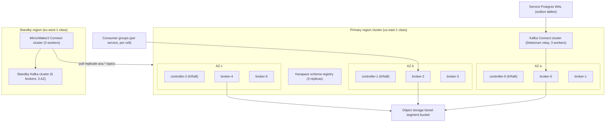
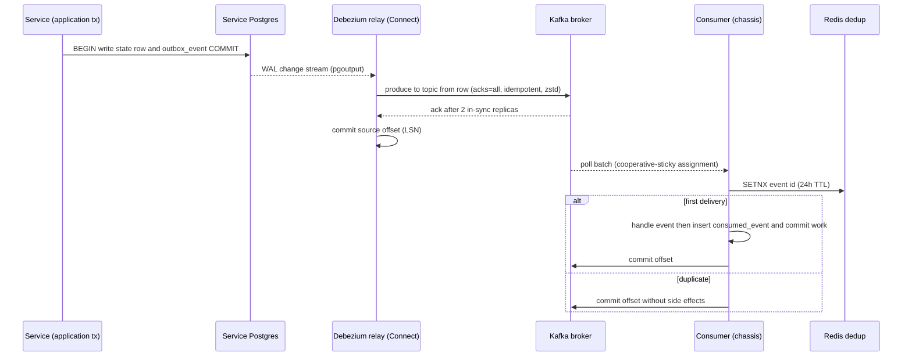
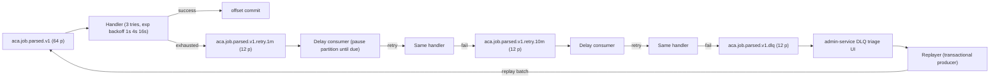
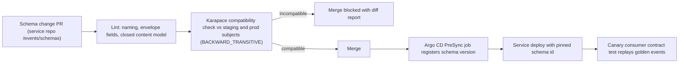

# 33 — Kafka

| | |
|---|---|
| Document ID | ACA-SAS-33 |
| Volume | 4 — Data Platform |
| Status | Draft v1.0 |
| Depends on | [00 — Architecture Canon](../00-architecture-canon.md) §8 §11 §15, [09 — Microservice Architecture](../volume-2-core-services/09-microservice-architecture.md) (chassis, outbox), [04 — Non-Functional Requirements](../volume-1-foundation/04-non-functional-requirements.md) §2.2, [06 — Technology Stack](../volume-1-foundation/06-technology-stack.md) §7, [25 — Cost Optimization Engine](../volume-3-ai-architecture/25-cost-optimization-engine.md), [35 — Object Storage](35-object-storage.md) |

## 1. Overview

Kafka is the asynchronous backbone of the platform (canon §2): every cross-service fact — job discovered, match scored, application submitted, AI request completed — travels as a CloudEvents 1.0 message on a topic named `aca.<domain>.<event>.v<major>` (canon §8). This chapter is the authoritative specification of the Kafka platform itself: cluster topology and sizing, the governed topic catalog with per-topic partition counts and keys (the sizing Volume 1 explicitly deferred here — [NFR §2.2](../volume-1-foundation/04-non-functional-requirements.md)), the single producer path (outbox + Debezium CDC), consumer-group design, the retry/DLQ topology's implementation, schema-registry workflow with CI-enforced compatibility, per-flow delivery-semantics decisions, tiered storage and retention, and multi-region replication for DR.

Two prior decisions shape everything. First, **there is exactly one way events are produced**: services write `outbox_event` rows in their state-changing transaction and a Debezium CDC relay publishes them ([Chapter 09 §7](../volume-2-core-services/09-microservice-architecture.md)); direct produce is lint-banned outside the CDC relay, MirrorMaker2, and the DLQ replayer. Producer configuration is therefore a *platform* concern owned by this chapter, not a per-team knob. Second, **delivery is at-least-once and consumers are idempotent** (canon §8, HLA rule R14): Kafka transactions are used only where a flow is pure Kafka→Kafka and duplication is operator-visible harm — in practice, only the DLQ replayer (§9). Everything else buys effective-once semantics with dedup, which also covers the DB/HTTP side effects that Kafka EOS never could.

Scale context from the load model ([NFR §2](../volume-1-foundation/04-non-functional-requirements.md)): 6M events/day at GA, 50M/day at target scale (≈ 580 msg/s average), with a ×10 burst-absorption design point (6k msg/s sustained, lag recovery < 30 min — NFR-026). At 1.5 KB mean payload and RF=3 that is ~27 MB/s peak cluster write — small for Kafka. The engineering problems here are therefore not raw throughput; they are **partition-key discipline** (ordering + skew), **governance** (90+ topics with owners, schemas, and compatibility gates), **replay** (7-day rewind for projection rebuilds, [Chapter 27 §7](../volume-3-ai-architecture/27-knowledge-graph.md)), and **DR** (RPO ≤ 5 min, canon §15).

The reference deployment is the Strimzi operator on Kubernetes (matches the Argo CD GitOps posture, [canon §3](../00-architecture-canon.md)); a managed Kafka (MSK-class) is an acceptable substitute behind the same topology contract — the seam is the Kafka protocol plus this chapter's catalog-as-code, neither of which is vendor-specific.

## 2. Cluster Architecture

### 2.1 Topology

One Kafka cluster per region serves all cells in that region. Cells ([canon §15](../00-architecture-canon.md)) isolate at the *consumer-group and database* layer, not the broker layer: a cell runs its own consumer groups against shared topics, filtered by its tenant shard. Dedicated enterprise cells with an isolated-data-plane contract may additionally receive a dedicated small cluster (3 brokers) provisioned from the same Strimzi chart — an option priced into enterprise plans, not the default.



| Element | Specification | Rationale |
|---|---|---|
| Kafka version | Apache Kafka 3.9-class (KRaft mode, no ZooKeeper) | Canon §3 pins 3.x; 3.9 is where KRaft + tiered storage are both production-grade |
| Brokers | 6 × 8 vCPU / 32 GiB, gp3 1 TB (6000 IOPS, 250 MB/s) | NFR §2.2 sizes 6 brokers; 2 per AZ so one AZ loss removes ⅓ capacity, not a quorum; 32 GiB is page-cache headroom for 3× consumer fan-out and replay reads |
| Controllers | 3 dedicated × 2 vCPU / 8 GiB, one per AZ | Dedicated quorum isolates metadata from data-plane load spikes; 3 tolerates one AZ loss |
| Rack awareness | `broker.rack` = AZ id; RF=3 spreads replicas across all 3 AZs | An AZ outage leaves 2 in-sync replicas for every partition |
| Replication | RF=3, `min.insync.replicas=2`, `unclean.leader.election.enable=false` | Survive one broker/AZ loss without accepting silent under-replication or data loss (Vol 1 §7 N6) |
| Topic autocreation | `auto.create.topics.enable=false` | Every topic enters via the governed catalog (§3.3) |
| Max message | `message.max.bytes=1 MiB` | Payload cap is 256 KB (HLA rule R9, claim-check to [object storage](35-object-storage.md)); 1 MiB leaves envelope + batch headroom while keeping broker memory predictable |
| Segments | `log.segment.bytes=512 MiB` | Tiered-storage upload granularity; small enough that hot local data rolls to remote promptly |

### 2.2 Sizing math

| Quantity | GA | Target | Derivation |
|---|---|---|---|
| Events/day | 6 M | 50 M | Load model L14 |
| Average rate | 70 msg/s | 580 msg/s | ÷ 86,400 s |
| Burst design | 700 msg/s | 6,000 msg/s | ×10 burst absorption (NFR-026) |
| Ingress at burst | 1 MB/s | 9 MB/s | × 1.5 KB mean payload |
| Cluster write at burst | 3 MB/s | 27 MB/s | × RF 3 |
| Read fan-out (avg 3 groups/topic) | 3 MB/s | 27 MB/s | Dominated by page-cache hits for tail readers; disk reads only on replay |
| Logical storage/day | 9 GB | 75 GB | events × payload |
| Hot retention on cluster (7 d, RF 3) | 190 GB | 1.6 TB | canon §11 7-day hot retention |
| Local disk per broker | ≤ 100 GB | ≤ 400 GB | Only ~24–48 h resident locally; remainder tiered (§10); 1 TB volumes give ×2.5 headroom for skew and tiering lag |
| Partition replicas per broker | ~700 | ~1,100 | §3.2 partition budget ≈ 2,200 partitions × RF 3 ÷ 6 — well under the ~4k/broker KRaft comfort line |

The cluster is deliberately over-provisioned relative to throughput: the binding constraints are (a) surviving a rolling restart plus one broker failure at burst rate (4 of 6 brokers must carry 27 MB/s writes — trivial), (b) replay storms when a projection rebuild re-reads 7 days of a 64-partition topic (page cache and remote-tier fetch throughput, §10), and (c) partition-count ceilings, which fail operationally (rebalance and recovery time) long before throughput fails.

### 2.3 Component summary — Purpose through Tradeoffs

| Aspect | Kafka cluster (this section) |
|---|---|
| Purpose | Durable, ordered (per key), replayable event transport for all async integration |
| Responsibilities | Retention per topic class, per-key ordering, burst absorption, 7-day replay window, tiering to object storage |
| Interactions | Debezium Connect (sole domain producer), all service consumer groups, MM2 (DR), Karapace (schemas), object storage (tiered segments) |
| Failure scenarios | §12 |
| Scaling | §13 |
| Security | §14 |
| Monitoring | §15 |
| Future improvements | §16 |
| Alternatives & tradeoffs | Pulsar/SQS rejected in [Chapter 06 §7](../volume-1-foundation/06-technology-stack.md); §17 covers deployment-level alternatives |

## 3. Topic Catalog & Governance

### 3.1 Naming, ownership, and catalog rules

Topic names follow canon §8 exactly: `aca.<domain>.<event>.v<major>`. The catalog adds mandatory metadata per topic — without all of it, the topic cannot be created:

| Field | Rule | Why |
|---|---|---|
| `owner` | Exactly one producing service (the outbox writer) | Single-writer principle; schema authorship is unambiguous |
| `key` | Documented key expression (`tenant_id` or entity id, canon §8) | Ordering scope and skew analysis are reviewable, not tribal |
| `partition_class` | `low` / `core` / `high` (§3.2) | Partition counts are class-derived, not invented per topic |
| `retention_class` | `domain` / `telemetry` / `retry` / `dlq` / `audit` (§10) | Retention is policy, not per-team preference |
| `schema_subject` | `<topic>-value` registered in Karapace | No schema, no topic (§8) |
| `pii_max` | Highest PII class (canon §11) that may appear in payloads | Drives DR/replication eligibility (§11) and consumer handling; P0 is banned from Kafka outright |

### 3.2 Partition classes and the sized catalog

Volume 1 set the baselines (32 for tenant-keyed core topics, 64 for entity-keyed discovery topics — [Chapter 06 §7](../volume-1-foundation/06-technology-stack.md) N6); this catalog is the per-topic authority. Classes: **low = 12** (≤ 100k events/day; 12 matches the smallest useful consumer parallelism), **core = 32** (≤ 5M/day), **high = 64** (dominant topics; headroom for ~10× growth without repartitioning, which breaks per-key ordering and is done only at major topic versions). Representative catalog (full machine-readable catalog lives in the `aca-event-catalog` repo, §3.3):

| Topic family (representatives) | Owner | Key | Class / partitions | Retention class | Volume basis |
|---|---|---|---|---|---|
| `aca.user.*`, `aca.tenant.*` (`registered`, `deleted`, `suspended`) | `user-service` | `user_id` / `tenant_id` | low / 12 | domain | Account lifecycle, ≪ 100k/day |
| `aca.identity.*` (`login.failed`, `session.revoked`, `risk.flagged`) | `identity-service` | `user_id` | core / 32 | domain | Login volume tracks DAU |
| `aca.profile.*` (`updated`, `embedding.updated`, `import.completed`) | `profile-service` | `user_id` | core / 32 | domain | Import waves are bursty (marketing-driven) |
| `aca.resume.*` (`parsed`, `version.created`, `rendered`) | `resume-service` | `resume_id` | low / 12 | domain | Bounded by draft volume L10 |
| `aca.job.discovered.v1`, `aca.job.parsed.v1`, `aca.job.updated.v1`, `aca.job.expired.v1` | `job-intelligence-service` | `job_id` | high / 64 | domain | 2M/day discovery (L6), entity-keyed per Vol 1 N6 |
| `aca.job.crawl.*` (`requested`, `task`, `completed`) | `job-intelligence-service` / `scheduler-service` | `source_id` | core / 32 | telemetry | Crawl fan-out; per-source ordering protects site budgets |
| `aca.company.enriched.v1` | `job-intelligence-service` | `company_id` | low / 12 | domain | ~150k refreshes/day |
| `aca.match.scored.v1` | `matching-service` | `user_id` | high / 64 | telemetry | 20M pairs/day (L8) — co-dominant topic |
| `aca.application.*` (`drafted`, `approved`, `submitted`, `status.changed`) | `application-service` | `application_id` | core / 32 | domain | 180k drafts/day peak; per-application ordering is the timeline invariant |
| `aca.interview.scheduled.v1`, `aca.offer.received.v1` | `application-service` | `application_id` | low / 12 | domain | Low volume, high value |
| `aca.agent.run.*`, `aca.agent.approval.*`, `aca.agent.handoff.*` | `agent-orchestrator` | `run_id` | core / 32 | domain | ~1M runs/day × 2–3 events |
| `aca.browser.session.*`, `aca.browser.action.failed.v1` | `browser-fleet-service` | `session_id` | core / 32 | telemetry | 100k sessions/day ×3 business-hours concentration |
| `aca.ai.request.completed.v1` | `ai-gateway` | `tenant_id` | high / **64** | telemetry | 50M/day design peak; 64 partitions and `tenant_id` key fixed by the ledger consumer contract ([Ch 25 §3](../volume-3-ai-architecture/25-cost-optimization-engine.md)) |
| `aca.ai.provider.health.changed.v1`, `aca.ai.batch.completed.v1` | `ai-gateway` | `provider` / `batch_id` | low / 12 | domain | Control signals |
| `aca.cost.*` (`budget.threshold`, `anomaly.detected`, `killswitch.changed`) | `cost-controller` | `tenant_id` | low / 12 | domain | Threshold crossings, not per-request |
| `aca.billing.*` (`subscription.changed`, `usage.recorded`) | `billing-service` / `cost-controller` | `tenant_id` | core / 32 | domain | Metering aggregates; money-adjacent (§9) |
| `aca.notification.requested.v1`, `aca.notification.delivered.v1` | various / `notification-service` | `user_id` | core / 32 | domain | Digests + alerts, ~2M/day target |
| `aca.portal.*` (`fingerprinted`, `template.promoted`, `drift.detected`) | `portal-intelligence-service` | `portal_id` | low / 12 | domain | Template lifecycle |
| `aca.memory.*` (`consolidated`, `quarantined`, `purged`) | `memory-service` | `user_id` | low / 12 | domain | Consolidation jobs |
| `aca.learning.*` (`experiment.decided`, `calibration.published`) | `learning-pipeline` | `experiment_id` | low / 12 | domain | Decisions, not samples |
| `aca.scheduler.trigger.fired.v1` | `scheduler-service` | `tenant_id` | core / 32 | telemetry | Autopilot cadence ticks, night-window plateau ([Ch 08 §13](../volume-1-foundation/08-user-journey.md)) |
| `aca.audit.event.v1` | all (mirror) | `tenant_id` | core / 32 | audit | Consequential-action mirror; `audit-service` sole consumer of record |

Payload sketches for the two dominant topics (CloudEvents envelope per canon §8; `data` shown):

| Topic | `data` sketch |
|---|---|
| `aca.job.discovered.v1` | `{job_id, source_id, canonical_url, title, company_ref, location_raw, discovered_at, raw_doc_ref (S3 claim check), dedup_cluster_id?}` |
| `aca.ai.request.completed.v1` | `{request_id, tenant_id, user_id?, agent_id?, feature, model_class, provider, tokens_in, tokens_out, cache_tier?, cost_usd, latency_ms, prompt_id?}` |

### 3.3 Topics-as-code governance workflow

Topics are declared as Strimzi `KafkaTopic` CRs generated from the `aca-event-catalog` repository and applied by Argo CD — no imperative topic creation, anywhere, including dev.

```yaml
# aca-event-catalog/topics/aca.job.discovered.v1.yaml (source of the generated KafkaTopic CR)
name: aca.job.discovered.v1
owner: job-intelligence-service
key: job_id
partition_class: high        # -> 64 partitions
retention_class: domain      # -> 7d, tiered
schema_subject: aca.job.discovered.v1-value
pii_max: P3
consumers:                   # declared, ACL-generating (§14)
  - matching-scoring
  - search-indexer
  - kg-job
```

CI on the catalog repo enforces: name regex `^aca\.[a-z]+(\.[a-z]+)+\.v[0-9]+$`, owner is one of the 32 canonical services, key documented, schema subject exists in the staging registry, and — for changes — that partition counts never decrease and only increase at a major-version topic migration (repartitioning in place breaks per-key ordering; canon §8 makes ordering a contract). Retry and DLQ topics (§7) are generated automatically for every topic with declared consumers; they never appear hand-written.

## 4. Partitioning Strategy & Key Selection

Key selection rules, in priority order:

1. **Key = the entity whose ordering is a correctness invariant.** `application_id` (timeline is event-sourced — out-of-order status changes corrupt the fold), `job_id` (parse/update/expire sequence), `run_id` (agent step ordering), `session_id` (browser action sequence).
2. **Key = `tenant_id` only where aggregation locality wants it and per-event ordering does not matter**: the AI ledger (per-scope Redis aggregation, [Ch 25](../volume-3-ai-architecture/25-cost-optimization-engine.md)), audit (per-tenant hash chains), billing usage, scheduler ticks.
3. **Never key by anything with unbounded per-key rate** without a skew plan (below).

Skew analysis and mitigations:

| Risk | Where it bites | Mitigation |
|---|---|---|
| Mega-tenant on `tenant_id`-keyed topics | `aca.ai.request.completed.v1` — an enterprise tenant can be 10–50× median | 64 partitions dilute; per-partition bytes-in skew alert at max/median > 3 for 1 h (§15); persistent offenders are the input to dedicated-cell placement (canon §15), which moves them to their own consumer groups and optionally their own cluster — the *placement* fix, not a re-keying fix |
| Hot `job_id` (viral posting re-parsed repeatedly) | `aca.job.*` | Bounded by per-source crawl budgets ([Ch 15](../volume-2-core-services/15-job-intelligence-service.md)); transient by nature |
| Null-key temptation for telemetry | `aca.match.scored.v1` | Rejected — `user_id` keying preserved so per-user match ordering holds for feed assembly; skew bounded because per-user daily pair count is capped (~40, load model L8) |
| Partition-count change re-keys everything | Any | Counts change only with a new topic major (§3.3 CI rule); classes are pre-provisioned ×10 |

Consumer parallelism ceiling = partition count; the classes were chosen so no consumer group in the catalog needs more instances than its topic's partitions before target scale (the ledger consumer's ≤ 64 workers ↔ 64 partitions is the tightest fit, by design — [Ch 25 §11](../volume-3-ai-architecture/25-cost-optimization-engine.md)).

## 5. Producer Path — Outbox, Debezium CDC, Producer Configuration

### 5.1 Purpose and responsibilities

The CDC relay is the platform's only domain-event producer. It turns committed `outbox_event` rows ([Ch 09 §7](../volume-2-core-services/09-microservice-architecture.md) owns the DDL) into Kafka records: topic from the row's `topic` column, key from `partition_key`, CloudEvents attributes from row columns, headers carrying `ce_id`, `tenantid`, and `traceparent`. This centralizes atomicity (DB write + event publish can never diverge) and producer tuning (one config, one team).

### 5.2 Deployment

| Item | Specification | Rationale |
|---|---|---|
| Runtime | Kafka Connect distributed cluster, 3 workers (one per AZ), Strimzi-managed | Connect rebalances connector tasks on worker loss; 3 workers ride out an AZ outage |
| Connectors | One Debezium Postgres connector **per service database** | Blast-radius isolation: a wedged slot on one DB never stalls another service's events |
| Capture | `pgoutput` plugin, publication scoped to `outbox_event` only | No decoding plugin to install (native logical replication); capturing only the outbox keeps slot volume minimal |
| Snapshot | `snapshot.mode=no_data` after first start | The outbox is transient (rows pruned after 7 days, Ch 09); historical snapshotting is meaningless |
| Slot liveness | `heartbeat.interval.ms=10s` + heartbeat table writes on low-traffic DBs | Idle databases otherwise pin WAL and bloat the slot — the classic Debezium failure |
| Event routing | Debezium outbox `EventRouter` SMT | Row→topic/key/header mapping is configuration, not code |
| Slot monitoring | `pg_replication_slots` lag alert at 60 s ([Ch 09 §12](../volume-2-core-services/09-microservice-architecture.md)); page at 5 min | 60 s relay lag is the freshness budget before downstream SLOs (15-min discovery→scored) start consuming their margins |

### 5.3 Producer configuration (relay, MM2, replayer — the only three producers)

| Setting | Value | Rationale |
|---|---|---|
| `acks` | `all` | With `min.insync.replicas=2`, a commit means 2 AZs have the record — the durability half of RPO ≤ 5 min |
| `enable.idempotence` | `true` | Free (Kafka ≥ 3.0 default); removes broker-side duplicates from producer retries within a session |
| `max.in.flight.requests.per.connection` | `5` | Max allowed with idempotence while preserving per-partition ordering |
| `retries` / `delivery.timeout.ms` | `MAX_INT` / `120000` | The relay must never drop; 120 s bounds how long a record can be silently in limbo before the relay surfaces the failure and stalls (stall ≠ loss — outbox absorbs) |
| `compression.type` | `zstd` | 1.5 KB JSON compresses ~4×; broker CPU is abundant at our rates |
| `linger.ms` / `batch.size` | `10` / `128 KiB` | The relay path already carries ~100 ms CDC latency; 10 ms of batching is invisible and triples throughput headroom |
| `transactional.id` | unset (relay), set (replayer only) | §9 — transactions only where justified |

Note the deliberate honesty: idempotent production does **not** make the pipeline exactly-once — a relay crash between Kafka ack and offset commit re-emits rows. Consumers dedup on the CloudEvents `id` (Redis 24 h + `consumed_event` table, Ch 09); the envelope `id` is the outbox row's UUIDv7, so re-emission is invisible downstream.

### 5.4 End-to-end sequence



## 6. Consumer Group Design

### 6.1 Conventions

- **Group id:** `<service-or-abbrev>-<pipeline>` — matching established usage: `kg-profile`…`kg-portfolio` ([Ch 27 §7](../volume-3-ai-architecture/27-knowledge-graph.md)), `ai-gateway-cache-invalidator` ([Ch 26 §7](../volume-3-ai-architecture/26-semantic-cache.md)), `cost-controller-ledger` ([Ch 25](../volume-3-ai-architecture/25-cost-optimization-engine.md)). Cell-scoped groups suffix the cell: `matching-scoring.cell-01` (cells own consumer groups, [canon §15](../00-architecture-canon.md)).
- **Assignor:** `CooperativeStickyAssignor` — incremental rebalances; a scale-out of one pod must not stop-the-world a 64-partition group.
- **Static membership** (`group.instance.id` = pod ordinal) for consumers with warm local state (search indexer bulk buffers, ledger workers) — restarts within `session.timeout.ms=45s` avoid rebalances entirely.
- **Offsets:** `enable.auto.commit=false`; commit after side effects + dedup record, per the chassis. `auto.offset.reset=earliest` platform-wide — a new group must never silently skip history; bounded by 7-day retention.
- **Autoscaling:** KEDA on consumer lag (established for parse lanes [Ch 15 §10](../volume-2-core-services/15-job-intelligence-service.md) and agent runtime [Ch 21 §9](../volume-3-ai-architecture/21-ai-architecture.md)); scale ceiling = partition count.
- **One group, one purpose.** A service consuming a topic for two pipelines runs two groups (e.g., `ai-gateway-cache-invalidator` is separate from serving) so their lag, scaling, and failure are independent.

### 6.2 Group catalog (principal groups)

| Group | Service | Consumes | Parallelism (max = partitions) | Lag SLO (§15) |
|---|---|---|---|---|
| `matching-scoring` | `matching-service` | `aca.job.parsed.v1`, `aca.profile.embedding.updated.v1` | 64 | 5 min (feeds 15-min discovery→scored p95) |
| `jis-parse-fresh` / `jis-parse-bulk` | `job-intelligence-service` | `aca.job.discovered.v1` (+ bulk lane topic) | 64 | 5 min fresh / 4 h bulk (two lanes, Ch 15) |
| `cost-controller-ledger` | `cost-controller` | `aca.ai.request.completed.v1` | 64 (one worker/partition) | 30 s (NFR-063 budget-enforcement freshness) |
| `billing-metering` | `billing-service` | `aca.billing.usage.recorded.v1`, `aca.billing.subscription.changed.v1` | 32 | 5 min (invoicing is daily; 5 min keeps entitlement snapshots fresh) |
| `audit-ingest` | `audit-service` | `aca.audit.event.v1` | 32 | 5 min (compliance freshness, no user-facing path) |
| `notification-dispatch` | `notification-service` | `aca.notification.requested.v1` + digest triggers | 32 | 30 s (60 s delivery SLO leaves 30 s for channel send) |
| `realtime-fanout` | `realtime-gateway` | user-facing domain events (curated allowlist) | 32 | 1 s (2 s realtime delivery SLO) |
| `search-indexer` | `search-service` | `aca.job.*`, `aca.application.*` | 64 | 60 s (search freshness) |
| `analytics-projections` | `analytics-service` | broad domain subscription | 32 | 15 min (CQRS read models are eventually consistent by contract) |
| `kg-profile` … `kg-portfolio` (5 groups) | `knowledge-graph-service` | per-domain topics (Ch 27) | per-source | 10 min |
| `learning-outcomes` | `learning-pipeline` | `aca.application.status.changed.v1`, `aca.offer.received.v1`, portal/browser outcomes | 12 | 1 h (offline loop) |
| `memory-intake` | `memory-service` | domain events feeding memory writes (Ch 24) | 12 | 10 min |
| `ai-gateway-cache-invalidator` | `ai-gateway` | invalidation-relevant domain events (Ch 26) | 32 | 60 s (stale-cache exposure window) |

Every group inherits the chassis retry/DLQ ladder (§7) and dedup. Groups are registered in the topic catalog's `consumers` list, which generates their ACLs (§14) — an undeclared consumer cannot read.

## 7. Retry & DLQ Topology — Implementation

Canon §8 fixes the shape: 3 in-process tries → `<topic>.retry.1m` → `<topic>.retry.10m` → `<topic>.dlq`. This section fixes the machinery.



| Mechanism | Detail | Rationale |
|---|---|---|
| Retry topic partitions | 12 regardless of parent | Per-key ordering is already forfeited once a record enters retry (later records for the key overtake it on the main path — canon accepts this; consumers are idempotent and per-entity state is last-write-wins or event-sourced with sequence checks); 12 caps the partition-count tax of ~90 generated topics |
| Delay implementation | Retry consumer reads `x-retry-at` header; if in the future, `pause()` the partition and `resume()` on schedule — never `sleep()` in `poll()` | Pause/resume keeps the consumer live (no `max.poll.interval` eviction) and delays without timer infrastructure |
| Headers | `x-original-topic`, `x-original-partition`, `x-original-offset`, `x-retry-attempt`, `x-retry-at`, `x-error-class`, `x-error-digest` | Triage and replay need full provenance without payload archaeology |
| Error classification | `transient` (network, 429, deadlock) retries; `permanent` (schema-invalid, business-rule reject) skips the ladder → DLQ directly with `x-error-class=permanent` | Retrying a permanent failure 3× across 11 minutes is pure noise and delays triage |
| Poison-pill guard | A record that crashes the handler process (not merely errors) is detected by the chassis via a pre-commit marker; second crash on the same offset → direct to DLQ | An OOM-inducing payload must not crash-loop a whole partition's consumer |
| DLQ retention | 14 days (`dlq` retention class) | Triage SLA is 1 business day (§15 alert); 14 d covers holidays + replay-after-fix cycles |
| Replayer | admin-service tool; consumes a DLQ offset range, produces to the original topic with the **original key** and a `x-replay-of` header, within a Kafka transaction (`transactional.id` per replay job) | The one justified EOS use (§9): an operator retrying a half-failed replay must not double-inject hundreds of events; transactions make replay batches atomic. Original-key production restores ordering scope on re-entry |

## 8. Schema Registry & Compatibility Enforcement

### 8.1 Deployment and contract

| Item | Specification | Rationale |
|---|---|---|
| Registry | Karapace, 3 stateless replicas behind the mesh; state in compacted `_schemas` topic (RF 3) | Canon §3; Confluent-API-compatible so standard serializers work; licensing rationale in [Ch 06 §7](../volume-1-foundation/06-technology-stack.md) |
| Schema type | JSON Schema (canon §8) for the CloudEvents `data` payload | Envelope is fixed CloudEvents 1.0; only `data` evolves |
| Subject strategy | TopicNameStrategy — `<topic>-value` | One schema lineage per topic; key schemas unregistered (keys are plain strings by convention) |
| Compatibility | `BACKWARD_TRANSITIVE` within a topic major | Canon says BACKWARD within `v<major>`; transitive closes the "compatible with N-1 but not N-3" replay hole — a 7-day replay can encounter any version still in retention |
| Breaking change | New topic major (`.v2`) + §8.3 migration | Never in place |
| Runtime resolution | `auto.register.schemas=false`; producers pin the schema id baked at build time; consumers resolve by id with local cache | Runtime registration is how schema drift sneaks past CI; fail-static caching keeps a registry outage from stopping traffic (§12) |

### 8.2 CI workflow



Rules the lint stage enforces beyond compatibility: `additionalProperties: false` is **banned** on event payloads (a closed content model makes every producer addition a consumer-breaking change — the opposite of BACKWARD evolution); new fields must be optional with documented defaults; field removal requires a deprecation marker present for ≥ 2 released versions. The compatibility check runs against *both* staging and prod registries so an emergency prod-only hotfix schema cannot silently diverge from the promotion path.

### 8.3 Major-version topic migration

1. Register `aca.<domain>.<event>.v2` topic + schema via the catalog (new topic, fresh partitions — the only moment partition counts may change).
2. Producer dual-writes both majors from the outbox (two rows per fact, feature-flagged).
3. Consumers migrate group-by-group to `v2` (each starts at `earliest` of `v2`); dedup on event `id` makes the overlap harmless.
4. When all declared consumers confirm cutover (catalog `consumers` list drives the checklist), producer stops `v1` writes; `v1` retained 7 more days, then deleted.

## 9. Delivery Semantics per Flow

The platform default is **at-least-once + idempotent consumers** ([canon §8](../00-architecture-canon.md); HLA R14: "idempotency is cheaper than exactly-once theater"). Kafka EOS transactions cover only Kafka-to-Kafka hops; every flow below has DB, Redis, HTTP, or provider side effects that transactions cannot cover — so dedup is required regardless, and transactions would add broker cost for redundant coverage ([Ch 09 §17](../volume-2-core-services/09-microservice-architecture.md)). Per-flow record:

| Flow | Semantics decision | Mechanism | Why not transactions |
|---|---|---|---|
| Outbox → Kafka | At-least-once produce, effectively-once visible | Idempotent producer + consumer dedup on envelope `id` | Relay crash between ack and LSN commit re-emits; dedup absorbs; EOS would still not cover the DB read side |
| All domain consumption | At-least-once, effectively-once side effects | Redis `SETNX` 24 h + `consumed_event` unique constraint (crash-window closure) | Side effects are in Postgres/HTTP — outside EOS scope |
| AI ledger → cost aggregation | At-least-once, effectively-once increments | `request_id` dedup set before Redis Lua increments (Ch 25) | Aggregation target is Redis, not Kafka |
| Usage → billing invoices | At-least-once, **effectively-once by construction** | DB unique constraint on `usage_record_id`; invoices computed from the deduped table, never from the stream | Money safety comes from uniqueness at rest; stream-level EOS would still require the constraint |
| Audit mirror | At-least-once | Dedup before hash-chain append; the chain itself makes silent duplication or loss evident on verification | Chain verification is the stronger guarantee |
| Application submission | Not an event-consistency problem | Temporal saga owns the transaction ([Ch 20 §7](../volume-2-core-services/20-workflow-engine.md)); events are notifications of saga facts | Coordination by workflow, not by broker |
| DLQ replay | **Kafka transactions (EOS)** — the only transactional producer | `transactional.id` per replay job; produce + offset commit atomic | Pure Kafka→Kafka; operator-driven retries would otherwise double-inject batches; volume is tiny so transaction overhead is irrelevant |
| MM2 mirroring | At-least-once | Post-failover overlap absorbed by consumer dedup (§11) | Cross-cluster EOS is not worth its operational fragility for a DR path exercised quarterly |

## 10. Retention & Tiered Storage

Tiered storage (Kafka remote log storage) is enabled cluster-wide: brokers keep a small local hotset, older segments live in the [object storage](35-object-storage.md) tiered-segment bucket (`aca-kafka-{env}`, SSE-KMS, no versioning — segments are immutable and Kafka manages lifecycle). This is what makes a 7-day replay window affordable on 1 TB broker volumes and makes broker replacement fast (only the local hotset re-replicates).

| Retention class | Topics | Total retention | Local retention | Rationale |
|---|---|---|---|---|
| `domain` | Business facts (`aca.user.*`, `aca.job.*`, `aca.application.*`, …) | 7 d | 48 h | Canon §11 hot retention; 48 h local covers all steady-state consumption + one weekend of lag without touching the remote tier |
| `telemetry` | `aca.match.scored.v1`, `aca.ai.request.completed.v1`, browser/crawl/scheduler | 7 d | 24 h | Highest volume; consumers are near-real-time, replay is rare — minimize local disk |
| `retry` | `*.retry.1m`, `*.retry.10m` | 3 d | 3 d (no tiering) | In-flight work; if it is older than 3 d something upstream already paged |
| `dlq` | `*.dlq` | 14 d | 14 d (no tiering) | §7 triage cycle; volume is small by definition (alert fires at depth > 0) |
| `audit` | `aca.audit.event.v1` | 30 d | 48 h | Canon: "audit topics longer"; 30 d covers audit-service rebuild/verification windows. The 7-year system of record is WORM object storage ([Ch 35 §7](35-object-storage.md)), **not** Kafka |
| `internal` | `_schemas`, Connect offsets/config/status, MM2 checkpoints | compacted | n/a | State, not history |

Remote-tier reads are the replay path (projection rebuilds, learning backfills). They are rate-limited per broker (`remote.fetch` quota) so a rebuild reading 7 days of a 64-partition topic cannot starve tail consumers' page-cache hits — replay is throttled, live traffic is not.

## 11. Multi-Region Replication & DR

Phase-1 posture is active-passive (canon §15): primary us-east-1-class, warm standby eu-west-1-class, RPO ≤ 5 min, RTO ≤ 30 min. Kafka's contribution is MirrorMaker2 running as a dedicated Connect cluster **in the standby region** (pull model — the surviving region owns replication during a primary failure, which is exactly when it matters).

| Item | Decision | Rationale |
|---|---|---|
| Technology | MirrorMaker2 (Apache) over Confluent cluster linking | Cluster linking is proprietary to Confluent Platform/Cloud; the stack is Apache-2.0 throughout ([Ch 06 §19](../volume-1-foundation/06-technology-stack.md)). Revisit if a managed Confluent offering is ever adopted — the seam is topic-name fidelity |
| Replication policy | `IdentityReplicationPolicy` (no `primary.` prefix) | Consumers must find identical topic names after failover; safe because replication is strictly one-way per topic (active-passive) — the loop-prevention that prefixes buy is not needed |
| Scope | All `aca.*` domain/telemetry/audit/dlq topics; **excluded:** `*.retry.*` (in-flight timing is meaningless cross-region; the work re-derives), internal topics (rebuilt locally) | Replicate facts, not machinery |
| Offset translation | MM2 checkpoints + `MirrorCheckpointConnector`, group-offset sync interval 30 s | Consumers resume within ≤ 30 s of their primary position after failover; overlap re-delivery absorbed by dedup |
| Lag SLO | p99 replication lag ≤ 60 s; alert at 2 min, page at 4 min | RPO ≤ 5 min with margin: worst loss = lag at the moment of region loss |
| Schema registry | Karapace `_schemas` topic is itself MM2-replicated; standby registry runs read-only against the replica | Schemas and data arrive on the same transport — no separate sync to drift |
| Residency | EU-resident tenants are pinned to the EU cell whose Kafka **primary** is eu-west-1; that cluster mirrors to a second EU region (eu-central-1-class), never to the US | Residency is a routing property of the tenant's cell, not an exception list inside MM2 configs |
| DLQ replication | Yes | Triage state must survive a region loss; 14-day retention bounds cost |

**Failover runbook sketch** (full runbook: Volume 6): (1) declare region failover (platform incident command); (2) verify MM2 checkpoint recency — the observed lag *is* the data-loss bound, record it; (3) stop MM2 (prevent the failed primary from resurrecting and re-mirroring stale data on recovery); (4) repoint the Debezium Connect cluster in the standby region at the standby brokers and start connectors against the promoted Postgres replicas (the outbox tables travel with the databases — Kafka DR and Postgres DR compose, they do not race); (5) consumers start with translated offsets; dedup absorbs the overlap window; (6) reverse MM2 direction only after the incident closes, as a deliberate re-seeding operation. Quarterly game-days exercise steps 2–5 against the staging pair (canon §15).

## 12. Failure Scenarios

| Scenario | Effect | Detection | Response |
|---|---|---|---|
| Single broker loss | Leadership moves; RF 3 / min-ISR 2 holds; no producer impact | URP > 0, ISR shrink alerts | Strimzi replaces the broker; only local hotset re-replicates (tiering shrinks recovery from hours to minutes) |
| AZ loss | ⅓ brokers + 1 controller gone; quorum holds (2/3); all partitions retain 2 replicas | Rack-scoped URP burst | No action to serve; capacity alert if burst coincides |
| Controller quorum loss (2 of 3) | Metadata plane frozen: no leader elections, no topic changes; data plane keeps serving existing leaders | Quorum health probe | Page immediately; restore controllers before any broker restart |
| Debezium relay down / slot wedged | Events delayed, never lost — outbox absorbs (24 h table sizing, Ch 09) | Relay lag > 60 s; slot WAL retention growth | Restart task; if slot corrupt: drop + recreate slot, relay resumes from outbox (rows ≥ 7 d pruning window make this safe) |
| Kafka fully unavailable | Async plane stalls; sync control plane unaffected by design (Tier-0 paths have no sync Kafka dependency, Ch 09) | Producer error rate, all-groups lag | Outbox absorbs writes; consumers drain on recovery; NFR-026 requires < 30 min lag recovery after a 1 h outage — trivially met at our rates (backlog ≈ 2 M events) |
| Schema registry outage | Producers/consumers run on cached ids (fail-static); **new** deploys with unseen schema ids block | Registry health + cache-miss counter | Treat as deploy-freeze, not availability incident; 3-replica + compacted-topic recovery is minutes |
| Tiered-storage bucket unavailable | Tail consumption unaffected (local hotset); replay/rebuild reads fail; segment uploads back up on local disk | Remote upload lag; local disk fill projection | Local 2.5× disk headroom buys ~3 days at target rate; pause rebuild jobs; escalate as object-storage incident (Ch 35 §11) |
| Consumer group crash-loop on poison record | One partition stalls | Max-partition-lag vs group median skew alert | §7 poison-pill guard auto-DLQs on second crash; triage |
| MM2 lag breach | RPO at risk | Lag page at 4 min | Scale MM2 tasks (bounded by partition count); if primary-side throttling, raise replication quotas — DR traffic outranks replay traffic |
| Region loss | Failover per §11 runbook | Multi-signal (Volume 6) | RTO ≤ 30 min; measured data loss = MM2 lag at loss |

## 13. Scaling Strategy

- **Throughput** scales by broker adds + partition reassignment (Strimzi Cruise-Control-driven, rehearsed — [Ch 06 §17](../volume-1-foundation/06-technology-stack.md)); at 10× target load (500M events/day, 270 MB/s replicated) the same architecture holds at ~12 brokers. Partition *counts* do not change with brokers — classes were pre-provisioned ×10 (§3.2).
- **Consumers** scale on KEDA lag up to partition count; beyond that, the fix is a topic major with a higher class, or splitting the pipeline (the reason `high` = 64 exists).
- **Cells**: growth adds consumer groups, not clusters; a new cell is config (group suffix + tenant-shard filter). Dedicated enterprise cells or a second shared cell get their own cluster only when the shared cluster's *partition* budget (not throughput) approaches ~4k replicas/broker.
- **Governance scaling**: the catalog repo is the control point — 90 topics today, and the marginal cost of topic 200 is a YAML file + CI, not a meeting.

## 14. Security Considerations

- **AuthN:** Strimzi-issued per-service client certificates (mTLS on all listeners). Kafka clients bypass the Istio sidecar (native protocol), so broker mTLS is the enforced hop; certificates rotate on the Strimzi CA schedule (30 d). SPIFFE identities are not natively consumable by Kafka listeners — the Strimzi CA is the accepted parallel PKI, scoped to Kafka only (recorded tradeoff, §17).
- **AuthZ:** Kafka ACLs generated from the topic catalog: `WRITE` only for the Connect relay principal (plus MM2 target-side and the replayer on original topics), `READ` only for declared consumer groups on declared topics, `IDEMPOTENT_WRITE` cluster-scoped for the three producers. Undeclared access fails at the broker, and the diff that would grant it is a reviewed PR in `aca-event-catalog`.
- **Encryption:** TLS in transit everywhere; at rest via encrypted broker volumes and SSE-KMS on the tiered bucket ([Ch 35 §3](35-object-storage.md)).
- **Payload hygiene:** P0 material (credentials, cookies) is banned from Kafka — enforced by the outbox writer's payload linter (chassis) and `pii_max` catalog review. P1 fields ride only on topics whose catalog entry declares it, which gates DR replication review (§11) and consumer-side handling obligations.
- **Tenant isolation:** topics are multi-tenant; isolation is enforced at consumption (tenant-scoped processing in services under RLS) and at the edge (no client-facing Kafka access, ever — `realtime-gateway` mediates all client delivery).
- **Audit:** topic-catalog changes, ACL changes, DLQ replays, and MM2 direction changes emit `aca.audit.event.v1` (replays carry operator identity from admin-service JIT elevation, canon §13).

## 15. Observability

Stack: Strimzi metrics + kafka-lag-exporter → Prometheus/Mimir; dashboards per topic family; traces continue through events via the `traceparent` extension (canon §14).

| Signal | SLO / threshold | Rationale |
|---|---|---|
| Consumer lag (time-based) per group | Per-group SLOs in §6.2 (30 s ledger/notification, 1 s realtime, 5 min matching, …); burn-rate alerts at 2%/1h, 5%/6h | Lag in *seconds* (not offsets) is what maps to the product SLOs (15-min discovery→scored, 60 s notification, 2 s realtime) |
| Partition skew — bytes-in max/median per topic | > 3 for 1 h → ticket; > 10 → page | Detects hot keys (mega-tenants) before they become a stalled partition; feeds cell-placement decisions (§4) |
| Max-partition-lag vs group median | > 5× → alert | The poison-pill / stuck-partition signature (§7) |
| Under-replicated partitions | > 0 for 5 min → page | Durability margin gone; next failure loses acks=all guarantees |
| KRaft quorum | Non-leader controller unreachable > 60 s → page | Metadata plane is the cluster's spine |
| Debezium relay lag | Alert 60 s, page 5 min (Ch 09) | Freshness budget of downstream SLOs |
| Replication-slot WAL retention per service DB | > 5 GB → alert | Slot wedge detection before the DB's disk pays for it |
| DLQ depth | > 0 on Tier-0/1-owned topics → alert; triage SLA 1 business day | DLQs are exceptions, not queues |
| MM2 replication lag | Alert 2 min, page 4 min | §11 RPO math |
| Tiered upload lag / local disk projection | Upload backlog > 1 h → alert | 3-day local headroom needs early warning |
| Schema-registry compatibility rejections in CI | Tracked per service | Chronic rejections signal a contract-design problem, not a tooling problem |

## 16. Future Improvements

- **Cluster linking / KIP-932 share groups** evaluation when Kafka 4.x adoption is scheduled: queue semantics for the retry ladder would replace the pause/resume delay consumer with native per-message acknowledgement.
- **Catalog-driven consumer conformance tests**: generate contract tests (golden events per schema version) into every declared consumer's CI, closing the loop §8.2 opens.
- **Tenant-level event export** (enterprise feature): governed bridge from `aca.*` topics to a tenant's own event sink via `public-api-service` webhooks — explicitly *not* direct Kafka access.
- **Automated skew-driven cell placement**: today §15's skew report feeds a human decision; the `cost-optimization-agent` could propose placements with projected partition-balance deltas.
- **ClickHouse ingestion lane** for `telemetry`-class topics if/when `analytics-service` executes its phase-2 OLAP migration ([Ch 04 §9](../volume-1-foundation/04-non-functional-requirements.md)).

## 17. Alternatives Considered & Tradeoffs

| Decision | Alternative | Tradeoff accepted |
|---|---|---|
| Strimzi on Kubernetes (reference) | Managed MSK / Confluent Cloud | Self-run cost and on-call burden accepted for: cloud-agnostic manifests (canon §3), on-prem enterprise cells (MinIO-class parity), and license freedom. The topology contract is protocol-level, so a managed substitution remains a per-environment choice |
| One cluster per region, cells share brokers | Cluster per cell | Cell-per-cluster multiplies operational surface ~linearly with cells for isolation the consumer-group + RLS model already provides; dedicated clusters remain a priced enterprise option |
| Partition classes 12/32/64 | Per-topic bespoke counts | Classes trade a little over-provisioning (a 12-partition topic at 1k events/day) for a governable invariant; supersedes the interim "48" figure in [Ch 09 §13](../volume-2-core-services/09-microservice-architecture.md) — flagged for reconciliation on canon review |
| Retry topics at 12 partitions, ordering forfeited in retry | Parent-count retry topics preserving key locality | Ordering during retry is unsalvageable anyway (main-path records overtake); parent-count retry topics would triple the cluster partition budget for no contractual gain |
| MM2 with IdentityReplicationPolicy | Default prefixed replication; Confluent cluster linking | Identity policy loses loop protection (irrelevant one-way) and per-direction observability naming; linking is license-incompatible with the Apache-2.0 stack |
| BACKWARD_TRANSITIVE compatibility | BACKWARD (non-transitive), FULL | FULL would block producer-side field additions consumers ignore anyway (forward compat is not needed when consumers deploy after schemas register); non-transitive BACKWARD leaves a replay hole across ≥ 2 versions |
| Transactions only in the DLQ replayer | Platform-wide EOS (transactional outbox relay + `read_committed` consumers) | EOS cannot cover DB/HTTP side effects, so dedup is mandatory regardless; platform-wide transactions would add ~1 broker round trip per batch and operational fragility (fenced producers, hanging transactions) for coverage that is redundant where it applies and absent where it matters |
| Time-based lag SLOs | Offset-based lag SLOs | Offset lag is meaningless across topics with 1000× volume differences; time-lag exporters cost a little accuracy at low rates but speak the product-SLO language |
