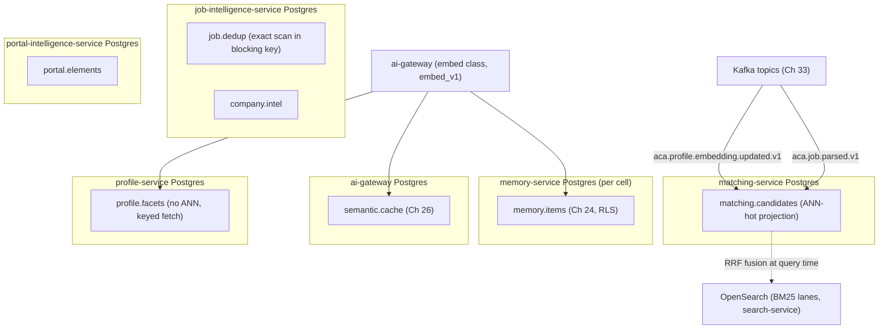
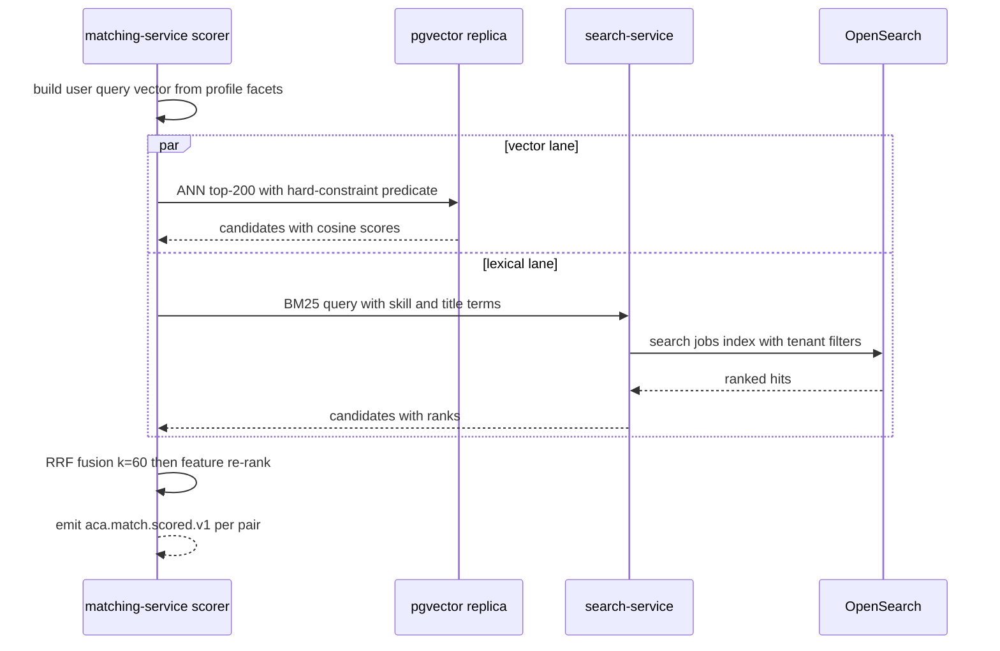
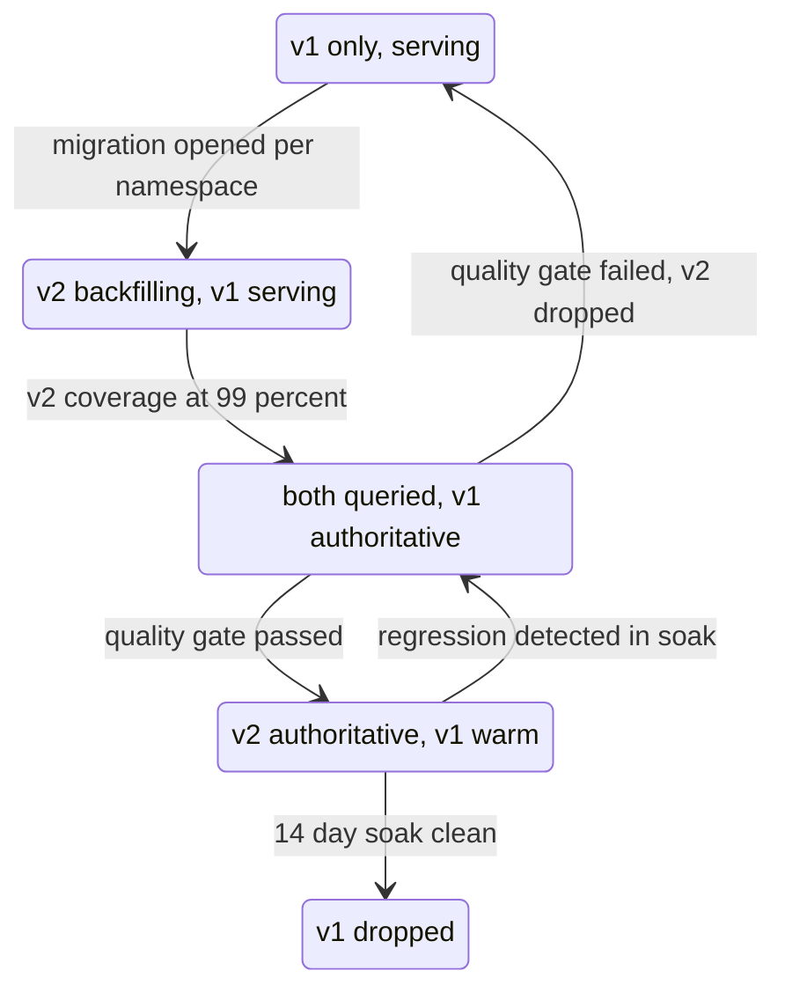

# 34 — pgvector

| | |
|---|---|
| Document ID | ACA-SAS-34 |
| Volume | 4 — Data Platform |
| Status | Draft v1.0 |
| Depends on | [00 — Architecture Canon](../00-architecture-canon.md) §3 §10.5, [04 — Non-Functional Requirements](../volume-1-foundation/04-non-functional-requirements.md) (NFR-015, NFR-027), [06 — Technology Stack](../volume-1-foundation/06-technology-stack.md) §9.2, [13 — Profile Service](../volume-2-core-services/13-profile-service.md), [15 — Job Intelligence Service](../volume-2-core-services/15-job-intelligence-service.md), [24 — Memory System](../volume-3-ai-architecture/24-memory-system.md), [26 — Semantic Cache](../volume-3-ai-architecture/26-semantic-cache.md), [33 — Kafka](33-kafka.md) |

## 1. Overview

pgvector is the phase-1 vector platform (canon §3): every embedding the system stores — profile facets, job postings, semantic-cache entries, agent memories, portal template elements, company intelligence — lives in a pgvector column inside the *owning service's* PostgreSQL database, accessed through the `embedding-store` interface. This chapter is the platform-level specification that individual service chapters delegate to: the namespace catalog with models and dimensions, per-namespace index strategy with recall/latency targets, hybrid search (vector + metadata + OpenSearch BM25 fusion), embedding versioning and the dual-read migration mechanic (canon §10.5), sizing math, the phase-2 Qdrant trigger and rehearsed migration plan, freshness SLOs, and retrieval-quality evaluation.

The load-bearing architectural decision — made in [Chapter 13](../volume-2-core-services/13-profile-service.md) and reaffirmed here — is **vectors live with their owner; ANN-heavy search runs on projections**. There is no central "vector database service." `profile-service` stores facet embeddings next to facts (transactional lifecycle: a profile purge deletes vectors in the same transaction); `matching-service` maintains the ANN-hot projection it searches; `ai-gateway` owns the semantic-cache index; `memory-service` owns memory embeddings under RLS. This topology is why pgvector is viable at phase-1 scale: no single node carries the union of all namespaces, and each namespace inherits its owner's tenancy (RLS), backup, and migration machinery for free — the properties a dedicated vector DB would have to re-implement ([Ch 24 §15](../volume-3-ai-architecture/24-memory-system.md)).

Scale anchors ([NFR §3](../volume-1-foundation/04-non-functional-requirements.md)): ~8 GB of active vectors at GA (≈ 2.2 M ANN-active vectors), 150 GB raw / ~400 GB with indexes at target scale, kNN p95 < 200 ms (NFR-015), with the named Qdrant migration trigger — **> 25 M active vectors or kNN p95 > 200 ms sustained 7 days** (NFR-027) — behind the `embedding-store` interface. All embeddings are produced by the `embed` model class via `ai-gateway` only (canon §9); the reference space is `embed_v1`: bge-class open-weight model, 1024 dimensions, cosine similarity, L2-normalized at write.

## 2. Platform Topology & the `embedding-store` Interface

### 2.1 Topology



### 2.2 The interface (library, not service)

`embedding-store` is a chassis library (TypeScript + Python variants) with one contract per language, backed by pgvector in phase 1 and Qdrant in phase 2. It is deliberately narrow — anything not expressible here does not get to depend on the store's engine:

| Method | Contract |
|---|---|
| `upsert(ns, id, embed_version, vector, metadata)` | Idempotent by `(ns, id, embed_version)`; vector must be L2-normalized; metadata is a flat JSON object of filterable scalars |
| `query(ns, embed_version, vector, k, filter?, ef_hint?)` | Returns ≤ k `(id, score, metadata)` by cosine similarity within `embed_version`; `filter` is conjunctive equality/range over metadata; `ef_hint` tunes recall/latency per call within namespace bounds |
| `delete(ns, ids | filter)` | Hard delete; GDPR purge path |
| `stats(ns)` | Row counts, per-version counts, index health — feeds §13 monitoring |

What the interface **excludes**, on purpose: cross-namespace queries (no legitimate consumer), raw SQL escape hatches (would fossilize pgvector-isms), and server-side joins (hybrid fusion happens in the consumer, §5). Where the owner co-locates vectors with relational state (profile, memory), the service may additionally touch the table inside its own transactions — that is owner privilege, invisible outside the service boundary.

| Aspect | `embedding-store` interface |
|---|---|
| Purpose | Vendor seam (canon §3) making the pgvector→Qdrant path a per-namespace adapter swap |
| Responsibilities | Contract above; version-scoped queries; normalization enforcement; per-namespace config (index params, caps) |
| Interactions | Owning services in-process; Qdrant adapter kept green in CI against contract tests ([Ch 06 §17](../volume-1-foundation/06-technology-stack.md)) |
| Failure scenarios | Inherits the owner's Postgres posture (§10) |
| Monitoring | §13 — per-namespace latency, recall probes, freshness |
| Alternatives | Central vector-store *service* rejected — §15 |

## 3. Namespace Catalog

All namespaces use `embed_v1` (bge-class, 1024-d) — one space platform-wide until a namespace demonstrably needs a specialist model (§14). Storage type is `halfvec(1024)` (fp16, 2 KB/vector): halves storage and index size versus fp32; measured recall delta on the evaluation sets (§9) is < 0.1 pt, far inside index-parameter noise.

| Namespace | Owner | Content (embedded text) | Rows GA → target | Query pattern | PII |
|---|---|---|---|---|---|
| `profile.facets` | `profile-service` | ~10 facet texts per active profile (skills summary, experience blocks, goals) — [Ch 13 §8](../volume-2-core-services/13-profile-service.md) | 1.0 M → 20 M | Keyed fetch by `(profile_id, facet)`; **no ANN** — the ANN consumer is the matching projection | P2 |
| `matching.candidates` | `matching-service` | Active-job composite (title + normalized description); per-user query vectors built from profile facets | 1.5 M → 20 M | ANN top-k (k ≤ 200) with metadata filters; the platform's ANN-hot path (20 M pair-scorings/day, L8) | P3 |
| `job.dedup` | `job-intelligence-service` | Posting body for dedup clustering — [Ch 15 §6](../volume-2-core-services/15-job-intelligence-service.md) | 1.5 M → 20 M (shares vectors with source rows) | **Exact scan within a blocking key** (company + title family), cosine ≥ 0.93; candidate sets are tens of rows — no ANN index at all | P3 |
| `semantic.cache` | `ai-gateway` | Request-input vectors for cache lookup — [Ch 26](../volume-3-ai-architecture/26-semantic-cache.md) owns semantics | 1.2 M → 12 M | ANN top-1 task-scoped, threshold ≥ 0.97 | P2 |
| `memory.items` | `memory-service` (per cell) | Memory item content — [Ch 24](../volume-3-ai-architecture/24-memory-system.md) owns semantics | 0.5 M → 10–20 M per cell | ANN top-k (k ≤ 32) under RLS `(tenant, user)` scope | P2 |
| `portal.elements` | `portal-intelligence-service` | Form-field labels/context for semantic field mapping; template similarity for fingerprint neighbors | 0.1 M → 1 M | ANN top-5, verified downstream by the perception pipeline (Volume 7) | P3 |
| `company.intel` | `job-intelligence-service` | Company profile facets (culture, stack, hiring signals) for retrieval into letters/prep | 0.3 M → 3 M | ANN top-k (k ≤ 20), company-scoped filters | P3 |

Platform totals: ≈ 5 M vectors / ~10 GB with indexes at GA (the ANN-active subset ≈ 2.2 M matches the NFR anchor); ≈ 75 M / 150 GB raw / ~400 GB with indexes at target — which is exactly why the 25 M-active-vector trigger fires *before* target scale for the hot namespaces (§8.3): the plan of record is Qdrant for `matching.candidates` (and likely `memory.items`) somewhere between GA and target, with the cold namespaces staying on pgvector indefinitely.

Reference DDL shape (the library generates per-namespace tables to this template; `semantic.cache` and `memory.items` DDL are owned by Chapters 26/24 and conform):

```sql
-- matching-service: the ANN-hot projection (unpartitioned by design, §4)
CREATE TABLE matching_candidate (
  id             UUID PRIMARY KEY,                  -- job_id (UUIDv7)
  embed_version  TEXT NOT NULL DEFAULT 'embed_v1',  -- canon §10.5
  embedding      HALFVEC(1024) NOT NULL,
  status         TEXT NOT NULL,                     -- active | expired (expired rows deleted, not flagged)
  remote_mode    TEXT NOT NULL,
  seniority      TEXT,
  lang           TEXT NOT NULL,
  geo_bucket     TEXT,
  comp_min       INT,
  posted_at      TIMESTAMPTZ NOT NULL,
  embedded_at    TIMESTAMPTZ NOT NULL               -- freshness SLI source (§7)
);
CREATE INDEX mc_emb_hnsw ON matching_candidate
  USING hnsw (embedding halfvec_cosine_ops) WITH (m = 16, ef_construction = 200);
CREATE INDEX mc_filter ON matching_candidate (lang, remote_mode, seniority, geo_bucket);
```

## 4. Index Strategy

### 4.1 HNSW parameters per namespace

HNSW is the default for every ANN namespace: high-churn corpora (jobs expire daily, cache entries TTL out, memories consolidate) rule out IVFFlat's train-once/drift-forever centroids as a *serving* index. Parameters, with targets the weekly recall probes (§9) enforce:

| Namespace | m | ef_construction | ef_search (default) | Target | Rationale |
|---|---|---|---|---|---|
| `matching.candidates` | 16 | 200 | 100 | recall@200 ≥ 0.95, p95 < 200 ms (NFR-015) | Largest ANN corpus + largest k; efc=200 buys graph quality at build time (build is background), efs=100 balances the 200 ms budget at 20 M rows |
| `semantic.cache` | 16 | 64 | 80 | recall ≥ 0.98, p99 inside the 25 ms stage budget | Fixed by [Ch 26 §5](../volume-3-ai-architecture/26-semantic-cache.md) — verbatim; false *misses* are cost, false hits are quality bugs, hence high recall at top-1 |
| `memory.items` | 16 | 128 | 80 | recall@32 ≥ 0.95, p95 < 50 ms | Fixed by [Ch 24 §9](../volume-3-ai-architecture/24-memory-system.md) (m, efc); context-assembly latency budget bounds efs |
| `portal.elements` | 16 | 64 | 64 | recall@5 ≥ 0.95, p95 < 50 ms | Small corpus; downstream verification tolerates occasional misses but retries cost browser-session time |
| `company.intel` | 16 | 64 | 60 | recall@20 ≥ 0.90, p95 < 100 ms | Enrichment retrieval; a missed 19th-best facet is negligible — cheapest acceptable settings |
| `profile.facets`, `job.dedup` | — (no ANN index) | — | — | — | Keyed fetch / exact scan within blocking key; an index would be pure write amplification |

`m=16` platform-wide is deliberate: recall probes showed no namespace needing m=24's memory (+50% index size) at our corpus sizes, and one value keeps capacity math and operator intuition uniform. `ef_search` is the *runtime* knob — per-query `ef_hint` within namespace bounds (max 400) is how §9's probe-driven tuning responds to recall sag without DDL.

### 4.2 When IVFFlat

IVFFlat is used in exactly three situations, none of them steady-state serving: (1) **migration staging** — bulk re-embeds (§6) build IVFFlat (`lists ≈ rows/1000`) on the shadow version first because it builds ~10× faster than HNSW, letting dual-read start early; the HNSW index is built concurrently and swapped in before cutover; (2) **evaluation snapshots** — frozen corpora for offline evals (`learning-pipeline`) where batch recall matters and build time dominates; (3) **archival namespaces** with rare, batch-only queries. Rule of thumb recorded for reviewers: if a namespace serves interactive traffic, it is HNSW; if it is rebuilt more often than it is queried, IVFFlat.

### 4.3 Index operations

- **Builds:** `CREATE INDEX CONCURRENTLY`; `maintenance_work_mem = 4 GB` on builder connections (HNSW build memory is the practical ceiling — a 20 M × 1024-d build that spills is a build that takes days); parallel workers 4.
- **Parameter changes:** never in place — build the new index concurrently, validate with a probe run, swap under a metadata lock, drop the old. Same mechanic as version migration, deliberately.
- **Churn hygiene:** high-delete namespaces (`semantic.cache` TTLs, `matching.candidates` expiries) get aggressive per-table autovacuum (`autovacuum_vacuum_scale_factor = 0.02`) — HNSW does not shrink on delete, so bloat shows up as latency first; the semantic cache's per-task-class partitions (Ch 26) additionally cap any single graph's size.
- **Replicas:** ANN queries run on a dedicated read replica per owning DB where the namespace is ANN-hot (`matching.candidates`); the primary serves writes and keyed reads. Replication lag folds into the freshness SLO (§7), not the recall SLO.

## 5. Hybrid Search

Vector similarity alone is insufficient for the two consumer classes that need ranking rather than lookup: matching (hard constraints + semantic fit) and user-facing search (keyword intent + semantic recall). The platform pattern is **filter → ANN → BM25 → RRF fusion**, executed by the consumer (matching-service or search-service), not inside any store:

| Stage | Where | Detail |
|---|---|---|
| Metadata filter | pgvector SQL predicate | Hard constraints (language, remote mode, geo bucket, seniority, comp floor) as a `WHERE` clause; pgvector 0.8 iterative index scans (`hnsw.iterative_scan = relaxed_order`, `hnsw.max_scan_tuples = 20000`) prevent the classic post-filter starvation where selective filters return < k rows; oversample ×4 before filtering as a floor |
| ANN lane | pgvector | Top-k by cosine within `embed_version` |
| Lexical lane | OpenSearch via `search-service` | BM25 over the jobs/applications indices ([canon §3](../00-architecture-canon.md)); carries exact-term intent (skill names, company names, certifications) that embeddings blur |
| Fusion | Consumer | Reciprocal Rank Fusion, `k = 60` (standard constant; insensitive ±20 in our evals): `score = Σ 1/(60 + rank_lane)`; no score normalization across lanes — RRF's rank-only property is why it is safe to fuse cosine and BM25 without calibration |
| Re-rank | Consumer | Matching applies its feature model on the fused candidate set ([Ch 15/21] pipeline); search returns fused order directly |



Which flows use which lanes (decision table — deviations require an eval showing lift):

| Flow | Lanes | Why |
|---|---|---|
| Autopilot matching pre-filter | vector + lexical, fused | Both signals proven complementary; the 15-min SLO budget affords two lanes in parallel |
| User job search (typed query) | lexical primary, vector secondary | Typed queries carry exact intent; vector lane rescues synonym/semantic misses |
| Semantic cache lookup | vector only | Threshold lookup, not ranking (Ch 26) |
| Memory retrieval | vector + metadata recency/tier boosts | Lexical adds nothing to conversational memory ([Ch 24 §6](../volume-3-ai-architecture/24-memory-system.md)) |
| Dedup clustering | exact vector within blocking key | Blocking *is* the filter; ANN and BM25 both unnecessary |
| Portal field mapping | vector top-5 + rules | Downstream verification replaces re-ranking |

## 6. Embedding Versioning & Dual-Read Migration (canon §10.5)

Every table carries `embed_version`; queries are always version-scoped (mixing spaces produces garbage cosines — the interface makes it structurally impossible). Model upgrades (`embed_v1 → embed_v2`) run per namespace:



| Phase | Mechanics | Gate to advance |
|---|---|---|
| Backfill | Re-embed via ai-gateway **batch lane** (≈ 50% cost, ≤ 24 h SLA, canon §10.2); the load model reserves up to 8 M embed calls/day for exactly this ([NFR §2.3](../volume-1-foundation/04-non-functional-requirements.md)); new rows dual-write both versions from the moment the migration opens (no moving target); shadow rows indexed IVFFlat first, HNSW built concurrently (§4.2) | ≥ 99% row coverage in v2; HNSW swapped in |
| Dual-read | Interface queries both spaces; v1 results serve; v2 results logged with full rank lists | `learning-pipeline` interleaved comparison on live traffic + golden sets (§9): v2 must be non-inferior on recall and strictly better on ≥ 1 tracked quality metric; per-namespace owner signs off |
| Cutover | v2 serves; v1 kept warm and dual-read *inverted* (v1 shadow) for regression detection | 14-day soak with no regression alert — long enough to cover weekly traffic cycles |
| Retire | v1 rows and index dropped; storage reclaimed | — |

Cost honesty: a full-platform re-embed at target scale is ~75 M embed calls ≈ 10 days of the reserved batch-lane envelope — embedding-model upgrades are scheduled campaigns with a cost line, not casual version bumps. Namespaces migrate independently (the cache can lag the matching projection by months); `embed_version` in every query is what makes that safe.

## 7. Consistency & Freshness SLOs

Embeddings are derived data; the SLO is lag from source-of-truth update to searchable vector. Two consistency modes exist and are chosen per namespace, not per mood:

- **Transactional (co-located):** the vector row commits in the same Postgres transaction as the source row. Searchable-at-commit; lag = embedding compute time only. Used by `memory.items`, `semantic.cache`, `profile.facets` (the pgvector-over-dedicated-store advantage named in [Ch 06 §9.2](../volume-1-foundation/06-technology-stack.md)).
- **Event-projected:** the vector lives in a projection fed by Kafka ([Ch 33 §6](33-kafka.md)); lag = event pipeline + embed + upsert. Used by `matching.candidates`, `company.intel`, `portal.elements`.

| Namespace | Trigger | Freshness SLO (p95) | Budget reasoning |
|---|---|---|---|
| `profile.facets` | profile fact change (debounced 60 s, [Ch 13 §8](../volume-2-core-services/13-profile-service.md)) | ≤ 5 min to `aca.profile.embedding.updated.v1` | Debounce absorbs edit bursts; 5 min keeps next matching cycle current |
| `matching.candidates` (job side) | `aca.job.parsed.v1` | ≤ 2 min | Stage budget inside the 15-min discovered→scored SLO; embed is batched ≤ 64 texts/call |
| `matching.candidates` (profile side) | `aca.profile.embedding.updated.v1` | ≤ 3 min after the profile event | Projection consumer lag SLO (Ch 33 §6.2) plus upsert |
| `memory.items` | memory write accepted | ≤ 30 s | Embed call + transactional insert; an agent's next step should see this run's memory |
| `semantic.cache` | response stored | at-commit | Write-after-response; a miss is safe (full compute), so no lag SLO — correctness lives in invalidation (Ch 26) |
| `company.intel` | `aca.company.enriched.v1` | ≤ 1 h | Batch-lane embedding; company intel staleness is measured in days |
| `portal.elements` | template promoted (`aca.portal.template.promoted.v1`) | ≤ 10 min | Templates must be searchable before the next session against that portal family |

The SLI is `embedded_at − source_updated_at` histograms per namespace (the `embedded_at` column exists for this), exported by `stats()` and alerted per §13. Replica lag on ANN replicas adds to event-projected freshness and is included in the same SLI (measured at the replica).

## 8. Sizing & the Phase-2 Qdrant Seam

### 8.1 Sizing math

Per-row cost: 2 KB vector (halfvec 1024) + ~0.4 KB metadata/row overhead + HNSW ≈ 1.2–1.5× multiplier on vector payload (m=16 link lists + graph levels). Working figure: **3.2 KB/row indexed**.

| Namespace | Target rows | Raw (2.4 KB) | With HNSW (3.2 KB) | × replicas | Notes |
|---|---|---|---|---|---|
| `matching.candidates` | 20 M | 48 GB | 64 GB | ×2 (primary + ANN replica) → 128 GB | Index working set ≈ 40 GB must be memory-resident for the 200 ms p95 — the sizing pressure point |
| `profile.facets` | 20 M | 48 GB | 48 GB (no ANN) | ×1 | Keyed access; page cache handles it |
| `memory.items` | 10–20 M/cell | ≤ 48 GB | ≤ 64 GB | per cell | Cells shard by construction (Ch 24 §11) |
| `semantic.cache` | 12 M | 29 GB | 48 GB provisioned | ×1 | Matches Ch 26 §9 (75 GB with metadata, 150 GB provisioned) |
| `company.intel` | 3 M | 7 GB | 10 GB | ×1 | |
| `portal.elements` | 1 M | 2.4 GB | 3.2 GB | ×1 | |
| **Platform total** | ~75 M | ~150 GB | ~250–400 GB | — | Matches the NFR §3 envelope; GA totals are ~5% of these |

### 8.2 Trigger criteria (verbatim from NFR-027, operationalized)

Migration to Qdrant executes when **either**: (a) ANN-active vectors exceed **25 M** platform-wide, or (b) kNN p95 exceeds **200 ms sustained 7 days** on any ANN-hot namespace at correct index parameters. **Leading indicators** that start the rehearsal (not the migration): any single namespace crossing **10 M** vectors, or HNSW build memory pressure on the owning DB ([Ch 06 §9.2](../volume-1-foundation/06-technology-stack.md)). Given §8.1, `matching.candidates` is the predicted first mover, between GA and target scale.

### 8.3 Migration plan (rehearsed in staging before the trigger, per NFR-027)

1. **Stand up Qdrant** (3 nodes, replication factor 2, one collection per namespace-version, payload-indexed on the namespace's filter fields). Kubernetes, same cells as the owning service.
2. **Adapter parity**: the Qdrant `embedding-store` adapter is already kept green in CI against the interface contract tests ([Ch 06 §17](../volume-1-foundation/06-technology-stack.md)) — the migration does not begin with adapter development.
3. **Backfill** the namespace from a Postgres snapshot (bulk upsert, ~1 M vectors/hour/node conservative).
4. **Dual-write** live upserts/deletes to both stores (interface-level fan-out; failures on the shadow store alert but do not fail the write).
5. **Dual-read shadow**: queries served by pgvector, mirrored to Qdrant; parity gates = recall overlap ≥ 0.98 vs pgvector results, p95 latency ≤ 0.5× pgvector (the reason to migrate), zero filter-correctness diffs on the golden sets.
6. **Cutover reads** per namespace behind a feature flag (`feature-flag-service`); pgvector kept warm 14 days (inverse shadow), then dual-write stops and the pgvector index is dropped.
7. **Tenancy note**: namespaces under RLS (`memory.items`) migrate **last** — Qdrant enforces tenancy by payload filter + collection partitioning, which is application-enforced rather than database-enforced; the compensating control (mandatory tenant filter injected by the adapter, contract-tested) must be reviewed by security before any P2 namespace moves.

The same seven steps, run per namespace, are the rollback plan in reverse — dual-write symmetry is what makes the migration boring, which is the design goal.

## 9. Evaluation of Retrieval Quality

Retrieval quality is a monitored SLI, not an assumption (canon §14 makes AI quality first-class):

| Mechanism | Cadence | Detail |
|---|---|---|
| **Recall probes** | Weekly per ANN namespace (daily during migrations) | Sample 1,000 production-shaped queries; ground truth by exact scan on the replica (`SET enable_indexscan = off` lane); report recall@k at the namespace's target k; alert on 2-pt drop from baseline. Established for the cache in [Ch 26 §12](../volume-3-ai-architecture/26-semantic-cache.md); generalized here |
| **Golden retrieval sets** | Per release + per migration gate | Curated query→expected-results sets per namespace, versioned in `learning-pipeline` alongside prompt eval sets ([Ch 29](../volume-3-ai-architecture/29-learning-pipeline.md)); job/matching sets refreshed quarterly (corpus drift), memory sets synthetic (privacy) |
| **Online proxies** | Continuous | Match acceptance rate per surfaced match (`aca.match.scored.v1` → user actions), semantic-cache false-hit rate (Ch 26 quality guard), dedup precision samples (Ch 15), portal field-mapping verification pass rate — each attributed to retrieval vs downstream by the owning chapter's dashboards |
| **Interleaved comparisons** | During dual-read phases only | v_old vs v_new (or pgvector vs Qdrant) result-list interleaving on live traffic; the §6 cutover gate |
| **Parameter-change gates** | On any index/ef change | Probe run before and after; a tuning change that trades > 1 pt recall for latency requires the namespace owner's sign-off recorded in the catalog |

## 10. Failure Scenarios

| Scenario | Effect | Response |
|---|---|---|
| ANN replica loss (`matching.candidates`) | ANN queries fail over to primary; latency SLO at risk under combined load | HPA on scorer concedes throughput (batch lanes slow first); replica rebuild from base backup ≈ minutes at these sizes; matching degrades to lexical-lane-only candidates if p95 breaches 2× budget (graceful-degradation rule, [Ch 15](../volume-2-core-services/15-job-intelligence-service.md)) |
| HNSW index corruption / bloat-driven latency creep | Recall or latency SLI breach without code change | Rebuild concurrently and swap (§4.3); the probe history distinguishes bloat (gradual) from corruption (step) |
| Embedding backfill overruns batch-lane budget | Migration stalls; dual-write continues safely | Backfill is resumable (per-namespace watermark); `cost-controller` throttles per canon §10.2 — migrations yield to interactive traffic by design |
| ai-gateway `embed` unavailable | Transactional namespaces block their write paths (memory intake spools, [Ch 24 §8](../volume-3-ai-architecture/24-memory-system.md)); event-projected namespaces accumulate lag | Freshness SLI pages at 2× SLO; consumers drain on recovery; no data loss (events retained 7 d, Ch 33) |
| Version-mix bug (query without version scope) | Garbage similarity results | Structurally prevented by the interface (version is a required parameter); the raw-SQL owner privilege is covered by a lint rule on `halfvec` queries requiring `embed_version` in the predicate |
| Freshness lag on `matching.candidates` | Users matched against stale corpus | 15-min pipeline SLO burn alerts fire from the freshness SLI before user impact; KEDA scales the projection consumer (bounded by 64 partitions, Ch 33 §4) |
| Qdrant shadow store down during migration | Dual-write alerts, primary path unaffected | Shadow catches up from dual-write backlog or re-backfills the gap window; migration timeline slips, service does not |

## 11. Scaling Strategy

Scaling is per-namespace because ownership is per-service: (1) **read scaling** = ANN replicas (one today, two before trigger) — ANN is read-dominant everywhere except the cache; (2) **write scaling** = batch embedding (≤ 64 texts/call) and projection-consumer parallelism up to partition counts ([Ch 33 §4](33-kafka.md)); (3) **corpus scaling** = keep ANN sets *active-only* (`matching.candidates` deletes expired jobs rather than flagging them — the projection is rebuildable from events, so deletion is safe and keeps the graph small); (4) **cell scaling** shards `memory.items` by construction; (5) past the trigger, scaling *is* the Qdrant seam (§8.3) — horizontal sharding of HNSW inside Postgres is explicitly not attempted. The anti-goal is a central vector cluster that every service depends on; the topology keeps each namespace's failure and scaling domain inside its owner.

## 12. Security Considerations

- **Tenancy:** namespaces holding tenant data (`memory.items`, `profile.facets`, tenant-scoped cache rows) sit under the owner's RLS policies (canon §6) — vectors are rows like any other. Global namespaces (`matching.candidates`, `company.intel`, `portal.elements`) hold P3 job/company/portal data with no tenant rows by construction.
- **Embedding inversion:** treat embeddings at the PII class of their source text (a P2 profile facet's vector is P2 — inversion attacks recover semantic content); this classification drives backup encryption and the §8.3 note that P2 namespaces migrate to Qdrant only with reviewed tenancy controls.
- **Purge:** GDPR deletion reaches vectors through the owner's purge saga (co-located rows die in-transaction; projections consume `aca.user.deleted.v1` tombstones — [Ch 12 §7](../volume-2-core-services/12-user-service.md)); the `delete(ns, filter)` interface method exists for exactly this path and is audit-logged.
- **No direct store exposure:** the interface is in-process within owners; there is no network-reachable "vector API" to attack. Qdrant phase 2 introduces one — its mTLS + per-collection authz posture is specified before first production byte (§8.3 step 7).

## 13. Observability

| Signal | Threshold | Rationale |
|---|---|---|
| kNN latency per namespace (p50/p95/p99) | p95 > namespace target (§4.1) for 1 h → alert; > 200 ms 7 d on ANN-hot → **trigger review** (NFR-027) | The Qdrant trigger is a monitored SLI, not a retrospective discovery |
| Recall probe result per namespace | 2-pt drop from baseline → alert; below target → page owner | Quality regression detection (§9) |
| Freshness `embedded_at − source_updated_at` p95 | > SLO (§7) → alert at 1×, page at 2× | Derived-data staleness is invisible to users until matches degrade |
| Active vector count per namespace + platform ANN-active total | 10 M/namespace → rehearsal; 25 M platform → trigger | NFR-027 operationalization |
| Index size vs table size ratio, dead-tuple ratio | ratio drift > 30% from baseline → bloat investigation | HNSW bloat shows as latency; catch it as storage first |
| HNSW build duration + peak memory (migrations) | build > 24 h projected → replan | Backfill scheduling input |
| Dual-read divergence rate (during migrations) | overlap < 0.98 → hold gate | §6/§8.3 gates are dashboards, not documents |
| Embed-call spend per namespace (`aca.ai.request.completed.v1` attribution) | budget per campaign | Re-embedding is a priced activity (§6) |

## 14. Future Improvements

- **Matryoshka/truncated dimensions** for cheap namespaces (`portal.elements`, `company.intel` at 512-d) once an `embed_v2` model with MRL training lands — halves their footprint; requires per-namespace dimension metadata the schema already carries (canon §10.5).
- **Binary/scalar quantization probes**: evaluate `halfvec` → quantized rescoring (pgvector `bit` + rerank) for `matching.candidates` before the Qdrant trigger — could defer the migration a phase.
- **Learned fusion weights**: replace fixed RRF with a per-flow learned combiner in `learning-pipeline` once outcome volume supports it; RRF stays the fallback.
- **Per-tenant recall reporting** for enterprise cells (their corpora skew differently; a global probe can hide a tenant-local regression).
- **Streaming freshness** for `matching.candidates` via direct consumer upsert batching improvements — target ≤ 60 s job-side freshness, tightening the 15-min pipeline's margin.

## 15. Alternatives Considered & Tradeoffs

| Decision | Alternative | Tradeoff accepted |
|---|---|---|
| Vectors-with-owner + projections | Central vector-store service | A central store recreates the shared-database anti-pattern (canon §2) with worse failure coupling; accepted cost: the same job vector exists in ≤ 2 places (source + projection), reconciled by events — storage is cheap, coupling is not |
| pgvector phase 1, Qdrant at trigger | Qdrant day 1 | Decided platform-wide in [Ch 01 D10](../volume-1-foundation/01-executive-summary.md)/[Ch 06 §9.2](../volume-1-foundation/06-technology-stack.md); this chapter operationalizes the trigger and rehearsal so the deferred cost stays bounded |
| `halfvec` fp16 everywhere | fp32 vectors | < 0.1 pt recall delta for 2× storage/memory savings; accepted: re-validation of the delta on every embed-model change (added to §9 migration gates) |
| One `embed_v1` space for all namespaces | Per-namespace specialist models | Specialist models (e.g., code-tuned for portfolio) would fragment the batch lane, the cache, and version management for unproven lift; the namespace catalog carries model metadata so a namespace *can* diverge later with evidence |
| HNSW serving, IVFFlat only for staging/archival | IVFFlat serving (cheaper builds) | IVFFlat centroid drift on churn-heavy corpora degrades recall silently; HNSW's build cost is paid in background and §4.3 makes rebuilds routine |
| RRF fusion in consumers | Store-side hybrid (OpenSearch k-NN, pgvector + FTS in one query) | Single-store hybrid marries the two lanes' scaling and failure domains and was rejected for primary retrieval in [Ch 06 §9.2](../volume-1-foundation/06-technology-stack.md); consumer-side RRF keeps lanes independently degradable (lexical-only fallback, §10) |
| Exact scan for dedup | ANN index on `job.dedup` | Blocking keys cap candidate sets at tens of rows — exact scan is both faster and exact; an ANN index would add write amplification on the highest-churn table for negative benefit |
