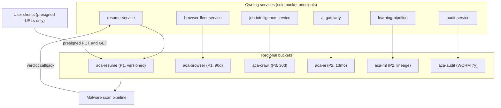
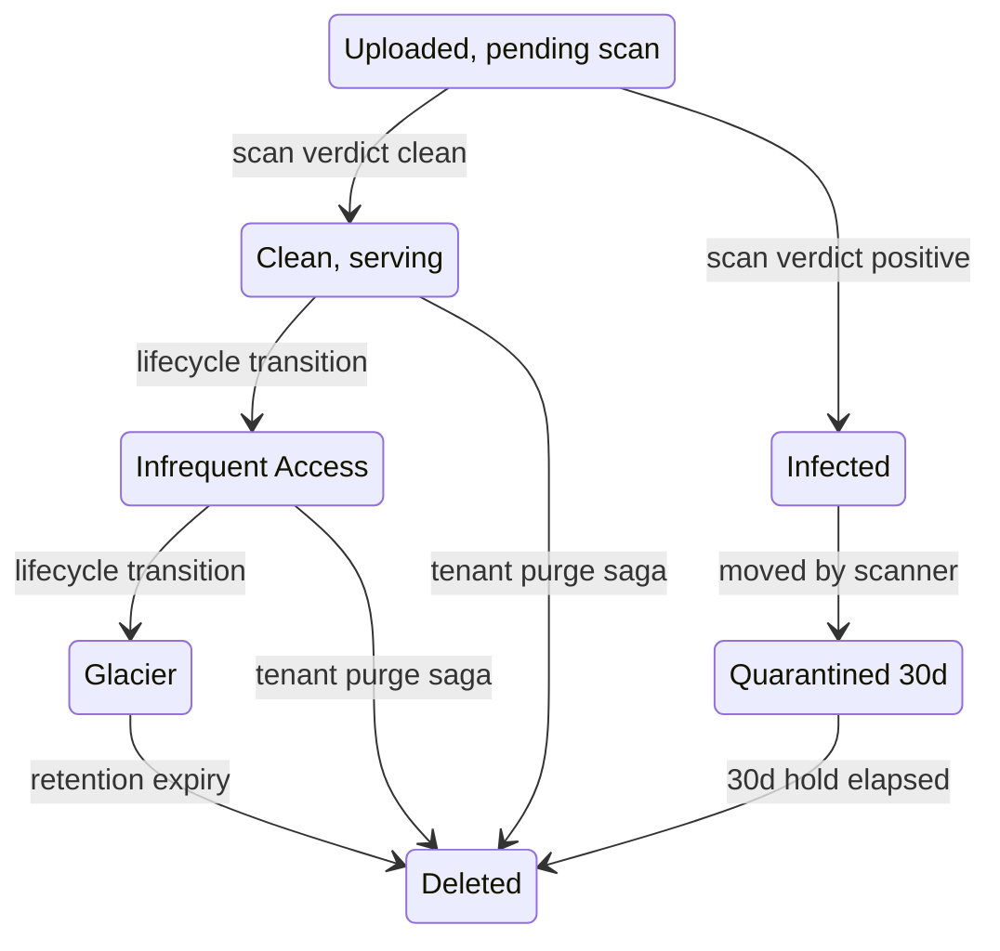
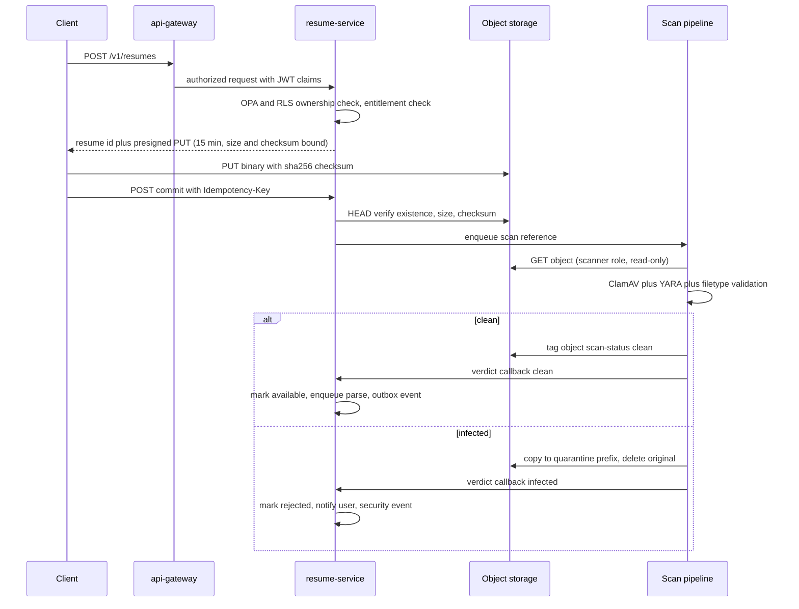
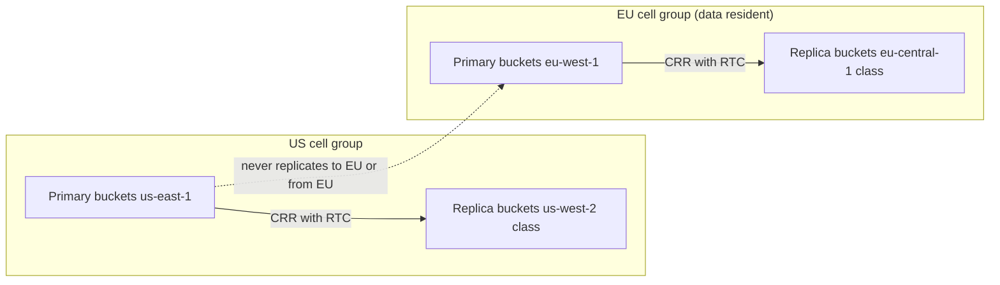

# 35 — Object Storage

| | |
|---|---|
| Document ID | ACA-SAS-35 |
| Volume | 4 — Data Platform |
| Status | Draft v1.0 |
| Depends on | [00 — Architecture Canon](../00-architecture-canon.md) §11 §13 §15, [10 — API Gateway](../volume-2-core-services/10-api-gateway.md) §7 (presigned bypass), [14 — Resume Service](../volume-2-core-services/14-resume-service.md) §8 (established bucket layout), [15 — Job Intelligence Service](../volume-2-core-services/15-job-intelligence-service.md), [17 — Browser Fleet](../volume-2-core-services/17-browser-fleet.md), [33 — Kafka](33-kafka.md) §10 |

## 1. Overview

Object storage is the platform's artifact plane: everything too large, too binary, or too long-lived for Postgres or Kafka — resume sources and rendered PDFs, browser screenshots and DOM snapshots, raw crawl documents, AI request-log archives and tool-result overflow (the claim-check pattern, HLA rule R9), learning datasets and model artifacts, GDPR/compliance exports, Kafka tiered segments, and the 7-year WORM audit record. The canonical implementation is S3 (canon §3), with MinIO for on-prem enterprise cells behind the same S3 API — every rule in this chapter is expressed in S3-API terms deliberately, because that API *is* the vendor seam.

This chapter specifies the bucket and prefix architecture (extending the layout [Chapter 14 §8](../volume-2-core-services/14-resume-service.md) established for resumes into a platform standard), encryption and key management including the per-tenant-key posture for P1 artifacts, lifecycle policies per artifact class implementing canon §11 retention verbatim, the presigned-URL access pattern and its authorization flow, integrity controls (checksums, content addressing, versioning), Object Lock WORM for audit, cross-region replication under data-residency constraints, cost tiering, the malware-scanning pipeline for user-supplied uploads, and egress governance.

Three invariants govern everything here. **First: no service reads another service's bucket.** Data ownership (canon §11) applies to objects exactly as to rows; cross-service artifact access is via the owner's API minting presigned URLs after authorization — never via shared bucket policies. **Second: binaries never transit the service plane.** Uploads and downloads go direct-to-storage via presigned URLs ([Chapter 10 §7](../volume-2-core-services/10-api-gateway.md)); API pods exchange only JSON and references. **Third: P0 material never enters this plane.** Credentials, cookies, and session secrets live exclusively in `session-vault-service`'s envelope-encrypted store (canon §11); any P0 detection in an upload or artifact is a security incident, not a storage decision.

Scale context: at target load the dominant write streams are browser artifacts (~250 GB/day of screenshots + DOM snapshots at 100k sessions/day), crawl documents (~200 GB/day at 2M discoveries), AI request archives (~100 GB/day compressed), and resume renders (~25 GB/day, [Ch 14 §12](../volume-2-core-services/14-resume-service.md)) — order 600 GB/day inbound, ~100 TB steady-state after lifecycle policies. At that shape, lifecycle and tiering discipline (§4) is worth more than any single performance optimization.

## 2. Bucket & Prefix Architecture

### 2.1 Bucket catalog

Buckets are per-domain, per-environment, per-region. Logical names follow Chapter 14's established `aca-<domain>-{env}` form; the physical S3 name (globally unique) appends the region: `aca-resume-prod-use1`. Services address logical names through chassis configuration — code never embeds physical names, which is what lets MinIO cells and region failover rebind targets.

| Logical bucket | Owner (sole API access) | Content | Max PII | Versioning | Object Lock |
|---|---|---|---|---|---|
| `aca-resume-{env}` | `resume-service` | Source uploads, canonical model exports, rendered artifacts, parse intermediates, quarantine ([Ch 14 §8](../volume-2-core-services/14-resume-service.md) layout is normative) | P1 | On | — |
| `aca-portfolio-{env}` | `portfolio-service` | Project artifacts, portfolio site bundles, repo analysis outputs | P2 | On | — |
| `aca-browser-{env}` | `browser-fleet-service` | Screenshots, DOM snapshots, session traces, failure evidence | P1 (portal pages render user PII) | Off (append-only naming, §6) | — |
| `aca-crawl-{env}` | `job-intelligence-service` | Raw fetched documents, parse intermediates | P3 | Off | — |
| `aca-ai-{env}` | `ai-gateway` | Request-log archive (90 d hot in Postgres → here for 13 months, canon §11), tool-result overflow (claim check), batch-lane payloads | P2 | Off | — |
| `aca-ml-{env}` | `learning-pipeline` | Training/eval datasets, eval run outputs, model artifacts (vLLM weights, adapters) | P2 | On (datasets are lineage) | — |
| `aca-export-{env}` | `user-service` / `admin-service` / `analytics-service` (per prefix) | GDPR exports, compliance exports, analytics report exports | P1 | Off | — |
| `aca-audit-{env}` | `audit-service` | Hash-chained audit segments, compliance export snapshots | P1 | On | **Compliance mode, 7 y** |
| `aca-kafka-{env}` | Kafka brokers (tiered storage) | Remote log segments ([Ch 33 §10](33-kafka.md)) | P2 | Off (Kafka manages lifecycle) | — |

Out of data-plane scope but present per canon §3: Terraform state buckets (with locking) and Postgres backup targets — owned by Volume 6, listed here only so no bucket exists outside a catalog.

### 2.2 Prefix and key conventions

| Rule | Convention | Rationale |
|---|---|---|
| Tenant data | `tenants/{tenant_id}/...` as first path element | One prefix = one tenant's blast radius: per-tenant listing, per-tenant purge, per-tenant metrics, and IAM/policy conditions all key off it |
| Global (non-tenant) data | `global/...` | Crawl docs, model artifacts, portal evidence — makes "no tenant data outside `tenants/`" a lintable invariant |
| Immutable content | Content-addressed terminal segment: `.../{sha256}.{ext}` | Established in Ch 14: free dedup, tamper-evident references, cache-forever semantics |
| Run-scoped artifacts | `.../{run_id}/...` or `.../{session_id}/...` (UUIDv7) | Time-ordered IDs make prefix listings chronological; lifecycle rules match on prefix age cleanly |
| No user-supplied names in keys | Original filenames stored as object metadata (`x-amz-meta-filename`), never in the key | Key-injection and path-traversal hygiene; keys are system-generated only |

Representative layouts (Ch 14 owns the resume layout; these extend the pattern):

| Bucket | Key pattern |
|---|---|
| `aca-browser-{env}` | `tenants/{tenant_id}/sessions/{session_id}/shots/{step_seq}.webp`, `.../dom/{step_seq}.json.zst`, `.../trace/{session_id}.zst` |
| `aca-crawl-{env}` | `global/sources/{source_id}/{yyyy-mm-dd}/{sha256}.html.zst` |
| `aca-ai-{env}` | `global/request-archive/{yyyy-mm-dd}/{hour}/{batch_uuid}.jsonl.zst`, `tenants/{tenant_id}/tool-overflow/{run_id}/{sha256}.json` |
| `aca-export-{env}` | `tenants/{tenant_id}/gdpr/{request_id}/export.zip` |
| `aca-audit-{env}` | `tenants/{tenant_id}/chain/{yyyy}/{mm}/{dd}/segment-{seq}.jsonl` + `.../manifest-{seq}.json` |

## 3. Encryption & Key Management

| PII class of artifact | Encryption | Key arrangement | Rationale |
|---|---|---|---|
| P1 (resume sources, browser artifacts, exports, audit) | SSE-KMS, Bucket Keys **off** on P1 prefixes | Cell-scoped CMK + mandatory KMS **encryption context** `{"tenant_id": "..."}` on every P1 object; **dedicated CMK per enterprise/university tenant** with a dedicated cell | Encryption context binds every data key to its tenant cryptographically and in CloudTrail: a decrypt outside the tenant's authorized path fails and audits. Bucket Keys stay off so each object gets a fresh data key under its own context |
| P2 (renders under Ch 14 rules use per-tenant posture; ML datasets, AI archives) | SSE-KMS, Bucket Keys on | Per-bucket CMK | Bucket Keys cut KMS request cost ~99% on high-volume streams where per-object context adds nothing (global/aggregate data) |
| P3 (crawl docs, Kafka segments) | SSE-S3 | S3-managed | At-rest compliance with zero KMS cost at 200 GB/day write rates |

**The per-tenant-key decision, honestly.** Canon §11 requires per-tenant KEKs for P0 (session vault — Vault-transit keys, not in this plane) and Chapter 14 declared "SSE-KMS, per-tenant KEK" for resume artifacts. A literal CMK per tenant does not survive contact with the tenant model: individual users are single-member tenants (canon §6), so 500k GA users ≈ 500k CMKs ≈ $500k/month in key charges alone. The platform posture is therefore: **cryptographic per-tenant separation via per-object data keys bound to tenant-scoped encryption context under a shared cell CMK**, with **true dedicated CMKs (optionally BYOK) for enterprise/university tenants on dedicated cells** — who are the tenants whose threat model and contracts actually demand key-level isolation and revocation. Per-tenant *revocation* for individual tenants is delivered by the deletion saga (hard delete of objects, §4) rather than key destruction. This refinement is recorded for canon promotion.

Key rotation: CMKs rotate yearly (KMS automatic); data keys are per-object so rotation is forward-only (no re-encryption sweeps; objects re-key on lifecycle rewrite or never — accepted, standard SSE-KMS posture). Vault is uninvolved in this plane except as the audit trail's co-signer for enterprise BYOK ceremonies (Volume 5).

## 4. Object Lifecycle & Cost Tiering

Lifecycle rules implement canon §11 retention *as bucket policy*, so retention holds even if application-level cleanup fails. Storage classes: Standard → Standard-IA (30-day minimum billing) → Glacier Flexible → Glacier Deep Archive.

| Artifact class | Bucket / prefix | Transition policy | Terminal | Rationale |
|---|---|---|---|---|
| Resume sources, models, renders | `aca-resume` `tenants/` | Standard → IA at 90 d (old versions are rarely re-read after tailoring settles) | Retained until tenant purge; noncurrent versions expire at **30 d** | User data: no time-based deletion; 30 d noncurrent cap keeps versioning from defeating GDPR hard-delete guarantees |
| Parse intermediates | `aca-resume` `tmp/parse/` | — | Delete at 7 d (Ch 14) | Debug value only |
| Quarantined uploads | `aca-resume` `quarantine/` | — | Delete at 30 d (Ch 14) | Forensics window |
| Screenshots, DOM snapshots | `aca-browser` | Standard → IA at 30 d (read pattern: hot for ~1 week of dispute/debug, then cold) | Delete at **90 d** or per-tenant policy (canon §11); enterprise policy may extend to 180 d — policy suffix on prefix rules | Evidence artifacts, not user documents |
| Session traces | `aca-browser` `trace/` | — | Delete at 30 d | Debug-density data; recovery-agent needs days, not months |
| Raw crawl artifacts | `aca-crawl` | none (IA's 30-day minimum equals the object's whole life — transition would cost more than it saves) | Delete at **30 d** (canon §11) | Reparse window for parser regressions ([Ch 15](../volume-2-core-services/15-job-intelligence-service.md)) |
| AI request archive | `aca-ai` `request-archive/` | IA at 30 d → Glacier Flexible at 120 d (past the 90 d hot window + dispute margin) | Delete at **13 months** (canon §11) | Billing disputes and abuse forensics decay fast; 13 months covers a full annual cycle |
| Tool-result overflow | `aca-ai` `tool-overflow/` | — | Delete at 90 d, or with owning run's retention if shorter | Claim-check payloads are meaningless once the run's audit window closes |
| Datasets, eval runs | `aca-ml` | IA at 90 d | Keep last 4 dataset generations per family (application-level GC; lifecycle backstop at 25 months) | Reproducibility of the learning loop ([Ch 29](../volume-3-ai-architecture/29-learning-pipeline.md)) without unbounded growth |
| Model artifacts | `aca-ml` `models/` | — | Keep current + previous per deployment target (app-level GC) | Rollback capability is the retention driver |
| Exports (GDPR, reports) | `aca-export` | — | Delete at **30 d** | Long enough for the user to fetch; short enough that exports do not become a shadow copy of the platform |
| Audit segments | `aca-audit` | Glacier Flexible at 1 y (verification reads are rare after the first year; Object Lock is storage-class-independent) | Expire at **7 y** (aligned with lock expiry) | Canon §11 verbatim |
| Kafka segments | `aca-kafka` | — | Deleted by broker retention ([Ch 33 §10](33-kafka.md)); lifecycle backstop at 30 d catches orphaned segments | Kafka is authoritative; the backstop is leak insurance |
| All buckets | — | Abort incomplete multipart uploads at 7 d | — | Half-uploaded invisible bytes are a classic cost leak |

GDPR deletion (canon §11: hard delete within 30 days) is executed by owner services enumerating `tenants/{tenant_id}/` and issuing versioned deletes for **all versions** — lifecycle noncurrent-expiry is the backstop, not the mechanism. The audit bucket is the sole exception: audit events are lawful-basis retained and tenant erasure is recorded *in* the chain, with PII in audit payloads pseudonymized at write time (Volume 5 owns that contract).

## 5. Access Patterns — Presigned URLs & Authorization Flow

### 5.1 The pattern

All client-facing binary I/O uses presigned URLs minted by the owning service after full authorization (JWT → OPA → RLS-scoped ownership check). Established parameters ([Ch 14 §4](../volume-2-core-services/14-resume-service.md)) become platform standards:

| Parameter | Value | Rationale |
|---|---|---|
| Presign TTL (GET and PUT) | 15 min | Slow-mobile-friendly; bounds leaked-URL value (Ch 14) |
| PUT conditions | Exact `content-length-range`, required `x-amz-checksum-sha256`, enforced `Content-Type` from an allowlist | The URL can upload exactly one declared object, nothing else |
| Upload size caps | Resume 15 MiB; portfolio 100 MiB; exports assembled server-side (no client PUT) | Resume cap per [Ch 10 §7](../volume-2-core-services/10-api-gateway.md); portfolio covers site bundles; caps are entitlement-checkable |
| Internal service access | IAM role per owning service, scoped to its bucket + VPC gateway endpoint condition | No cross-service grants exist to audit away; VPC endpoints remove NAT cost and public-path exposure |
| Client GET at volume (render previews) | Presigned URLs, CDN-fronted only if §10 metering shows egress pressure — signed-URL semantics preserved either way | Premature CDN indirection adds an auth surface; adopt on evidence |

### 5.2 Upload + scan sequence (resume as the reference flow)

### 5.3 Scan pipeline — component record

| Aspect | Detail |
|---|---|
| Purpose | No user-supplied binary becomes downloadable or parseable without a clean verdict |
| Scope | All user-origin uploads: resume/portfolio uploads, email-agent attachments; **not** crawl documents (P3, never executed, parsed in sandboxed workers) or platform-generated artifacts (screenshots, renders) |
| Placement | Platform infrastructure (like the Debezium relay — [Ch 33 §5](33-kafka.md)), not a catalog service: a worker deployment consuming a scan queue fed by owner-service enqueue at commit time |
| Engines | ClamAV + YARA ruleset + strict filetype validation (magic bytes vs declared type vs extension); commercial engine slot behind the same verdict interface |
| Isolation | Dedicated node pool, gVisor-sandboxed workers, **no egress** NetworkPolicy (definition updates via pull-through cache), read-only bucket role |
| Verdict delivery | Object tag `scan-status` + gRPC callback to the owning service (which owns state + outbox events); bucket policies deny presigned GET on objects lacking `scan-status=clean` in scanned prefixes — belt and suspenders with the service-level state gate (Ch 14) |
| SLO | Verdict p95 < 60 s for ≤ 15 MiB objects — inside the resume-parse pipeline's user-visible budget |
| Failure posture | Queue backlog → uploads stay `pending` (fail-closed, never fail-open); backlog alert at 5 min of arrivals |
| Rescan | Quarantine re-checked on signature updates during its 30-day hold (false-positive recovery); clean objects are immutable and not rescanned — compensating control is upload-time defense plus content-addressing (a re-upload of the same bytes is the same object) |

## 6. Integrity & Versioning

- **Checksums end-to-end:** clients send `x-amz-checksum-sha256` (enforced by presign conditions); S3 verifies at ingest; the owner's commit re-verifies via HEAD; content-addressed keys make the hash part of the reference. The submission saga's verify-before-submit ([Ch 14 §8](../volume-2-core-services/14-resume-service.md)) — the approved document provably equals the submitted one — is the pattern's payoff.
- **Versioning** on buckets where objects are mutable references (resume — though content addressing makes most writes create-only; ml datasets; audit for Object Lock's benefit). Buckets with append-only naming (browser, crawl, ai) run unversioned: their keys are never overwritten by construction, and versioning would double storage on the highest-volume streams for zero protection.
- **Immutability by convention, verified:** a weekly integrity sampler re-reads ~1,000 random objects per bucket, re-hashes, and compares with the key/manifest hash — bit-rot and replication-corruption detection at negligible cost.
- **Replication integrity:** CRR metrics (§8) plus the sampler running in the standby region against replicated objects.

## 7. Audit WORM — Object Lock

The audit trail's system of record is `aca-audit-{env}` (Kafka retains only 30 d — [Ch 33 §10](33-kafka.md)):

| Control | Setting | Rationale |
|---|---|---|
| Object Lock | **Compliance mode**, default retention 7 y, set at bucket creation | Compliance mode binds even account root; governance mode would make the WORM claim contractual rather than technical |
| Write path | `audit-service` (sole principal) appends daily per-tenant segments (`segment-{seq}.jsonl`) + a manifest carrying the segment hash and previous-manifest hash — the hash chain (canon: audit log is hash-chained) | Chain across manifests makes gaps and reordering detectable; daily segmentation bounds object counts (millions of events → hundreds of objects/tenant/year) |
| Verification | Quarterly chain-walk job re-hashes segments against manifests; results are themselves audit events | A WORM store that is never verified is a hope, not a control |
| Legal hold | S3 Legal Hold flag per litigation scope, applied via `admin-service` JIT-elevated ops (canon §13) | Holds beyond 7 y without changing default retention |
| Deletion | None until retention expiry; lifecycle expiry at 7 y + 1 d | Lock and lifecycle aligned so expiry is automatic, not operational |
| SCP guardrail | Organization-level policy denies `s3:PutBucketObjectLockConfiguration` changes and `s3:DeleteObjectVersion` on `aca-audit-*` for all principals | Defense against compromised admin credentials — the canon's zero-trust posture applied to ourselves |

## 8. Cross-Region Replication & Residency

| Item | Decision | Rationale |
|---|---|---|
| Topology | CRR per bucket to a same-jurisdiction pair region; **replication never crosses a residency boundary** | Residency is a property of the tenant's cell (canon §15: EU tenants pinned to EU cell); the bucket catalog's region binding inherits it. Note the standby pair for US object data is a second US-jurisdiction region, whereas the platform's warm-standby *compute* region is eu-west-1-class — object storage follows data law, compute follows the DR plan; the DR runbook reads US artifacts cross-region during a failover rather than storing them in the EU |
| Replication SLO | S3 Replication Time Control: 99.99% of objects within 15 min | Object RPO ≤ 15 min is looser than the platform's 5-min DB/Kafka RPO — acceptable and recorded: artifacts are either re-derivable (renders, screenshots) or commit-gated (a resume whose replica lags is re-uploadable; the authoritative state row in Postgres replicates at ≤ 5 min and references the object by hash, so loss is detectable, not silent) |
| Scope | Replicated: resume, portfolio, ml, export, audit (lock-preserving — replica bucket also Object-Lock enabled), ai archive. **Not replicated:** crawl (30-day re-derivable, ~6 TB of churn), browser artifacts older than 7 d (recent evidence replicates; bulk history is debug data), Kafka segments (Kafka DR is MM2, [Ch 33 §11](33-kafka.md) — replicating segments would fork the source of truth) | Replicate what cannot be re-derived; replication of 600 GB/day of derivable artifacts is pure cost |
| Failover | Chassis logical-name rebinding flips owners to replica buckets; presign issuance follows automatically (owners mint URLs against whatever bucket they are bound to) | Same seam as MinIO support — §2.1 |
| Failback | Two-way replication is never enabled; failback is a deliberate reverse-sync operation in the DR runbook (Volume 6) | Bidirectional CRR plus deletes is a data-loss generator |

## 9. Egress Governance

Egress is a cost surface, an exfiltration surface, and (for the public API) a billable product surface — governed accordingly:

| Control | Mechanism | Rationale |
|---|---|---|
| No public buckets, ever | Org-wide Block Public Access + SCP denying `s3:PutBucketPolicy` public grants; presigned URLs are the only unauthenticated-principal path | The entire class of "leaky bucket" incidents removed structurally |
| Internal traffic never leaves the VPC | Gateway VPC endpoints per region; bucket policies require the VPC endpoint for role-based access (presigned client traffic exempt by design) | NAT egress on 600 GB/day would be a five-figure monthly bill for nothing |
| Presign minting is rate-limited and audited | Owner services enforce per-user/per-tenant mint quotas (e.g., resume artifact GETs: 60/min/user — 10× any legitimate UI pattern); every mint logs `(principal, object, ttl)` to the audit stream | A compromised account bulk-presigning a tenant's documents is the realistic exfiltration path; quotas cap it, logs catch it |
| Per-tenant egress metering | S3 access logs + CDN logs (if adopted) aggregated daily per `tenants/` prefix → `aca.billing.usage.recorded.v1` for API-plan tenants; anomaly detection (tenant egress > 5× its 30-day baseline) alerts `security-agent` review | Egress is an entitlement dimension for `public-api-service` consumers and an early-warning exfiltration signal for everyone |
| Export discipline | GDPR/compliance exports are assembled server-side into `aca-export`, capped at 10 GiB per archive (multi-part beyond), presigned with **single-use tokens** via the owning service, deleted at 30 d (§4) | Exports are the highest-density PII objects on the platform; they get the tightest handling |
| Cross-region reads | Denied by bucket policy except the DR-failover role | Accidental cross-region GET patterns are silent cost multipliers |

## 10. Failure Scenarios

| Scenario | Effect | Response |
|---|---|---|
| Regional object-storage outage | Uploads/renders/artifact reads fail; parse/tailor stall; Kafka tiering backs up onto broker disks ([Ch 33 §12](33-kafka.md)) | Owner APIs return 503 + retry-after; durable tasks drain on recovery ([Ch 14 §10](../volume-2-core-services/14-resume-service.md)); submission saga reads switch to replica buckets read-only (stale-tolerant by hash verification); declared platform incident at 15 min |
| Scan pipeline backlog/outage | Uploads stuck `pending` (fail-closed) | Backlog alert at 5 min of arrivals; horizontal scale (stateless workers); comms via status page if user-visible beyond 15 min |
| KMS unavailable / CMK disabled | P1/P2 reads and writes fail in the affected scope; P3 unaffected | KMS outage is treated as a storage outage (above); a *disabled tenant CMK* (enterprise offboarding or incident response) is by design — scoped, audited denial |
| Replication lag breach (RTC alarm) | Object RPO risk beyond 15 min | RTC alarms page storage on-call; failover decisions during the window consult the S3 replication metrics per bucket to bound loss explicitly |
| Lifecycle misconfiguration deletes early | Data loss within a class | Versioned buckets: restore noncurrent versions within 30 d; unversioned high-volume classes accept the loss (all re-derivable — the versioning decision in §6 was made with this scenario priced in); lifecycle rules are Terraform-reviewed and drift-detected |
| Quarantine false positive | Legitimate resume rejected | 30-day hold + rescan on signature update recovers it; user-facing path offers re-upload immediately (fastest fix); false-positive rate tracked per engine |
| Orphaned objects (state row lost, object remains) | Cost leak, GDPR risk | Weekly reconciliation job per owner: object listing diffed against DB references; orphans older than 7 d deleted (resume-service's orphan sweep, Ch 14, generalized) |
| Presigned URL leaked | 15-min exposure of one object | TTL bounds it; access logs attribute it; per-object scope means no lateral movement; incident process if the object is P1 |

## 11. Scaling Strategy

S3-class storage scales without capacity planning; what needs engineering is request shape and cost: (1) **request-rate partitioning** — UUIDv7/date-first key designs spread prefixes; the browser bucket's per-session prefixes keep per-prefix write rates far under S3's per-prefix limits even at 2,000 concurrent sessions ([Ch 17 §9](../volume-2-core-services/17-browser-fleet.md)); (2) **small-object pressure** — DOM snapshots and screenshots are batched per step, compressed (zstd; WebP for shots at ~150 KB), and traces consolidated per session to keep PUT counts ~2M/day rather than 20M; (3) **lifecycle is the scaling lever** — §4 keeps steady-state near ~100 TB despite ~600 GB/day inbound; (4) **MinIO cells** — on-prem enterprise cells cap object sizes and disable Glacier-class transitions (no equivalent), with lifecycle handled by MinIO ILM mirroring §4's delete rules; the logical-bucket seam confines the difference to configuration; (5) **per-tenant fan-out** — nothing in the layout requires per-tenant buckets; a mega-tenant is a prefix, and prefixes scale.

## 12. Security Considerations

- **IAM as code, minimal principals:** one role per owning service per bucket; scanner read-only; replication role; DR failover role. No human principals on data buckets — break-glass access goes through `admin-service` JIT elevation with session recording (canon §13).
- **Presign hygiene:** URLs minted only after OPA + RLS checks; TTL 15 min; single-use tokens for exports; mint quotas (§9); no presign ever embeds P1 metadata in the key or query string beyond the opaque object key.
- **Scan-before-serve** (§5.3) with fail-closed posture; filetype allowlists at presign time *and* verdict time.
- **P0 exclusion enforced**, not assumed: the scanner's YARA set includes credential/secret patterns; a P0-positive verdict routes to security incident response, and the object is quarantined regardless of malware status.
- **Tenant isolation:** `tenants/` prefixing + RLS-checked minting + KMS encryption context (§3) give three independent layers; no query pattern exists that lists across tenants except owner-service admin paths under audit.
- **Access logging:** S3 server access logs + CloudTrail data events on P1 buckets, shipped to the audit pipeline; log buckets themselves are WORM-locked 1 y (logs about the audit store must be at least as tamper-resistant as routine evidence).
- **Compliance mapping:** WORM audit (§7) and retention-as-policy (§4) are SOC 2 / ISO 27001 evidence generators; the DPA-relevant flows (exports, erasure) are executable contracts, not documentation.

## 13. Observability

| Signal | Threshold | Rationale |
|---|---|---|
| Owner-API storage error rate (per bucket) | 5xx > 0.5% over 5 min → alert | Upstream of every artifact-touching SLO |
| Presign mint rate per tenant/user | > quota (§9) → throttle + security review at 10× baseline | Exfiltration early warning |
| Scan verdict latency p95 / backlog age | > 60 s / > 5 min → alert | User-visible upload path (§5.3 SLO) |
| Scan positive rate per engine | Step change → ruleset review | Distinguishes attack wave from false-positive regression |
| Replication lag (RTC metrics per bucket) | > 15 min → page | §8 RPO commitment |
| Lifecycle transition/expiry counts per class | Zero-activity anomaly on an active rule → drift alert | A silently broken lifecycle rule is a compounding cost and compliance bug |
| Storage bytes by bucket × class × `tenants/` prefix rollup | Growth > 2× 30-day trend → capacity/cost review | The §11 cost posture is monitored, not hoped |
| Orphan reconciliation delta | > 0.1% of objects → owner investigation | Referential integrity between DB and storage |
| Integrity sampler failures | Any → page | Bit-rot / replication corruption is a data-loss precursor |
| WORM chain verification result | Any gap → security incident | §7 quarterly control |
| Per-tenant egress | > 5× 30-day baseline → security-agent review | §9 |

## 14. Future Improvements

- **CDN with signed cookies** for render previews and portfolio sites once §9 metering shows sustained egress pressure — designed to preserve presign-equivalent authorization semantics.
- **S3 Object Lambda (or equivalent) redaction proxy** for support-case artifact viewing — serve screenshots with PII regions masked for `admin-service` support tooling without duplicating objects.
- **Intelligent-Tiering evaluation** for `aca-ml` datasets whose access patterns defy the §4 static rules; adopt only where monitoring shows misfit (Intelligent-Tiering's per-object fee loses on small objects).
- **Client-side encryption for enterprise BYOK tenants** whose compliance regimes require ciphertext-only-at-provider; the chassis storage client is the insertion point.
- **Event-driven orphan prevention** — reconcile on `aca.user.deleted.v1` completion rather than weekly sweep, shrinking the GDPR deletion tail.

## 15. Alternatives Considered & Tradeoffs

| Decision | Alternative | Tradeoff accepted |
|---|---|---|
| Per-domain buckets, prefix-per-tenant | Bucket-per-tenant | Bucket-per-tenant hits account bucket limits at ~1k tenants, breaks lifecycle/replication uniformity, and buys isolation that prefixes + IAM conditions + encryption context already provide; dedicated enterprise cells can still get dedicated buckets as a cell property |
| Encryption context under cell CMKs for individuals; dedicated CMKs for enterprise | Literal CMK per tenant (Ch 14's phrasing, taken literally) | $1/key/month × 500k single-member tenants is indefensible; context-bound data keys preserve cryptographic tenant binding and auditability — recorded for canon promotion (§3) |
| Fail-closed scan gating with 60 s SLO | Serve-then-scan (optimistic) | Optimistic serving makes the platform a malware distributor for the scan-lag window; the 60 s cost sits inside an already-async parse pipeline |
| Versioning only where objects are mutable references | Versioning everywhere | Versioning on 250 GB/day append-only browser streams doubles cost to protect keys that are never overwritten; §6's convention + sampler covers the residual risk |
| Compliance-mode Object Lock | Governance mode | Governance mode is revocable by privileged principals — precisely the threat (insider/compromised admin) a 7-year audit WORM exists to resist; accepted: misconfigured retention in compliance mode is unfixable, hence retention values are Terraform-reviewed with a four-eyes rule |
| RTC 15-min object RPO | Synchronous dual-region writes | Dual-region write latency and cost on every upload to protect mostly re-derivable artifacts; the DB row (5-min RPO) referencing the object by hash makes lag *detectable*, which is the property that matters |
| Scan pipeline as platform infrastructure | New `storage-scan-service` in the catalog | The 32-service catalog is canon-fixed; scanning has no API surface, no owned domain data, and one consumer pattern — infrastructure like the CDC relay, not a service (recorded for canon review) |
| S3 API as the portability seam (MinIO for on-prem) | Cloud-portable abstraction layer over multiple object APIs | A bespoke abstraction would lag the S3 API's guarantees (conditional PUT, checksums, Object Lock) that this design load-bears; MinIO's S3 fidelity is the pragmatic portability bet, per canon §3 |
