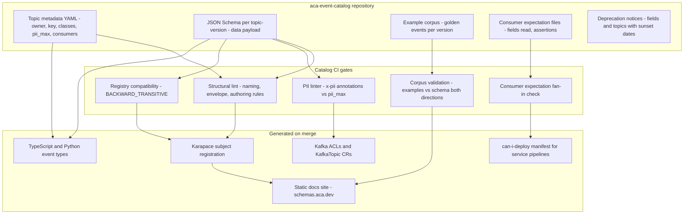
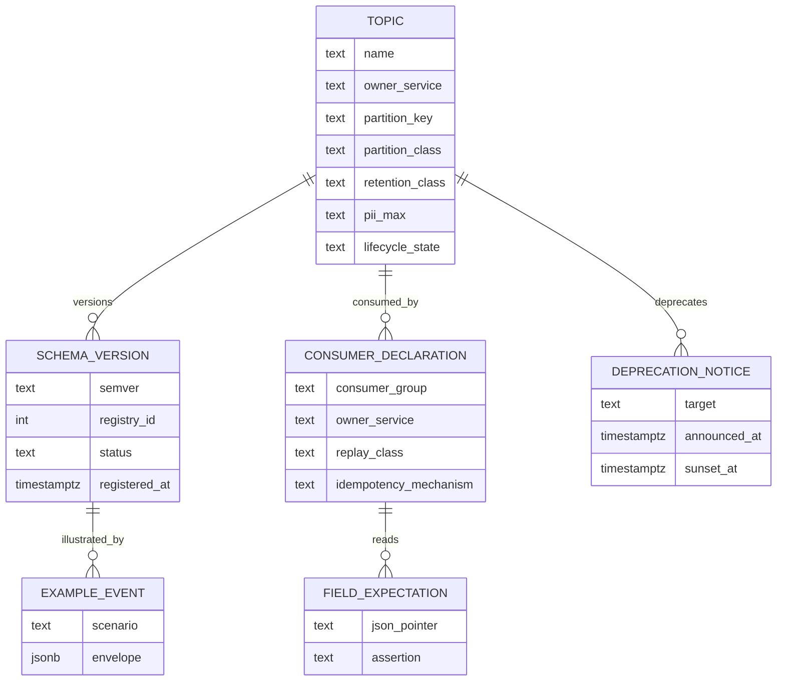
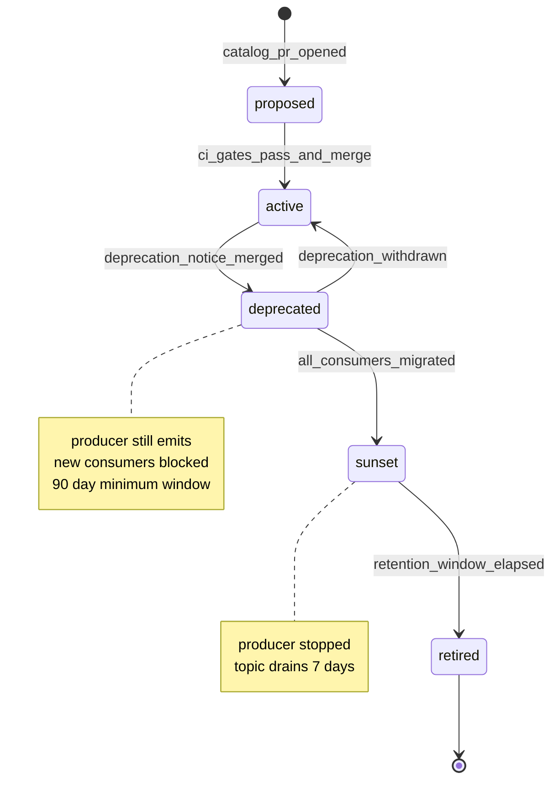
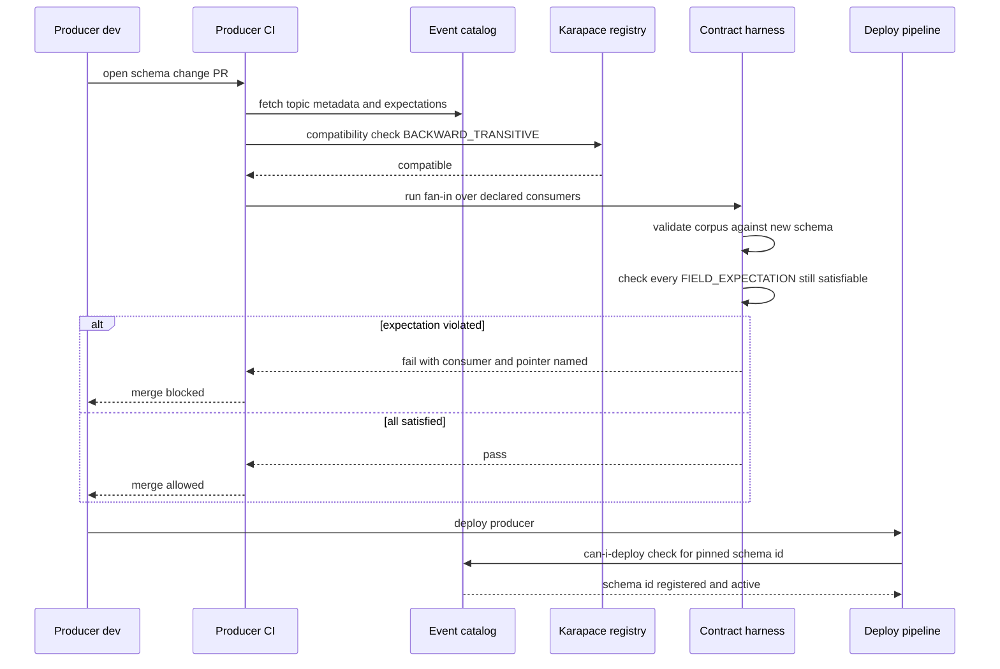
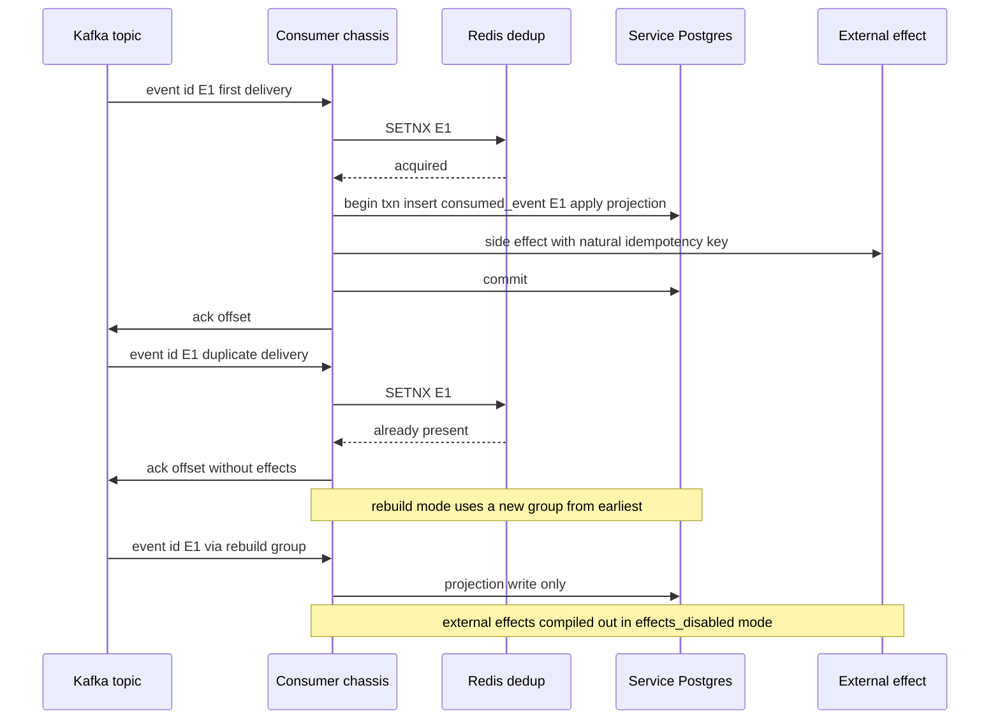

# 36 — Event Contracts

| | |
|---|---|
| Document ID | ACA-SAS-36 |
| Volume | 4 — Data Platform |
| Status | Draft v1.0 |
| Depends on | [00 — Architecture Canon](../00-architecture-canon.md) §6 §8 §11 §13, [33 — Kafka](33-kafka.md) (transport, registry deployment, DLQ/replay machinery), [09 — Microservice Architecture](../volume-2-core-services/09-microservice-architecture.md) (outbox, `consumed_event` dedup), [35 — Object Storage](35-object-storage.md) (claim-check artifacts), [18 — AI Gateway](../volume-2-core-services/18-ai-gateway.md), [19 — Agent Orchestrator](../volume-2-core-services/19-agent-orchestrator.md), [25 — Cost Optimization Engine](../volume-3-ai-architecture/25-cost-optimization-engine.md) |

## 1. Overview

[Chapter 33](33-kafka.md) specifies the transport: brokers, topics, partitions, the outbox/Debezium producer path, the retry/DLQ topology, and the schema registry as a deployed system. This chapter specifies the **contract** — the thing that travels on that transport and the discipline that keeps ~90 topics evolvable by a dozen teams without coordination meetings. An event contract in ACA is a five-part artifact: the CloudEvents envelope (fixed, platform-owned), the JSON Schema of the `data` payload (producer-owned, registry-governed), the catalog entry (topic metadata, key, PII ceiling, declared consumers), the example corpus (golden events that CI validates both ways), and the consumer expectation files (machine-readable statements of what each consumer actually reads). All five live in the `aca-event-catalog` repository introduced in [Chapter 33 §3.3](33-kafka.md); this chapter defines their content and the processes that operate on them.

The discipline exists because events are the platform's widest interface. A REST endpoint has one caller class and a synchronous error channel; a domain event has an open-ended consumer set, a 7-day replay window in which *every retained schema version is live input*, and no back-channel — a bad payload is discovered in a consumer's DLQ, hours later, by a different team. The rules here are therefore stricter than the API conventions: payloads are open-content-model and additive-only within a major; every field carries a PII annotation with a hard "IDs and references, never raw P0/P1" ceiling; every consumer declares the fields it reads so that producers can prove — in CI, before merge — that a change strands nobody; and every event class has an explicit replay/idempotency contract, because at-least-once delivery plus 7-day rewind means "what happens when this arrives twice, or a week late, or ten thousand times in an hour" is part of the event's meaning, not an operational footnote.

The chapter proceeds contract-inward: governance model and artifacts (§2), the envelope (§3), payload authoring rules (§4), full schemas for the ten highest-traffic/highest-consequence events (§5), versioning and deprecation (§6), consumer compatibility testing in CI (§7), catalog tooling and generated documentation (§8), the PII-in-events policy (§9), and per-event replay and idempotency requirements (§10). Cross-cutting failure, scaling, security, and observability sections close it out. Normative language: MUST/SHOULD as in RFC 2119; every MUST here is enforced by a named CI gate or runtime check, not by convention.

## 2. Contract Governance Model

### 2.1 Purpose and responsibilities

| Aspect | Specification |
|---|---|
| Purpose | Single source of truth for every event's shape, meaning, ownership, consumers, and lifecycle state; the substrate for all generated enforcement (registry subjects, ACLs, docs, types, contract tests) |
| Owner | Platform data-engineering guild owns the catalog framework and CI; each topic's schema is owned by its producing service team (canon §11 data ownership extends to events) |
| Responsibilities | Hold the five contract artifacts per topic; enforce authoring rules (§4) and PII policy (§9) in CI; run the compatibility and consumer-expectation gates (§7); generate registry registrations, Kafka ACLs, docs site, and language types on merge |
| Interactions | Karapace registry (registration target), Argo CD (generated `KafkaTopic` CRs and ACLs, [Ch 33 §3.3](33-kafka.md)), service CI pipelines (contract-test fan-in), internal docs portal (generated site), `admin-service` (DLQ triage links to catalog pages) |
| Non-goals | The catalog does not carry runtime traffic; a catalog outage blocks merges and deploys, never message flow (§11) |

### 2.2 Contract artifacts





The `CONSUMER_DECLARATION.replay_class` and `idempotency_mechanism` columns make §10's requirements machine-readable: a consumer cannot be added to a topic's ACL without stating how it deduplicates and whether it is safe to replay against — the declaration *is* the access request.

### 2.3 What is and is not a contract change

| Change | Contract change? | Gate |
|---|---|---|
| Add optional payload field | Yes — minor | Compat + fan-in (§7); new example required |
| Add a known value to an advisory string field | Yes — patch | Fan-in checks no consumer declared exhaustive branching (§4 rule A6) |
| Widen a `maxLength` / `maxItems` | Yes — minor | Compat; consumers sized buffers from the schema |
| Tighten any constraint, remove field, change type | Forbidden within a major | New topic major (§6) |
| Change partition key | Forbidden within a major | New topic major — key is ordering contract ([Ch 33 §4](33-kafka.md)) |
| Reword a `description` | No — editorial | Docs regenerate; no version bump |
| Change `x-pii` on a field | Yes — always a review-gated change | PII linter + security-owner CODEOWNERS approval (§9) |

## 3. CloudEvents Envelope Specification

### 3.1 Attribute table

Envelope: CloudEvents 1.0, JSON structured mode (canon §8). Every attribute below is validated by the CDC relay before produce ([Ch 33 §5](33-kafka.md)); an invalid envelope is a producer bug and routes the outbox row to the producer's dead-letter table, never onto the topic.

| Attribute | Req | Type / format | Value rule | Rationale |
|---|---|---|---|---|
| `specversion` | MUST | string | Literal `"1.0"` | Pinned; envelope evolution is a platform-wide migration, not per-topic |
| `id` | MUST | string, UUIDv7 | The outbox row's UUIDv7 (canon §6) | Globally unique **and** time-ordered; the universal consumer dedup key (§10); re-emission by the relay reuses the same `id` so duplicates are invisible |
| `source` | MUST | string | Canonical producing service identifier, e.g. `job-intelligence-service` (canon §8: source = service name; a bare name is a valid URI-reference) | One producer per topic ([Ch 33 §3](33-kafka.md)); `source` is provenance for triage and audit, not routing |
| `type` | MUST | string | Equals the full topic name including major, e.g. `aca.job.discovered.v1` | Events at rest (DLQ exports, object-storage archives, webhook deliveries) stay self-identifying without transport context; the redundancy with the topic is deliberate |
| `subject` | SHOULD | string | Prefixed opaque ID of the primary entity (canon §6), e.g. `app_...`; equals the partition key for entity-keyed topics | Lets tooling (DLQ triage, audit search) group by entity without parsing `data` |
| `time` | MUST | RFC 3339 UTC, ms precision | Outbox-row commit time, not relay-publish time | Commit time is the fact's time; relay lag is measured separately, not smeared into event semantics |
| `datacontenttype` | MUST | string | `application/json` | Single serialization (canon §8); Avro/Protobuf rejected in §16 |
| `dataschema` | MUST | URI | `https://schemas.aca.dev/<topic>/<schemaversion>` — the generated docs site's canonical, immutable schema URL (§8) | Human-resolvable from any stored event; the registry ID travels in the `x-schema-id` Kafka header for machines |
| `tenantid` | MUST | string, extension | `ten_...` prefixed ID; platform-scope events (shared job corpus, provider health) use the sentinel `ten_platform` | Tenant filtering at the consumer edge without payload parsing; cells filter their shard on this attribute ([Ch 33 §2.1](33-kafka.md)) |
| `traceparent` | MUST | string, extension | W3C Trace Context of the causing request/workflow (canon §14) | End-to-end tracing across the async hop; missing-rate is an SLO (§14) |
| `schemaversion` | MUST | string, extension | Semver of the `data` payload schema, e.g. `1.3.0`; major MUST equal the topic-name major | Consumers and triage tooling know the exact shape without a registry round-trip; the major-match rule makes topic renames and schema majors impossible to desynchronize |
| `data` | MUST | object | Payload per the topic's JSON Schema (§5) | — |

Extensions beyond the canon's three (`tenantid`, `traceparent`, `schemaversion`) are prohibited without canon amendment — envelope sprawl is how "just one more header" becomes an undocumented second payload.

### 3.2 Kafka binding

| Item | Decision | Rationale |
|---|---|---|
| Content mode | Structured (whole CloudEvent as the record value, JSON) | One artifact to archive, replay, and DLQ-export; binary mode's header/payload split saves ~200 bytes but makes every stored event context-dependent |
| Mirrored headers | `ce_id`, `ce_type`, `tenantid`, `traceparent`, `x-schema-id` | Broker-side and interceptor-side filtering (cell shard filters, trace propagation, schema resolution) without deserializing the value; the value remains authoritative — a header/value mismatch is a relay bug and alerts (§14) |
| Record key | Plain UTF-8 string per the catalog's `partition_key` column — **not** part of the CloudEvent | Keys are a partitioning concern owned by [Chapter 33 §4](33-kafka.md); duplicating them inside `data` is required only when the payload semantically needs the field |
| Size budget | Serialized event ≤ 256 KB (HLA rule R9); free-text fields capped by schema `maxLength`; anything larger goes to [object storage](35-object-storage.md) as a claim-check `artifact_ref` | Broker `message.max.bytes` is 1 MiB ([Ch 33 §2.1](33-kafka.md)); the 4× margin absorbs envelope, header, and batch overhead |

### 3.3 Reference envelope

```json
{
  "specversion": "1.0",
  "id": "01909f2e-7c3a-7d21-9b6e-3f8a1c2d4e5f",
  "source": "job-intelligence-service",
  "type": "aca.job.discovered.v1",
  "subject": "job_01hv3k9f8q2m4n6p8r0s1t2u3v",
  "time": "2026-07-30T02:14:07.412Z",
  "datacontenttype": "application/json",
  "dataschema": "https://schemas.aca.dev/aca.job.discovered.v1/1.2.0",
  "tenantid": "ten_platform",
  "traceparent": "00-6a1c2b3d4e5f60718293a4b5c6d7e8f9-1234567890abcdef-01",
  "schemaversion": "1.2.0",
  "data": { "job_id": "job_01hv3k9f8q2m4n6p8r0s1t2u3v", "...": "..." }
}
```

## 4. Payload Schema Authoring Rules

All payload schemas are JSON Schema **draft 2020-12**, registered per topic as `<topic>-value` ([Ch 33 §8](33-kafka.md)). The catalog lint gate enforces:

| # | Rule | Rationale |
|---|---|---|
| A1 | Open content model: `additionalProperties: false` is banned; consumers MUST ignore unknown fields | A closed model turns every producer addition into a consumer-breaking change — the inverse of BACKWARD evolution ([Ch 33 §8.2](33-kafka.md)) |
| A2 | `required` lists only fields every producer version has always emitted; new fields are always optional | The 7-day replay window makes every retained version live input; `required` is a promise about the past, not the present |
| A3 | Absent means absent: optional fields are omitted, never `null`; `type: ["x", "null"]` is banned | One representation of "no value" halves consumer branch surface and keeps schema diffs honest |
| A4 | Field names `snake_case`, `^[a-z][a-z0-9_]{0,63}$` | Matches SQL and Python conventions; generated TS types camelize at the codegen seam |
| A5 | Money is integer micro-USD in fields suffixed `_micro_usd` | Floats corrupt ledgers; micro-USD covers sub-cent AI pricing without decimals ([Ch 25](../volume-3-ai-architecture/25-cost-optimization-engine.md) uses the same unit) |
| A6 | Closed `enum` only for canon-fixed sets (model classes, autonomy levels L0–L3, PII classes). Growable vocabularies (statuses, reasons, channels) are `type: string` + `x-known-values` annotation; consumers MUST tolerate unknown values | Adding an enum value breaks strictly-validating consumers; canon-fixed sets are the only sets that provably never grow without a canon amendment |
| A7 | Timestamps: `format: date-time`, UTC, `Z` suffix, ms precision, field names suffixed `_at` | One time shape platform-wide; suffix makes temporal fields greppable |
| A8 | Entity references use prefixed opaque IDs (canon §6) matching `^[a-z]{2,8}_[0-9a-z]{20,32}$`; raw UUIDs never cross an event boundary | External-shape IDs in events keep payloads safe to forward to webhooks/clients without translation |
| A9 | Every `string` has `maxLength`; every `array` has `maxItems`; free text beyond 2,000 chars becomes an `artifact_ref` claim check | Bounds the §3.2 size budget structurally, not by producer discipline |
| A10 | Every property carries `x-pii` (`P0`–`P3`); topic `pii_max` MUST dominate all field annotations (§9) | PII policy is machine-checkable, not a review-comment convention |
| A11 | Fields sourced from crawled/external content carry `x-untrusted: true` | Consumers feeding such fields to LLMs MUST wrap them per the prompt-injection defense (canon §13); the annotation makes the taint visible at the contract |
| A12 | Shared shapes come from the versioned common library `https://schemas.aca.dev/common/1/defs.json`; local re-definitions of `artifact_ref`, IDs, money, timestamps are lint-rejected | One claim-check shape, one money shape — divergence here is contract debt everywhere |

### 4.1 Common definitions library

```json
{
  "$schema": "https://json-schema.org/draft/2020-12/schema",
  "$id": "https://schemas.aca.dev/common/1/defs.json",
  "$defs": {
    "entity_id": { "type": "string", "pattern": "^[a-z]{2,8}_[0-9a-z]{20,32}$", "x-pii": "P3" },
    "ts": { "type": "string", "format": "date-time", "x-pii": "P3" },
    "micro_usd": { "type": "integer", "minimum": 0, "maximum": 100000000000, "x-pii": "P3" },
    "artifact_ref": {
      "type": "object",
      "required": ["uri", "sha256"],
      "properties": {
        "uri": { "type": "string", "maxLength": 1024, "pattern": "^s3://aca-", "x-pii": "P3" },
        "sha256": { "type": "string", "pattern": "^[0-9a-f]{64}$", "x-pii": "P3" },
        "bytes": { "type": "integer", "minimum": 0, "x-pii": "P3" },
        "content_type": { "type": "string", "maxLength": 100, "x-pii": "P3" }
      }
    },
    "short_text": { "type": "string", "maxLength": 500 },
    "summary_text": { "type": "string", "maxLength": 2000 }
  }
}
```

`artifact_ref.sha256` is mandatory: replayed events may reference objects that later versions overwrote; the digest lets a consumer detect that the referenced artifact is no longer the one the event described (it fetches, compares, and treats mismatch as a dangling reference, §9.3). The `micro_usd` ceiling ($100M) is a sanity bound that catches unit bugs (cents-vs-micro) at validation time, not in a ledger audit.

## 5. Canonical Event Schemas

Full schemas for the ten events that carry the platform's dominant volume ([Ch 33 §3.2](33-kafka.md)) or its highest-consequence facts. Each entry states the contract facts a consumer needs beyond the schema: producer, partition key, PII ceiling, and the idempotency handle (expanded in §10). `$schema` and `description` fields are elided here for space; the catalog versions carry both. All `$ref` values abbreviate `https://schemas.aca.dev/common/1/defs.json#/$defs/...` as `common#...`.

### 5.1 `aca.job.discovered.v1`

Producer `job-intelligence-service`; key `job_id`; `pii_max: P3` (shared corpus — no user linkage, `tenantid: ten_platform`); idempotency: upsert by `job_id`.

```json
{
  "$id": "https://schemas.aca.dev/aca.job.discovered.v1/1.2.0",
  "type": "object",
  "required": ["job_id", "source_id", "canonical_url", "title", "discovered_at", "raw_doc_ref"],
  "properties": {
    "job_id": { "$ref": "common#entity_id" },
    "source_id": { "$ref": "common#entity_id" },
    "canonical_url": { "type": "string", "maxLength": 2048, "x-pii": "P3", "x-untrusted": true },
    "title": { "type": "string", "maxLength": 300, "x-pii": "P3", "x-untrusted": true },
    "company_ref": {
      "type": "object",
      "properties": {
        "company_id": { "$ref": "common#entity_id" },
        "raw_name": { "type": "string", "maxLength": 200, "x-pii": "P3", "x-untrusted": true }
      }
    },
    "location_raw": { "type": "string", "maxLength": 300, "x-pii": "P3", "x-untrusted": true },
    "discovered_at": { "$ref": "common#ts" },
    "raw_doc_ref": { "$ref": "common#artifact_ref" },
    "dedup_cluster_id": { "$ref": "common#entity_id" }
  }
}
```

The full posting body is never inline — `raw_doc_ref` claim-checks it to the 30-day crawl-artifact store (canon §11 retention); the inline fields are exactly what downstream routing (dedup, matching candidate generation, search indexing) needs without a fetch.

### 5.2 `aca.match.scored.v1`

Producer `matching-service`; key `user_id` (per-user feed ordering, [Ch 33 §4](33-kafka.md)); `pii_max: P3`; idempotency: upsert by `match_id`; ~20M/day at target — the schema is deliberately lean.

```json
{
  "$id": "https://schemas.aca.dev/aca.match.scored.v1/1.1.0",
  "type": "object",
  "required": ["match_id", "user_id", "job_id", "score", "scorer_version", "scored_at"],
  "properties": {
    "match_id": { "$ref": "common#entity_id" },
    "user_id": { "$ref": "common#entity_id" },
    "job_id": { "$ref": "common#entity_id" },
    "score": { "type": "number", "minimum": 0, "maximum": 1, "x-pii": "P3" },
    "threshold_passed": { "type": "boolean", "x-pii": "P3" },
    "scorer_version": { "$ref": "common#short_text" },
    "embed_version": { "type": "string", "maxLength": 20, "x-pii": "P3" },
    "top_factors": {
      "type": "array", "maxItems": 5,
      "items": { "type": "string", "maxLength": 60, "x-pii": "P3" }
    },
    "explanation_ref": { "$ref": "common#artifact_ref" },
    "scored_at": { "$ref": "common#ts" }
  }
}
```

`top_factors` values come from a controlled factor vocabulary (never free text derived from the profile) so the event stays P3; the full natural-language explanation — which cites P2 career data — is claim-checked behind `explanation_ref` with access control at the object layer. `scorer_version` + `embed_version` make every score reproducible and let `learning-pipeline` segment outcomes by model generation (canon §10.5).

### 5.3 `aca.application.submitted.v1`

Producer `application-service` (saga fact, [Ch 20](../volume-2-core-services/20-workflow-engine.md)); key `application_id`; `pii_max: P2`; idempotency: event-sourced timeline fold on (`application_id`, `seq`).

```json
{
  "$id": "https://schemas.aca.dev/aca.application.submitted.v1/1.3.0",
  "type": "object",
  "required": ["application_id", "seq", "user_id", "job_id", "channel", "autonomy_level", "submitted_at"],
  "properties": {
    "application_id": { "$ref": "common#entity_id" },
    "seq": { "type": "integer", "minimum": 1, "x-pii": "P3" },
    "user_id": { "$ref": "common#entity_id" },
    "job_id": { "$ref": "common#entity_id" },
    "channel": { "type": "string", "maxLength": 30, "x-pii": "P3",
      "x-known-values": ["browser_portal", "email", "manual_assist"] },
    "portal_family": { "type": "string", "maxLength": 40, "x-pii": "P3" },
    "template_id": { "$ref": "common#entity_id" },
    "template_version": { "type": "integer", "minimum": 1, "x-pii": "P3" },
    "resume_version_id": { "$ref": "common#entity_id" },
    "cover_letter_id": { "$ref": "common#entity_id" },
    "run_id": { "$ref": "common#entity_id" },
    "workflow_id": { "$ref": "common#short_text" },
    "autonomy_level": { "type": "string", "enum": ["L0", "L1", "L2", "L3"], "x-pii": "P3" },
    "confirmation": {
      "type": "object",
      "properties": {
        "method": { "type": "string", "maxLength": 30, "x-pii": "P3",
          "x-known-values": ["portal_confirmation_page", "confirmation_email", "user_attested"] },
        "external_ref": { "type": "string", "maxLength": 100, "x-pii": "P2" },
        "evidence_ref": { "$ref": "common#artifact_ref" }
      }
    },
    "submitted_at": { "$ref": "common#ts" }
  }
}
```

`seq` is the application timeline's event-sourcing sequence (canon §8: `application` timeline is event-sourced); consumers folding the timeline treat a duplicate (`application_id`, `seq`) as a no-op and a gap as a stall signal (§10). The submission screenshot is P2 evidence and travels only as `confirmation.evidence_ref` into the 90-day screenshot store — never inline. `autonomy_level` records the level *the submission executed under* (audit-critical: an L3 auto-submit and an L1 human-approved submit are different compliance facts).

### 5.4 `aca.application.status.changed.v1`

Producer `application-service`; key `application_id`; `pii_max: P2`; idempotency: same (`application_id`, `seq`) fold.

```json
{
  "$id": "https://schemas.aca.dev/aca.application.status.changed.v1/1.1.0",
  "type": "object",
  "required": ["application_id", "seq", "user_id", "from_status", "to_status", "signal_source", "changed_at"],
  "properties": {
    "application_id": { "$ref": "common#entity_id" },
    "seq": { "type": "integer", "minimum": 1, "x-pii": "P3" },
    "user_id": { "$ref": "common#entity_id" },
    "from_status": { "type": "string", "maxLength": 30, "x-pii": "P3" },
    "to_status": { "type": "string", "maxLength": 30, "x-pii": "P3",
      "x-known-values": ["submitted", "under_review", "screening", "interview", "offer", "rejected", "withdrawn", "ghosted"] },
    "signal_source": { "type": "string", "maxLength": 30, "x-pii": "P3",
      "x-known-values": ["email_parse", "portal_check", "user_input", "recruiter_update"] },
    "detected_by": { "type": "string", "maxLength": 40, "x-pii": "P3" },
    "confidence": { "type": "number", "minimum": 0, "maximum": 1, "x-pii": "P3" },
    "evidence_ref": { "$ref": "common#artifact_ref" },
    "changed_at": { "$ref": "common#ts" }
  }
}
```

`signal_source` + `confidence` exist because status is often *inferred* (`application-tracker-agent` parsing a rejection email) rather than declared; `learning-pipeline` weighs outcomes by confidence, and the UI renders inferred statuses differently. The evidence (parsed email excerpt — P1-adjacent content) is claim-checked, never inline (§9).

### 5.5 `aca.agent.run.started.v1`

Producer `agent-orchestrator`; key `tenant_id` ([Ch 19 §](../volume-2-core-services/19-agent-orchestrator.md) event table); `pii_max: P3`; idempotency: upsert by `run_id`.

```json
{
  "$id": "https://schemas.aca.dev/aca.agent.run.started.v1/1.0.1",
  "type": "object",
  "required": ["run_id", "agent", "agent_version", "trigger_kind", "autonomy_level", "started_at"],
  "properties": {
    "run_id": { "$ref": "common#entity_id" },
    "agent": { "type": "string", "maxLength": 40, "pattern": "^[a-z][a-z-]+-agent$|^agent-supervisor$", "x-pii": "P3" },
    "agent_version": { "type": "string", "maxLength": 20, "x-pii": "P3" },
    "user_id": { "$ref": "common#entity_id" },
    "trigger_kind": { "type": "string", "maxLength": 30, "x-pii": "P3",
      "x-known-values": ["user_request", "schedule", "event", "recovery", "supervisor"] },
    "trigger_event_id": { "type": "string", "format": "uuid", "x-pii": "P3" },
    "parent_run_id": { "$ref": "common#entity_id" },
    "autonomy_level": { "type": "string", "enum": ["L0", "L1", "L2", "L3"], "x-pii": "P3" },
    "budget_micro_usd": { "$ref": "common#micro_usd" },
    "queued_at": { "$ref": "common#ts" },
    "started_at": { "$ref": "common#ts" }
  }
}
```

`trigger_event_id` closes the causality chain: a run started by an event names the envelope `id` that caused it, giving supervision and audit a walkable event→run→event graph without log archaeology. `queued_at` vs `started_at` exposes scheduler admission latency as data (the [Ch 19](../volume-2-core-services/19-agent-orchestrator.md) fairness SLI derives from it).

### 5.6 `aca.agent.run.completed.v1`

Producer `agent-orchestrator`; key `tenant_id`; `pii_max: P2` (the summary may mention career entities); idempotency: terminal-state upsert by `run_id`.

```json
{
  "$id": "https://schemas.aca.dev/aca.agent.run.completed.v1/1.1.0",
  "type": "object",
  "required": ["run_id", "agent", "steps", "model_calls", "cost_micro_usd", "duration_ms", "completed_at"],
  "properties": {
    "run_id": { "$ref": "common#entity_id" },
    "agent": { "type": "string", "maxLength": 40, "x-pii": "P3" },
    "user_id": { "$ref": "common#entity_id" },
    "outcome_summary": { "$ref": "common#summary_text", "x-pii": "P2" },
    "steps": { "type": "integer", "minimum": 1, "maximum": 10000, "x-pii": "P3" },
    "model_calls": { "type": "integer", "minimum": 0, "x-pii": "P3" },
    "cost_micro_usd": { "$ref": "common#micro_usd" },
    "duration_ms": { "type": "integer", "minimum": 0, "x-pii": "P3" },
    "child_run_ids": { "type": "array", "maxItems": 50, "items": { "$ref": "common#entity_id" } },
    "artifacts_ref": { "$ref": "common#artifact_ref" },
    "completed_at": { "$ref": "common#ts" }
  }
}
```

### 5.7 `aca.agent.run.failed.v1`

Producer `agent-orchestrator`; key `tenant_id`; `pii_max: P3`; idempotency: terminal-state upsert by `run_id` **plus** the recovery guard in §10 (this event triggers `recovery-agent`).

```json
{
  "$id": "https://schemas.aca.dev/aca.agent.run.failed.v1/1.1.0",
  "type": "object",
  "required": ["run_id", "agent", "end_reason", "failure_class", "steps", "cost_micro_usd", "failed_at"],
  "properties": {
    "run_id": { "$ref": "common#entity_id" },
    "agent": { "type": "string", "maxLength": 40, "x-pii": "P3" },
    "user_id": { "$ref": "common#entity_id" },
    "end_reason": { "type": "string", "maxLength": 40, "x-pii": "P3",
      "x-known-values": ["budget_exhausted", "loop_detected", "tool_failure", "policy_denied", "approval_expired", "timeout", "provider_outage", "browser_failure", "cancelled"] },
    "failure_class": { "type": "string", "enum": ["transient", "permanent"], "x-pii": "P3" },
    "recovery_eligible": { "type": "boolean", "x-pii": "P3" },
    "last_step_ref": { "$ref": "common#artifact_ref" },
    "steps": { "type": "integer", "minimum": 0, "x-pii": "P3" },
    "cost_micro_usd": { "$ref": "common#micro_usd" },
    "failed_at": { "$ref": "common#ts" }
  }
}
```

`failure_class` is a closed enum (A6 exception) because `recovery-agent` branches exhaustively on it — the two-value set is a canon-stable design commitment, mirrored from the error taxonomy in [Chapter 33 §7](33-kafka.md). `recovery_eligible` is computed by the orchestrator, not inferred by the consumer: recovery policy lives with the run's owner.

### 5.8 `aca.agent.approval.requested.v1`

Producer `agent-orchestrator` (HITL checkpoint); key `tenant_id`; `pii_max: P2`; idempotency: upsert by `approval_id`; **never blind-replayed** (notification side effect, §10).

```json
{
  "$id": "https://schemas.aca.dev/aca.agent.approval.requested.v1/1.0.2",
  "type": "object",
  "required": ["approval_id", "run_id", "agent", "user_id", "action_class", "summary", "requested_at", "expires_at"],
  "properties": {
    "approval_id": { "$ref": "common#entity_id" },
    "run_id": { "$ref": "common#entity_id" },
    "agent": { "type": "string", "maxLength": 40, "x-pii": "P3" },
    "user_id": { "$ref": "common#entity_id" },
    "action_class": { "type": "string", "maxLength": 40, "x-pii": "P3",
      "x-known-values": ["application.submit", "email.send", "offer.respond", "profile.publish"] },
    "autonomy_level": { "type": "string", "enum": ["L0", "L1", "L2", "L3"], "x-pii": "P3" },
    "summary": { "$ref": "common#summary_text", "x-pii": "P2" },
    "proposal_ref": { "$ref": "common#artifact_ref" },
    "requested_at": { "$ref": "common#ts" },
    "expires_at": { "$ref": "common#ts" }
  }
}
```

`expires_at` is load-bearing for replay safety: a consumer processing this event late (or via replay) checks expiry before any user-facing effect, making stale deliveries structurally inert (§10). The full proposal (tailored resume diff, drafted letter — P2) is claim-checked; the inline `summary` is what notification templates may embed.

### 5.9 `aca.ai.request.completed.v1`

Producer `ai-gateway`; key `tenant_id` (aggregation locality, [Ch 33 §4](33-kafka.md)); `pii_max: P3` — **counters and classifications only; no prompt or completion content, ever** (content lives in ai-gateway's request-log store under its own 90-day policy); idempotency: dedup on `request_id` before aggregation increments ([Ch 25](../volume-3-ai-architecture/25-cost-optimization-engine.md)).

```json
{
  "$id": "https://schemas.aca.dev/aca.ai.request.completed.v1/1.4.0",
  "type": "object",
  "required": ["request_id", "tenant_id", "feature", "model_class", "provider", "tokens_in", "tokens_out", "cost_micro_usd", "latency_ms", "completed_at"],
  "properties": {
    "request_id": { "$ref": "common#entity_id" },
    "tenant_id": { "$ref": "common#entity_id" },
    "user_id": { "$ref": "common#entity_id" },
    "agent_id": { "$ref": "common#entity_id" },
    "run_id": { "$ref": "common#entity_id" },
    "feature": { "type": "string", "maxLength": 60, "x-pii": "P3" },
    "model_class": { "type": "string", "enum": ["embed", "small", "medium", "large", "frontier", "vision"], "x-pii": "P3" },
    "provider": { "type": "string", "maxLength": 40, "x-pii": "P3" },
    "model_id": { "type": "string", "maxLength": 80, "x-pii": "P3" },
    "prompt_id": { "type": "string", "maxLength": 120, "x-pii": "P3" },
    "tokens_in": { "type": "integer", "minimum": 0, "x-pii": "P3" },
    "tokens_out": { "type": "integer", "minimum": 0, "x-pii": "P3" },
    "cache_tier": { "type": "string", "maxLength": 20, "x-pii": "P3",
      "x-known-values": ["none", "exact", "semantic", "provider_prefix"] },
    "batch": { "type": "boolean", "x-pii": "P3" },
    "status": { "type": "string", "maxLength": 20, "x-pii": "P3",
      "x-known-values": ["ok", "provider_error", "safety_filtered", "budget_denied"] },
    "cost_micro_usd": { "$ref": "common#micro_usd" },
    "latency_ms": { "type": "integer", "minimum": 0, "x-pii": "P3" },
    "completed_at": { "$ref": "common#ts" }
  }
}
```

`tenant_id` is duplicated from the envelope deliberately: this is the billing metering source (canon §10.3), and metering pipelines must survive an envelope-stripping hop (warm-store rows, ledger exports) without re-joining. `model_class` is a closed enum — the six classes are canon §10.1's fixed vocabulary. Prose sketches elsewhere abbreviate the cost field as `cost_usd`; the wire name is authoritative here: `cost_micro_usd`, integer (rule A5).

### 5.10 `aca.billing.usage.recorded.v1`

Producers `cost-controller` (AI metering) and `application-service` (application counts) — the sole two-producer topic, each producing disjoint `metric` values (canon §12); key `tenant_id`; `pii_max: P3`; idempotency: DB unique constraint on `usage_record_id` — effectively-once by construction ([Ch 33 §9](33-kafka.md)).

```json
{
  "$id": "https://schemas.aca.dev/aca.billing.usage.recorded.v1/1.2.0",
  "type": "object",
  "required": ["usage_record_id", "tenant_id", "metric", "quantity", "unit", "window_start", "window_end", "source_service", "record_kind"],
  "properties": {
    "usage_record_id": { "$ref": "common#entity_id" },
    "tenant_id": { "$ref": "common#entity_id" },
    "user_id": { "$ref": "common#entity_id" },
    "metric": { "type": "string", "maxLength": 40, "x-pii": "P3",
      "x-known-values": ["ai_spend_micro_usd", "ai_tokens_in", "ai_tokens_out", "ai_calls_small", "ai_calls_medium", "ai_calls_large", "ai_calls_frontier", "applications_submitted"] },
    "quantity": { "type": "integer", "minimum": 0, "x-pii": "P3" },
    "unit": { "type": "string", "maxLength": 20, "x-pii": "P3",
      "x-known-values": ["micro_usd", "tokens", "calls", "applications"] },
    "window_start": { "$ref": "common#ts" },
    "window_end": { "$ref": "common#ts" },
    "source_service": { "type": "string", "maxLength": 40, "x-pii": "P3" },
    "record_kind": { "type": "string", "maxLength": 30, "x-pii": "P3",
      "x-known-values": ["window_close", "interim_threshold", "correction"] },
    "corrects_usage_record_id": { "$ref": "common#entity_id" }
  }
}
```

`record_kind: correction` + `corrects_usage_record_id` is the money-safe amendment path: usage records are never mutated or re-emitted with the same ID; a metering error produces a signed correction record referencing the original. `quantity` is an integer for every metric by unit design (micro-USD, tokens, calls) — no floating-point money anywhere in the billing path.

## 6. Versioning Rules & Deprecation Process

### 6.1 Version taxonomy

| Layer | Identifier | Compatible changes | Breaking changes |
|---|---|---|---|
| Payload schema | `schemaversion` semver, e.g. `1.3.0` | Minor: add optional field, widen bounds, add known-value. Patch: descriptions, annotations, example corpus | None permitted — breaking means major |
| Topic | `.v<major>` suffix | — | New topic + §6.3 migration ([Ch 33 §8.3](33-kafka.md) owns the transport mechanics) |
| Envelope | `specversion` | Platform-wide migration only | Canon amendment required |
| Common defs | `common/<major>/defs.json` | Additive `$defs` | New library major; topics adopt at their next schema minor |

Registry compatibility mode is `BACKWARD_TRANSITIVE` within a major ([Ch 33 §8.1](33-kafka.md)): a consumer built against the newest schema can read every version still inside the 7-day retention window. This chapter adds the *semantic* rules the registry cannot check: a field's meaning, unit, or reference target never changes within a major — a field that must mean something else is a **new field**, with the old one deprecated. Renames do not exist; they are add-plus-deprecate.

### 6.2 Lifecycle



The state machine applies at two granularities: **topic majors** (the diagram's primary use) and **individual fields** (same states; "sunset" means the producer stops emitting the field, "retired" means it leaves the schema at the next major).

### 6.3 Deprecation process — topic major

1. **Announce.** Producer team merges a `DEPRECATION_NOTICE` into the catalog: target topic, replacement topic, rationale, `sunset_at` ≥ 90 days out. Rationale for 90 days: two quarterly planning cycles' margin over the observed ~30-day median consumer-migration time in comparable platforms; internal events do not get the canon §7 12-month external window because we control both sides (events exposed through `public-api-service` webhooks *do* inherit the 12-month window — the notice must flag webhook exposure).
2. **Block new consumption.** Catalog CI rejects new `CONSUMER_DECLARATION`s against a `deprecated` topic; existing consumers keep their ACLs.
3. **Dual-write.** Producer dual-writes old and new majors from the outbox ([Ch 33 §8.3](33-kafka.md)); the migration checklist is generated from the declared-consumer list — nobody migrates "informally", because the checklist is the ACL source.
4. **Migrate consumers group-by-group**, each verifying via its §7 contract suite against the new major before cutover.
5. **Sunset.** When the checklist is empty, producer stops old-major writes; topic drains for one retention window (7 days) so replays complete.
6. **Retire.** Topic deleted via catalog removal; DLQ and archive exports remain readable because `type` + `dataschema` in the stored envelopes are transport-independent (§3.1).

Field-level deprecation is the same pipeline in miniature: annotation `"deprecated": true` + notice with `sunset_at` ≥ 90 days and ≥ 2 released producer versions (harmonized with [Ch 33 §8.2](33-kafka.md)); the fan-in gate (§7) blocks sunset while any `FIELD_EXPECTATION` still references the field — a field with declared readers cannot be removed, mechanically.

## 7. Consumer Compatibility Testing in CI

Registry compatibility proves *schemas* compose; it cannot prove a consumer's *code* still works — a producer can compatibly stop populating an optional field that a consumer's business logic silently requires. The contract-test layer closes that gap with two artifacts already in the catalog: the **example corpus** (producer-owned golden events per schema version, covering every `x-known-values` branch and every optional-field presence combination that occurs in production) and **consumer expectation files** (consumer-owned, machine-readable field usage + assertions).

```yaml
# aca-event-catalog/expectations/matching-scoring/aca.job.discovered.v1.yaml
consumer_group: matching-scoring
owner_service: matching-service
replay_class: replay_safe
idempotency_mechanism: upsert_by_job_id
reads:
  - pointer: /data/job_id
    assertion: required
  - pointer: /data/title
    assertion: required            # consumer hard-requires an optional-in-schema field: now visible + gated
  - pointer: /data/raw_doc_ref/uri
    assertion: required
  - pointer: /data/dedup_cluster_id
    assertion: optional
tolerates_unknown_values:
  - pointer: /data/company_ref
```

### 7.1 Gate placement



| Gate | Runs on | Checks | Failure meaning |
|---|---|---|---|
| Corpus validation | Producer PR | Every example validates against the new schema; every schema branch (`x-known-values`, optional groups) has ≥ 1 example | Schema and reality diverged; examples are the docs — stale examples are lying docs |
| Expectation fan-in | Producer PR | Every declared consumer's `reads` pointers resolve in the new schema with unchanged types; `assertion: required` pointers are populated in all corpus examples | The change strands a named consumer — the failure message names the team before the merge, not the pager after |
| Consumer verification | Consumer PR + nightly | Consumer's deserializer + handler run against the **full corpus of every active schema version** of each consumed topic (transitive: replay serves old versions); handler must ack every example without error | Consumer code cannot survive the retention window's version mix |
| Unknown-tolerance probe | Consumer PR + nightly | Corpus events are re-run with (a) an injected unknown field, (b) an unknown value in every `x-known-values` field the consumer did not list under exhaustive branching | Enforces rules A1/A6 in code, not in review comments |
| can-i-deploy | Both pipelines | Producer: pinned schema ID is registered and `active`. Consumer: expectations version matches the catalog build the ACLs were generated from | Deploy-time drift guard; catalog and runtime cannot desynchronize silently |

Nightly (not merely on-PR) consumer verification exists because the *producer* side can move between a consumer's merges; nightly runs catch the drift within 24 h instead of at the consumer's next unrelated PR. Fan-in cost is bounded by running only suites for topics the PR touches — O(consumers-of-topic), not O(all consumers) (§12).

## 8. Event Catalog Tooling

### 8.1 Generated documentation

On every catalog merge, CI publishes a static site at `schemas.aca.dev` (internal, SSO-gated): one page per topic with rendered schema (annotations visible — `x-pii` badges, `x-untrusted` flags, deprecation strikethroughs), the example corpus (validated, so examples are never stale), the consumer table with replay classes, the version history with diffs, and the deprecation status. The `dataschema` URI in every envelope (§3.1) resolves to the exact immutable version page — an engineer holding a 6-day-old DLQ event clicks from the raw JSON to its precise contract. Immutability rule: published version pages are write-once; corrections create a patch version. The site is the generated *view*; the repo is the truth — hand-edited docs are structurally impossible.

### 8.2 Generated code and enforcement artifacts

| Artifact | Generator output | Consumed by |
|---|---|---|
| TypeScript types + type guards | `@aca/events` package, one module per topic, camelized per A4 | NestJS services; the chassis consumer wrapper refuses handlers not typed against the package (compile-time contract pinning) |
| Python models | `aca_events` package (pydantic v2, validation on parse) | FastAPI AI-plane services, agent runtime tools |
| Kafka ACLs + `KafkaTopic` CRs | From topic metadata + consumer declarations | Argo CD ([Ch 33 §3.3](33-kafka.md), §14) |
| Registry registrations | PreSync job per [Ch 33 §8.2](33-kafka.md) | Karapace |
| can-i-deploy manifest | Versioned JSON of (topic, schema id, status, consumers) | Deploy pipelines (§7) |
| DLQ triage annotations | Topic → owner, runbook link, replay class | `admin-service` triage UI ([Ch 33 §7](33-kafka.md)) |

Codegen is one-directional (catalog → packages); hand-written event types are lint-banned in service repos. The packages version in lockstep with the catalog build number, which is what makes the can-i-deploy check meaningful: a service's package version identifies exactly which contract snapshot its binary was compiled against.

## 9. PII-in-Events Policy

### 9.1 The rule

**Events carry identifiers and references — never raw P0/P1 data.** (Canon §11 PII classes.) The event backbone is the platform's most-copied data surface: 7-day multi-AZ retention, DR mirroring to a second region, DLQ exports, engineer-visible triage tooling, and consumer-side logs. Excluding raw P0/P1 at the contract layer means none of those surfaces ever needs P1-grade handling, which is the difference between "Kafka is in GDPR scope for erasure" and "Kafka drains erased data within 7 days by construction".

| Class | Policy in events | Enforcement |
|---|---|---|
| P0 (credentials, session cookies) | **Never**, in any form — not even references to specific vault items in shared-visibility topics; browser events reference `session_id`, and `session-vault-service` resolves internally | Lint denies fields named/patterned like secrets (`token`, `cookie`, `password`, `secret`, `authorization`); `x-pii: P0` is an invalid annotation — no topic may declare it |
| P1 (identity PII — names, emails, phones) | Never raw. `usr_` opaque IDs only; consumers needing identity attributes fetch via the owning service's API under their own authz (e.g., `notification-service` resolves delivery address from `user-service` at send time — an email address never transits Kafka) | `x-pii: P1` invalid on inline fields; P1 content may exist only *behind* an `artifact_ref` into an encrypted store with object-level authz |
| P2 (career data) | Minimized: bounded `summary_text` fields at most, only on topics with `pii_max: P2` and an access-reviewed consumer list; full documents always claim-checked | PII linter: `x-pii: P2` requires topic `pii_max: P2`; changing either requires security-owner CODEOWNERS approval (§2.3) |
| P3 (public/derived) | Unrestricted within size rules | Default annotation; still mandatory (explicit beats implicit) |

### 9.2 Enforcement pipeline

Three layers: (1) **catalog CI** — the A10 linter proves annotation completeness and dominance (`pii_max` ≥ every field) at merge; (2) **outbox write** — the chassis serializer validates payloads against the pinned schema before the outbox insert, so a producer bug that stuffs a raw email into a P3 field fails the producing transaction, not a downstream audit; (3) **sampling audit** — `audit-service` runs a daily sampled scan (1% of events per topic; full scan of any topic whose schema changed that day) with PII detectors (email/phone/name patterns) over *string field values*, alerting on P1-pattern hits in fields annotated P3/P2. Layer 3 exists because annotations describe intent and layers 1–2 enforce structure, but only content inspection catches a P3-annotated free-text field being *misused* — the classic leak is a "notes" field, which is why free text is capped and enumerated (A9) in the first place.

### 9.3 Erasure interplay

GDPR erasure (canon §11: hard delete + tombstone within 30 days) composes with events as follows: `aca.user.deleted.v1` is the tombstone; every consumer maintaining a user-keyed projection MUST declare it as a consumed topic (fan-in gate makes the check mechanical) and purge within its handler. The stream itself needs no crypto-shredding: 7-day retention self-drains well inside the 30-day window, and audit topics — retained longer — carry only opaque IDs by this policy (the 7-year WORM audit store's lawful-basis analysis lives in Volume 5). Claim-check artifacts are deleted at source by their owning stores' retention/erasure jobs; consumers MUST treat a dangling `artifact_ref` (404 or digest mismatch, §4.1) as "content lawfully gone", degrade gracefully, and never cache fetched artifact content beyond their own service's retention class.

## 10. Replay Semantics & Idempotency Requirements

### 10.1 The two replay modes

At-least-once delivery (canon §8) makes duplicate handling mandatory everywhere; the 7-day rewind capability ([Ch 33 §10](33-kafka.md)) adds *deliberate* re-delivery. The platform distinguishes two modes with different correctness contracts:

| Mode | Intent | Mechanism | Side-effect contract |
|---|---|---|---|
| **DLQ replay** | Re-attempt events that were never successfully processed | `admin-service` transactional replayer, original key, `x-replay-of` header ([Ch 33 §7](33-kafka.md)) | Effects SHOULD execute — that is the point; the header is provenance for triage metrics, not a suppression signal |
| **Historical replay (rebuild)** | Rebuild a projection/index from retained history | Dedicated rebuild consumer group reading from `earliest`, chassis `effects_disabled` mode: projection writes on, external effects (notifications, run triggers, HTTP calls) compiled out | Effects MUST NOT execute; suppression is a *deployment mode* of the consumer, never a per-message header check — header-based suppression fails open when a header is lost, mode-based fails closed |

### 10.2 Universal consumer requirements

Every consumer, regardless of topic (chassis-provided, [Ch 09 §7](../volume-2-core-services/09-microservice-architecture.md)):

1. **Envelope dedup**: Redis `SETNX` on `id` (24 h TTL) + `consumed_event` unique-constraint insert in the effect transaction — the table closes the Redis crash window; 24 h covers the retry ladder's maximum ([Ch 33 §7](33-kafka.md)), the table covers the 7-day window.
2. **Late-arrival tolerance**: an event may arrive up to 7 days after `time` (replay) — handlers MUST NOT assume freshness; time-sensitive actions check payload timestamps (`expires_at`, `window_end`) before acting.
3. **Cross-key ordering**: none assumed, ever; per-key ordering only, and only on the main topic (forfeited in retry, [Ch 33 §7](33-kafka.md)).
4. **Unknown tolerance**: rules A1/A6, enforced by the §7 probe.

### 10.3 Per-event replay contract

The catalog's `replay_class` per consumer declaration (§2.2) takes one of: `replay_safe` (handler is a pure idempotent projection — both modes fine, no special handling), `replay_guarded` (handler has external effects that natural idempotency keys or payload guards neutralize — DLQ replay fine, rebuild requires `effects_disabled`), `never_replay` (handler effects are user-facing and time-bound — DLQ replay requires case-by-case triage approval in the admin tooling).

| Event | Idempotency handle | Replay class (typical consumer) | Guard detail |
|---|---|---|---|
| `aca.job.discovered.v1` | Upsert by `job_id` | `replay_safe` | Re-discovery is the steady state; dedup clustering is idempotent by design |
| `aca.match.scored.v1` | Upsert by `match_id`; feeds last-write-win on `scored_at` | `replay_safe` | Stale replays lose the last-write race harmlessly |
| `aca.application.submitted.v1` | Timeline fold on (`application_id`, `seq`) — duplicate seq is a no-op, gap triggers stall alarm | `replay_guarded` | Notification consumer's intent key (user, kind, entity, day) suppresses double-notify even on DLQ replay |
| `aca.application.status.changed.v1` | Same seq fold | `replay_guarded` | Same intent-key suppression; analytics funnels rebuild via `effects_disabled` |
| `aca.agent.run.started.v1` | Upsert by `run_id` | `replay_safe` | Telemetry projections only |
| `aca.agent.run.completed.v1` | Terminal upsert by `run_id`; terminal states are write-once | `replay_safe` | A completed run cannot re-complete; counters dedup on envelope `id` |
| `aca.agent.run.failed.v1` | Terminal upsert + **recovery guard** | `replay_guarded` | `recovery-agent` re-checks the run's live terminal state and existing recovery lineage (`parent_run_id`) before spawning — a replayed failure event finds recovery already attempted and no-ops |
| `aca.agent.approval.requested.v1` | Upsert by `approval_id`; `expires_at` payload guard | `never_replay` | Expired approvals are inert on any late delivery; un-expired ones re-notify only through the intent key; rebuilds use `effects_disabled` |
| `aca.ai.request.completed.v1` | `request_id` dedup set before Redis Lua increments ([Ch 25](../volume-3-ai-architecture/25-cost-optimization-engine.md)) | `replay_guarded` | Hot-window aggregation only; warm rollups rebuild from the ledger store, never by stream replay — replaying into live counters after the dedup TTL would double-count, so hot replay is bounded to the 24 h dedup horizon |
| `aca.billing.usage.recorded.v1` | DB unique constraint on `usage_record_id` | `replay_safe` | Effectively-once by construction; corrections are new records (§5.10), so replay can never resurrect an amended value |

### 10.4 Reference sequence — duplicate and rebuild paths



## 11. Failure Scenarios

| Scenario | Effect | Detection | Response |
|---|---|---|---|
| Catalog repo/CI unavailable | Schema merges and can-i-deploy checks block; runtime traffic unaffected (contracts are compiled in) | CI availability alert | Treat as deploy-freeze; emergency deploys use the last published can-i-deploy manifest (cached artifact) with incident-commander sign-off |
| Registry outage | Covered in [Ch 33 §12](33-kafka.md) — fail-static caching; new schema IDs block | Registry health | Deploy-freeze, not availability incident |
| Envelope invalid at relay | Outbox row routed to producer dead-letter table; event never published | Producer DLQ table depth > 0 alert | Producer bug — fix and re-emit from outbox; consumers unaffected |
| Semantically-bad schema merged despite gates (meaning change, unit bug) | Consumers process wrong data confidently — the worst class, invisible to validation | §9.2 sampling audit (unit/pattern anomalies), consumer business-metric anomalies | Runbook: register corrected schema minor; identify poisoned window by `schemaversion` + `time`; rebuild affected projections via §10.1 historical replay; corrections for money paths via `record_kind: correction` |
| Consumer hard-requires a field the producer stopped populating | Would be a silent starvation — prevented by fan-in gate **iff** the consumer declared the read | Fan-in pass rate; undeclared-read incidents | Post-incident rule: every incident of this class adds the missing `FIELD_EXPECTATION`; declarations ratchet toward completeness |
| Unknown `x-known-values` value crashes a consumer | One partition stalls → poison-pill guard DLQs ([Ch 33 §7](33-kafka.md)) | DLQ depth, `x-error-class` | The §7 unknown-tolerance probe exists to make this a CI failure, not a production one; gap in probe coverage is the follow-up fix |
| Dangling `artifact_ref` (claim-check deleted by retention/erasure) | Consumer fetch 404s or digest mismatches | Dangling-ref counter per topic | Defined behavior per §9.3 — degrade, never fail the fold; alert only on rate anomaly (suggests retention misconfiguration) |
| Corpus drift (examples pass schema but diverge from real traffic) | Contract tests green while reality moves | §9.2 audit compares sampled field-presence stats vs corpus coverage quarterly | Producer team refreshes corpus; presence-stat report is generated, not hand-collected |
| Clock skew between producers | `time` ordering anomalies within a key | Envelope `time` vs broker timestamp skew metric | `id` (UUIDv7) is the tiebreaker; consumers ordering strictly by `time` across events are violating §10.2 rule 3 anyway |

## 12. Scaling Strategy

Contract governance scales in **topic count** and **team count**, not message volume ([Ch 33 §13](33-kafka.md) owns throughput). Design points: ~90 topics today, ~250 at target (new domains, majors in flight, per-domain additions under canon §8's naming rule); ~40 producer/consumer teams.

- **CI time**: fan-in runs only suites for touched topics — a producer PR costs O(consumers-of-that-topic) suite runs (median 3, max ~8 for `aca.job.discovered.v1`); nightly full-matrix verification (~250 topics × ~3 consumers × ~4 active versions ≈ 3,000 suite runs) parallelizes to < 20 min on 20 CI workers — sized so the nightly signal is same-day actionable.
- **Corpus growth**: examples per topic capped at 25 (every branch, not every combination — pairwise coverage over optional-field combinations beyond that); beyond the cap the schema is too polymorphic and should split (a smell gate, not just a limit).
- **Registry**: hundreds of subjects × dozens of versions is trivial for Karapace; the compacted `_schemas` topic stays in MBs.
- **Docs site**: static generation is O(topics); immutable version pages accumulate — object-storage-hosted, effectively unbounded.
- **Organizational**: the catalog is the coordination point that *removes* meetings — the marginal cost of topic 200 is a directory and CI green, and the marginal cost of consumer 500 is a declaration file that doubles as its ACL request (§2.2).

## 13. Security Considerations

- **Least-privilege access is generated, not requested**: Kafka ACLs derive from consumer declarations (§8.2) — no declaration, no read; topic writes are restricted to the CDC relay principal ([Ch 33 §14](33-kafka.md)). Reviewing event access = reviewing a diff on a YAML file.
- **Untrusted content taint**: crawled/external strings carry `x-untrusted` (A11); any consumer assembling LLM context from event fields MUST wrap tainted fields in `untrusted_content` markers per canon §13 — the annotation propagates the prompt-injection defense across the async boundary, where the original fetch context is long gone.
- **No secrets, structurally**: §9.1's P0 lint plus the outbox-side schema validation make credential leakage into the stream a producing-transaction failure.
- **Envelope spoofing**: producers cannot spoof `source`/`tenantid` — the relay derives them from the outbox row's service-owned columns, and services can only write their own outbox (per-service DB, canon §11); consequential-action events additionally mirror to `aca.audit.event.v1` whose hash chain makes post-hoc tampering evident (audit-service, canon §8).
- **DLQ exposure**: DLQ triage shows raw payloads to `admin-service` operators; the P2 ceiling means the most sensitive thing an operator sees is a bounded career-data summary — an accepted, access-audited exposure (JIT elevation per canon §13). P1-bearing artifact refs require a separate authorized fetch that is itself audit-logged.
- **Docs site**: `schemas.aca.dev` is internal + SSO; schemas reveal system topology (valuable to attackers) even with zero payload data.

## 14. Observability

| Signal | Type | Threshold / target | Rationale |
|---|---|---|---|
| Envelope validation failures at relay | Counter per producer | Alert > 0 sustained 5 min | Should be structurally impossible post-chassis; any hit is a producer-chassis bug |
| `traceparent` missing rate | Ratio per topic | < 0.1%; alert at 1% | Trace continuity is a canon §14 requirement; small residual tolerated for legacy backfills |
| Header/value envelope mismatch | Counter | Alert > 0 | Relay correctness invariant (§3.2) |
| Unknown schema ID at consumer | Counter | Alert > 0 | Means a producer deployed a schema the consumer's registry cache cannot resolve — deploy-order bug |
| Deprecated field emission | Counter per (topic, field) | Trend to zero by `sunset_at`; alert if non-zero at sunset − 14 d | Makes §6.3 sunset dates enforceable with data, not optimism |
| Deprecated topic consumption | Consumer-group lag per deprecated topic | Zero active groups by sunset | The migration checklist's live complement |
| Contract-suite pass rate (nightly) | Ratio | 100%; page owner team on failure | A red nightly is tomorrow's production incident |
| Dedup hit rate | Ratio per consumer group | Baseline 0.1–2%; alert on 10× baseline | Spikes reveal relay re-emission storms or a replay someone forgot to mode-switch |
| Dangling `artifact_ref` rate | Counter per topic | Baseline-relative anomaly alert | §11 — signal of retention misconfiguration |
| PII sampling-audit hits | Counter per topic | Page security on any P1-pattern hit in P2/P3 fields | The layer-3 net (§9.2) |
| Corpus coverage vs live field-presence stats | Quarterly report | 100% branch coverage | Anti-drift for the §7 gates' foundation |

Dashboards: a per-topic "contract health" page (generated into the §8.1 docs site) joins these signals with schema version adoption (histogram of `schemaversion` seen per topic over 7 days) — the adoption histogram is the practical answer to "can I remove this field yet".

## 15. Future Improvements

1. **AsyncAPI export** — generate AsyncAPI 3 documents from the catalog for external-facing webhook consumers of `public-api-service`, keeping the catalog as source of truth (generation target, not a second source).
2. **Runtime expectation telemetry** — instrument generated deserializers to report *actual* field reads per consumer, auto-suggesting `FIELD_EXPECTATION` updates and shrinking the undeclared-read gap (§11) empirically.
3. **Schema-aware DLQ triage** — auto-diff a DLQ event against its `schemaversion` and the consumer's expectations to classify failures (contract vs code vs data) before a human looks.
4. **Cross-major transformation functions** — registered, pure v(N)→v(N+1) upgrade functions per topic, enabling rebuilds that read old majors through the new-major handler and shortening dual-write windows.
5. **Per-tenant contract projections** — enterprise cells with data-residency contracts may need attested subsets of the catalog (which events, which fields, which PII classes) as compliance artifacts; generate them from the same annotations.

## 16. Alternatives Considered & Tradeoffs

| Decision | Alternative | Why rejected | Tradeoff accepted |
|---|---|---|---|
| JSON Schema payloads (canon §8) | Avro or Protobuf via registry | Polyglot friction (TS + Python first-class here; Avro's TS story is weak); CloudEvents JSON structured mode composes naturally; human-debuggable DLQs and archives; canon fixes it | ~2–4× payload size vs binary and no compile-enforced compatibility algebra — mitigated by claim-checks (A9), lint rules, and Karapace JSON-Schema compat checks; revisit only if broker egress cost ever dominates ([Ch 33](33-kafka.md) shows it does not) |
| Catalog-driven expectations + golden corpus | Pact (broker + consumer-driven contracts) | Pact's pairwise request/response model fits RPC, not broadcast topics with N consumers and a registry already holding schemas; a Pact broker would be a second source of truth beside the catalog | We build/own the harness (§7) — a real cost, bounded by its narrow job: validate corpus, resolve pointers, run suites |
| `type` = full topic name incl. major | Version-free `type` + `schemaversion` only | Stored/exported events (DLQ, WORM archives, webhooks) must self-identify for years without transport context; one string to grep, zero join logic | Redundancy between `type` and topic — checked for equality at the relay, so it cannot drift |
| Advisory `x-known-values` for growable vocabularies (A6) | Strict `enum` everywhere | Adding an enum value is FORWARD-breaking for strictly-validating consumers — every vocabulary addition would force a coordinated consumer release, recreating the coordination the event backbone exists to remove | Weaker automatic validation; recovered via the §7 unknown-tolerance probe and corpus branch coverage |
| Structured content mode | CloudEvents binary mode (attributes in headers) | One self-contained artifact everywhere an event is stored, moved, or replayed; header-only attributes get lost by intermediate tooling | ~200 B/event overhead (< 1% at 1.5 KB mean, [Ch 33 §1](33-kafka.md)); mirrored headers (§3.2) reclaim broker-side filtering |
| Mode-based effect suppression for rebuilds (§10.1) | Replay-marker header suppression | Headers fail open (lost marker ⇒ effects fire during a rebuild); a compiled deployment mode fails closed | Rebuilds need a distinct deployment (group + flag) — heavier ceremony, deliberately so |
| 90-day internal deprecation window | Canon §7's 12-month window for everything | 12 months for internal topics fossilizes majors and forces long dual-writes; we control both sides of internal contracts | Faster internal churn; externally-exposed webhook events explicitly inherit the 12-month window (§6.3) |
| Integer micro-USD money (A5) | Decimal strings | Strings defeat range validation and invite locale bugs; integers are exact, comparable, and sum in SQL/Redis without parsing | Unit discipline required at boundaries — enforced by the `_micro_usd` suffix convention and the §4.1 sanity ceiling |
| Mandatory per-field `x-pii` (A10) | Topic-level classification only | Field-level is what makes the §9.2 linter, the sampling audit's expectations, and future per-tenant projections (§15) computable; topic-level ceilings alone hide the one field that matters | Authoring friction on every schema PR — the price of PII policy as code |

---

*Sibling references: transport and registry mechanics in [33 — Kafka](33-kafka.md); outbox and consumer chassis in [09 — Microservice Architecture](../volume-2-core-services/09-microservice-architecture.md); claim-check stores and retention in [35 — Object Storage](35-object-storage.md); token-ledger consumption in [25 — Cost Optimization Engine](../volume-3-ai-architecture/25-cost-optimization-engine.md); run lifecycle in [19 — Agent Orchestrator](../volume-2-core-services/19-agent-orchestrator.md).*
