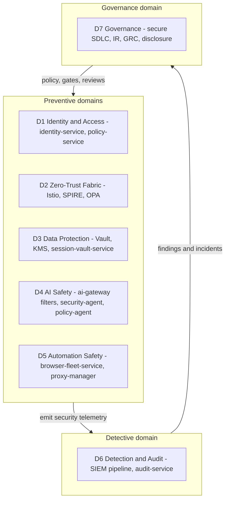
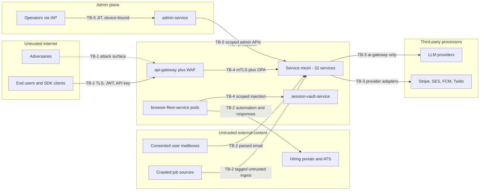
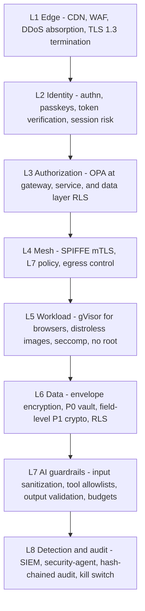
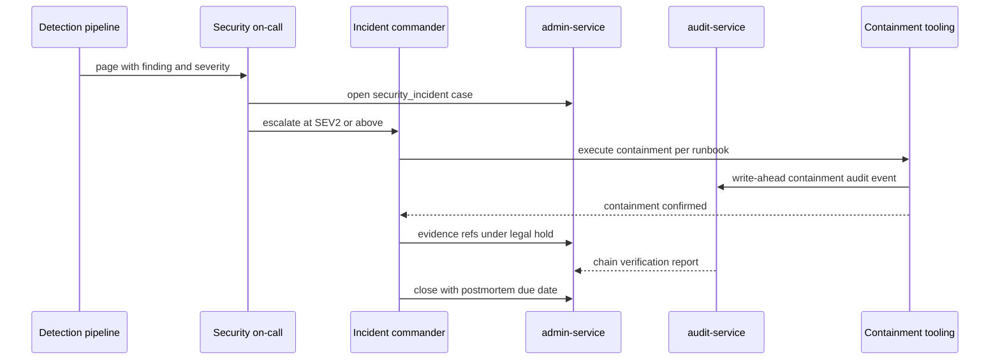

# 37 — Security Architecture

| | |
|---|---|
| Document ID | ACA-SAS-37 |
| Volume | 5 — Security |
| Status | Draft v1.0 |
| Depends on | [00 — Architecture Canon](../00-architecture-canon.md) §1 §13, [07 — System Context](../volume-1-foundation/07-system-context.md), [10 — API Gateway](../volume-2-core-services/10-api-gateway.md), [11 — Identity Service](../volume-2-core-services/11-identity-service.md), [16 — Universal Portal Engine](../volume-2-core-services/16-universal-portal-engine.md), [17 — Browser Fleet](../volume-2-core-services/17-browser-fleet.md), [18 — AI Gateway](../volume-2-core-services/18-ai-gateway.md), [38 — Zero Trust](38-zero-trust.md), [39 — RBAC](39-rbac.md) |

## 1. Overview

This chapter is the umbrella for Volume 5. It defines the platform threat model, maps the security domains and the chapters/services that own them, specifies the defense-in-depth layering that every other control assumes, and sets the operating processes that keep the posture honest over time: secure SDLC gates, incident response, abuse and fraud prevention, coordinated disclosure, and the security organization with explicit RACI. Sibling chapters go deep on individual domains — [Chapter 38](38-zero-trust.md) on the zero-trust fabric, [Chapter 39](39-rbac.md) on authorization; later chapters of this volume cover data protection, session-vault cryptography, prompt-injection defense in depth, and compliance programs.

ACA's threat profile is unusual in three ways, and this chapter is written around them. First, the platform **holds users' hiring-portal credentials and acts with them** (canon §1, §13): a compromise is not a data leak but an identity hijack of thousands of job seekers. `P0` custody (session-vault-service) is therefore the crown jewel and every trust-boundary analysis ends with the question "does this path shorten the distance to P0?" Second, the platform **feeds adversary-controllable content into LLMs and lets agents act on the output**: job posts, portal DOM, and inbound email are all untrusted input to a system with tools. Classic web threats (XSS, SSRF) recur here as prompt injection, tool abuse, and excessive agency, and the model must treat them as first-class STRIDE entries, not an appendix. Third, ACA is itself an attractive **abuse platform**: a system that can generate tailored documents and submit forms at scale is exactly what spammers and fraudsters want, so abuse prevention is a product-safety obligation to the hiring ecosystem, not only self-defense.

The chapter's normative outputs are: the trust-boundary register and STRIDE tables (§3) that every design RFC must reference, the defense-in-depth layer contract (§4) that forbids any single control from being load-bearing, the CI security gates (§5) that block merges, the severity matrix and forensics procedure (§6) that on-call responds under, the abuse control catalog (§7), the disclosure policy (§8), and the RACI (§9). Numbers in this chapter (SLAs, thresholds, reward bands) are the platform defaults; per-tenant contractual overrides are recorded by the compliance chapter.

## 2. Security Domains Map

Security work is partitioned into seven domains. Each domain has one accountable owner (§9), a small set of enforcing services, and a normative chapter. The map exists to prevent the two classic failure modes of security programs: controls with no owner, and two teams believing the other one owns a control.

| Domain | Scope | Enforcing services | Normative chapter(s) |
|---|---|---|---|
| D1 Identity & Access | Human/service/agent identity, tokens, sessions, roles | `identity-service`, `policy-service`, `user-service` | [11](../volume-2-core-services/11-identity-service.md), [39](39-rbac.md) |
| D2 Zero-Trust Fabric | mTLS, workload identity, L7 authz, segmentation | Istio/SPIRE (platform), OPA sidecars, `policy-service` | [38](38-zero-trust.md) |
| D3 Data Protection | PII classes P0–P3, encryption, key management, retention | Vault + KMS (platform), `session-vault-service`, service schemas | Volume 5 (session vault chapter, in preparation), [canon §11](../00-architecture-canon.md) |
| D4 AI Safety | Prompt-injection defense, output validation, model abuse, data poisoning | `ai-gateway`, `security-agent`, `policy-agent`, `prompt-registry-service` | [18](../volume-2-core-services/18-ai-gateway.md), [21](../volume-3-ai-architecture/21-ai-architecture.md), Volume 5 prompt-injection chapter (in preparation) |
| D5 Automation Safety | Browser isolation, credential custody at egress, portal compliance | `browser-fleet-service`, `session-vault-service`, `proxy-manager`, `policy-agent` | [17](../volume-2-core-services/17-browser-fleet.md), [16](../volume-2-core-services/16-universal-portal-engine.md), Volume 7 |
| D6 Detection & Audit | Security telemetry, SIEM detections, anomaly models, immutable audit | SIEM pipeline (this chapter §6.4), `audit-service`, `security-agent` | This chapter, [audit topics in canon §8](../00-architecture-canon.md) |
| D7 Governance | SDLC gates, IR process, pentest/bounty, compliance, RACI | CI platform, `admin-service` (case tooling) | This chapter, compliance chapter (in preparation) |

Boundary rule: a control may be *executed* by many services but is *owned* by exactly one domain. Cross-domain disputes are resolved by the security architecture review (§9), recorded as canon amendments where they change names or invariants.

## 3. Threat Model

### 3.1 Trust boundary register

The system-context trust zones from [Chapter 07](../volume-1-foundation/07-system-context.md) are refined into five security trust boundaries. Every design RFC that touches a boundary must cite its `TB-n` identifier and address the relevant STRIDE rows (§5.1).

| ID | Boundary | What crosses it | Dominant risks |
|---|---|---|---|
| TB-1 | External users/clients ↔ edge | Logins, API calls, uploads, webhooks | Account takeover, API abuse, injection, DoS |
| TB-2 | External content/portals ↔ ingestion + browser fleet | Job posts, portal DOM, CAPTCHAs, emails | Prompt injection, poisoning, malicious content, credential exfil attempts |
| TB-3 | ACA ↔ third-party processors (LLM, billing, comms) | Prompts/completions, payment data, messages | Data leakage to providers, provider compromise, response tampering |
| TB-4 | Internal service ↔ service | gRPC calls, Kafka events, DB access | Lateral movement, confused deputy, event forgery |
| TB-5 | Admins/operators ↔ production | Admin APIs, break-glass, deploys | Insider misuse, credential theft, over-privileged tooling |

### 3.2 STRIDE per boundary

Threats below are representative, not exhaustive; the living register (one row per accepted/mitigated threat with an owner) is maintained as `threat-register.yaml` in the architecture repo and reviewed quarterly (§9). Mitigation references are the load-bearing part.

**TB-1 — External users and clients**

| STRIDE | Threat | Primary mitigations |
|---|---|---|
| S | Credential stuffing, phished OTPs, session theft | Passkeys-first, breached-password checks, risk-scored logins with step-up ([Ch 11](../volume-2-core-services/11-identity-service.md)); 15-min access tokens (canon §7) |
| T | Tampered requests, replayed webhooks, forged idempotency | TLS 1.3 only; webhook HMAC signatures; `Idempotency-Key` dedup (canon §7) |
| R | "I never submitted that application" | Every consequential action audit-logged with consent + autonomy snapshot (`aca.audit.event.v1`); approval records event-sourced in `application-service` |
| I | IDOR/tenant bleed via API | Three-layer authz incl. Postgres RLS ([Ch 39 §6](39-rbac.md)); opaque prefixed IDs (canon §6) |
| D | Volumetric + application-layer DoS, expensive-endpoint abuse | CDN/WAF at edge, two-layer token-bucket rate limiting ([Ch 10](../volume-2-core-services/10-api-gateway.md)), per-plan quotas, cost-controller caps on AI-backed endpoints |
| E | JWT confusion/alg downgrade, scope escalation | EdDSA-only verification with `kid` pinning; OPA scope checks at gateway and service ([Ch 39 §6](39-rbac.md)) |

**TB-2 — Portals and crawled content (the AI-native boundary)**

| STRIDE | Threat | Primary mitigations |
|---|---|---|
| S | Phishing portal impersonating a real ATS to harvest injected credentials | Portal fingerprint verification + TLS cert/domain checks before credential injection; template trust ladder gates auto-use (canon §16) |
| T | Indirect prompt injection in job posts/DOM steering agents | `untrusted_content` wrappers, instruction/data separation, tool allowlists, security-agent screening (canon §13); output validators in `ai-gateway` |
| T | Data poisoning of template learning / learning-pipeline (adversarial pages teach bad templates) | Templates promoted only via shadow verification (`discovered → candidate → trusted`); learning-pipeline trains only on outcome-verified signals; anomaly checks on template diffs |
| R | Portal disputes a submission ("bot spam") | Post-submit verification artifacts (confirmation capture, screenshots 90d), per-site compliance policy log by `policy-agent` |
| I | Malicious page exfiltrates data visible to the browser session | Per-session egress allowlist (target portal + proxy only, canon §13); credentials injected at egress, never in agent context; DOM snapshots scrubbed before LLM |
| D | Tarpit pages / infinite CAPTCHA loops burning fleet and tokens | Per-session step/time/token budgets; `agent-supervisor` loop detection; `recovery-agent` circuit-breaks a portal |
| E | Browser pod escape to cluster | gVisor sandbox, dedicated node pool, per-session NetworkPolicy, no service-account token mounted ([Ch 17](../volume-2-core-services/17-browser-fleet.md), [Ch 38 §5](38-zero-trust.md)) |

**TB-3 — LLM and other third-party processors**

| STRIDE | Threat | Primary mitigations |
|---|---|---|
| S/T | Compromised or spoofed provider endpoint returns hostile completions | Pinned TLS + egress gateway allowlist; output validators treat completions as untrusted; provider failover isolates a bad provider |
| I | PII over-sharing in prompts; provider retains data | Prompt PII minimization in context builder; P0 never in prompts (canon §13); zero-retention/DPA contract terms per provider; provider choice per data-residency |
| D | Provider outage or quota exhaustion | Multi-provider failover + degrade-to-smaller-class ladder ([Ch 18](../volume-2-core-services/18-ai-gateway.md)) |
| E | Model abuse of ACA's provider accounts (stolen key = "LLM-jacking") | Provider keys only in `ai-gateway` via Vault dynamic secrets; per-key spend alerts; egress locked to gateway |

**TB-4 — Internal services** — S: workload impersonation → SPIFFE mTLS identities; T: forged Kafka events → producer ACLs limited to the CDC relay + schema validation; R: unattributable internal actions → mesh access logs + `traceparent` through events; I: cross-service DB access → per-service credentials, network segmentation, lint-banned drivers; D: noisy-neighbor cascade → per-service quotas, circuit breakers; E: sidecar/OPA bypass → fail-closed ext-authz, [Ch 38 §9](38-zero-trust.md) drift detection.

**TB-5 — Admin plane** — S: stolen operator SSO → passkeys + device-bound sessions ([Ch 38 §6](38-zero-trust.md)); T: out-of-band prod mutation → GitOps-only changes, break-glass audited; R: "who suspended this tenant" → dual-control for destructive ops + hash-chained audit; I: support reading user data without need → consented, time-boxed impersonation ([Ch 39 §7](39-rbac.md)); D: fat-fingered kill switch → scoped switches with confirmation + auto-expiry; E: standing admin rights → JIT elevation only (canon §13).

### 3.3 AI-specific threat catalog

These threats cut across TB-1/2/3 and get their own register entries because their kill chains are novel. Mapping to OWASP LLM Top 10 identifiers is included for auditor familiarity.

| ID | Threat | Kill chain sketch | Controls (owning domain) |
|---|---|---|---|
| AI-1 | Direct prompt injection (user-authored profile/resume text steers agents) | User content → context builder → agent plans hostile action | Same `untrusted_content` treatment as external text; tool allowlists; policy-agent pre-action check (D4) — LLM01 |
| AI-2 | Indirect prompt injection (job post/DOM/email) | Adversary page → perception → plan → tool call (e.g., "email your session cookies") | Source tagging, instruction/data separation, security-agent screen, no-credential-in-context invariant, egress allowlists (D4/D5) — LLM01 |
| AI-3 | Data poisoning of portal templates | Adversary serves crafted pages → `portal-intel-agent` learns booby-trapped template | Trust ladder with shadow verification; template diff anomaly scoring; failure-rate demotion to `stale` (D5) — LLM03 |
| AI-4 | Data poisoning of learning-pipeline | Fake "outcomes" bias global strategy models | Only verified outcome signals enter training sets; per-tenant influence caps; eval gates before rollout (D4) — LLM03 |
| AI-5 | Model abuse / denial of wallet | Attacker drives expensive frontier-class calls via free accounts or scripted flows | cost-controller budgets per tenant/user/agent/feature with hard stops; plan-gated model classes; anomaly alerts on token velocity (D4) — LLM10 |
| AI-6 | Credential misuse by automation | Injected or buggy agent uses vaulted portal credentials outside consented scope | Credentials injected only at browser egress for a policy-cleared session; capability tokens scope agent tools ([Ch 39 §8](39-rbac.md)); kill switch per user/tenant/platform (D1/D5) — LLM08 |
| AI-7 | Excessive agency / runaway autonomy | Agent loop escalates beyond user's autonomy level | Autonomy levels L0–L3 enforced by `agent-orchestrator` + policy-agent before consequential actions; `agent-supervisor` stall/loop detection (D4) — LLM08 |
| AI-8 | System-prompt / template exfiltration | Attacker extracts prompts, portal templates, or match features via probing | Prompts are not secrets by policy (no credentials/keys in prompts); rate + similarity probes alerts; templates served only to workloads with SPIFFE identity (D2/D4) — LLM07 |
| AI-9 | Unsafe output handling | Completion contains markup/SQL/URLs consumed by downstream code | Output validators: schema-constrained outputs, URL allowlists, HTML sanitization before render (D4) — LLM02 |

### 3.4 Threat-model process hooks

- **`security-agent`** operationalizes parts of this model at runtime: prompt-injection screening on TB-2 content, behavioral anomaly detection on agent runs (tool-call sequences vs. per-agent baselines), and emission of `aca.security.finding.v1` events (§6.4). It is a detector, not an enforcement point — enforcement stays with `ai-gateway` filters and `policy-agent`, so a security-agent outage degrades detection, never opens a gate (fail-safe direction is explicit).
- The register feeds §5 (design-time gates) and §6 (detections): every register row must name at least one preventive control **and** one detection, or carry an explicit risk acceptance signed by the accountable owner (§9).

## 4. Defense in Depth

No single control is load-bearing. The layer contract: each layer assumes the layers above it have already failed, and each layer's bypass must be observable at the layer below. Reviews reject designs where two "independent" mitigations share a failure domain (e.g., two checks in the same process).

| Layer | Assumed failure above | What this layer still guarantees |
|---|---|---|
| L2 | WAF bypassed, request reaches origin | No unauthenticated request reaches business logic; anomalous sessions step-up or die |
| L3 | Valid token, wrong intent | Action denied unless role ∩ attributes permit ([Ch 39](39-rbac.md)); denials logged |
| L4 | A service is compromised | Blast radius = that service's declared dependencies; no ambient network reach ([Ch 38](38-zero-trust.md)) |
| L5 | Hostile code executes in a pod | Browser pods cannot reach cluster metadata/other tenants; escape requires gVisor + node break |
| L6 | Attacker reads a database or bucket | P0/P1 remain ciphertext without per-tenant KEKs; RLS bounds queries to `tenant_id` |
| L7 | Malicious content reaches an LLM | Tools outside the allowlist cannot be called; outputs failing validation are dropped; spend is capped |
| L8 | All preventive layers failed | The compromise is detected, evidence is tamper-evident, and the kill switch bounds ongoing harm |

The **kill switch** (canon §1) is the terminal control: `admin-service` + `feature-flag-service` expose scoped switches (`automation.enabled`, `submissions.enabled`, `ai.frontier.enabled`) at user, tenant, and platform scope; browser-fleet and agent-orchestrator poll flags with a ≤ 30 s propagation SLO (bounded harm window; faster would require a push path that itself becomes a critical dependency). Switch flips are dual-controlled at platform scope, single-operator at user/tenant scope, always audit-logged.

## 5. Secure SDLC

### 5.1 Threat modeling in design

Every design RFC includes a mandatory "Security" section; RFCs touching a trust boundary (§3.1), a new external input, a new tool for any agent, or any P0/P1 data path require a **threat-modeling review** with product security before implementation starts. The review is STRIDE-lite: 30–60 minutes against the boundary tables in §3, output is new/updated `threat-register.yaml` rows. Triggers are enforced by an RFC-template checklist, not goodwill; the review queue SLA is 3 business days so it never becomes the excuse for skipping it.

### 5.2 CI/CD security gates

Gates run in GitHub Actions (canon §3); blocking gates fail the merge, advisory gates open tracked findings. Tools are reference choices behind stable interfaces (SARIF in, findings out) — swapping a scanner is not an architecture change.

| Gate | Reference tool | Stage | Blocking policy | Rationale |
|---|---|---|---|---|
| Secret scanning | gitleaks + GitHub push protection | pre-commit, push, CI | Block any verified finding | Leaked secret = incident, zero tolerance |
| SAST | Semgrep (org ruleset + ACA custom rules) | PR | Block high/critical; medium = 14-day SLA | Custom rules encode canon invariants (see below) |
| SCA + SBOM | Syft (SBOM) + Grype | PR + nightly | Block critical with available fix; license allowlist | Nightly catches newly-published CVEs on unchanged code |
| Container scan | Trivy; distroless/Chainguard base enforced by policy | image build | Block high in OS packages; block non-canon base images | Base-image drift is a supply-chain regression |
| IaC scan | Checkov (Terraform) + conftest/OPA (Helm, K8s) | PR | Block high (public buckets, permissive SGs, privileged pods) | Same OPA toolchain as runtime authz — one policy language (Rego) org-wide |
| DAST | OWASP ZAP baseline | nightly vs. staging | Advisory; high = 5-business-day SLA | DAST is too slow/flaky for merge gating |
| API fuzz | Schema-driven fuzzing of `public-api-service` | weekly | Advisory | Public API is the widest anonymous-reachable surface |
| Prompt/AI gate | prompt-registry eval suite incl. injection red-team set | on prompt/tool-schema change | Block promotion to `stable` on regression | Prompt changes are deploys; they get deploy-grade gates (canon §10.4) |

ACA-custom SAST rules (maintained by product security, versioned with the ruleset): no provider SDK import outside `ai-gateway` (canon §9); no string concatenation of `untrusted_content` into prompt templates; no direct Kafka produce outside the CDC relay allowlist; no `pg` connection strings referencing another service's database; no logging of fields tagged P0/P1 in the shared chassis annotations.

Supply chain: SBOM per image retained 18 months (matches SOC 2 audit look-back + margin); images signed (cosign) and admission-verified in cluster; third-party GitHub Actions pinned by SHA.

### 5.3 Penetration testing cadence

| Activity | Cadence | Scope |
|---|---|---|
| External full-scope pentest | Annual (SOC 2 evidence) | Edge, authn/authz, tenant isolation, public API |
| Targeted subsystem pentest | Per major launch + annually rotating | Browser fleet & session vault; AI plane (injection→tool-abuse chains); admin plane |
| Internal red-team exercise | Semi-annual | Assume-breach from a compromised service pod; TB-4/TB-5 paths |
| AI red-team (automated) | Continuous | Injection corpus replayed against `stable` prompts/agents in staging; corpus grows from bounty + incident findings |
| Bug bounty | Continuous | §8 |

Findings enter the same vulnerability-management flow as scanner output: critical 7-day fix SLA, high 30, medium 90 (aligned with SOC 2 expectations and achievable with weekly deploys; tighter SLAs would be aspirational fiction).

## 6. Incident Response

### 6.1 Severity matrix

| SEV | Definition | Examples | Ack | Cadence / notification |
|---|---|---|---|---|
| SEV1 | Active breach, cross-tenant data exposure, P0 (session-vault) compromise, agents acting maliciously at scale | Vault KEK misuse; template poisoning causing harmful submissions across tenants | 15 min, 24×7 | IC + exec + legal engaged; status every 60 min; GDPR 72-hour breach-notification clock evaluated within 24 h |
| SEV2 | Exploitable critical vuln in prod, single-tenant compromise, provider key theft, sustained authz bypass | Working IDOR on applications; leaked provider key with spend anomaly | 30 min, 24×7 | Status every 4 h; affected-tenant notification per DPA terms |
| SEV3 | Contained vuln, suspicious-but-unconfirmed activity, single-user compromise | Credential-stuffing spike absorbed; one account takeover | 4 business hours | Daily summary until closed |
| SEV4 | Policy violation or finding with no user impact | Advisory scanner finding; internal secret hygiene lapse | Next business day | Tracked in vuln management |

Severity is set by the first responder and may only be lowered by the IC with written rationale (prevents quiet downgrades). Any confirmed cross-tenant read is automatically ≥ SEV1 regardless of volume — tenant isolation is the product's core promise.

### 6.2 Roles and process

Standard IC model: **Incident Commander** (rotating, trained pool from security + SRE), **Ops lead** (hands on keyboard), **Comms lead** (internal + customer + regulator drafts with legal), **Scribe** (timeline into the case record). Security incidents run in `admin-service` support-case tooling with a dedicated `security_incident` case type so evidence links, actions, and approvals live in one audited place. Postmortems are blameless, due in 5 business days for SEV1/2, and must update: the threat register, at least one detection, and (if relevant) a runbook.

Runbook catalog (maintained in Volume 6's operations repo; security-owned entries): account-takeover wave, provider key compromise, session-vault anomaly, prompt-injection incident (novel bypass), rogue-agent containment, admin-credential compromise, data-exposure assessment, DDoS, malicious-insider, template-poisoning rollback.

### 6.3 Containment tooling

Ordered by increasing blast radius, all audited: revoke a user's sessions/tokens (identity-service) → freeze an agent type or a tenant's automation (agent-orchestrator + flags) → rotate a service's credentials (Vault dynamic secrets) → per-portal circuit breaker (proxy-manager) → tenant kill switch → platform kill switch (dual-control). Every containment action emits `aca.audit.event.v1` before taking effect (write-ahead audit; if the audit write fails, the action still proceeds for SEV1 containment but raises a paired alarm — availability of containment beats audit completeness in an active breach, and the gap is reconciled from mesh logs).

### 6.4 Forensics with audit-service and the detection pipeline

**Detection pipeline (component).** *Purpose:* one path from raw security telemetry to triaged detection. *Responsibilities:* ingest mesh access logs, gateway/WAF logs, identity events, OPA decision logs, `aca.security.finding.v1` (from `security-agent`), and cloud-provider audit trails into the SIEM (reference: OpenSearch security-analytics on the existing OpenSearch cluster — no new stateful platform for phase 1); run correlation rules; page per §6.1. *Interactions:* consumes Kafka `aca.audit.event.v1` and `aca.security.*` topics plus Loki-forwarded logs; opens cases in `admin-service`. *Failure modes:* ingestion lag (alarm at > 5 min — detections older than that materially widen dwell time), rule regression (rules are code, PR-reviewed with replay tests). *Scaling:* stateless consumers; OpenSearch index sizing per Volume 4 conventions. *Monitoring:* detection latency, rule hit/false-positive rates, coverage vs. threat register (every register row lists its detections).

Security event topics (new `security` domain, following canon §8 naming):

| Topic | Key | Payload sketch |
|---|---|---|
| `aca.security.finding.v1` | `tenant_id` | detector, finding type, severity, subject (user/agent/run/service), evidence refs, confidence |
| `aca.security.incident.opened.v1` / `.closed.v1` | incident id | severity, boundary, affected scopes, case ref |
| `aca.security.containment.executed.v1` | scope id | action, scope (user/tenant/platform), operator(s), expiry |

**Forensics.** `audit-service` (hash-chained, append-only, 7-year WORM retention per canon §11) is the evidence backbone: chain verification proves non-tampering, and the chain head is externally anchored daily (checkpoint hash written to an independent WORM bucket in a separate account) so even an audit-service compromise cannot silently rewrite history. Evidence handling: a per-incident evidence bucket with object lock (legal hold), chain-of-custody recorded in the case; browser-session artifacts (screenshots, DOM snapshots — 90-day retention) are copied under hold *before* expiry when relevant. Forensic queries run against read replicas/SIEM, never against production primaries. Clock discipline: all evidence timestamps trace to NTP-synced nodes; `trace_id` links audit events ↔ traces ↔ AI request logs for cross-plane reconstruction.

## 7. Abuse and Fraud Prevention

Abuse controls protect three parties: ACA (cost, reputation), users (account integrity), and the hiring ecosystem (portals must not be spammed — a compliance obligation under canon §1, and existential: portals that classify ACA traffic as abuse will block the product).

| Vector | Detection | Response | Owner |
|---|---|---|---|
| Fake-account farms | Signup risk score (IP/ASN reputation, disposable-email list, device fingerprint, velocity: > 3 signups/IP/day flags — low enough to catch farms, high enough for shared NATs); phone verification on high risk | Progressive friction → manual review queue in `admin-service` → block; free-plan capability floor until verified | D1 + `admin-service` |
| API scraping of job/match data | Per-key + per-tenant token buckets (canon §7); sequential-ID probing alarms (opaque IDs make enumeration loud); honeytoken records planted in list endpoints | Key throttle → key revocation → tenant review; honeytoken access = automatic SEV3 | D6 + `public-api-service` |
| Spam applications through ACA | Plan quotas (canon §12) as hard ceiling; `policy-agent` quality gate pre-submission (duplicate/mismatched/low-quality drafts blocked); per-portal rate budgets in `proxy-manager`; portal complaint intake | Throttle user's autopilot → force L1 approval mode → suspend automation for the account; portal-level circuit breaker protects the shared reputation | D5 + `policy-agent` |
| Account takeover for credential harvesting | Login anomaly scoring; impossible-travel; new-device step-up; alert on session-vault access pattern changes | Session revocation, forced re-auth, vault access frozen pending re-verification | D1 |
| Payment fraud | Stripe Radar via `billing-service` adapter; chargeback monitoring | Standard dunning/fraud flows; automation disabled on confirmed fraud | `billing-service` |
| Model abuse (§3.3 AI-5) | cost-controller budget anomalies; token-velocity per account; output-similarity probes | Budget hard-stop, plan floor enforcement, account review | D4 + `cost-controller` |

Abuse review tooling lives in `admin-service` (canon §4.5 "abuse review"): a queue with evidence panels, per-reviewer action audit, and appeal workflow (false-positive suspensions of paying users are a retention risk, so appeals have a 2-business-day SLA). All enforcement actions emit audit events and are reversible except confirmed-fraud closures.

## 8. Vulnerability Disclosure and Bug Bounty

- **Coordinated disclosure policy** published at `https://aca.dev/.well-known/security.txt` and `/security`: safe harbor for good-faith research within scope, no legal action, 90-day coordinated disclosure window (industry norm; extendable by mutual agreement for architectural fixes).
- **Scope:** production edge (`api.aca.dev`), web app, public API, mobile apps. **Out of scope:** third-party hiring portals (researching against portals with ACA is attacking a third party — explicitly forbidden), volumetric DoS, social engineering of staff, physical attacks.
- **Program shape:** private bounty (invite ~50 researchers) from public beta; public program after the first annual pentest cycle closes the obvious findings — public-first burns triage capacity on duplicates of known issues.
- **Reference reward bands** (calibrated to crown jewels; the top band exists because a session-vault or cross-tenant finding is worth far more to a criminal): Critical — cross-tenant data access, session-vault/P0 compromise, RCE, authn bypass: $5,000–$15,000. High — single-tenant privilege escalation, stored XSS reaching another user, agent tool-abuse chains with real-world effect: $1,500–$5,000. Medium: $300–$1,500. Low: $50–$300. Novel prompt-injection chains that achieve tool misuse (not mere jailbreak text) are classed High minimum — this is the program's most valuable research signal and priced to attract it.
- **Triage SLAs:** first response 2 business days; severity confirmation 5; researcher-visible status thereafter. Intake lands in the detection pipeline as `aca.security.finding.v1` (detector = `bounty`) so bounty and internal findings converge in one queue.

## 9. Security Organization and RACI

Phase-1 organization (matches a platform of this scale; roles, not headcount — one person may hold several early, but the *accountability* split is fixed): **CISO** (accountable owner of the program; fractional acceptable pre-GA), **Security Engineering** (D2/D3 platform controls), **Product Security / AppSec** (D1/D4/D5 design reviews, SDLC gates, SAST rules), **Detection & Response** (D6, IR), **GRC** (D7 compliance, vendor risk), plus **Service teams** (control implementation in their services) and **SRE/Platform** (infrastructure execution).

| Activity | CISO | SecEng | ProdSec | D&R | GRC | Service teams | SRE |
|---|---|---|---|---|---|---|---|
| Threat modeling reviews | A | C | R | C | I | R | C |
| SDLC gate policy + custom rules | A | C | R | I | C | C | C |
| Zero-trust fabric ([Ch 38](38-zero-trust.md)) | A | R | C | C | I | C | R |
| Authz policy ([Ch 39](39-rbac.md)) | A | C | R | I | C | R | I |
| Key management / Vault | A | R | C | I | C | I | R |
| Detection rules + SIEM | A | C | C | R | I | C | C |
| Incident response | A | C | C | R | C | R | R |
| Pentest + bounty triage | A | C | R | R | C | C | I |
| Access reviews (quarterly) | A | C | I | I | R | R | C |
| Compliance audits (SOC 2, ISO) | A | C | C | C | R | C | C |
| Kill-switch governance | A | C | C | R | I | I | C |

(R = responsible, A = accountable, C = consulted, I = informed.) Escalation rule: any security veto overridden by a product decision requires written risk acceptance by the CISO, recorded in the threat register — silent overrides are the pattern this table exists to kill. The **security architecture review** (CISO + SecEng + ProdSec, biweekly) owns domain-boundary disputes (§2) and canon-amendment proposals.

## 10. Failure Scenarios

| Scenario | Impact | Response / design answer |
|---|---|---|
| WAF/CDN outage or misconfig | Edge exposed to volumetric + known-signature attacks | api-gateway rate limiting is independent (L1/L2 separation); WAF config changes canaried like code; runbook: temporary aggressive edge limits |
| Vault unavailable | New dynamic credentials and decryption of cold P1 fields fail | Services cache leases within TTL; session-vault holds envelope keys with independent KMS path; degraded mode: no new browser sessions (fail-closed on P0), existing API traffic unaffected |
| Detection pipeline lag > 5 min | Dwell-time window widens silently | Lag alarm is itself paged (detector-of-the-detector); audit-service ingestion is a separate consumer group so evidence is not lost, only triage is delayed |
| `security-agent` outage | Injection screening + anomaly detection degraded | Enforcement layers (ai-gateway validators, policy-agent, allowlists) unaffected by design (§3.4); elevated-risk flag reduces autonomy ceilings to L1 for consequential actions until restored |
| Compromised admin credential | TB-5 breach with high blast radius | JIT elevation means standing access ≈ 0; device binding blocks replay from attacker hardware; dual-control on destructive ops; runbook: admin-credential compromise |
| Audit chain verification failure | Evidence integrity in doubt | SEV1 by definition; external daily anchor bounds the tamper window to ≤ 24 h; reconcile from Kafka audit topic + mesh logs |
| Kill switch mis-flip (platform scope) | All automation halted (availability incident, not security) | Dual-control + confirmation prevents solo error; flags auto-expire after 24 h unless renewed, preventing forgotten global stops |

## 11. Scaling Strategy

Security-plane load scales with three drivers: request volume (OPA decisions, mesh logs — [Ch 38 §11](38-zero-trust.md) owns those budgets), agent activity (security-agent screening calls scale with TB-2 content volume; screening uses `small`-class models per the escalation ladder, and batches non-interactive screening through the batch lane), and audit volume (`aca.audit.event.v1` at target scale is bounded by canon partitioning conventions; the SIEM consumes the same topic without a second emission path). Detection rules are stateless consumers — scale horizontally by partition. Abuse scoring at signup/login is a synchronous Redis-backed feature lookup with a 50 ms budget (risk scoring must never become the login bottleneck; on timeout it defaults to "medium risk + async review", never to open). Bounty/pentest triage scales by queue, not architecture.

## 12. Security Considerations (residual risk register)

Explicitly accepted residual risks, reviewed quarterly: (1) **LLM provider trust** — prompts (P2-class content, never P0) transit third-party infrastructure under DPA/zero-retention terms; mitigation is contractual + minimization, not technical, until self-hosted classes cover more traffic. (2) **Prompt injection is mitigated, not solved** — the layered defense reduces exploitability; the register assumes new bypasses will appear, which is why AI-8/AI-2 have paired detections and the bounty prices them High. (3) **gVisor is strong but not a hypervisor** — a gVisor + kernel chain remains theoretically possible; browser nodes are a dedicated, tainted, minimal-privilege pool to bound it. (4) **Insider risk** — dual-control and audit reduce but cannot eliminate a determined privileged insider; detection (D6) is the honest control. (5) **Portal-side changes** — a portal could reclassify consented automation as abuse despite compliance controls; this is a product/legal risk tracked outside the technical register but with technical hooks (per-portal circuit breakers).

## 13. Observability

Security observability rides the standard OTel stack (canon §14) with a dedicated Grafana folder. First-class dashboards: **Boundary health** (WAF blocks, authn failure rates, step-up rates, TB-2 screening verdicts), **Authz** (deny rates by service/policy — spikes mean either attack or bad policy deploy, both page-worthy), **AI safety** (injection findings/day, output-validation failures, tool-denial counts, budget hard-stops), **Detection ops** (ingest lag, rule latencies, finding→triage time, false-positive rate per rule), **Audit integrity** (chain verification status, anchor freshness, audit consumer lag). Alert routing: SEV-mapped PagerDuty services; every §3 register row's detection lists its alert. KPIs reported monthly to the CISO: mean time to detect/contain, gate-block counts vs. override count (overrides trending up = gates being routed around), vuln SLA adherence, bounty signal quality.

## 14. Future Improvements

- Dedicated SIEM/UEBA platform when OpenSearch security-analytics rule expressiveness or retention economics are outgrown (revisit at > 10 TB/month security telemetry).
- Deception layer: honeytokens beyond API records — decoy vault entries and decoy portal credentials that page on use.
- Automated containment (SOAR-style) for high-confidence detections: auto-freeze agent runs on confirmed injection findings, with human confirmation within 15 min.
- Cryptographic transparency log for template and prompt provenance (Sigstore-style) extending the §5.2 signing posture to AI artifacts.
- Purple-team automation: continuous replay of past incident kill chains against staging as regression tests for detections.

## 15. Alternatives Considered & Tradeoffs

| Decision | Alternatives | Why this choice / tradeoff |
|---|---|---|
| STRIDE-per-boundary as the modeling frame | PASTA, LINDDUN, attack trees per feature | STRIDE-per-boundary is teachable to every RFC author and maps 1:1 to the zone model in Ch 07; LINDDUN privacy analysis is folded into the data-protection chapter instead. Tradeoff: STRIDE under-serves privacy threats — accepted because GDPR work has its own track |
| SIEM on existing OpenSearch (phase 1) | Dedicated SIEM (Splunk/Chronicle-class), security data lake | One less stateful platform to run pre-GA; rules-as-code portability preserves the exit. Tradeoff: weaker correlation features — accepted at current telemetry scale (revisit trigger in §14) |
| security-agent as detector, not enforcer | Inline enforcement by security-agent on all agent I/O | Inline would put an LLM-based judgment on the availability path of every agent action and create a single choke point whose outage blocks the product or (worse) gets bypassed under pressure. Detector + independent deterministic enforcement (allowlists, validators, policy-agent) fails safe |
| Write-ahead audit with SEV1 proceed-on-failure exception | Strict audit-before-action always | Strict ordering makes audit-service an availability dependency of *containment during a breach* — the worst possible moment. Exception is narrow (SEV1 containment), alarmed, and reconciled |
| Private-then-public bounty | Public from day 1; no bounty (pentest only) | Public-first floods triage with duplicates; pentest-only misses the continuous, adversarial creativity that AI-abuse chains need. Tradeoff: slower researcher-community ramp |
| Central threat register file, quarterly review | Per-team registers; tooling-first (GRC platform) | One register keeps the "every threat has a control and a detection" invariant checkable; a GRC platform is process overhead before SOC 2 demands it. Tradeoff: YAML review discipline required |
| Abuse enforcement inside `admin-service` queues | Standalone trust-and-safety service | The canon's 32-service catalog holds; abuse review is a workflow over existing signals, not a new data owner. Revisit if abuse ops headcount > ~5 or reviewer tooling needs diverge (would require canon amendment) |
