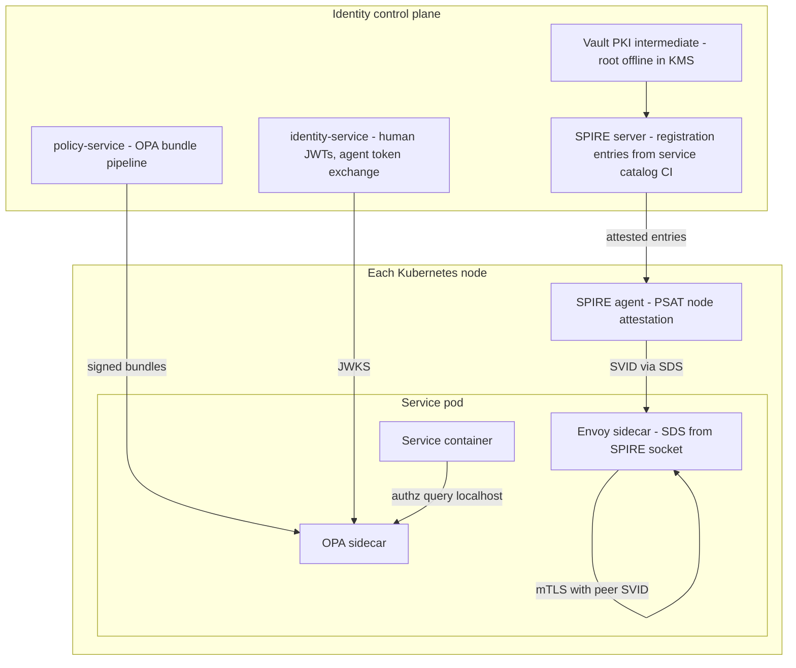
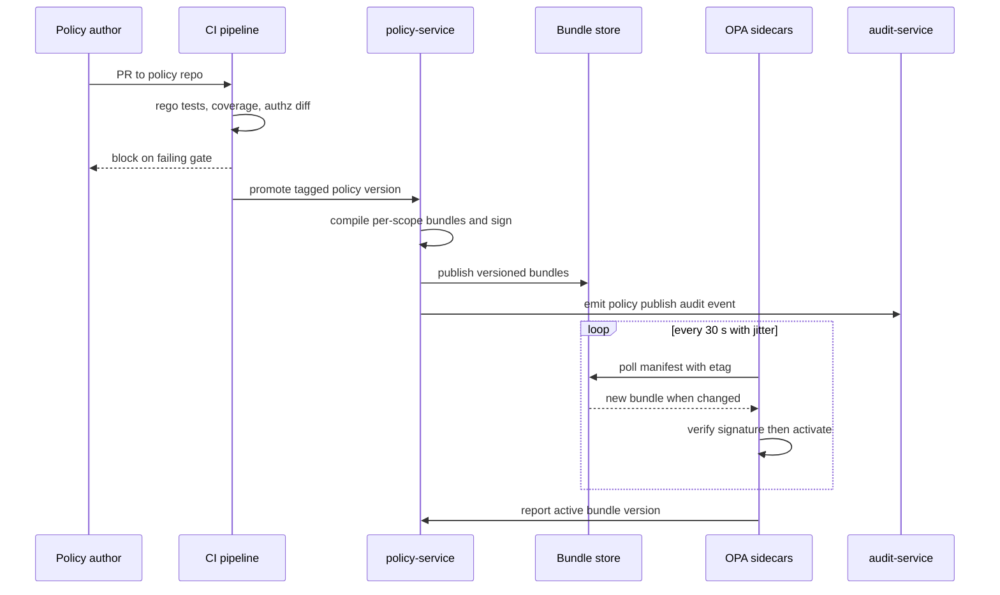
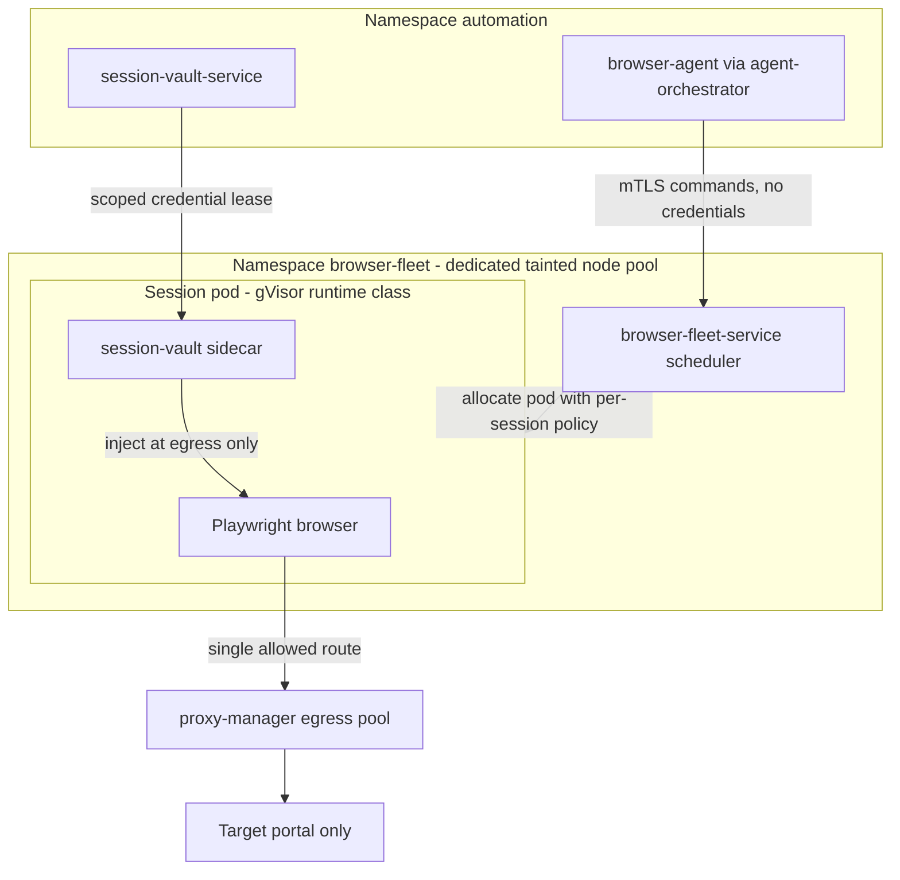

# 38 — Zero Trust

| | |
|---|---|
| Document ID | ACA-SAS-38 |
| Volume | 5 — Security |
| Status | Draft v1.0 |
| Depends on | [00 — Architecture Canon](../00-architecture-canon.md) §2 §3 §7 §13, [37 — Security Architecture](37-security-architecture.md), [39 — RBAC](39-rbac.md), [09 — Microservice Architecture](../volume-2-core-services/09-microservice-architecture.md), [10 — API Gateway](../volume-2-core-services/10-api-gateway.md), [11 — Identity Service](../volume-2-core-services/11-identity-service.md), [17 — Browser Fleet](../volume-2-core-services/17-browser-fleet.md) |

## 1. Overview

The canon's security posture is zero trust (canon §13): no implicit network trust; every hop authenticated and authorized. This chapter specifies the implementation — the identity fabric for humans, services, and agents; mesh-wide mTLS via Istio with SPIFFE/SPIRE workload identity; L7 authorization with OPA and the `policy-service` bundle distribution pipeline; network micro-segmentation including the browser-fleet egress isolation model; device- and context-aware access for the admin plane; continuous verification through short-lived credentials and session risk scoring; the migration path from residual perimeter assumptions; and the testing/drift-detection machinery that keeps declared policy equal to enforced policy.

The organizing principle: **authorization decisions consume identities, never network locations.** An IP address, namespace, or security group may appear in defense-in-depth layering ([Ch 37 §4](37-security-architecture.md)) but must never be the *reason* a request is allowed. Concretely, every allow decision in the system reduces to a tuple — (verified principal, verified context, explicit policy) — where the principal is a human identity from `identity-service`, a workload SVID from SPIRE, or an agent capability token ([Ch 39 §8](39-rbac.md)), and the policy is versioned Rego distributed by `policy-service`.

The second organizing principle is **fail-closed by default, with tiered, documented exceptions.** Zero-trust systems die by exception creep: each "temporary" permissive rule becomes load-bearing. Every exception here (permissive mTLS during migration, OPA fail-open for Tier-3 read paths) has an owner, an expiry, and a drift-detection probe asserting it still matches the register (§9). This chapter is normative for those registers.

Scope note: token formats and human authentication flows belong to [Chapter 11](../volume-2-core-services/11-identity-service.md); role/permission semantics to [Chapter 39](39-rbac.md). This chapter owns the fabric that carries and verifies them.

## 2. Identity-Centric Model

### 2.1 Principal classes

| Principal | Identity form | Issuer | Lifetime | Attestation basis |
|---|---|---|---|---|
| Human (end user) | JWT (EdDSA), `sub = usr_...` | `identity-service` | 15 min access / 30 d rotating refresh (canon §7) | OIDC login + passkey/TOTP; session risk (§7) |
| Human (operator/admin) | JWT + JIT elevation grant | `identity-service` + `policy-service` approval | Elevation ≤ 60 min | SSO + passkey + device posture (§6) |
| Service workload | X.509 SVID, `spiffe://aca.dev/ns/<ns>/sa/<service>` | SPIRE (upstream CA in Vault PKI) | 24 h cert, rotated at 50% TTL | Node PSAT + K8s workload attestor (§2.2) |
| Browser session pod | X.509 SVID, `spiffe://aca.dev/ns/browser-fleet/sa/browser-session` | SPIRE | 1 h | Same, plus pod-label selector binding to session id |
| Agent run | Capability token (JWT) bound to the orchestrator's SVID | `identity-service` token exchange | ≤ 15 min, run-scoped | Requested by `agent-orchestrator` over its own mTLS identity ([Ch 39 §8](39-rbac.md)) |
| External API consumer | `X-API-Key` → resolved principal | `public-api-service` | Key until revoked; resolved session per request | Key hash lookup + tenant entitlements |
| Kafka client | mTLS SVID mapped to ACL principal | SPIRE | 24 h | Broker mTLS with SPIFFE SAN mapping |

Trust domain is `aca.dev` — one SPIFFE trust domain per environment (`aca.dev` prod, `staging.aca.dev`, `dev.aca.dev`); environments never federate (a staging compromise must not mint prod-valid identities). Cells (canon §15) share the regional trust domain; cell isolation is enforced by policy on the SVID's namespace path plus data-layer RLS, not by separate CAs — separate CAs per cell would multiply operational burden without changing the decision inputs, since policy already sees the namespace.

### 2.2 Workload attestation (SPIRE)

- **Node attestation:** SPIRE agents attest to the SPIRE server with Kubernetes Projected Service Account Tokens (PSAT), binding each agent to a specific node identity. Cloud instance-identity attestation is layered on for the browser-fleet node pool (defense in depth on the highest-risk nodes).
- **Workload attestation:** the K8s workload attestor maps pod service account + namespace + labels to a registration entry. Registration entries are **generated from the service catalog** (one entry per canonical service, canon §4) by CI — hand-registered entries are forbidden; the drift probe (§9) diffs live entries against the generated set.
- **Istio integration:** Istio is configured with SPIRE as the certificate source (Envoy SDS from the SPIRE agent socket), so mesh mTLS certs *are* SVIDs — one identity system, not an Istio CA shadow hierarchy. Upstream signing chains to a Vault PKI intermediate (root offline in KMS), giving a single revocation/rotation story for mesh and non-mesh (Kafka, Postgres client) certs.



**Component summary — SPIRE deployment.** *Purpose:* single source of workload identity. *Responsibilities:* attestation, SVID minting/rotation, trust-bundle distribution. *Interactions:* Vault PKI (upstream), Istio SDS (consumer), CI (registration entries). *Failure scenarios:* server outage → agents serve cached SVIDs until TTL; at 24 h certs with 50%-TTL rotation the fleet tolerates ≥ 12 h of server downtime before first expiry — the TTL choice is exactly this availability/exposure tradeoff (1 h certs were rejected: a 30-min SPIRE outage would start dropping mesh traffic). *Scaling:* server HA pair per region, datastore on the platform Postgres; agents are per-node DaemonSet. *Monitoring:* SVID expiry histograms (page if any workload < 20% TTL remaining), attestation failure rate, registration-entry drift. *Alternatives:* Istio built-in CA (rejected: ties workload identity to the mesh — Kafka/Postgres/off-mesh jobs need the same identities); cert-manager per-service certs (rejected: no attestation, secrets become copyable).

## 3. mTLS Everywhere (Istio)

### 3.1 Configuration approach

Mesh-wide `STRICT` peer authentication is the default; anything else is an entry in the exception register with owner + expiry.

```yaml
apiVersion: security.istio.io/v1
kind: PeerAuthentication
metadata:
  name: default
  namespace: istio-system    # mesh-wide root policy
spec:
  mtls:
    mode: STRICT
```

Rules that keep this honest: namespace- or workload-level `PeerAuthentication` overrides may only *tighten* (e.g., port-level exceptions are forbidden in prod; the single sanctioned exception class is health-check ports for kubelet probes, expressed once in the base chart, not per team). `DestinationRule` TLS is `ISTIO_MUTUAL` everywhere; `PERMISSIVE` exists only as a migration state (§8) with an expiry annotation that CI rejects when past due.

| Path | TLS posture | Notes |
|---|---|---|
| Client → edge | TLS 1.3 (1.2 floor for legacy), CDN/WAF in front | [Ch 10](../volume-2-core-services/10-api-gateway.md) |
| Edge → mesh services | mTLS (gateway holds an SVID like any workload) | Gateway is in-mesh; no "trusted edge" bypass |
| Service ↔ service | STRICT mTLS, SPIFFE SVIDs | §2 |
| Service → Postgres/Redis/OpenSearch | TLS with client certs from the same Vault PKI | Off-mesh stateful stores get the same identity roots |
| Service → Kafka | mTLS, SPIFFE SAN → broker ACL principal | Producer ACLs restricted to CDC relay per canon §8 |
| Mesh → external (LLM providers, Stripe, portals) | Egress via dedicated gateways only (§5.3) | Direct pod egress to internet is deny-by-default |

Certificate rotation is continuous (50% TTL); there is no rotation "event" to run. Root rotation is a runbooked, dual-controlled ceremony (annual or on suspicion), staged via dual-trust bundles.

### 3.2 Failure and scaling notes

mTLS failure mode is loud and safe: a workload without a valid SVID cannot connect — pages fire on SVID-expiry metrics well before impact (§2.2). Handshake overhead is amortized by connection pooling (HTTP/2, gRPC); measured budget: < 1 ms added p99 on established connections, connection-storm risk only during mass restarts, mitigated by rollout maxUnavailable limits ([Ch 09](../volume-2-core-services/09-microservice-architecture.md)).

## 4. L7 Authorization (OPA + policy-service)

### 4.1 Decision architecture

Two enforcement points share one policy pipeline:

1. **Edge:** `api-gateway` ext-authz filter calls the gateway OPA (coarse route/role/plan decisions — [Ch 10](../volume-2-core-services/10-api-gateway.md), [Ch 39 §6](39-rbac.md)).
2. **Service:** every service pod carries an OPA sidecar (Tier-1/2 services) or embeds OPA as a library (latency-critical paths); Istio `AuthorizationPolicy` with `CUSTOM` action delegates to it for mesh-level L7 checks, and the service chassis calls it for fine-grained checks.

Istio `AuthorizationPolicy` also carries a **base layer of static mesh policy** that does not need OPA: deny-all default per namespace, then allow only declared caller SVIDs per service. This static layer survives an OPA outage and encodes the dependency graph (§5.2).

```yaml
apiVersion: security.istio.io/v1
kind: AuthorizationPolicy
metadata:
  name: application-service-callers
  namespace: application
spec:
  action: ALLOW
  rules:
    - from:
        - source:
            principals:
              - "aca.dev/ns/edge/sa/api-gateway"
              - "aca.dev/ns/automation/sa/agent-orchestrator"
              - "aca.dev/ns/automation/sa/workflow-service"
      to:
        - operation:
            methods: ["POST"]
            paths: ["/aca.application.v1.ApplicationService/*"]
```

### 4.2 Policy structure and example Rego

Policy packages follow `aca.authz.<layer>.<service>`; shared libraries under `aca.lib.*`. Role/permission data comes from the data documents shipped in the same bundle ([Ch 39 §5](39-rbac.md) owns the semantics).

```rego
package aca.authz.service.application

import data.aca.lib.roles
import data.aca.lib.attributes

default allow := false

# Service-to-service: caller must be a declared dependency with the right scope
allow if {
    input.peer.spiffe_id == "spiffe://aca.dev/ns/automation/sa/agent-orchestrator"
    input.method == "SubmitApplication"
    input.token.cap[_] == "application.submit"
    attributes.autonomy_permits(input.token.autonomy, "application.submit")
    input.token.tenant_id == input.resource.tenant_id
}

# Human path: role grants the permission and tenant matches
allow if {
    roles.has_permission(input.token.roles, "application.submit")
    input.token.tenant_id == input.resource.tenant_id
    not attributes.region_blocked(input.token, input.resource)
}
```

Decision input is standardized by the chassis: `input.peer` (verified SVID), `input.token` (verified JWT claims incl. roles, tenant, capabilities, autonomy), `input.method`/`input.resource` (call context). Policies never parse raw JWTs — verification happens in Envoy/chassis; OPA sees only verified claims. This keeps Rego small and testable.

### 4.3 Bundle distribution via policy-service

**Component — policy bundle pipeline.** *Purpose:* one governed path from policy source to every enforcement point. *Responsibilities:* compile policy repo + role/attribute data into per-scope OPA bundles (`edge`, `service/<name>`, `admin`), sign them (cosign, same signing posture as images — [Ch 37 §5.2](37-security-architecture.md)), publish to the bundle store (S3-compatible, versioned), and expose bundle metadata. *Interactions:* Git policy repo (source of truth, PR-gated), CI (tests §9), OPA sidecars (poll), audit (publish events).

| Parameter | Value | Rationale |
|---|---|---|
| Bundle poll interval | 30 s (±10 s jitter) | Policy changes visible in ≤ 1 min without a push channel becoming a hard dependency; jitter avoids thundering-herd on the bundle store |
| Bundle signature | cosign, key in KMS | Unsigned bundle = refused; a compromised bundle store cannot inject policy |
| Per-service bundle scoping | Only that service's packages + shared libs + minimal data | Blast-radius and memory bound; a leaked bundle reveals only that service's rules |
| Decision log sink | Kafka `aca.policy.decision.v1` (sampled) | 100% of denies and consequential allows, 1% of routine allows — full allow logging at mesh scale is cost without signal |
| Fail mode, Tier-0/1 write paths | Fail-closed | Wrong writes are worse than downtime for consequential actions |
| Fail mode, Tier-2 read paths | Fail-open ≤ 5 min with last-known-good bundle, flagged | Availability of benign reads beats lockout; window bounded and alarmed |

Publishing flow:



Rollout is staged like code: `staging` → prod canary namespaces (the same 5%→25%→100% posture as Argo Rollouts, driven by deny-rate metrics) → fleet. `policy-service` records which bundle version each OPA instance reports (heartbeat), which powers drift detection (§9) and instant answers to "what policy was active when decision X happened" — decision logs carry `bundle_version`.

*Failure scenarios:* bundle store outage → OPAs keep last-known-good (policies keep working; staleness alarmed at > 15 min); bad policy published → deny-rate canary halts rollout, one-command rollback to prior bundle version; policy-service outage → distribution pauses, enforcement unaffected (deliberate: the control plane is never on the data path). *Scaling:* bundle store is object storage (trivially scales); per-decision latency budget 1 ms p99 in-sidecar (measured gate in CI perf tests) so authz never dominates the 300 ms API read SLO.

## 5. Network Micro-Segmentation

### 5.1 Namespace model

One namespace per service domain grouping, aligned with the canon catalog: `edge`, `identity`, `profile`, `job`, `automation`, `ai`, `browser-fleet`, `experience`, `business`, `data-platform` (operators), `istio-system`, `observability`. Rationale: per-service namespaces (32+) multiply policy objects without adding isolation beyond what per-workload SVID policy already gives; per-domain namespaces make NetworkPolicy and quota management tractable while L7 policy (§4) provides the fine grain. Browser-fleet gets its own namespace *and* node pool because its isolation needs are qualitatively different.

### 5.2 NetworkPolicy model

Reference CNI is **Cilium** (NetworkPolicy + L4 identity-aware enforcement + per-pod egress control needed for browser sessions; the seam is standard `NetworkPolicy` semantics — any conformant CNI substitutable, with the per-session egress feature the only Cilium-specific dependency, isolated in the browser-fleet chart).

- **Default-deny** ingress + egress in every namespace (base chart).
- **Allow rules are generated**, not handwritten: each service's `service.yaml` manifest ([Ch 09](../volume-2-core-services/09-microservice-architecture.md)) declares its dependencies (gRPC targets, Kafka, Postgres, Redis, object storage); CI generates matching NetworkPolicy + the static Istio `AuthorizationPolicy` (§4.1) from the same declaration. One source of truth → L3/L4 and L7 layers cannot drift apart from each other.
- DNS egress allowed only to cluster DNS; NTP to node-local; cloud metadata endpoint blocked for all pods except the two components with a reviewed need (SPIRE agent, cloud-controller) — metadata-service theft is the classic pod-escape multiplier.

### 5.3 Egress control and browser-fleet isolation

All internet egress flows through one of three sanctioned paths; direct pod-to-internet is denied everywhere:

| Egress path | Who | Control |
|---|---|---|
| `egress-gateway-api` (Istio egress gateway) | `ai-gateway` → LLM providers; adapters → Stripe/SES/FCM/Twilio | Hostname allowlist per source SVID; TLS origination pinned |
| `proxy-manager` pool | `job-intelligence-service` fetchers; browser sessions | Per-site rate budgets, geo routing, reputation health (canon §4.4) |
| None (fully internal) | Everything else | Default-deny egress |

Browser-fleet isolation (implements canon §13, detailed in [Ch 17](../volume-2-core-services/17-browser-fleet.md)):



Per-session enforcement: at allocation, `browser-fleet-service` stamps the pod with a session-scoped Cilium policy allowing egress **only** to the `proxy-manager` endpoints for the target portal's resolved destinations — not the whole proxy pool. The session-vault sidecar holds the credential lease (P0 never transits `browser-agent` context — canon §13) and injects cookies/credentials into the browser profile at egress time; the agent sees placeholders. No service-account token is mounted in session pods; the pod cannot reach cluster DNS beyond the proxy resolver, the metadata endpoint, or any other pod. A compromised page therefore holds: one browser, one user's one-portal session, one egress route — and the session is destroyed after use (no cross-user reuse, canon §13).

## 6. Admin Plane: Device- and Context-Aware Access

Admin access is the highest-value target (TB-5, [Ch 37 §3](37-security-architecture.md)) and gets the strictest interpretation of zero trust:

| Requirement | Mechanism |
|---|---|
| Identity | Corporate OIDC SSO + passkey (hardware-bound WebAuthn; TOTP not accepted for admin plane — phishable) |
| Device | Managed-device mutual TLS certificate (MDM-issued) verified by the identity-aware proxy in front of `admin-service`; unmanaged devices cannot reach the listener |
| Context | Session risk evaluation on every admin session: geo/ASN change, time-of-day anomaly, impossible travel → deny or step-up |
| Privilege | Zero standing privilege: read-only admin baseline; mutating scopes via JIT elevation — request → `policy-service` approval rule (self-approve forbidden; SEV-linked auto-approve for on-call containment scopes) → grant ≤ 60 min |
| Session | Admin JWTs are DPoP-bound (proof-of-possession) so a stolen bearer token replays nowhere; idle timeout 15 min |
| Audit | Every admin mutation → `aca.audit.event.v1` with elevation grant reference; screen-recording for break-glass sessions |

The admin plane is reachable only through the identity-aware proxy — it has no route on `api-gateway`'s public listener. Break-glass (IdP outage): two sealed hardware keys in separate custody unlock a local-account path with mandatory session recording and automatic SEV2 case creation; tested quarterly with the DR game-days (canon §15).

## 7. Continuous Verification

Zero trust is continuous, not gate-at-login. Verification budget per principal class:

| Credential | Lifetime | Re-verification trigger |
|---|---|---|
| Workload SVID | 24 h, rotate at 50% | Continuous (attestation on every rotation) |
| Human access JWT | 15 min | Refresh-token rotation; risk engine may revoke the session mid-window via the revocation set — checked at ext-authz on sensitive routes (immediate), ≤ 15 min elsewhere ([Ch 11](../volume-2-core-services/11-identity-service.md)) |
| Refresh token | 30 d rotating, one-time-use | Reuse detection = family revocation ([Ch 11](../volume-2-core-services/11-identity-service.md)) |
| Agent capability token | ≤ 15 min, run-scoped | New token per run/checkpoint; autonomy or consent change invalidates at next policy check |
| Admin elevation | ≤ 60 min | Every elevation is a fresh approval; no renewal without re-request |
| Vault dynamic DB creds | 1 h lease | Lease renewal gated on service health; revoked on incident containment |

**Session risk scoring** (identity-service risk engine, shared with [Ch 37 §7](37-security-architecture.md) abuse controls): inputs — device fingerprint stability, geo/ASN velocity, credential age, behavioral anomalies (API call pattern shift), and security-agent findings referencing the principal. Output is a risk tier attached to the session record; the gateway's ext-authz includes it in OPA input, so *policy* decides consequences: `elevated` → step-up before consequential actions (submissions, credential changes, data export); `high` → revoke + re-auth + vault-access freeze. Scoring is asynchronous (never on the login latency path beyond the 50 ms feature lookup) with decisions enforced at next token use — accepted staleness ≤ 15 min, matching the access-token lifetime by construction.

## 8. Migration Path from Perimeter Assumptions

Applies to the initial build-out and, permanently, to every acquisition of new infrastructure (new cell, new region, self-hosted enterprise install). Phases gate on **measured** exit criteria, not calendar:

| Phase | Work | Exit criteria (measured) |
|---|---|---|
| Z0 Inventory | SPIFFE identities registered for all workloads; dependency manifests complete | 100% workloads with SVIDs; 0 hand-registered entries |
| Z1 mTLS permissive | Mesh in `PERMISSIVE`; dashboards show plaintext ratio | Plaintext internal traffic < 0.1% for 7 days |
| Z2 mTLS strict | Flip root `PeerAuthentication` to STRICT | 0 handshake-failure pages for 7 days; exception register empty or all entries expiring |
| Z3 Default-deny network | Enable generated NetworkPolicies namespace by namespace (shadow → enforce) | 0 unexplained drops in shadow for 7 days per namespace |
| Z4 L7 authz enforced | OPA decisions enforced (deny) at edge + services, canary-first | Deny-rate stable; authz coverage report = 100% of routes/methods mapped to policy |
| Z5 Perimeter demolition | Remove IP-allowlist assumptions from code/config; block metadata endpoints; egress gateways only | Static scan finds 0 network-trust predicates; egress flow logs show 0 direct internet flows |

The dangerous residue is **code-level** perimeter assumptions ("it's internal, skip the check"). Two permanent controls: the chassis makes the OPA check non-optional for annotated route classes (opting out is a lint error), and the Z5 static scan (Semgrep rule set from [Ch 37 §5.2](37-security-architecture.md)) runs forever, not just during migration.

## 9. Policy Testing and Drift Detection

**Testing (pre-deploy):**
- Rego unit tests colocated with every package; CI enforces ≥ 90% rule coverage (opa test coverage) — untested authz rules are unshipped authz rules.
- **Authz diff:** CI evaluates the proposed bundle against the recorded decision corpus (sampled real inputs from decision logs, PII-scrubbed) and posts the delta — "this PR flips 214 decisions, 12 in `application-service` submit paths" — reviewers approve *decision changes*, not Rego prose. ([Ch 39 §10](39-rbac.md) owns the corpus.)
- Staging soak in shadow mode (log-only) for new packages; promotion requires zero unexplained shadow-denies over 48 h.
- Synthetic **authz canaries** in prod: a scheduled probe suite asserts that known-bad requests (cross-tenant read, expired capability token, off-allowlist egress, unelevated admin mutation) are *denied* — a security regression pages like an availability regression. Probes run every 5 min (bounds the window in which a catastrophic policy regression can sit unnoticed).

**Drift detection (post-deploy):** a nightly reconciler (plus on-demand during incidents) compares:

| Declared source | Live state | Alarm condition |
|---|---|---|
| Git policy repo (tagged) | Active bundle versions reported by OPA heartbeats | Any instance ≠ fleet target for > 15 min |
| Generated NetworkPolicies + Istio AuthorizationPolicies | Cluster objects (Argo CD diff) | Any out-of-Git object or manual edit |
| Service-catalog SPIRE entries | Live SPIRE registration entries | Any unmanaged entry (possible persistence implant) |
| Exception register (owner + expiry) | Permissive/PERMISSIVE/fail-open configs found in cluster | Any config without a register entry, or past expiry |
| Dependency manifests | Observed mesh traffic graph (Envoy telemetry) | Traffic on an undeclared edge — either an attack or an undocumented dependency; both must be fixed |

Drift findings feed the detection pipeline ([Ch 37 §6.4](37-security-architecture.md)) as `aca.security.finding.v1` with detector `drift`.

## 10. Failure Scenarios

| Scenario | Impact | Design answer |
|---|---|---|
| SPIRE server outage | No new SVIDs / rotations | ≥ 12 h runway from 24 h certs + 50% rotation (§2.2); HA pair; page at 20% TTL remaining |
| Vault PKI unavailable | SPIRE cannot renew intermediate; dynamic DB creds stall | Intermediate validity 30 d with renewal at 15 d gives long runway; DB lease caching per [Ch 37 §10](37-security-architecture.md) |
| Bundle store outage | Policy updates stall | Enforcement continues on last-known-good; staleness alarm at 15 min; break-glass local bundle push path (dual-controlled) |
| Bad policy deploy | Legitimate traffic denied (fail-closed tiers) | Deny-rate canary halts at 5% stage; one-command rollback to previous bundle version; authz diff makes silent flips unlikely |
| OPA sidecar crash-loop on one service | That service denies (Tier-0/1) or fails open ≤ 5 min (Tier-2 reads) per §4.3 | Sidecar health in rollout analysis; library-mode fallback for latency-critical Tier-0 paths avoids the sidecar SPOF entirely |
| Cilium per-session policy fails to apply | Browser session would run with namespace-default (deny-all egress) | Fail-safe direction: session cannot reach anything, allocation fails visibly, `recovery-agent` retries; never falls back to broad egress |
| Identity-aware proxy outage (admin plane) | Admins locked out during an incident | Break-glass path (§6) with hardware keys + recording; deliberately kept out-of-band from the mesh |
| Mass pod restart (node failure) | mTLS connection storm + SVID issuance spike | SPIRE agent caching + rollout throttles; issuance rate tested at 10× steady state in game-days |

## 11. Scaling Strategy

The fabric scales with request rate, workload count, and policy size — each with a stated budget: OPA in-sidecar decisions at ≤ 1 ms p99 with bundles ≤ 10 MB per service (data documents beyond that must move to partial evaluation or an external data callout — none needed at current catalog size); SPIRE sized for ~5,000 concurrent SVIDs per region at target scale (32 services × cells × replicas + browser sessions; browser-session SVID churn dominates and is why session SVIDs are 1 h — cache pressure, not security, sets that number). Envoy ext-authz at the edge adds one local hop (< 2 ms budget, [Ch 10](../volume-2-core-services/10-api-gateway.md)). Decision-log volume is controlled by sampling (§4.3) — full-fidelity deny logging is preserved at any scale because denies are rare and are the security signal. Cells replicate the whole fabric per cell data plane; the control plane (policy repo, bundle pipeline) stays global with per-cell bundle scopes.

## 12. Security Considerations (residual risks)

(1) **Sidecar trust:** Envoy and OPA sidecars share the pod trust boundary with the app; a compromised app container can read its own SVID key material in memory. Mitigation is blast-radius (that identity only) + detection (anomalous mesh edges, §9); SGX-class attestation is out of scope phase 1. (2) **Node-level attacker:** a kernel-compromised node can impersonate any pod scheduled on it; PSAT node attestation bounds this to that node's workloads, and browser-fleet's tainted pool keeps the riskiest workloads off shared nodes. (3) **Policy correctness is the new perimeter:** zero trust concentrates risk in Rego — hence the disproportionate investment in §9 (diff, canaries, drift). (4) **Fail-open windows:** the Tier-2 read fail-open (≤ 5 min) is an explicit availability trade; it is registered, alarmed, and excludes anything consequential. (5) **Metadata endpoint exceptions:** the two allowed consumers are the highest-value pivot targets and carry extra detection rules.

## 13. Observability

Mesh: mTLS coverage (must read 100%; anything else pages), handshake failure rate, SVID TTL histograms, cert-rotation success. Authz: decision rate, deny rate by service/policy/bundle-version (the primary canary metric), decision latency p99, fail-open occurrences (counter with alarm, target 0), bundle staleness per instance. Network: NetworkPolicy drop counters by namespace (shadow vs. enforce), undeclared-edge detections, egress-gateway flow logs by destination. Admin plane: elevation grants/denials, break-glass invocations (target 0; every one is reviewed), DPoP failures. All security-relevant events land in the [Ch 37 §6.4](37-security-architecture.md) pipeline; dashboards live in the security Grafana folder with the boundary-health board as the on-call landing page.

## 14. Future Improvements

- Confidential-compute node pool (SEV-SNP/TDX class) for `session-vault-service` and KEK operations — removes the node-level-attacker residual for P0 custody.
- SPIFFE federation for enterprise on-prem cells (customer-hosted data plane keeping identity verifiability with the shared control plane).
- Continuous authorization for long-lived gRPC streams (re-evaluate policy mid-stream on bundle change rather than at stream open only).
- Risk-adaptive policy: feed session risk tiers into more decision points (e.g., degrade autonomy ceilings automatically at `elevated` risk — today only consequential-action step-up).
- eBPF-based L7 visibility (Cilium/Hubble) to enrich the observed-traffic-graph drift detector from L4 to method-level.

## 15. Alternatives Considered & Tradeoffs

| Decision | Alternatives | Why this choice / tradeoff |
|---|---|---|
| SPIRE as identity root with Istio SDS integration | Istio built-in CA; cert-manager; cloud IAM-per-workload | One identity system spanning mesh, Kafka, Postgres, and off-mesh jobs; attestation-based (no copyable secrets). Tradeoff: operating SPIRE is real work; accepted as the cost of a uniform identity plane |
| 24 h workload certs | 1 h (tighter exposure) / 90 d (less churn) | 1 h makes a short SPIRE outage a mesh outage; 90 d makes theft durable. 24 h + 50% rotation gives ≥ 12 h control-plane runway with ≤ 24 h theft utility |
| OPA sidecar (library for Tier-0 hot paths) | Central PDP service; authz logic in-code per service | Central PDP adds a network hop and a global SPOF on every request; in-code authz is untestable-as-policy and drifts. Sidecar keeps decisions local, versioned, and diffable. Tradeoff: per-pod memory (~50–100 MB) — accepted |
| Per-domain namespaces, not per-service | Per-service namespaces (max granularity); flat cluster | Identity-based L7 policy already gives per-workload granularity; per-domain keeps NetworkPolicy/quota objects tractable (10 vs. 32+ sets). Tradeoff: L3/L4 blast radius is domain-wide — mitigated by the L7 layer being the real boundary |
| Generated NetworkPolicies from dependency manifests | Handwritten per-team policies | Handwritten policies rot and drift from L7 reality; generation makes L4 and L7 provably consistent. Tradeoff: manifest must be accurate — enforced by the undeclared-edge detector (§9) |
| Cilium as reference CNI | Calico; cloud-native CNI + security groups | Per-pod session-scoped egress policy (browser fleet) is the deciding requirement; standard NetworkPolicy remains the seam. Tradeoff: one Cilium-specific feature dependency, isolated to the browser-fleet chart |
| Pull-based bundle distribution (30 s poll) | Push (streaming) policy updates | Push makes policy-service an availability-critical realtime system; pull with last-known-good degrades gracefully and is trivially cacheable. Tradeoff: ≤ ~1 min propagation — acceptable because emergency revocation paths (the identity-service revocation set, kill switch) are separate and faster |
| Tiered fail-open (Tier-2 reads only, ≤ 5 min) | Uniform fail-closed; uniform fail-open | Uniform fail-closed turns an OPA blip into a product outage including benign reads; uniform fail-open is indefensible. The tier split matches the service-tiering already in [Ch 09](../volume-2-core-services/09-microservice-architecture.md). Tradeoff: complexity of two modes — bounded by the exception register |
| DPoP for admin tokens only | DPoP everywhere; bearer everywhere | Proof-of-possession everywhere adds client complexity for marginal gain on 15-min user tokens; the admin plane's threat model (TB-5) justifies it. Revisit for public-API keys in Volume 8 |
