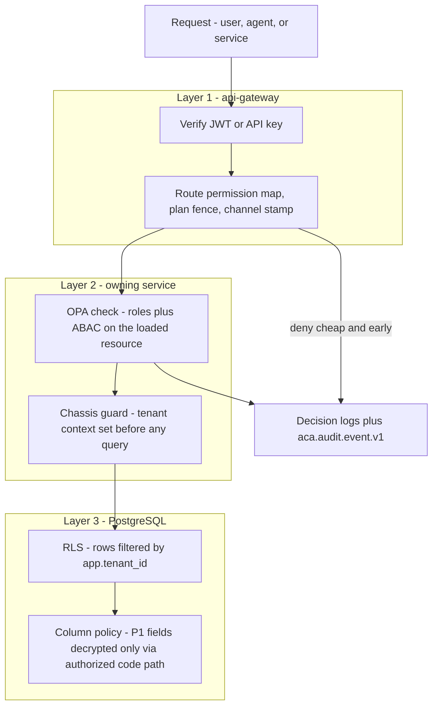
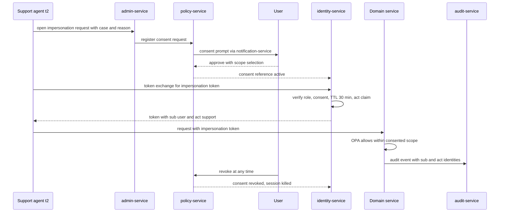
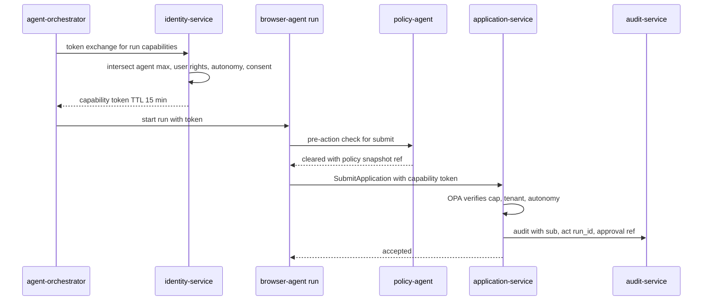
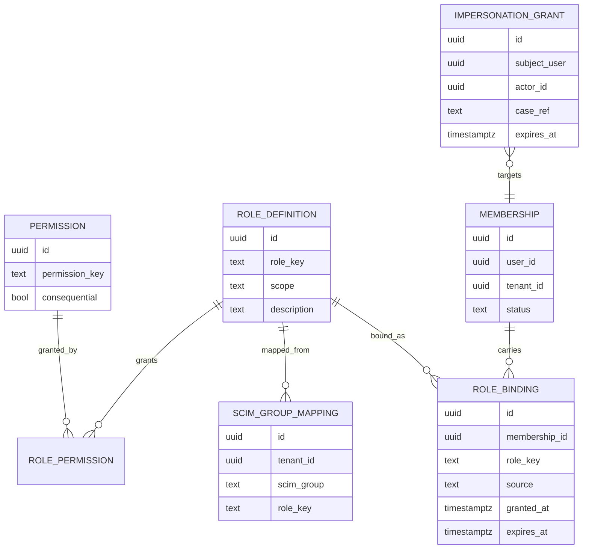

# 39 — RBAC

| | |
|---|---|
| Document ID | ACA-SAS-39 |
| Volume | 5 — Security |
| Status | Draft v1.0 |
| Depends on | [00 — Architecture Canon](../00-architecture-canon.md) §6 §7 §9 §12 §13, [37 — Security Architecture](37-security-architecture.md), [38 — Zero Trust](38-zero-trust.md), [11 — Identity Service](../volume-2-core-services/11-identity-service.md), [12 — User Service](../volume-2-core-services/12-user-service.md), [19 — Agent Orchestrator](../volume-2-core-services/19-agent-orchestrator.md), [10 — API Gateway](../volume-2-core-services/10-api-gateway.md) |

## 1. Overview

This chapter defines the authorization model for every principal class in the platform: human end users across the five tenant classes, organizational admins, support and platform staff, service workloads, and AI agents. It specifies the role catalog and permission matrices, the RBAC + ABAC hybrid decision model, the OPA implementation (bundle layout, data documents, decision logs), enforcement at three layers (gateway, service, data), delegation and impersonation for support, capability-token authorization for agents, SCIM synchronization for enterprise tenants, and the testing regime that keeps a policy change from silently flipping decisions.

Two design commitments shape the model. First, **roles are coarse and few; attributes carry the nuance.** Pure RBAC explodes when it tries to express "premium-plan user in an EU-resident tenant with autonomy L3 and consent for mailbox access" as role permutations. ACA keeps ~20 human roles (§3) and pushes tenancy, plan, autonomy, data classification, region, and consent into ABAC attributes (§4) evaluated by the same OPA policies that [Chapter 38 §4](38-zero-trust.md) distributes. Second, **agents are not users.** An agent acting for a user holds a scoped, time-boxed capability token derived from — and strictly narrower than — the user's own rights and current autonomy settings (§8). No agent ever authorizes as the user directly; the delegation chain (user → orchestrator → agent run) is explicit in every token and every audit record. The same discipline applies to support staff acting for users (§7): delegation is always visible, consented, bounded, and logged.

Authorization is enforced with defense in depth (§6): the gateway rejects what it can prove wrong cheaply, services enforce resource-level decisions, and PostgreSQL RLS makes tenant isolation survive service bugs. A permission granted at one layer but not the others is a bug by definition — the regression suite (§10) tests the *composition*, not each layer in isolation.

## 2. Decision Model: RBAC + ABAC Hybrid

Every decision evaluates the tuple **(principal, action, resource, context)** in two stages:

1. **RBAC stage:** does any of the principal's roles grant the permission (`<resource>.<action>`, e.g. `application.submit`)? Roles are additive; there are no negative grants (deny-by-omission only — negative grants make policy reasoning and diffing intractable).
2. **ABAC stage:** do the attribute constraints hold? Constraints can only *narrow* what RBAC granted, never widen it. This monotonicity rule is what keeps the hybrid analyzable: the role catalog is the upper bound of anyone's power, auditable in one table.

| Decision input | Source (verified before OPA sees it) | Examples |
|---|---|---|
| `principal.roles` | JWT claims (identity-service) / SVID mapping (services) | `candidate`, `team-admin`, `svc.agent-orchestrator` |
| `principal.tenant_id`, `plan` | JWT claims from entitlement snapshot (billing-service, canon §12) | `ten_...`, `premium` |
| `principal.autonomy` | Capability token claim (agents) or user settings snapshot | `L2` |
| `principal.risk_tier` | Session risk engine ([Ch 38 §7](38-zero-trust.md)) | `normal`, `elevated`, `high` |
| `resource.tenant_id`, `owner_id`, `classification` | Service-provided resource context | `P1`, `P2` |
| `resource.region` | Service-provided; from tenant residency pinning (canon §15) | `eu` |
| `context.channel` | Gateway-stamped | `web`, `public-api`, `agent`, `admin` |
| `context.consents` | policy-service consent registry references | `mailbox.read` granted |

Golden rules enforced structurally (chassis + policy lint, not convention): tenant match is checked in *every* policy package (a package without a tenant predicate fails CI lint); P0-classified resources accept no human principal except via the session-vault protocol (no role grants `vault.read` — the permission does not exist); `admin` channel requires a live JIT elevation reference ([Ch 38 §6](38-zero-trust.md)).

## 3. Role Catalog and Permission Matrices

Roles are tenant-scoped unless marked platform-scoped. Naming: kebab-case role keys, stable forever (renames are new roles + migration).

### 3.1 End-user and organizational roles

| Role | Tenant classes | Intent |
|---|---|---|
| `candidate` | all | The job seeker; owns their profile, applications, and automation settings |
| `tenant-owner` | individual, team | Billing + membership control; every individual tenant's single member holds `candidate` + `tenant-owner` |
| `team-admin` | team | Manage members, shared settings, team analytics; no access to members' application content beyond what each member shares |
| `university-admin` | university | Seat/SSO management, cohort analytics (aggregated), advisor assignment |
| `career-advisor` | university | View/coach specific students **with per-student consent**; draft suggestions; never submit on a student's behalf |
| `enterprise-admin` | enterprise | Seats, SSO/SCIM config, policy defaults (autonomy ceilings), org analytics |
| `enterprise-viewer` | enterprise | Read-only org analytics and billing |
| `recruiter-admin` | recruiter | Recruiter org management, posting intake config, seat management |
| `recruiter` | recruiter | Source consented candidates, manage postings and pipelines (`recruiter-service` scope only) |

### 3.2 Support and platform roles (platform-scoped)

| Role | Intent | Hard limits |
|---|---|---|
| `support-t1` | Account metadata, subscription state, delivery status; guided fixes | No career content, no impersonation, no P1 field decryption |
| `support-t2` | Consented impersonation (§7), refunds within limits, GDPR request handling | Impersonation is read + user-approved actions only; no vault access |
| `support-t3` | Abuse/fraud ops ([Ch 37 §7](37-security-architecture.md)), containment actions, escalated cases | Containment scopes via JIT elevation; dual-control on tenant-level actions |
| `platform-admin` | Baseline read-only platform visibility; parent for JIT scopes | All mutations require JIT elevation to a scope below |
| — JIT scope `platform.ops` | Fleet ops, replays, DLQ triage | ≤ 60 min grants |
| — JIT scope `platform.security` | Detection tooling, forensics, kill switches | Kill switch platform scope dual-controlled |
| — JIT scope `platform.billing` | Plan overrides, invoice corrections | Four-eyes above reference thresholds |

### 3.3 Service and agent roles

- **Service roles** `svc.<service-name>` are derived from SPIFFE identity ([Ch 38 §2](38-zero-trust.md)), not tokens — the mapping `spiffe://aca.dev/ns/<ns>/sa/<name>` → `svc.<name>` ships as bundle data. A service role's permissions are exactly its declared dependency surface; the undeclared-edge detector ([Ch 38 §9](38-zero-trust.md)) keeps this honest.
- **Agent roles** `agent.<agent-name>` (one per canonical agent, canon §5) define the *maximum* capability set an agent class may ever hold; each run's capability token (§8) carries a subset. Example maxima: `agent.browser-agent` → `browser.session.execute`, `application.submit`; `agent.resume-agent` → `resume.version.create`, `profile.read`; `agent.interview-coach-agent` → `application.read`, `interview.prep.write` — never `application.submit`.

### 3.4 Permission matrix (representative rows)

Permissions follow `<resource>.<action>`; the full machine-readable matrix is bundle data (§5) and its rendered form is CI-generated documentation — the table below pins the semantics reviewers argue about. ✓ = RBAC grant (ABAC still applies); C = only with per-subject consent; — = no grant.

| Permission | candidate | tenant-owner | team-admin | career-advisor | university-admin | enterprise-admin | recruiter | support-t1 | support-t2 |
|---|---|---|---|---|---|---|---|---|---|
| `profile.read` (own/member) | ✓ own | ✓ own | — | C | — | — | C (sourcing) | — | C (impersonation) |
| `profile.write` | ✓ own | ✓ own | — | — | — | — | — | — | — |
| `application.read` | ✓ own | ✓ own | aggregate only | C | aggregate only | aggregate only | pipeline-scoped | — | C |
| `application.submit` | ✓ own | ✓ own | — | — | — | — | — | — | — |
| `automation.settings.write` (autonomy L0–L3) | ✓ own | ✓ own | — | — | ceiling only | ceiling only | — | — | — |
| `resume.version.create` | ✓ own | ✓ own | — | C (drafts) | — | — | — | — | — |
| `tenant.members.manage` | — | ✓ | ✓ | — | ✓ | ✓ | admin only | — | — |
| `billing.manage` | — | ✓ | ✓ | ✓ | ✓ | ✓ | admin only | — | limited |
| `tenant.analytics.read` | own | ✓ | ✓ | cohort | ✓ | ✓ | ✓ | — | — |
| `posting.manage` | — | — | — | — | — | — | ✓ | — | — |
| `account.metadata.read` | — | — | — | — | — | — | — | ✓ | ✓ |
| `gdpr.request.execute` | ✓ own | ✓ own | — | — | — | — | — | — | ✓ |

Notes with teeth: `application.submit` is *only* grantable to the subject user and to `agent.browser-agent` under an L-appropriate capability token — no organizational role can submit for a member (advisor "submit for student" was explicitly rejected: consent-washing risk and portal-compliance exposure). Aggregate-only analytics for org admins means k-anonymous rollups from `analytics-service`; row-level member data requires member consent recorded in policy-service.

## 4. Attribute Semantics (ABAC)

| Attribute | Values | Effect in policy |
|---|---|---|
| `tenant_id` | `ten_...` | Mandatory equality with resource tenant in every package (lint-enforced, §2) |
| `plan` | `free`, `professional`, `premium`, `enterprise` | Gates plan-fenced permissions (e.g., `automation.settings.write` to L3 requires `premium`+, canon §12); evaluated from signed entitlement snapshots, never live billing calls |
| `autonomy` | `L0`–`L3` | Caps consequential actions: `application.submit` via agent requires token `autonomy >= L1` matching the user's per-action-class setting (canon §9) |
| `classification` | `P0`–`P3` | `P0`: no human principal path exists (§2); `P1`: decryption-requiring reads restricted to the owning user + `support-t2` under impersonation |
| `region` | tenant residency | EU-pinned tenant resources deny non-EU-cell service principals (canon §15) |
| `consent` | consent registry refs | `career-advisor`, `recruiter` sourcing, mailbox/email-agent scopes all require live consent references; expiry/revocation invalidates at next evaluation |
| `risk_tier` | `normal`, `elevated`, `high` | `elevated` forces step-up on consequential permissions; `high` denies them outright ([Ch 38 §7](38-zero-trust.md)) |
| `channel` | `web`, `public-api`, `agent`, `admin` | Permission×channel fencing: e.g., `gdpr.request.execute` denied on `public-api`; all `admin`-channel actions require elevation reference |

## 5. OPA Implementation

### 5.1 Bundle layout

Policies and data ship through the [Chapter 38 §4.3](38-zero-trust.md) pipeline; this chapter owns the content layout:

```
bundles/
  edge/                          # gateway ext-authz scope
    aca/authz/edge/routes.rego   # route -> required permission map, plan fences, channel stamps
    data/route_permissions.json
  service/<name>/                # one scoped bundle per service
    aca/authz/service/<name>.rego
    aca/lib/roles.rego           # shared: role -> permission resolution
    aca/lib/attributes.rego      # shared: ABAC predicates (tenant, plan, autonomy, consent, region, risk)
    data/roles.json              # role definitions + permission grants (generated from policy-service DB)
    data/svc_principals.json     # SPIFFE -> svc.* role mapping (generated from service catalog)
    data/agent_capabilities.json # agent.* maximum capability sets
  admin/
    aca/authz/admin/*.rego       # JIT scopes, dual-control rules, impersonation constraints
```

`data/*.json` documents are **generated** from policy-service's database (§9 data model) at bundle build — the database is the source of truth for grants; Rego encodes only *logic*. This split means a role grant change is a data publish (minutes, low risk, auto-diffed) while a logic change is a policy deploy (canaried, [Ch 38 §4.3](38-zero-trust.md)).

### 5.2 Decision logs

Same sink and sampling as [Ch 38 §4.3](38-zero-trust.md) (`aca.policy.decision.v1`; 100% denies + consequential allows, 1% routine allows), with this chapter adding the required fields for authz forensics: `principal` (id + roles), `permission`, `resource_ref`, `attributes_hash` (hash of the ABAC input — full attributes would leak P1 into logs), `bundle_version`, `decision`, `reason` (first failing predicate for denies — makes support triage of "why can't I" cases self-service). Consequential-allow list: `application.submit`, `automation.settings.write`, `tenant.members.manage`, `billing.manage`, `gdpr.request.execute`, all `admin` channel decisions, all impersonation-context decisions.

## 6. Enforcement Layers (Defense in Depth)



| Layer | Decides | Cannot decide | Failure containment |
|---|---|---|---|
| Gateway | Token validity, route×permission plausibility, plan fences, channel, rate | Resource ownership (resource not loaded yet) | A service missing a check still never sees traffic for routes the principal's roles could never reach |
| Service | Full RBAC+ABAC on the actual resource; consent/autonomy checks | Nothing it must defer — this is the authoritative layer | A gateway misconfig cannot mint access: services re-verify claims and re-evaluate policy |
| Data (RLS) | Tenant row visibility regardless of query author; P1 column custody | Business semantics | A service-layer bug (missing tenant predicate, injected query) still cannot cross tenants (canon §6) |

The layers are deliberately *redundant*, not partitioned: gateway and service both evaluate role→permission, service and RLS both constrain tenant. Redundancy is the point ([Ch 37 §4](37-security-architecture.md)); the cost — three places to update when a permission is added — is absorbed by generation: the route-permission map, service policy data, and the regression matrix (§10) all derive from the same policy-service catalog, so "add a permission" is one PR in one repo.

## 7. Delegation and Impersonation (Support Access)

**Purpose:** let `support-t2` see what a consenting user sees, and act only with the user watching. **Non-negotiables:** consent-first (or dual-controlled break-glass), time-boxed, visibly bannered to the user, fully audited, and structurally excluded from P0 (impersonation tokens carry no vault-capable claims — there is nothing to elevate to).

Flow: support agent opens an impersonation request in `admin-service` (case-linked, reason-coded) → user receives an in-product + notification-channel consent prompt (`policy-service` consent registry) → on approval, `identity-service` mints an impersonation token via RFC 8693 token exchange: `sub` = the user, `act.sub` = the support agent (nested actor claim — every downstream audit event carries both), scope = read + the specific action classes the user approved, TTL ≤ 30 min (short enough that "left a session open" is bounded; renewable only via fresh consent). The user sees a persistent banner during the session and can revoke instantly — impersonation-context routes are all sensitive routes, so the revocation set kills the token on the next request ([Ch 11](../volume-2-core-services/11-identity-service.md)). Break-glass (user unreachable, e.g. account-takeover recovery): `support-t3` + one approver from `platform.security`, reason-coded, auto-opens a review case; volume target for break-glass is ~0 and every instance is reviewed.



Delegation between *users* (e.g., a career-advisor drafting for a student) uses the same consent registry but never token exchange: the advisor acts as themselves with consent-gated permissions (§3.1) — resources record the true author. Impersonation ("acting as") is reserved for support because mixing the two models destroys audit clarity.

## 8. Agent Authorization: Capability Tokens

**Purpose:** give each agent run exactly the rights the task, the user's autonomy settings, and consent allow — nothing more, and only briefly.

Issuance: `agent-orchestrator`, authenticated by its own SVID, requests a capability token from `identity-service` (token exchange) when starting a run. `identity-service` composes the token by intersecting four sets — (1) the agent class maximum (`agent.<name>` catalog, §3.3), (2) the subject user's own permissions, (3) the user's autonomy level for the relevant action classes, (4) live consent references — and rejects the request if the intersection is empty for the requested task. Claims:

```json
{
  "sub": "usr_01H...",             
  "act": { "sub": "agent:browser-agent", "run_id": "run_01H..." },
  "tenant_id": "ten_01H...",
  "cap": ["browser.session.execute", "application.submit"],
  "autonomy": "L1",
  "consent_refs": ["cns_01H..."],
  "channel": "agent",
  "exp": "<= 15 min from iat>"
}
```

TTL ≤ 15 min (matches the human access-token lifetime; long agent runs re-mint at Temporal activity boundaries, which also re-checks autonomy/consent — a user downgrading L3→L1 mid-run takes effect at the next activity, worst case 15 min, and immediately for new consequential actions via policy-agent). Tokens are run-scoped: `run_id` in the `act` claim joins every decision log and audit event to the exact agent run, its Temporal history, and its `aca.agent.run.*` events — the full "who did what on whose behalf and why" chain is reconstructable from IDs alone.

Enforcement is layered like everything else: OPA at the called service verifies `cap` ∋ permission + ABAC; `policy-agent` performs the pre-action compliance check for consequential actions (canon §9) — policy-agent consumes the same bundles but adds site-policy and approval-rule evaluation; and HITL checkpoints ([Ch 19](../volume-2-core-services/19-agent-orchestrator.md)) hold L1/L2 actions for approval. An `aca.agent.approval.requested.v1` approval grant is itself recorded as a consent-class object, so the capability token for the approved action references the approval — deny-by-default with an explicit, auditable widening.



Failure containment: a stolen capability token is useful for ≤ 15 min, for one user, one capability set, one channel — and `application.submit` still requires the policy-agent clearance reference for L1/L2 users, which the thief cannot mint (policy-agent verifies run context against orchestrator state). Kill-switch flips ([Ch 37 §4](37-security-architecture.md)) drop token issuance instantly (issuance-time flag check), bounding a rogue-agent incident to in-flight tokens.

## 9. Data Model, Interfaces, and Events

### 9.1 Ownership and DDL (policy-service authz schema)

`policy-service` owns role/permission definitions and grants-as-data plus the consent registry; `user-service` owns *membership* (who is in which tenant — canon §4.2) and stores role bindings on membership; `identity-service` snapshots roles into tokens at issuance and refresh (change propagation ≤ 15 min via token lifetime; revocation paths are faster, [Ch 38 §7](38-zero-trust.md)).

```sql
-- policy-service: catalog (source of truth for bundle data documents)
CREATE TABLE role_definition (
  id            uuid PRIMARY KEY,          -- UUIDv7
  role_key      text NOT NULL UNIQUE,      -- 'team-admin', 'agent.browser-agent'
  scope         text NOT NULL CHECK (scope IN ('tenant','platform','service','agent')),
  tenant_class  text[],                    -- which tenant classes may bind it (tenant scope)
  description   text NOT NULL,
  created_at    timestamptz NOT NULL DEFAULT now()
);

CREATE TABLE permission (
  id            uuid PRIMARY KEY,
  permission_key text NOT NULL UNIQUE,     -- 'application.submit'
  resource      text NOT NULL,
  action        text NOT NULL,
  consequential bool NOT NULL DEFAULT false, -- drives decision-log sampling + policy-agent gating
  channels      text[] NOT NULL            -- allowed channels fence (§4)
);

CREATE TABLE role_permission (
  role_id       uuid NOT NULL REFERENCES role_definition(id),
  permission_id uuid NOT NULL REFERENCES permission(id),
  constraint_expr jsonb,                   -- structured ABAC narrowing, compiled into bundle data
  PRIMARY KEY (role_id, permission_id)
);

CREATE TABLE impersonation_grant (
  id            uuid PRIMARY KEY,
  subject_user  uuid NOT NULL,             -- impersonated user
  actor_id      uuid NOT NULL,             -- support agent
  case_ref      text NOT NULL,             -- admin-service case
  consent_id    uuid,                      -- null only for break-glass
  breakglass_approver uuid,                -- required when consent_id is null
  scope         jsonb NOT NULL,            -- approved action classes
  expires_at    timestamptz NOT NULL,      -- <= 30 min from grant
  revoked_at    timestamptz,
  tenant_id     uuid NOT NULL              -- RLS anchor
);
```



`role_binding.source` distinguishes `manual`, `scim`, `system` — SCIM-sourced bindings are not manually editable (§9.4 conflict rule made structural). `role_binding.expires_at` supports time-boxed grants (JIT scopes reuse this mechanism with ≤ 60 min expiry).

### 9.2 Authorization-relevant endpoints

| Service | Endpoint | Purpose | Guard |
|---|---|---|---|
| `user-service` | `POST /v1/tenants/{ten}/members/{usr}/roles` | Grant tenant-scoped role | `tenant.members.manage` + role's `tenant_class` check |
| `user-service` | `DELETE /v1/tenants/{ten}/members/{usr}/roles/{role_key}` | Revoke | Same; last-`tenant-owner` removal blocked |
| `policy-service` | `GET /v1/authz/roles`, `GET /v1/authz/permissions` | Catalog read | Any authenticated org admin / platform read |
| `policy-service` | `POST /v1/authz/simulate` | What-if decision (principal, action, resource) against a named bundle version | Platform + org admins; powers support triage and the §10 diff tooling |
| `admin-service` | `POST /v1/support/impersonation-requests` | Open request (§7) | `support-t2` |
| `policy-service` | `POST /v1/consents/{id}/approve` / `.../revoke` | User consent actions | Subject user only |
| `identity-service` | `POST /v1/oauth/token` (token-exchange grant) | Impersonation + capability tokens | Actor authn + policy checks (§7, §8) |
| `identity-service` | `/scim/v2/Users`, `/scim/v2/Groups` | Enterprise SCIM sync | Per-tenant SCIM bearer token, IP-allowlisted per IdP |

### 9.3 Events

| Topic | Key | Payload sketch | Notes |
|---|---|---|---|
| `aca.policy.role.granted.v1` / `.revoked.v1` | `tenant_id` | membership, role_key, source, actor, expiry | Mirrored to audit; drives access-review reports |
| `aca.policy.impersonation.started.v1` / `.ended.v1` | `tenant_id` | grant id, actor, subject, scope, consent/breakglass ref | 100% audited; feeds user-visible security activity log |
| `aca.policy.capability.issued.v1` | `tenant_id` | run_id, agent, cap list, autonomy, TTL | Volume bounded by agent runs; joins decision logs to runs |
| `aca.policy.decision.v1` | `tenant_id` | §5.2 fields | Sampled per §5.2 |
| `aca.policy.scim.synced.v1` | `tenant_id` | adds/removes/conflicts summary | Deprovision evidence for enterprise audits |

### 9.4 SCIM role sync (enterprise)

`identity-service` implements SCIM 2.0 (Users + Groups) per enterprise/university tenant; `enterprise-admin` configures `scim_group_mapping` rows (IdP group → tenant-scoped role). Rules: SCIM is **authoritative for what it manages** — bindings with `source=scim` are created/removed only by sync, and manual edits are rejected with a pointer to the IdP; platform-scoped roles and `support-*` roles are never SCIM-assignable (mapping validation rejects them — an enterprise IdP admin must not be able to mint platform power); unmapped groups are ignored and reported, never auto-created. Deprovisioning: IdP push is applied immediately; access is fully dead within ≤ 15 min worst case (token lifetime) and immediately for new sessions; the user's *memberships* deactivate but ACA account survives (an individual's career data does not belong to their employer — deactivation severs the tenant link only). Reconciliation: nightly full-sync diff catches missed pushes; drift beyond 0 emits `aca.policy.scim.synced.v1` with conflicts for admin review.

## 10. Testing Authorization

| Layer | Test | Gate |
|---|---|---|
| Rego unit | Per-package tests, ≥ 90% rule coverage ([Ch 38 §9](38-zero-trust.md)) | CI block |
| Matrix regression | The **golden permission matrix**: generated cross-product of every role × representative endpoint/action per permission (~20 roles × ~120 representative actions), executed as real HTTP/gRPC calls against staging with seeded fixtures; expected allow/deny checked per §3.4 semantics | CI block on any unexpected flip — this suite is the composition test across all three §6 layers, incl. RLS (fixtures span two tenants; every read asserts zero cross-tenant rows) |
| Authz diff | Proposed bundle vs. scrubbed decision corpus; delta posted on the PR | Reviewer approval of flipped decisions |
| ABAC property tests | Monotonicity checks: for random inputs, removing an attribute constraint never converts allow→deny for a *different* principal; ABAC never allows what RBAC denied (§2) | CI block |
| Impersonation/agent invariants | No token path yields P0 capability; capability ⊆ agent max ⊆ user rights; TTL ceilings | CI block (schema-level tests on issuance code + Rego) |
| Production canaries | [Ch 38 §9](38-zero-trust.md) synthetic denied-path probes include the §3.4 "with teeth" rows | Page on regression |

The golden matrix doubles as the quarterly **access review** artifact ([Ch 37 §9](37-security-architecture.md)): reviewers attest the rendered matrix, and attestation diffs (what changed since last quarter) are generated, not hand-compiled.

## 11. Failure Scenarios

| Scenario | Impact | Design answer |
|---|---|---|
| Stale role data in tokens after grant/revoke | Up to 15 min of pre-change permissions | Accepted for grants; revocations of sensitive scopes ride the revocation set (immediate on sensitive routes, [Ch 11](../volume-2-core-services/11-identity-service.md)); impersonation/capability tokens re-check consent live at consequential actions via policy-agent |
| policy-service DB unavailable | No grant changes, no new consents/impersonations; bundles keep serving last data | Enforcement unaffected (bundle-cached data); impersonation and JIT elevation fail closed — support waits, which is correct |
| SCIM push storm or malformed IdP data | Mass unintended deprovisioning risk | Guardrail: a single sync removing > 20% of a tenant's bindings pauses and requires `enterprise-admin` confirmation (fat-finger and IdP-compromise protection); nightly reconcile repairs partial applies |
| Capability issuance outage (identity-service) | Agent runs cannot start/renew | Runs pause at activity boundaries (Temporal), no capability degradation or bypass; user-interactive traffic unaffected |
| Regression-suite fixture drift | Matrix tests silently weaken | Fixtures generated from the same catalog as policies; a permission without matrix coverage fails CI (coverage check on the cross-product) |
| Orphaned bindings (user leaves tenant) | Dangling grants | `membership` deactivation cascades `role_binding` deactivation in the same transaction (user-service owns both); event mirror to audit |

## 12. Scaling Strategy

Decision throughput scales with the mesh (in-sidecar, ≤ 1 ms p99, [Ch 38 §11](38-zero-trust.md)); role/permission data is small (thousands of rows) and ships as bundle data — no runtime DB reads on the decision path, ever (the availability and latency of authz must not depend on policy-service uptime). Capability-token issuance scales with agent runs (target-scale peak ≈ low hundreds/s), a cheap signing operation with Redis-cached consent/autonomy lookups; issuance latency budget 50 ms p99 so orchestrator scheduling is unaffected. The golden matrix suite grows as roles × actions — kept tractable by testing representative actions per permission (not every endpoint), bounded to a 10-minute CI stage; beyond that, shard by service. SCIM sync is per-tenant and rate-limited per IdP token (protects identity-service from a misconfigured IdP hammering the endpoint).

## 13. Security Considerations (residual risks)

(1) **Token-lifetime staleness window** (≤ 15 min) after revocation is the model's accepted exposure; sensitive-scope revocations and kill switches bypass it, but ordinary role revocations do not — documented to enterprise admins. (2) **Consent fatigue:** advisor/recruiter/support consent prompts risk reflexive approval; UX mitigations (scope plain-language rendering, default-deny expiry) are product work tracked with D1. (3) **Catalog centralization:** policy-service compromise could rewrite grants-as-data; mitigations are bundle signing, publish audit events, and the §10 canaries asserting known-bad stays bad — a grants rewrite that widens access trips the denied-path probes. (4) **Aggregate analytics inference:** k-anonymous rollups can still leak in small cohorts; `analytics-service` enforces minimum cohort sizes (k ≥ 5) — owned by Volume 8 but recorded here as an authz-adjacent risk. (5) **Recruiter consent scope creep:** sourcing consent is per-purpose and expiring; `recruiter-service` queries are consent-filtered at the data layer, not the UI.

## 14. Observability

Dashboards: deny-rate by permission/role/service (top-N movers after each bundle publish — the fastest bad-deploy signal); impersonation activity (grants, durations, break-glass count with target 0); capability issuance vs. agent-run starts (divergence = orchestration or authz fault); SCIM sync health per enterprise tenant (last sync, conflicts, deprovision latency); consent lifecycle (grants, revocations, expiring-soon). Alerts: unexpected-flip from production canaries (page), break-glass invocation (page `platform.security`), SCIM mass-removal guardrail trip (notify + hold), decision-log lag > 5 min (detection dependency, [Ch 37 §10](37-security-architecture.md)). Monthly authz report to the CISO: matrix attestation status, flip counts, impersonation stats, dormant-role candidates (roles with zero decisions in 90 days are removal candidates — dead grants are latent risk).

## 15. Future Improvements

- Relationship-based access (ReBAC, Zanzibar-class) for fine-grained sharing if product grows document-level sharing graphs (e.g., users sharing individual applications with mentors); current consent-registry model covers today's cases with less machinery.
- Policy-as-data authoring UI for enterprise-admins (custom org roles within platform-defined permission bounds) — today custom roles are a professional-services change.
- Just-in-time *user* permission elevation (step-up granting, e.g. temporary advisor access) reusing the JIT machinery now reserved for staff.
- Differential-privacy budgets on aggregate analytics to harden §13(4) beyond k-anonymity.
- Formal verification of the monotonicity invariant (§2) over the shipped bundle (currently property-tested, not proven).

## 16. Alternatives Considered & Tradeoffs

| Decision | Alternatives | Why this choice / tradeoff |
|---|---|---|
| RBAC upper bound + ABAC narrowing (monotonic) | Pure RBAC; pure ABAC; ReBAC (Zanzibar-class) | Pure RBAC explodes combinatorially with plans×autonomy×consent; pure ABAC makes "who can do what" unanswerable for auditors; ReBAC's graph machinery is unjustified without user-to-user sharing graphs. Monotonicity keeps the role table the auditable ceiling. Tradeoff: some duplication between role grants and attribute predicates — accepted for analyzability |
| Grants-as-data in bundles, logic-as-Rego | All-Rego (grants encoded in rules); runtime DB lookups from OPA | All-Rego makes grant changes into policy deploys (slow, risky); runtime lookups put policy-service on the request path (latency + SPOF). Tradeoff: bundle rebuild on grant change (~minutes latency) — acceptable because sensitive revocations have faster paths |
| Role bindings on user-service membership | Bindings in policy-service; bindings in identity-service | Membership and binding lifecycles are the same lifecycle (leave tenant ⇒ lose roles, §11) — one owner makes the cascade transactional. policy-service keeps definitions; identity-service stays a stateless-ish snapshotter. Tradeoff: two services in the grant path (user-service write → bundle data publish) |
| Capability tokens minted by identity-service | Orchestrator self-mints; per-service ad-hoc scoping | Self-minting makes the orchestrator a second token authority (key sprawl, no single revocation point); identity-service already owns issuance, JWKS, and revocation ([Ch 11](../volume-2-core-services/11-identity-service.md)). Tradeoff: issuance dependency for agent starts — §11 shows the pause-not-bypass failure mode |
| RFC 8693 + `act` claim for impersonation | Shadow accounts; shared support logins; sudo-style role switch | The `act` chain preserves both identities in every log line — the property auditors and users actually need; shadow/shared accounts destroy attribution. Tradeoff: all services must propagate and log `act` — enforced in the chassis, not per-team |
| SCIM authoritative only for `source=scim` bindings | SCIM authoritative for all roles; SCIM advisory only | Full authority lets an enterprise IdP strip platform-assigned roles (or worse, §9.4); advisory-only recreates manual drift SCIM exists to kill. The source-tagged split is the standard resolution. Tradeoff: two management planes per enterprise tenant, mitigated by rejecting manual edits on SCIM-managed bindings |
| Golden matrix as end-to-end staging suite | Unit-test-only policies; production-only canaries | Unit tests miss layer-composition bugs (the gateway/service/RLS seams); production canaries catch too late. The matrix is slow (~minutes) but it is the only test that exercises the actual promise. Tradeoff: staging fixture maintenance — mitigated by generation from the catalog |
| No negative grants | Deny rules for exceptions | Deny rules make the diff tool's output ambiguous (is a flip a widening or a narrowing?) and break the monotonic-ceiling property. Exceptions are modeled as narrower roles instead. Tradeoff: occasional role proliferation — bounded by the dormant-role review (§14) |
