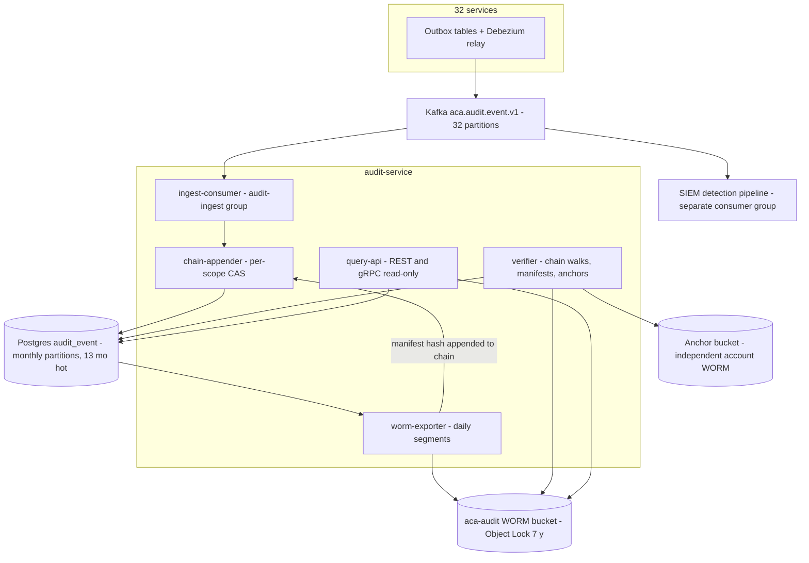
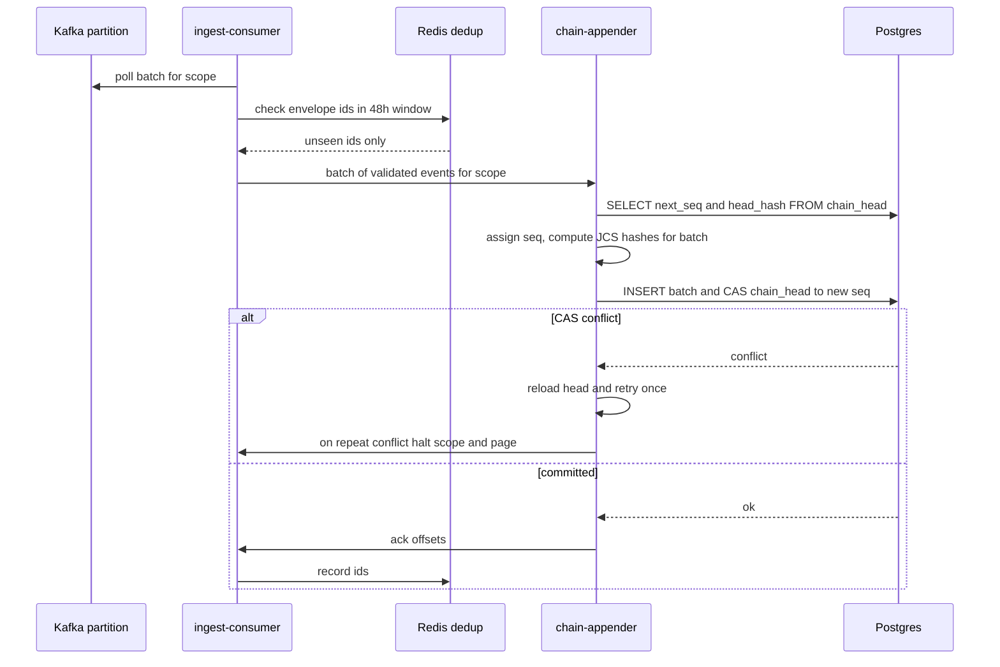
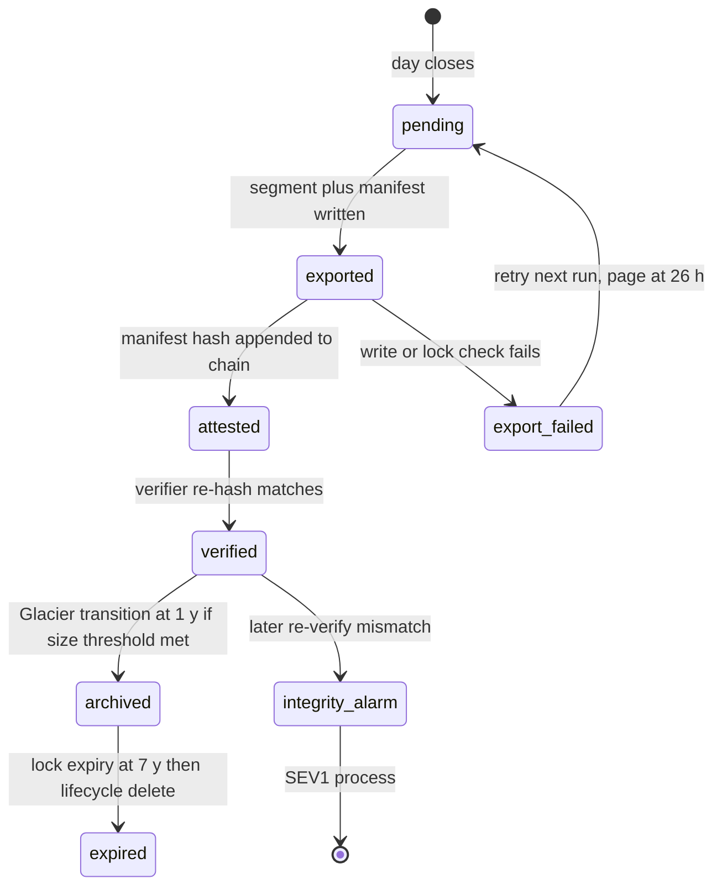

# 40 — Audit Logs

| | |
|---|---|
| Document ID | ACA-SAS-40 |
| Volume | 5 — Security |
| Status | Draft v1.0 |
| Depends on | [00 — Architecture Canon](../00-architecture-canon.md) §4.5 §8 §11 §13, [31 — PostgreSQL Schema §10](../volume-4-data-platform/31-postgresql-schema.md), [33 — Kafka](../volume-4-data-platform/33-kafka.md), [35 — Object Storage](../volume-4-data-platform/35-object-storage.md), [36 — Event Contracts](../volume-4-data-platform/36-event-contracts.md), [37 — Security Architecture](37-security-architecture.md), [39 — RBAC](39-rbac.md), [12 — User Service](../volume-2-core-services/12-user-service.md) |

## 1. Overview

This chapter is the normative specification of `audit-service` — the platform's immutable, hash-chained, append-only record of consequential actions — and of the audit contract every other service must honor. It defines what is audited (and, as deliberately, what is not), the event schema and producer rules, the ingestion pipeline from `aca.audit.event.v1`, the per-scope hash-chain design with daily WORM export and external anchoring, the verification jobs that make tamper-evidence a live property rather than a brochure claim, the tenant-scoped query and compliance-export APIs, the 7-year retention and tiering plan, the pseudonymization contract that reconciles immutability with GDPR erasure, SIEM integration, and the capacity/cost model. The physical schema sketched in [Chapter 31 §10](../volume-4-data-platform/31-postgresql-schema.md) and the WORM bucket layout in [Chapter 35](../volume-4-data-platform/35-object-storage.md) are restated here with this chapter as the owning specification.

The audit log exists for three distinct consumers whose requirements pull in different directions. **Forensics** ([Chapter 37 §6.4](37-security-architecture.md)) needs completeness, tamper-evidence, and cross-plane linkage (`trace_id` to traces, `run_ref` to agent runs). **Compliance** (SOC 2 Type II, GDPR accountability, future ISO 27001) needs 7-year retention, exportability with integrity proofs, and demonstrable append-only enforcement. **Tenant trust** needs a user- and admin-visible answer to "what did the agent do on my behalf, and who approved it" — for a product whose core promise is autonomous action under consent, the audit log is a product feature, not only a control. The design serves all three from one pipeline: a single Kafka topic, a single chained store, and read paths differentiated by authorization, never by separate write paths that could diverge.

Two boundary clarifications shape everything below. First, the audit log is **not** the observability log stream: Loki logs are debugging exhaust with 90-day-class retention and no integrity guarantee; audit events are a curated, schema-bound record of consequential actions with legal weight. Second, it is not the domain event stream: `application_event` timelines, agent run records, and the `admin-service` audit shadow remain owned by their services for product purposes; the audit chain is the cross-service, tamper-evident *mirror* of the consequential subset (canon §8: `aca.audit.event.v1` mirrored to `audit-service`). A fact may legitimately exist in both places; only the chain is evidence.

## 2. Audit Scope — What Is Audited

### 2.1 Audit categories

The audit scope is enumerable and versioned: every category below has an identifier, a producer set, and a coverage rule. A new auditable action class is a schema-reviewed change (it alters compliance posture), not a per-team judgment call.

| ID | Category | Coverage rule | Producers | Est. volume/day (GA) |
|---|---|---|---|---|
| AC-1 | Authorization decisions | All **denials** at service-layer OPA for sensitive action classes (P0/P1 access, payment, automation-grant, admin routes); all admin-plane decisions (permit **and** deny). Routine permits are *not* chained — they live in OPA decision logs (SIEM, 90 d) | all services, `policy-service` | ~0.5 M |
| AC-2 | Admin actions | Every `admin-service` operation: JIT elevation grant/use, impersonation start/stop, tenant suspend/restore, DLQ replay, kill-switch flips, break-glass | `admin-service`, `feature-flag-service` | ~10 k |
| AC-3 | Agent consequential actions | Every policy-checked tool call by any agent (canon §9: all tool calls policy-checked and audit-logged), every HITL approval/rejection, every submission saga phase with external effect | `agent-orchestrator`, `workflow-service`, `application-service` | ~6 M |
| AC-4 | P0 data access | Every session-vault grant issuance, credential injection, vault item create/update/purge, break-glass access | `session-vault-service`, `browser-fleet-service` | ~0.4 M |
| AC-5 | P1 data access | API-operation granularity: admin/support reads of identity PII, GDPR export/erasure milestones, P1 artifact fetches from DLQ triage, masked-clone access grants | `user-service`, `admin-service`, owning services | ~0.6 M |
| AC-6 | Billing changes | Subscription create/change/cancel, entitlement snapshot issuance, invoice adjustments, refunds, dunning suspensions | `billing-service` | ~0.1 M |
| AC-7 | Policy & consent changes | OPA bundle publications, consent grant/revocation, autonomy-level changes (L0–L3), approval-rule edits, automation-grant scope changes | `policy-service`, `user-service` | ~0.2 M |
| AC-8 | Platform security operations | Containment actions ([Ch 37 §6.3](37-security-architecture.md)), migration runs, partition export/verify, Kafka ACL and topic-catalog changes, Vault admin ceremonies ([Ch 42](42-secret-management.md)) | platform tooling, `admin-service` | ~10 k |
| AC-9 | Identity lifecycle | Login success on new device, step-up events, credential change, session revocation, SSO federation changes, account lifecycle transitions | `identity-service`, `user-service` | ~2 M |

Rationale for the AC-1 split: chaining every permit would multiply chain volume by ~50× to record the uninteresting steady state; denials and sensitive-class permits are where disputes and forensics live. The full OPA decision stream remains queryable in the SIEM for 90 days — the two records reference each other via `trace_id`, so an investigation can always pivot from a chained denial to the surrounding permit context.

Rationale for AC-5 granularity: auditing every field-level decrypt ([Ch 41 §5](41-encryption.md)) would generate ~10⁹ rows/day of noise dominated by legitimate request serving. The operation boundary (an API call that *returns* P1 to a human or exports it) is where accountability attaches; key-level usage below that boundary is covered by KMS/CloudTrail telemetry in the SIEM.

### 2.2 Non-goals

- Request/response logging (observability plane, Loki).
- Product timelines (`application_event` is event-sourced for product reasons; its consequential subset is mirrored, the rest is not).
- Metrics-shaped facts (counts, spend aggregates — `cost-controller` and `analytics-service`).
- Crawl/browse mechanics without external effect (a page fetch is not audited; a form **submission** is).

## 3. Audit Event Contract

### 3.1 Envelope and topic

| Topic | Key | Partitions | Producers | Consumer of record |
|---|---|---|---|---|
| `aca.audit.event.v1` | `tenant_id` (platform-scope events use `platform:{shard}`) | 32 ([Ch 33](../volume-4-data-platform/33-kafka.md)) | all services (mirror pattern) | `audit-service` (`audit-ingest` group, max lag 5 min) |

Envelope is CloudEvents 1.0 per canon §8 (`id` UUIDv7, `source` = producing service, `tenantid`, `traceparent`, `schemaversion`). Keying by `tenant_id` gives per-tenant arrival ordering, which is what the per-tenant chain needs; cross-tenant global order is deliberately not promised (see §5.4).

### 3.2 Payload schema

| Field | Type | Req | Semantics |
|---|---|---|---|
| `category` | enum `AC-1..AC-9` | MUST | Audit category (§2.1); drives retention class and query filters |
| `action` | string | MUST | Dotted verb taxonomy `domain.action.outcome`, e.g. `application.submit.approved`, `vault.grant.issued`, `authz.decision.denied` — the taxonomy registry lives with the schema in Schema Registry |
| `actor.kind` | enum `user, agent, service, admin` | MUST | Who acted |
| `actor.ref` | string | MUST | Opaque prefixed ID (`usr_`, `agt_`, `svc_<name>`, `adm_`); never a name or email |
| `actor.session_ref` | string | SHOULD | `sid` or `run_ref` for attribution to a session/run |
| `actor.ip_pseud` | string | SHOULD | HMAC pseudonym of client IP (§10.3); absent for internal actors |
| `resource.type` / `resource.ref` | string | MUST | What was acted on, opaque ref (`app_`, `job_`, `ten_`) |
| `outcome` | enum `permitted, denied, executed, failed, approved, rejected` | MUST | Result — auditing failures is as important as successes |
| `reason_code` | string | SHOULD | Machine-readable cause (policy id for denials, error class for failures) |
| `context.autonomy_level` | enum `L0..L3` | AC-3 MUST | User autonomy setting in force at action time |
| `context.consent_ref` | string | AC-3/4 MUST | Consent record honored (policy-service registry) |
| `context.policy_version` | string | SHOULD | OPA bundle / policy version evaluated |
| `context.trace_id` | string | MUST | Cross-plane linkage |
| `payload_refs[]` | array | MAY | `{ref, sha256}` pairs to evidence artifacts (drafts, screenshots, exports) — refs and digests only, never inline documents |
| `attrs` | object | MAY | Category-specific keys from an allowlisted, schema-checked set; values pass the pseudonymization gate (§10) |

The invariant inherited from [Chapter 31 §10](../volume-4-data-platform/31-postgresql-schema.md) and [Chapter 36 §11](../volume-4-data-platform/36-event-contracts.md): **payloads carry refs and hashes, never P0/P1 values**. The schema linter denies secret-shaped and P1-patterned fields; `attrs` is allowlist-only precisely so free-form keys cannot smuggle PII into a store that cannot delete.

### 3.3 Producer rules

- **Emission is transactional where the producer has state**: the chassis `audit-emitter` writes the audit mirror row into the service's outbox in the same transaction as the domain write (canon §8 outbox pattern). The Debezium relay derives `source`/`tenantid` from service-owned columns, so producers cannot spoof provenance ([Ch 36 §12](../volume-4-data-platform/36-event-contracts.md)).
- **Stateless producers** (`api-gateway` has no database) do not chain their denials directly; edge denials are SIEM-only telemetry (AC-1 covers service-layer decisions). This keeps "one producer path = outbox" nearly universal and keeps bot noise out of the chain.
- **Write-ahead semantics** ([Ch 37 §6.3](37-security-architecture.md)): "audit before effect" means the outbox row is durably committed before the action executes. Chain inclusion is asynchronous within the 5-minute ingest SLO — the durability point is the outbox commit, not the chain append. The SEV1-containment exception (proceed on audit-write failure, alarm, reconcile) is defined in Chapter 37 and honored here by the reconciliation tooling (§7.3).
- **No synchronous write API exists.** Kafka is the only ingress to the chain. A synchronous append endpoint would invite bypass of the outbox discipline and make `audit-service` an availability dependency of every producer; its absence is an invariant, checked by the fact that the service exposes no write route (§8).

## 4. audit-service Component Architecture



| Component | Purpose | Key responsibilities | Failure posture | Scaling |
|---|---|---|---|---|
| `ingest-consumer` | Move events from Kafka into the chain path | Schema validation, dedup by envelope `id` (Redis, 48 h window — matches the retry-topic horizon), batching per scope | Lag alarms at 5 min; poison events → `aca.audit.event.v1.dlq` with page (an unchainable audit event is itself an incident) | Horizontal by partition, ≤ 32 consumers |
| `chain-appender` | Assign gapless `chain_seq` and hashes | Per-scope single-writer via `chain_head` CAS; canonicalization; batch append (≤ 500 events/scope/txn) | CAS conflict = retry; sustained conflict on one scope indicates duplicate consumers — halt scope + page | Scope-partitioned; hot platform scopes sharded (`platform:{0..15}`) |
| `worm-exporter` | Daily export of yesterday's chain slices to WORM | Per-scope JSONL segments + manifests; manifest hash appended back into the chain (cross-attestation); lock verification | Export failure blocks nothing user-facing; > 26 h since last successful export pages (anchor freshness depends on it) | Batch job, parallel by scope prefix |
| `verifier` | Prove integrity continuously | Weekly random chain walks, daily anchor write + previous-anchor verify, export-manifest re-hash, pre-export full walk | Any verification failure = SEV1 by definition ([Ch 37 §10](37-security-architecture.md)) | Batch; sampling rate tunable |
| `query-api` | Read-only access | Tenant-scoped queries, chain proofs, export jobs, integrity status | Read-only by construction; degradation affects investigations, never ingestion | Stateless, HPA |

**Interactions.** Upstream: Kafka only. Downstream: Postgres (own schema), `aca-audit-{env}` bucket (sole principal), anchor bucket (write-only cross-account role), `aca-export-{env}` for compliance export delivery, `notification-service` for export-ready notices. The SIEM consumes the topic in its own consumer group — `audit-service` is not on the detection path and detection lag never delays chaining (separate failure domains, [Ch 37 §10](37-security-architecture.md)).

## 5. Hash-Chained Append-Only Design

### 5.1 Chain construction

Chains are **per scope**: one chain per tenant (`chain_scope = {tenant_id}`) plus sharded platform scopes (`platform:{0..15}`) for tenant-less events. Per-scope chaining parallelizes writes while keeping tamper-evidence complete within the unit where disputes occur — a tenant's history ([Ch 31 §10](../volume-4-data-platform/31-postgresql-schema.md) records the tradeoff: cross-scope ordering is not attested by the chains themselves; the daily anchor closes that gap at day granularity, §6.2).

```
event_hash = SHA-256( prev_hash || JCS(canonical_fields) )
canonical_fields = {id, chain_scope, chain_seq, tenant_id, category, action,
                    actor, resource, outcome, reason_code, context, payload_refs,
                    attrs, occurred_at, recorded_at}
genesis: prev_hash(seq 0) = SHA-256(chain_scope)
```

Canonicalization is **RFC 8785 (JCS)** over the fixed field list — a byte-stable serialization is what makes a verifier written in any language reach the same digest; ad-hoc JSON ordering is where chain designs quietly rot.

### 5.2 Schema (DDL, owned here; Ch 31 §10 defers)

```sql
CREATE TABLE audit_event (
    id           uuid NOT NULL,                      -- UUIDv7 = envelope id
    chain_scope  text NOT NULL,
    chain_seq    bigint NOT NULL,                    -- gapless per scope
    tenant_id    uuid,                               -- NULL for platform scopes
    category     text NOT NULL,                      -- AC-1..AC-9
    actor_kind   text NOT NULL CHECK (actor_kind IN ('user','agent','service','admin')),
    actor_ref    text NOT NULL,
    action       text NOT NULL,
    resource_ref text,
    outcome      text NOT NULL,
    payload      jsonb NOT NULL,                     -- refs + hashes + allowlisted attrs
    prev_hash    bytea NOT NULL,
    event_hash   bytea NOT NULL,
    trace_id     text,
    occurred_at  timestamptz NOT NULL,               -- producer clock
    recorded_at  timestamptz NOT NULL DEFAULT now(), -- chain clock (authoritative)
    PRIMARY KEY (id, recorded_at)
) PARTITION BY RANGE (recorded_at);                  -- monthly partitions
CREATE UNIQUE INDEX audit_chain_uq ON audit_event (chain_scope, chain_seq, recorded_at);
CREATE INDEX audit_brin ON audit_event USING brin (recorded_at);
CREATE INDEX audit_actor_ix ON audit_event (tenant_id, actor_ref, recorded_at DESC);
REVOKE UPDATE, DELETE, TRUNCATE ON audit_event FROM svc_audit_rw;   -- append-only enforced

CREATE TABLE chain_head (
    chain_scope text PRIMARY KEY,
    next_seq    bigint NOT NULL,
    head_hash   bytea NOT NULL,
    updated_at  timestamptz NOT NULL
);  -- CAS on next_seq in the append transaction; single-writer per scope

CREATE TABLE export_segment (
    id             uuid PRIMARY KEY,
    chain_scope    text NOT NULL,
    seq_from       bigint NOT NULL,
    seq_to         bigint NOT NULL,
    object_key     text NOT NULL,          -- tenants/{tid}/chain/{yyyy}/{mm}/{dd}/segment-{seq}.jsonl
    manifest_sha   bytea NOT NULL,
    exported_at    timestamptz NOT NULL,
    verified_at    timestamptz
);

CREATE TABLE anchor_checkpoint (
    id          uuid PRIMARY KEY,
    anchor_date date NOT NULL UNIQUE,
    scope_count int  NOT NULL,
    root_hash   bytea NOT NULL,            -- Merkle root over per-scope head hashes
    object_key  text NOT NULL,             -- key in the independent-account anchor bucket
    written_at  timestamptz NOT NULL
);
```

Append-only is *enforced* (REVOKE), not promised: even `svc_audit_rw` cannot mutate history; the only sanctioned triggers on the table are the append guard and chain-head maintenance ([Ch 31 §14](../volume-4-data-platform/31-postgresql-schema.md)). Corrections are new events (`action` suffix `.corrected` referencing the original `id`).

### 5.3 Append sequence



Offsets are acknowledged only after the chain transaction commits — at-least-once end to end, with Redis dedup as the fast path and the chain's uniqueness (`audit_chain_uq` + hash linkage) as the structural guarantee: silent duplication or loss is *evident on verification* even if dedup fails ([Ch 33 §9](../volume-4-data-platform/33-kafka.md)).

### 5.4 Ordering doctrine

- **Authoritative order is `chain_seq`** (ingest order per scope), not producer timestamps: producer clocks skew, and evidentiary order must be totally ordered and attested. `occurred_at` is preserved as a claim; `recorded_at` is the chain's clock.
- Per-tenant arrival order follows Kafka partition order; cross-producer interleaving within a tenant is arrival-ordered, which is acceptable because causality across services is reconstructed via `trace_id`, not via chain adjacency.
- Cross-scope order is attested only at daily granularity by the anchor (§6.2) — accepted; no dispute class requires finer cross-tenant ordering.

## 6. WORM Export and External Anchoring

### 6.1 Daily export

Each day, `worm-exporter` writes the previous day's slice of every active scope to `aca-audit-{env}` as `tenants/{tenant_id}/chain/{yyyy}/{mm}/{dd}/segment-{seq}.jsonl` plus `manifest-{seq}.json` (event count, `seq_from/seq_to`, segment SHA-256, head hash at segment end) — layout per [Chapter 35 §2.2](../volume-4-data-platform/35-object-storage.md). The bucket has **Object Lock in compliance mode, 7-year retention**: not even root can shorten it. The manifest hash is then appended *into the chain* as a platform-scope AC-8 event — the WORM copy and the Postgres chain cross-attest, so tampering with either is visible from the other.

### 6.2 External anchor

Daily, the verifier computes a Merkle root over all per-scope head hashes and writes the checkpoint to an **anchor bucket in a separate account** with independent credentials and its own Object Lock ([Ch 37 §6.4](37-security-architecture.md)). Threat addressed: a full compromise of `audit-service` *and* its bucket could rewrite both cross-attesting copies; the attacker would still face yesterday's anchor in an account they cannot reach. The tamper window is thereby bounded at ≤ 24 h. The Merkle construction also gives per-scope inclusion proofs against a single daily root — used by compliance exports (§8.3). RFC 3161 timestamping of the root is a future hardening (§17), not phase 1: the cross-account boundary already removes the single-administrator rewrite path.

### 6.3 Segment lifecycle



## 7. Tamper-Evidence Verification

### 7.1 Verification jobs

| Job | Cadence | Scope | What it proves | On failure |
|---|---|---|---|---|
| Head consistency | continuous (in append txn) | every append | Gapless seq, head hash continuity | Append rejected; scope halted on repeat |
| Chain walk | weekly | random 2% of scopes; every scope at least quarterly | Full hash linkage in Postgres | SEV1, scope frozen (writes buffer in Kafka/outbox), forensic compare vs WORM |
| Export-manifest verify | daily (T+1 of export) | all new segments | WORM bytes match manifests match chain entries | SEV1; determine which copy diverged via anchor |
| Anchor verify | daily | previous anchor object | Anchor exists, immutable, root recomputes | SEV1; tamper window analysis |
| Pre-export full walk | per compliance export | exported range | Export carries a true chain slice | Export blocked; incident |

Sampling rationale: a full weekly walk of 4 TB is ~11 h of sequential read that competes with export I/O; 2% weekly with a quarterly full-coverage guarantee keeps detection latency ≤ 13 weeks for cold tampering while the daily anchor bounds *undetectable* tampering to 24 h — the anchor, not the walk, is the hard guarantee.

### 7.2 Verdict handling

Any verification failure is **SEV1 by definition** ([Ch 37 §6.1](37-security-architecture.md)): evidence integrity in doubt is a breach-class event. Response runbook: freeze the affected scope's appends (events buffer upstream — Kafka retains 30 d on the audit topic, so nothing is lost), reconstruct from the WORM copy + anchor, diff against Postgres, and only then resume with a chain-repair event recording the episode. Repair never rewrites rows; it documents.

### 7.3 Reconciliation

The SEV1-containment exception ([Ch 37 §6.3](37-security-architecture.md)) and any producer outbox loss are reconciled by a tooling job that replays mesh access logs and Temporal histories against the chain for a given window, emitting `audit.reconciliation.recorded` events for confirmed gaps. Reconciliation adds facts late; it cannot backdate — `recorded_at` is honest about when the chain learned them.

## 8. Query and Export APIs

### 8.1 REST (external, via api-gateway)

| Method & path | Purpose | AuthZ | Notes |
|---|---|---|---|
| `GET /v1/audit/events` | Tenant-scoped event list; filters: `category`, `action` prefix, `actor_ref`, `resource_ref`, `from/to`, cursor pagination | tenant `owner`/`admin` roles; individual users see their own single-member tenant | max 100/page (canon §7); read replicas only |
| `GET /v1/audit/events/{audit_id}` | Single event + chain-inclusion proof (hash path to scope head + latest anchor root) | same | proof makes "show me this is untampered" a product feature |
| `POST /v1/audit/exports` | Start compliance export (range, categories, format `jsonl`) | tenant `owner`/`admin` + `aal2` step-up ([Ch 11 §5.3](../volume-2-core-services/11-identity-service.md)) | async job; `Idempotency-Key`; pre-export full walk (§7.1) |
| `GET /v1/audit/exports/{export_id}` | Export status + presigned URL | same | delivered via `aca-export-{env}`, 30-day expiry ([Ch 35 §4](../volume-4-data-platform/35-object-storage.md)) |
| `GET /v1/audit/integrity` | Tenant-visible integrity summary — last walk, last anchor, export attestations | tenant `owner`/`admin` | trust surface; no internal detail leakage |

Rate limits: 10 rps per tenant on list/read (investigation tooling, not an analytics API), 5 export jobs/day/tenant (each triggers a full walk of the range — the ceiling protects the verifier's I/O budget).

### 8.2 Internal gRPC

`GetChainProof(scope, seq)`, `GetHead(scope)`, `VerifyScope(scope, range)` (admin-triggered), `StreamTenantEvents(tenant, cursor)` (feeds the enterprise SIEM connector, §11.2). No append RPC exists (§3.3).

### 8.3 Compliance exports

An export bundle contains: the JSONL event slice, per-day manifests, the chain-inclusion Merkle proofs against daily anchors, and a signed attestation (Ed25519, Vault Transit key — same custody pattern as [Ch 11 §8](../volume-2-core-services/11-identity-service.md)) binding bundle digest to anchor roots. An auditor can verify the bundle offline against published anchor roots without trusting ACA's serving infrastructure — the property SOC 2 evidence requests and legal discovery actually need.

## 9. Retention and Storage Tiering

| Tier | Store | Window | Rationale |
|---|---|---|---|
| Hot | Postgres monthly partitions | 13 months | Covers a full annual compliance cycle + margin for investigations with warm query latency ([Ch 30 §7](../volume-4-data-platform/30-database-design.md)) |
| Warm | `aca-audit` Standard → Standard-IA at 90 d | months 0–12 | Segments are re-read for verification and exports in year 1; IA halves storage cost after the active-verification window |
| Cold | Glacier Flexible at 1 y — **only objects ≥ 128 KB** | years 1–7 | Verification reads are rare after year 1; the size filter exists because Glacier bills ~40 KB/object overhead and per-object transition fees — for small per-scope daily segments the overhead would exceed the data (decision recorded §18) |
| Expiry | Lifecycle delete at 7 y | — | Canon §11 verbatim; aligned with Object Lock expiry |

Partition aging follows the platform pattern: detach → verify against existing WORM segments (no second export needed — daily export already happened) → drop; deletion by DDL, never `DELETE` ([Ch 30 §7](../volume-4-data-platform/30-database-design.md)). Enterprise contracts requiring > 7 y are handled by per-tenant lock extension on their prefix (contract-driven; the default stays 7 y so the platform's data-minimization story is honest).

## 10. Privacy in the Audit Log

Immutability and erasure collide by design; this section is the contract [Chapter 35 §4](../volume-4-data-platform/35-object-storage.md) delegates to Volume 5.

### 10.1 Structural minimization

The first defense is that audit events are built from **opaque refs and digests** (§3.2): `usr_`/`app_` identifiers, artifact SHA-256s. After the owning service hard-deletes the referent (GDPR saga, [Ch 12 §7](../volume-2-core-services/12-user-service.md)), the ref dangles by construction — the chain retains proof that *an* action occurred under lawful-basis retention (fraud defense, dispute resolution, regulatory audit), while the identity payload it pointed to is gone. Erasure completion itself is recorded *in* the chain (the proof-of-deletion trail).

### 10.2 Pseudonymization where lawful

Where an operationally necessary discriminator would otherwise be P1 (e.g., the counterparty mailbox domain in an `email-agent` action, a portal account label), producers must emit `pseud$v1$<hex16>` = truncated `HMAC-SHA-256(k_user, value)`:

- `k_user` is a per-user pseudonym key derived (HKDF) from a per-tenant pseudonym root; the per-user derivation salt is stored by `user-service` alongside the account.
- Equal values pseudonymize equally *within one user* — investigations can group and correlate without reading plaintext.
- **Erasure = crypto-shred**: the GDPR saga deletes the user's salt; every pseudonym derived from it becomes irreversibly unlinkable, satisfying erasure without touching the immutable chain. This is the load-bearing reconciliation of WORM retention with GDPR.

### 10.3 Network identifiers

Client IPs appear only as `actor.ip_pseud` = HMAC under a platform pseudonym key rotated yearly (year-scoped keys: long-range correlation of IPs across years is not an investigative need, and yearly rotation caps linkage), plus coarse geo (country). Full IPs live only in edge/SIEM telemetry within its 90-day window.

### 10.4 Enforcement

The Schema Registry linter (P1-pattern denial, [Ch 36 §11](../volume-4-data-platform/36-event-contracts.md)) plus a sampling audit that regex-scans chained payloads for email/phone/name patterns weekly; any hit pages security ([Ch 36 §14](../volume-4-data-platform/36-event-contracts.md) pattern, applied to this topic). A P1 leak into the chain is unerasable by design, so prevention is triple-layered: allowlisted `attrs`, linter, sampler.

## 11. SIEM Integration

### 11.1 Internal

The detection pipeline ([Ch 37 §6.4](37-security-architecture.md)) consumes `aca.audit.event.v1` in its own consumer group — same facts, independent failure domain, no second emission path. Correlation rules join audit events with OPA decision logs, mesh logs, and `aca.security.finding.v1` on `trace_id`/`actor_ref`. `audit-service` additionally emits `aca.security.finding.v1` itself for chain-integrity anomalies (detector = `audit-verifier`), so integrity failures enter the standard triage queue as well as paging.

### 11.2 Enterprise tenant export

Enterprise-plan tenants may stream their own scope to their SIEM (entitlement-gated via `billing-service` snapshots):

| Mode | Mechanism | Latency | Notes |
|---|---|---|---|
| Push | Signed HTTPS webhook via `public-api-service` (HMAC signature, retry/backoff per canon webhook rules) | ≤ 5 min (matches ingest SLO) | Delivery is post-chain: tenants receive events with `chain_seq`, so their copy is independently verifiable against `/v1/audit/integrity` |
| Drop | Hourly JSONL batches to a tenant-designated bucket (cross-account write role) | ≤ 1 h | For tenants whose SIEM ingests from object storage |

Only the tenant's own scope, post-pseudonymization — the export path adds no privacy surface beyond the query API.

## 12. Capacity and Cost Model

| Dimension | Value (GA target) | Derivation |
|---|---|---|
| Event rate | ~10 M/day avg (≈ 116/s; peak 3× diurnal ≈ 350/s) | Category table §2.1; dominated by AC-3 tool calls ([Ch 30 §8](../volume-4-data-platform/30-database-design.md) anchor) |
| Event size | ~1.0 KB canonical JSON | refs-and-hashes payload discipline caps size; 4 KB hard limit in schema |
| Kafka | 10 GB/day; 32 partitions; 30 d retention ≈ 300 GB (tiered) | [Ch 33 §10](../volume-4-data-platform/33-kafka.md); tiered segments make the 30 d window cheap |
| Ingest throughput | 2 consumers sustain avg; 8 sustain peak (batch 500, ~2 k events/s/consumer measured budget) | chain append is one CAS txn per scope-batch — batching is the throughput lever |
| Postgres hot | 10 GB/day → ~4 TB data, ~5 TB with indexes (13 mo); provision 8 TB | [Ch 30 §8](../volume-4-data-platform/30-database-design.md); BRIN keeps index overhead ~25% |
| WORM | ~3.7 TB/yr → ~26 TB cumulative at year 7 | steady state; compliance-mode lock |
| WORM objects | ~150 k active scopes/day → ~55 M objects/yr | drives the ≥ 128 KB Glacier filter (§9) and the packing trigger (§17) |
| Cost/month (reference, year 3) | Postgres storage ≈ $700 (8 TB gp3 + replica); S3 ≈ $120 (mixed IA/Glacier); Kafka marginal (shared cluster); KMS ≈ $30 (bucket-key-off on P1 prefixes bounded by segment count, not event count) | verification compute ≈ 2 vCPU steady; anchor bucket negligible |

The chain's write cost in Postgres (~15 ms budget per append batch, [Ch 31 §13](../volume-4-data-platform/31-postgresql-schema.md)) and the 500-event batch ceiling give 5-year headroom at 10× event growth before scope-sharding of large tenants is needed.

## 13. Failure Scenarios

| Scenario | Impact | Response / design answer |
|---|---|---|
| `audit-service` down | Chain lags; nothing lost (Kafka 30 d + producer outboxes) | Lag alarm at 5 min; consumers resume from committed offsets; the 5-min SLO is compliance freshness, not a user-facing path |
| Kafka audit topic unavailable | Producers buffer in outboxes; write-ahead durability holds (outbox commit) | Outbox drain on recovery; ordering per scope preserved by relay |
| Chain CAS livelock on one scope | One tenant's chain stalls | Halt + page (§5.3); indicates duplicate consumer or partition reassignment bug — structural, not transient |
| Postgres partition full / disk pressure | Ingest stalls platform-wide | Capacity alarms at 70/85%; partitions pre-created 3 months ahead; emergency: detach-export oldest hot partition early (data already in WORM) |
| WORM export fails > 26 h | Anchor staleness; tamper window extends | Page; export retries idempotently (content-addressed manifests); anchor job refuses to anchor unverified heads |
| Verification failure (any) | Evidence integrity in doubt | SEV1 process §7.2 |
| Redis dedup loss | Duplicate risk on redelivery | Chain uniqueness + verification make duplicates evident; dedup is an optimization, not the guarantee |
| Anchor account access lost | Anchoring halts | Independent alarm (anchor freshness > 26 h); chain + WORM cross-attestation still hold; restore access via cross-account break-glass ceremony (AC-8 audited) |
| Producer emits P1 in `attrs` despite linter | Unerasable PII in chain | Sampler catches (§10.4); response: pseudonym-key shred if user-scoped; else legal review — this is the residual risk the triple layer minimizes but cannot zero |

## 14. Scaling Strategy

Scaling dimensions and levers, in the order they will be pulled: (1) **consumer parallelism** to 32 (partition count) — covers ~10× current peak; (2) **append batching** already amortizes CAS and WAL costs, so per-scope throughput is bounded by single-scope serialization only for pathological single-tenant bursts — a tenant emitting > 500 events/s sustained (an abuse signature long before a scaling problem, cross-check with `cost-controller` anomalies); (3) **platform-scope sharding** is pre-sharded 16-way; (4) **partition-count increase** on the topic requires the standard key-locality caveat ([Ch 33 §5](../volume-4-data-platform/33-kafka.md)) but chains tolerate it — chain assignment is scope-keyed in the appender, not partition-keyed; (5) at > 100 M events/day, move the hot store to per-cell audit instances (cell model, canon §15) with per-cell anchors — the design is cell-ready because chains are scope-local by construction.

## 15. Security Considerations

- **The chain protects integrity, not confidentiality**: payload discipline (§3.2, §10) is what bounds disclosure; access to the query API is tenant-scoped via the standard three-layer authz ([Ch 39](39-rbac.md)) with RLS on `tenant_id`.
- **audit-service is a target**: compromising it is step one of covering tracks. Mitigations: no write API; append-only REVOKE at the DB layer; WORM + cross-account anchor make even DB-superuser tampering evident within 24 h; its own admin operations are AC-8 events in the platform scope (self-auditing, verified externally).
- **Producer spoofing** is bounded by the outbox relay deriving `source`/`tenantid` from service-owned rows ([Ch 36 §12](../volume-4-data-platform/36-event-contracts.md)) and Kafka producer ACLs restricting the topic to the CDC relay principal.
- **Query API abuse** (fishing expeditions by tenant admins over employees' activity): category-level visibility rules — AC-9 identity events about a user are visible to that user and tenant `owner` only where the tenant class implies employment context (`team`, `university`, `enterprise`, `recruiter`); `individual` tenants see everything of their own. Visibility policy lives in `policy-service` bundles, not code.
- **Availability of containment audit** during a breach follows the Ch 37 write-ahead exception — availability of containment beats audit completeness, reconciled after (§7.3).

## 16. Observability

| Signal | Type | Alert |
|---|---|---|
| `audit_ingest_lag_seconds` | gauge per partition | > 300 s pages (SLO); > 60 s warns |
| `audit_chain_append_latency` | histogram | p99 > 50 ms per batch — DB pressure leading indicator |
| `audit_chain_halted_scopes` | gauge | > 0 pages |
| `audit_export_freshness_hours` | gauge | > 26 h pages |
| `audit_anchor_freshness_hours` | gauge | > 26 h pages (independent of export alarm) |
| `audit_verification_failures_total` | counter | any increment = SEV1 page |
| `audit_dlq_events_total` | counter | any increment pages (unchainable audit event) |
| `audit_pii_sampler_hits_total` | counter | any increment pages security |
| `audit_export_jobs` / duration | counter/histogram | duration p95 > 30 min warns (verifier I/O contention) |

Dashboards: the **Audit integrity** board (chain status, anchor freshness, verification history) is part of the Ch 37 security folder and is the first screen of every forensic engagement; a **tenant-facing integrity summary** is served from the same metrics via `/v1/audit/integrity`.

## 17. Future Improvements

- **Segment packing**: consolidate small per-scope daily segments into shared pack objects with per-scope manifests once object count exceeds ~20 M/year sustained — cuts per-object Glacier overhead; requires manifest-level inclusion proofs (Merkle within pack), so it is deferred until the cost signal justifies the verifier complexity.
- **RFC 3161 / public transparency anchoring**: co-sign daily roots with an external timestamping authority or a public transparency log, removing the residual trust in the anchor account's cloud provider.
- **Per-cell chains and anchors** as cells roll out (§14), with a cross-cell daily super-root.
- **Auditor self-service portal**: scoped, read-only auditor identities with time-boxed access to exports and integrity proofs — currently mediated by GRC manually.
- **Selective-disclosure proofs**: redact fields in exported events while preserving chain verifiability (hash-tree per event) — useful for legal discovery where full payloads over-disclose.

## 18. Alternatives Considered & Tradeoffs

| Decision | Alternatives | Why this choice / tradeoff |
|---|---|---|
| Per-scope hash chains + daily Merkle anchor | Single global chain; per-event external notarization; blockchain/ledger DB (QLDB-class) | Global chain serializes all writes ([Ch 31 §15](../volume-4-data-platform/31-postgresql-schema.md)); per-event notarization is cost-prohibitive at 10 M/day; ledger DBs lock the evidence store to a vendor and still need the export/anchor machinery for auditor-offline verification. Tradeoff: cross-scope order attested only daily — no dispute class needs better |
| Kafka as sole ingress, no write API | Sync gRPC append for "important" events | A sync path invites bypassing the outbox and couples every producer's availability to audit-service; write-ahead durability lives at the outbox commit instead. Tradeoff: chain inclusion is eventually consistent (≤ 5 min) — acceptable for evidence, made explicit in the write-ahead semantics |
| Chain in Postgres, system of record in WORM S3 | Chain directly in object storage; dedicated append-only store | Postgres gives queryability, RLS tenancy, and the CAS primitive the chain needs; WORM S3 gives the 7-year compliance guarantee Postgres cannot (a superuser can always drop a table — Object Lock compliance mode cannot be shortened). Each covers the other's weakness |
| AC-1 denials + sensitive permits only | Chain every authz decision | ~50× volume for steady-state permits with no dispute value; SIEM retains the full decision stream 90 d with `trace_id` pivot. Tradeoff: permit forensics beyond 90 d relies on category coverage — reviewed against real investigations quarterly |
| Pseudonymization + crypto-shred for erasure | Store P1 plaintext and redact WORM copies on erasure; store nothing user-linked at all | WORM redaction is impossible by design (compliance-mode lock) and "nothing user-linked" destroys the log's accountability purpose. HKDF-per-user keys + salt deletion delivers provable unlinkability without touching immutable bytes. Tradeoff: pseudonyms are one-way even for lawful investigation after erasure — accepted, that is what erasure means |
| Glacier transition gated at ≥ 128 KB | Uniform Glacier at 1 y | Glacier per-object overhead (~40 KB billed + transition fees) exceeds the data for small daily per-scope segments; the filter keeps small objects in IA where they cost less in total. Tradeoff: two storage-class populations to reason about — encoded in lifecycle policy, not code |
| Enterprise SIEM export post-chain | Tenant tap on the Kafka topic | A raw topic tap leaks other tenants' partitions and bypasses pseudonymization/entitlement gates; post-chain delivery adds `chain_seq` so the tenant's copy is verifiable. Tradeoff: ≤ 5 min delivery latency vs near-realtime — within enterprise SIEM ingestion norms |
