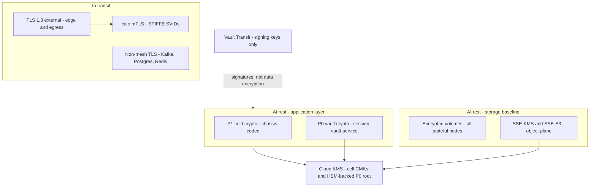
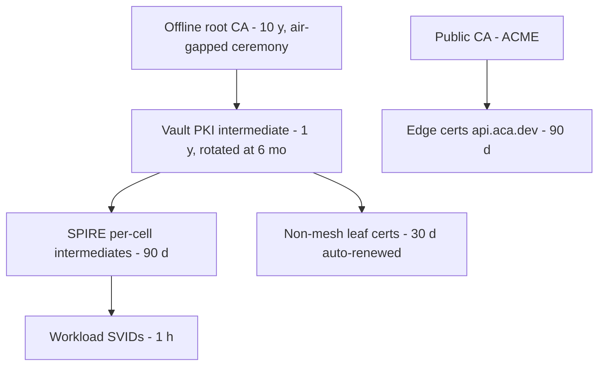
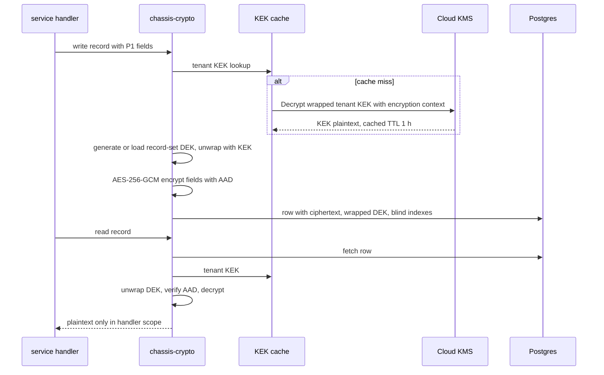
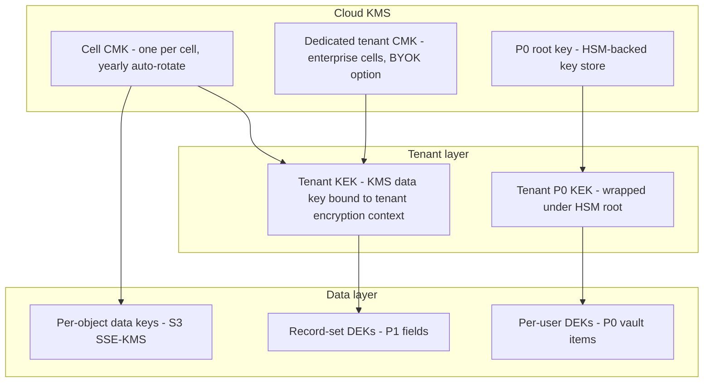
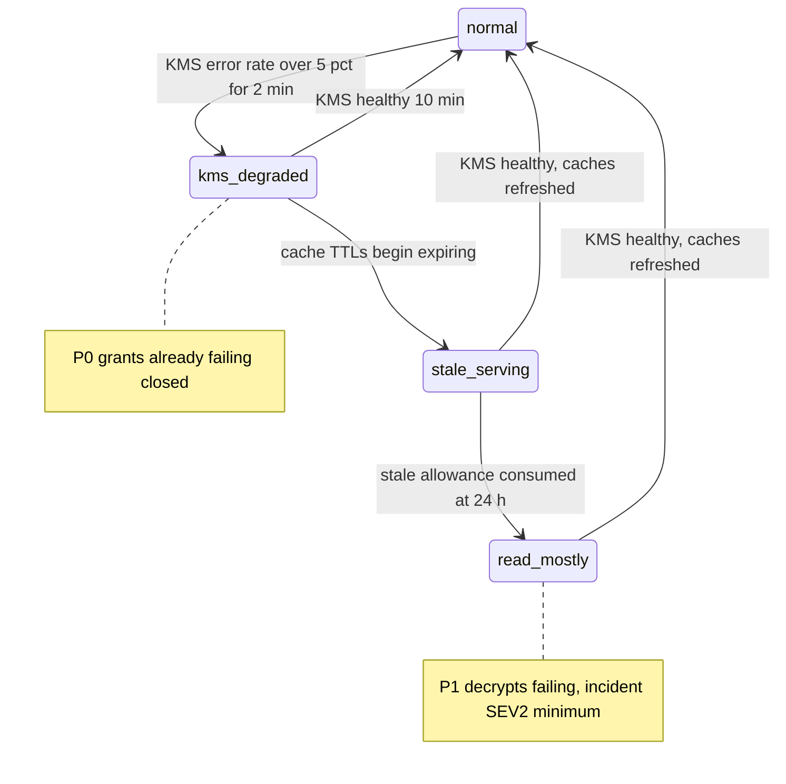

# 41 — Encryption

| | |
|---|---|
| Document ID | ACA-SAS-41 |
| Volume | 5 — Security |
| Status | Draft v1.0 |
| Depends on | [00 — Architecture Canon](../00-architecture-canon.md) §3 §7 §11 §13, [10 — API Gateway](../volume-2-core-services/10-api-gateway.md), [11 — Identity Service](../volume-2-core-services/11-identity-service.md), [17 — Browser Fleet §7](../volume-2-core-services/17-browser-fleet.md), [30 — Database Design](../volume-4-data-platform/30-database-design.md), [35 — Object Storage §3](../volume-4-data-platform/35-object-storage.md), [37 — Security Architecture](37-security-architecture.md), [38 — Zero Trust](38-zero-trust.md), [40 — Audit Logs](40-audit-logs.md), [42 — Secret Management](42-secret-management.md) |

## 1. Overview

This chapter is the normative cryptographic architecture for ACA: encryption in transit (external TLS 1.3, internal mesh mTLS, non-mesh channels, and the certificate lifecycles behind them), encryption at rest (storage-level baseline plus field-level AES-256-GCM for P1), the envelope-encryption key hierarchy (per-record-set DEKs, per-tenant KEKs, KMS-rooted CMKs), the dedicated P0 cryptographic design inside `session-vault-service` (per-user data keys under an HSM-backed KEK, with explicit memory-handling rules), key rotation policy and the re-encryption job machinery, crypto agility (a versioned algorithm registry and a post-quantum readiness position), hashing and tokenization standards, the separation between secret management and data encryption, and the failure-mode policy when KMS — the root of most of this — is unavailable.

The design is driven by the PII classification in canon §11. `P0` (portal credentials, session cookies) gets the strongest and most isolated treatment: per-user envelope keys under HSM-backed custody, decryptable only inside the session-vault egress sidecar. `P1` (identity PII) gets field-level authenticated encryption so that a database or backup compromise yields ciphertext, not identities. `P2` (career data) relies on storage-level encryption — field-level crypto on the platform's bulk working data would tax every query for marginal gain against the realistic threat set. `P3` is public/derived and needs only baseline hygiene. The chapter's recurring discipline is **blast-radius accounting**: for every key, the design states what an attacker holding it can read, and every layering decision is justified by shrinking that answer.

Two boundaries with sibling chapters. Object-storage encryption (SSE-KMS postures, per-tenant encryption context, Bucket Keys economics, enterprise BYOK) is specified in [Chapter 35 §3](../volume-4-data-platform/35-object-storage.md) and only summarized here; this chapter owns the *database and application layer* crypto and the overall hierarchy those postures hang from. Custody of *platform secrets* (API keys, signing keys, database credentials) is [Chapter 42](42-secret-management.md); this chapter owns the rule that separates those planes (§11).

## 2. Data Classes and Mechanisms

| Class | Examples | Transit | At rest — storage | At rest — field/record | Key root |
|---|---|---|---|---|---|
| P0 | Portal credentials, session cookies | mTLS internal; TLS 1.3 to portals at egress | Encrypted volumes | Per-item AES-256-GCM under per-user DEK, per-tenant KEK | HSM-backed KMS key (§7) |
| P1 | Names, emails, phones, contact blocks | TLS 1.3 / mTLS | Encrypted volumes, SSE-KMS | Field-level AES-256-GCM under per-record-set DEK, per-tenant KEK (§5–6) | Cell CMK in KMS |
| P2 | Resumes content, profiles, jobs, matches | TLS 1.3 / mTLS | Encrypted volumes, SSE-KMS | none (deliberate) | Cell/bucket CMK |
| P3 | Crawl artifacts, public postings | TLS | SSE-S3 / volumes | none | provider-managed |



## 3. Encryption in Transit

### 3.1 External TLS

- **TLS 1.3 only** at the public edge (canon §13); no 1.2 fallback. Client population is modern browsers, mobile apps, and SDK clients — the compatibility cost is near zero and the downgrade/renegotiation attack surface disappears with the version floor.
- Cipher policy: TLS 1.3 defaults (AES-256-GCM, AES-128-GCM, ChaCha20-Poly1305); X25519 preferred group. No custom suite curation — the 1.3 suite set is already minimal and curating it creates config drift risk, not security.
- HSTS with 12-month max-age + preload; OCSP stapling on; session resumption with rotating ticket keys (daily rotation — tickets are a forward-secrecy soft spot; daily bounds it).
- Termination at `api-gateway` Envoy listeners ([Ch 10 §9](../volume-2-core-services/10-api-gateway.md)); private keys live in Envoy SDS backed by Vault — never in Kubernetes Secrets or on nodes.
- **Egress TLS** (browser fleet → portals, providers): TLS 1.3 preferred with 1.2 permitted — portal servers are not ours to set floors for; certificate verification against system roots plus the portal-fingerprint domain/cert checks before credential injection (canon §16, [Ch 37 §3.2](37-security-architecture.md)).

### 3.2 Internal mTLS

- Istio `STRICT` mesh-wide ([Ch 38](38-zero-trust.md) owns the fabric): every hop authenticated with SPIFFE SVIDs, rotated **hourly** by SPIRE — theft of a workload cert is a ≤ 1 h asset.
- Non-mesh stateful channels get mTLS from the same trust root, with certs from Vault PKI ([Ch 42 §5](42-secret-management.md)): Kafka client/broker TLS, Postgres `verify-full` client certs for service connections, Redis TLS. Rationale: the mesh cannot wrap every stateful protocol hop (broker-to-broker, replica streams), so those channels need first-class cert issuance rather than being quietly exempted.

### 3.3 Certificate authority hierarchy



| Cert class | Issuer | Lifetime | Renewal | Failure alarm |
|---|---|---|---|---|
| Public edge | ACME (DNS-01, cert-manager) | 90 d | at 30 d remaining | page at 14 d unrenewed ([Ch 10 §9](../volume-2-core-services/10-api-gateway.md)) |
| Mesh SVIDs | SPIRE (per-cell intermediate) | 1 h | continuous | SVID issuance error rate > 0.1% |
| SPIRE intermediates | Vault PKI | 90 d | at 30 d | page at 14 d |
| Non-mesh leaf (Kafka, PG, Redis) | Vault PKI | 30 d | at 10 d, automated | page at 5 d |
| Vault PKI intermediate | Offline root | 1 y | re-issue at 6 mo | tracked ceremony calendar |

Lifetimes step down with automation level: the hand-touched root is long-lived and offline; everything automated is short-lived because short lifetimes convert "revocation" (unreliable everywhere) into "expiry" (reliable everywhere). Internal CRL/OCSP is therefore not load-bearing; SPIRE de-registration plus ≤ 1 h expiry is the revocation story for workloads.

## 4. Encryption at Rest — Storage Level

The baseline every byte gets, independent of class:

| Store | Mechanism | Key | Notes |
|---|---|---|---|
| Postgres volumes (all services) | Block-level volume encryption | Cell CMK | Applies to WAL, temp files, replicas, PITR archives |
| Postgres backups / PITR | Encrypted at rest in object storage | Cell CMK | Restore clones inherit encryption; clone access controls in [Ch 30 §11](../volume-4-data-platform/30-database-design.md) |
| Kafka broker volumes + tiered segments | Volume encryption; SSE-KMS on `aca-kafka` | Cell CMK / bucket CMK | [Ch 33 §12](../volume-4-data-platform/33-kafka.md) |
| Redis | Volume encryption; no P1/P0 permitted in Redis at all | Cell CMK | Data-class rule does the heavy lifting ([Ch 32 §9](../volume-4-data-platform/32-redis.md)) |
| OpenSearch | Volume encryption | Cell CMK | Indices are P2-bounded projections |
| Object storage | SSE-KMS / SSE-S3 per class | Per [Ch 35 §3](../volume-4-data-platform/35-object-storage.md) | P1 prefixes: per-object data keys + tenant encryption context |
| Temporal history | Volume encryption **plus** payload-codec P1 field crypto | Cell CMK + tenant KEK | Codec encrypts before persistence ([Ch 20 §8](../volume-2-core-services/20-workflow-engine.md)) |

Storage-level encryption defends against lost disks and snapshot exfiltration; it does nothing against a live query path or a leaked logical dump. That is the gap field-level crypto closes for P1 — the two layers answer different attacks, which is why P1 gets both.

## 5. Field-Level Encryption for P1 (chassis crypto codec)

**Purpose.** Ensure identity PII is ciphertext everywhere below the authorized application layer: in the database, in logical dumps, in replicas, in Temporal histories, in DLQ-visible artifacts.

**Responsibilities.** The shared chassis (`chassis-crypto`, one implementation per language stack per [Ch 09 §7](../volume-2-core-services/09-microservice-architecture.md)) owns: encrypt/decrypt of annotated fields, DEK lifecycle per record-set, KEK caching, blind-index derivation, algorithm-registry dispatch, and metric emission. Services annotate fields (`@P1Encrypted`), never call primitives directly — a hand-rolled crypto path in a product service is a review-rejecting event.

### 5.1 Wire format and AAD

```
ciphertext column value:
aca1 $ <alg_id> $ <key_id> $ base64(nonce) $ base64(ct || tag)

alg_id : registry entry (§9), phase 1 = A1 (AES-256-GCM)
key_id : wrapped-DEK reference = {record_set_id, dek_version}
nonce  : 96-bit random per encryption
AAD    : tenant_id || table || field_path || record_id || dek_version
```

The AAD binding is the anti-splice control: a ciphertext moved to another row, column, tenant, or key version fails authentication. `aca1` version prefix makes format evolution a parse branch, not a migration crisis.

### 5.2 Record-set DEKs

A **record-set** is the unit fetched and purged together — one resume model, one user identity block, one profile facts group. Each record-set has its own DEK; the wrapped DEK (`wrapped_dek bytea`, wrapped by the tenant KEK) is stored adjacent to the data it protects, so data and its envelope travel together through backups and restores. Bounds: a DEK encrypts at most **1 M operations** before forced rotation — five orders of magnitude under the 2³² random-nonce collision bound for GCM; the cap costs nothing at record-set granularity and makes nonce-collision risk unarguable.

### 5.3 Blind indexes for equality lookup

Encrypted fields are unsearchable by design; where equality lookup is a real requirement (email uniqueness in `identity-service`, phone dedup), the codec maintains a **blind index**: `hmac_sha256(k_index_tenant, normalize(value))` truncated to 128 bits in a sibling column. Per-tenant index keys (Vault KV, [Ch 42 §5](42-secret-management.md)) mean equal values across tenants produce unequal digests — no cross-tenant correlation from a dump. Range and fuzzy queries over P1 are structurally unsupported; product asks for them are design smells to push back on, not codec features to add.

### 5.4 Encrypt/decrypt sequence



**Monitoring** (per-component): decrypt failure rate (any sustained rise is either corruption or an attack on ciphertext integrity — page), KMS call rate vs cache hit ratio (target ≥ 99%), DEK ages, blind-index divergence sampler.

## 6. Envelope Key Hierarchy



| Level | Materialization | Rotation | Blast radius if compromised |
|---|---|---|---|
| Cell CMK | KMS, non-exportable | Yearly automatic (KMS) | All tenant KEKs in the cell — mitigated by KMS non-exportability: "compromise" means IAM misuse, which CloudTrail + encryption context make loud |
| Tenant KEK | KMS-generated data key, encrypted under cell CMK with encryption context `{tenant_id}`; plaintext only in service memory caches (TTL 1 h) | Yearly version bump; re-wrap of DEKs within 90 d; emergency on demand | One tenant's P1 (and nothing cross-tenant — the context binding fails decrypts outside the tenant's authorized path and audits them) |
| Record-set DEK | Wrapped alongside data | On rewrite, 1 M-op cap, or sweep (§8) | One record-set |
| P0 tenant KEK / per-user DEK | §7 | §7 | One tenant's / one user's vault items |

**The per-tenant KEK decision, restated honestly.** Canon §11 says "KEK per tenant in KMS." A literal KMS CMK per tenant fails at 500 k single-member tenants (key-charge economics, [Ch 35 §3](../volume-4-data-platform/35-object-storage.md)). The platform-wide interpretation — already adopted for the object plane and extended here to the field-crypto plane — is: **per-tenant KEKs are distinct key materials** (KMS-generated data keys, one per tenant, context-bound), rooted in a shared **cell CMK** for individual/team tenants, and in a **dedicated CMK (optionally BYOK)** for enterprise/university tenants on dedicated cells, whose contracts genuinely require key-level isolation, revocation, and escrow ceremonies. Cryptographic tenant separation holds in both cases (unique KEK per tenant; context-bound unwrap); what differs is the *root* blast radius and the revocation ceremony. Recorded for canon promotion.

## 7. P0 Cryptography — session-vault-service

**Purpose.** The crown-jewel store (portal credentials, cookies, session artifacts) gets a hierarchy and handling rules stricter than P1: compromise here is identity hijack, not data leak ([Ch 37 §1](37-security-architecture.md)).

### 7.1 Key design

- **Root:** a dedicated KMS key in an **HSM-backed custom key store** (CloudHSM-class, FIPS 140-2 Level 3). Rationale: contractual and audit posture for credential custody, plus removal of the shared-KMS-fleet trust assumption for exactly the material that justifies the cost (~$1.5 k/month reference for the HSM pair — accepted for P0 only, explicitly not extended to P1 where it buys little).
- **Tenant P0 KEK:** per tenant, wrapped under the HSM root; cached in the vault service with **TTL 5 min** (vs 1 h for P1 — freshness beats latency here; the vault's call pattern is low-rate).
- **Per-user DEK:** every user gets their own data key (canon §11 verbatim); rotated on every credential update, every 180 d scheduled, and on any incident touching the user.
- **Per-item encryption:** AES-256-GCM per vault item, fresh nonce, AAD = `tenant_id || user_id || item_id || purpose || dek_version`. The `purpose` field (e.g. `portal:greenhouse:login`) means a cookie ciphertext cannot be replayed into a password slot even inside the vault.
- Plaintext exists in exactly one place: the **egress sidecar** in the browser pod at injection time ([Ch 17 §7](../volume-2-core-services/17-browser-fleet.md)); the vault control plane and fleet control plane never see it.

### 7.2 Memory-handling rules (normative for vault service and sidecar)

| Rule | Mechanism |
|---|---|
| Plaintext key/credential buffers are page-locked | `mlock`/`sodium_malloc` guarded allocations; allocator is libsodium-class, not GC heap |
| No swap on vault and browser node classes | Node pools provisioned swap-off; verified by node conformance checks |
| Core dumps disabled | `RLIMIT_CORE=0` + `madvise(MADV_DONTDUMP)` on secret pages |
| Zeroization | Buffers wiped ≤ 5 s after injection completes or on any error path; wipe is fenced (`explicit_bzero`-class) |
| No plaintext across process boundaries | Injection writes into the TLS stream to the portal only; never argv, env, files, logs, or IPC |
| No plaintext in crash telemetry | Sidecar exceptions scrub registers/locals; crash reports are structurally plaintext-free |
| Screenshot redaction during secure entry | Sidecar signals secure-field state; capturer masks the region at capture ([Ch 17 §7](../volume-2-core-services/17-browser-fleet.md)) |
| Decrypt-count anomaly detection | Per-user decrypt rate baselined; > 3× baseline flags the account and freezes vault access pending re-verification ([Ch 37 §7](37-security-architecture.md)) |

TypeScript/Python services cannot honor guarded-allocation rules on GC heaps — which is one reason the decrypting component is a dedicated sidecar (Go/Rust-class implementation) rather than library code inside a NestJS service. The vault *control plane* handles only wrapped material, so its runtime language is unconstrained.

## 8. Key Rotation and Re-Encryption Jobs

### 8.1 Rotation policy

| Key | Rotation | Mechanism | Old-version handling |
|---|---|---|---|
| Cell CMK | 1 y automatic | KMS versioning | Old versions retained by KMS for decrypt; nothing to re-encrypt (KMS-internal) |
| Tenant KEK (P1) | 1 y scheduled; emergency on demand | New KEK version for new wraps; background re-wrap of all wrapped DEKs within 90 d | Re-wrap touches wrapped-DEK columns only — cheap, no data re-encryption |
| Record-set DEK | On record rewrite; 1 M-op cap; targeted sweep | New DEK + field re-encryption for that record-set | Dual-read via `key_id` dispatch |
| P0 tenant KEK | 180 d | Re-wrap of per-user DEKs | Same re-wrap economics |
| P0 per-user DEK | Credential update; 180 d; incident | Full item re-encryption (items are small — milliseconds per user) | None retained |
| JWT signing keys (Ed25519, Vault Transit) | 90 d scheduled + emergency | `kid` rotation via JWKS ([Ch 11 §8](../volume-2-core-services/11-identity-service.md)) | Previous `kid` honored ≤ 15 min (access-token lifetime) |
| Blind-index keys | **Compromise-only** | Full index rebuild job | Deliberate: rotation forces re-deriving every digest — cost documented, accepted |
| Argon2id pepper | 1 y, versioned | New hashes use new pepper version; re-pepper on next successful login | Hash records carry pepper version |
| TLS/cert material | §3.3 table | automated | expiry-based |

### 8.2 Re-encryption job design

Re-encryption sweeps (KEK emergency rotation, algorithm migration, DEK cap breaches) run as Temporal workflows per service (`workflow-service`), following the migration doctrine (expand → migrate → contract, [Ch 30 §5](../volume-4-data-platform/30-database-design.md)):

1. **Expand:** codec dispatches on `key_id`/`alg_id` — old and new decrypt concurrently; no schema change needed (the wire format is self-describing).
2. **Migrate:** batched rewrite at ≤ 200 rows/s/service off-peak (measured to keep replica lag < 5 s — the constraint is WAL volume, not CPU), checkpointed per record-set, resumable, idempotent (AAD verification detects already-migrated rows).
3. **Contract:** old KEK version disabled in KMS only after a full-scan verifier confirms zero references; disablement (not deletion) first — a 90-day soft window before scheduled key deletion, because premature key deletion is the one unrecoverable operator error in this chapter.

Every sweep emits AC-8 audit events (start, checkpoints, verify, contract) into the [audit chain](40-audit-logs.md).

## 9. Crypto Agility

### 9.1 Algorithm registry

The registry is versioned code + config in `chassis-crypto`; additions/deprecations require security architecture review ([Ch 37 §9](37-security-architecture.md)). Every ciphertext, hash record, and signature carries its registry ID — nothing is implicit.

| ID | Algorithm | Status | Use |
|---|---|---|---|
| A1 | AES-256-GCM | active | P0/P1 field and item encryption |
| A2 | XChaCha20-Poly1305 | approved reserve | Successor path if GCM nonce discipline ever needs relaxing (192-bit nonces); activating A2 is config + sweep, not code |
| H1 | SHA-256 | active | Content addressing, audit chain, artifact digests |
| H2 | HMAC-SHA-256 | active | Blind indexes, pseudonyms ([Ch 40 §10](40-audit-logs.md)), webhook signatures, token hashing |
| P1 | Argon2id (64 MiB, t=3, p=4) | active | Secrets-at-auth (§10) |
| S1 | Ed25519 | active | JWT, bundle/export signing |
| S2 | ML-DSA-65 | evaluation | PQC signature successor; dual-sign path staged for long-lived artifacts |
| K1 | X25519 | active | TLS key agreement |
| K2 | X25519MLKEM768 | evaluation | Hybrid PQC KEM for edge TLS, phase 2 |

### 9.2 PQC readiness note

Position, by exposure class:

- **Harvest-now-decrypt-later** is the only PQC threat with present-day cost. Exposure: recorded external TLS carrying P1/P2. Action: enable hybrid key agreement (K2) at the edge and for egress as soon as the Envoy/BoringSSL path is production-stable (phase 2 target); internal mTLS follows the mesh's upstream support.
- **Signatures** are low-urgency: access tokens live 15 min, SVIDs 1 h — a future quantum adversary gains nothing from recorded short-lived signatures. Long-lived signatures (compliance-export attestations, prompt/routing bundle signatures) get an ML-DSA **dual-signing** path (S1+S2) before any single-algorithm cutover, staged behind the registry.
- **Symmetric and hashing** margins are adequate (Grover halves effective strength; AES-256/SHA-256 retain 128-bit post-quantum margin). No action.
- A **cryptographic inventory** (every algorithm use mapped to registry IDs — which this chapter's discipline produces as a byproduct) is maintained as the SOC 2/ISO-facing artifact; PQC migration is then a registry-driven sweep (§8.2), which is the entire point of paying the agility tax now.

## 10. Hashing and Tokenization Standards

| Use | Standard | Parameters / rationale |
|---|---|---|
| Passwords / secrets-at-auth | Argon2id | 64 MiB, t=3, p=4, per-credential salt + server-side pepper (Vault KV) — matches [Ch 11 §12](../volume-2-core-services/11-identity-service.md) exactly; ~200 ms verify is the chosen login-latency floor; pepper makes a DB-only leak uncrackable |
| Refresh tokens, API keys at rest | HMAC-SHA-256 with pepper | Deterministic lookup required (token → record), so Argon2id's salt-per-record is unusable; HMAC pepper (Vault) keeps a DB dump unusable without the key |
| Equality lookup over encrypted fields | Blind index (§5.3) | HMAC-SHA-256, per-tenant key, truncated 128-bit |
| Pseudonymization (audit, analytics) | HMAC-SHA-256, HKDF per-user keys | [Ch 40 §10](40-audit-logs.md); crypto-shred on erasure |
| Content addressing | SHA-256 | Object keys, dedup, chain hashing — one hash family platform-wide keeps tooling and HSM policy simple |
| Idempotency keys, cache keys | SHA-256 over canonical request | Non-adversarial; same family for uniformity |

Tokenization (format-preserving substitution) is deliberately **not** offered: FPE's use case (legacy schema constraints) does not exist in a greenfield schema, and blind indexes cover the lookup need with simpler, better-analyzed primitives.

## 11. Secrets vs Data Encryption — Separation of Planes

| Plane | Custodian | Material | Why separate |
|---|---|---|---|
| Platform secrets | Vault ([Ch 42](42-secret-management.md)) | Provider API keys, DB credentials, peppers, signing keys (Transit) | Low-volume, high-privilege, operator-lifecycle material; needs dynamic issuance and policy-as-code |
| Data encryption | Cloud KMS + chassis codec | CMKs, tenant KEKs, DEKs | High-volume, request-path material; needs latency-tolerant caching and per-tenant context binding — pushing this through Vault Transit would put Vault on every P1 read path and make its availability equal platform availability |
| P0 user credentials | `session-vault-service` + HSM-backed KMS | Users' portal credentials and cookies | Product data with consent lifecycle and GDPR purge semantics, not platform secrets; scale (millions of items) and blast-radius isolation both disqualify Vault ([Ch 42 §9](42-secret-management.md) carries the full argument) |

The separation is also a failure-domain statement: a Vault outage must not stop P1 reads (it does not — KMS path is independent), and a KMS outage must not stop token signing (it does not — Vault Transit is independent). The two roots meet only at the audit trail.

## 12. Failure Modes and Degraded Operation

### 12.1 KMS outage policy (normative)

| Capability | Behavior during KMS unavailability | Rationale |
|---|---|---|
| P1 decrypt (reads) | Continue on cached KEKs; caches may serve **stale up to 24 h** past TTL for decrypt-only | Availability of the product's read path beats key-freshness dogma; 24 h bounds the window and is alarmed from minute one |
| P1 encrypt (writes) | Continue for tenants with cached KEKs; new-tenant KEK creation fails → new-tenant onboarding degrades gracefully (deferred, queued) | Existing-tenant writes are the availability-critical mass |
| P0 operations | **Fail closed immediately.** No stale-cache allowance beyond the 5-min TTL; no new session-vault grants, no new browser sessions requiring credential injection | Canon-consistent ([Ch 37 §10](37-security-architecture.md)): degraded mode is "no new browser sessions", never "weaker P0 crypto"; in-flight sessions complete on already-injected material |
| SSE-KMS object reads | Cloud-internal; degraded per provider — out of our control, tracked as provider dependency | [Ch 07](../volume-1-foundation/07-system-context.md) failure posture |
| Re-wrap / rotation jobs | Pause automatically | Jobs are latency-tolerant by construction |



### 12.2 Other failure scenarios

| Scenario | Impact | Response / design answer |
|---|---|---|
| Vault outage | Token minting, PKI issuance, new static secrets fail; **P1/P0 data paths unaffected** (§11) | [Ch 42 §14](42-secret-management.md); identity break-glass standby key ([Ch 11 §10](../volume-2-core-services/11-identity-service.md)) |
| Cert expiry storm (renewal automation broken) | Mesh or edge outage risk | Stepped alarms (§3.3) give 2+ escalation windows; SVID hourly issuance failure pages at 0.1% error — hours of warning before mass expiry |
| Tenant KEK compromise suspected | One tenant's P1 at risk | Emergency KEK rotation + targeted re-encryption sweep (§8.2); KMS context binding means exfiltrated wrapped DEKs are useless without KMS IAM access — CloudTrail scoping tells us if that happened |
| HSM/custom key store failure | P0 unwrap fails → new injections fail closed | HSM pair is HA; total loss → restore ceremony from KMS-escrowed backup; browser automation is down meanwhile — accepted, this is the fail-closed posture working |
| Nonce misuse bug in a codec release | GCM catastrophic failure class | 1 M-op DEK cap bounds exposure per record-set; codec property tests + registry review are the preventive layer; response is targeted re-encryption sweep |
| Decrypt failures spike (corruption or tamper) | Data integrity event | AAD verification distinguishes wrong-context reads from corruption; page; cross-check backups + [audit chain](40-audit-logs.md) |
| Backup restored to wrong environment | Ciphertext without KMS grants | By design: restore environments lack production KMS IAM — a restore is readable only through the sanctioned, audited clone path ([Ch 30 §11](../volume-4-data-platform/30-database-design.md)) |

## 13. Scaling Strategy

Crypto-plane load scales with the request path, and the design keeps the expensive hop (KMS) off it: the KEK cache (per-service, LRU 10 k tenants, TTL 1 h) turns KMS traffic from per-request into per-tenant-per-hour — at 500 k tenants and 30-pod fleets, worst-case KMS decrypt load is ~4 k/min platform-wide against a default KMS quota of 60 k/min, an order of magnitude of headroom before quota work. Field encryption itself is sub-microsecond-per-field AES-NI work — invisible next to a 15 ms write budget. Object-plane KMS economics are handled by Bucket Keys where per-object context is not needed ([Ch 35 §3](../volume-4-data-platform/35-object-storage.md)). The session-vault's strict 5-min KEK TTL is affordable because its call rate is browser-session-shaped (~10 k/day), not request-shaped. Re-encryption sweeps are the only bulk consumer; their 200 rows/s/service throttle exists precisely so they never compete with the request path.

## 14. Security Considerations

- **Key separation of duties:** no principal spans planes — the codec's IAM role can use tenant KEK operations but cannot administer keys; key administration (create, disable, delete) requires JIT-elevated human ceremony, dual-controlled for the P0 root and any deletion, all AC-8 audited.
- **Encryption context is an authorization control**, not metadata: KMS policies condition on `tenant_id` context, so a service coerced into decrypting for the wrong tenant fails at KMS with a CloudTrail record — a second, independent tenant-isolation layer under RLS.
- **The cache is attack surface:** KEK caches hold plaintext keys in service memory. Bounded by: guarded allocations where the runtime allows, 1 h/5 min TTLs, no cache persistence, and the fact that a process compromise already yields plaintext data in that service's scope — the cache does not extend the blast radius beyond the process's existing authority.
- **Ciphertext integrity is monitored** ([Ch 40](40-audit-logs.md) AC-8 + decrypt-failure telemetry): GCM authentication failures are the tamper tripwire for stored data.
- **Deletion interplay:** crypto-shredding (per-user pseudonym salts, per-user P0 DEKs) complements, never replaces, physical deletion — GDPR erasure does both ([Ch 12 §7](../volume-2-core-services/12-user-service.md)).

## 15. Observability

| Signal | Type | Alert |
|---|---|---|
| `crypto_decrypt_failures_total` | counter by service, class | any sustained rise pages (tamper/corruption tripwire) |
| `kms_request_latency` / error rate | histogram / counter | error > 5% for 2 min → degraded-mode state machine (§12.1) |
| `kek_cache_hit_ratio` | gauge | < 95% warns (cache regression = KMS bill + latency) |
| `kek_cache_stale_serving` | gauge | > 0 warns; > 4 h escalates (degraded window consuming) |
| `dek_age_p99` / `dek_op_count_max` | gauge | op count > 800 k warns (cap approach) |
| `cert_expiry_days_min` by class | gauge | per §3.3 thresholds |
| `p0_decrypt_rate_per_user` | histogram | > 3× baseline flags account (§7.2) |
| `reencryption_sweep_progress` / lag | gauge | sweep stalled > 24 h warns |
| `alg_registry_usage` | counter by alg_id | any use of a deprecated ID pages (agility enforcement) |

Dashboards: **Crypto health** (failures, KMS, caches, cert horizons) in the security folder; **rotation calendar** view showing every key class against its policy age — the audit-facing artifact for SOC 2 key-management evidence.

## 16. Future Improvements

- **Hybrid PQC TLS (K2) at edge and egress** once the proxy stack is production-stable; then internal mTLS as mesh support lands.
- **Dual-signing (S1+S2)** for long-lived attestations; registry-staged.
- **Confidential computing** (SEV-SNP/TDX-class) for the session-vault sidecar and KEK caches — shrinks the "process compromise yields cached keys" residual (§14); adopt when node-pool support is mainstream in the reference cloud.
- **Per-tenant field-crypto for P2** as a paid enterprise control (some procurement checklists demand it); currently rejected platform-wide on cost/benefit (§2) but the codec architecture supports it by annotation.
- **Automated cryptographic inventory reporting** from registry telemetry (§9.2) into the compliance evidence pipeline.
- **HPKE (RFC 9180)** for service-to-service payload encryption where data must cross a broker without broker visibility — candidate for enterprise-cell event payloads.

## 17. Alternatives Considered & Tradeoffs

| Decision | Alternatives | Why this choice / tradeoff |
|---|---|---|
| Field-level crypto for P1 only (not P2) | Encrypt everything field-level; TDE-style only | Field crypto on bulk career data would tax every query, break search/indexing paths, and defend mostly against threats RLS + storage encryption already cover; P1 is where a dump equals identity theft. Tradeoff: P2 in a logical dump is plaintext — accepted, bounded by dump-access controls ([Ch 30 §11](../volume-4-data-platform/30-database-design.md)) |
| KMS envelope for data, Vault Transit for signatures | Vault Transit for all data encryption | Transit on the P1 read path makes Vault availability = platform availability and its throughput the platform ceiling; KMS is built for envelope-at-scale with IAM/CloudTrail integration. Tradeoff: two key-management systems — accepted, they serve different planes and fail independently (§11) |
| Per-tenant KEKs as context-bound data keys under cell CMKs | CMK per tenant; single platform KEK | CMK-per-tenant fails economically at 500 k tenants; single KEK makes every tenant one key compromise from exposure. The middle path keeps unique per-tenant key material + KMS-enforced context isolation. Tradeoff: cell CMK is a shared root for individuals — enterprise contracts that reject it buy dedicated cells/CMKs |
| HSM-backed root for P0 only | HSM everything; no HSM | HSM-everything triples key-ops cost and complexity for P1/P2 material whose threat model does not demand it; no-HSM weakens the crown-jewel custody story that enterprise DPAs and auditors probe first. Tradeoff: two KMS key-store tiers to operate |
| Random 96-bit GCM nonces + 1 M-op DEK cap | Counter-based nonces; SIV mode | Counters require durable per-DEK state (a new failure mode: counter reuse after restore); SIV halves throughput for misuse resistance the cap already provides statistically. Tradeoff: the cap forces occasional DEK rotations — cheap at record-set granularity |
| Blind indexes for encrypted-field lookup | Deterministic encryption; order-preserving encryption; decrypt-and-scan | Deterministic encryption leaks equality *globally* (blind indexes scope leakage per tenant, truncated); OPE leaks order and is repeatedly broken; decrypt-and-scan does not scale past toy tables. Tradeoff: equality-only queries — a product constraint this chapter makes explicit |
| Compromise-only rotation for blind-index keys | Scheduled rotation | Rotation = rebuild every digest in the index (full-table sweep per rotation); scheduled rebuilds buy negligible risk reduction for keys that never leave Vault + service memory. Tradeoff: a long-lived key class exists — documented and monitored |
| TLS 1.3-only at edge | 1.2 floor with modern suites | Client base makes 1.2 support pure attack surface; the few legacy SDK environments get an upgrade path, not a downgrade listener. Tradeoff: a hard line some enterprise proxies trip over — handled case-by-case at the account level, not by weakening the default |
