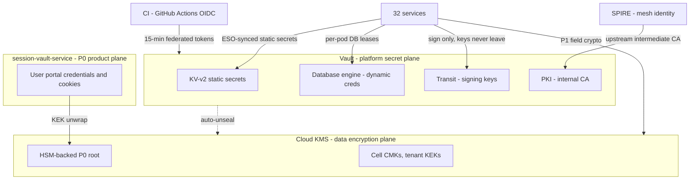
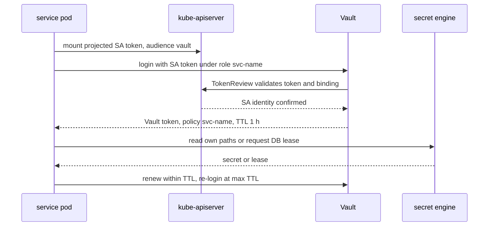
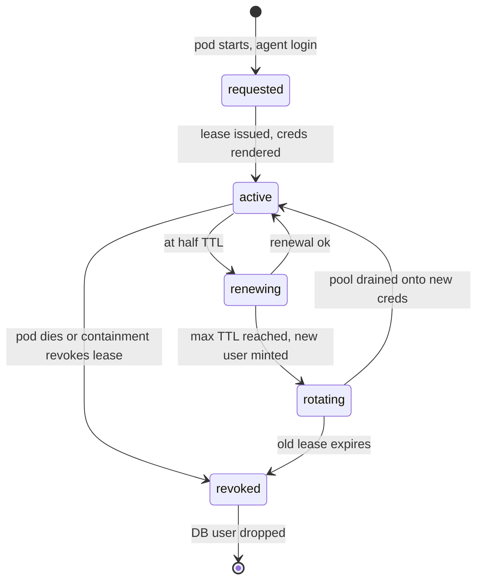
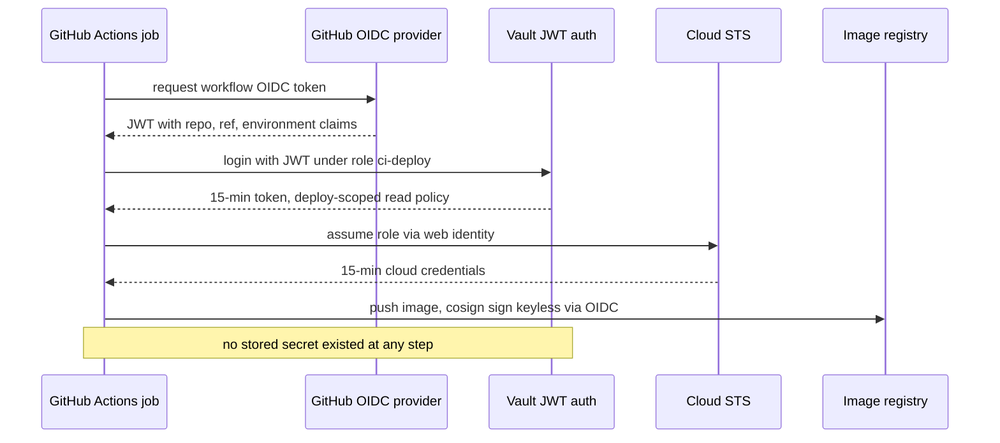

# 42 — Secret Management

| | |
|---|---|
| Document ID | ACA-SAS-42 |
| Volume | 5 — Security |
| Status | Draft v1.0 |
| Depends on | [00 — Architecture Canon](../00-architecture-canon.md) §3 §13, [06 — Technology Stack §11.3](../volume-1-foundation/06-technology-stack.md), [09 — Microservice Architecture](../volume-2-core-services/09-microservice-architecture.md), [11 — Identity Service](../volume-2-core-services/11-identity-service.md), [17 — Browser Fleet §7](../volume-2-core-services/17-browser-fleet.md), [37 — Security Architecture](37-security-architecture.md), [38 — Zero Trust](38-zero-trust.md), [40 — Audit Logs](40-audit-logs.md), [41 — Encryption](41-encryption.md) |

## 1. Overview

This chapter specifies the platform-secret plane: the self-hosted HashiCorp Vault deployment that is the sole source of platform secrets (canon §13: "Secrets only from Vault; no secrets in env-committed files"), its authentication methods and secret engines, the External Secrets Operator (ESO) sync pattern that delivers static secrets into workloads, the dynamic short-lived database-credential design and its rollout, rotation automation and break-glass ceremonies, CI/CD secret handling via OIDC federation, secret-sprawl prevention, Vault HA/DR, and policy-as-code governance of Vault ACLs.

A **platform secret** is credential material that lets *the platform's own components* act: third-party API keys (Stripe, SES/SendGrid, Twilio, LLM providers, proxy vendors), database credentials, signing keys, peppers, internal PKI material. The chapter's most important boundary statement is what is **not** here: users' portal credentials and session cookies (P0) live exclusively in `session-vault-service`, a product data plane with its own cryptography ([Ch 41 §7](41-encryption.md)) — §9 carries the full argument for why Vault is the wrong home for them. Likewise, bulk data-encryption keys are the cloud KMS plane ([Ch 41 §6](41-encryption.md)); Vault holds *signing* keys (Transit) and secrets, not the tenant KEK hierarchy. Three custodians, three failure domains, by design ([Ch 41 §11](41-encryption.md)).

The stance throughout is that the best secret is one that does not exist at rest: dynamic database credentials that are minted per workload and expire, CI credentials that exist only as 15-minute OIDC-federated tokens, PKI leaves that renew themselves. Static secrets are the residue — externally issued API keys that providers force on us — and they get metadata-driven rotation discipline and sprawl scanning. Vault is licensed under BUSL (amber per [Ch 06 §14](../volume-1-foundation/06-technology-stack.md)); the OpenBao exit seam is kept warm by restricting usage to APIs the fork tracks (§18).

## 2. Vault Position and Non-Goals



| In Vault | Not in Vault | Where instead |
|---|---|---|
| Provider API keys, SMTP/SMS/webhook credentials | User portal credentials, cookies (P0) | `session-vault-service` (§9) |
| DB credentials (dynamic), Redis/OpenSearch auth | Tenant KEKs, DEKs, per-object data keys | Cloud KMS ([Ch 41 §6](41-encryption.md)) |
| Ed25519 signing keys (Transit): JWT, prompt/routing bundles, export attestations | Kubernetes ServiceAccount tokens | Kubernetes (projected, bound) |
| Argon2id pepper, HMAC peppers, blind-index keys | Mesh workload certs | SPIRE (Vault PKI is its upstream, §5.3) |
| Internal PKI intermediates and leaves | TLS session material | runtime |

## 3. Vault Deployment Architecture

**Purpose.** One highly available, KMS-auto-unsealed Vault cluster per region, serving all cells in that region; the secret plane is regional because its consumers are.

**Topology.**

| Element | Choice | Rationale |
|---|---|---|
| Cluster | 3 nodes, Raft integrated storage, one per AZ | No external storage backend to operate or compromise; 3/2 quorum tolerates one AZ loss |
| Unseal | Auto-unseal via cloud KMS (dedicated CMK, separate from data-plane CMKs) | Removes human unseal ceremony from every restart; recovery keys (5 shares, threshold 3) exist for KMS-loss break-glass only (§8.3) |
| Access | In-mesh, mTLS, `vault.internal` service; no public exposure; admin API reachable only via JIT-elevated identity ([Ch 37 §3.1 TB-5](37-security-architecture.md)) | Vault is TB-5 admin-plane surface |
| Namespacing | OSS has none — path convention `secret/data/{env}/{cell}/services/{svc}/...` + policy templating enforces the same isolation | Convention + policy-as-code (§13) substitutes for Enterprise namespaces; recorded tradeoff (§19) |
| Audit devices | File audit device on every node → Fluent Bit → Loki + SIEM; Vault admin operations additionally mirrored to the [audit chain](40-audit-logs.md) as AC-8 by the operating tooling | Two sinks: high-volume raw trail (SIEM, 90 d) + consequential-operation chain (7 y) |
| Sizing | Steady load ≈ 300 rps (lease renewals + KV reads + Transit signs); 3× m-class nodes hold 10× that | Transit signing (~1–2 ms, [Ch 11 §8](../volume-2-core-services/11-identity-service.md)) is the hottest path |

**Interactions.** Consumers reach Vault four ways, and only these four: ESO (static secret sync, §6), Vault Agent injector sidecars (dynamic DB leases, §7), direct SDK for Transit sign/verify (identity-service, prompt-registry, audit exports), and Terraform (management plane, §13). Human access is JIT-elevated, read-scoped, and audited; there is no standing human token.

## 4. Authentication Methods

| Method | Principal class | Binding | Token TTL / max | Notes |
|---|---|---|---|---|
| Kubernetes auth | Every service workload | Role per service: bound ServiceAccount name + namespace + audience-bound projected token | 1 h / 4 h | The workhorse; one role per canonical service, generated from the service registry (§13) |
| JWT (OIDC) — GitHub Actions | CI jobs | Bound claims: `repository`, `ref` (protected branches), `environment`, `job_workflow_ref` | 15 min / 15 min | §10; no long-lived CI tokens exist |
| OIDC — humans | Operators via SSO | Group claims from identity provider; JIT elevation via `admin-service` flow (canon §13) | 30 min / 1 h | Read/inspect roles; mutation only via Terraform pipeline |
| AppRole | **Prohibited** except one bootstrap consumer (ESO controller initialization where k8s auth is unavailable during cluster bring-up) | SecretID delivered by provisioning pipeline, single-use, TTL 10 min | — | AppRole is where static-credential hygiene goes to die; the single exception is documented, wrapped, and audited |
| TLS cert auth | none | — | — | SPIFFE identity is consumed by the mesh, not doubled into Vault auth; k8s auth already binds pod identity |

Kubernetes auth flow (normative for all services):



The projected token is audience-bound (`aud=vault`) and short-lived (10 min) — a stolen SA token is useless against other APIs and stale quickly; the Vault role's namespace+name binding stops cross-service replay.

## 5. Secret Engines

### 5.1 KV-v2 — static secrets

| Path convention | Content | Rotation class |
|---|---|---|
| `secret/data/{env}/shared/{provider}/...` | Third-party keys used by exactly one owning service despite the `shared` mount segment — path metadata names the owner | per class below |
| `secret/data/{env}/{cell}/services/{svc}/...` | Service-scoped static config secrets | per class below |

- Versioned (KV-v2), `max_versions=10`, delete-protection on; reads are of pinned latest.
- **Metadata contract (mandatory, recon-enforced §11):** every secret carries `owner` (service), `rotation_class` (`auto-90d`, `auto-30d`, `manual-ceremony`, `on-compromise`), `last_rotated_at`, `source` (issuing provider console/API). A secret without metadata is an incident-in-waiting; the weekly recon job flags it.
- Reference inventory at GA: ~200 static secrets — LLM provider keys (rotated 90 d, [Ch 18 §12](../volume-2-core-services/18-ai-gateway.md)), Stripe restricted keys, SES/SendGrid/Twilio, proxy-vendor credentials, OAuth client secrets for import integrations, peppers and blind-index keys ([Ch 41 §10](41-encryption.md)).

### 5.2 Database engine — dynamic credentials

Design in §7; the engine holds one connection per service database using a Vault-owned admin role, and mints per-workload users from `creation_statements` that grant the service's canonical role:

```sql
-- role: db-profile-rw  (creation_statements template)
CREATE ROLE "{{name}}" WITH LOGIN PASSWORD '{{password}}'
    VALID UNTIL '{{expiration}}' IN ROLE svc_profile_rw;
-- svc_profile_rw carries the RLS-subject grants from Ch 31;
-- dynamic users inherit exactly that, never BYPASSRLS, never superuser
```

Inheriting the static `svc_*_rw` roles keeps the RLS posture ([Ch 31 §14](../volume-4-data-platform/31-postgresql-schema.md)) untouched by credential dynamism: authorization stays with the role; Vault only rotates *authentication*.

### 5.3 PKI — internal certificates

- Vault PKI holds the **intermediate CA** (1 y, re-issued at 6 mo) under the air-gapped offline root ([Ch 41 §3.3](41-encryption.md)).
- Two issuance paths: **SPIRE upstream authority** (SPIRE fetches its per-cell signing intermediates from Vault PKI, then issues 1 h SVIDs itself — Vault is not on the per-SVID path, which keeps SVID issuance latency and availability independent of Vault), and **non-mesh leaves** (Kafka, Postgres, Redis, webhook servers; 30 d TTL, auto-renewed at 10 d via cert-manager's Vault issuer).
- Issuance roles constrain SANs by consumer (`allowed_domains` per service class); a Kafka client role cannot mint a Postgres server cert.

### 5.4 Transit — signing and envelope operations

- Ed25519 keys: JWT signing ([Ch 11 §8](../volume-2-core-services/11-identity-service.md) — private keys never leave Vault; signing is an API call), prompt-bundle signing ([Ch 23 §12](../volume-3-ai-architecture/23-prompt-registry.md)), routing-bundle signing ([Ch 28 §12](../volume-3-ai-architecture/28-model-routing.md)), compliance-export attestation ([Ch 40 §8.3](40-audit-logs.md)).
- Key policy: `exportable=false`, `allow_plaintext_backup=false`, per-key `min_decryption_version` advanced on rotation; rotation 90 d with `kid`-style version pinning by consumers.
- Envelope ops via Transit are **limited to enterprise BYOK ceremony co-signing** ([Ch 35 §3](../volume-4-data-platform/35-object-storage.md)); bulk data encryption stays on KMS ([Ch 41 §11](41-encryption.md) records why — Vault must not sit on the P1 read path).

## 6. External Secrets Operator Sync

**Pattern.** ESO runs per cluster with its own Kubernetes-auth role (read-only over explicitly enumerated paths). Services declare `ExternalSecret` resources in their Helm charts referencing Vault paths; ESO materializes native Kubernetes Secrets and refreshes them on interval. The chassis consumes secrets as env/file mounts, fail-fast on absence ([Ch 09 §7](../volume-2-core-services/09-microservice-architecture.md)).

| Parameter | Value | Rationale |
|---|---|---|
| Refresh interval | 1 h default; 5 min for secrets with `rotation_class: auto-30d` or faster | Bounded staleness after a rotation without hammering Vault |
| Rotation pickup | Reloader-style annotation triggers rolling restart on Secret change for env-consumed secrets; file-mount consumers hot-reload | A rotated secret that pods never re-read is an outage deferred to the old credential's revocation |
| Scope | Static secrets only | Dynamic leases need renewal lifecycles ESO does not manage — those use the Agent injector (§7); enforcing the split prevents the classic "ESO-synced DB password expired mid-day" failure |
| Target namespaces | Service's own namespace only; ESO `ClusterSecretStore` denies cross-namespace fan-out | One service's chart cannot pull another's secrets into scope |

The two-path rule is worth stating as an invariant: **ESO for static, Agent injector for leased.** CI lints charts for `ExternalSecret` resources pointing at database-engine paths and fails them.

## 7. Dynamic Short-Lived Database Credentials

**Purpose.** Eliminate standing database passwords: each pod holds a unique, expiring DB identity, so credential theft has a TTL, per-pod attribution appears in `pg_stat_activity`, and revocation is lease revocation ([Ch 37 §6.3](37-security-architecture.md) containment step).

**Mechanics.** Vault Agent injector sidecar logs in with the pod's Kubernetes identity, requests a lease from the service's DB role, renders it to a file the chassis pool watches, and renews the lease. On rotation or non-renewal:

| Parameter | Value | Rationale |
|---|---|---|
| Lease TTL / max | 24 h / 72 h | 24 h bounds theft; 72 h max forces fresh users even on long-lived pods; both far above pool-refresh granularity |
| Pool refresh | At 50% TTL, with ±10% jitter | Jitter prevents synchronized reconnect storms across a fleet; refresh replaces connections gradually (drain-and-replace, no hard cut) |
| Expiry handling | Vault revokes the DB user at lease end (`DROP ROLE` semantics with connection termination) | Guarantees the credential's death does not depend on pod cooperation |
| Per-DB concurrency | ≤ 4 active dynamic users per service steady-state (2 during rotation overlap × HA) | Keeps `pg_roles` churn trivial; alarms if user count runs away (leak signature) |



**Rollout plan** (dynamism touches every service's most sensitive dependency, so it lands in waves, each gated on the prior wave's error budget):

| Phase | Scope | Exit criteria |
|---|---|---|
| R0 (baseline) | Static per-service creds in KV, rotated 90 d by job | Already the floor; remains the break-glass fallback (§8.3) |
| R1 | Read-replica connections of Tier-2 services | 30 d with zero credential-caused connection errors |
| R2 | RW paths of Tier-1/2 services | Same gate; pool-drain behavior verified under deploy churn |
| R3 | Tier-0 services (`identity-service`, `user-service`, `application-service`, …) | Game-day: Vault outage drill proves cached-lease ride-through (§14) |
| R4 | CI/staging ephemeral DB creds; static creds deleted from KV (metadata `rotation_class: retired`) | Static secrets reduced to the sealed break-glass copies |

**Failure posture:** leases outlive Vault outages (renewal failure ≠ revocation until TTL); a pod that cannot renew keeps working until lease expiry, giving a ≥ 12 h ride-through window at steady state — Vault's availability bounds *new pod scheduling*, not running traffic ([Ch 06 §13](../volume-1-foundation/06-technology-stack.md)).

## 8. Rotation Automation and Break-Glass

### 8.1 Rotation matrix

| Secret class | Rotation | Automation |
|---|---|---|
| Dynamic DB creds | Continuous (≤ 72 h) | Engine-native |
| PKI leaves / intermediates | 30 d / 6 mo | cert-manager + calendar ceremony |
| Transit signing keys | 90 d + emergency | Scheduled job; consumers pin by version (`kid`) |
| Provider API keys (Stripe, LLM, comms) | 90 d where the provider API allows; else `manual-ceremony` with calendar SLA | Rotation job per provider adapter: mint new → write KV (new version) → ESO refresh → verify canary call → revoke old. Two-key overlap throughout — rotation is never revoke-then-replace |
| Peppers / blind-index keys | Yearly (versioned) / compromise-only | Per [Ch 41 §8](41-encryption.md) |
| ESO/injector platform roles | Tokens self-expire (≤ 4 h) | n/a |

Every rotation writes `last_rotated_at` metadata and emits an AC-8 [audit event](40-audit-logs.md); the recon job (§11) alarms on any secret whose age exceeds its class SLA — rotation discipline is monitored, not remembered.

### 8.2 Emergency rotation

A suspected-compromise rotation ("rotate everything this service can see") is a runbook, exercised quarterly: enumerate the service's policy paths (mechanical, because policy-as-code §13 makes the path set explicit), execute per-class rotations in dependency order (DB lease revocation is instant; provider keys need the overlap dance), verify via canary calls, close with an audit summary. Target: ≤ 2 h for a single service's full surface.

### 8.3 Break-glass

| Asset | Custody | Use ceremony |
|---|---|---|
| Vault recovery keys (5 shares, threshold 3) | Named officers, per-person sealed hardware envelopes, two geographies | KMS-unseal-loss only; dual-person retrieval, exec approval, AC-8 audited; shares re-cut after any use |
| Standby JWT signing key | Pre-provisioned, sealed ([Ch 11 §10](../volume-2-core-services/11-identity-service.md)) | Vault outage exceeding token-mint tolerance; runbook-activated, rotated out immediately after |
| Static DB credentials (Tier-0 services only) | Envelope-encrypted escrow in a separate cloud account; not in Vault (must survive Vault loss) | Dual-control open; credential force-rotated after use; existence itself reviewed quarterly |
| Root CA materials | Air-gapped, HSM-token, two-person | Intermediate re-issue ceremonies only |

Break-glass design rule: every break-glass path must be *slower and louder* than the normal path — dual-control, paging on use, and automatic post-use rotation — so it is never the convenient shortcut.

## 9. Relationship to session-vault-service

User portal credentials are **not** in Vault. This is an architectural decision, not an accident of history, and it rests on five independent reasons — any two of which would suffice:

1. **Scale shape.** Vault is built for ~10³–10⁴ platform secrets with operator lifecycles. The session vault holds millions of per-user items (500 k users × several portals × credentials + cookie jars) with request-path read patterns. KV-v2 at that cardinality becomes an operational and Raft-storage liability.
2. **Crypto model.** P0 requires per-user DEKs under per-tenant HSM-rooted KEKs with AAD purpose-binding and egress-only decryption ([Ch 41 §7](41-encryption.md)). Vault KV offers storage encryption under Vault's own barrier key — the wrong hierarchy, no per-user crypto-shred, no purpose binding.
3. **Lifecycle semantics.** Vault items are product data: consent-scoped ([Ch 12](../volume-2-core-services/12-user-service.md) consents), GDPR-purgeable within the deletion saga (`PurgeVault` is the saga's first activity, P0 store first), per-item audit with user-facing visibility. Grafting product lifecycles onto Vault's admin model would reimplement a service inside a tool.
4. **Failure-domain separation.** Vault is a platform-wide Tier-0 dependency; the session vault is the crown-jewel data store. Fusing them means a Vault compromise is instantly a P0 breach, and a session-vault load event is a platform secrets event. Separate services keep the blast radii disjoint ([Ch 37 §3.1](37-security-architecture.md) treats them as distinct boundary assets).
5. **Access topology.** P0 plaintext may appear only inside the browser-pod egress sidecar (canon §13). The session vault's gRPC grant/sidecar protocol ([Ch 17 §7](../volume-2-core-services/17-browser-fleet.md)) is purpose-built for that; Vault's client model (token → read secret into client memory) is structurally the anti-pattern — it would put plaintext credentials in requesting-service memory.

What Vault *does* hold for the session vault: nothing on the data path. The session vault authenticates to its database like every service (§7) and unwraps its KEKs against KMS/HSM directly. The planes meet only in the audit chain.

## 10. CI/CD Secrets — OIDC Federation

**No long-lived credentials exist in CI.** GitHub Actions authenticates to both the cloud provider and Vault by presenting its OIDC workflow token; everything downstream is a 15-minute federated identity.



| Control | Detail |
|---|---|
| Bound claims | Vault CI roles bind `repository` (org allowlist), `ref` (protected branches / release tags only for prod-scoped roles), `environment`, and `job_workflow_ref` (pins the reusable deploy workflow — a compromised feature branch cannot borrow the prod role) |
| Role granularity | `ci-test` (ephemeral test-fixture secrets only), `ci-build` (registry push), `ci-deploy-{env}` (env-scoped chart values reads) — least privilege per pipeline stage |
| Image signing | cosign **keyless** via the same OIDC identity (Fulcio-issued ephemeral cert, Rekor transparency log) — consistent with admission verification ([Ch 37 §5.2](37-security-architecture.md)) and zero signing keys to custody |
| Argo CD | In-cluster, authenticates via its own Kubernetes identity; manifests contain `ExternalSecret` references, never values — GitOps repos are secret-free by construction |
| Third-party Actions | SHA-pinned ([Ch 37 §5.2](37-security-architecture.md)); OIDC token permissions default `none`, elevated per job |

## 11. Secret Sprawl Prevention

Layered, because sprawl is entropy and no single gate holds:

| Layer | Mechanism | Failure it catches |
|---|---|---|
| Pre-commit / push | gitleaks + GitHub push protection ([Ch 37 §5.2](37-security-architecture.md)) | Secret about to enter git |
| CI | trufflehog history scan (PR-18, [Ch 09 §12](../volume-2-core-services/09-microservice-architecture.md)); Trivy image scan includes embedded-secret detectors; chart lint rejects inline secret-shaped values and `ExternalSecret` → DB-engine paths (§6) | Secret in diff, image layer, or Helm values |
| Admission | Kyverno/OPA policy: Kubernetes `Secret` objects may be created only by the ESO controller, the Vault injector, and an enumerated system allowlist (cert-manager, Istio); human `kubectl create secret` in workload namespaces is denied | Out-of-band secret creation in-cluster |
| Runtime | Log-scrubber tests (NFR-047); `ai-gateway` credential detector blocks P0/secret-shaped content in prompts ([Ch 18 §7](../volume-2-core-services/18-ai-gateway.md)); prompt-registry PSL-05 lint ([Ch 23 §11](../volume-3-ai-architecture/23-prompt-registry.md)) | Secrets leaking into logs or LLM context |
| Inventory recon | Weekly job walks all KV metadata: flags missing `owner`/`rotation_class`, age > class SLA, paths read by zero policies (orphans), policies granting paths that no longer exist (drift) | Rot inside Vault itself |
| Allowlists | Scanner false-positive allowlist is a reviewed file with expiry dates per entry — an allowlist entry without an expiry is itself a finding | Allowlist becoming a blind spot |

The recon philosophy: Vault solves *storage* sprawl but creates *inventory* sprawl of its own — unowned, unrotated, orphaned secrets inside Vault are quieter than a key in a repo and nearly as dangerous. Metadata + recon makes them loud.

## 12. Vault HA and DR

| Property | Design | Number / rationale |
|---|---|---|
| In-region HA | 3-node Raft across AZs; leader failover automatic | Seconds of write unavailability on failover; reads continue on standbys with `allow_stale` for non-critical paths |
| Backup | Raft snapshots every 15 min → S3 (SSE-KMS under a dedicated CMK, separate account write path); retained 35 d | 15-min RPO on the secret plane; most material is re-derivable (dynamic creds re-mint; PKI re-issues; static keys re-importable from provider consoles in the worst case) |
| DR | Warm-standby cluster in the secondary region, restored from latest snapshot on failover, sealed until activated (KMS multi-region unseal key) | RTO ≤ 30 min, matching platform DR (canon §15); OSS has no streaming replication — the snapshot gap is the honest cost of the license posture, and the 15-min RPO covers it because secret-plane churn is low |
| Failover blast radius | During Vault DR: running workloads ride on leases/ESO-cached secrets (§7 failure posture); *new* pod scheduling of secret-dependent services throttles ([Ch 06 §13](../volume-1-foundation/06-technology-stack.md)) | Vault DR is an operational event, not a user-facing outage, provided RTO < minimum lease runway (12 h) — enforced by the game-day drill |
| Drills | Quarterly: leader kill (expect < 30 s), full-region restore (expect < 30 min), KMS-unseal-loss recovery-key ceremony (annually) | DR that is not drilled is fiction (canon §15 game-day discipline) |

## 13. Policy-as-Code for Vault ACLs

All Vault configuration — auth roles, policies, mounts, engine configs — is Terraform, in a dedicated repo, applied by the CI OIDC identity; the Vault UI and CLI are read-only for humans (JIT-elevated inspect roles). Nothing is clicked into existence.

- **Service policy template:** each of the 32 services gets a generated policy from the service registry: read on `secret/data/{env}/{cell}/services/{svc}/*`, its own DB-engine role creds path, its enumerated Transit keys (sign-only where applicable), deny all else. Deny-by-default is structural: there is no shared read path, so "which services can read X" is answerable by grep.
- **CI policy checks (conftest, same Rego toolchain as runtime authz — one policy language org-wide, [Ch 37 §5.2](37-security-architecture.md)):** no `*` capabilities on `sys/*` or `auth/*`; no policy may grant another service's path prefix; no `root` policy attachment anywhere; Transit keys must set `exportable=false`; every KV path in a policy must exist in the path registry with an owner; TTLs within platform ceilings.
- **Drift detection:** nightly `terraform plan` against live Vault; any diff pages the security-engineering rotation — out-of-band mutation of the secret plane is a TB-5 event by definition, not a hygiene note.
- **Review:** policy diffs require security-engineering approval (CODEOWNERS); changes to `auth/` mounts or CI bound-claims require two approvals — those are the paths whose weakening silently widens who can *become* a secret consumer.

## 14. Failure Scenarios

| Scenario | Impact | Response / design answer |
|---|---|---|
| Vault leader loss | Writes stall seconds | Raft election; clients retry with backoff (SDK default) |
| Vault cluster down | No new logins/leases/signs; ESO serves last-synced Secrets; DB leases ride to TTL (≥ 12 h runway); token minting degraded → standby signing key runbook if prolonged ([Ch 11 §10](../volume-2-core-services/11-identity-service.md)) | Restore or DR failover ≤ 30 min (§12); new-pod scheduling throttled |
| KMS unseal key unavailable | Vault restarts cannot unseal | Running cluster unaffected (unseal is start-time); recovery-key ceremony (§8.3) if KMS loss persists across a restart |
| ESO controller down | Secret refresh stops; existing Secrets persist | Staleness alarm at 2× refresh interval; rotations pause safely (two-key overlap §8.1 means old creds stay valid) |
| Injector webhook down | New pods of lease-consuming services fail to schedule | PodDisruptionBudget on webhook; failurePolicy tuned so non-secret workloads are unaffected |
| Lease-expiry storm (mass renewal failure) | Services lose DB access at staggered TTLs | Jittered TTLs prevent synchronization; alarm on renewal-failure rate at 1% — hours before first expiry |
| CI OIDC misconfiguration (over-broad bound claims) | Fork/branch could assume deploy roles | Conftest gate on bound-claim minimums; quarterly access review replays claim sets against policy (§13) |
| Compromised service token | Attacker reads that service's paths for ≤ 4 h | Blast radius = one service's enumerated secrets (§13); containment = revoke accessor + emergency rotation runbook (§8.2); Vault audit log + SIEM correlation detects anomalous path access |
| Vault storage compromise (Raft snapshot theft) | Barrier-encrypted data at rest | Snapshot is ciphertext under the unseal key (KMS); without KMS access it is noise — snapshot custody still treated as secret-grade |

## 15. Scaling Strategy

Vault load has three components with different curves. **Lease churn** scales with pod count (≈ 4 leases/service × replicas × renewal every 12 h ≈ tens of ops/min at GA — negligible). **Transit signing** scales with logins/refreshes (~1.4 k rps peak at 1 M MAU per [Ch 11 §13](../volume-2-core-services/11-identity-service.md)); Ed25519 sign is ~50 μs of CPU, so the ceiling is network round-trips — batchable and horizontally scaled with performance standbys if the identity fleet's mint rate grows 10×. **KV reads** are ESO-interval-shaped, not request-shaped, by design (§6). The scaling rule that matters is *negative*: nothing request-path beyond token minting may take a Vault dependency — enforced by architecture review, because the cheapest Vault scaling strategy is refusing hot-path couplings ([Ch 41 §11](41-encryption.md) applies the same rule from the crypto side).

## 16. Security Considerations

- **Vault is TB-5 crown infrastructure:** it holds the keys to the platform's external identities. Controls stack: mesh-internal only, JIT human access, policy-as-code with drift paging, audit device to SIEM + chain, deny-by-default policies, no root token in existence (revoked post-bootstrap; regenerated only via recovery-key ceremony).
- **The barrier is not the story:** Vault's storage encryption protects snapshots, but the live threat is *policy* — an over-broad policy is a plaintext leak with extra steps. Hence §13's structural deny-by-default and the two-approval rule on auth mounts.
- **Auto-unseal trust:** cloud KMS can unseal Vault; the KMS CMK for unsealing is dedicated, IAM-scoped to the Vault node role, and CloudTrail-alarmed — a KMS-side unseal by any other principal pages.
- **Secret-zero:** the Kubernetes auth chain bottoms out in kube-apiserver's ServiceAccount issuance — cluster compromise implies secret-plane compromise for those services' scopes. That is the honest floor of in-cluster secret delivery; gVisor-isolated browser pods deliberately mount **no** ServiceAccount token at all ([Ch 17 §6](../volume-2-core-services/17-browser-fleet.md)), keeping the hostile-content plane out of this chain entirely.
- **Vault audit ↔ platform audit:** high-volume raw trail to SIEM (90 d); consequential admin operations (mount changes, policy changes, break-glass, recovery ceremonies) mirrored as AC-8 to the [hash-chained audit log](40-audit-logs.md) — tamper-evident for 7 years.

## 17. Observability

| Signal | Type | Alert |
|---|---|---|
| `vault_core_unsealed` | gauge per node | any sealed node pages |
| `vault_raft_leader_changes` | counter | > 2/h warns (flapping) |
| Request latency by endpoint class | histogram | Transit sign p99 > 10 ms warns (identity mint budget, [Ch 11 §14](../volume-2-core-services/11-identity-service.md)) |
| Lease count + renewal failure rate | gauge/counter | failure > 1% pages (expiry-storm precursor) |
| Token TTL distribution by auth role | histogram | any token > role max = policy bug, pages |
| ESO sync staleness | gauge per ExternalSecret | > 2× refresh interval warns; > 6× pages |
| Snapshot age | gauge | > 45 min pages (RPO breach) |
| Recon findings (unowned/overdue/orphaned secrets) | counter | weekly report; overdue `manual-ceremony` > 14 d escalates to CISO report ([Ch 37 §13](37-security-architecture.md) KPI set) |
| Drift detections | counter | any = page (§13) |
| Break-glass usage | counter | any = page + incident case |

Dashboard: **Secret plane health** in the security folder — seal/HA state, lease economy, rotation calendar vs SLA, sync staleness, recon debt. The rotation-calendar panel doubles as SOC 2 evidence of key/secret-management operating effectiveness.

## 18. Future Improvements

- **OpenBao migration rehearsal**: annual restore-into-OpenBao drill of a production snapshot in staging — converts the license exit ([Ch 06 §14](../volume-1-foundation/06-technology-stack.md)) from a document into a tested runbook; triggers for actually migrating: BUSL scope change, or Enterprise-only features becoming load-bearing.
- **SPIFFE-native secret delivery**: replace Kubernetes auth with SPIRE-issued JWT-SVID auth to Vault, unifying workload identity across mesh and secret plane (one attestation chain, no kube-apiserver in the trust path).
- **Dynamic credentials beyond Postgres**: Redis ACL users and OpenSearch credentials via Vault database/plugin engines once the Postgres rollout (R1–R4) proves the operational pattern.
- **Secretless brokering for third-party APIs**: an egress proxy that injects provider keys at the connection edge (session-vault-style, but for platform keys) so provider credentials never enter service memory — evaluate for the highest-value keys (payment, LLM) after GA.
- **Hardware-backed Vault seal attestation** (KMS custom key store for the unseal CMK) aligning the secret plane's root with the P0 plane's HSM posture ([Ch 41 §7](41-encryption.md)).

## 19. Alternatives Considered & Tradeoffs

| Decision | Alternatives | Why this choice / tradeoff |
|---|---|---|
| Self-hosted Vault OSS | Cloud secrets manager (AWS Secrets Manager class); Vault Enterprise; Kubernetes Secrets + SOPS/sealed-secrets | Cloud managers lock the seam the canon requires open (cells may run on-prem/MinIO-class environments) and lack dynamic DB engines' breadth; Enterprise buys replication/namespaces at a license cost unjustified at phase-1 scale; SOPS-class git-encrypted secrets have no dynamic issuance, no central revocation, no lease model. Tradeoff: we operate a Tier-0 stateful security system ourselves — accepted with the [Ch 06 §15](../volume-1-foundation/06-technology-stack.md) resourcing precondition, and BUSL is carried with a drilled OpenBao exit (§18) |
| Path-convention isolation on OSS | Vault Enterprise namespaces | Namespaces are cleaner multi-tenancy but Enterprise-only; policy templating + conftest achieves equivalent *enforced* isolation with more review discipline. Tradeoff: isolation lives in CI-checked convention, not a server primitive — drift detection (§13) is the compensating control |
| ESO for static + Agent injector for dynamic | One mechanism for everything (all-ESO or all-injector) | All-ESO mismanages leases (no renewal semantics); all-injector adds a sidecar to every pod for secrets that change yearly. Two mechanisms, one selection rule (§6), each doing what it is built for. Tradeoff: two consumption paths to teach — mitigated by the chart lint that auto-classifies |
| Dynamic DB creds with role inheritance | Static creds rotated by job; per-pod static users provisioned by operator tooling | Rotation jobs leave standing passwords between rotations and need revoke-then-replace choreography; operator-provisioned users rebuild half of Vault's engine badly. Inheritance (`IN ROLE svc_*_rw`) keeps authorization static and RLS-safe while authentication churns. Tradeoff: Vault outage now bounds *new* DB identity issuance — covered by lease runway (§7) and drilled |
| GitHub OIDC federation for CI | Long-lived deploy tokens in repo/org secrets; self-hosted runners with instance identity | Stored CI tokens are the single most-stolen secret class in supply-chain incidents; OIDC bound claims give per-workflow, per-branch, 15-min identities with no stored material. Tradeoff: trust in GitHub's OIDC issuer — bounded by claim pinning (`job_workflow_ref`) and by the fact that repo compromise already implies pipeline compromise |
| User credentials in a dedicated `session-vault-service` | Store P0 in Vault (KV or Transit-wrapped) | §9's five reasons: scale shape, crypto model, product lifecycle, failure-domain separation, access topology. Tradeoff: two "vault"-named systems to keep conceptually distinct — the naming collision is unfortunate and the documentation burden is real; the canon's naming is retained deliberately to avoid a rename ripple |
| No standing human access; Terraform-only mutation | Admin UI workflows with approvals | UI mutations are unreviewable drift generators in a system where a policy typo equals exposure; PR review + conftest + drift paging beats trained caution. Tradeoff: emergency changes go through break-glass (slower by design, §8.3) |
| Recovery keys held by named officers (Shamir 3-of-5) | Cloud-only recovery (KMS multi-region); escrow with a third party | KMS-only recovery makes the cloud provider a single point of unseal failure and trust; third-party escrow adds a contract where a ceremony suffices. Tradeoff: a human ceremony that must be drilled (annually, §12) or it will fail when needed |
