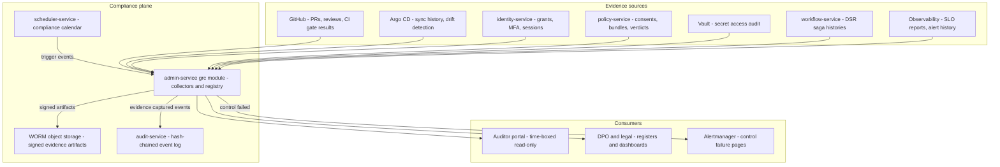
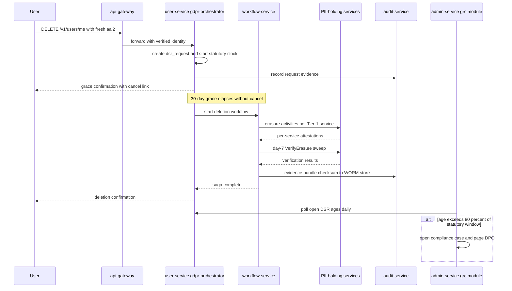
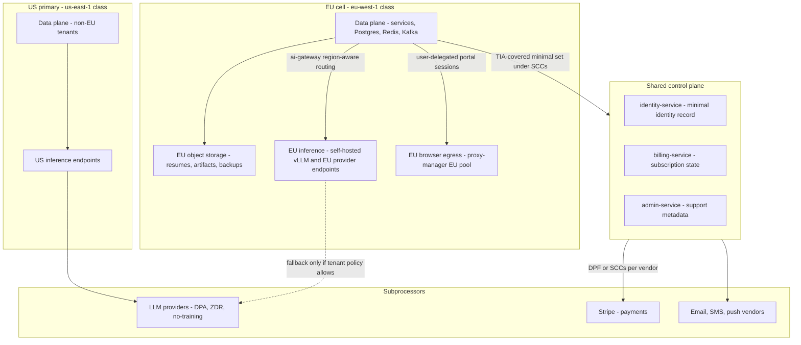
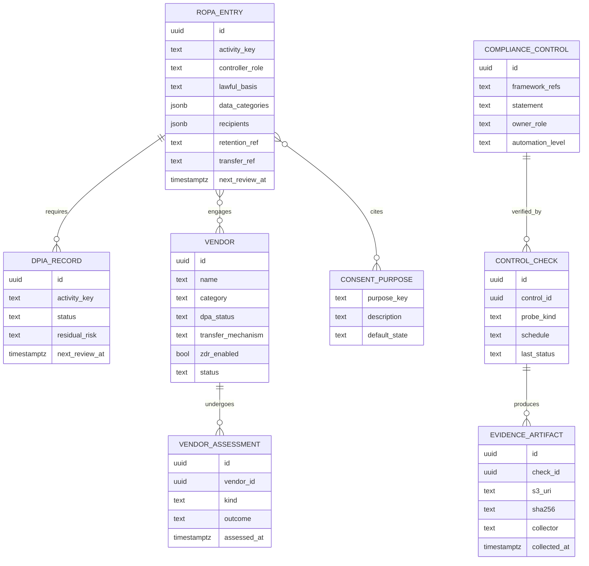
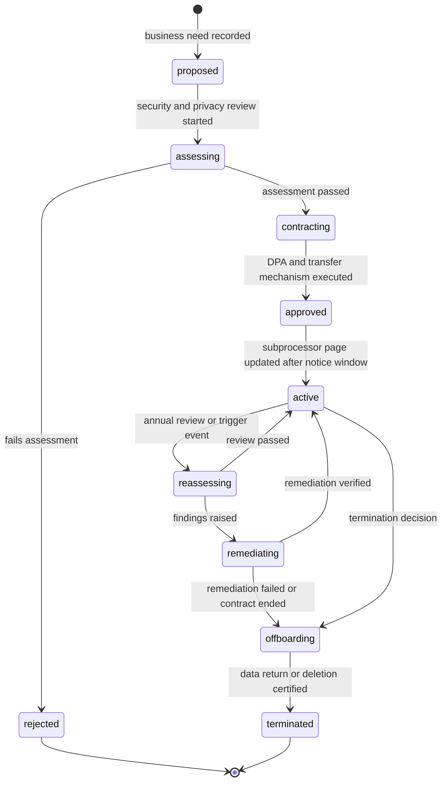

# 43 — Compliance

| | |
|---|---|
| Document ID | ACA-SAS-43 |
| Volume | 5 — Security |
| Status | Draft v1.0 |
| Depends on | [00 — Architecture Canon](../00-architecture-canon.md) §1 §6 §11 §12 §13 §15 §16, [37 — Security Architecture](37-security-architecture.md), [38 — Zero Trust](38-zero-trust.md), [39 — RBAC](39-rbac.md), [11 — Identity Service](../volume-2-core-services/11-identity-service.md), [12 — User Service](../volume-2-core-services/12-user-service.md) §7, [15 — Job Intelligence Service](../volume-2-core-services/15-job-intelligence-service.md) §6, [16 — Universal Portal Engine](../volume-2-core-services/16-universal-portal-engine.md), [18 — AI Gateway](../volume-2-core-services/18-ai-gateway.md), [35 — Object Storage](../volume-4-data-platform/35-object-storage.md), [36 — Event Contracts](../volume-4-data-platform/36-event-contracts.md) |

## 1. Overview

This chapter is the normative specification of ACA's compliance program: the GDPR/CCPA implementation map (lawful bases, data-subject-rights machinery, consent, DPIAs, automated-decision transparency), the SOC 2 Type II control mapping, the ISO 27001 roadmap, data-residency and cross-border transfer controls, the platform-ToS compliance posture for portal automation, the Article 30 records of processing, vendor/subprocessor management, and the evidence-automation pipeline that makes all of it auditable without a quarterly fire drill. Canon §13 fixes the targets — GDPR/CCPA from day 1, SOC 2 Type II in year 1, ISO 27001 in year 2 — and this chapter fixes how they are met.

The organizing principle is **compliance as a property of the architecture, not a parallel paperwork universe.** Every claim an auditor or regulator will test must resolve to a system artifact that already exists for engineering reasons: GitOps history *is* the change-management control; the hash-chained `audit-service` log *is* the evidence store; the Temporal DSR sagas of [Chapter 12 §7](../volume-2-core-services/12-user-service.md) *are* the data-subject-rights implementation; `policy-service` consent records *are* the lawful-basis evidence; `policy-agent` verdicts ([Ch 15 §6](../volume-2-core-services/15-job-intelligence-service.md)) *are* the crawling-compliance record. Where a compliance obligation has no such artifact, the gap is closed by building the artifact — never by writing a document that asserts an uninstrumented behavior.

Two structural choices follow. First, there is **no `compliance-service`**: canon §4 fixes the service catalog, and compliance state (registers, controls, evidence index) is low-volume, admin-facing data — it lives in a `grc` module inside `admin-service`, with evidence bodies in WORM object storage ([Ch 35](../volume-4-data-platform/35-object-storage.md)) and consent/policy authority remaining with `policy-service` (§18 records the tradeoff). Second, **registers are code**: the RoPA, control catalog, DPIA register, and subprocessor list are YAML in a compliance repository, validated in CI against the canon service catalog and deployed into the `grc` registry — a register that can drift from the deployed system silently is worse than no register, because it converts an engineering gap into a false attestation.

Roles referenced throughout: the DPO (Data Protection Officer, appointed under Art 37 — EU-establishment processing at scale), the security lead ([Ch 37 §9](37-security-architecture.md) RACI), and legal. This chapter binds services and pipelines; contractual per-tenant overrides (enterprise DPAs, custom retention) are recorded as tenant policy in `policy-service` and referenced here.

## 2. Compliance Program Architecture

### 2.1 Purpose and responsibilities

The program has four moving parts:

| Part | Owner | Implementation |
|---|---|---|
| Compliance registry | `admin-service` `grc` module | Postgres schema `grc` (§10, §11, §12 DDL): RoPA entries, DPIA register, control catalog, control checks, vendor registry, evidence index |
| Evidence pipeline | `admin-service` collectors + `scheduler-service` calendar | Read-only collectors pull from source systems, sign and store artifacts in WORM S3, index them in `grc` (§12) |
| Registers-as-code | Compliance repo (Git) | YAML sources for RoPA/controls/vendors/DPIA metadata; CI validation; deploy = upsert into `grc` with `source_rev` git SHA |
| Compliance calendar | `scheduler-service` | RRULE schedules for recurring obligations (access reviews, DPIA reviews, RoPA review, vendor reassessment, DR drills, pentest) publishing trigger events consumed by the `grc` module |

Interactions: the `grc` module is a consumer of nearly everything and an authority over almost nothing — it reads GitOps history, `identity-service` grants, `policy-service` consents, `workflow-service` saga histories, and observability data; its only outbound enforcement is opening cases, paging on control failure, and gating auditor access. Enforcement authority stays where it already lives (`policy-service`/OPA, `policy-agent`, service guards) — the compliance plane observes and proves; it does not become a second enforcement path that can disagree with the first.



### 2.2 Controller/processor matrix

GDPR obligations differ by role, and ACA's role differs by tenant class (canon §1). This matrix is the root of the RoPA and of every DPA ACA signs:

| Tenant class | ACA role for career/application data | ACA role for org-supplied data | Consequence |
|---|---|---|---|
| `individual` | Controller | — | ACA owns lawful bases, DSRs, breach notification to users |
| `team` | Controller | Controller (member roster) | Consumer product; team admins get only member-shared views ([Ch 39 §3](39-rbac.md)) |
| `university` | Controller (student career data — students consent directly) | Processor (university-provided rosters, cohort config) | Dual role documented per activity; joint-controllership avoided by keeping cohort analytics aggregate-only |
| `enterprise` | Controller (employee's own career activity) | Processor (employer roster, seat assignments) | Employer never sees individual application content; DPA covers the processor slice only |
| `recruiter` | Processor (recruiter org's pipeline data) | — | Candidate-side sharing is governed by the candidate's own consent (`recruiter.visibility`, §4), not the recruiter's instructions |

Where ACA is processor, DSRs arriving from data subjects are forwarded to the controller within 72 h with assistance obligations per the DPA; where controller, the §3 machinery applies directly. The split is encoded per RoPA entry (`controller_role`, §10) so the DSR intake can route mechanically.

## 3. GDPR / CCPA Implementation Map

### 3.1 Lawful bases per processing activity

Each processing activity (`PA-nn`) is a RoPA entry (§10). Basis codes: `6(1)(a)` consent, `6(1)(b)` contract, `6(1)(c)` legal obligation, `6(1)(f)` legitimate interest (balancing test on file in the DPIA/LIA register), `9(2)(a)` explicit consent for special-category data. CCPA column notes the CPRA treatment.

| PA | Activity | Services | GDPR basis | CCPA/CPRA treatment |
|---|---|---|---|---|
| PA-01 | Account and tenancy management | `user-service`, `identity-service` | 6(1)(b) | Necessary business purpose |
| PA-02 | Career profile and resume processing | `profile-service`, `resume-service`, `portfolio-service` | 6(1)(b); 9(2)(a) for self-ID fields (§5.2) | Sensitive PI — use limited to service delivery |
| PA-03 | Job corpus building (public postings; incidental recruiter names) | `job-intelligence-service` | 6(1)(f) — LIA on file; public-source data, P3 | Publicly available info exemption where applicable |
| PA-04 | Matching and ranking for the user | `matching-service` | 6(1)(b) — core contracted service; transparency per §5.3 | Necessary business purpose |
| PA-05 | Application material generation (LLM) | `resume-agent`, `cover-letter-agent` via `ai-gateway` | 6(1)(b) | Necessary business purpose; subprocessor DPAs §11 |
| PA-06 | Automated portal submission | `browser-agent`, `browser-fleet-service`, `session-vault-service` | 6(1)(b) for submission itself + 6(1)(a) consent `automation.portal_submission`; credential custody under consent `credential.custody`; DPIA-01 (§5.1) | Sensitive PI (credentials); no sale/share |
| PA-07 | Mailbox integration | `email-agent`, `application-tracker-agent` | 6(1)(a) — consent `mailbox.read` | Consent; revocable |
| PA-08 | Interview prep, negotiation coaching | `interview-coach-agent`, `negotiation-agent` | 6(1)(b) | Necessary business purpose |
| PA-09 | Cross-user learning (global model/prompt improvement) | `learning-pipeline` | 6(1)(a) — opt-in consent `learning.global` for identifiable content; 6(1)(f) for de-identified aggregates with opt-out | Opt-out of profiling honored; de-identification standard documented |
| PA-10 | Product notifications and digests | `notification-service`, `notification-agent` | 6(1)(b); marketing under 6(1)(a) | Marketing opt-out; GPC honored (§3.4) |
| PA-11 | Billing and invoicing | `billing-service` | 6(1)(b) + 6(1)(c) tax retention | Necessary; Stripe as subprocessor |
| PA-12 | Security logging, audit, fraud/abuse prevention | `audit-service`, SIEM ([Ch 37 §6](37-security-architecture.md)) | 6(1)(f) + 6(1)(c) | Security exemption |
| PA-13 | Recruiter candidate sourcing | `recruiter-service` | 6(1)(a) — consent `recruiter.visibility` | This is "sharing" under CPRA → consent-gated, opt-out = withdrawal, GPC honored |
| PA-14 | Support and abuse case handling | `admin-service` | 6(1)(f) | Necessary business purpose |
| PA-15 | Product analytics (pseudonymized) | `analytics-service` | 6(1)(f) with opt-out | Opt-out honored |

Rules enforced structurally: an activity without a RoPA entry cannot ship (CI check on the service catalog ↔ RoPA join, §10); consent-based activities are enforced by `policy-service` consent state at the OPA layer ([Ch 39 §2](39-rbac.md) `context.consents`), so "basis = consent" is machine-checked, not aspirational.

### 3.2 Data-subject rights — flows wired to services

The mechanics (Temporal sagas, `dsr_request` table, per-service `ExportUserData`/`VerifyErasure` gRPC contract, evidence bundles) are specified in [Chapter 12 §7](../volume-2-core-services/12-user-service.md). This section fixes the compliance layer above them: rights coverage, identity verification standard, deadlines, and oversight.

| Right | GDPR | CCPA | Mechanism | Internal SLA (statutory ceiling) |
|---|---|---|---|---|
| Access / know | Art 15 | §1798.110 | Export saga → encrypted JSONL bundle with manifest | 72 h (30 d / 45 d) |
| Portability | Art 20 | §1798.130 | Same bundle — machine-readable JSONL is the portability format | 72 h (30 d / 45 d) |
| Rectification / correct | Art 16 | §1798.106 | Self-service profile edit; support-assisted for derived data with re-generation of downstream artifacts | 7 d (30 d / 45 d) |
| Erasure / delete | Art 17 | §1798.105 | Deletion saga + tombstone sweep + day-7 verification; legal holds pseudonymize (billing, audit) | Grace 30 d + saga ≤ 30 d (canon §11) |
| Restriction | Art 18 | — | Account `suspended`/frozen state: automation halts, data retained | Immediate |
| Objection | Art 21 | — | Opt-out toggles for every 6(1)(f) activity (PA-09 aggregates, PA-15) via consent registry | p95 < 60 s propagation (§4) |
| Opt-out of sale/share | — | §1798.120 | ACA sells no PI; "share" = recruiter visibility → withdrawal of `recruiter.visibility`; GPC signal auto-applies it | p95 < 5 min de-indexing |
| Meaningful info on automated decisions | Art 15(1)(h), Art 22 | §1798.185 ADMT regs | §5.3 transparency surfaces + DSR export includes model/prompt version references | Included in export |
| Non-discrimination | — | §1798.125 | No plan/feature degradation on rights exercise — verified by policy lint: no OPA rule may consume DSR state | Structural |

**Identity verification:** rights requests require an authenticated session at `aal2` (erasure additionally requires fresh authentication, [Ch 11 §5.3](../volume-2-core-services/11-identity-service.md)). Unauthenticated requests (email to privacy@) are converted to in-product requests via a verification loop; ACA never executes a destructive DSR against a bare email claim — account-takeover-initiated erasure is a real attack ([Ch 12 §4](../volume-2-core-services/12-user-service.md)). **CCPA authorized agents** submit via a dedicated intake with signed permission + user confirmation through the account; the agent never receives the export bundle directly — it is delivered into the user's account.

**Oversight:** the `grc` module polls open `dsr_request` ages daily and opens a compliance case at 80% of the statutory window (a deadline breach must surface while there is still time to act, not after); every DSR closure requires the evidence bundle checksum recorded in `audit-service`.



### 3.3 Breach notification

Detection and severity classification belong to [Chapter 37 §6](37-security-architecture.md); this chapter owns the regulatory clock. A SEV with confirmed personal-data exposure starts the 72-hour Art 33 timer at *establishment of reasonable certainty*, recorded as an `audit-service` event (the timestamp will be examined). Pre-drafted notification templates per audience (supervisory authority via the EU representative, affected users via `notification-service`, enterprise controllers per DPA — typically 24–48 h contractual), and a decision tree (risk to rights and freedoms → notify authority; high risk → notify subjects) are versioned in the compliance repo. Processor-role breaches notify the controller tenant, not the authority.

### 3.4 CCPA/CPRA specifics

- **No sale, one share:** the only CPRA "share"-like flow is recruiter visibility, gated on `recruiter.visibility` consent. "Do Not Sell or Share My Personal Information" link → consent withdrawal, and the **Global Privacy Control** header/signal is treated as a valid opt-out for the authenticated browser's user (frontend forwards it; `policy-service` records it with `source = gpc`).
- **Sensitive PI limitation:** credentials (P0), self-ID demographics, and mailbox content are used only for the service purposes the user configured; no secondary use — enforced because every agent action is consent + policy checked (canon §9), not by policy document.
- **Metrics publication:** CPRA-required DSR metrics (received/complied/denied, median days) are generated from `dsr_request` data by the `grc` module and published annually.

## 4. Consent Management via policy-service

`policy-service` is the canonical consent registry (canon §4.1). Consents are **purpose-keyed, versioned, evidence-backed grants** distributed to enforcement points through the same OPA bundle pipeline as authorization policy ([Ch 38 §4](38-zero-trust.md)) — consent enforcement is therefore exactly as strong, and as testable, as authorization.

### 4.1 Purpose catalog

| `purpose_key` | Grants | Default | Withdrawal effect and SLO |
|---|---|---|---|
| `automation.portal_submission` | `browser-agent` may execute submission flows per autonomy level | off | New submissions blocked p95 < 60 s (bundle push interval); in-flight runs cancelled at next HITL checkpoint |
| `credential.custody` | `session-vault-service` may store portal credentials/cookies (P0) | off | Vault entries crypto-shredded (per-user DEK destroyed) ≤ 24 h; dependent automation consents cascade-revoked |
| `mailbox.read` | `email-agent` may read application-related email | off | OAuth token revoked immediately; parsed derivatives deleted ≤ 7 d |
| `import.linkedin` / `import.github` | One-shot profile import | off | Import artifacts deletable via profile UI |
| `learning.global` | Pseudonymized outcomes may enter cross-user training sets | off (opt-in) | Excluded from future sets immediately; feature-store purge at next consolidation ≤ 30 d |
| `recruiter.visibility` | Profile discoverable in `recruiter-service` sourcing | off | De-indexed p95 < 5 min (search projection delete) |
| `marketing.email` | Marketing communications | off | Suppression list immediate |
| `analytics.product` | Non-essential product analytics | on with opt-out (6(1)(f)) | Event pipeline drops user key at ingestion |

Defaults are off for everything consent-based — a pre-ticked box is not consent (Art 7). Granularity is per-purpose, never bundled; the signup flow requests only what the first-run experience needs.

### 4.2 Consent records and propagation

Each grant/withdrawal writes a consent record: `usr_` reference, purpose key, action, policy-text version (the exact privacy-notice hash shown), UI context, timestamp, IP-derived region — mirrored to `audit-service` (`aca.audit.event.v1`) as legal evidence and retained 7 years pseudonymized after erasure ([Ch 12 §6](../volume-2-core-services/12-user-service.md)). Changes publish:

| Topic | Key | Payload sketch | Consumers |
|---|---|---|---|
| `aca.policy.consent.changed.v1` | `user_id` | purpose_key, old_state, new_state, policy_text_version, evidence ref | `agent-orchestrator` (cancel dependent runs), `ai-gateway` (routing constraints), `recruiter-service` (de-index), `learning-pipeline` (exclusion list), `search-service`, `audit-service` |

Enforcement points check consent at decision time via OPA data documents (`context.consents`, [Ch 39 §2](39-rbac.md)); the event exists for *revocation side effects* (cancellation, purging, de-indexing), not as the primary check — a consumer that misses an event still cannot act, because the bundle says no.

**Re-consent:** a material change to a purpose's meaning creates a new policy-text version; existing grants remain valid only if the change is narrowing. Widening changes set the grant to `stale` and the dependent automation freezes until re-consent — the alternative (grandfathering) is how consent programs quietly rot.

## 5. DPIA and Automated-Decision Transparency

### 5.1 DPIA register and DPIA-01 (automated application submission)

DPIAs are mandatory where Art 35 triggers apply (systematic evaluation, large-scale processing, new technology — agentic submission qualifies on all three). Register:

| DPIA | Activity | Status | Review |
|---|---|---|---|
| DPIA-01 | Automated application submission (PA-06) | Approved pre-GA | Annual + triggers below |
| DPIA-02 | Recruiter sourcing and ranking (PA-13) | Approved pre-GA | Annual |
| DPIA-03 | Mailbox integration (PA-07) | Approved pre-GA | Annual |
| DPIA-04 | Cross-user learning (PA-09) | Approved pre-GA | Annual + new-data-category trigger |

**DPIA-01 condensed record** (full text in the compliance repo; this is the architectural summary):

- **Processing description:** on user instruction and within configured autonomy (L0–L3, canon §9), agents generate application materials and submit them to third-party portals using the user's own credentials via `browser-fleet-service`, with credential custody in `session-vault-service`.
- **Necessity/proportionality:** submission is the product's contracted purpose; data minimization = the context builder assembles only profile/job/company data needed per step; credentials never enter agent context (canon §13); default autonomy for submission is L1 (approve-each).
- **Risk table:**

| Risk | Impact | Mitigations | Residual |
|---|---|---|---|
| R1 Unwanted/erroneous submission | User reputation harm with employers | L1 default; dry-run validation + post-submit verification (canon §16); per-portal daily caps (§9); kill switch user/tenant/platform scope | Low |
| R2 Misrepresentation via generation errors | Materially false application content | Evidence-grounded generation (claims traceable to profile), output validators, user review at L0–L2, golden-set evals ≥ 95% (canon §14) | Low-medium — monitored via complaint rate |
| R3 Special-category exposure (EEO/demographic portal questions) | Art 9 data processed without basis | §5.2 self-ID policy: answer only from consented self-ID store, default "decline to answer"; never inferred | Low |
| R4 Credential compromise (P0) | Identity hijack across portals | Session-vault envelope encryption per user, per-tenant KEK (canon §11); egress-only injection ([Ch 17](../volume-2-core-services/17-browser-fleet.md)); crypto-shred on withdrawal | Low, highest-severity — crown-jewel controls [Ch 37 §3](37-security-architecture.md) |
| R5 Discriminatory steering by matching/learning | Systematically narrowed opportunity | Fairness evals in `learning-pipeline` (outcome-disparity monitors on protected-attribute proxies), explanation surfaces (§5.3), user-adjustable match calibration | Medium — standing monitor, quarterly review |
| R6 Ecosystem harm (spam-at-scale) | Third-party portal burden; user bans | Rate limits (§9), prohibited-source registry, plan-level application caps (canon §12) | Low |
| R7 Cross-border inference exposure | EU personal data at non-EU LLM endpoints | §8 residency routing; subprocessor DPAs with ZDR (§11) | Low |

- **Sign-off:** DPO + security lead + product owner; disagreements escalate to the security architecture review ([Ch 37 §9](37-security-architecture.md)).
- **Review triggers:** new portal family with novel data categories; change to default autonomy or consequential-action allowlist; new model class in the submission path; any R-item residual moving to high; regulator guidance change (e.g., EU AI Act employment-context classification, §17).

### 5.2 Special-category and self-ID data

Resumes and portal questions can carry Art 9 data (demographics, disability, veteran status — routine in US EEO sections). Policy: ACA maintains an explicit **self-ID store** in `profile-service` (P1, field-encrypted, `9(2)(a)` explicit consent per field); `browser-agent` answers demographic portal questions *only* from that store, defaulting to the portal's decline option when a field is absent; no agent may infer or auto-fill special-category values from other profile content — enforced as a `policy-agent` pre-action check on semantic form fields classified `demographic` by `portal-intelligence-service` form models.

### 5.3 Automated-decision transparency (Art 22 analysis)

| Surface | Art 22 status | Safeguards |
|---|---|---|
| User-side matching/ranking (PA-04) | Not Art 22 — decision support *for* the data subject, no legal/similarly-significant effect imposed on them | Match explanations from `matching-service` (canon §4.3) on every score; adjustable calibration; Art 15(1)(h) "meaningful information" text + model/prompt version references included in DSR export |
| L3 autopilot acting for the user | Not an Art 22 decision *about* the subject — delegated agency the user configures | Art 22-grade safeguards adopted anyway: consequential-action allowlist, HITL checkpoints, right-to-intervene (pause/kill switch), full action log in the application timeline |
| Recruiter-side ranking of candidates (DPIA-02) | Potentially Art 22 — affects candidates' access to employment | Product is decision-support only: no auto-rejection feature exists (binding non-goal, [Ch 02](../volume-1-foundation/02-product-vision.md)); stage changes require recruiter human action, logged; candidate-facing disclosure that ranking assists consented sourcing; ranking factors documented and exportable |

Transparency artifacts are generated, not hand-written: the DSR export bundle includes, per AI-affected record, the `prompt_id@semver` and model class used (from `ai-gateway` request logs joined by entity reference) — this is what makes "meaningful information about the logic involved" answerable in bounded time.

## 6. SOC 2 Type II Control Mapping

SOC 2 Type II (Security + Availability + Confidentiality TSCs; Privacy TSC deferred in favor of GDPR machinery, §18) is targeted within year 1 post-GA: 6-month observation window, so controls and evidence collection must be live at GA. The mapping principle: **every control's operating evidence is a byproduct of the platform's own machinery.**

| TSC | Control (ours) | Implementing feature | Automated evidence (collector source) |
|---|---|---|---|
| CC1/CC2 | Policies versioned, acknowledged annually | Policies-as-code repo; acknowledgment tracking in `grc` | Git history; acknowledgment records |
| CC3.2 | Risk assessment maintained | Threat-model register [Ch 37 §3](37-security-architecture.md), quarterly review | Register diffs + review case records |
| CC4.1 | Controls continuously monitored | Control checks (§12) | `control_check` status history |
| CC5.2 / CC8.1 | **Change management:** every prod change via reviewed PR + CI gates + GitOps sync; no manual prod access | Branch protection, [Ch 37 §5](37-security-architecture.md) CI gates, Argo CD as sole deploy path, JIT-only break-glass | PR metadata (review, checks) joined to Argo sync history; break-glass register with ratification records |
| CC6.1 | Access per role catalog, least privilege | `identity-service` SSO + passkeys; RBAC/ABAC ([Ch 39](39-rbac.md)) | Role-grant snapshots; policy bundle versions |
| CC6.2/6.3 | Joiner/mover/leaver within SLA; quarterly access reviews | SCIM sync; review campaigns (below) | Grant/revoke timestamps vs HR events; campaign outcomes |
| CC6.6 | Privileged access JIT, time-boxed, audited | JIT elevation ([Ch 38 §6](38-zero-trust.md)) | Elevation grants + approvals from `policy-service` |
| CC6.7 | Encryption in transit everywhere | Mesh mTLS/SPIFFE | Drift-probe results ([Ch 38 §9](38-zero-trust.md)) |
| CC7.2 | Anomaly detection operating | SIEM detections, `security-agent` | Detection firing/triage stats |
| CC7.3/7.4 | Incident response per severity matrix | [Ch 37 §6](37-security-architecture.md) | Incident timeline exports, postmortem records |
| CC9.2 | Vendor risk management | §11 registry and lifecycle | `vendor` + `vendor_assessment` records |
| A1.2 | Availability objectives met; DR tested | Canon §14 SLOs; quarterly DR game-days (canon §15) | SLO reports from Grafana/Mimir; drill runbook attestations |
| C1.1/C1.2 | Confidential data classified, retained, disposed per policy | PII classes P0–P3; retention jobs (canon §11) | Retention-job completion logs; classification lint results |

**Access reviews (CC6.2/6.3/6.6):** quarterly campaigns generated by the `grc` module from `identity-service` + `policy-service` state; reviewers are tenant admins for tenant-scoped roles and platform leads for platform roles; **unreviewed grants auto-expire 14 days after campaign close** — fail-closed, because a review that cannot expire anything is theater. Privileged (platform-scoped) roles are reviewed monthly. Recertification decisions are themselves evidence artifacts.

**Auditor interaction:** auditors get time-boxed (≤ 30 d), read-only access to the evidence portal (§12.3) — never to production systems. Sampling requests resolve to evidence-index queries; the WORM store guarantees the artifact the auditor sees is the artifact collected.

## 7. ISO 27001 Roadmap

ISO 27001 (year 2, canon §13) is run as a delta on the SOC 2 program — roughly 60–70% control overlap; the genuinely new work is the ISMS formalism (scope, Statement of Applicability, risk treatment, management review, internal audit).

| Phase | Timeframe | Milestones |
|---|---|---|
| Gap analysis | GA+Q2 | Map SOC 2 controls → Annex A; identify deltas (asset inventory formalism, supplier security clauses, ISMS documentation) |
| ISMS establishment | GA+Q3 | Scope statement (production platform + supporting corp systems); risk methodology aligned to [Ch 37 §3](37-security-architecture.md); Statement of Applicability drafted from the control catalog (§12) — same registry, additional `framework = iso27001` mappings |
| Risk treatment + internal audit | GA+Q4 | Risk treatment plan executed; internal audit by a party independent of control owners; management review with recorded decisions |
| Stage 1 | GA+Q5 | Documentation review by certification body; findings remediated |
| Stage 2 + certification | GA+Q6 | Certification audit over operating evidence — the same automated evidence base as SOC 2 |
| Surveillance | Annual thereafter | Continuous via §12; ISO 27701 privacy extension evaluated (§17) |

Decision: one control catalog with per-framework mappings (SOC 2 TSC refs, ISO Annex A refs), not per-framework catalogs — dual catalogs guarantee divergence and double evidence collection.

## 8. Data Residency and Cross-Border Transfer Controls

### 8.1 EU cell pinning

Canon §15: EU-data-resident tenants are pinned to the EU cell (`eu-west-1`-class). Residency is a **tenant attribute set at creation** (self-declared region for individuals, contractual for enterprise/university), stored in the control-plane tenant directory, and enforced at three layers: (1) routing — `api-gateway` resolves tenant → cell and never routes an EU-pinned tenant's data-plane request to a US cell; (2) data — the cell's Postgres/Redis/Kafka/object storage are EU-homed, with backups and cross-region replicas EU-only for pinned tenants; (3) policy — `resource.region` is an ABAC input ([Ch 39 §2](39-rbac.md)), so a service bug that reached across regions still fails authorization.



### 8.2 Transfer register

Every route by which EU personal data can leave the EU is a register entry with a legal mechanism and a Transfer Impact Assessment (TIA, refreshed annually or on legal change — Schrems-class events are a named trigger):

| Route | Data | Mechanism | Supplementary measures |
|---|---|---|---|
| EU cell → shared control plane (US) | Minimal identity record, subscription state, support case metadata — enumerated fields only, no career content | SCCs (intra-group processing terms) + TIA | Field minimization enforced by control-plane schema (career content structurally absent); P1 field encryption; pseudonymous references |
| EU tenant → LLM provider (US endpoints) | Prompt content possibly containing P1/P2 | **Default: denied for pinned tenants.** `ai-gateway` routes EU-pinned traffic to EU provider endpoints or self-hosted vLLM in-cell; US fallback requires explicit tenant policy opt-in | Provider DPA + SCCs + ZDR (§11); prompt-log redaction; no-training clauses |
| Payments | Billing PI | Vendor DPF certification (verified annually) or SCCs | Tokenized card data — ACA never holds PANs |
| Email/SMS/push | Contact data, notification content | DPF or SCCs per vendor | Notification content minimization (no application content in push payloads) |
| Browser-session egress (user-delegated portal flows) | Application content the user is submitting | Not a restricted transfer in the processor sense — the user directs disclosure to the portal (their chosen recipient); EU users egress via EU proxy pool for locality | Proxy vendors see TLS metadata only (CONNECT tunneling, no interception) — assessed as subprocessors with metadata-only exposure (§11) |

**Failure posture:** if EU inference capacity is exhausted, `ai-gateway` degrades per the escalation ladder within the EU (queueing, batch-lane deferral, class degradation) rather than silently failing over across the transfer boundary — a residency promise that dissolves under load is a contractual breach, not a graceful degradation. Cross-boundary failover happens only for tenants whose policy records the opt-in, and each occurrence is audit-logged.

## 9. Platform-ToS Compliance Posture for Portal Automation

### 9.1 Posture

Two legally distinct activities, two regimes (already separated in [Ch 15 §6](../volume-2-core-services/15-job-intelligence-service.md)):

1. **Platform crawling** (job discovery): ACA acting for itself on public data — robots.txt binding, ToS-classified sources, declared bot identity, `restricted` never crawled.
2. **User-delegated automation** (portal submission): ACA acting as the *user's authorized agent, with the user's own credentials and identity, under user-approved policies* (canon §1 — the non-negotiable guardrail). The platform's posture is agency, not scraping: the portal receives a genuine application from a genuine, consenting candidate.

The posture is defensible only if the platform never behaves deceptively at the technical layer. Hence three binding rules: **no identity misrepresentation** (§9.2), **polite-by-construction load** (§9.3), and **prohibition honored, not circumvented** (§9.4). CAPTCHAs are never auto-solved to bypass an access control; user-present handoff is the only path (Volume 7 policy regime).

### 9.2 User-agent transparency policy

| Context | Identity presented | Rationale |
|---|---|---|
| Job-corpus crawling (`job-intelligence-service`) | Declared bot UA `ACA-Crawler/1.0 (+https://aca.dev/crawler)`; published crawler page with purpose, contact, and egress IP ranges | Honest crawler identity is table stakes; robots targeting requires a stable token |
| Company enrichment fetches | Same declared bot UA | Same regime — company pages are sources ([Ch 15 §8](../volume-2-core-services/15-job-intelligence-service.md)) |
| User-delegated browser sessions (`browser-agent`) | Genuine Chromium UA of the real browser in use — no third-party UA spoofing, no fake device fingerprints | It *is* a real browser executing the user's instruction; presenting a bot UA would misidentify the principal (the user), and presenting a fabricated third-party identity would be deception. Automation-assisted use is disclosed in ACA's ToS and on the published agent-policy page |
| Official portal APIs/partnerships | API credentials under partner agreement | Preferred tier wherever offered — partnership displaces automation |

`proxy-manager` geo-routing exists for locality-correct results and capacity, never for identity evasion: per-user portal sessions use a stable, geo-appropriate egress consistent with the user's region, and ACA does not rotate identity to defeat per-account blocks — a portal that blocks a user's automated session has expressed a decision the platform respects (§9.4).

### 9.3 Rate limits

| Limit | Value | Rationale |
|---|---|---|
| Crawl default per domain | 0.5 req/s, burst 5 ([Ch 15 §6](../volume-2-core-services/15-job-intelligence-service.md)) | Invisible against target traffic; robots crawl-delay overrides upward |
| Browser-session action pacing | Template-declared pacing from `portal-intelligence-service`, floor 1.5 s between form actions | Human-plausible interaction; protects portals from burst load and users from error cascades |
| Submissions per user per portal per day | 10 | Above legitimate individual behavior is a spam signal; protects user standing |
| Submissions per portal per day, platform-wide | Per-portal budget in `proxy-manager`, default 5,000, tuned by portal size | Aggregate politeness independent of user count; the number a portal operator conversation starts from |
| Application volume per user per month | Plan entitlements (canon §12) | Product-level abuse ceiling |

### 9.4 Prohibited-source registry governance

The registry (authoritative in `policy-service`, distributed via OPA bundles) lists portals/domains where automation must not run regardless of user instruction. It is the governance answer to "what happens when a portal says no."

| Aspect | Rule |
|---|---|
| Entry classes | `legal_demand` (C&D, litigation posture), `tos_prohibition` (explicit automation ban legal review judges applicable to user-agency), `operator_request` (portal operator opt-out), `technical_block` (persistent, deliberate blocking signals), `reciprocity` (partnership terms supersede automation) |
| Intake | Legal notices; operator requests via published channel `automation-policy@aca.dev` (honored ≤ 72 h); `policy-agent`/T&S detections; user reports |
| Approval | Dual control: trust-and-safety proposes (case in `admin-service`), legal approves. Emergency add: on-call legal delegate, effective ≤ 4 h, ratified within 72 h or auto-expires |
| Distribution | `policy-service` bundle push; enforcement points — `job-intelligence-service` scheduler (source verdicts), `policy-agent` pre-action checks, Universal Portal Engine pre-flight ([Ch 16](../volume-2-core-services/16-universal-portal-engine.md)), `browser-fleet-service` egress allowlist (network-layer backstop) |
| User experience | Affected users see "this portal does not permit automated submission" with a manual-apply assist path — the product degrades honestly rather than silently failing |
| Review | Quarterly re-review of every entry (ToS change, expired demand, partnership formed); removals need the same dual control as additions |
| Evidence | Every entry carries its basis document (WORM store) and decision case; every blocked attempt logs the verdict reference — zero-violation invariant mirrors [Ch 15 §12](../volume-2-core-services/15-job-intelligence-service.md) (`robots_violations_total > 0` pages immediately) |

## 10. Records of Processing (RoPA)

Art 30 records are **generated, validated, and versioned as code**. Source YAML per processing activity in the compliance repo; CI validation asserts: every canonical service owning P0–P2 data (canon §4 + §11) appears in ≥ 1 activity; every activity's `recipients` resolve to canonical services or registered vendors (§11); every consent-based activity's purpose key exists in the `policy-service` catalog (§4.1); every activity citing 6(1)(f) has an LIA document reference. Deploys upsert into `grc.ropa_entry` with the git SHA, making "which RoPA was in force on date X" a one-query answer.

```sql
-- admin-service, schema grc. Registers are code-sourced; evidence bodies live in WORM S3.
CREATE TABLE grc.ropa_entry (
    id               uuid PRIMARY KEY,          -- UUIDv7
    activity_key     text NOT NULL UNIQUE,      -- 'PA-06.portal-submission'
    controller_role  text NOT NULL,             -- 'controller' | 'processor' per §2.2 matrix
    purpose          text NOT NULL,
    lawful_basis     text NOT NULL,             -- 'art6_1b', 'art6_1a+art9_2a', ...
    data_categories  jsonb NOT NULL,            -- category -> PII class (P0..P3)
    recipients       jsonb NOT NULL,            -- canonical service ids + vendor ids
    retention_ref    text NOT NULL,             -- pointer into canon §11 retention matrix
    transfer_ref     text,                      -- transfer register entry (§8.2), NULL = no transfer
    lia_ref          text,                      -- LIA document URI, required when basis is art6_1f
    source_rev       text NOT NULL,             -- git SHA of ropa-as-code source
    reviewed_at      timestamptz NOT NULL,
    next_review_at   timestamptz NOT NULL       -- quarterly cadence; CI also forces review on schema change
);

CREATE TABLE grc.dpia_record (
    id               uuid PRIMARY KEY,
    activity_key     text NOT NULL REFERENCES grc.ropa_entry(activity_key),
    status           text NOT NULL,             -- 'draft' | 'approved' | 'stale'
    residual_risk    text NOT NULL,             -- 'low' | 'medium' | 'high'
    document_uri     text NOT NULL,             -- WORM S3
    approved_at      timestamptz,
    next_review_at   timestamptz NOT NULL
);
```

The review clock is real: `next_review_at` in the past flips the control check `grc.ropa_review` to failing (§12), which pages the DPO track — an out-of-date RoPA is treated as a failing control, not a backlog item. Quarterly review cadence balances Art 30 accuracy against review fatigue; schema-change-triggered review catches drift between quarters.



## 11. Vendor and Subprocessor Management

### 11.1 Registry and lifecycle

Every external party that can touch personal data is a `grc.vendor` record with category, DPA status, transfer mechanism, and assessment history. Reference categories: LLM providers (Anthropic — primary per canon §3, OpenAI), cloud provider, payments (Stripe), communications (SES/SendGrid, FCM/APNs, Twilio), proxy vendors (metadata-only exposure, §8.2), observability SaaS if any, and the GRC/auditor tooling itself.



Gating is structural where possible: `ai-gateway` provider adapters load only providers whose vendor record is `active` with `dpa_status = executed` — a lapsed DPA disables the adapter (with failover to compliant providers) rather than relying on someone reading a dashboard.

### 11.2 LLM provider DPA requirements

LLM providers are the highest-sensitivity subprocessor class — prompts can contain P1/P2 career data. Minimum contractual terms, verified at assessment and annually:

| Requirement | Rationale |
|---|---|
| DPA with SCCs (or DPF certification) covering prompt/completion content | Prompts are personal-data processing, full stop |
| **Zero data retention (ZDR)** on inference endpoints, or shortest available retention with no human review | Bounds breach blast radius at the provider; `zdr_enabled` recorded per vendor |
| **No-training clause** on ACA traffic | User career data must not leak into third-party model weights |
| Subprocessor disclosure + flow-down obligations | Chain visibility for our own subprocessor list |
| EU endpoint availability (or exclusion from EU-pinned routing) | §8.2 transfer default-deny depends on it |
| Breach notification ≤ 48 h | Feeds our own 72 h Art 33 clock with margin |
| Batch-lane data handling equivalent to sync lane | Canon §10.2 batch APIs must not carry weaker terms |

Self-hosted open-weight models (vLLM) are the structural hedge: they carry no subprocessor risk and anchor the EU-residency inference path — a compliance argument for the multi-provider seam beyond cost/availability (canon §3).

### 11.3 Change notification

Enterprise DPAs promise advance notice of subprocessor changes. Mechanism: vendor transitions to/from `active` publish `aca.compliance.vendor.changed.v1` (key: `vendor_id`; payload: transition, category, effective date) → `notification-service` (email to tenant compliance contacts) and `public-api-service` webhooks; the public subprocessor page regenerates from the registry (never hand-edited — the page *is* the register view). **Notice window: 30 days** before a new subprocessor processes tenant data (contractual standard; emergency replacements disclosed within 72 h with objection rights per DPA). Tenant objection handling is a support case with a documented resolution path (exclusion where technically feasible, otherwise termination right).

## 12. Compliance Evidence Automation

### 12.1 Control catalog and checks

Every control in the catalog (§6, §7) declares an `automation_level`: `automated` (a probe computes pass/fail), `attested` (a human confirms with artifact upload — e.g., DR drill runbook), or `manual` (auditor-sampled). Target: ≥ 70% automated by the SOC 2 observation window — below that, evidence collection reverts to quarterly archaeology and the Type II window becomes a scramble.

| Check archetype | Schedule | Example |
|---|---|---|
| Config-state probe | Daily | Branch protection enabled on all deploy repos; mesh mTLS drift probe green; RLS enabled on every tenant table |
| Event-derived probe | Continuous (Kafka consumer) | Every prod Argo sync maps to a reviewed PR (unmatched sync = control failure); every JIT elevation has an approval reference |
| Periodic report capture | Weekly/monthly | SLO attainment snapshot; DSR age distribution; retention-job completions |
| Campaign outcome | Quarterly | Access-review completion with auto-expiry results |

Failing checks publish `aca.compliance.control.failed.v1` (key: `control_id`; payload: probe, expected, observed, severity) → Alertmanager (critical controls page the owning role) and open an `admin-service` case. A control failure is handled like an SLO breach — triage, fix, postmortem if systemic — not like a finding to be worded around.

### 12.2 Evidence artifacts

Collectors write artifacts (JSON/CSV/PDF snapshots) to the WORM evidence bucket ([Ch 35](../volume-4-data-platform/35-object-storage.md); object-lock, 7-year retention aligning with canon §11 audit retention), sign them (collector SVID key via Vault transit), and index them in `grc.evidence_artifact` with SHA-256. Capture emits `aca.compliance.evidence.captured.v1` (key: `control_id`) mirrored into `audit-service` — the hash chain then proves the evidence timeline itself, which is precisely what a Type II auditor needs to trust automated evidence.

### 12.3 Interfaces

| Method | Path | Auth | Purpose |
|---|---|---|---|
| GET | `/v1/admin/compliance/ropa` | `admin` channel + JIT, `compliance-officer` role | Art 30 record export (point-in-time by `source_rev`) |
| GET | `/v1/admin/compliance/controls` | same | Control catalog + live check status |
| GET | `/v1/admin/compliance/controls/{id}/evidence` | same | Evidence index for a control; signed S3 URLs, short-lived |
| GET | `/v1/admin/compliance/dsr` | same | DSR oversight dashboard data (ages, deadline risk) |
| GET | `/v1/admin/compliance/vendors` | same | Subprocessor registry + assessment status |
| POST | `/v1/admin/compliance/vendors/{id}/transition` | same, dual-control enforced by `policy-service` approval rule | Lifecycle transitions (§11.1) |
| GET | `/v1/admin/compliance/auditor/**` | Auditor principal — time-boxed grant ≤ 30 d, read-only, fully audit-logged | Auditor evidence portal |

`compliance-officer` is a platform-scoped role added to the [Chapter 39](39-rbac.md) catalog (read-heavy; its only writes are cases, attestations, and dual-controlled vendor transitions — it cannot touch user data, which keeps the compliance function out of the PII blast radius).

## 13. Failure Scenarios

| Scenario | Impact | Detection / response |
|---|---|---|
| DSR saga stalled (service down ≥ 7 d in erasure fan-out) | Statutory deadline risk | [Ch 12 §7](../volume-2-core-services/12-user-service.md) escalation + `grc` 80%-of-window page; documented-process defense preserved by evidence trail |
| Consent bundle push fails; enforcement points hold stale consent | Withdrawn consent briefly still honored as granted | Bundle staleness probe ([Ch 38 §9](38-zero-trust.md)); OPA fail posture for consent-gated *actions* is fail-closed (no fresh bundle confirmation → consequential actions pause); revocation side-effect events replayed from Kafka |
| EU inference endpoints exhausted | Pressure to fail over across the transfer boundary | §8.2 posture: degrade within EU (queue, batch-defer, class-degrade); cross-boundary only per recorded tenant opt-in; occurrences audit-logged and reported |
| Prohibited-source entry missed (portal opt-out not yet propagated) | Automation runs against an opting-out portal | ≤ 72 h honor SLA on operator requests; bundle push p95 < 60 s once entered; violation counter zero-tolerance page; incident + operator communication playbook |
| Evidence collector broken for weeks (silent) | Type II evidence gap for the period | Collectors are themselves monitored: missing expected `evidence.captured` events per schedule flips a meta-control to failing within 2 × schedule period |
| Vendor DPA lapses mid-contract | Unlawful subprocessing risk | `dpa_status` expiry probe (daily) → adapter disable for LLM providers (§11.1), case for others; failover absorbs LLM path per [Ch 18](../volume-2-core-services/18-ai-gateway.md) |
| Registry/registers-as-code drift (manual DB edit) | RoPA no longer matches source of truth | `source_rev` reconciliation probe diffs `grc` tables against compiled repo state daily; mismatch = failing control |
| Auditor-portal credential leak | Evidence exposure (metadata + artifacts) | Time-boxed grants, read-only, no user PII in evidence (see §15); full access logging; revocation is one grant deletion |

## 14. Scaling Strategy

Compliance data is small and slow: thousands of register rows, tens of thousands of evidence artifacts per year, DSR volumes tracking user growth (at 10 M users, even a 2% annual DSR rate is ~550/day — trivially handled by the existing saga infrastructure, which is the scaling-relevant component and is addressed in [Ch 12 §10](../volume-2-core-services/12-user-service.md)). The `grc` module scales as a standard `admin-service` workload. Two real scaling axes: (1) **event-derived probes** consume high-volume topics (Argo syncs, elevation grants) — implemented as ordinary Kafka consumer groups with the platform's idempotency conventions (canon §8); (2) **multi-framework growth** (SOC 2 → ISO 27001 → future regimes, §17) scales by adding mappings to the single control catalog, not new catalogs — the deliberate §7 decision. Evidence storage grows ~linearly and stays cheap in object storage; the index is time-partitioned for hygiene.

## 15. Security Considerations

- **The compliance plane must not become a PII aggregation point.** Evidence artifacts contain control outcomes and system metadata — never user career content; DSR oversight sees ages and states, not bundle contents; the collector lint rejects artifact schemas containing P1+ fields. The `grc` module's blast radius is deliberately metadata-shaped.
- **Evidence integrity:** WORM object-lock + collector signatures + audit-chain mirroring (§12.2). An attacker who owns `admin-service` can stop collecting but cannot rewrite history — and the stoppage itself is detected (§13).
- **Dual control on registry mutations with legal effect:** prohibited-source entries, vendor transitions, and DPIA approvals all require two distinct principals via `policy-service` approval rules — the same machinery as agent HITL, reused.
- **Auditor access** is the deliberately narrow exception to "no external principals in the admin plane": time-boxed, read-only, portal-scoped, logged; no mesh or database access ever.
- **Compliance automation is itself in scope of change management:** collectors, probes, and register compilers deploy through the same GitOps chain they attest — a probe change without a reviewed PR fails the very control it verifies (CC5.2), which is the intended self-referential trap.

## 16. Observability

| Metric | Type | Alert |
|---|---|---|
| `grc_dsr_open_age_hours` | histogram by kind | ≥ 80% statutory window → page DPO track |
| `grc_control_status` | gauge per control | Critical control failing → page owner; any control failing > 7 d → escalate to security architecture review |
| `grc_evidence_capture_lag` | gauge per check | > 2 × schedule → meta-control failure (§13) |
| `grc_consent_propagation_seconds` | histogram | p95 > 60 s → page (consent SLO, §4.1) |
| `grc_prohibited_source_violations_total` | counter | **Any** > 0 → immediate page (zero-tolerance invariant, §9.4) |
| `grc_residency_crossboundary_fallbacks_total` | counter by tenant | Any without recorded opt-in → SEV; with opt-in → weekly report |
| `grc_vendor_dpa_days_to_expiry` | gauge | < 30 d → case; expired → adapter-disable path (§11.1) |
| `grc_access_review_completion_ratio` | gauge per campaign | < 100% at close+14 d → auto-expiry executes; report to leadership |
| `grc_ropa_reviews_overdue` | gauge | Any → failing control |

Dashboards: DSR funnel and deadline risk; control-catalog heat map by framework; consent grant/withdrawal rates by purpose (an unusual withdrawal spike is a product-trust signal, not just a compliance one); transfer-fallback occurrences; vendor posture. All compliance-plane actions trace via OTel with `traceparent` like any other service (canon §14).

## 17. Future Improvements

- **EU AI Act readiness:** employment-context AI is a named high-risk category; prepare conformity-assessment artifacts (risk management, data governance, human-oversight documentation) from the DPIA + eval machinery — target assessment GA+Q6, tracked as a framework mapping on the existing control catalog.
- **ISO 27701** privacy extension once ISO 27001 is certified — reuses the RoPA/consent machinery as PIMS evidence.
- **Regional DSR variants** (LGPD, PIPEDA, UK GDPR divergence) as configuration of the same saga and deadline tables, per [Ch 12 §12](../volume-2-core-services/12-user-service.md).
- **Consumer trust center:** public page auto-generated from control status + subprocessor registry (sanitized), replacing security-questionnaire toil for enterprise sales.
- **Continuous DPIA:** wire `learning-pipeline` fairness monitors (§5.1 R5) directly into DPIA review triggers so residual-risk drift reopens the assessment automatically.
- **Auditor API standardization:** adopt an evidence-interchange format if the audit industry converges on one, replacing the bespoke portal export.

## 18. Alternatives Considered & Tradeoffs

| Decision | Alternatives | Rationale / tradeoff |
|---|---|---|
| `grc` module in `admin-service` | Dedicated `compliance-service`; GRC SaaS as system of record | Canon §4 fixes the 32-service catalog; compliance state is low-volume admin data with no independent scaling or isolation need. Tradeoff: `admin-service` scope grows — bounded by the module owning only metadata (§15). A GRC SaaS as *system of record* would put attestations outside our evidence-integrity chain |
| Build evidence pipeline on own WORM + audit chain; optionally *export* to a GRC SaaS for auditor workflow | Buy Vanta/Drata-class end-to-end | Off-the-shelf collectors do not cover ACA-specific controls (browser-fleet isolation, consent propagation, prohibited-source invariants) — the differentiated risks are exactly the uncovered ones. Buying only the auditor-workflow layer avoids rebuilding commodity UX. Tradeoff: integration work and dual representation of common controls |
| One control catalog, per-framework mappings | Per-framework catalogs | Dual catalogs diverge and double evidence collection; mappings keep one operational truth. Tradeoff: occasional awkward fits where frameworks slice a control differently — resolved by splitting the control, not forking the catalog |
| Registers-as-code (RoPA, controls, vendors, DPIA metadata) | GRC-tool documents; wiki pages | CI can prove register ↔ catalog consistency; point-in-time answers come from git. Tradeoff: legal staff edit YAML via PR — mitigated with templates and a form-based PR generator |
| Fail-closed access reviews (auto-expiry of unreviewed grants) | Report-only reviews | Report-only reviews rot into ritual; expiry makes the review load-bearing. Tradeoff: a lazy reviewer can cause outages for their team — accepted deliberately, with a 14-day grace and re-grant path |
| Residency default-deny for EU→US inference fallback | Silent failover with logging | A logged breach of a residency promise is still a breach; queue/degrade-in-region preserves the contract at an availability cost — the honest tradeoff, made visible per occurrence for opted-in tenants |
| Genuine browser UA for user-delegated automation + declared bot UA for crawling | Declared automation UA everywhere; stealth fingerprinting | A bot UA on user-delegated sessions misattributes the principal and triggers indiscriminate blocking of legitimate user agency; stealth fingerprinting is deception and forfeits the agency posture. The split matches the two legal postures exactly. Tradeoff: the user-agency position is legally novel in some jurisdictions — mitigated by the prohibited-source registry honoring explicit refusals |
| Recruiter ranking as decision-support only (no auto-rejection) | Automated screening features | Auto-rejection lands squarely in Art 22 + emerging AI-hiring statutes and would demand a far heavier assurance regime; forgoing the feature is cheaper than assuring it, and aligned with the product's candidate-side mission |
| SOC 2 scope: Security + Availability + Confidentiality; Privacy TSC deferred | Include Privacy TSC | Privacy TSC would duplicate the GDPR program under a second rubric for little buyer demand; enterprise buyers ask for SOC 2 + DPA + ISO roadmap. Revisit if US enterprise demand shifts |
| Opt-in (`learning.global`) for identifiable training data; 6(1)(f) only for de-identified aggregates | 6(1)(f) with opt-out for all learning | Training on identifiable career content fails the balancing test under reasonable-expectations analysis; opt-in costs training-set volume — accepted, with de-identified aggregates preserving most of the learning signal |
